# 日曜深夜にショートの買い戻しで$83,800台へ ― 週明けの満期もプットが高くなり、米国の買い手は沈んだまま

**2026年10月12日**

ビットコインは日曜日、昼間は$83,000の前後でほとんど動かず、深夜0時台にショートの買い戻しで$83,800台へ上げました。

* **価格**：24時間の値幅は1.7%で、前日の0.8%から広がったものの、上げは深夜の1時間に集中していて、朝7時5分の時点で約$83,515。月曜の$87,000手前からの下げは取り戻しておらず、1週間前より3%あまり低い水準で週明けを迎えた
* **きっかけ**：はっきりしたきっかけは無い。土曜にリヤドの空港へのフーシ派のミサイル攻撃で12人が死亡し、日曜夜にはトランプ大統領がロシアとウクライナの「エネルギー停戦」を宣言したが、証券市場は閉まっていて原油はまだ値が付いていない。土曜のビットコインはどちらにも反応していない
* **先物**：上げを運んだのはショートの買い戻し。土曜の日中に少しずつ積まれた売り持ち（ショート）が深夜0時台に買い戻され、清算（＝証拠金不足で強制的に閉じられた取引）が上げを加速させた。買い持ち（ロング）は積まれておらず、建玉（＝先物の未決済残高。証拠金で張っている人の量）は減ったままなので、上げへの確信が戻った動きではない
* **需給の土台**：米国の買い手は手を止めたままで、日曜はこの10か月でも最も低い側まで沈んだ。長期保有者の利益確定の売りは続いているが減り方は前の週より小さいままなので、土台は前日から変わっていない
* **オプションの見方**：前日に外れていた週明けの満期の下げへの備えが戻り、全部の満期でプットのほうが高くなった。備えがいちばん厚いのは米CPIをまたぐ16日と、FOMCをまたぐ30日の満期で、今週は証券市場の側から動くと見ている

## 1. 何が起きたか

**図1-1 価格の推移（1時間足・直近7日）**

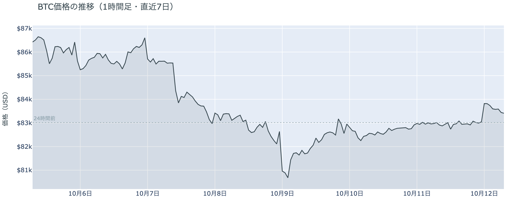

*図の見方: 1時間ごとの価格（日本時間）。点線は24時間前の水準。右端の手前で線が一段上がり、そのあと少し下がっています。*

* 24時間の値幅は1.7%で、そのうち0.9%が深夜0時台の1時間に入っている。
* Hyperliquidで見えた清算は全部がショートで、25のアドレスに散らばり、最大の1件でも全体の45%。

日曜日の上げは、土曜の日中に少しずつ積まれたショートが深夜0時台に買い戻されたもので、清算がそれを加速させました。土曜の昼から夜まで、価格は$82,700〜$83,100の幅で横ばいのまま建玉だけが少しずつ増えていたので、積まれたのはショートです。日付が変わった0時台に建玉が減りながら価格が0.9%上げたので、新しいロングが積まれたのではなく、そのショートが閉じられた動きです。Hyperliquid（＝オンチェーンの先物取引所）で見えた清算は値動きの速い時間に集まり、大口1件ではなく多数が焼けました。そのあとは建玉がもう一段減り、価格は朝7時5分の約$83,515まで少しずつ戻しています。

**図1-2 価格と50日・200日移動平均**

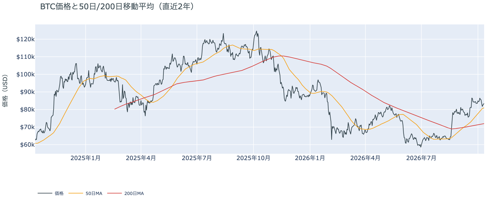

*図の見方: 2本の平均線の上下関係を見ます。50日線が200日線の上にあるのがゴールデンクロスです。*

* 50日線と200日線の差は約$8,958（12.5%）で、前日からさらに開いた。
* 価格は50日線の3.2%上で、前日の2.7%上から少し離れた。

長い目で見た流れの向きは変わっていません。ゴールデンクロス（＝50日線が200日線を上抜けること）の状態が34日目で、2本の平均線の差は開き続けています。価格は木曜に一時割った50日線の上に戻ったまま、日曜深夜の上げでそこから少し離れましたが、1週間前のように9%上にいた形には戻っていません。

証券市場は10月9日の金曜に株と金がそろって上げ、原油は$91台で動かなかったまま週末に入りました。米国株（S&P500）は+0.6%で最高値の近く、金は+1.4%で、外部環境から持ち越された売りの材料はありません。ただ週末に中東で新しい出来事が起きたので、ビットコインにとっては、原油がそれをどう値付けするかがまだ出ていない状態です。今日12日は日本がスポーツの日で休場、米国はコロンブスデーで債券市場が休みで、株は開きます。

## 2. なぜ動いたか：きっかけと、需給のどこが動いたか

**図2-1 ビットコインと株・金・原油の相対推移（起点＝100）**

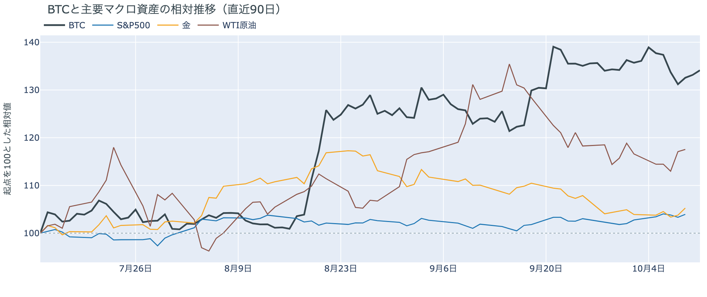

*図の見方: 同じ起点から何%動いたかで重ねたもの。線の向きが揃っているかを見ます。*

| この5営業日の動き（ビットコインは7日間） | 変化 |
|---|---:|
| ビットコイン | −3.5% |
| 金 | +1.3% |
| 米国株（S&P500） | +1.2% |
| 原油 | +0.8% |

* 建玉は92,216BTCで、前日の92,674BTCから0.5%減り、7日では5.4%減ったまま。
* 資金調達率を1日でならすとマイナスで、直近34日の平均を大きく下回る。

日曜日の上げは、はっきりしたきっかけが無いまま、土曜に積まれたショートの買い戻しを通って起きました。

1. きっかけ：外部環境では週末に2つの出来事がありました。土曜10日にフーシ派のミサイルがリヤドの空港のターミナルに当たって12人が死亡し、サウジアラビアにとってこの10年でいちばん多くの死者を出す攻撃になりました。トランプ大統領は「サウジの攻撃に加わるかもしれない」と述べています。日曜11日の朝（米国時間）には、同じトランプ大統領がロシアとウクライナの「エネルギー停戦」を宣言しましたが、ロシアもウクライナも確認していません。証券市場は閉まっていて、原油は金曜の$91台から値が付いていません。土曜のビットコインは空港への攻撃のあとも$83,000の前後で動いておらず、効いた形跡はありません。日本時間の日曜夜に出た停戦の投稿とは、0時台の上げと時刻が重なります。この5営業日では株が+1.2%、金が+1.3%なのにビットコインは−3.5%と逆向きなので、この1週間の下げは株・金と共通のきっかけではありません。
2. 伝わり方：先物のショートです。土曜の日中、価格が横ばいのまま建玉が少しずつ増え、資金調達率（＝ロングが払う金利。プラス＝ロングがショートより多い）は1日をならすとマイナスに沈んでいたので、週末のあいだに積まれていたのはショートでした。それが0時台に建玉が減りながら価格が上げる形で買い戻され、清算が加速させました。ロングは積まれておらず、ETFは10月9日分までで流入はわずか（図①-2）、アメリカの買い手は手を止めたまま（図①-1）なので、現物の買いが通った上げではありません。

前日は「参加者はロングもショートも軽いまま、次の材料を待っている」と説明しました。日曜深夜の上げはショートの買い戻しで、ロングは積まれていないので、前日の説明は今日の数値と合っています。市場の多数は、上げに賭けを置き直してはおらず、週明けの証券市場と米CPIを待っています。

## 3. 市場参加者はいまどう見ているか

### ① アメリカの買い手は手を止めたまま、日曜はこの10か月でも最も低い側まで沈んだ

**図①-1 Coinbase Premium（アメリカとそれ以外の価格差・直近90日）**

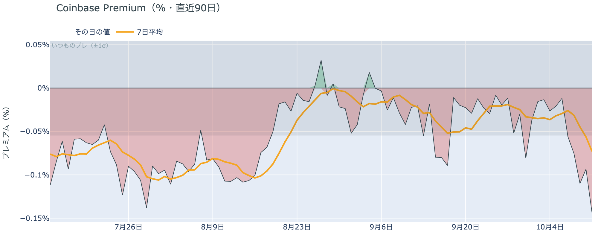

*図の見方: プラス＝アメリカで買いが強い。太線が1週間平均、細線がその日の値。薄い帯は「いつものブレの範囲」です。*

* 1週間平均は−0.07%で、前の週の−0.04%から沈み、1か月前の−0.02%の3倍。
* その日の値は−0.14%で、いつものブレの2.6倍と範囲の外側。この10か月で下から7%の水準。

アメリカの買い手は、週明けを前に一段と引いています。Coinbase Premium（＝アメリカとそれ以外の価格差）は1週間平均で前の週より沈み、日曜のその日の値はいつものブレを大きく超えて、この10か月でも最も低い側にあります。深夜の上げがアメリカ以外の市場で起きたショートの買い戻しだったということで、アメリカでの買いはそれに付いていっていません。手を止めている状態が深くなっていますが、ETFの流出が止まっているので（図①-2）、逃げ始めたと言える形ではありません。

**図①-2 ETFの日ごとの資金の出入り（直近90日）**

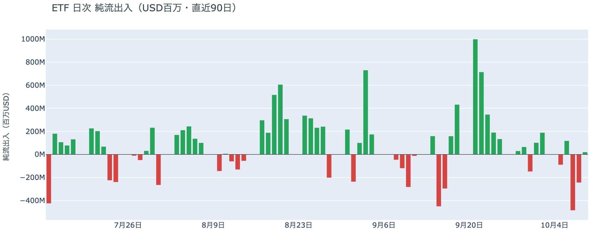

*図の見方: 入ったお金と出たお金の差。上に伸びれば入り超、下に伸びれば出超。*

| ETFの日ごとの出入り | 億ドル |
|---|---:|
| 10月1日 | +1.0 |
| 10月2日 | +1.9 |
| 10月5日 | −0.9 |
| 10月6日 | +1.2 |
| 10月7日 | −4.8 |
| 10月8日 | −2.4 |
| 10月9日 | +0.2 |
| 直近7営業日の合計 | −3.9 |

ETFの買い手は、一部が降りた状態のまま、それ以上は降りていません。10月9日分までの数値は前日と同じで、2日続いた流出が3日目に広がらず、わずかな流入に戻ったところで週末に入っています。戻って来た額はごくわずかで、直近7営業日の合計は出超のままなので、買い手が戻ったとも言えません。

**図①-3 Fear & Greed（市場心理の指数・直近90日）**

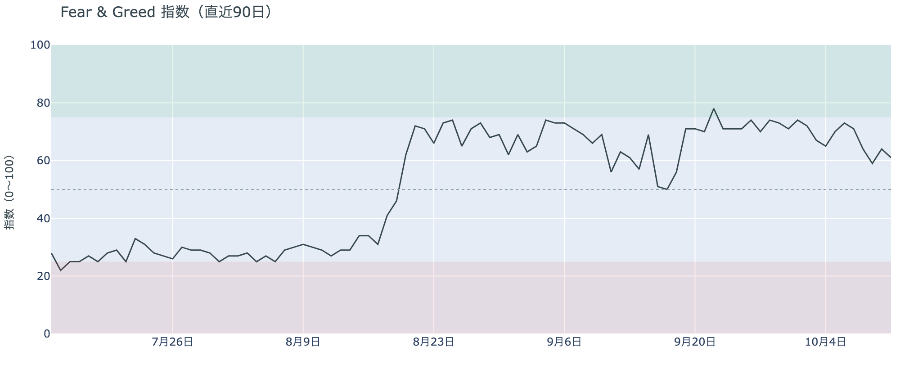

*図の見方: 0〜100で、50より上が「強欲」、下が「恐怖」。*

* 61の「強欲」。前日の64から3pt下げ、1週間前は65、1か月前は56。

市場心理は、週末の静けさで上げへの確信を取り戻すには至っていません。Fear & Greed（＝市場心理の指数）は10月11日の確定値で「強欲」の側に残っていますが、1週間前より低く、木曜の下げで冷めた分を金曜と土曜で取り戻しかけたあと、日曜にまた少し下げました。多数は価格の下げを怖がってはいないものの、上げを確信してもいないということです。

### ② 長期保有者は利益確定の売りを続けているが、減り方は前の週より小さい

**図②-1 長期保有者の保有量の30日変化とSOPR（直近90日）**

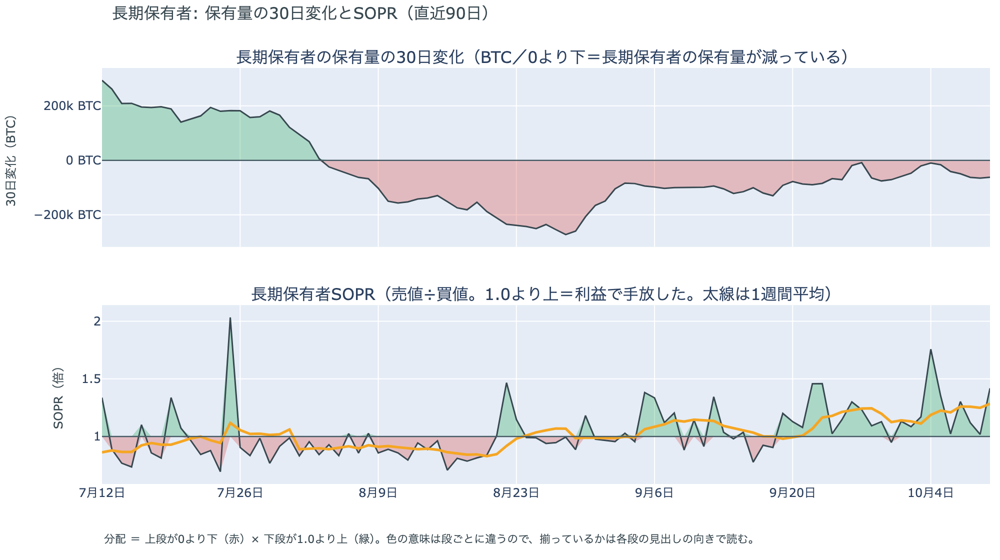

*図の見方: 上段は、長期保有者の保有量が30日でどれだけ増減したか。マイナス＝手放している。下段は長期保有者SOPRで、1より上なら利益で手放した。どちらも1週間平均で読みます。*

| 10月10日時点 | 1週間平均 | 前の週の平均 |
|---|---:|---:|
| 長期保有者SOPR（1より上＝利益で手放した） | 1.29 | 1.11 |
| 長期保有者の保有量の30日変化（万BTC） | −4.4 | −4.9 |

* 1週間平均の減り方は、1か月前（9月10日）の−9.9万BTCの半分以下。

長期保有者（＝155日以上保有者）は利益確定の売りを続けていますが、減り方は前の週より小さくなっています。保有量は30日で減り、動いたコインは平均して買値より高く動いています。10月10日時点の数値は木曜の$80,000台への下げをまたいだあとのもので、売りを急いだ形にはなっておらず、長期保有者の側から見たビットコイン自身の需給の土台は、前日と変わっていません。

長期保有者のほかに、売りに回りそうな持ち手も見当たりません。長く眠っていたコインがまとまって動いた記録はなく、マイナーの収入も平年をやや上回る程度（Puell Multiple（＝マイナー収入の平年比）が1週間平均で1.13）で、売りを急ぐ状況ではありません。コインが最後に動いた価格の分布にも、今日は新しい材料がありません。

### ③ 先物：土曜に積まれたショートは深夜に買い戻され、ロングを積む人はいない

**図③-1 資金調達率と建玉（直近30日）**

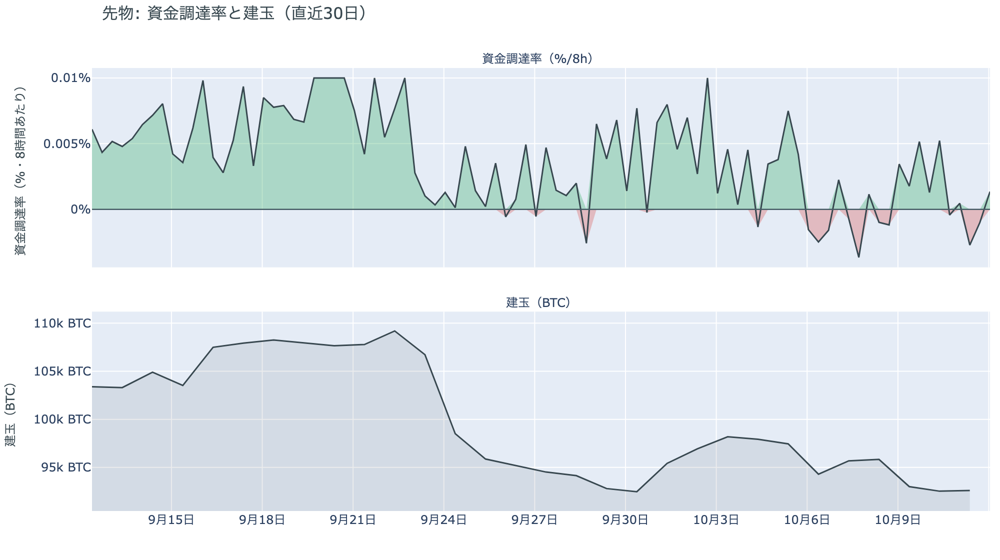

*図の見方: 上段は資金調達率（8時間ごと・日本時間）。プラスが続く＝ロングがショートより多い。下段は建玉。*

* 短期金利を引いた上乗せは−4.92ptで、直近34日の平均+0.53ptを5pt以上下回る。
* 建玉は7日で5.4%減り、月曜の$87,000手前へ向けて積まれた分が消えたまま。

先物の参加者は、下げに賭けても深夜に買い戻され、上げに賭ける人もいないという、どちらにも確信の無い状態です。資金調達率は1日をならした年率で−0.86%と、短期金利（＝ドルを米国の短期国債で持つだけで受け取れる金利。13週Tビル 4.06%）を引いた上乗せは大きくマイナスで、週末のあいだはショートがロングより多い時間が長かったということです。そのショートが0時台に買い戻されて清算も出たのに、建玉は戻らずに減っているので、代わりにロングを積んだ人はいません。金曜の戻りも日曜深夜の上げも、通り道はショートの買い戻しで、上げへの確信が戻った形ではありません。

### ④ オプション：週明けの満期にも下げへの備えが戻り、いちばん厚いのは米CPIとFOMC

オプションには2種類あります。コール（＝決めた価格で買う権利）とプット（＝決めた価格で売る権利）で、価格が上がればコールの価値が上がり、価格が下がればプットの価値が上がります。プットは「価格が下がったときの保険」として買われます。オプションを買う人は、その権利と引き換えに権利料（＝オプションを買う人が払う金額）を払います。

**図④-1 満期ごとのIV（年率%）**

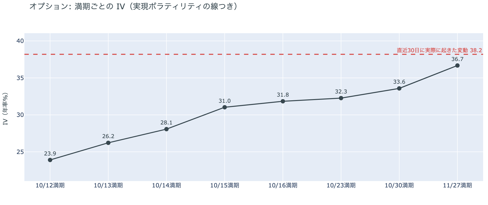

*図の見方: IVを満期ごとに並べたもの。点線は実現ボラティリティ。IVが点線より下なら、市場はこの先の値動きを過去の値動きより小さいと見ています。*

* IVは全体で37.0と、前日の36.4から少し上がった。実現ボラティリティ38.2より1.2pt低く、過去1年で下から21%。
* 満期ごとのIVは、今日12日の23.9から11月27日の36.7まで、手前ほど低く先ほど高い形で、突出した満期が無い。

オプションの参加者は、この先の値動きが荒くなるとは見ていませんが、週末に下げた分の予想を少し戻しました。IV（＝値動きの幅の予想）は実現ボラティリティ（＝過去の値動きの幅）より低いままで、その差は前日の2.8ptから1.2ptに縮んでいます。週明けの証券市場が週末の中東の出来事をどう値付けするかが分からないので、土曜に下げた分の予想を日曜に戻したということです。10月14日の米CPI（＝米国の物価統計）をまたぐ10月16日の満期（＝権利の期限）にも、10月末のFOMC（＝米国の金利を決める会合）をまたぐ10月30日の満期にも、ほかの満期に対する上乗せは乗っていません。

**図④-2 満期ごとのプットとコールの差**

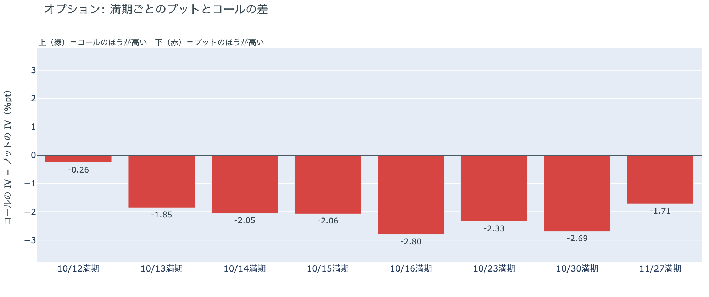

*図の見方: 満期ごとに、プットとコールのどちらが高く売れているか。ゼロより上ならコールのほうが高く、下ならプットのほうが高い。*

| 満期 | どちらが高いか |
|---|---|
| 10月12日 | ほぼ差なし（前日はコールが高かった） |
| 10月13日 | プットが高い（前日はコールが高かった） |
| 10月14日 | プットが高い |
| 10月15日 | プットが高い |
| 10月16日 | プットがはっきり高い |
| 10月23日 | プットが高い |
| 10月30日 | プットがはっきり高い |
| 11月27日 | プットが高い |

参加者は、週明けの証券市場が開く日から下げに備え直していて、備えをいちばん厚く置いているのは米CPIをまたぐ10月16日と、FOMCをまたぐ10月30日の満期です。前日は今日12日と明日13日の満期でコールのほうが高く、週末は荒れないと見られていました。それが日曜のうちに、13日の満期はプットのほうが高い形に戻り、12日もほぼ差が無くなったので、週末に外していた下げへの備えを、週明けの分だけ買い直したということです。週末に中東で起きたことを、週明けの原油と株がどう値付けするかを見てから動く構えです。14日から先はプットのほうが高いままで、途中で入れ替わる満期はありません。

**図④-3 10月30日満期の持ち高（権利の価格ごと）**

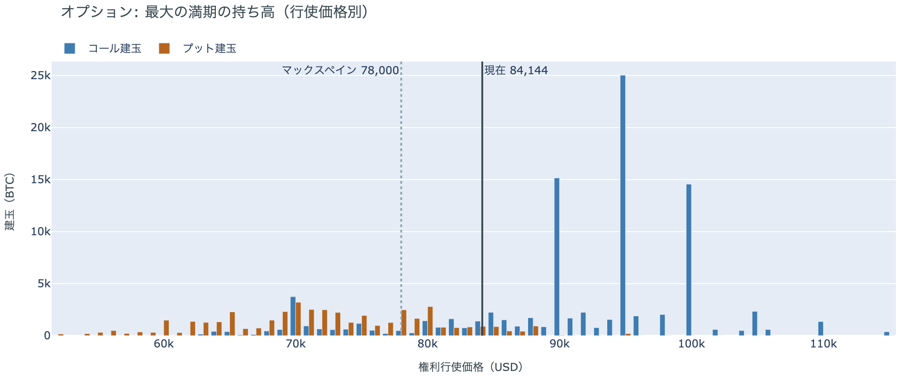

*図の見方: 青＝コール、橙＝プット。現値より上にコールが、下にプットが積まれるのが普通です。*

| 10月30日満期のオプション | 量（万BTC） | 意味 |
|---|---:|---|
| コール | 約9.5 | 「価格が上がる」に賭けた分 |
| プット | 約4.6 | 「価格が下がる」への保険 |
| うち、いまより15%以上高い価格のコール | 約2.2 | 大きな上げへの賭け |
| うち、いまより15%以上安い価格のプット | 約2.2 | 大きな下げへの保険 |

* 10月30日満期の持ち高は約14.1万BTCと全満期の38%で、前日と同じ。コールがプットの2.1倍。
* コールが集まっている価格は$95,000に約2.5万BTC、$90,000と$100,000に約1.5万BTCずつ。

「価格が上がる」に賭けた人たちは、週末を越えても降りていません。10月30日満期の持ち高は前日から動かず、コールの大半はいまより高い$90,000から$100,000に積まれたままだからです。その賭けが報われるには、FOMCを越えて10月30日までに$90,000を超える必要があり、距離はいまの価格から8%ほどです。週明けの満期にプットを買い直す一方で、10月末までの上げへの賭けは残しているので、参加者は近いうちに大きく崩れるとは見ていないが、今週は証券市場の側から動く週だと見ている、という構えです。

## 4. 価格に影響しうる直近のイベント

オプション市場が下げへの備えをいちばん厚く置いているのは、米9月のCPIをまたぐ10月16日の満期と、FOMCをまたぐ10月30日の満期です。どちらもプットが高いだけで、ほかの満期に対して権利料に上乗せが乗っているわけではありません。週末に外れていた週明けの満期の備えは日曜のうちに戻っていて、今週の前半は証券市場が週末の中東の出来事をどう値付けするかを見る区間です。

| 日付 | イベント | 何に効くか |
|---|---|---|
| 10/12（月） | 日本はスポーツの日で休場。米国はコロンブスデーで債券市場が休み、株は開く。リヤドの空港への攻撃と「エネルギー停戦」の宣言に、原油と株が初めて値を付ける日 | 原油。米10年債利回りの確定が1日遅れる |
| 10/11（日）〜15（木） | 世界石油会議（リヤド）。会場は攻撃を受けた空港の隣で、62か国の閣僚と石油会社が集まる | 原油 |
| 10/14（水）21:30 日本時間 | 米9月のCPI。10月のFOMCの前に出る最後の物価統計 | 金利。プットがはっきり高い10月16日の満期がまたぐ |
| 10/15（木）21:30 日本時間 | 米9月の小売売上高と生産者物価指数 | 金利 |
| 10/16（金）17:00 | オプションの満期。米CPIをまたぐ満期で、プットがいちばん高い | 下げへの備えの期限 |
| 10/27（火）〜28（水） | FOMC。利上げの織り込みは約2割で、1週間前の約2割から変わっていない。結果は日本時間29日未明 | 金利。プットがはっきり高い10月30日の満期がまたぐ |
| 10/29（木）〜30（金） | 日銀の会合。展望レポートも出る | 円 |
| 10/30（金）17:00 | オプションの最も大きな満期（約14.1万BTC、全満期の38%）。FOMCの2日後 | $90,000以上のコールの期限 |
| 11/1（日） | OPEC+の会合。12月の生産目標を決める | 原油 |
| 11/3（火） | 米国の中間選挙。トランプ大統領は「それまでイランを攻撃しない」と述べている | 原油 |

## まとめ：日曜日の動きは何だったか

日曜日は、はっきりしたきっかけが無いまま、土曜に積まれたショートが深夜0時台に買い戻されて$83,800台へ上げ、清算がそれを加速させた日でした。ビットコイン自身の需給の土台は変わっていません。アメリカの買い手はこの10か月でも最も低い側まで引いたまま手を止め、長期保有者の利益確定の売りは減り方が小さいまま続いています。参加者は、下げに賭けても買い戻され、上げに賭け直す人もいない状態で、週明けの満期に下げへの備えを買い直しながら10月末までの上げへの賭けは残していて、近いうちに大きく崩れるとは見ていないが、今週は週末の中東の出来事と米CPIを証券市場がどう値付けするかで動く、という構えです。

---

<small>（数値は10月12日7時5分（日本時間）までのデータに基づきます。価格・先物・オプション・Coinbase Premiumはその時点の値、市場心理は10月11日の確定値、オンチェーン（＝ブロックチェーン上の記録）は10月10日時点、ETF資金フローは10月9日分までです。証券市場の終値は10月9日時点で、週末のため更新がありません。FOMCの織り込みは10月9日のFF金利先物の終値から計算したものです。オンチェーンの長期保有者の数値には、ETFや取引所が預かっている分も含まれます。オプションはDeribit（BTCオプションの大半を占める取引所）の全銘柄です。）</small>

*本稿は情報提供を目的としたものであり、投資助言ではありません。将来の価格動向を保証・示唆するものではなく、投資判断は各自の責任において行ってください。*
