# 月曜の夜にロングの清算で$82,500台へ ― 米国の買い手は10か月でほぼ最低、下げへの備えは米CPIに厚い

**2026年10月13日**

ビットコインは月曜日、日中は$83,500〜$84,100の狭い幅で横ばいのまま、夜21時台に買い持ち（ロング）の清算を伴って一段下げ、$82,500前後で朝を迎えました。

* **価格**：24時間の値幅は2.5%で前日の1.7%から広がったものの、下げは夜の1時間に集中していて、朝7時5分の時点で約$82,540。1週間前より4%近く低く、先週月曜の$87,000手前からの下げをまだ取り戻していない
* **きっかけ**：はっきりしたきっかけは無い。月曜もリヤドの空港にミサイルが届いて原油は上げたが、米国株はほぼ変わらず、金は下げた。ビットコインの下げは株・金と同じ向きではなく、外部環境の出来事が通った形跡は無い
* **先物**：下げを運んだのはロングの手仕舞いと清算（＝証拠金不足で強制的に閉じられた取引）。日中に価格が横ばいのまま建玉（＝先物の未決済残高。証拠金で張っている人の量）が増え、21時台に建玉が減りながら下げたので、月曜に積まれた持ち高のうちロングが夜に消えた。資金調達率はプラスに戻ったが短期金利を下回り、上げへの確信は戻っていない
* **需給の土台**：米国の買い手は一段と引き、月曜はこの10か月でほぼ最低。長期保有者の利益確定の売りは続いているが、減り方は前の週とほぼ同じなので、土台は前日から変わっていない
* **オプションの見方**：全部の満期でプットのほうが高く、備えがいちばん厚いのは米CPIをまたぐ16日と、FOMCをまたぐ30日の満期。ただしどの満期の権利料にも上乗せは乗っておらず、荒れるとは見ていない

## 1. 何が起きたか

**図1-1 価格の推移（1時間足・直近7日）**

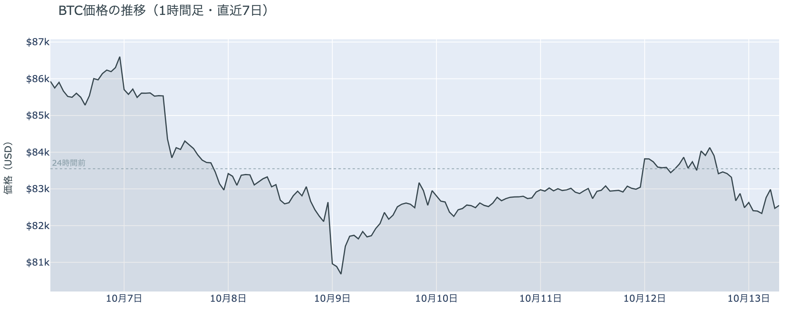

*図の見方: 1時間ごとの価格（日本時間）。点線は24時間前の水準。右端の手前で線が一段下がり、そのあと横ばいです。*

* 24時間の値幅は2.5%で、そのうち0.8%が夜21時台の1時間に入っている。
* Hyperliquidで見えた清算は全部がロングで、48のアドレスのうち最大の1件が全体の69%。

月曜日の下げは、日中に積まれた持ち高のうちロングが、夜21時台に手仕舞いと清算で消えたものです。朝8時から夜20時まで、価格は$83,300〜$84,100の幅で横ばいのまま建玉だけが3%近く増えていたので、月曜の日中には新しい持ち高が積まれていました。21時台に建玉が1%近く減りながら価格が0.8%下げたので、消えたのはそのうちのロングです。Hyperliquid（＝オンチェーンの先物取引所）で見えた清算は値動きの速い5分足に集まり、多数ではなく大口が1つ飛んだ形で、清算が下げを加速させました。そのあとは建玉がもう一段減り、価格は$82,300〜$83,000の幅で朝7時5分の約$82,540まで横ばいです。

**図1-2 価格と50日・200日移動平均**

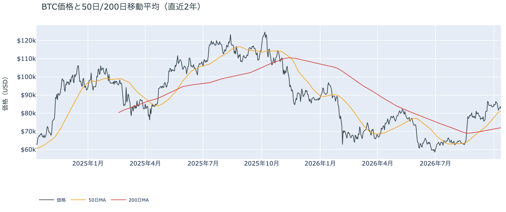

*図の見方: 2本の平均線の上下関係を見ます。50日線が200日線の上にあるのがゴールデンクロスです。*

* 50日線と200日線の差は約$8,988（12.5%）で、前日からわずかに開いた。
* 価格は50日線の1.9%上で、前日の3.2%上から近づいた。

長い目で見た流れの向きは変わっていません。ゴールデンクロス（＝50日線が200日線を上抜けること）の状態が35日目で、2本の平均線の差は開き続けています。価格は先週木曜に一時割った50日線の上にとどまっていますが、月曜夜の下げでその2%上まで近づき、1週間前のように9%上にいた余裕は無くなっています。

証券市場は月曜10月12日、米国株（S&P500）がほぼ変わらず（−0.06%）、金が−0.5%、原油が+1.4%の$93台で終わりました。米国は債券市場が休みで、米10年債利回りは5.24%とほぼ動いていません。リヤドの空港への攻撃は原油の側にだけ値付けされ、株には届いていないので、ビットコインにとって外部環境から今日へ持ち越された材料は、原油の高止まりと、水曜の米CPIです。

## 2. なぜ動いたか：きっかけと、需給のどこが動いたか

**図2-1 ビットコインと株・金・原油の相対推移（起点＝100）**

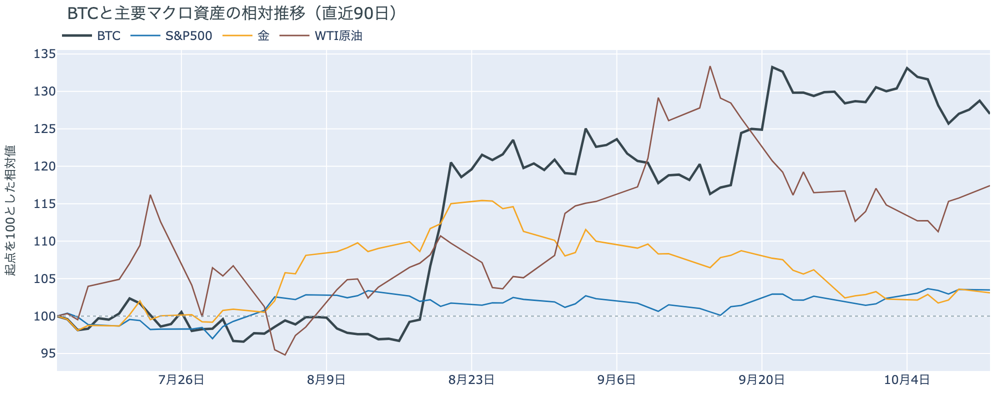

*図の見方: 同じ起点から何%動いたかで重ねたもの。線の向きが揃っているかを見ます。*

| この5営業日の動き（ビットコインは7日間） | 変化 |
|---|---:|
| ビットコイン | −3.7% |
| 金 | +0.9% |
| 米国株（S&P500） | +0.4% |
| 原油 | +4.2% |

* 建玉は93,475BTCで、前日の92,216BTCから1.4%増えたが、7日では5.2%減ったまま。
* 資金調達率を1日でならすとプラスに戻ったが、直近34日の平均+0.23ptを下回る。

月曜日の下げは、はっきりしたきっかけが無いまま、日中に積まれたロングが夜21時台に手仕舞いと清算で消えることを通って起きました。

1. きっかけ：外部環境では、月曜もリヤドの空港にフーシ派のミサイルが届いて1人が死亡し、サウジアラビアは3発を迎撃したと発表して報復を予告しました。空港は17日まで閉鎖されます。トランプ大統領が日曜に宣言したロシアとウクライナの「エネルギー停戦」は、ロシアが確認せず、ゼレンスキー大統領は月曜に「すでに破られた」と述べています。原油はこれを受けて+1.4%と上げましたが、米国株はほぼ変わらず、金は下げました。ビットコインが下げた21時台はニューヨークの株が開く前の時間で、株はその後も動いていないので、株と同じ向きに動いたのではありません。この5営業日でも株が+0.4%、金が+0.9%なのにビットコインは−3.7%と逆向きなので、この1週間の下げは株・金と共通のきっかけではありません。ビットコインに固有の出来事も、月曜には見当たりません。
2. 伝わり方：先物のロングです。月曜の日中、価格が横ばいのまま建玉が増え、資金調達率（＝ロングが払う金利。プラス＝ロングがショートより多い）は前日のマイナスからプラスに戻ったので、日曜までのショート一色から、ロングを置く人が少し戻っていました。それが21時台に建玉が減りながら価格が下げる形で手仕舞われ、清算が加速させました。アメリカの買い手は月曜に一段と引き（図①-1）、ETFの10月12日分はまだ集計の途中（図①-2）なので、現物の買い手がこの下げに関わった形跡はありません。

前日は「上げに賭け直す人はいない」と説明しました。月曜の日中に建玉が増えて資金調達率がプラスに戻ったので、この点は少し変わり、ロングを試す人は出ていました。ただし夜の清算でその一部が消え、資金調達率から短期金利を引いた上乗せはマイナスのままなので、上げへの確信が戻ったわけではなく、市場の多数は水曜の米CPI（＝米国の物価統計）を待っています。

## 3. 市場参加者はいまどう見ているか

### ① アメリカの買い手は一段と引き、月曜はこの10か月でほぼ最低

**図①-1 Coinbase Premium（アメリカとそれ以外の価格差・直近90日）**

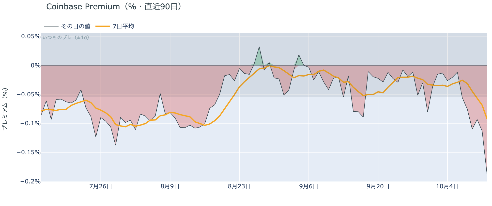

*図の見方: プラス＝アメリカで買いが強い。太線が1週間平均、細線がその日の値。薄い帯は「いつものブレの範囲」です。*

* 1週間平均は−0.09%で、前の週の−0.03%の3倍まで沈んだ。1か月前は−0.02%。
* その日の値は−0.19%で、いつものブレの3.4倍。この10か月で下から1%の水準。

アメリカの買い手は、週明けに一段と引きました。Coinbase Premium（＝アメリカとそれ以外の価格差）は1週間平均で前の週の3倍まで沈み、月曜のその日の値はいつものブレを大きく超えて、この10か月でほぼいちばん低い水準です。月曜の下げがアメリカの朝の時間帯で起きたことと合わせると、アメリカでの買いが価格を支えに入っていないということです。手を止めている状態はこの1週間で日ごとに深くなっていますが、ETFの流出は先週半ばで止まったままなので（図①-2）、逃げ始めたと言える形ではまだありません。

**図①-2 ETFの日ごとの資金の出入り（直近90日）**

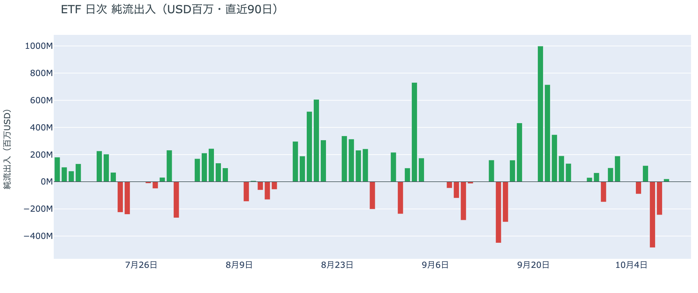

*図の見方: 入ったお金と出たお金の差。上に伸びれば入り超、下に伸びれば出超。*

| ETFの日ごとの出入り | 億ドル |
|---|---:|
| 10月2日 | +1.9 |
| 10月5日 | −0.9 |
| 10月6日 | +1.2 |
| 10月7日 | −4.8 |
| 10月8日 | −2.4 |
| 10月9日 | +0.2 |
| 10月12日 | ±0（集計途中） |
| 直近7営業日の合計 | −4.9 |

ETFの買い手は、一部が降りた状態のまま、それ以上は降りていません。先週水曜と木曜の流出は金曜にわずかな流入で止まり、月曜12日分はまだ集計の途中で、まとまった流出は入っていません。直近7営業日の合計は出超のままで、買い手が戻ったとも言えないので、Coinbase Premiumの沈み方と合わせて、アメリカの現物の買い手は「降りた分が戻らず、新しく入っても来ない」状態です。

**図①-3 Fear & Greed（市場心理の指数・直近90日）**

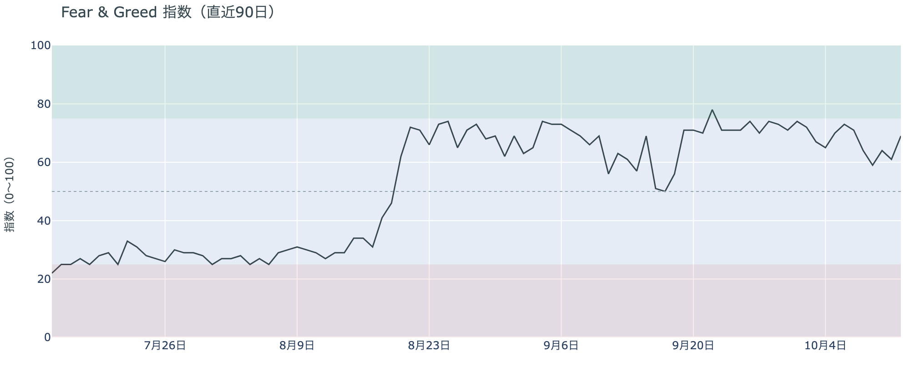

*図の見方: 0〜100で、50より上が「強欲」、下が「恐怖」。*

* 69の「強欲」。前日の61から8pt戻し、1週間前は70、1か月前は63。

市場心理は、価格の下げを怖がっていません。Fear & Greed（＝市場心理の指数）は10月12日の確定値で、日曜深夜の上げを受けて1週間前の水準まで戻しています。アメリカの買い手が引いているのとは逆に、多数は先週からの下げを流れの変化とは見ていないということです。ただ、この値は月曜夜の下げの前のもので、心理が戻った翌日に価格が下げた形です。

### ② 長期保有者は利益確定の売りを続けているが、減り方は前の週とほぼ同じ

**図②-1 長期保有者の保有量の30日変化とSOPR（直近90日）**

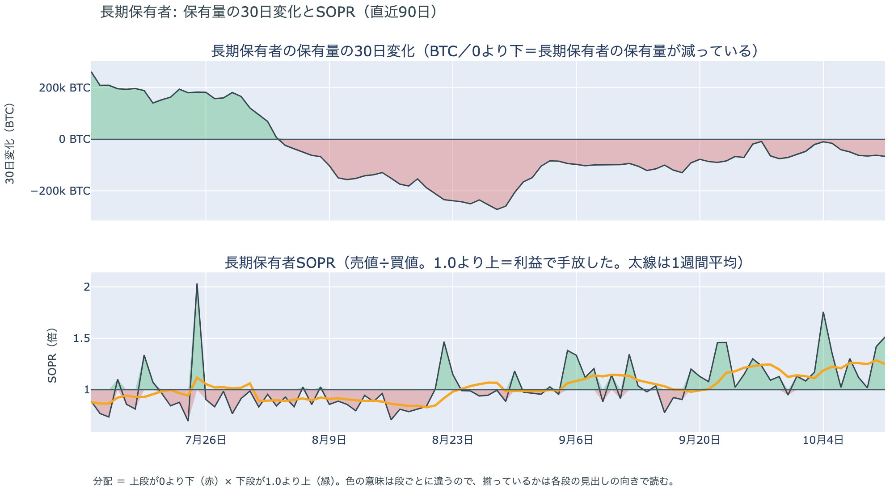

*図の見方: 上段は、長期保有者の保有量が30日でどれだけ増減したか。マイナス＝手放している。下段は長期保有者SOPRで、1より上なら利益で手放した。どちらも1週間平均で読みます。*

| 10月11日時点 | 1週間平均 | 前の週の平均 |
|---|---:|---:|
| 長期保有者SOPR（1より上＝利益で手放した） | 1.25 | 1.19 |
| 長期保有者の保有量の30日変化（万BTC） | −5.2 | −5.0 |

* 1週間平均の減り方は、1か月前（9月11日）の−9.9万BTCの半分。

長期保有者（＝155日以上保有者）は利益確定の売りを続けていますが、減り方は前の週とほぼ同じで、強まっていません。保有量は30日で減り、動いたコインは平均して買値より高く動いています。10月11日時点の数値は先週木曜の$80,000台への下げをまたいだあとのもので、売りを急いだ形にはなっていないので、長期保有者の側から見たビットコイン自身の需給の土台は、前日と変わっていません。

長期保有者のほかに、売りに回りそうな持ち手も見当たりません。長く眠っていたコインがまとまって動いた記録はなく、マイナーの収入も平年をやや上回る程度（Puell Multiple（＝マイナー収入の平年比）が1週間平均で1.14）で、売りを急ぐ状況ではありません。コインが最後に動いた価格の分布にも、今日は新しい材料がありません。

### ③ 先物：月曜に試されたロングは夜に焼かれ、上げへの確信は戻っていない

**図③-1 資金調達率と建玉（直近30日）**

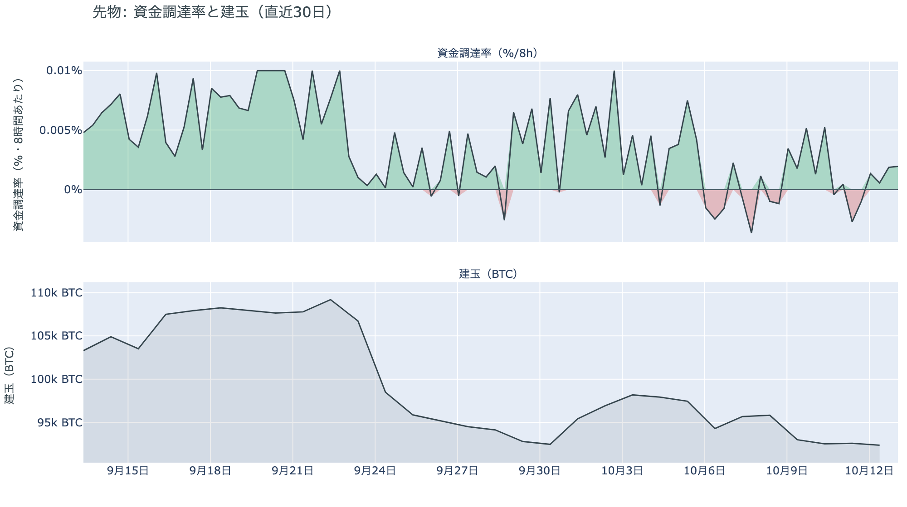

*図の見方: 上段は資金調達率（8時間ごと・日本時間）。プラスが続く＝ロングがショートより多い。下段は建玉。*

* 資金調達率はプラスが4回連続（約1.3日）で、日曜までのマイナスから向きが変わった。
* 建玉は1日で1.4%増えたが、7日では5.2%減ったまま。

先物の参加者は、上げにも下げにも強い確信を持っていません。資金調達率は1日をならした年率で+1.59%とプラスに戻り、ロングがショートよりわずかに多い状態になりましたが、短期金利（＝ドルを米国の短期国債で持つだけで受け取れる金利。13週Tビル 4.05%）を引いた上乗せは−2.46ptです。ロングが払う金利は普通の資金のコストを下回っているので、余分に払ってでも上げに賭けたい人はいないということです。月曜の日中にロングを置いた人は夜21時台に焼かれ、建玉は先週月曜の$87,000手前へ向けて積まれた分が消えた水準のままなので、上げへの確信は戻っていません。前日の「下げに賭けても買い戻され、上げに賭ける人もいない」状態から、「上げに賭けた人が焼かれた」が1つ足された形です。

### ④ オプション：全部の満期でプットが高く、備えは米CPIとFOMCに厚いが、上乗せは無い

オプションには2種類あります。コール（＝決めた価格で買う権利）とプット（＝決めた価格で売る権利）で、価格が上がればコールの価値が上がり、価格が下がればプットの価値が上がります。プットは「価格が下がったときの保険」として買われます。オプションを買う人は、その権利と引き換えに権利料（＝オプションを買う人が払う金額）を払います。

**図④-1 満期ごとのIV（年率%）**

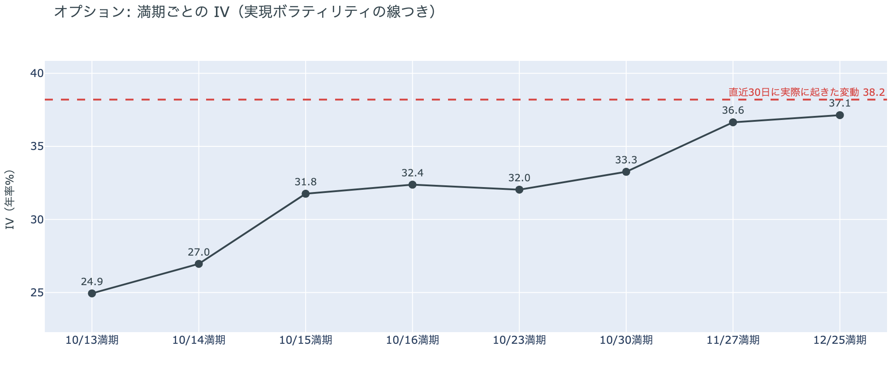

*図の見方: IVを満期ごとに並べたもの。点線は実現ボラティリティ。IVが点線より下なら、市場はこの先の値動きを過去の値動きより小さいと見ています。*

* IVは全体で37.3と、前日の37.0からわずかに上がった。実現ボラティリティ38.2より0.9pt低く、過去1年で下から20%。
* 満期ごとのIVは、今日13日の24.9から12月25日の37.1まで、手前ほど低く先ほど高い形で、突出した満期が無い。

オプションの参加者は、この先の値動きが荒くなるとは見ていません。IV（＝値動きの幅の予想）は実現ボラティリティ（＝過去の値動きの幅）より低いままで、月曜夜の下げを受けてもその差は0.3pt縮んだだけです。過去1年で下から20%の水準なので、恐怖の形でもありません。10月14日の米CPIをまたぐ10月16日の満期（＝権利の期限）にも、10月末のFOMC（＝米国の金利を決める会合）をまたぐ10月30日の満期にも、ほかの満期に対する上乗せは乗っていないので、どちらの日も大きく動くとは見られていないということです。

**図④-2 満期ごとのプットとコールの差**

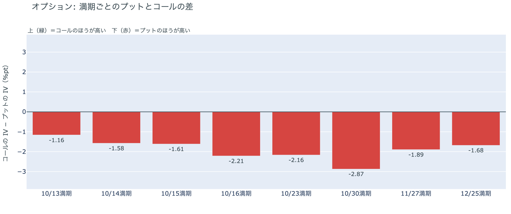

*図の見方: 満期ごとに、プットとコールのどちらが高く売れているか。ゼロより上ならコールのほうが高く、下ならプットのほうが高い。*

| 満期 | どちらが高いか |
|---|---|
| 10月13日 | プットが高い |
| 10月14日 | プットが高い |
| 10月15日 | プットが高い |
| 10月16日 | プットがはっきり高い |
| 10月23日 | プットがはっきり高い |
| 10月30日 | プットがはっきり高い |
| 11月27日 | プットが高い |
| 12月25日 | プットが高い |

参加者は、今日の満期から年末の満期まで、下げに備えるプットのほうを高く値付けしていて、備えをいちばん厚く置いているのは米CPIをまたぐ10月16日と、FOMCをまたぐ10月30日の満期です。日曜に買い直された週明けの備えは月曜も残り、今日13日の満期でもプットのほうが高いままなので、水曜の米CPIまでの数日も下げの側に備えているということです。途中で入れ替わる満期は無く、上げに備えるコールのほうが高い満期は1つもありません。もっとも、前日からの変化は週明けの満期にプットの高さが残っただけで、持ち高（図④-3）は動いていないので、備えを新しく買い足したのではなく、置いていた備えを外さなかったという形です。

**図④-3 10月30日満期の持ち高（権利の価格ごと）**

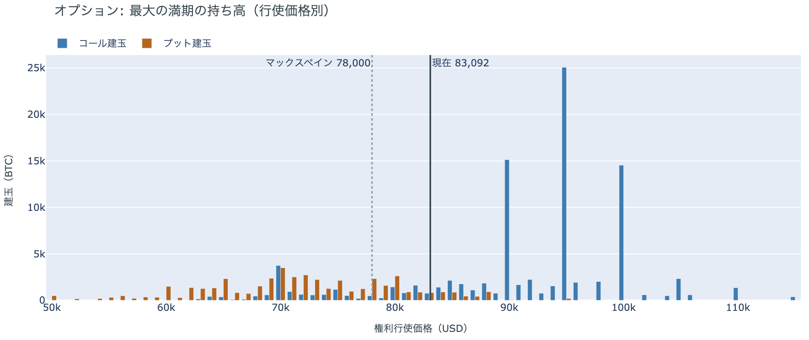

*図の見方: 青＝コール、橙＝プット。現値より上にコールが、下にプットが積まれるのが普通です。*

| 10月30日満期のオプション | 量（万BTC） | 意味 |
|---|---:|---|
| コール | 約9.6 | 「価格が上がる」に賭けた分 |
| プット | 約4.6 | 「価格が下がる」への保険 |
| うち、いまより15%以上高い価格のコール | 約2.4 | 大きな上げへの賭け |
| うち、いまより15%以上安い価格のプット | 約2.0 | 大きな下げへの保険 |

* 10月30日満期の持ち高は約14.2万BTCと全満期の38%で、前日とほぼ同じ。コールがプットの2.1倍。
* コールが集まっている価格は$95,000に約2.5万BTC、$90,000と$100,000に約1.5万BTCずつ。

「価格が上がる」に賭けた人たちは、月曜夜の下げでも降りていません。10月30日満期の持ち高は前日から動かず、コールの大半はいまより高い$90,000から$100,000に積まれたままだからです。その賭けが報われるには、FOMCを越えて10月30日までに$90,000を超える必要があり、距離はいまの価格から8%あまりで、前日より少し開きました。手前の満期にプットの高さを残しながら10月末までの上げへの賭けは外していないので、参加者は近いうちに大きく崩れるとは見ていないが、米CPIとFOMCの結果が出るまでは下げの側に備えておく、という構えです。

## 4. 価格に影響しうる直近のイベント

オプション市場が下げへの備えをいちばん厚く置いているのは、米9月のCPIをまたぐ10月16日の満期と、FOMCをまたぐ10月30日の満期です。どちらもプットが高いだけで、ほかの満期に対して権利料に上乗せが乗っているわけではなく、今日から水曜までの満期にも下げへの備えが残っています。原油の側では、リヤドの空港への攻撃が月曜も続き、サウジアラビアが報復を予告したことが、今週の材料として残っています。

| 日付 | イベント | 何に効くか |
|---|---|---|
| 10/13（火） | 米大手銀行（JPモルガン・ゴールドマン・サックス・シティ）の決算で、米株の決算シーズンが始まる | 株 |
| 10/11（日）〜15（木） | 世界石油会議（リヤド）。開催地の空港は月曜も攻撃を受け、17日まで閉鎖。サウジアラビアは報復を予告 | 原油 |
| 10/14（水）21:30 日本時間 | 米9月のCPI。10月のFOMCの前に出る最後の物価の数字 | 金利。プットがはっきり高い10月16日の満期がまたぐ |
| 10/15（木）21:30 日本時間 | 米9月の小売売上高と生産者物価指数 | 金利 |
| 10/16（金）17:00 | オプションの満期。米CPIをまたぐ満期で、プットがはっきり高い | 下げへの備えの期限 |
| 10/27（火）〜28（水） | FOMC。利上げの織り込みは約2割で、1週間前の約2割から変わっていない。結果は日本時間29日未明 | 金利。プットがはっきり高い10月30日の満期がまたぐ |
| 10/29（木）〜30（金） | 日銀の会合。展望レポートも出る | 円 |
| 10/30（金）17:00 | オプションの最も大きな満期（約14.2万BTC、全満期の38%）。FOMCの2日後 | $90,000以上のコールの期限 |
| 11/1（日） | OPEC+の会合。12月の生産目標を決める | 原油 |
| 11/3（火） | 米国の中間選挙。トランプ大統領は「それまでイランを攻撃しない」と述べている | 原油 |

## まとめ：月曜日の動きは何だったか

月曜日は、はっきりしたきっかけが無いまま、日中に積まれたロングが夜21時台に手仕舞いと清算で消えて$82,500台へ下げた日でした。ビットコイン自身の需給の土台は変わっていません。アメリカの買い手はこの10か月でほぼいちばん低いところまで引いたまま手を止め、長期保有者の利益確定の売りは減り方が前の週と変わらないまま続いています。参加者は、上げに賭けた人が焼かれても10月末までの上げへの賭けは外しておらず、近いうちに大きく崩れるとは見ていないが、水曜の米CPIと月末のFOMCの結果が出るまでは下げの側に備えておく、という構えです。

---

<small>（数値は10月13日7時5分（日本時間）までのデータに基づきます。価格・先物・オプション・Coinbase Premiumはその時点の値、市場心理は10月12日の確定値、オンチェーン（＝ブロックチェーン上の記録）は10月11日時点、ETF資金フローは10月12日分までで、12日分は集計の途中です。証券市場の終値は10月12日時点です。FOMCの織り込みは10月12日のFF金利先物の終値から計算したものです。オンチェーンの長期保有者の数値には、ETFや取引所が預かっている分も含まれます。オプションはDeribit（BTCオプションの大半を占める取引所）の全銘柄です。）</small>

*本稿は情報提供を目的としたものであり、投資助言ではありません。将来の価格動向を保証・示唆するものではなく、投資判断は各自の責任において行ってください。*
