# 火曜朝に$81,000を割って$83,000台へ戻す ― ロングが積み直され、備えは米CPIの直後に集中

**2026年10月14日**

ビットコインは火曜日、朝の2時間で$81,000を割ったあと昼までに下げの全部を取り戻し、夜は$83,000台で横ばいのまま朝を迎えました。

* **価格**：24時間の値幅は3.9%と前日の2.5%から広がったが、朝の安値は先週木曜の$80,315を割っておらず、朝7時5分の時点で約$83,340と24時間前より1.6%高い。月曜夜の下げは1日で埋まり、先週からの下げが続く形にはなっていない
* **きっかけ**：はっきりしたきっかけは無い。朝の下げは株式市場が開く前の時間帯で、そのあと韓国株（KOSPI）が半導体株の売りで5%あまり下げるあいだにビットコインは戻した。フーシ派がサウジアラビアの石油施設を標的と警告して原油は$94台へ上げたが、米国株は大手銀行の決算を受けても動いていない
* **先物**：朝の下げを運んだのは買い持ち（ロング）の手仕舞いと清算（＝証拠金不足で強制的に閉じられた取引）で、多数ではなく大口が1つ飛んだ。戻しは売り持ち（ショート）の買い戻しとロングの積み直しで、ロングが払う金利は短期金利を上回った。建玉（＝先物の未決済残高。証拠金で張っている人の量）は変わっていないので新しい資金ではなく、焼かれた人と賭け直す人が入れ替わった形で、上げへの確信は前日より戻った
* **需給の土台**：米国の買い手は引いたままで、火曜にさらに引いてはいない。長期保有者の利益確定の売りは続き、減り方は前の週より大きくなった。土台は前日から変わっていないが、長期保有者の売りは細っていない
* **オプションの見方**：全部の満期でプットのほうが高く、備えがいちばん厚いのは今夜の米CPI（＝米国の物価統計）の直後に来る15日と16日の満期。年末の満期ほど備えは薄いので、参加者は米CPIで下げる側に備えてはいるが、その先まで長く身構えてはいない

## 1. 何が起きたか

**図1-1 価格の推移（1時間足・直近7日）**

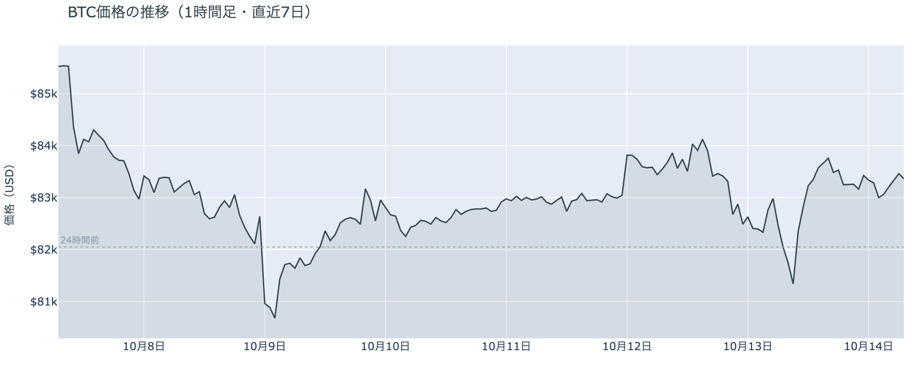

*図の見方: 1時間ごとの価格（日本時間）。点線は24時間前の水準。右端の手前で線が深く沈み、すぐに点線の上へ戻っています。*

* 朝8時台と9時台に価格が下げながら建玉が0.5%減り、10時台から16時台の戻しで建玉は0.6%増えた。
* 朝の安値$80,927は50日線をわずかに割ったが、1時間足の終値では一度も割っていない。

火曜日は、朝の2時間で$81,000を割ったあと、昼までに下げの全部を取り戻した日でした。朝8時台と9時台は価格が下げながら建玉が減ったので、月曜夜に続くロングの手仕舞いです。10時台からの戻しは、価格が上げながら建玉が減る時間（ショートの買い戻し）と建玉が増える時間（ロングの積み直し）が交互に来て、夕方には$83,700台まで戻しました。夜はアメリカの株が開いても$83,000〜$83,500の幅で横ばいのまま、朝7時5分の約$83,340を迎えています。

**図1-3 実際に起きた清算（Hyperliquid・直近24時間）**

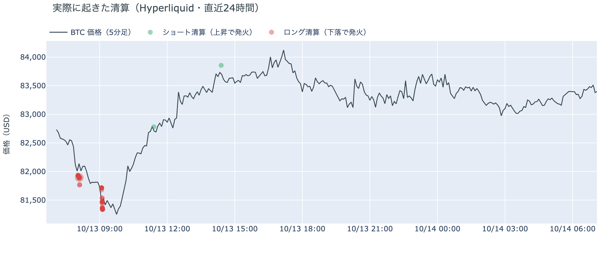

*図の見方: 5分ごとの価格（日本時間）に、Hyperliquidで見えた清算を重ねたもの。赤がロング、緑がショートの清算で、点の大きさが量です。*

* 清算は50件のうち最大の1件が全体の79%で、朝8時台の$81,000台に全体の82%が集まった。
* 値動きの速い5分足の上位5本に清算は入っておらず、上位1割の5分足に入った清算は17%。

朝の下げで焼かれたのは多数のロングではなく、Hyperliquid（＝オンチェーンの先物取引所）で見える限り大口1件です。清算は値動きの速い5分足には集まらず、下げ止まる手前の$81,500前後に固まっているので、清算が下げを加速させた形ではなく、下げの最後に大口が1つ焼けた形です。そのあとの戻しで焼けたショートはほとんど無く、戻しはショートが強制的に買い戻されて起きたものでもありません。

**図1-2 価格と50日・200日移動平均**

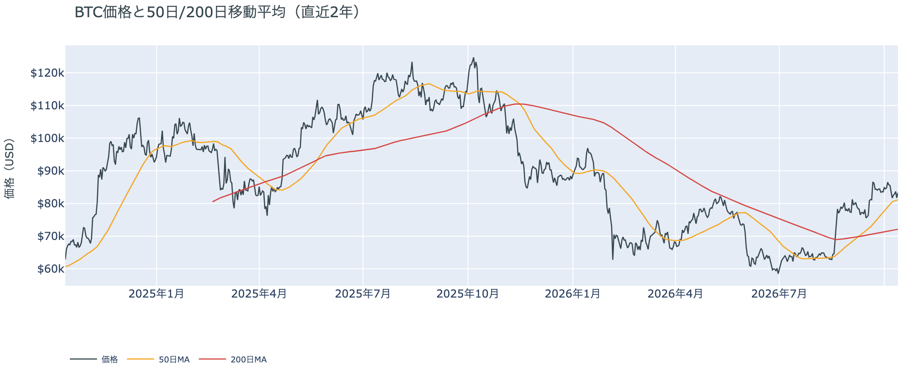

*図の見方: 2本の平均線の上下関係を見ます。50日線が200日線の上にあるのがゴールデンクロスです。*

* 50日線と200日線の差は約$8,978（12.5%）で、前日とほぼ同じ。
* 価格は50日線の2.8%上で、前日の1.9%上から少し離れた。

長い目で見た流れの向きは変わっていません。ゴールデンクロス（＝50日線が200日線を上抜けること）の状態が36日目で、2本の平均線の差は開いたままです。火曜朝の安値は50日線をわずかに割りましたが、1時間足の終値では一度も割らずに戻し、朝には50日線の3%近く上にいます。先週木曜に続いて50日線の手前で下げが止まった形で、月曜夜に失った余裕を少し取り戻しました。

証券市場は火曜10月13日、米国株（S&P500）が大手銀行の決算を受けても−0.02%とほぼ変わらず、金が−0.2%、原油が+1.1%の$94台で終わり、米10年債利回りは5.22%でした。韓国株（KOSPI）は半導体株の売りで−5.5%です。ビットコインにとっては、今夜の米CPIの前に株と金利から新しい材料は来ておらず、持ち越されているのはサウジアラビアをめぐる外部環境の出来事と、それで高止まりした原油だけです。

## 2. なぜ動いたか：きっかけと、需給のどこが動いたか

**図2-1 ビットコインと株・金・原油の相対推移（起点＝100）**

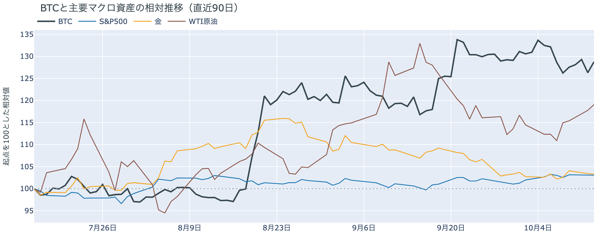

*図の見方: 同じ起点から何%動いたかで重ねたもの。線の向きが揃っているかを見ます。*

| この5営業日の動き（ビットコインは7日間） | 変化 |
|---|---:|
| ビットコイン | −2.6% |
| 金 | −0.1% |
| 米国株（S&P500） | −0.2% |
| 原油 | +6.0% |

* 建玉は93,388BTCで、前日の93,475BTCとほぼ同じ。7日では0.9%減ったまま。
* 資金調達率から短期金利を引いた上乗せは+2.71ptで、月曜の−2.46ptからプラスに転じた。

火曜日の値動きは、はっきりしたきっかけが無いまま、朝にロングの手仕舞いと清算で$81,000を割り、昼にショートの買い戻しとロングの積み直しを通って$83,000台へ戻ったものです。

1. きっかけ：外部環境では、フーシ派が火曜にサウジアラビアの石油施設と空港を「正当な標的」と警告し、サウジアラビア側はサナアの石油施設を空爆、リヤド北方でドローン3機を迎撃したと発表しました。原油はこれを受けて+1.1%と上げ、5営業日で6%高です。ただし米国株は動かず、金も下げました。ビットコインが下げた朝8時台はアメリカの株も韓国の株も開く前の時間で、9時に開いた韓国株が半導体株の売りで5.5%下げるあいだにビットコインは戻しているので、株とは逆向きに動いており、共通のきっかけではありません。この5営業日でも株と金がほぼ横ばい、原油が+6%なのにビットコインは−2.6%で、同じ向きには動いていません。ビットコインに固有の出来事では、米国の資産運用会社Striveが10月5日から9日に3,311BTCを買ったと火曜に開示しましたが、開示後の夜の価格は横ばいで、きっかけではありません。
2. 伝わり方：先物のロングとショートです。朝8時台と9時台に価格が下げながら建玉が減ったので、月曜夜に続いてロングの手仕舞いと清算が下げを運びました。10時台からの戻しはショートの買い戻しとロングの積み直しで、夕方までに建玉は朝の減り分を取り戻しました。資金調達率（＝ロングが払う金利。プラス＝ロングがショートより多い）はプラスが7回続き、短期金利（＝ドルを米国の短期国債で持つだけで受け取れる金利）を上回るところまで上がったので、ロングを置き直した人は余分に払ってでも上げに賭けています。アメリカの買い手は引いたまま（図①-1）、ETFの10月12日分は小さな流出（図①-2）なので、現物の買い手がこの戻しに加わった形跡はありません。

前日は「上げへの確信は戻っていない」と説明しました。火曜は資金調達率が短期金利を上回るまで上がったので、この点は変わり、上げに賭け直す人が戻っています。ただし建玉は増えていないので、新しい資金が入ったのではなく、朝に焼かれたロングと買い戻されたショートの分が、上げに賭けるロングに入れ替わった形です。

## 3. 市場参加者はいまどう見ているか

### ① アメリカの買い手は引いたままで、火曜の戻しには加わっていない

**図①-1 Coinbase Premium（アメリカとそれ以外の価格差・直近90日）**

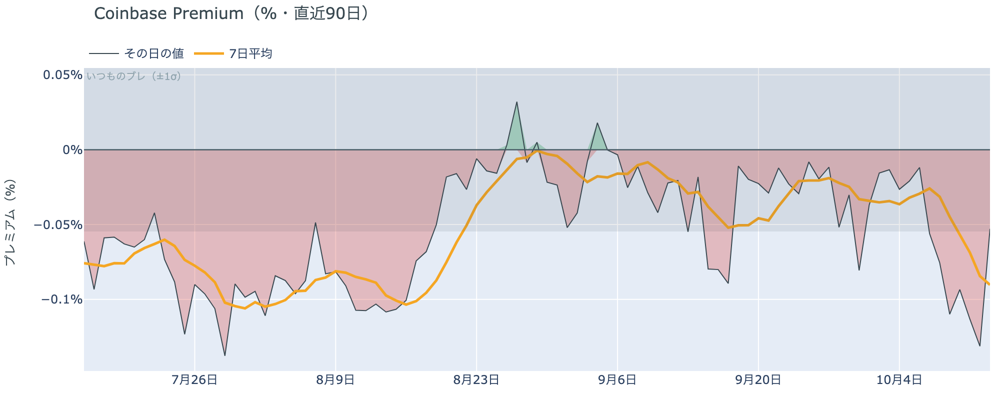

*図の見方: プラス＝アメリカで買いが強い。太線が1週間平均、細線がその日の値。薄い帯は「いつものブレの範囲」です。*

* 1週間平均は−0.09%で、前の週の−0.03%の3倍沈んだ水準のまま。1か月前は−0.05%。
* その日の値は−0.05%で、月曜にいつものブレを超えて沈んだところから、帯の内側に戻った。

アメリカの買い手は引いたままで、火曜にさらに引いた形ではありません。Coinbase Premium（＝アメリカとそれ以外の価格差）の1週間平均は前の週の3倍沈んだ水準に据え置かれ、その日の値は月曜の深い沈みから帯の内側に戻りました。火曜の戻しがアジアとヨーロッパの時間帯で起き、アメリカの時間帯には横ばいだったことと合わせると、戻しにアメリカの買い手は加わっておらず、価格を支える側には戻っていないということです。

**図①-2 ETFの日ごとの資金の出入り（直近90日）**

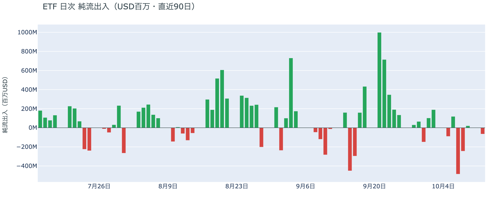

*図の見方: 入ったお金と出たお金の差。上に伸びれば入り超、下に伸びれば出超。*

| ETFの日ごとの出入り | 億ドル |
|---|---:|
| 10月2日 | +1.9 |
| 10月5日 | −0.9 |
| 10月6日 | +1.2 |
| 10月7日 | −4.8 |
| 10月8日 | −2.4 |
| 10月9日 | +0.2 |
| 10月12日 | −0.7 |
| 直近7営業日の合計 | −5.5 |

ETFの買い手は、一部が降りたまま戻っていません。10月12日分は小さな流出で、先週水曜と木曜の大きな流出のあとは出入りが小さくなっていますが、直近7営業日の合計は出超のままです。逃げ足が続いているわけではないものの、新しく入っても来ない状態が1週間続いているので、アメリカの現物の買い手は「降りた分が戻らず、新しく入っても来ない」ままです。

**図①-3 Fear & Greed（市場心理の指数・直近90日）**

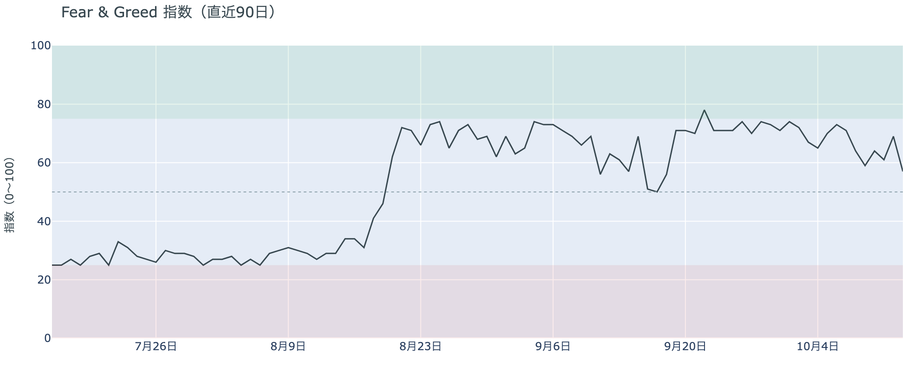

*図の見方: 0〜100で、50より上が「強欲」、下が「恐怖」。*

* 57の「強欲」。前日の69から12pt下げ、1週間前は73、1か月前は61。

市場心理は、月曜夜の下げで一気に冷えました。Fear & Greed（＝市場心理の指数）は10月13日の確定値で前日から12pt下げ、「強欲」と「中立」の境目のすぐ上まで来ています。1週間前から16pt下げたので、先週からの下げを「一時的な押し」と見ていた多数の見方が、半信半疑に変わってきているということです。アメリカの買い手が引いている形と、心理の向きが揃いました。

### ② 長期保有者の利益確定の売りは続き、減り方は前の週より大きくなった

**図②-1 長期保有者の保有量の30日変化とSOPR（直近90日）**

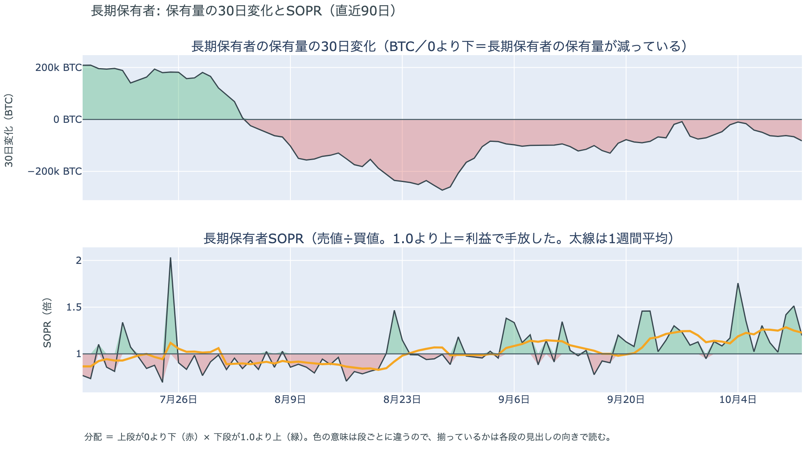

*図の見方: 上段は、長期保有者の保有量が30日でどれだけ増減したか。マイナス＝手放している。下段は長期保有者SOPRで、1より上なら利益で手放した。どちらも1週間平均で読みます。*

| 10月12日時点 | 1週間平均 | 前の週の平均 |
|---|---:|---:|
| 長期保有者SOPR（1より上＝利益で手放した） | 1.23 | 1.23 |
| 長期保有者の保有量の30日変化（万BTC） | −6.1 | −4.3 |

* 1週間平均の減り方は前の週の1.4倍で、1か月前（9月12日）の−9.4万BTCの3分の2。

長期保有者（＝155日以上保有者）は利益確定の売りを続けていて、減り方は前の週より大きくなっています。保有量は30日で減り、動いたコインは平均して買値より高く動いています。減り方は1か月前の3分の2までですが、先週の$80,000台への下げをまたいでも細っていないので、長期保有者の側は「売りが落ち着いた」とは言えません。向きは前日と同じで、ビットコイン自身の需給の土台が変わったとまでは言えませんが、前日より少し重い形です。

長期保有者のほかに、売りに回りそうな持ち手は見当たりません。2020年3月から6年半動いていなかった約4,600BTCが13日の未明3時台に新しいアドレスへ移った記録はありますが、取引所には入っておらず、移ってから朝の下げまでの4時間は価格が動いていないので、売却とは限らず、1者の保管替えでありうる量です。マイナーの収入は平年をやや上回る程度（Puell Multiple（＝マイナー収入の平年比）が1週間平均で1.11）で、売りを急ぐ状況ではありません。コインが最後に動いた価格の分布にも、今日は新しい材料がありません。

### ③ 先物：焼かれたあとに賭け直す人は戻ったが、賭けは大きくなっていない

**図③-1 資金調達率と建玉（直近30日）**

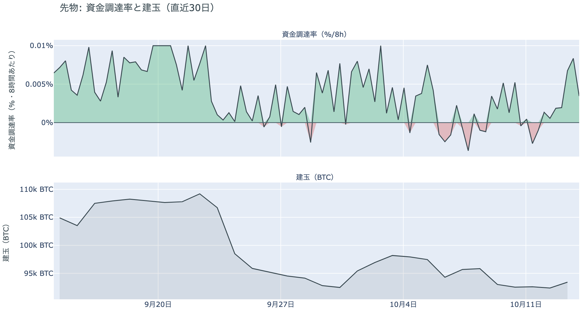

*図の見方: 上段は資金調達率（8時間ごと・日本時間）。プラスが続く＝ロングがショートより多い。下段は建玉。*

* 資金調達率はプラスが7回連続（約2.3日）。上乗せは直近34日の平均+0.30ptを大きく上回る。
* 建玉は前日からほぼ変わらず、先週月曜の$87,000手前へ向けて積まれた分が消えた水準のまま。

先物の参加者は、上げへの確信を前日より取り戻しましたが、賭けを大きくしてはいません。資金調達率は1日をならした年率で+6.77%、短期金利（13週Tビル 4.06%）を引いた上乗せは+2.71ptで、ロングが払う金利が普通の資金のコストを上回りました。余分に払ってでも上げに賭ける人が戻ったということです。一方で建玉は増えていないので、戻ったのは新しい資金ではなく、朝に焼かれたロングと買い戻されたショートの分が、上げに賭けるロングに入れ替わった形です。前日の「上げに賭けた人が焼かれた」から「焼かれたあとに賭け直した」へ1つ進みましたが、賭けの大きさは先週から減った水準のままなので、上げへの確信は戻りかけの段階です。

### ④ オプション：備えは米CPIの直後に集中し、年末へ向かうほど薄い

オプションには2種類あります。コール（＝決めた価格で買う権利）とプット（＝決めた価格で売る権利）で、価格が上がればコールの価値が上がり、価格が下がればプットの価値が上がります。プットは「価格が下がったときの保険」として買われます。オプションを買う人は、その権利と引き換えに権利料（＝オプションを買う人が払う金額）を払います。

**図④-1 満期ごとのIV（年率%）**

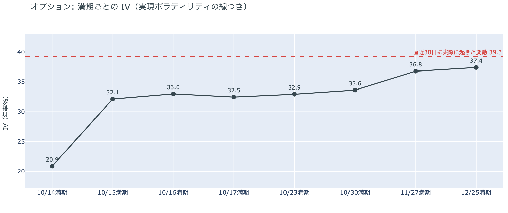

*図の見方: IVを満期ごとに並べたもの。点線は実現ボラティリティ。IVが点線より下なら、市場はこの先の値動きを過去の値動きより小さいと見ています。*

* IVは全体で37.7と、前日の37.3からわずかに上がった。実現ボラティリティ39.3より1.6pt低く、過去1年で下から25%。
* 満期ごとのIVは、今日14日の20.9から12月25日の37.4まで手前ほど低く先ほど高い形で、突出した満期が無い。

オプションの参加者は、今夜の米CPIで大きく動くとは見ていません。IV（＝値動きの幅の予想）は実現ボラティリティ（＝過去の値動きの幅）より低いままで、火曜朝の$81,000割れで実現ボラティリティのほうが上がったぶん、差はむしろ前日より開きました。市場はこの先の値動きを、朝のような動きを含めた過去の値動きより小さいと見ているということです。米CPIの直後に来る15日と16日の満期（＝権利の期限）にも、FOMC（＝米国の金利を決める会合）をまたぐ30日の満期にも、ほかの満期に対する上乗せは乗っていないので、どちらの日も荒れるとは見られていません。

**図④-2 満期ごとのプットとコールの差**

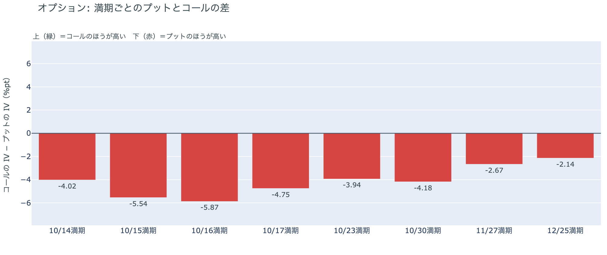

*図の見方: 満期ごとに、プットとコールのどちらが高く売れているか。ゼロより上ならコールのほうが高く、下ならプットのほうが高い。*

| 満期 | どちらが高いか |
|---|---|
| 10月14日 | プットが高い |
| 10月15日 | プットがはっきり高い |
| 10月16日 | プットがはっきり高い |
| 10月17日 | プットが高い |
| 10月23日 | プットが高い |
| 10月30日 | プットが高い |
| 11月27日 | プットがわずかに高い |
| 12月25日 | プットがわずかに高い |

参加者は、今夜の米CPIで下げる側に備えていますが、その先まで長く身構えてはいません。プットのほうがいちばん高く値付けされているのは米CPIの直後の15日と16日の満期で、11月27日と12月25日の満期ではプットの高さがわずかです。全部の満期でプットのほうが高い形は月曜から変わらず、コールのほうが高い満期は1つもないので、火曜の戻しでも上げに備える値付けには戻っていません。持ち高（図④-3）は動いていないので、備えを新しく買い足したのではなく、置いていた備えを米CPIまで外さなかった形です。

**図④-3 10月30日満期の持ち高（権利の価格ごと）**

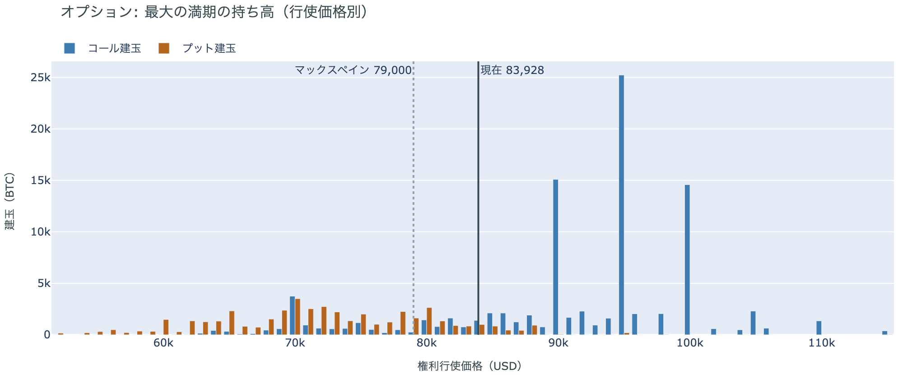

*図の見方: 青＝コール、橙＝プット。現値より上にコールが、下にプットが積まれるのが普通です。*

| 10月30日満期のオプション | 量（万BTC） | 意味 |
|---|---:|---|
| コール | 約9.6 | 「価格が上がる」に賭けた分 |
| プット | 約4.7 | 「価格が下がる」への保険 |
| うち、いまより15%以上高い価格のコール | 約2.2 | 大きな上げへの賭け |
| うち、いまより15%以上安い価格のプット | 約2.3 | 大きな下げへの保険 |

* 10月30日満期の持ち高は約14.4万BTCと全満期の37%で、前日とほぼ同じ。コールがプットの2.1倍。
* コールが集まっている価格は$95,000に約2.5万BTC、$90,000と$100,000に約1.5万BTCずつ。

「価格が上がる」に賭けた人たちは、火曜朝の$81,000割れでも降りていません。10月30日満期の持ち高は前日から動かず、コールの大半はいまより高い$90,000から$100,000に積まれたままだからです。その賭けが報われるには、FOMCを越えて10月30日までに$90,000を超える必要があり、距離はいまの価格から8%です。手前の満期にプットの高さを残しながら10月末までの上げへの賭けは外していないので、参加者は近いうちに大きく崩れるとは見ていないが、米CPIとFOMCの結果が出るまでは下げの側に備えておく、という構えのままです。

## 4. 価格に影響しうる直近のイベント

オプション市場が下げへの備えをいちばん厚く置いているのは、今夜の米9月のCPIの直後に来る10月15日と16日の満期で、次がFOMCをまたぐ10月30日の満期です。どちらもプットが高いだけで、ほかの満期に対して権利料に上乗せは乗っていません。原油の側では、フーシ派がサウジアラビアの石油施設を標的と警告し、サウジアラビア側がサナアの石油施設を空爆したことが、今週の材料として残っています。

| 日付 | イベント | 何に効くか |
|---|---|---|
| 10/14（水）21:30 日本時間 | 米9月のCPI。市場の予想は前年比3.7%前後（8月は3.4%）で、10月のFOMCの前に出る最後の物価の数字 | 金利。プットがはっきり高い15日・16日の満期がまたぐ |
| 10/11（日）〜15（木） | 世界石油会議（リヤド）。リヤドの空港は17日まで閉鎖。フーシ派はサウジアラビアの石油施設を標的と警告 | 原油 |
| 10/15（木）21:30 日本時間 | 米9月の小売売上高と生産者物価指数 | 金利 |
| 10/16（金）17:00 | オプションの満期。米CPIの直後でプットがはっきり高い | 下げへの備えの期限 |
| 10/27（火）〜28（水） | FOMC。利上げの織り込みは約2割で、1週間前の約2割から変わっていない。結果は日本時間29日未明 | 金利。プットが高い10月30日の満期がまたぐ |
| 10/29（木）〜30（金） | 日銀の会合。展望レポートも出る | 円 |
| 10/30（金）17:00 | オプションの最も大きな満期（約14.4万BTC、全満期の37%）。FOMCの2日後 | $90,000以上のコールの期限 |
| 11/1（日） | OPEC+の会合。12月の生産目標を決める | 原油 |
| 11/3（火） | 米国の中間選挙。トランプ大統領は「それまでイランを攻撃しない」と述べている | 原油 |
| 11/10（火） | Binanceのマイニングプールが停止（ハッシュレートの約2%） | ハッシュレート |

## まとめ：火曜日の動きは何だったか

火曜日は、はっきりしたきっかけが無いまま、朝にロングの手仕舞いと清算で$81,000を割り、昼にショートの買い戻しとロングの積み直しで$83,000台へ戻った日でした。ビットコイン自身の需給の土台は変わっていません。アメリカの買い手は引いたまま戻しに加わらず、長期保有者の利益確定の売りは減り方が前の週より大きくなって続いています。参加者は、焼かれたあとに上げへ賭け直すところまでは戻り、近いうちに大きく崩れるとは見ていませんが、今夜の米CPIの直後にだけ下げの側へ備えていて、賭けを先週より大きくはしていません。

---

<small>（数値は10月14日7時5分（日本時間）までのデータに基づきます。価格・先物・オプション・Coinbase Premiumはその時点の値、市場心理は10月13日の確定値、オンチェーン（＝ブロックチェーン上の記録）は10月12日時点、ETF資金フローは10月12日分までです。証券市場の終値は10月13日時点です。FOMCの織り込みは10月13日のFF金利先物の終値から計算したものです。オンチェーンの長期保有者の数値には、ETFや取引所が預かっている分も含まれます。オプションはDeribit（BTCオプションの大半を占める取引所）の全銘柄です。）</small>

*本稿は情報提供を目的としたものであり、投資助言ではありません。将来の価格動向を保証・示唆するものではなく、投資判断は各自の責任において行ってください。*
