# 米CPIの上振れで$81,000台へ下げる ― ショートが積まれ、ロングが払う金利はマイナスへ

**2026年10月15日**

ビットコインは水曜日、夜9時半の米CPIが予想を上回った直後に$83,000台から下げ始め、深夜に$81,000台で多数のロングが清算されたあと、$81,500前後で横ばいのまま朝を迎えました。

* **価格**：24時間の値幅は3.2%で、朝7時5分の時点で約$81,668と24時間前より2.2%低い。下げは先週木曜の安値の手前、50日線のすぐ上で止まっていて、先週からの下げが一段深くなった形にはなっていない
* **きっかけ**：夜9時半の米CPI（＝米国の物価統計）が予想を上回り、株も金も同じ夜に下げた。10月のFOMC（＝米国の金利を決める会合）での利上げの織り込みは約2割から約3割へ上がった
* **先物**：下げを運んだのは、米CPIの直後に新しく積まれた売り持ち（ショート）と、深夜の$81,000台で多数の買い持ち（ロング）に出た清算（＝証拠金不足で強制的に閉じられた取引）。ロングが払う金利は朝にはマイナスへ沈み、前日に戻りかけていた上げへの確信は1日で消えた
* **需給の土台**：米国の買い手は引いたままで、週をまたいでさらに深く沈んだ。長期保有者の利益確定の売りは続き、減り方は前の週より大きい。土台は前日から変わっていないが、どちらも軽くなってはいない
* **オプションの見方**：全部の満期でプットのほうが高く、備えがいちばん厚いのは今週の満期。米CPIの余波が数日続くとは見ているが、FOMCをまたぐ10月末の満期の権利料にほかの満期に対する上乗せは無く、長く身構えてはいない

## 1. 何が起きたか

**図1-1 価格の推移（1時間足・直近7日）**

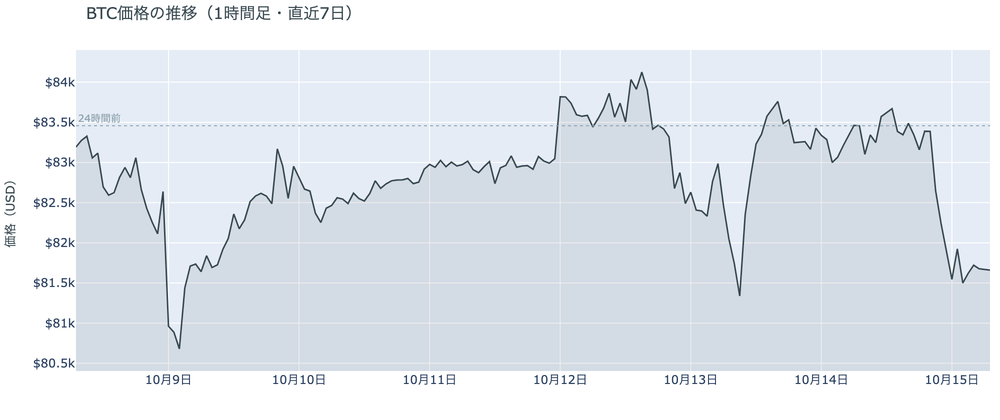

*図の見方: 1時間ごとの価格（日本時間）。点線は24時間前の水準。右端で線が点線を下へ抜け、そのまま平らになっています。*

* 21時台から23時台に価格が1.8%下げるあいだに建玉は2.8%増え、0時台に1%減った。
* 24時間の安値$81,417は、先週木曜の$80,315も50日線の$81,165も割っていない。

水曜日は、夜9時半の米CPIの直後に$83,000台から下げ始め、日付が変わるころに$81,500前後まで下げて、そのまま朝を迎えた日でした。21時台から23時台は価格が下げながら建玉（＝先物の未決済残高。証拠金で張っている人の量）が増えたので、米CPIを見て新しくショートを積んだ人が下げを運びました。23時台には$81,000台で多数のロングが清算され、下げの最後を押し広げています。日付が変わってからは価格が小動きのまま建玉が減ったので、残っていたロングの手仕舞いです。朝7時5分の約$81,668は、火曜朝に割った$81,000より上で、先週からの安値を更新してはいません。

**図1-2 価格と50日・200日移動平均**

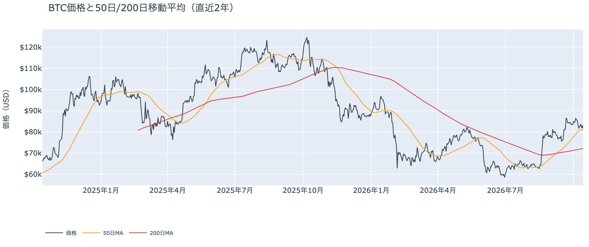

*図の見方: 2本の平均線の上下関係を見ます。50日線が200日線の上にあるのがゴールデンクロスです。*

* 50日線と200日線の差は約$8,961（12.4%）で、前日とほぼ同じ。
* 価格は50日線の0.6%上。前日の2.8%上から近づいた。

長い目で見た流れの向きは変わっていませんが、50日線までの余裕はほとんど無くなりました。ゴールデンクロス（＝50日線が200日線を上抜けること）の状態が37日目で、2本の平均線の差は開いたままです。ただし価格は50日線のすぐ上まで下げていて、先週木曜と火曜の朝に続いて3度目、50日線の手前で下げが止まった形です。

**図1-3 実際に起きた清算（Hyperliquid・直近24時間）**

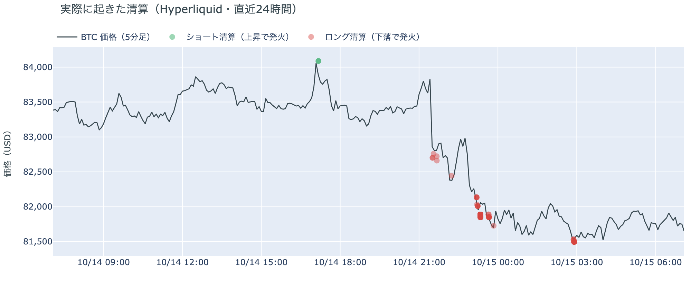

*図の見方: 5分ごとの価格（日本時間）に、Hyperliquidで見えた清算を重ねたもの。赤がロング、緑がショートの清算で、点の大きさが量です。*

* 110件のうち最大の1件は全体の10%で、全体の82%が23時台の$81,000台に出た。
* 値動きの速い5分足に入った清算は39%で、いちばん速い21時35分の足にも清算はあった。

焼かれたのは大口1件ではなく、多数のロングです。Hyperliquid（＝オンチェーンの先物取引所）で見える清算は、下げ始めた21時台の速い足にも少し出ていますが、8割は2時間後の23時台、$81,000台に集まっています。下げは米CPIの直後にほぼ清算なしで始まり、最後に$81,000台で多数のロングが焼けて加速した形です。

証券市場は水曜10月14日、米国株（S&P500）が−1.1%、金が−1.2%で終わり、原油は+1.1%の$95台でした。米10年債利回りは米CPIの直後に5.3%台へ上げたあと、朝までに5.19%へ戻しています。ビットコインは株・金と同じ夜に同じ向きへ下げていて、米CPIという共通のきっかけがあった形です。原油だけが逆向きなので、サウジアラビアをめぐる外部環境の出来事は、この夜のビットコインに効いた形跡がありません。

## 2. なぜ動いたか：きっかけと、需給のどこが動いたか

**図2-1 ビットコインと株・金・原油の相対推移（起点＝100）**

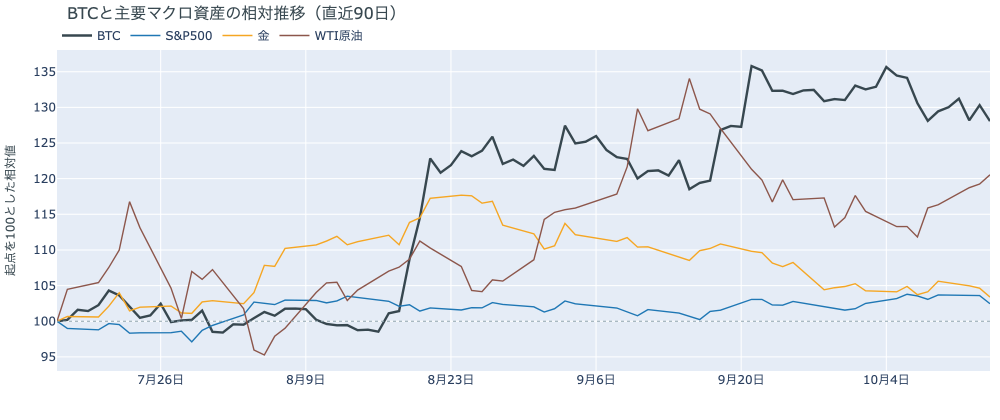

*図の見方: 同じ起点から何%動いたかで重ねたもの。線の向きが揃っているかを見ます。*

| この5営業日の動き（ビットコインは7日間） | 変化 |
|---|---:|
| ビットコイン | −1.9% |
| 金 | −0.3% |
| 米国株（S&P500） | −1.1% |
| 原油 | +7.8% |

* 建玉は92,948BTCで、前日の93,388BTCから0.5%減り、1週間では3.3%減った。
* 資金調達率から短期金利を引いた上乗せは−4.55ptで、前日の+2.71ptから一晩でマイナスへ転じた。

水曜日の下げは、米CPIが予想を上回ったのをきっかけに、先物に新しく積まれたショートと、深夜の$81,000台でのロングの清算を通って価格になったものです。

1. きっかけ：外部環境の出来事で、夜9時半に出た米9月のCPIです。前年比3.7%と8月の3.4%から加速し、予想の3.6%を上回りました。10月のFOMCで利上げする織り込みは、米CPIの前の約2割から約3割へ上がりました。ビットコインが下げ始めた時刻は米CPIの発表とぴったり重なり、米国株と金も同じ夜に下げているので、同じきっかけで動いた形です。この5営業日でも、ビットコインと米国株は同じ向きに動いています。原油は逆向きで、フーシ派がリヤドへ弾道ミサイルを撃ちサウジアラビアが迎撃、サウジアラビア側はイエメンの燃料施設を空爆と、サウジアラビアをめぐる攻撃の応酬は続いていますが、原油が上げるなかでビットコインは下げたので、この夜の共通のきっかけではありません。ビットコインに固有の出来事では、監視している米政府などのアドレスからの出金は無く、業界のニュースにも値動きと時刻が結びつくものはありません。
2. 伝わり方：先物のショートとロングです。米CPIの直後の2時間は価格が下げながら建玉が増えたので、新しくショートを積んだ人が下げを運びました。23時台に$81,000台で多数のロングが清算され、日付が変わってからは残っていたロングの手仕舞いで建玉が減りました。資金調達率（＝ロングが払う金利。プラス＝ロングがショートより多い）は、1日をならした年率で−0.47%と、短期金利（＝ドルを米国の短期国債で持つだけで受け取れる金利。13週Tビル 4.09%）を引いた上乗せは−4.55ptです。マイナスはショートがロングより多いということで、前日にプラスへ戻ったばかりの傾きが一晩で裏返りました。アメリカの買い手は引いたまま（図①-1）で、下げに逆らって買いに入った現物の買い手は見当たりません。

## 3. 市場参加者はいまどう見ているか

### ① アメリカの買い手は引いたまま、週をまたいでさらに深く沈んだ

**図①-1 Coinbase Premium（アメリカとそれ以外の価格差・直近90日）**

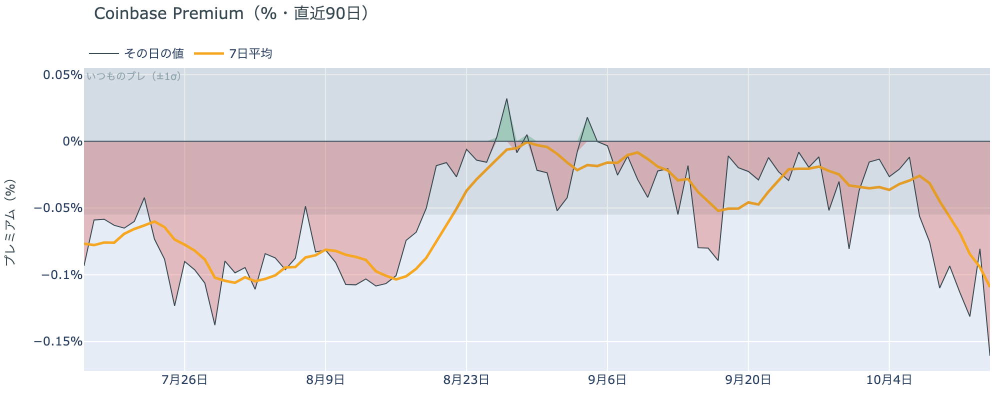

*図の見方: プラス＝アメリカで買いが強い。太線が1週間平均、細線がその日の値。薄い帯は「いつものブレの範囲」です。*

* 1週間平均は−0.11%で、前の週の−0.03%の4倍沈んだ。
* その日の値は−0.16%で、いつものブレの2.9倍。この10か月で下から3%の水準。

アメリカの買い手は引いたままで、米CPIの夜にさらに深く沈みました。Coinbase Premium（＝アメリカとそれ以外の価格差）は、1週間平均で前の週の4倍沈み、その日の値はいつものブレの3倍近く下にあります。米CPIの夜の下げにアメリカの買い手が逆らって買いに入った形跡は無く、むしろアメリカのほうがそれ以外より安く取引されているので、価格を支える側には戻っていないということです。

**図①-2 ETFの日ごとの資金の出入り（直近90日）**

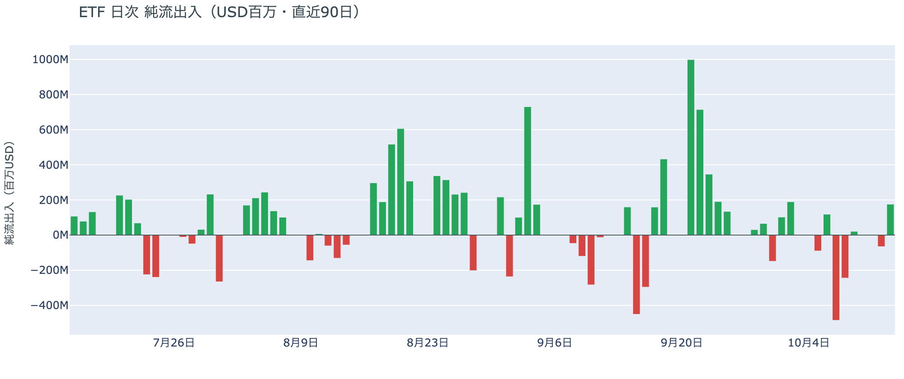

*図の見方: 入ったお金と出たお金の差。上に伸びれば入り超、下に伸びれば出超。*

| ETFの日ごとの出入り | 億ドル |
|---|---:|
| 10月5日 | −0.9 |
| 10月6日 | +1.2 |
| 10月7日 | −4.8 |
| 10月8日 | −2.4 |
| 10月9日 | +0.2 |
| 10月12日 | −0.7 |
| 10月13日 | +1.8 |
| 直近7営業日の合計 | −5.7 |

ETFの買い手は、降りた分がまだ戻っていません。10月13日分は入り超でしたが、先週水曜と木曜に出た分の4分の1を埋めたにとどまり、直近7営業日の合計は出超のままです。この入り超は米CPIの前の日のものなので、米CPIのあとにETFの買い手がどう動いたかはまだ見えていません。

**図①-3 Fear & Greed（市場心理の指数・直近90日）**

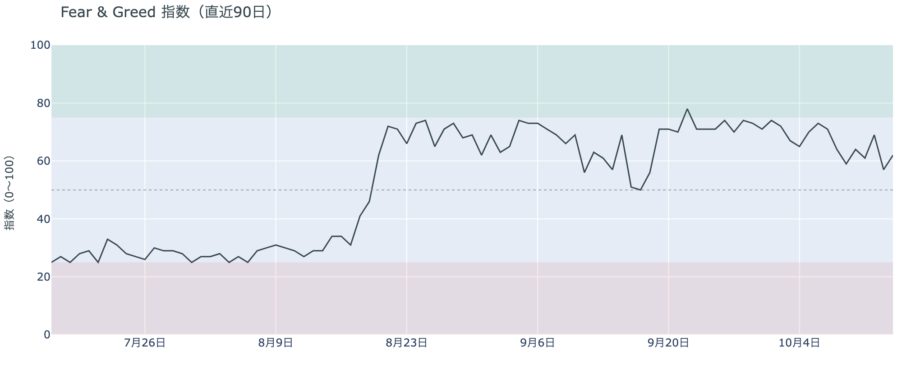

*図の見方: 0〜100で、50より上が「強欲」、下が「恐怖」。*

* 62の「強欲」。前日の57から5pt戻し、1週間前は71、1か月前は57。

市場心理は、月曜夜の下げで冷えたところから少し戻していました。Fear & Greed（＝市場心理の指数）の10月14日の確定値は「強欲」と「中立」の境目から離れましたが、1週間前からは9pt低いままです。この値は米CPIの前に確定したもので、水曜の夜の下げは含まれていません。先週からの下げを「一時的な押し」と見る人が多数ではあるものの、1週間前ほどの確信は無い、という形です。

### ② 長期保有者の利益確定の売りは続き、減り方は前の週の2倍近くになった

**図②-1 長期保有者の保有量の30日変化とSOPR（直近90日）**

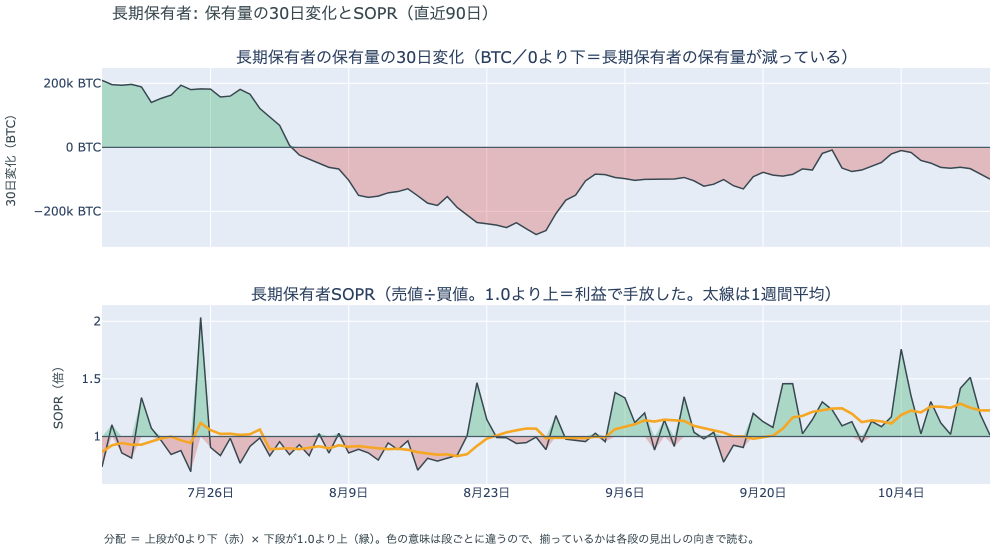

*図の見方: 上段は、長期保有者の保有量が30日でどれだけ増減したか。マイナス＝手放している。下段は長期保有者SOPRで、1より上なら利益で手放した。どちらも1週間平均で読みます。*

| 10月13日時点 | 1週間平均 | 前の週の平均 |
|---|---:|---:|
| 長期保有者SOPR（1より上＝利益で手放した） | 1.23 | 1.21 |
| 長期保有者の保有量の30日変化（万BTC） | −7.0 | −3.8 |

* 1週間平均の減り方は前の週の1.8倍で、1か月前（9月13日）の−10.5万BTCの3分の2。

長期保有者（＝155日以上保有者）は利益確定の売りを続けていて、減り方は前の週の2倍近くになっています。保有量は30日で減り、動いたコインは平均して買値より高く動いています。減り方は1か月前の水準には届いていませんが、先週の$80,000台への下げをまたいで3週続けて大きくなっているので、長期保有者の側は「売りが落ち着いた」とは言えません。向きは前日と同じで、ビットコイン自身の需給の土台が変わったとまでは言えませんが、前日より少し重い形です。

長期保有者のほかに、売りに回りそうな持ち手は見当たりません。長く眠っていたコインが急に動いた記録はなく、マイナーの収入は平年をやや上回る程度（Puell Multiple（＝マイナー収入の平年比）が1週間平均で1.11）で、売りを急ぐ状況ではありません。コインが最後に動いた価格の分布にも、今日は新しい材料がありません。

### ③ 先物：戻りかけた上げへの確信は1日で消え、下げに賭ける側へ傾いた

**図③-1 資金調達率と建玉（直近30日）**

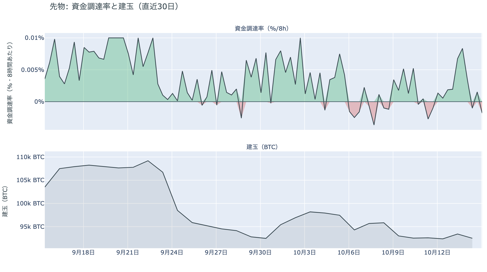

*図の見方: 上段は資金調達率（8時間ごと・日本時間）。プラスが続く＝ロングがショートより多い。下段は建玉。*

* 上乗せは−4.55ptで、直近34日の平均+0.03ptから大きく沈み、最小の−5.22ptに近い。
* 資金調達率の直近の値は、この30日でいちばん低い。

先物の参加者は、前日に戻りかけた上げへの確信を1日で失い、下げに賭ける側へ傾きました。ロングが払う側だった資金調達率は朝にはマイナスへ沈み、ショートが払う側になったので、いまは余分に払ってでも下げに賭けたい人のほうが多いということです。前日は「焼かれたあとに賭け直す人が戻った」と説明しました。その賭け直したロングが米CPIの夜に$81,000台で焼かれ、代わりにショートが積まれたので、前日の説明は1日で古くなりました。建玉は先週からの減った水準をさらに少し下回っていて、下げに賭ける人も賭けを大きくしてはいません。

### ④ オプション：備えは今週の満期に厚く、10月末の満期には長く身構えていない

オプションには2種類あります。コール（＝決めた価格で買う権利）とプット（＝決めた価格で売る権利）で、価格が上がればコールの価値が上がり、価格が下がればプットの価値が上がります。プットは「価格が下がったときの保険」として買われます。オプションを買う人は、その権利と引き換えに権利料（＝オプションを買う人が払う金額）を払います。

**図④-1 満期ごとのIV（年率%）**

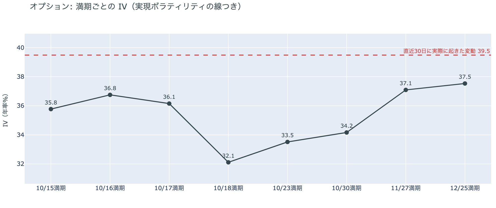

*図の見方: IVを満期ごとに並べたもの。点線は実現ボラティリティ。IVが点線より下なら、市場はこの先の値動きを過去の値動きより小さいと見ています。*

| 満期 | IV |
|---|---:|
| 10月15日〜17日 | 36〜37 |
| 10月18日〜30日 | 32〜34 |
| 11月27日・12月25日 | 37 |

* IVは全体で38.2と、前日の37.7からわずかに上がった。実現ボラティリティ39.5より1.3pt低く、過去1年で下から34%。

オプションの参加者は、米CPIの夜の下げを見ても、この先を怖がってはいません。IV（＝値動きの幅の予想）は実現ボラティリティ（＝過去の値動きの幅）より低いままで、市場はこの先の値動きを過去の値動きより小さいと見ています。例外は米CPIのあとの数日で、15日から17日に満期（＝権利の期限）が来るオプションの権利料には、18日から月末の満期に対するわずかな上乗せが乗っています。米CPIの余波が今週いっぱい続くと見られているからです。FOMCをまたぐ10月30日の満期には、ほかの満期に対する上乗せは乗っていないので、FOMCの直後に荒れるとは見られていません。

**図④-2 満期ごとのプットとコールの差**

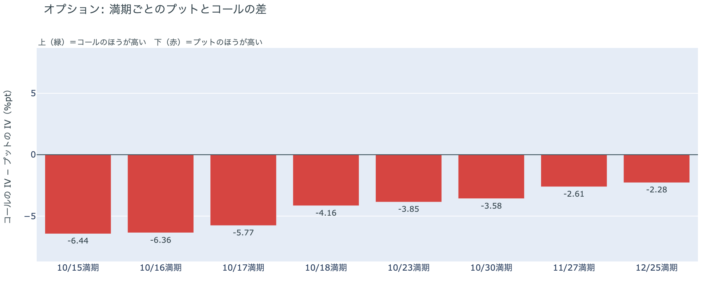

*図の見方: 満期ごとに、プットとコールのどちらが高く売れているか。ゼロより上ならコールのほうが高く、下ならプットのほうが高い。*

| 満期 | どちらが高いか |
|---|---|
| 10月15日 | プットがはっきり高い |
| 10月16日 | プットがはっきり高い |
| 10月17日 | プットが高い |
| 10月18日 | プットが高い |
| 10月23日 | プットが高い |
| 10月30日 | プットが高い |
| 11月27日 | プットがわずかに高い |
| 12月25日 | プットがわずかに高い |

参加者は、米CPIのあとも下げる側に備えたままで、備えがいちばん厚いのは今週の満期です。プットのほうがいちばん高く値付けされているのは15日と16日の満期で、11月27日と12月25日の満期ではプットの高さがわずかです。全部の満期でプットのほうが高い形は月曜から変わらず、コールのほうが高い満期は1つもありません。持ち高（図④-3）はほぼ動いていないので、米CPIの夜に備えを新しく買い足したのではなく、置いていた備えを米CPIのあとも外さなかった形です。つまり参加者は、この下げが今週のうちにもう一段来ることには備えていますが、年末まで続く流れの変化とは見ていません。

**図④-3 10月30日満期の持ち高（権利の価格ごと）**

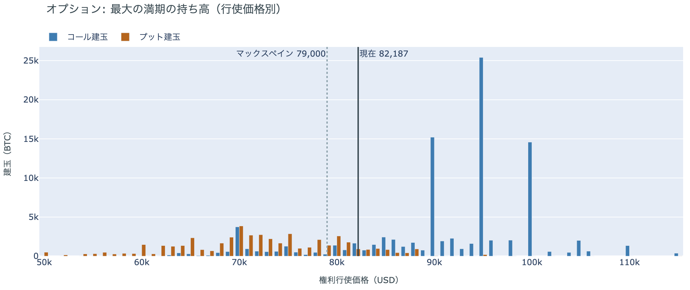

*図の見方: 青＝コール、橙＝プット。現値より上にコールが、下にプットが積まれるのが普通です。*

| 10月30日満期のオプション | 量（万BTC） | 意味 |
|---|---:|---|
| コール | 約9.8 | 「価格が上がる」に賭けた分 |
| プット | 約4.9 | 「価格が下がる」への保険 |
| うち、いまより15%以上高い価格のコール | 約5.0 | 大きな上げへの賭け |
| うち、いまより15%以上安い価格のプット | 約1.7 | 大きな下げへの保険 |

* 10月30日満期の持ち高は約14.6万BTCと全満期の37%で、前日とほぼ同じ。コールがプットの2.0倍。
* コールが集まっている価格は$95,000に約2.5万BTC、$90,000と$100,000に約1.5万BTCずつ。

「価格が上がる」に賭けた人たちは、米CPIの夜の下げでも降りていません。10月30日満期の持ち高は前日から動かず、コールの大半はいまより高い$90,000から$100,000に積まれたままだからです。価格が下げたぶん、その賭けが報われるまでの距離は伸びました。FOMCを越えて10月30日までに$90,000を超える必要があり、いまの価格からは10%上です。手前の満期にプットの高さを残しながら10月末までの上げへの賭けは外していないので、参加者は今週の下げには備えつつ、10月末までに流れが変わるとは見ていない、という構えのままです。

## 4. 価格に影響しうる直近のイベント

オプション市場が下げへの備えをいちばん厚く置いているのは今週の満期で、15日から17日の満期の権利料にはその先の満期に対するわずかな上乗せも乗っています。この区間に当たるのは、今夜の米9月の生産者物価指数と小売売上高です。FOMCをまたぐ10月30日の満期はプットが高いだけで、ほかの満期に対する上乗せは乗っていません。原油の側では、フーシ派がリヤドへ弾道ミサイルを撃ち、サウジアラビアが迎撃したうえでイエメンの燃料施設を空爆したことが、今週の材料として残っています。

| 日付 | イベント | 何に効くか |
|---|---|---|
| 10/15（木）21:30 日本時間 | 米9月の生産者物価指数と小売売上高。米CPIの翌日に出る物価と消費の数字 | 金利。IVがやや高い15〜17日の満期がまたぐ |
| 10/14（水）〜 | サウジアラビアとフーシ派の攻撃の応酬。フーシ派はサウジアラビアの空港と石油施設を標的にし続けると表明 | 原油 |
| 10/16（金）17:00 | オプションの満期。米CPIの直後でプットがはっきり高い | 下げへの備えの期限 |
| 10/27（火）〜28（水） | FOMC。利上げの織り込みは約3割で、米CPIの前の約2割から上がった。結果は日本時間29日未明 | 金利。プットが高い10月30日の満期がまたぐ |
| 10/29（木）〜30（金） | 日銀の会合。展望レポートも出る | 円 |
| 10/30（金）17:00 | オプションの最も大きな満期（約14.6万BTC、全満期の37%）。FOMCの2日後 | $90,000以上のコールの期限 |
| 11/1（日） | OPEC+の会合。12月の生産目標を決める | 原油 |
| 11/3（火） | 米国の中間選挙。トランプ大統領は「それまでイランを攻撃しない」と述べている | 原油 |
| 11/10（火） | Binanceのマイニングプールが停止（ハッシュレートの約2%） | ハッシュレート |

## まとめ：水曜日の動きは何だったか

水曜日は、米CPIが予想を上回ったのをきっかけに、先物に新しく積まれたショートと深夜の$81,000台でのロングの清算を通って、$83,000台から$81,500前後へ下げた日でした。ビットコイン自身の需給の土台は変わっていません。アメリカの買い手は引いたまま下げに逆らわず、長期保有者の利益確定の売りは減り方が前の週の2倍近くになって続いています。参加者は、前日に戻りかけた上げへの確信を1日で失って下げに賭ける側へ傾きましたが、FOMCまで長く身構えてはおらず、10月末までの上げへの賭けも外していません。

---

<small>（数値は10月15日7時5分（日本時間）までのデータに基づきます。価格・先物・オプション・Coinbase Premiumはその時点の値、市場心理は10月14日の確定値、オンチェーン（＝ブロックチェーン上の記録）は10月13日時点、ETF資金フローは10月13日分までです。証券市場の終値は10月14日時点です。FOMCの織り込みは10月14日のFF金利先物の終値から計算したものです。オンチェーンの長期保有者の数値には、ETFや取引所が預かっている分も含まれます。オプションはDeribit（BTCオプションの大半を占める取引所）の全銘柄です。）</small>

*本稿は情報提供を目的としたものであり、投資助言ではありません。将来の価格動向を保証・示唆するものではなく、投資判断は各自の責任において行ってください。*
