# $80,000割れから1時間で$82,000台へ ― 米PPIの夜にロングが積み直され、下げへの賭けは消える

**2026年10月16日**

ビットコインは木曜日、午前に$80,000台半ばまで下げ、夜9時半の米PPIの直後にもう一度下げて$80,000を割ったあと、1時間で$82,000台へ戻して朝を迎えました。

* **価格**：24時間の値幅は3.6%で、夜の安値$79,676は先週からの下げでいちばん安い。ただし朝7時5分の時点では約$82,446と24時間前より1.1%高く、安値を付けたあとの戻しのほうが大きかった
* **きっかけ**：夜9時半の米PPI（＝米国の生産者物価指数）が予想を大きく上回った。午前の下げは、韓国の株価指数が8%近く下げて取引が一時止まった時間帯と重なる。株は小幅高、金は2%高、米10年債利回りは下げて終えたので、証券市場は米PPIを週末へ持ち越す売り材料にはしていない
* **先物**：下げを運んだのは午前の$81,000台での多数の買い持ち（ロング）の清算（＝証拠金不足で強制的に閉じられた取引）と、米PPIの直後に積まれた売り持ち（ショート）。戻しを運んだのは$80,000を割った直後に積み直されたロングで、ロングが払う金利は1日でマイナスからプラスへ戻った
* **需給の土台**：米国の買い手は引いたままで、ETFは米CPIの日に出超へ戻った。長期保有者の利益確定の売りは続き、減り方は前の週の2倍を超えた。土台は前日から変わっていないが、どちらも軽くなっていない
* **オプションの見方**：全部の満期でプットのほうが高く、備えがいちばん厚いのは今日の満期。$80,000を割った夜にも10月末の満期のコールは外されておらず、FOMCをまたぐ満期の権利料にほかの満期に対する上乗せは無い

## 1. 何が起きたか

**図1-1 価格の推移（1時間足・直近7日）**

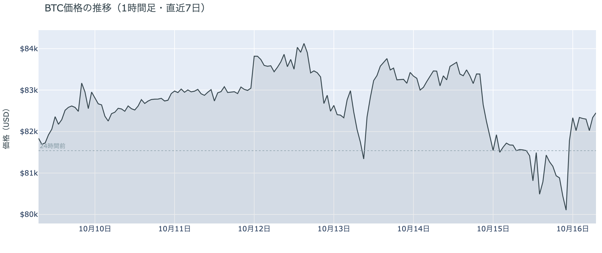

*図の見方: 1時間ごとの価格（日本時間）。点線は24時間前の水準。右端で線が点線の下へ沈んだあと、1本で点線の上へ戻っています。*

* 米PPIのあとの22時台は価格が下げながら建玉が0.7%増え、23時台は価格が2.1%上げながら建玉が0.5%増えた。
* 建玉は24時間で1.2%増えたが、1週間前より2.8%少ない。

木曜日は2度下げて、2度目の下げのあとに一気に戻した日でした。午前11時台に$81,000台で多数のロングが清算され、午後2時台に$80,500近くまで下げました。夜9時半の米PPIの直後にもう一度下げ、10時台の終わりに$79,700近くで底を打ち、11時台には$81,800、日付が変わると$82,300まで戻して、そのまま朝を迎えました。米PPIのあとの1時間は価格が下げながら建玉（＝先物の未決済残高。証拠金で張っている人の量）が増えたので、新しくショートを積んだ人が下げを運びました。次の1時間は価格が2%上げながら建玉がさらに増えたので、戻しを運んだのはショートの買い戻しだけでなく、新しく積まれたロングです。

**図1-2 価格と50日・200日移動平均**

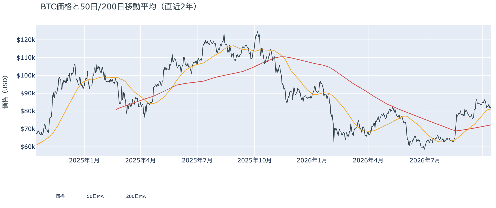

*図の見方: 2本の平均線の上下関係を見ます。50日線が200日線の上にあるのがゴールデンクロスです。*

* 50日線と200日線の差は約$8,945（12.4%）で、前日とほぼ同じ。
* 夜の安値$79,676は50日線の$81,231を1.9%下回ったが、朝7時5分の価格は50日線の1.5%上。

長い目で見た流れの向きは変わっていませんが、価格は夜に一度、50日線を割りました。ゴールデンクロス（＝50日線が200日線を上抜けること）の状態が38日目で、2本の平均線の差は開いたままです。先週木曜・火曜・水曜と3度、50日線の手前で止まっていた下げが、米PPIの夜に初めて線を割りました。ただし線の下にいたのは1時間ほどで、朝には線の上へ戻しているので、下へ抜けて定着した形ではありません。

**図1-3 実際に起きた清算（Hyperliquid・直近24時間）**

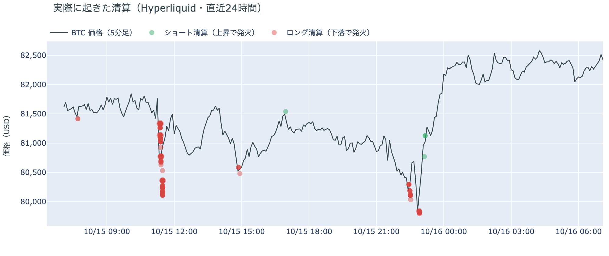

*図の見方: 5分ごとの価格（日本時間）に、Hyperliquidで見えた清算を重ねたもの。赤がロング、緑がショートの清算で、点の大きさが量です。*

* 287件のうち最大の1件は全体の42%で、全体の84%が木曜11時台の$81,000台に出た。
* 値動きの速い5分足に入った清算は66%で、11時25分の1本だけで57%。

焼かれたのは、午前の大口1件と、夜の多数のロングです。Hyperliquid（＝オンチェーンの先物取引所）で見える清算は、ほぼ全部がロングで、8割強が木曜11時台に集まっています。11時25分の速い足に最大の1件が入り、この1本が午前の下げを押し広げました。夜の米PPIのあとの下げは、清算なしで始まり、$80,000を割る足で清算が出て加速した形です。

証券市場は木曜10月15日、米国株（S&P500）が+0.3%、金が+2.1%の$4,192、原油が+1.1%の$96台で終わりました。米10年債利回りは5.09%と、前日の5.19%から下げています。米PPIが予想を大きく上回った夜に株は上げ、金利は下げて終えたので、証券市場は米PPIを売り材料として週末へ持ち越していません。ビットコインが米PPIの直後の下げを1時間で戻したのも、同じ形です。

## 2. なぜ動いたか：きっかけと、需給のどこが動いたか

**図2-1 ビットコインと株・金・原油の相対推移（起点＝100）**

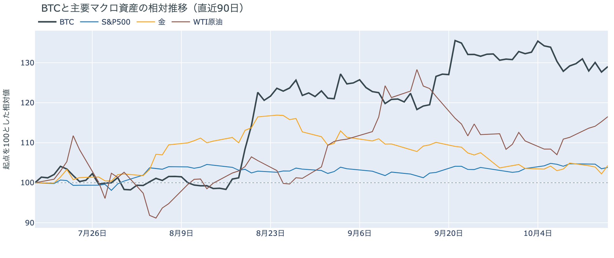

*図の見方: 同じ起点から何%動いたかで重ねたもの。線の向きが揃っているかを見ます。*

| この5営業日の動き（ビットコインは7日間） | 変化 |
|---|---:|
| ビットコイン | +0.9% |
| 金 | +0.9% |
| 米国株（S&P500） | −0.3% |
| 原油 | +5.1% |

* 建玉は94,093BTCで、前日の92,948BTCから1.2%増えた。
* 米PPIの直後の22時台に米10年債利回りは5.04%へ下げ、ビットコインが戻した23時台から0時台に5.10%へ上げた。

木曜日の値動きは、午前の韓国株の急落と同じ時間帯のロングの清算と、夜の米PPIの直後に積まれたショートを通って$80,000を割り、そのあと積み直されたロングを通って$82,000台へ戻したものです。

1. きっかけ：夜の下げは外部環境の出来事で、夜9時半に出た米9月のPPIです。前月比+1.3%と予想の+0.6%の2倍を超え、前年比は6.3%と4年ぶりの高さでした。ビットコインが下げ始めた時刻は発表とぴったり重なります。ただし米10年債利回りは米PPIのあとむしろ下げ、10月のFOMC（＝米国の金利を決める会合）で利上げする織り込みも、前日の約3割から約4分の1へ下がりました。株も小幅高で終えたので、証券市場は米PPIを利上げの材料として受け取っていません。ビットコインが1時間で戻したのは、これと同じ向きです。午前の下げに外部環境の新しい出来事はなく、同じ午前に韓国の株価指数が半導体株を中心に8%近く下げて取引が一時止まっていました。ビットコインは株と同じ向きに同じ時間帯に動いた形です。原油はサウジアラビアとフーシ派の応酬で1週間に5%上げていますが、木曜の2度の下げはどちらも原油が動いた時間ではなく、今日の値動きに効いた形跡はありません。ビットコインに固有の出来事では、監視している米政府などのアドレスからの出金は無く、ロシア中央銀行が個人同士の直接の売買を2027年7月から認めないと確認した報道も、値動きと時刻が結びつくものではありません。
2. 伝わり方：先物のロングとショートです。午前は11時台に$81,000台で多数のロングが清算され、建玉が1%減りました。夜は米PPIの直後の1時間に価格が下げながら建玉が増えたので、新しくショートを積んだ人が下げを運び、$80,000を割るところで残っていたロングが清算されました。その直後の1時間は価格が2%上げながら建玉が増えたので、戻しを運んだのは新しく積まれたロングです。資金調達率（＝ロングが払う金利。プラス＝ロングがショートより多い）は、1日をならした年率で+1.57%と、短期金利（＝ドルを米国の短期国債で持つだけで受け取れる金利。13週Tビル 4.09%）を引いた上乗せは−2.51ptです。前日のマイナスからプラスへ戻ったので、ロングがショートより多い側へ1日で戻りました。アメリカの買い手は引いたまま（図①-1）で、ETFも米CPIの日に出超へ戻っている（図①-2）ので、戻しに現物の買い手は加わっていません。

## 3. 市場参加者はいまどう見ているか

### ① アメリカの買い手は引いたままだが、米CPIの夜より深くは沈んでいない

**図①-1 Coinbase Premium（アメリカとそれ以外の価格差・直近90日）**

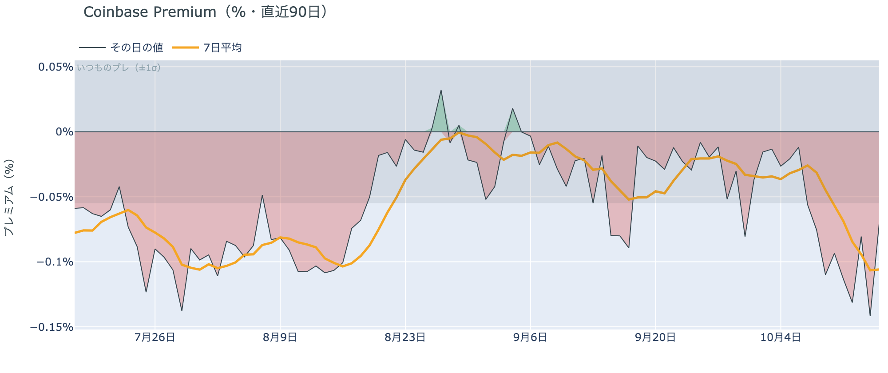

*図の見方: プラス＝アメリカで買いが強い。太線が1週間平均、細線がその日の値。薄い帯は「いつものブレの範囲」です。*

* 1週間平均は−0.11%で、前の週の−0.03%の3倍以上沈んだまま。
* その日の値は−0.07%で、前日の「いつものブレの2.9倍」から帯の内側へ戻った。

アメリカの買い手は引いたままで、$80,000を割った夜にも買いに入っていません。Coinbase Premium（＝アメリカとそれ以外の価格差）の1週間平均は、前の週の3倍以上沈んだままだからです。ただしその日の値はいつものブレの範囲に戻ったので、米CPIの夜のようにアメリカだけが突出して安く取引される形は1日で収まりました。戻しを運んだのは先物のロングであって、アメリカの現物の買い手ではないということです。

**図①-2 ETFの日ごとの資金の出入り（直近90日）**

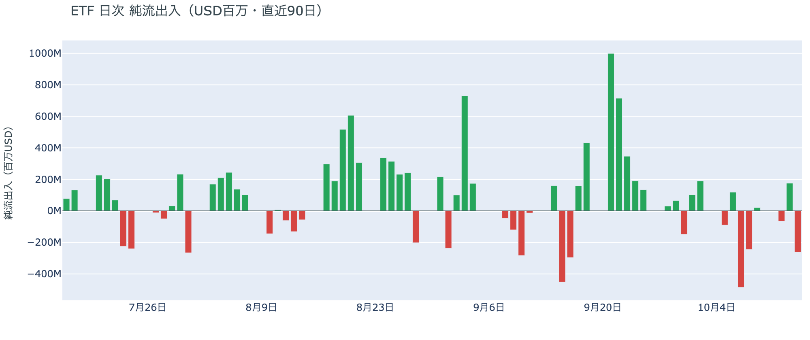

*図の見方: 入ったお金と出たお金の差。上に伸びれば入り超、下に伸びれば出超。*

| ETFの日ごとの出入り | 億ドル |
|---|---:|
| 10月6日 | +1.2 |
| 10月7日 | −4.8 |
| 10月8日 | −2.4 |
| 10月9日 | +0.2 |
| 10月12日 | −0.7 |
| 10月13日 | +1.8 |
| 10月14日 | −2.6 |
| 直近7営業日の合計 | −7.4 |

ETFの買い手は、米CPIの日に降りる側へ戻りました。10月14日分は2.6億ドルの出超で、前日の入り超を打ち消し、直近7営業日の合計の出超は広がっています。先週水曜と木曜に出た分が戻らないうちに米CPIの日にもう一段出たので、ETFの買い手は先週からの下げを買い増す側にはいません。

**図①-3 Fear & Greed（市場心理の指数・直近90日）**

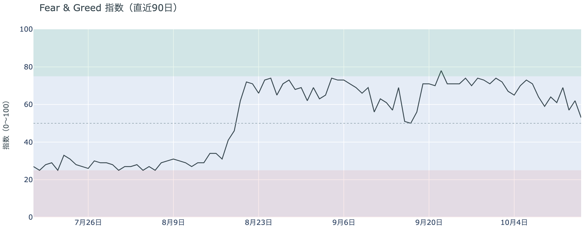

*図の見方: 0〜100で、50より上が「強欲」、下が「恐怖」。*

* 53の「中立」。前日の62から9pt下げ、1週間前は64、1か月前は69。

市場心理は、1か月ぶりに「強欲」の区分を外れました。Fear & Greed（＝市場心理の指数）の10月15日の確定値は「中立」で、9月17日以来です。9月下旬の70台から1か月かけて下がってきたところに、米CPIの夜の下げが乗りました。価格の下げを怖がっている人はまだ多数ではありませんが、先週までの「一時的な押し」という確信は薄れています。

### ② 長期保有者の利益確定の売りは続き、減り方は前の週の2倍を超えた

**図②-1 長期保有者の保有量の30日変化とSOPR（直近90日）**

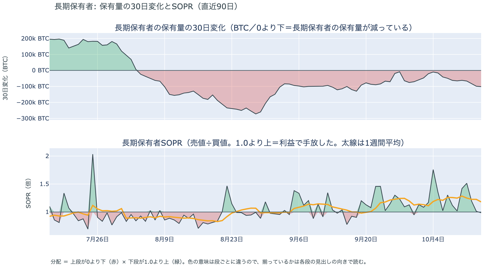

*図の見方: 上段は、長期保有者の保有量が30日でどれだけ増減したか。マイナス＝手放している。下段は長期保有者SOPRで、1より上なら利益で手放した。どちらも1週間平均で読みます。*

| 10月14日時点 | 1週間平均 | 前の週の平均 |
|---|---:|---:|
| 長期保有者SOPR（1より上＝利益で手放した） | 1.18 | 1.26 |
| 長期保有者の保有量の30日変化（万BTC） | −7.7 | −3.5 |

* 1週間平均の減り方は前の週の2.2倍で、1か月前（9月14日）の−12.1万BTCの3分の2。

長期保有者（＝155日以上保有者）は利益確定の売りを続けていて、減り方は前の週の2倍を超えました。保有量は30日で減り、動いたコインは平均して買値より高く動いています。減り方は先週の$80,000台への下げをまたいで3週続けて大きくなっているので、長期保有者は先週からの下げを売りを止める理由にはしていません。向きは前日と同じで、ビットコイン自身の需給の土台が変わったとまでは言えませんが、前日より重い形です。

長期保有者のほかに、売りに回りそうな持ち手は見当たりません。長く眠っていたコインが急に動いた記録はなく、マイナーの収入は平年をやや上回る程度（Puell Multiple（＝マイナー収入の平年比）が1週間平均で1.12）で、売りを急ぐ状況ではありません。コインが最後に動いた価格の分布にも、今日は新しい材料がありません。

### ③ 先物：下げに賭けた側は$80,000割れで報われずに降り、ロングが積み直された

**図③-1 資金調達率と建玉（直近30日）**

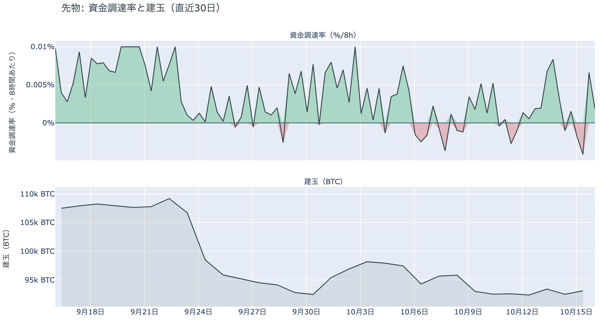

*図の見方: 上段は資金調達率（8時間ごと・日本時間）。プラスが続く＝ロングがショートより多い。下段は建玉。*

* 上乗せは−2.51ptで、前日の−4.55ptから半分に縮んだが、直近34日の平均−0.05ptより低い。
* 資金調達率のプラスは2回連続（約1日）。建玉は1週間前より2.8%少ない。

先物の参加者は、$80,000を割ったところで下げへの確信を失い、上げに賭け直しました。米PPIの直後に積まれたショートは1時間で買い戻され、戻す局面で建玉が増えたのは新しいロングなので、下げに賭けた側は一晩で降りたということです。前日は「戻りかけた上げへの確信を1日で失い、下げに賭ける側へ傾いた」と説明しました。その傾きは米PPIの直後までは続きましたが、$80,000を割ったところで裏返ったので、前日の説明は1日で古くなりました。ただし、ロングが払う金利は短期金利を下回ったままなので、余分に払ってでも上げに賭けたい人はまだ戻っていません。

### ④ オプション：$80,000を割っても下げへの備えは外さず、この先を怖がってもいない

オプションには2種類あります。コール（＝決めた価格で買う権利）とプット（＝決めた価格で売る権利）で、価格が上がればコールの価値が上がり、価格が下がればプットの価値が上がります。プットは「価格が下がったときの保険」として買われます。オプションを買う人は、その権利と引き換えに権利料（＝オプションを買う人が払う金額）を払います。

**図④-1 満期ごとのIV（年率%）**

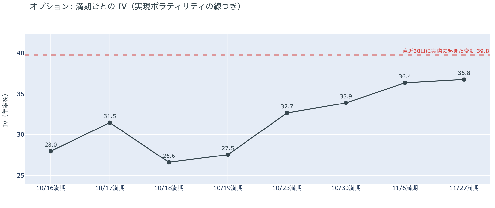

*図の見方: IVを満期ごとに並べたもの。点線は実現ボラティリティ。IVが点線より下なら、市場はこの先の値動きを過去の値動きより小さいと見ています。*

| 満期 | IV |
|---|---:|
| 10月16日〜19日 | 27〜32 |
| 10月23日〜30日 | 33〜34 |
| 11月6日・27日 | 36〜37 |

* IVは全体で39.1と、前日の38.2から上がった。実現ボラティリティ39.8より0.6pt低く、過去1年で下から30%。

オプションの参加者は、$80,000を割った夜を見ても、この先を怖がってはいません。IV（＝値動きの幅の予想）は実現ボラティリティ（＝過去の値動きの幅）より低いままで、市場はこの先の値動きを過去の値動きより小さいと見ています。例外は17日の満期（＝権利の期限）で、権利料には18日・19日の満期に対する上乗せが乗っています。米CPIと米PPIのあと最初の米国の取引時間、つまり今夜をまたぐからです。FOMCをまたぐ10月30日の満期には、ほかの満期に対する上乗せは乗っていないので、FOMCの直後に荒れるとは見られていません。

**図④-2 満期ごとのプットとコールの差**

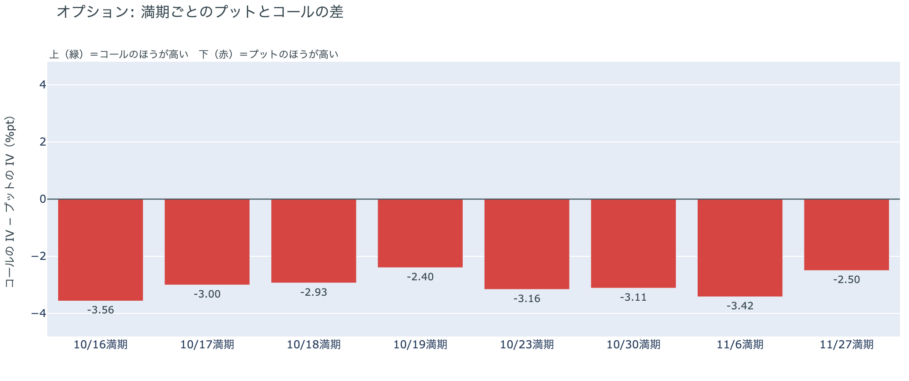

*図の見方: 満期ごとに、プットとコールのどちらが高く売れているか。ゼロより上ならコールのほうが高く、下ならプットのほうが高い。*

| 満期 | どちらが高いか |
|---|---|
| 10月16日 | プットがはっきり高い |
| 10月17日 | プットが高い |
| 10月18日 | プットが高い |
| 10月19日 | プットが高い |
| 10月23日 | プットが高い |
| 10月30日 | プットが高い |
| 11月6日 | プットがはっきり高い |
| 11月27日 | プットがやや高い |

参加者は、$80,000を割って戻したあとも下げる側に備えたままで、備えがいちばん厚いのは今日の満期です。全部の満期でプットのほうが高い形は月曜から変わらず、コールのほうが高い満期は1つもありません。持ち高（図④-3）はほぼ動いていないので、$80,000を割った夜に備えを新しく買い足したのではなく、置いていた備えを外さなかった形です。11月27日の満期ではプットの高さがやや小さいので、参加者は今週からFOMCまでの下げにはもう一段備えていますが、年末まで続く流れの変化とは見ていません。

**図④-3 10月30日満期の持ち高（権利の価格ごと）**

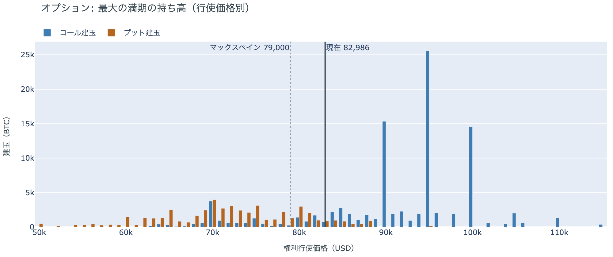

*図の見方: 青＝コール、橙＝プット。現値より上にコールが、下にプットが積まれるのが普通です。*

| 10月30日満期のオプション | 量（万BTC） | 意味 |
|---|---:|---|
| コール | 約9.9 | 「価格が上がる」に賭けた分 |
| プット | 約5.1 | 「価格が下がる」への保険 |
| うち、いまより15%以上高い価格のコール | 約2.4 | 大きな上げへの賭け |
| うち、いまより15%以上安い価格のプット | 約2.1 | 大きな下げへの保険 |

* 10月30日満期の持ち高は約15.0万BTCと全満期の37%で、前日とほぼ同じ。コールがプットの1.9倍。
* コールが集まっている価格は$95,000に約2.6万BTC、$90,000と$100,000に約1.5万BTCずつ。

「価格が上がる」に賭けた人たちは、$80,000を割った夜にも降りていません。10月30日満期の持ち高は前日から動かず、コールの大半はいまより高い$90,000から$100,000に積まれたままだからです。その賭けが報われるには、FOMCを越えて10月30日までに$90,000を超える必要があり、いまの価格からは9%上です。手前の満期にプットの高さを残しながら10月末までの上げへの賭けは外していないので、参加者は今週からFOMCまでの下げには備えつつ、10月末までに流れが変わるとは見ていない、という構えのままです。

## 4. 価格に影響しうる直近のイベント

オプション市場が下げへの備えをいちばん厚く置いているのは今日の満期で、17日の満期の権利料にはその先の満期に対するわずかな上乗せも乗っています。この区間に当たるのは、米CPIと米PPIのあと最初で週末前では最後になる、今夜の米国の取引時間です。FOMCをまたぐ10月30日の満期はプットが高いだけで、ほかの満期に対する上乗せは乗っていません。原油の側では、フーシ派がサウジアラビアの石油施設と空港を標的にし続けると表明し、サウジアラビアが警戒警報を出したことが、今週の材料として残っています。

| 日付 | イベント | 何に効くか |
|---|---|---|
| 10/16（金）17:00 | オプションの満期。米PPIの翌日でプットがはっきり高い | 下げへの備えの期限 |
| 10/15（木）〜 | サウジアラビアとフーシ派の攻撃の応酬。フーシ派は石油施設と空港を標的にし続けると表明し、サウジアラビアは石油施設の周辺に警戒警報 | 原油 |
| 10/17（土）〜29（木） | FRBのブラックアウト期間。FOMCの結果が出るまで高官の発言が止まる | 金利。織り込みを動かす材料が米国の物価や雇用の数字だけになる |
| 10/27（火）〜28（水） | FOMC。利上げの織り込みは約4分の1で、米CPIの翌日の約3割から下がった。結果は日本時間29日未明 | 金利。プットが高い10月30日の満期がまたぐ |
| 10/29（木）〜30（金） | 日銀の会合。展望レポートも出る | 円 |
| 10/30（金）17:00 | オプションの最も大きな満期（約15.0万BTC、全満期の37%）。FOMCの2日後 | $90,000以上のコールの期限 |
| 11/1（日） | OPEC+の会合。12月の生産目標を決める | 原油 |
| 11/3（火） | 米国の中間選挙。トランプ大統領は「それまでイランを攻撃しない」と述べている | 原油 |
| 11/10（火） | Binanceのマイニングプールが停止（ハッシュレートの約2%） | ハッシュレート |

## まとめ：木曜日の動きは何だったか

木曜日は、午前の韓国株の急落と同じ時間帯のロングの清算と、夜の米PPIの直後に積まれたショートを通って一時$80,000を割り、そのあと積み直されたロングを通って$82,000台へ戻した日でした。ビットコイン自身の需給の土台は変わっていません。アメリカの買い手もETFの買い手も引いたままで戻しには加わらず、長期保有者の利益確定の売りは減り方が前の週の2倍を超えて続いています。参加者は、$80,000を割っても下げが長く続くとは見ておらず、下げに賭けた側は一晩で降りてロングを積み直しましたが、今週の満期に下げへの備えを厚く残したまま、FOMCまでは賭けを大きくしないでいます。

---

<small>（数値は10月16日7時5分（日本時間）までのデータに基づきます。価格・先物・オプション・Coinbase Premiumはその時点の値、市場心理は10月15日の確定値、オンチェーン（＝ブロックチェーン上の記録）は10月14日時点、ETF資金フローは10月14日分までです。証券市場の終値は10月15日時点です。FOMCの織り込みは10月15日のFF金利先物の終値から計算したものです。オンチェーンの長期保有者の数値には、ETFや取引所が預かっている分も含まれます。オプションはDeribit（BTCオプションの大半を占める取引所）の全銘柄です。）</small>

*本稿は情報提供を目的としたものであり、投資助言ではありません。将来の価格動向を保証・示唆するものではなく、投資判断は各自の責任において行ってください。*
