# 株安と原油高の夜に$81,000へじり安 ― ロングは降りず、下げへの備えは週明けの満期に厚い

**2026年10月17日**

ビットコインは金曜日、夜8時台に$82,500まで上げたあと、米国株が下げた夜にじりじりと$81,000近くまで下げ、朝7時5分の時点では$81,600台でした。

* **価格**：24時間の値幅は2.6%で、前日の3.6%から縮みました。朝7時5分の時点で約$81,627と24時間前より0.9%安く、前日のような一気の下げではなく、米国の取引時間を通したじり安でした。深夜に一度50日線を割りましたが、朝には線の上へ戻しています
* **きっかけ**：外部環境の新しい出来事はありません。米国株はAI関連企業の借入への不安で下げ、ナスダックは2%超、S&P500は1.1%安で引け、原油は取引時間中に一時$100を超えました。ビットコインはこれと同じ時間帯に同じ向きで動き、証券市場は株安と原油高を週末へ持ち越しています
* **先物**：下げを運んだのは、米国の取引時間に手仕舞われた買い持ち（ロング）で、清算（＝証拠金不足で強制的に閉じられた取引）は深夜2時台の大口1件だけでした。ただし株が安値のまま引けた最後の1時間にロングが積み直され、ロングが払う金利は短期金利を上回るところまで戻ったので、上げへの確信は前日より強まっています
* **需給の土台**：米国の買い手はさらに引き、ETFの出入りはほぼゼロでした。長期保有者の利益確定の売りは続き、減り方は前の週の2倍を超えたままです。土台は前日から変わっていませんが、どちらも軽くなっていません
* **オプションの見方**：全部の満期でプットのほうが高く、備えがいちばん厚い満期は今週の満期から週明けの19日・20日へ移りました。IVは全体で実現ボラティリティを上回り、市場はこの先の値動きを過去の値動きより大きいと見る側へ1日で変わりましたが、10月末のコールは外されていません

## 1. 何が起きたか

**図1-1 価格の推移（1時間足・直近7日）**

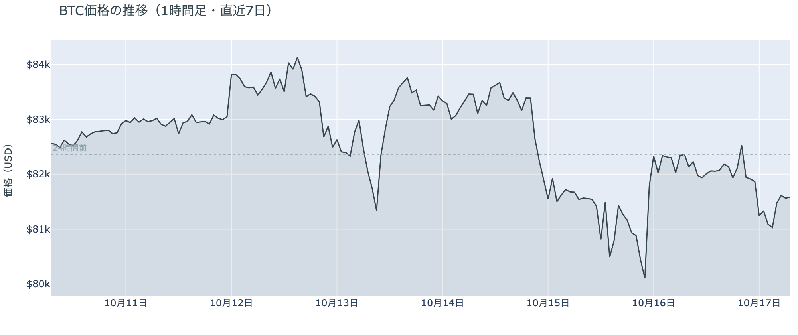

*図の見方: 1時間ごとの価格（日本時間）。点線は24時間前の水準。右端で線が点線の上から下へ、米国の取引時間にかけて階段のように下がっています。*

* 24時間の値幅は2.6%で、前日の3.6%から縮んだ。
* 建玉は24時間で0.5%増え、1週間前より1.5%多い。

金曜日は、夜8時台に$82,500まで上げたあと、米国の取引時間にじりじり下げて、深夜3時台に$81,000近くで底を打った日でした。夜8時台は価格が上げながら建玉（＝先物の未決済残高。証拠金で張っている人の量）が増えたので、新しくロングを積んだ人が上げを運びました。夜9時台から深夜3時台までは、価格が1.8%下げる間に建玉がわずかに減ったので、積んだばかりのロングの手仕舞いが下げを運んでいます。最後の1時間にあたる朝4時台は、価格が0.5%上げながら建玉が0.6%増えたので、戻しを運んだのは新しく積まれたロングです。Hyperliquid（＝オンチェーンの先物取引所）で見える清算は10件と少なく、ほぼ全部がロングで、深夜2時台に$81,000を割ったところで出た大口1件が7割を占めます。この1件は2時20分の速い足に入ってその1本の下げを押し広げましたが、ほかの速い足に清算は無く、夜の下げは手仕舞いのじり安です。

**図1-2 価格と50日・200日移動平均**

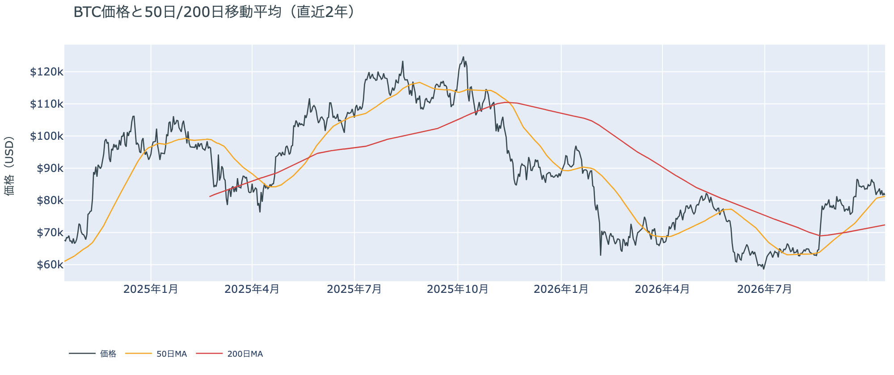

*図の見方: 2本の平均線の上下関係を見ます。50日線が200日線の上にあるのがゴールデンクロスです。*

* 50日線と200日線の差は約$8,900（12.3%）で、前日とほぼ同じ。
* 夜の安値$80,694は50日線の$81,252を0.7%下回り、朝7時5分の価格は線の0.5%上。

長い目で見た流れの向きは変わっていませんが、価格は2日続けて夜に50日線を割りました。ゴールデンクロス（＝50日線が200日線を上抜けること）の状態が39日目で、2本の平均線の差は開いたままです。木曜は1時間ほど、金曜は深夜2時台から3時台の2時間ほど線の下にいて、どちらも朝には線の上へ戻しています。価格は50日線のすぐ上に張りついた形で、上にも下にも抜けて定着していません。

証券市場は金曜10月16日、米国株（S&P500）が−1.1%、ナスダックは2%超の下げで引け、VIX（＝株式市場の恐怖指数）は20と4か月ぶりの高さまで2割上げました。金は+0.4%の$4,187、原油は+1.1%の$99で取引時間中に一時$100を超え、米10年債利回りは5.10%でほぼ動いていません。株が安値のまま引け、恐怖指数が上がったまま週末に入ったので、証券市場は株安と原油高を週末へ持ち越しています。木曜の「持ち越していない」から、1日で変わりました。

## 2. なぜ動いたか：きっかけと、需給のどこが動いたか

**図2-1 ビットコインと株・金・原油の相対推移（起点＝100）**

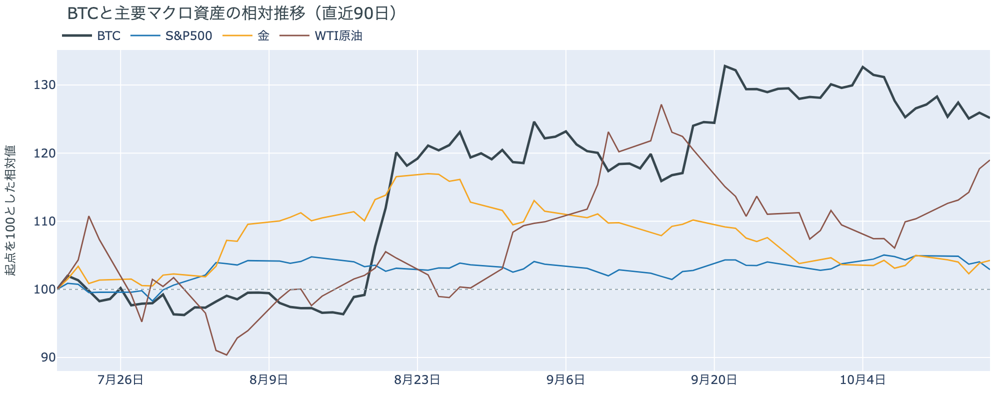

*図の見方: 同じ起点から何%動いたかで重ねたもの。線の向きが揃っているかを見ます。*

| この5営業日の動き（ビットコインは7日間） | 変化 |
|---|---:|
| ビットコイン | −1.1% |
| 金 | −0.7% |
| 米国株（S&P500） | −2.0% |
| 原油 | +7.8% |

* 建玉は94,552BTCで、前日の94,093BTCから0.5%増えた。
* 米10年債利回りは夜9時台の5.11%から深夜3時台の5.10%まで動かず、ビットコインが下げた時間に向きを変えていない。

金曜日の値動きは、米国株の下げと原油の上げをきっかけに、米国の取引時間に手仕舞われたロングを通って$81,000近くまで下げ、取引の最後の1時間に積み直されたロングを通って$81,500へ戻したものです。

1. きっかけ：外部環境の新しい出来事ではなく、証券市場の側です。金曜の米国株は、AI関連企業が借入に頼って設備を増やしていることへの不安を材料に下げ、午後には大手ヘッジファンドが大きな損失を出したという未確認の噂が広がってVIXが跳ねました。原油はサウジアラビアの東西パイプラインが攻撃されたという未確認の報道で、深夜2時台に一時$100を超えました。ビットコインは株と同じ時間帯に同じ向きで動き、下げ幅はS&P500と同じくらいでナスダックより小さかったので、株と共通のきっかけで動いた形です。金利は運んでいません。金曜の朝にFRBのウォーシュ議長が10月の利上げを否定しませんでしたが、FOMC（＝米国の金利を決める会合）で利上げする織り込みは約2割で、米CPIの翌日の約3割から下がり、米10年債利回りも夜を通して動いていないからです。ビットコインに固有の出来事では、MSCIが10月15日に、ビットコインを大量に持つ企業を株価指数から外しうる規則を確定し、対象になりうるStrategyの株が金曜に9%下げました。ただしその下げは株全体と同じ時間帯で、ビットコインがそれに別に反応した形跡はありません。
2. 伝わり方：先物のロングの手仕舞いです。夜9時台から深夜3時台まで、価格が1.8%下げる間に建玉はわずかに減ったので、木曜の夜に積み直されたロングの一部が、株安を見て手仕舞われました。清算は大口1件で、多数のロングが強制的に閉じられた形ではありません。アメリカの現物の買い手は引いたまま（図①-1）で、ETFもほぼゼロ（図①-2）なので、下げを止めたのは現物の買い手ではなく、最後の1時間に積み直された先物のロングです。資金調達率（＝ロングが払う金利。プラス＝ロングがショートより多い）は、1日をならした年率で+6.04%と、短期金利（＝ドルを米国の短期国債で持つだけで受け取れる金利。13週Tビル 4.07%）を引いた上乗せは+1.97ptです。前日の−2.51ptからプラスへ転じたので、ロングは短期金利より余分に払ってでも持つ側へ戻りました。

## 3. 市場参加者はいまどう見ているか

### ① アメリカの買い手はさらに引き、ETFの買い手は降りも戻りもしていない

**図①-1 Coinbase Premium（アメリカとそれ以外の価格差・直近90日）**

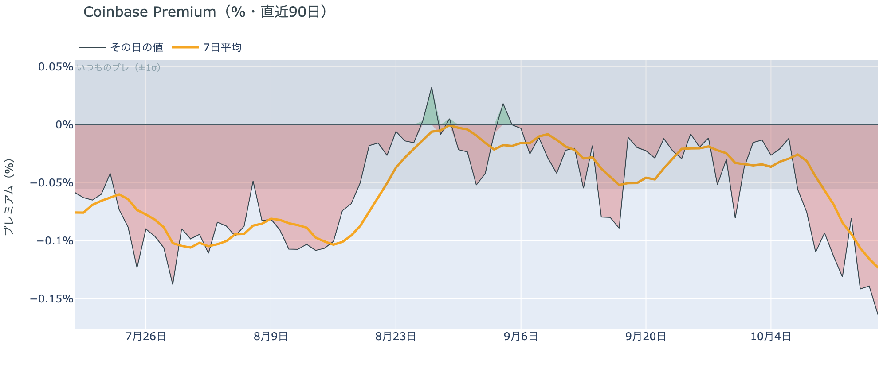

*図の見方: プラス＝アメリカで買いが強い。太線が1週間平均、細線がその日の値。薄い帯は「いつものブレの範囲」です。*

* 1週間平均は−0.12%で、前の週の−0.05%から倍以上沈んだ。
* その日の値は−0.16%で、いつものブレの3倍。取得できる約10か月の中で下から3%の低さ。

アメリカの買い手は引いたままで、金曜はさらに引きました。Coinbase Premium（＝アメリカとそれ以外の価格差）の1週間平均は前の週の倍以上沈み、その日の値はいつものブレを3倍超えて、この10か月でほぼ最低の水準まで下がったからです。木曜に帯の内側へ戻った分は1日で消え、米CPIの夜のようにアメリカだけが突出して安く取引される形が、株安の夜にもう一度出たということです。

**図①-2 ETFの日ごとの資金の出入り（直近90日）**

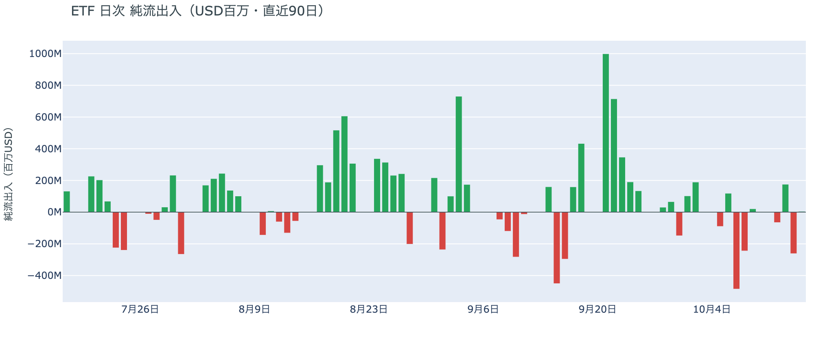

*図の見方: 入ったお金と出たお金の差。上に伸びれば入り超、下に伸びれば出超。*

| ETFの日ごとの出入り | 億ドル |
|---|---:|
| 10月7日 | −4.8 |
| 10月8日 | −2.4 |
| 10月9日 | +0.2 |
| 10月12日 | −0.7 |
| 10月13日 | +1.8 |
| 10月14日 | −2.6 |
| 10月15日 | +0.1 |
| 直近7営業日の合計 | −8.5 |

ETFの買い手は、米CPIの日に降りたあと、$80,000を割った木曜には降りも戻りもしていません。10月15日分はほぼゼロの入り超で、直近7営業日の合計の出超は広がりが止まりました。ただし先週水曜と木曜に出た分は戻っていないので、ETFの買い手は先週からの下げを買い増す側にはいません。

**図①-3 Fear & Greed（市場心理の指数・直近90日）**

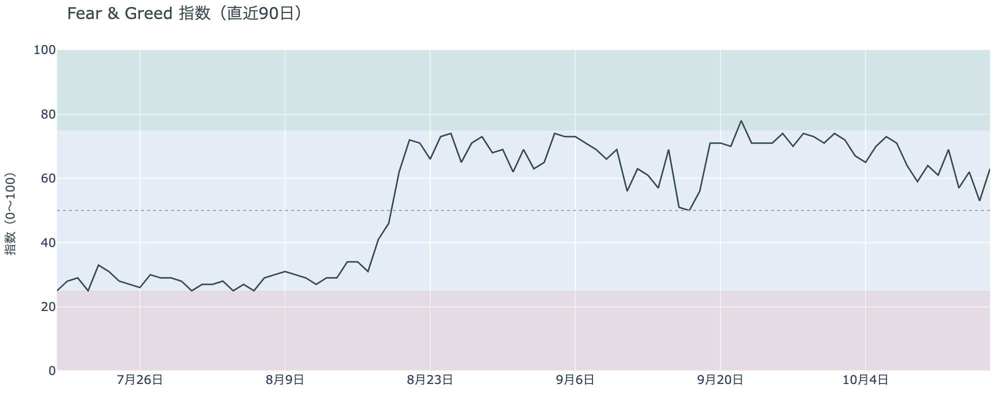

*図の見方: 0〜100で、50より上が「強欲」、下が「恐怖」。*

* 63の「強欲」。前日の53から10pt上げ、1週間前は59、1か月前は51。

市場心理は、1日だけの「中立」からもう「強欲」へ戻りました。Fear & Greed（＝市場心理の指数）の10月16日の確定値は、木曜に$80,000を割ってから1時間で戻した動きを見た人たちの反応で、価格の下げを怖がっている人は多数ではありません。1週間前より高いので、先週からの下げを「一時的な押し」と見る人のほうが、まだ多いままです。

### ② 長期保有者の利益確定の売りは続き、減り方は前の週の2倍を超えたまま

**図②-1 長期保有者の保有量の30日変化とSOPR（直近90日）**

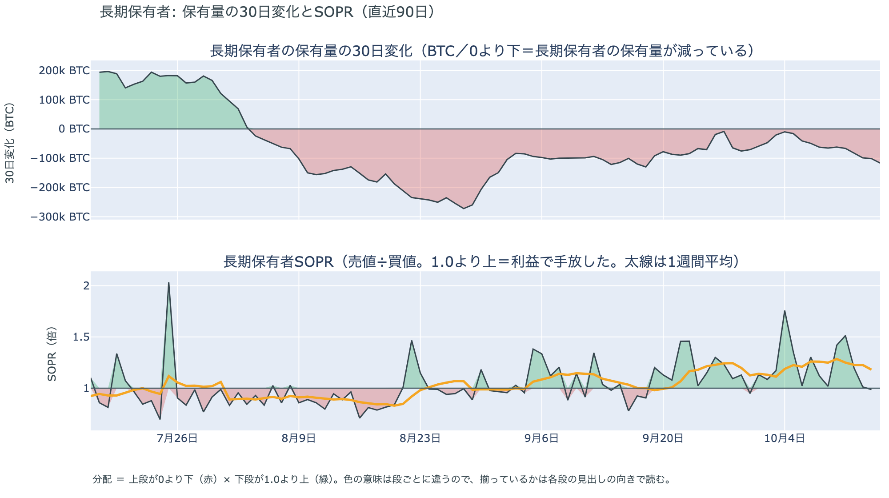

*図の見方: 上段は、長期保有者の保有量が30日でどれだけ増減したか。マイナス＝手放している。下段は長期保有者SOPRで、1より上なら利益で手放した。どちらも1週間平均で読みます。*

| 10月15日時点 | 1週間平均 | 前の週の平均 |
|---|---:|---:|
| 長期保有者SOPR（1より上＝利益で手放した） | 1.18 | 1.26 |
| 長期保有者の保有量の30日変化（万BTC） | −8.5 | −3.5 |

* 1週間平均の減り方は前の週の2.4倍で、1か月前（9月15日）の−11.5万BTCの4分の3。

長期保有者（＝155日以上保有者）は利益確定の売りを続けていて、減り方は前の週の2倍を超えたまま、さらに広がっています。保有量は30日で減り、動いたコインは平均して買値より高く動いています。減り方は先週の$80,000台への下げをまたいで広がり続けているので、長期保有者は先週からの下げを、売りを止める理由にはしていません。向きは前日と同じで、ビットコイン自身の需給の土台が変わったとまでは言えませんが、前日より重い形が続いています。

長期保有者のほかに、売りに回りそうな持ち手は見当たりません。長く眠っていたコインが急に動いた記録はなく、マイナーの収入は平年をやや上回る程度（Puell Multiple（＝マイナー収入の平年比）が1週間平均で1.12）で、売りを急ぐ状況ではありません。コインが最後に動いた価格の分布にも、今日は新しい材料がありません。

### ③ 先物：株安の夜にもロングは降りず、余分に払ってでも持つ側へ戻った

**図③-1 資金調達率と建玉（直近30日）**

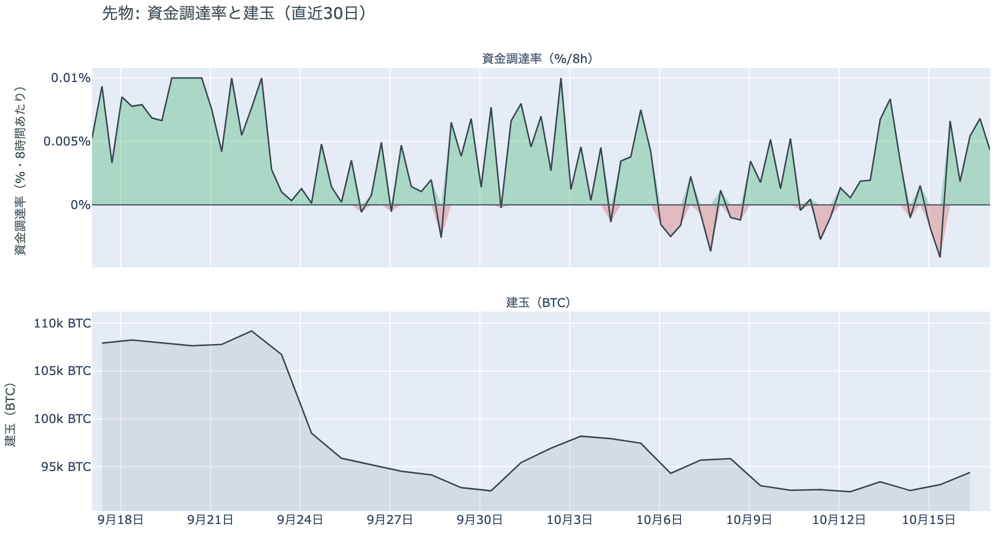

*図の見方: 上段は資金調達率（8時間ごと・日本時間）。プラスが続く＝ロングがショートより多い。下段は建玉。*

* 上乗せは+1.97ptで、前日の−2.51ptからプラスへ転じ、直近34日の平均−0.01ptより高い。
* 資金調達率のプラスは5回連続（約2日）。建玉は1週間前より1.5%多い。

先物の参加者は、株が2%下げた夜にも上げへの賭けを降りず、短期金利より余分に払ってでもロングを持つ側へ戻りました。米国の取引時間に手仕舞われたロングは一部で、最後の1時間には積み直されたので、建玉は1週間前より多いままです。前日は「下げに賭けた側は$80,000を割ったところで一晩で降り、ロングを積み直した」と説明しました。金曜は株安の夜にもショートへ戻る動きが出ず、ロングが払う金利が短期金利を上回ったので、前日の説明は今日の数値と合っています。上げへの確信は、米CPIで一度失われたあと、2日かけて戻ってきました。

### ④ オプション：備えは週明けの満期へ移り、この先の値動きを過去より大きいと見る側へ変わった

オプションには2種類あります。コール（＝決めた価格で買う権利）とプット（＝決めた価格で売る権利）で、価格が上がればコールの価値が上がり、価格が下がればプットの価値が上がります。プットは「価格が下がったときの保険」として買われます。オプションを買う人は、その権利と引き換えに権利料（＝オプションを買う人が払う金額）を払います。

**図④-1 満期ごとのIV（年率%）**

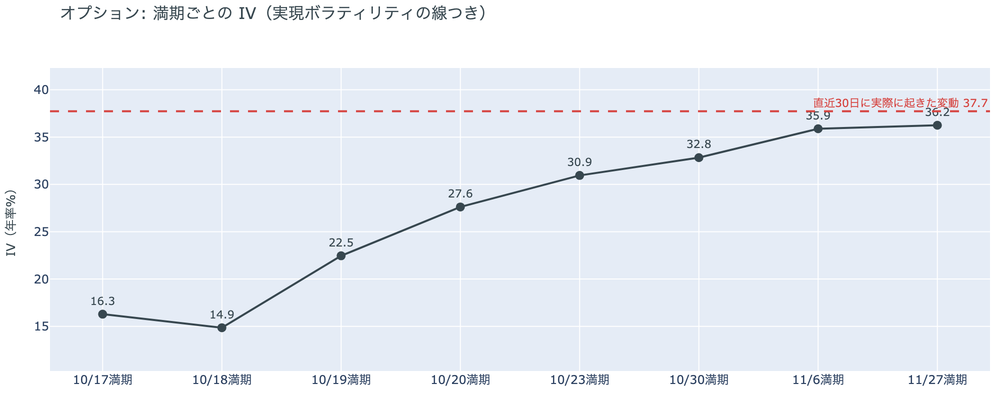

*図の見方: IVを満期ごとに並べたもの。点線は実現ボラティリティ。IVが点線より下なら、市場はこの先の値動きを過去の値動きより小さいと見ています。*

| 満期 | IV |
|---|---:|
| 10月17日・18日 | 15〜16 |
| 10月19日・20日 | 23〜28 |
| 10月23日・30日 | 31〜33 |
| 11月6日・27日 | 36 |

* IVは全体で38.8で、実現ボラティリティ37.7より1.0pt高い。過去1年で下から26%。

オプションの参加者は、この先の値動きを過去の値動きより大きいと見る側へ1日で変わりましたが、怖がってはいません。IV（＝値動きの幅の予想）は前日まで実現ボラティリティ（＝過去の値動きの幅）を下回っていましたが、金曜に上回りました。ただし過去1年の中では低いほうから4分の1の位置なので、恐怖の水準ではありません。満期（＝権利の期限）ごとに見ると手前が低く先が高い平常の形で、特定の日だけ権利料に上乗せが乗っている満期はありません。前日に17日の満期の権利料に乗っていた、18日・19日の満期に対する上乗せは、米国の取引時間が終わって剥がれました。

**図④-2 満期ごとのプットとコールの差**

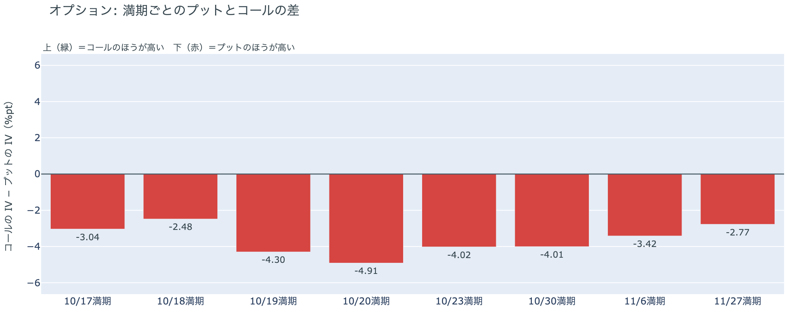

*図の見方: 満期ごとに、プットとコールのどちらが高く売れているか。ゼロより上ならコールのほうが高く、下ならプットのほうが高い。*

| 満期 | どちらが高いか |
|---|---|
| 10月17日 | プットが高い |
| 10月18日 | プットがやや高い |
| 10月19日 | プットがはっきり高い |
| 10月20日 | プットがはっきり高い |
| 10月23日 | プットが高い |
| 10月30日 | プットが高い |
| 11月6日 | プットが高い |
| 11月27日 | プットがやや高い |

参加者は下げへの備えを、今週の満期から週明けの満期へ移しました。備えがいちばん厚いのは19日と20日の満期で、株安と原油高を持ち越した週末のあと、最初に証券市場が開く月曜と火曜をまたぐからです。全部の満期でプットのほうが高い形は月曜から変わらず、コールのほうが高い満期は1つもありません。持ち高（図④-3）はほぼ動いていないので、週明けに向けて備えを新しく買い足したというより、置いていた備えを外さないまま、週明けの満期のプットの権利料が上がった形です。11月27日の満期ではプットの高さが小さいので、参加者は週明けからFOMCまでの下げに備えていますが、年末まで続く流れの変化とは見ていません。

**図④-3 10月30日満期の持ち高（権利の価格ごと）**

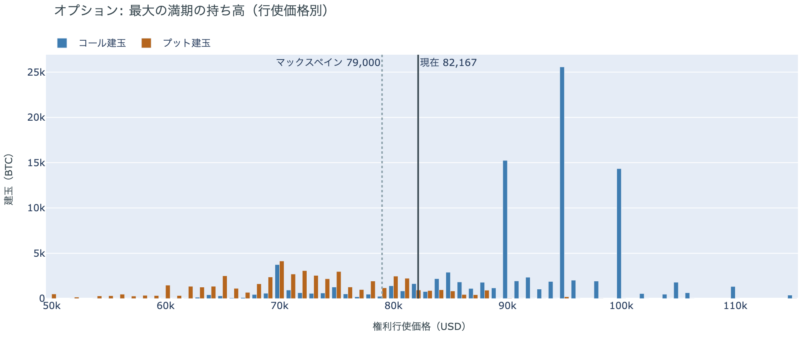

*図の見方: 青＝コール、橙＝プット。現値より上にコールが、下にプットが積まれるのが普通です。*

| 10月30日満期のオプション | 量（万BTC） | 意味 |
|---|---:|---|
| コール | 約9.9 | 「価格が上がる」に賭けた分 |
| プット | 約5.1 | 「価格が下がる」への保険 |
| うち、いまより15%以上高い価格のコール | 約4.9 | 大きな上げへの賭け |
| うち、いまより15%以上安い価格のプット | 約1.8 | 大きな下げへの保険 |

* 10月30日満期の持ち高は約15.0万BTCと全満期の38%で、前日とほぼ同じ。コールがプットの1.9倍。
* コールが集まっている価格は$95,000に約2.6万BTC、$90,000と$100,000に約1.5万BTCずつ。

「価格が上がる」に賭けた人たちは、株安の夜にも降りていません。10月30日満期の持ち高は前日から動かず、コールの大半はいまより高い$90,000から$100,000に積まれたままだからです。その賭けが報われるには、FOMCを越えて10月30日までに$90,000を超える必要があり、いまの価格からは10%上です。週明けの満期にプットの高さを残しながら、10月末までの上げへの賭けは外していないので、参加者は週明けの下げには備えつつ、10月末までに流れが変わるとは見ていない、という構えのままです。

## 4. 価格に影響しうる直近のイベント

オプション市場が下げへの備えをいちばん厚く置いているのは週明け19日と20日の満期で、この区間に当たるのは、株安と原油高を持ち越した週末のあと、最初に証券市場が開く月曜と火曜の米国の取引時間です。FRBは今日からFOMCまでブラックアウトに入り、織り込みを動かす材料は米国の物価や雇用の数字だけになります。FOMCをまたぐ10月30日の満期はプットが高いだけで、ほかの満期に対する上乗せは乗っていません。原油の側では、サウジアラビアの東西パイプラインが攻撃されたという未確認の報道と、フーシ派との攻撃の応酬が、週末へ持ち越された材料です。

| 日付 | イベント | 何に効くか |
|---|---|---|
| 10/17（土）〜29（木） | FRBのブラックアウト期間。FOMCの結果が出るまで高官の発言が止まる。金曜の朝にはウォーシュ議長が10月の利上げを否定しなかった | 金利。織り込みを動かす材料が米国の物価や雇用の数字だけになる |
| 10/16（金）〜 | サウジアラビアの東西パイプラインが攻撃されたという未確認の報道で原油が一時$100超。フーシ派はサウジアラビアの石油施設と空港を標的にし続けると表明したまま | 原油 |
| 10/19（月）・20（火）17:00 | オプションの満期。株安を持ち越した週明けの2日で、プットがはっきり高い | 下げへの備えの期限 |
| 10/27（火）〜28（水） | FOMC。利上げの織り込みは約2割で、米CPIの翌日の約3割から下がった。結果は日本時間29日未明 | 金利。プットが高い10月30日の満期がまたぐ |
| 10/29（木）〜30（金） | 日銀の会合。展望レポートも出る | 円 |
| 10/30（金）17:00 | オプションの最も大きな満期（約15.0万BTC、全満期の38%）。FOMCの2日後 | $90,000以上のコールの期限 |
| 11/1（日） | OPEC+の会合。12月の生産目標を決める | 原油 |
| 11/3（火） | 米国の中間選挙。トランプ大統領は「それまでイランを攻撃しない」と述べている | 原油 |
| 11/10（火） | Binanceのマイニングプールが停止（ハッシュレートの約2%） | ハッシュレート |
| 11/11（水） | MSCIが株価指数から外す企業の最終一覧を公表。ビットコインを大量に持つ企業を外しうる規則を10月15日に確定し、Strategyが対象になりうる。入れ替えは11月30日 | 指数に連動する資金による、それらの企業の株の売買 |

## まとめ：金曜日の動きは何だったか

金曜日は、米国株の下げと原油の上げをきっかけに、米国の取引時間に手仕舞われたロングを通って$81,000近くまでじりじり下げ、取引の最後の1時間に積み直されたロングを通って$81,500へ戻した日でした。ビットコイン自身の需給の土台は変わっていません。アメリカの買い手はさらに引いて戻しには加わらず、長期保有者の利益確定の売りは減り方を広げたまま続いています。参加者は、株安を持ち越した週明けの2日には下げへの備えを厚くしましたが、ロングは短期金利より余分に払ってでも持ち続け、10月末のコールも外していないので、週明けの揺れには備えつつ、10月末までに流れが変わるとは見ていません。

---

<small>（数値は10月17日7時5分（日本時間）までのデータに基づきます。価格・先物・オプション・Coinbase Premiumはその時点の値、市場心理は10月16日の確定値、オンチェーン（＝ブロックチェーン上の記録）は10月15日時点、ETF資金フローは10月15日分までです。証券市場の終値は10月16日時点で、週末のため次の更新は月曜日です。FOMCの織り込みは10月16日のFF金利先物の終値から計算したものです。オンチェーンの長期保有者の数値には、ETFや取引所が預かっている分も含まれます。オプションはDeribit（BTCオプションの大半を占める取引所）の全銘柄です。）</small>

*本稿は情報提供を目的としたものであり、投資助言ではありません。将来の価格動向を保証・示唆するものではなく、投資判断は各自の責任において行ってください。*
