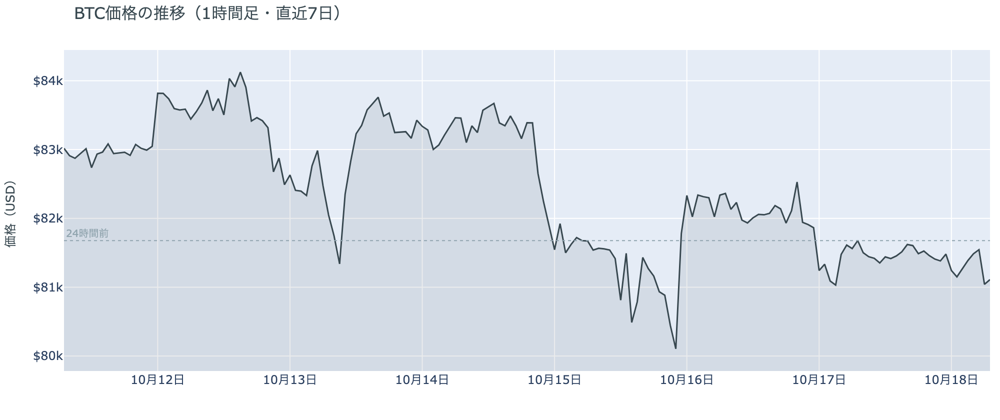
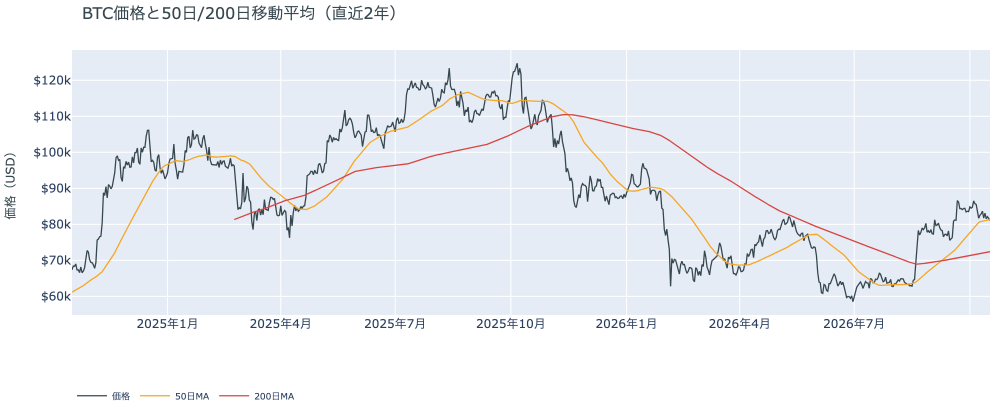
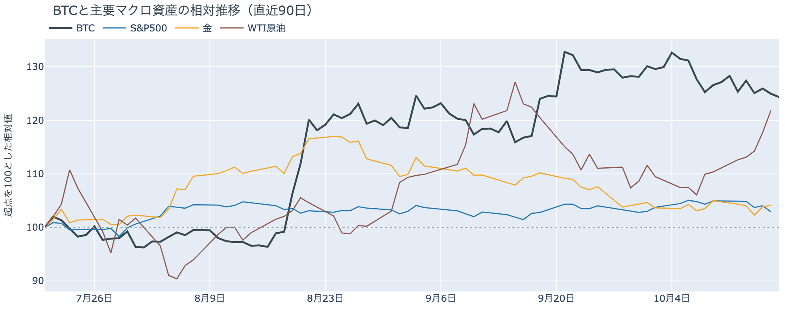
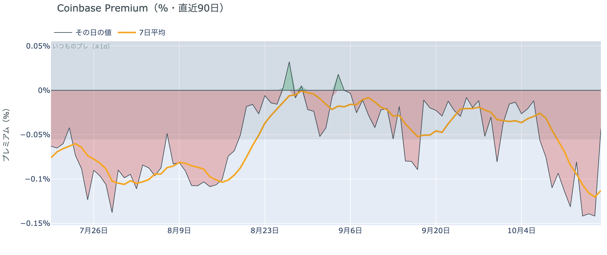
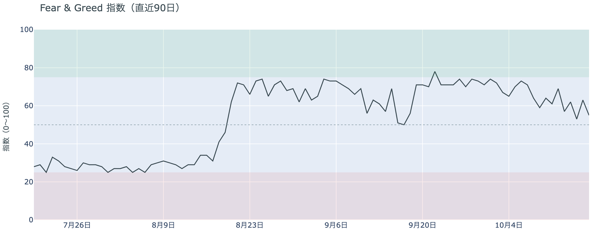
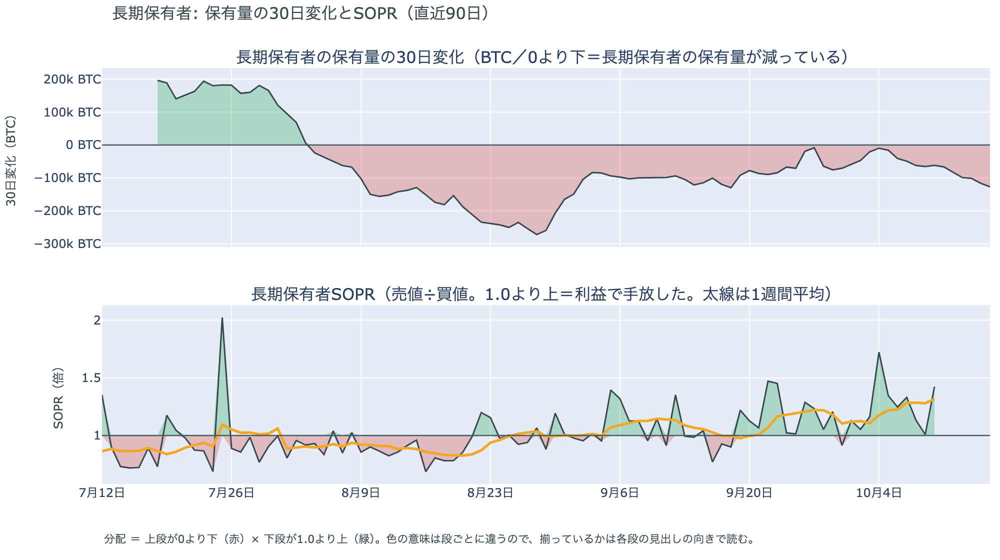
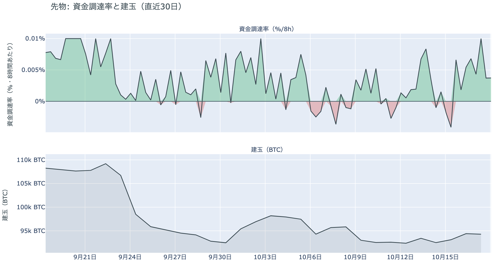
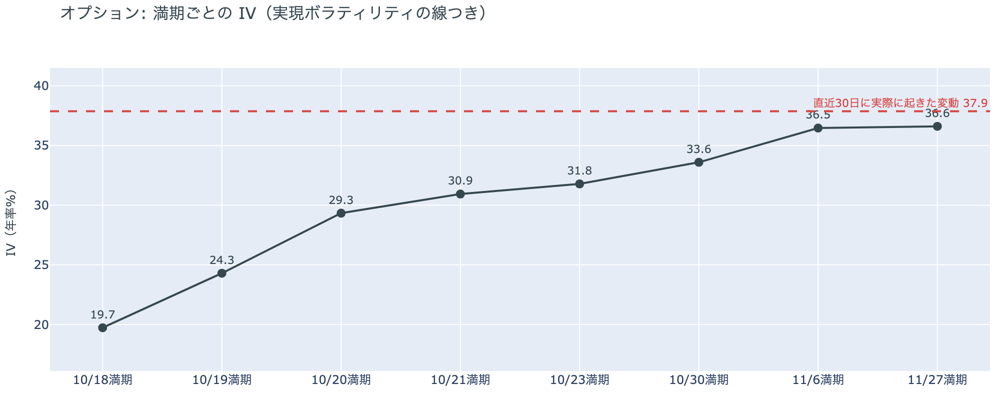
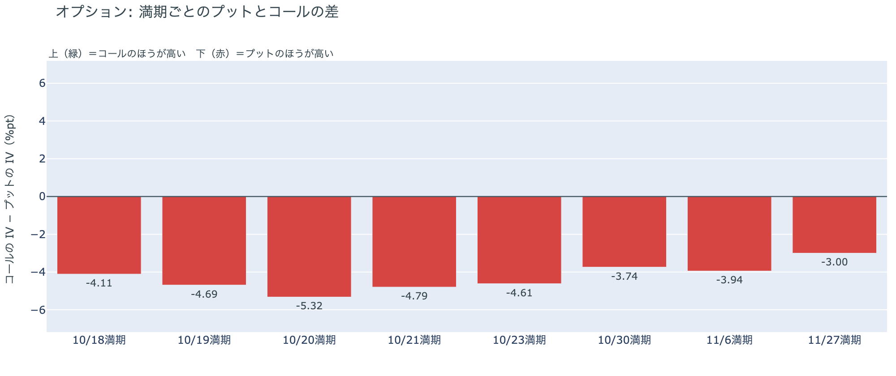
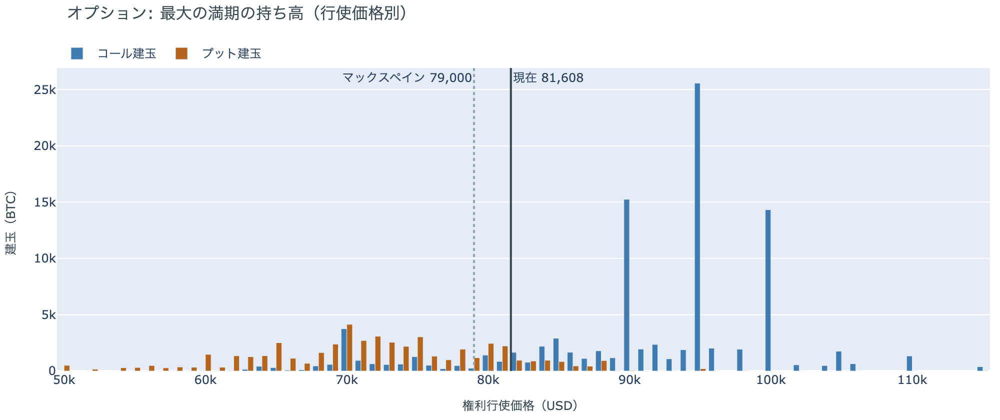

# $81,000台で横ばいの土曜、朝に50日線を割る ― ロングは残り、下げへの備えは火曜・水曜の満期に厚い

**2026年10月18日**

ビットコインは土曜日、日中は$81,400前後でほとんど動かず、日曜の朝6時台に$81,000近くまで下げて、朝7時5分の時点では$81,100近くでした。

* **価格**：24時間の値幅は1.3%で、前日の2.6%から半分に縮みました。朝7時5分の時点で約$81,086と24時間前より0.8%安く、下げは日曜の朝6時台の1時間に集まっています。この下げで価格は50日線をわずかに割り、木曜・金曜の夜に続いて3日続けて線の下を見ました
* **きっかけ**：新しいきっかけは来ませんでした。証券市場は週末で閉まっていて、金曜に原油を押し上げたホルムズ海峡での船舶攻撃やフーシ派のサウジアラビア攻撃、トランプ大統領が金曜に署名したロシア産原油への関税の大統領令は、土曜のビットコインを動かしていません。株安と原油高は、そのまま週明けへ持ち越されています
* **先物**：上げも下げも運んでいません。建玉はほぼ変わらず、清算（＝証拠金不足で強制的に閉じられた取引）は朝6時台の大口1件だけで、値動きの速い足には入っていません。買い持ち（ロング）は短期金利より余分に払ったまま残っているので、上げへの確信は金曜から弱まっていません
* **需給の土台**：米国の買い手は引いたままで、ETFは10月16日分も小さな流出でした。長期保有者の利益確定の売りは続き、減り方は前の週の2倍を超えてさらに広がりました。土台は前日から変わっていませんが、軽くなってもいません
* **オプションの見方**：全部の満期でプットのほうが高く、備えがいちばん厚いのは、週明けの月曜と火曜の米国の取引時間をまたぐ20日・21日の満期です。IVは全体で実現ボラティリティと同じ水準に戻り、金曜に出た「この先は過去より大きく動く」と見る側への傾きは一晩で消えました。10月末のコールは外されていません

## 1. 何が起きたか

**図1-1 価格の推移（1時間足・直近7日）**

*図の見方: 1時間ごとの価格（日本時間）。点線は24時間前の水準。土曜は線がほぼ平らで、右端の朝6時台だけ点線の下へ一段下がっています。*

* 24時間の値幅は1.3%で、前日の2.6%の半分。
* 建玉は24時間で0.2%減り、1週間前より1.9%多い。

土曜日は、日中を$81,350から$81,620の狭い幅で過ごし、日曜の朝6時台に$81,000近くまで0.6%下げた日でした。日中は価格も建玉（＝先物の未決済残高。証拠金で張っている人の量）もほとんど動かず、ロングもショートも新しく積まれていません。朝6時台の下げでも建玉はほぼ変わらず、Hyperliquid（＝オンチェーンの先物取引所）で見える清算はロングの大口1件だけで、値動きの速い5分足には入っていません。清算が下げを加速させた形でも、ロングがまとまって手仕舞われた形でもなく、持ち高を動かさずに起きた下げです。はっきりしたきっかけは見当たりません。

**図1-2 価格と50日・200日移動平均**

*図の見方: 2本の平均線の上下関係を見ます。50日線が200日線の上にあるのがゴールデンクロスです。*

* 50日線と200日線の差は約$8,900（12.3%）で、前日と同じ。
* 朝7時5分の価格は50日線の$81,315を0.3%下回る。

長い目で見た流れの向きは変わっていませんが、価格は朝6時台の下げで50日線をわずかに割ったまま朝を迎えました。ゴールデンクロス（＝50日線が200日線を上抜けること）の状態が40日目で、2本の平均線の差は開いたままです。木曜と金曜は夜に線を割って朝には線の上へ戻していましたが、土曜は戻さずに線の下にいます。差が1%に届かないので、線の下に定着したとは言えず、価格が50日線に張りついた形が続いています。

証券市場は週末で休みです。金曜10月16日は米国株（S&P500）が−1.1%、ナスダックは−2.1%で、どちらも6月以来いちばん悪い週で終えました。原油（WTI）は+3.5%の$101で、ブレントは5月以来の$110に触れ、VIX（＝株式市場の恐怖指数）は20まで2割上げたままです。株安と原油高がそろったまま週末に入ったので、週明けの証券市場には、金曜と同じ材料が両方とも持ち越されています。

## 2. なぜ動いたか：きっかけと、需給のどこが動いたか

**図2-1 ビットコインと株・金・原油の相対推移（起点＝100）**

*図の見方: 同じ起点から何%動いたかで重ねたもの。線の向きが揃っているかを見ます。*

| この5営業日の動き（ビットコインは7日間） | 変化 |
|---|---:|
| ビットコイン | −2.2% |
| 金 | −0.8% |
| 米国株（S&P500） | −2.0% |
| 原油 | +10.4% |

* 建玉は94,387BTCで、前日の94,552BTCから0.2%減った。

土曜日に価格が動かなかったのは、新しいきっかけが来ず、先物のロングもショートも動かなかったからです。朝6時台の0.6%の下げも、持ち高を動かさずに起きています。

1. きっかけ：証券市場は閉まっていて、新しい出来事はビットコインに届いていません。金曜に原油を押し上げた材料は3つあり、イランによるホルムズ海峡での船舶攻撃、フーシ派がサウジアラビアの石油輸出港ヤンブーに向けて撃ったミサイル、ロシアとウクライナのエネルギー停戦の崩れです。これに加えてトランプ大統領は金曜、ロシアへの500%関税とロシア産原油の主要輸入国への100%関税を発動する大統領令に署名し、同時に制裁の一部を免除しました。どれも土曜のビットコインを動かしていません。土曜の日中、価格は$81,350から$81,620の間にとどまったからです。この5営業日では、株と金が下げて原油が上げるなかでビットコインも下げていて、株と同じ向きです。ただし同じ向きに動いたことは、共通のきっかけがありえたことを示すだけで、原因の証明ではありません。
2. 伝わり方：先物の持ち高はどちらにも動きませんでした。建玉は24時間で0.2%しか減らず、朝6時台の下げでも増減はわずかで、清算もロングの大口1件が速い足の外で出ただけです。資金調達率（＝ロングが払う金利。プラス＝ロングがショートより多い）は、1日をならした年率で+6.36%と、短期金利（＝ドルを米国の短期国債で持つだけで受け取れる金利。13週Tビル 4.07%）を引いた上乗せは+2.29ptです。金曜の+1.97ptからわずかに増え、ロングは短期金利より余分に払ってでも持ち続けています。アメリカの現物の買い手は引いたまま（図①-1）、ETFは10月16日分も小さな流出（図①-2）なので、週末の価格を$81,000台に保ったのは現物の買い手ではなく、降りなかった先物のロングです。

## 3. 市場参加者はいまどう見ているか

### ① アメリカの買い手は引いたままで、ETFの買い手も戻っていない

**図①-1 Coinbase Premium（アメリカとそれ以外の価格差・直近90日）**

*図の見方: プラス＝アメリカで買いが強い。太線が1週間平均、細線がその日の値。薄い帯は「いつものブレの範囲」です。*

* 1週間平均は−0.11%で、前の週の−0.06%の2倍沈んだまま。
* その日の値は−0.04%で、いつものブレの範囲内。前日の−0.16%（ブレの3倍）から帯の内側へ戻った。

アメリカの買い手は引いたままで、土曜に戻ってきた形にはなっていません。Coinbase Premium（＝アメリカとそれ以外の価格差）の1週間平均は、前の週の2倍沈んだままだからです。その日の値は金曜の深い沈みから帯の内側へ戻りましたが、1週間平均が沈んだままなので、アメリカだけが安く取引される形は株安の夜だけの一時的なものではなく、10月9日から10日続いています。

**図①-2 ETFの日ごとの資金の出入り（直近90日）**

*図の見方: 入ったお金と出たお金の差。上に伸びれば入り超、下に伸びれば出超。*

| ETFの日ごとの出入り | 億ドル |
|---|---:|
| 10月8日 | −2.4 |
| 10月9日 | +0.2 |
| 10月12日 | −0.7 |
| 10月13日 | +1.8 |
| 10月14日 | −2.6 |
| 10月15日 | +0.1 |
| 10月16日 | −0.8 |
| 直近7営業日の合計 | −4.5 |

ETFの買い手は戻っていません。10月16日分は小さな流出で、7営業日のうち入り超は3日だけ、どれも前後の流出を埋める大きさではないからです。先週水曜の米CPIの日に出た分は戻っておらず、ETFの買い手は先週からの下げを買い増す側にはいないままです。

**図①-3 Fear & Greed（市場心理の指数・直近90日）**

*図の見方: 0〜100で、50より上が「強欲」、下が「恐怖」。*

* 55の「強欲」。前日の63から8pt下げ、1週間前は64、1か月前は50。

市場心理は「強欲」の下の端まで下がり、「中立」との境目にいます。Fear & Greed（＝市場心理の指数）の10月17日の確定値は、株安と原油高の夜にじりじり下げた金曜の値動きを見た人たちの反応で、木曜の戻しで上げた分を1日で返しました。1週間前より低いので、先週からの下げを「一時的な押し」と見る人は、1週間前より減っています。

### ② 長期保有者の利益確定の売りは続き、減り方は前の週の2.5倍に広がった

**図②-1 長期保有者の保有量の30日変化とSOPR（直近90日）**

*図の見方: 上段は、長期保有者の保有量が30日でどれだけ増減したか。マイナス＝手放している。下段は長期保有者SOPRで、1より上なら利益で手放した。どちらも1週間平均で読みます。*

| 10月16日時点 | 1週間平均 | 前の週の平均 |
|---|---:|---:|
| 長期保有者SOPR（1より上＝利益で手放した） | 1.32 | 1.11 |
| 長期保有者の保有量の30日変化（万BTC） | −9.4 | −3.8 |

* 1週間平均の減り方は、1か月前（9月16日）の−10.1万BTCとほぼ同じ水準まで戻った。

長期保有者（＝155日以上保有者）は利益確定の売りを続けていて、減り方は前の週の2.5倍に広がりました。保有量は30日で減り、動いたコインは平均して買値より高く動いていて、その差は前の週より大きくなっています。減り方は先週の$80,000台への下げをまたいで広がったので、長期保有者は下げを、売りを止める理由にはしていません。向きは前日と同じで、ビットコイン自身の需給の土台が変わった日ではありませんが、1か月前と同じ規模の売りが戻ってきた分、金曜より重い側です。

長期保有者のほかに、売りに回りそうな持ち手は見当たりません。長く眠っていたコインが急に動いた記録はなく、マイナーの収入は平年をやや上回る程度（Puell Multiple（＝マイナー収入の平年比）が1週間平均で1.13）で、売りを急ぐ状況ではありません。コインが最後に動いた価格の分布にも、今日は新しい材料がありません。

### ③ 先物：週末もロングは降りず、短期金利より余分に払ったまま

**図③-1 資金調達率と建玉（直近30日）**

*図の見方: 上段は資金調達率（8時間ごと・日本時間）。プラスが続く＝ロングがショートより多い。下段は建玉。*

* 資金調達率のプラスは8回連続（約3日）。建玉は1週間前より1.9%多い。
* 上乗せの直近34日の平均は−0.11ptで、いまはそれを2pt以上上回る。

先物の参加者は、株安と原油高を持ち越した週末にも上げへの賭けを降りず、短期金利より余分に払ってでもロングを持ち続けています。建玉は金曜からほぼ変わらず1週間前より多いままで、資金調達率から短期金利を引いた上乗せもこの1か月の平均を上回っているので、上げへの確信は、米CPIで一度失われたあと2日かけて戻った水準を保っています。前日は「ロングは短期金利より余分に払ってでも持ち続け、10月末までに流れが変わるとは見ていない」と説明しました。土曜もロングの手仕舞いは出ず、上乗せも消えていないので、前日の説明は今日の数値と合っています。ただし買い増してもいないので、週末に賭けを大きくしたわけではありません。

### ④ オプション：備えは週明けの火曜・水曜の満期に最も厚く、IVは実現ボラティリティと同じ水準へ戻った

オプションには2種類あります。コール（＝決めた価格で買う権利）とプット（＝決めた価格で売る権利）で、価格が上がればコールの価値が上がり、価格が下がればプットの価値が上がります。プットは「価格が下がったときの保険」として買われます。オプションを買う人は、その権利と引き換えに権利料（＝オプションを買う人が払う金額）を払います。

**図④-1 満期ごとのIV（年率%）**

*図の見方: IVを満期ごとに並べたもの。点線は実現ボラティリティ。IVが点線より下なら、市場はこの先の値動きを過去の値動きより小さいと見ています。*

| 満期 | IV |
|---|---:|
| 10月18日 | 20 |
| 10月19日・20日 | 24〜29 |
| 10月21日・23日 | 31〜32 |
| 10月30日 | 34 |
| 11月6日・27日 | 36〜37 |

* IVは全体で37.7で、実現ボラティリティ37.9とほぼ同じ（0.2pt低い）。過去1年で下から26%。

オプションの参加者は、この先の値動きを過去の値動きと同じくらいと見ていて、怖がってはいません。IV（＝値動きの幅の予想）は金曜に実現ボラティリティ（＝過去の値動きの幅）を1pt上回りましたが、土曜にはほぼ同じ水準まで戻りました。過去1年の中では低いほうから4分の1の位置なので、恐怖の水準ではありません。満期（＝権利の期限）ごとに見ると手前が低く先が高い平常の形で、特定の日だけ権利料に上乗せが乗っている満期はありません。FOMC（＝米国の金利を決める会合）をまたぐ10月30日の満期も、前後の満期に対して権利料が高くなっていません。

**図④-2 満期ごとのプットとコールの差**

*図の見方: 満期ごとに、プットとコールのどちらが高く売れているか。ゼロより上ならコールのほうが高く、下ならプットのほうが高い。*

| 満期 | どちらが高いか |
|---|---|
| 10月18日 | プットが高い |
| 10月19日 | プットが高い |
| 10月20日 | プットがはっきり高い |
| 10月21日 | プットがはっきり高い |
| 10月23日 | プットが高い |
| 10月30日 | プットが高い |
| 11月6日 | プットが高い |
| 11月27日 | プットがやや高い |

参加者は下げへの備えを、週明けに最初に証券市場が開く月曜と火曜の米国の取引時間をまたぐ、20日と21日の満期にいちばん厚く置いています。株安と原油高を持ち越した週末のあと、最初に株と原油に値が付く2日だからです。全部の満期でプットのほうが高い形は月曜から変わらず、コールのほうが高い満期は1つもありません。持ち高（図④-3）は動いていないので、週末に備えを買い足したのではなく、金曜に置いた備えをそのまま持ち越した形です。11月27日の満期ではプットの高さがいちばん小さいので、参加者は週明けからFOMCまでの下げに備えていますが、年末まで続く流れの変化とは見ていません。

**図④-3 10月30日満期の持ち高（権利の価格ごと）**

*図の見方: 青＝コール、橙＝プット。現値より上にコールが、下にプットが積まれるのが普通です。*

| 10月30日満期のオプション | 量（万BTC） | 意味 |
|---|---:|---|
| コール | 約9.8 | 「価格が上がる」に賭けた分 |
| プット | 約5.1 | 「価格が下がる」への保険 |
| うち、いまより15%以上高い価格のコール | 約5.1 | 大きな上げへの賭け |
| うち、いまより15%以上安い価格のプット | 約1.8 | 大きな下げへの保険 |

* 10月30日満期の持ち高は約15.0万BTCと全満期の38%で、前日と同じ。コールがプットの1.9倍。
* コールが集まっている価格は$95,000に約2.6万BTC、$90,000と$100,000に約1.5万BTCずつ。

「価格が上がる」に賭けた人たちは、週末も降りていません。10月30日満期の持ち高は金曜から動かず、コールの大半はいまより高い$90,000から$100,000に積まれたままだからです。その賭けが報われるには、FOMCを越えて10月30日までに$90,000を超える必要があり、いまの価格からは11%上です。週明けの満期にプットの高さを置きながら10月末のコールは外していないので、参加者は週明けの下げには備えつつ、10月末までに流れが変わるとは見ていない構えを、週末もそのまま持ち越しています。

## 4. 価格に影響しうる直近のイベント

オプション市場が下げへの備えをいちばん厚く置いているのは20日と21日の満期で、この区間に当たるのは、株安と原油高を持ち越した週末のあと、最初に証券市場が開く月曜と火曜の米国の取引時間です。原油の側では、ホルムズ海峡での船舶攻撃、フーシ派のサウジアラビア攻撃、ロシアとウクライナのエネルギー停戦の崩れが週末へ持ち越され、金曜に署名されたロシア産原油への関税の大統領令は日曜から適用が始まります。FRBはFOMCまでブラックアウトに入っていて、FOMCをまたぐ10月30日の満期はプットが高いだけで、ほかの満期に対する上乗せは乗っていません。利上げの織り込みは2割弱で、米CPIの翌日の約3割から下がっています。

| 日付 | イベント | 何に効くか |
|---|---|---|
| 10/18（日）〜 | 米国がロシア産原油・ガスの主要輸入5か国への100%関税の適用を開始。トランプ大統領が16日に署名した大統領令で、ロシアへの500%関税も発動する一方、制裁の一部は免除した。19日はロシアの3大銀行への制裁を課す期限で、免除の対象かは未確定 | 原油 |
| 10/20（火）・21（水）17:00 | オプションの満期。株安と原油高を持ち越した週明けの月曜・火曜の米国の取引時間をまたぎ、プットがはっきり高い | 下げへの備えの期限 |
| 10/21（水）米国の引け後 | Meta・Teslaなど大手テック6社の決算（日本時間22日朝） | 米国株。AI関連の設備投資と借入への不安で株が下げた週の、最初の決算 |
| 10/23（金） | 米国の10月PMI速報 | 金利・株 |
| 10/27（火）〜28（水） | FOMC。利上げの織り込みは2割弱で、米CPIの翌日の約3割から下がった。結果は日本時間29日未明。FRBは17日からブラックアウト | 金利。プットが高い10月30日の満期がまたぐ |
| 10/29（木） | 米国の7〜9月期GDPと9月のPCE物価 | 金利 |
| 10/29（木）〜30（金） | 日銀の会合。展望レポートも出る | 円 |
| 10/30（金）17:00 | オプションの最も大きな満期（約15.0万BTC、全満期の38%）。FOMCの2日後 | $90,000以上のコールの期限 |
| 11/1（日） | OPEC+の会合。12月の生産目標を決める | 原油 |
| 11/3（火） | 米国の中間選挙。トランプ大統領は「それまでイランを攻撃しない」と述べている | 原油 |
| 11/11（水） | MSCIが株価指数から外す企業の最終一覧を公表。ビットコインを大量に持つ企業を外しうる規則を10月15日に確定し、Strategyが対象になりうる。入れ替えは11月30日 | 指数に連動する資金による、それらの企業の株の売買 |

## まとめ：土曜日の動きは何だったか

土曜日は、新しいきっかけが来ず、先物のロングもショートも動かなかったので$81,400前後で止まり、日曜の朝6時台に持ち高を動かさない小さな下げで50日線をわずかに割った日でした。ビットコイン自身の需給の土台は変わっていません。アメリカの買い手は引いたまま戻らず、長期保有者の利益確定の売りは減り方を広げたまま続いています。参加者は、株安と原油高を持ち越した週明けの米国の取引時間には下げへの備えを厚くしたまま、ロングは短期金利より余分に払ってでも持ち続け、10月末のコールも外していないので、週明けの揺れには備えつつ、10月末までに流れが変わるとは見ていません。

---

<small>（数値は10月18日7時5分（日本時間）までのデータに基づきます。価格・先物・オプション・Coinbase Premiumはその時点の値、市場心理は10月17日の確定値、オンチェーン（＝ブロックチェーン上の記録）の長期保有者の保有量は10月16日時点、長期保有者SOPRとマイナーの収入は10月10日分まで、ETF資金フローは10月16日分までです。証券市場の終値は10月16日時点で、週末のため次の更新は月曜日です。FOMCの織り込みは10月16日のFF金利先物の終値から計算したものです。オンチェーンの長期保有者の数値には、ETFや取引所が預かっている分も含まれます。オプションはDeribit（BTCオプションの大半を占める取引所）の全銘柄です。）</small>

*本稿は情報提供を目的としたものであり、投資助言ではありません。将来の価格動向を保証・示唆するものではなく、投資判断は各自の責任において行ってください。*
