# 日曜の夜に$82,000台と$81,000の間を往復 ― 週末のロングは1日で手仕舞われ、市場心理は「中立」へ

**2026年10月19日**

ビットコインは日曜日、夕方にかけて$82,000台まで上げたあと、22時から23時台に$81,000近くまで下げ、朝7時5分の時点では約$81,500と24時間前とほぼ同じでした。

* **価格**：24時間の値幅は2.0%で、土曜の1.3%から広がりましたが、上げも下げも1日で打ち消され、朝7時5分の時点で約$81,506は24時間前より0.3%高いだけです。価格は土曜に割った50日線の上へ戻り、線に張りついた形が続いています
* **きっかけ**：新しいきっかけは来ませんでした。証券市場は週末で閉まっていて、ホルムズ海峡でのタンカーの触雷やフーシ派のサウジアラビア攻撃は土曜に伝わったもので、日曜の夜の下げと時刻が合いません。金曜にトランプ大統領が署名した大統領令は、ロシア産原油の輸入国への関税を発動するものではなく、見送るものでした
* **先物**：下げを運んだのは先物です。日曜の夕方に積まれた買い持ち（ロング）が夜に手仕舞われ、深夜の清算（＝証拠金不足で強制的に閉じられた取引）は大口1件だけで値動きの速い足の外でした。残ったロングは短期金利より余分に払う分を増やしているので、上げへの確信は土曜から弱まっていません
* **需給の土台**：米国の買い手は引いたままで、Coinbase Premium（＝アメリカとそれ以外の価格差）の1週間平均はさらに沈みました。ETFは週末のため10月16日分の小さな流出が最新です。長期保有者（＝155日以上保有者）の利益確定の売りは続き、減り方は前の週の2倍を超えたままです。土台は前日から変わっていません
* **オプションの見方**：全部の満期でプットのほうが高く、備えがいちばん厚いのは、週明けの月曜と火曜の米国の取引時間をまたぐ20日・21日の満期です。週明けを前に手前の満期のIVが上がって10月30日の満期より高くなったので、参加者は今週の最初の2日を、FOMCまでの残りの日より荒れると見ています。10月末のコールは外されていません

## 1. 何が起きたか

**図1-1 価格の推移（1時間足・直近7日）**

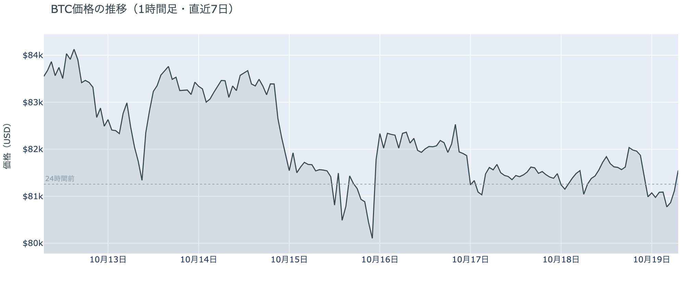

*図の見方: 1時間ごとの価格（日本時間）。点線は24時間前の水準。日曜は夕方に一段上がり、夜に点線の下へ下がって、朝に点線のところまで戻っています。*

* 24時間の値幅は2.0%で、土曜の1.3%から広がった。
* 建玉は24時間で0.9%減ったが、1週間前より1.8%多い。

日曜日は、夕方6時台に$82,000台まで上げたあと、22時から23時台の2時間で$81,000近くまで1.1%下げ、朝にかけて$81,500へ戻した日でした。夕方の上げでは価格と一緒に建玉（＝先物の未決済残高。証拠金で張っている人の量）が約2%増えたので、ロングが新しく積まれています。夜の下げでは22時台に建玉が1.9%減ったので、その積まれたロングが手仕舞われて下げを運び、続く23時台には価格が下げながら建玉が増えたので、ショートが積まれました。Hyperliquid（＝オンチェーンの先物取引所）で見える清算は8件で、そのうち深夜1時台のロングの大口1件が大半を占めますが、値動きの速い5分足には入っていません。清算が下げを加速させた形ではなく、積まれたロングの手仕舞いで下げ、下げが止まったあとに大口が1つ飛んだ形です。

**図1-2 価格と50日・200日移動平均**

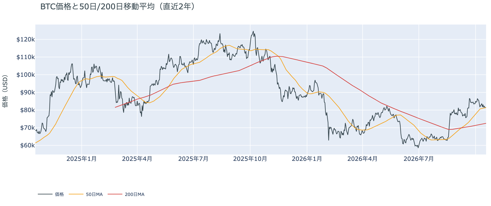

*図の見方: 2本の平均線の上下関係を見ます。50日線が200日線の上にあるのがゴールデンクロスです。*

* 50日線と200日線の差は約$8,900（12.3%）で、前日と同じ。
* 朝7時5分の価格は50日線の$81,386を0.1%上回る。

長い目で見た流れの向きは変わっていません。ゴールデンクロス（＝50日線が200日線を上抜けること）の状態が41日目で、2本の平均線の差は開いたままです。土曜の朝に割った50日線は、日曜の夕方の上げで上に戻り、夜の下げでまた割って、朝には線の上にいます。差が0.1%なので線の上に戻ったとは言えず、木曜から4日続けて50日線に張りついた形です。

証券市場は週末で休みです。金曜10月16日は米国株（S&P500）が−1.1%で、原油（WTI）はこの5営業日で+7.8%の$99です。株安と原油高がそろったまま週末に入ったので、週明けの証券市場には金曜と同じ材料が両方とも持ち越されていて、日曜の夜のビットコインの往復は、それが開く前に起きています。

## 2. なぜ動いたか：きっかけと、需給のどこが動いたか

**図2-1 ビットコインと株・金・原油の相対推移（起点＝100）**

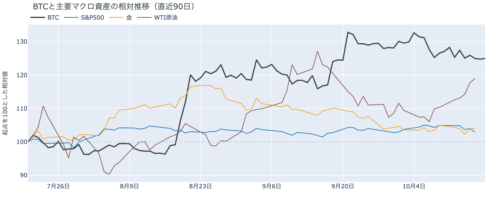

*図の見方: 同じ起点から何%動いたかで重ねたもの。線の向きが揃っているかを見ます。*

| この5営業日の動き（ビットコインは7日間） | 変化 |
|---|---:|
| ビットコイン | −2.6% |
| 金 | −0.8% |
| 米国株（S&P500） | −2.0% |
| 原油 | +7.8% |

* 建玉は93,513BTCで、前日の94,387BTCから0.9%減った。
* 資金調達率から短期金利を引いた上乗せは+2.60ptで、前日の+2.29ptから増えた。

日曜日の往復は、新しいきっかけなしに、先物のロングが夕方に積まれてから夜に手仕舞われることで起きました。

1. きっかけ：証券市場は閉まっていて、新しい出来事はビットコインに届いていません。週末に伝わった出来事は、イラン革命防衛隊が土曜に発表したホルムズ海峡での大型タンカーの触雷、フーシ派によるサウジアラビアの空港への攻撃、イラン外相の「米国が条件を満たせばホルムズ海峡は数日で再開する」という発言の3つで、どれも土曜のうちに出ています。日曜の日中はそのなかで価格が上げていたので、夜の下げのきっかけにはなっていません。トランプ大統領が金曜に署名した大統領令は、ロシア産原油の主要輸入国への100%関税とロシアの銀行への制裁の適用を見送るもので、原油を押し上げる向きの出来事ではありません。はっきりしたきっかけは見当たりません。この5営業日では、株と金が下げて原油が上げるなかでビットコインも下げていて、株と同じ向きです。ただし同じ向きに動いたことは、共通のきっかけがありえたことを示すだけで、原因の証明ではありません。
2. 伝わり方：通り道は先物のロングでした。夕方に積まれた約2%の建玉が22時台にそっくり消えたので、週末に上げを見込んで積まれた持ち高が、半日で手仕舞われたことになります。手仕舞いのあとにショートが積まれ、深夜には大口1件の清算が出ましたが、朝には価格が$81,500へ戻り、建玉も1週間前より多い水準を保っています。資金調達率（＝ロングが払う金利。プラス＝ロングがショートより多い）は、1日をならした年率で+6.67%と、短期金利（＝ドルを米国の短期国債で持つだけで受け取れる金利。13週Tビル 4.07%）を引いた上乗せは+2.60ptで、土曜より増えました。手仕舞ったのは日曜に積んだ分だけで、残ったロングは降りていません。アメリカの現物の買い手は引いたまま（図①-1）、ETFは週末で動かない（図①-2）ので、往復のあとの価格を$81,500へ戻したのは現物の買い手ではなく、先物の残ったロングです。

## 3. 市場参加者はいまどう見ているか

### ① アメリカの買い手は引いたままで、市場心理は「中立」まで下がった

**図①-1 Coinbase Premium（アメリカとそれ以外の価格差・直近90日）**

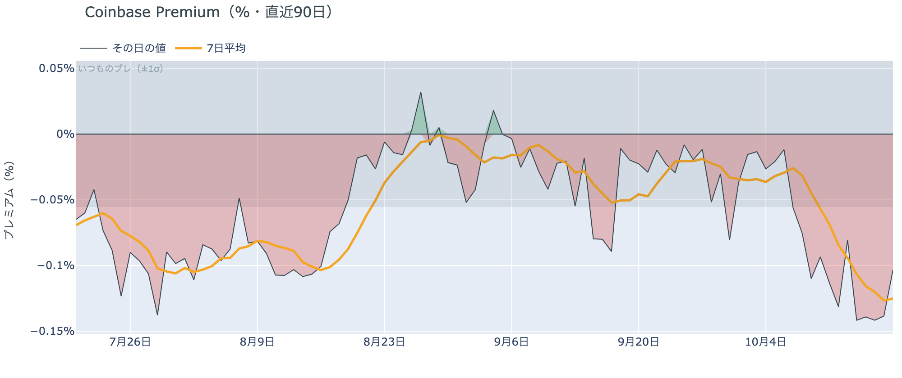

*図の見方: プラス＝アメリカで買いが強い。太線が1週間平均、細線がその日の値。薄い帯は「いつものブレの範囲」です。*

* 1週間平均は−0.13%で、前の週の−0.07%からさらに沈んだ。
* その日の値は−0.10%で、いつものブレの1.9倍。日曜も帯の外にいる。

アメリカの買い手は引いたままで、日曜に戻ってきた形にはなっていません。Coinbase Premiumの1週間平均は、前の週からさらに沈み、1か月前の−0.01%の10倍以上の深さにあるからです。その日の値も土曜に一度帯の内側へ戻ったあと、日曜にはまた帯の外へ出ています。アメリカだけが安く取引される形は、株安の夜だけの一時的なものではなく、10月9日から11日続いています。

**図①-2 ETFの日ごとの資金の出入り（直近90日）**

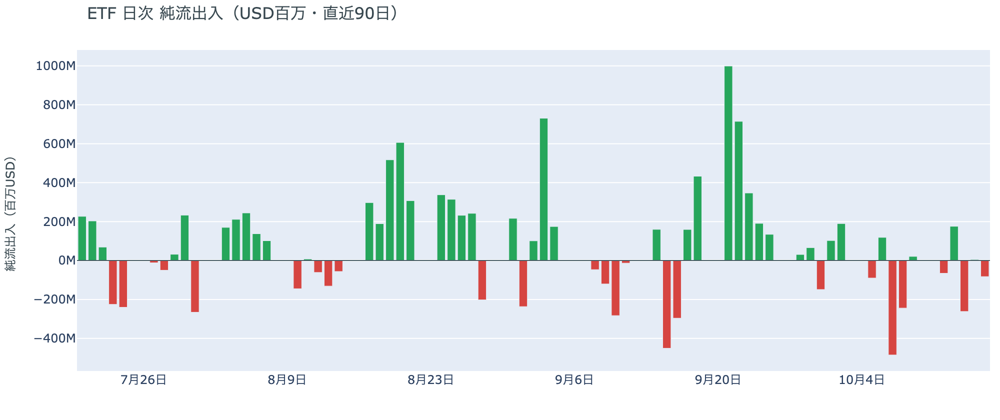

*図の見方: 入ったお金と出たお金の差。上に伸びれば入り超、下に伸びれば出超。*

| ETFの日ごとの出入り | 億ドル |
|---|---:|
| 10月8日 | −2.4 |
| 10月9日 | +0.2 |
| 10月12日 | −0.7 |
| 10月13日 | +1.8 |
| 10月14日 | −2.6 |
| 10月15日 | +0.1 |
| 10月16日 | −0.8 |
| 直近7営業日の合計 | −4.5 |

ETFの買い手は戻っていません。週末のため10月16日分が最新で、7営業日のうち入り超は3日だけ、どれも前後の流出を埋める大きさではないからです。先週水曜の米CPIの日に出た分は戻っておらず、ETFの買い手は先週からの下げを買い増す側にはいないまま、週明けを迎えます。

**図①-3 Fear & Greed（市場心理の指数・直近90日）**

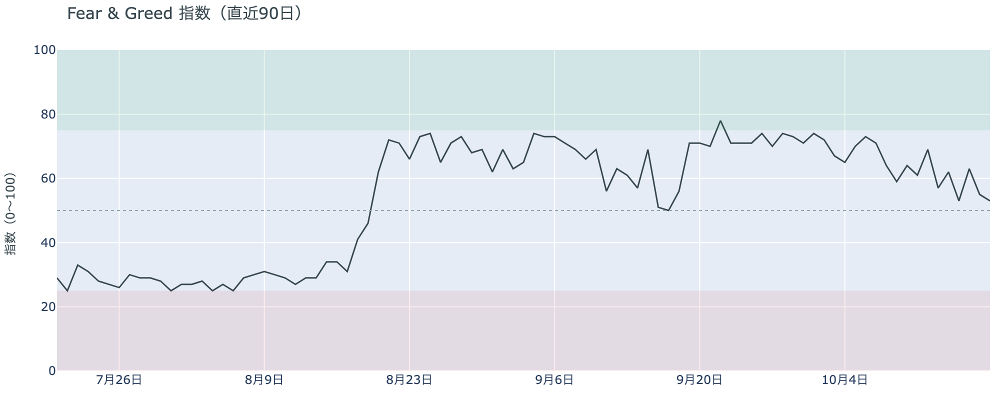

*図の見方: 0〜100で、50より上が「強欲」、下が「恐怖」。*

* 53の「中立」。前日の55から2pt下げ、1週間前は61、1か月前は56。

市場心理は「強欲」から「中立」へ下がり、先週からの下げを「一時的な押し」と見る人は減り続けています。Fear & Greed（＝市場心理の指数）の10月18日の確定値は、先週木曜に一度触れた「中立」へ戻ったもので、1週間前より8pt低いからです。「恐怖」ではないので、怖がって投げる人が増えた形ではなく、上げを期待して待つ人が減った形です。

### ② 長期保有者の利益確定の売りは続き、減り方は前の週の2倍を超えたまま

**図②-1 長期保有者の保有量の30日変化とSOPR（直近90日）**

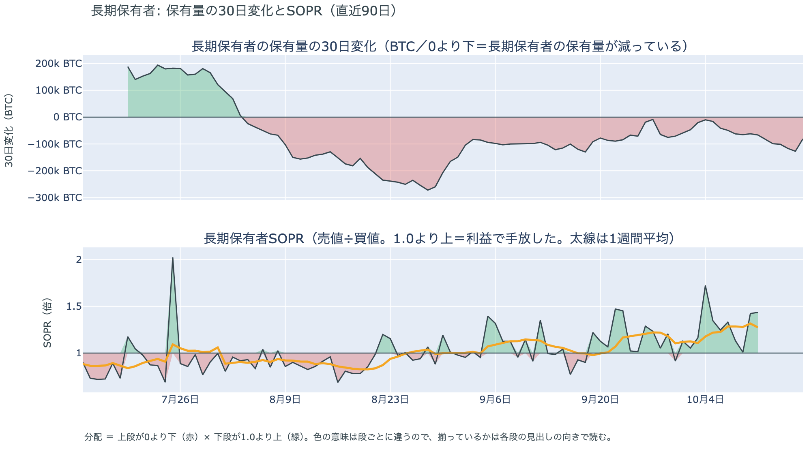

*図の見方: 上段は、長期保有者の保有量が30日でどれだけ増減したか。マイナス＝手放している。下段は長期保有者SOPRで、1より上なら利益で手放した。どちらも1週間平均で読みます。*

| 10月17日時点 | 1週間平均 | 前の週の平均 |
|---|---:|---:|
| 長期保有者SOPR（1より上＝利益で手放した） | 1.28 | 1.18 |
| 長期保有者の保有量の30日変化（万BTC） | −9.6 | −4.4 |

* 1週間平均の減り方は、1か月前（9月17日）の−12.0万BTCに近づいた。

長期保有者は利益確定の売りを続けていて、減り方は前の週の2倍を超えたままです。保有量は30日で減り、動いたコインは平均して買値より高く動いていて、その差は前の週より大きくなっています。減り方は先週の$80,000台への下げをまたいで広がったので、長期保有者は下げを、売りを止める理由にはしていません。向きは前日と同じで、ビットコイン自身の需給の土台が変わった日ではありませんが、1か月前と同じ規模の売りが続いている分、週明けの価格を支える側ではありません。

長期保有者のほかに、売りに回りそうな持ち手は見当たりません。長く眠っていたコインが急に動いた記録はなく、マイナーの収入は平年をやや上回る程度（Puell Multiple（＝マイナー収入の平年比）が1週間平均で1.14）で、売りを急ぐ状況ではありません。コインが最後に動いた価格の分布にも、今日は新しい材料がありません。

### ③ 先物：日曜に積んだロングは1日で手仕舞われたが、残ったロングは余分に払う分を増やした

**図③-1 資金調達率と建玉（直近30日）**

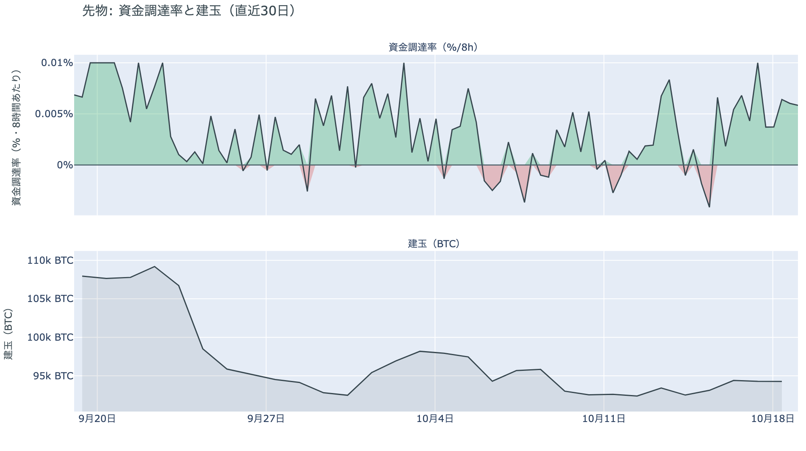

*図の見方: 上段は資金調達率（8時間ごと・日本時間）。プラスが続く＝ロングがショートより多い。下段は建玉。*

* 資金調達率のプラスは11回連続（約4日）。建玉は1週間前より1.8%多い。
* 上乗せの直近34日の平均は+0.05ptで、いまはそれを2.5pt上回る。

先物の参加者は、日曜の夕方に積んだロングを夜のうちに手仕舞いましたが、残ったロングは短期金利より余分に払う分を増やしていて、上げへの確信は弱まっていません。建玉は土曜から0.9%減っただけで1週間前より多く、上乗せは土曜より増えてこの1か月の平均を大きく上回っているので、米CPIで一度失われたあと戻った確信は、週明けを前に保たれています。前日は「ロングは短期金利より余分に払ってでも持ち続け、10月末までに流れが変わるとは見ていない」と説明しました。日曜に残ったロングの手仕舞いは出ず、上乗せはむしろ増えたので、前日の説明は今日の数値と合っています。ただし日曜に積んだ分は半日で消えたので、賭けを大きくする試みは1日続きませんでした。

### ④ オプション：備えは今週の満期に厚く、週明けを前に手前の満期の権利料に上乗せが乗った

オプションには2種類あります。コール（＝決めた価格で買う権利）とプット（＝決めた価格で売る権利）で、価格が上がればコールの価値が上がり、価格が下がればプットの価値が上がります。プットは「価格が下がったときの保険」として買われます。オプションを買う人は、その権利と引き換えに権利料（＝オプションを買う人が払う金額）を払います。

**図④-1 満期ごとのIV（年率%）**

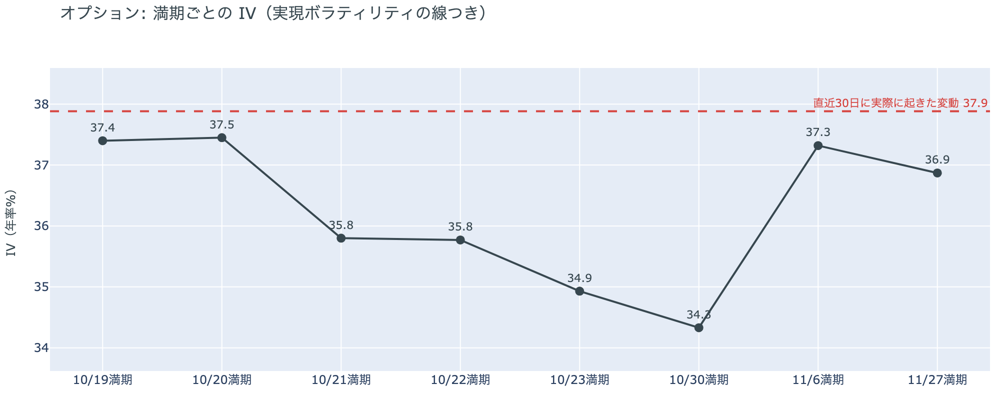

*図の見方: IVを満期ごとに並べたもの。点線は実現ボラティリティ。IVが点線より下なら、市場はこの先の値動きを過去の値動きより小さいと見ています。*

| 満期 | IV |
|---|---:|
| 10月19日・20日 | 37 |
| 10月21日・22日 | 36 |
| 10月23日 | 35 |
| 10月30日 | 34 |
| 11月6日・27日 | 37 |

* IVは全体で37.9で、実現ボラティリティ37.9と同じ。過去1年で下から31%。

オプションの参加者は、この先の値動きを過去の値動きと同じくらいと見ていて、怖がってはいません。IV（＝値動きの幅の予想）は全体で実現ボラティリティ（＝過去の値動きの幅）と同じ水準にあり、過去1年の中では低いほうから3分の1の位置なので、恐怖の水準ではありません。例外は手前の満期（＝権利の期限）です。19日と20日に満期が来るオプションの権利料には、10月30日の満期に対する上乗せが乗っていて、IVは土曜の20台から37台へ上がりました。株安と原油高を持ち越した週末のあと、最初に株と原油に値が付く月曜と火曜の米国の取引時間に大きく動くと見られているからです。FOMC（＝米国の金利を決める会合）をまたぐ10月30日の満期は、前後の満期に対して権利料が高くなっていません。

**図④-2 満期ごとのプットとコールの差**

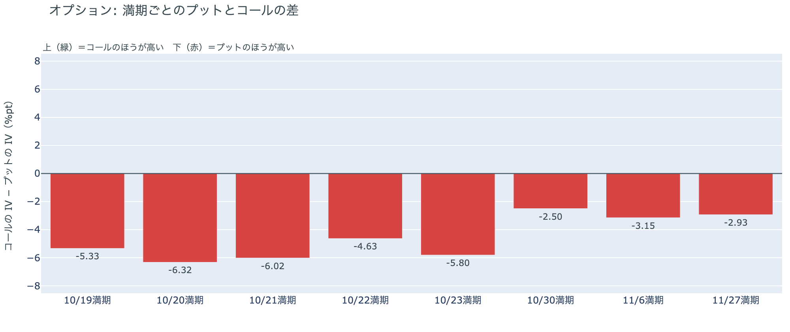

*図の見方: 満期ごとに、プットとコールのどちらが高く売れているか。ゼロより上ならコールのほうが高く、下ならプットのほうが高い。*

| 満期 | どちらが高いか |
|---|---|
| 10月19日 | プットが高い |
| 10月20日 | プットがはっきり高い |
| 10月21日 | プットがはっきり高い |
| 10月22日 | プットが高い |
| 10月23日 | プットがはっきり高い |
| 10月30日 | プットがやや高い |
| 11月6日 | プットがやや高い |
| 11月27日 | プットがやや高い |

参加者は下げへの備えを今週の満期に厚く置いていて、10月30日から先の満期では薄くしています。全部の満期でプットのほうが高い形は先週月曜から変わらず、コールのほうが高い満期は1つもありません。備えがいちばん厚いのは、週明けの月曜と火曜の米国の取引時間をまたぐ20日と21日の満期で、土曜と同じです。持ち高（図④-3）は動いていないので、週末に備えを買い足したのではなく、金曜に置いた備えを週明けまでそのまま持ち越した形です。10月30日以降の満期ではプットの高さが小さいので、参加者は週明けからの数日の下げには備えていますが、FOMCの先まで続く流れの変化とは見ていません。

**図④-3 10月30日満期の持ち高（権利の価格ごと）**

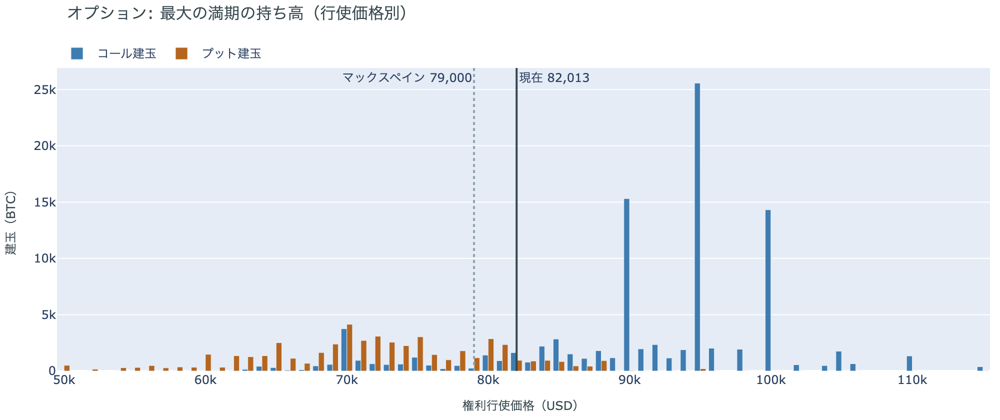

*図の見方: 青＝コール、橙＝プット。現値より上にコールが、下にプットが積まれるのが普通です。*

| 10月30日満期のオプション | 量（万BTC） | 意味 |
|---|---:|---|
| コール | 約9.8 | 「価格が上がる」に賭けた分 |
| プット | 約5.2 | 「価格が下がる」への保険 |
| うち、いまより15%以上高い価格のコール | 約4.9 | 大きな上げへの賭け |
| うち、いまより15%以上安い価格のプット | 約1.8 | 大きな下げへの保険 |

* 10月30日満期の持ち高は約15.0万BTCと全満期の38%で、前日と同じ。コールがプットの1.9倍。
* コールが集まっている価格は$95,000に約2.6万BTC、$90,000と$100,000に約1.5万BTCずつ。

「価格が上がる」に賭けた人たちは、週末も降りていません。10月30日満期の持ち高は金曜から動かず、コールの大半はいまより高い$90,000から$100,000に積まれたままだからです。その賭けが報われるには、FOMCを越えて10月30日までに$90,000を超える必要があり、いまの価格からは10%上です。今週の満期にプットの高さを置きながら10月末のコールは外していないので、参加者は週明けの下げには備えつつ、10月末までに流れが変わるとは見ていない構えを、週明けまで持ち越しています。

## 4. 価格に影響しうる直近のイベント

オプション市場が下げへの備えをいちばん厚く置いているのは20日と21日の満期で、この区間に当たるのは、株安と原油高を持ち越した週末のあと、最初に証券市場が開く月曜と火曜の米国の取引時間です。原油の側では、ホルムズ海峡でのタンカーの触雷とフーシ派のサウジアラビア攻撃が週末に続き、イラン外相は米国の意見を検討中で条件が満たされれば数日で海峡を再開すると述べましたが、協議の日程は決まっていません。ロシア制裁法の関税と銀行制裁は、金曜の大統領令で適用が見送られました。FRBはFOMCまでブラックアウトに入っていて、FOMCをまたぐ10月30日の満期はプットがやや高いだけで、ほかの満期に対する上乗せは乗っていません。利上げの織り込みは2割弱で、米CPIの翌日の約3割から下がっています。

| 日付 | イベント | 何に効くか |
|---|---|---|
| 日程未定 | イランの7日間の停戦案。イラン外相は18日、米国の意見を検討中で、条件が満たされればホルムズ海峡は数日で再開すると述べた。ロシア外相のテヘラン訪問も報じられている | 原油 |
| 日程未定 | ロシア制裁法の100%関税とロシアの銀行への制裁。18日に始まるはずだったが、トランプ大統領が16日の大統領令で適用を見送った。見送りの期限は決まっていない | 原油 |
| 10/20（火）・21（水）17:00 | オプションの満期。株安と原油高を持ち越した週明けの月曜・火曜の米国の取引時間をまたぎ、プットがはっきり高い | 下げへの備えの期限 |
| 10/21（水）米国の引け後 | Meta・Tesla・IBMなど大手テックの決算（日本時間22日朝） | 米国株。AI関連の設備投資への不安で株が下げた週のあとの、最初の大手テックの決算 |
| 10/23（金） | 米国の10月PMI速報 | 金利・株 |
| 10/27（火）〜28（水） | FOMC。利上げの織り込みは2割弱で、米CPIの翌日の約3割から下がった。結果は日本時間29日未明。FRBは17日からブラックアウト | 金利。プットがやや高い10月30日の満期がまたぐ |
| 10/29（木） | 米国の7〜9月期GDPと9月のPCE物価 | 金利 |
| 10/29（木）〜30（金） | 日銀の会合。展望レポートも出る | 円 |
| 10/30（金）17:00 | オプションの最も大きな満期（約15.0万BTC、全満期の38%）。FOMCの2日後 | $90,000以上のコールの期限 |
| 11/1（日） | OPEC+の会合。12月の生産目標を決める | 原油 |
| 11/3（火） | 米国の中間選挙。トランプ大統領は「それまでイランを攻撃しない」と述べている | 原油 |
| 11/11（水） | MSCIが株価指数から外す企業の最終一覧を公表。ビットコインを大量に持つ企業を外しうる規則を10月15日に確定し、Strategyが対象になりうる。入れ替えは11月30日 | 指数に連動する資金による、それらの企業の株の売買 |

## まとめ：日曜日の動きは何だったか

日曜日は、新しいきっかけなしに、夕方に積まれた先物のロングが夜に手仕舞われることで$82,000台から$81,000近くまで下げ、朝には$81,500へ戻った日でした。ビットコイン自身の需給の土台は変わっていません。アメリカの買い手は引いたまま戻らず、長期保有者の利益確定の売りは減り方を広げたまま続いています。参加者は、週明けに最初に証券市場が開く2日には下げへの備えを厚くし、その満期の権利料に上乗せまで乗せていますが、残ったロングは短期金利より余分に払う分を増やし、10月末のコールも外していないので、今週の初めは荒れると見つつ、10月末までに流れが変わるとは見ていません。

---

<small>（数値は10月19日7時5分（日本時間）までのデータに基づきます。価格・先物・オプション・Coinbase Premiumはその時点の値、市場心理は10月18日の確定値、オンチェーン（＝ブロックチェーン上の記録）の長期保有者の保有量は10月17日時点、長期保有者SOPRとマイナーの収入は10月11日分まで、ETF資金フローは10月16日分までです。証券市場の終値は週末をはさんでいるため10月16日時点です。FOMCの織り込みは10月16日のFF金利先物の終値から計算したものです。オンチェーンの長期保有者の数値には、ETFや取引所が預かっている分も含まれます。オプションはDeribit（BTCオプションの大半を占める取引所）の全銘柄です。）</small>

*本稿は情報提供を目的としたものであり、投資助言ではありません。将来の価格動向を保証・示唆するものではなく、投資判断は各自の責任において行ってください。*
