# 週明けの夜は株高でも上げず$82,000で足踏み ― ショートが積まれ、下げへの備えはFOMC前後の満期へ

**2026年10月20日**

ビットコインは月曜日、日中に$83,000近くまで上げたあと、株が反発した夜には上げずに押し戻され、朝7時5分の時点では約$82,000と24時間前とほぼ同じでした。

* **価格**：24時間の値幅は1.8%で日曜の2.0%より小さく、朝7時5分の時点で約$82,000は24時間前より0.4%高いだけです。日中の上げは夜に戻され、価格は50日線のすぐ上に5日続けて張りついたままです
* **きっかけ**：新しいきっかけは来ませんでした。週明けの証券市場では株が反発し原油が3%下げて、金曜から持ち越した株安と原油高が両方とも戻りましたが、ビットコインはその時間に上げていません。原油の下げは、金曜の大統領令でロシア制裁の適用が見送られ、ロシアからの供給が増えるとの見方によるものと報じられています
* **先物**：日中の上げは買い持ち（ロング）が運び、夜の下げは売り持ち（ショート）が新しく積まれて運びました。清算（＝証拠金不足で強制的に閉じられた取引）は日中のショートの大口1件だけで、値動きの速い足の外でした。残ったロングが払う金利は短期金利の2倍を超えたので、上げへの確信は日曜からさらに強まっています
* **需給の土台**：米国の買い手は引いたままで、Coinbase Premium（＝アメリカとそれ以外の価格差）の1週間平均は前の週より沈んだままです。ETFは週明けの分が集計途中で、先週からの流出は埋まっていません。長期保有者（＝155日以上保有者）の利益確定の売りは続き、減り方は前の週の約2倍のままです。土台は前日から変わっていません
* **オプションの見方**：週明けの月曜と火曜に大きく動くという見方は1日で取り下げられ、今週の満期の権利料に乗っていた10月30日の満期に対する上乗せは剥がれました。下げへの備えは、FOMC（＝米国の金利を決める会合）をまたぐ10月30日とその先の11月6日の満期で厚くなっています。10月末のコールは外されていません

## 1. 何が起きたか

**図1-1 価格の推移（1時間足・直近7日）**

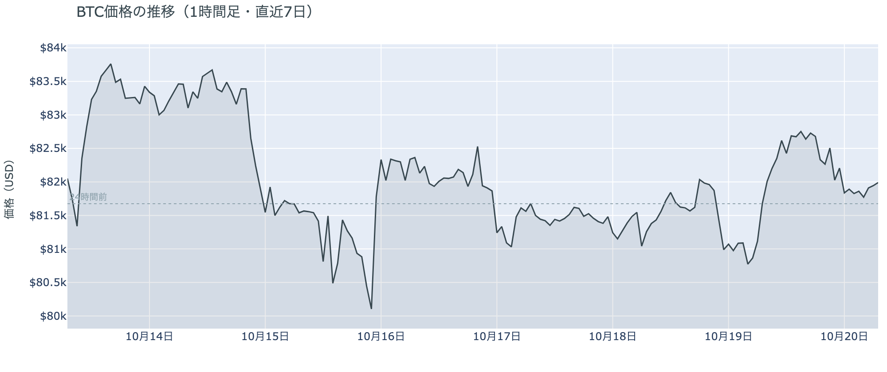

*図の見方: 1時間ごとの価格（日本時間）。点線は24時間前の水準。月曜は日中に点線の上へ一段上がり、夜に点線のところまで戻っています。*

* 24時間の値幅は1.8%で、日曜の2.0%から縮んだ。
* 建玉は日曜の朝より1.7%増え、1週間前より0.8%多い。

月曜日は、朝8時台から午後3時台にかけて$81,600台から$82,700台へ上げ、途中で$83,000を超える場面があったあと、夜に$81,800まで戻して朝を迎えた日でした。日中の上げでは価格と一緒に建玉（＝先物の未決済残高。証拠金で張っている人の量）が増えたので、ロングが新しく積まれています。Hyperliquid（＝オンチェーンの先物取引所）で見える清算は5件で、そのうち11時台のショートの大口1件が大半を占めますが、値動きの速い5分足には1件も入っていません。清算が上げを加速させた形ではなく、ロングの積み増しだけで上げた形です。夜7時から8時台には価格が0.5%下げながら建玉が1.6%減ったので、日中に積まれたロングの一部が手仕舞われました。米国の株式市場が開いた22時台から0時台には、価格が$82,500から$81,800へ下げながら建玉が1.7%増えたので、ショートが新しく積まれています。深夜はそのまま$81,800から$81,900で動いていません。

**図1-2 価格と50日・200日移動平均**

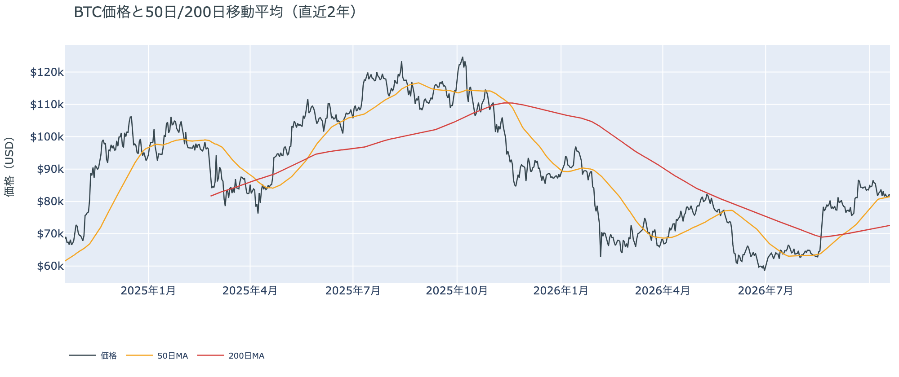

*図の見方: 2本の平均線の上下関係を見ます。50日線が200日線の上にあるのがゴールデンクロスです。*

* 50日線と200日線の差は約$8,900（12.3%）で、前日と同じ。
* 朝7時5分の価格は50日線の$81,483を0.6%上回る。

長い目で見た流れの向きは変わっていません。ゴールデンクロス（＝50日線が200日線を上抜けること）の状態が42日目で、2本の平均線の差は開いたままです。価格は日中の上げで50日線の上へ戻りましたが、差は0.6%なので線から離れたとは言えず、木曜から5日続けて50日線に張りついた形です。

証券市場は月曜10月19日に、米国株（S&P500）が+0.4%で反発し、原油（WTI）が−3.1%の$98へ下げました。金曜から持ち越した株安と原油高が両方とも戻った夜で、ビットコインにとっては外部環境から押される材料が減った夜でしたが、同じ時間にビットコインは上げずに下げています。

## 2. なぜ動いたか：きっかけと、需給のどこが動いたか

**図2-1 ビットコインと株・金・原油の相対推移（起点＝100）**

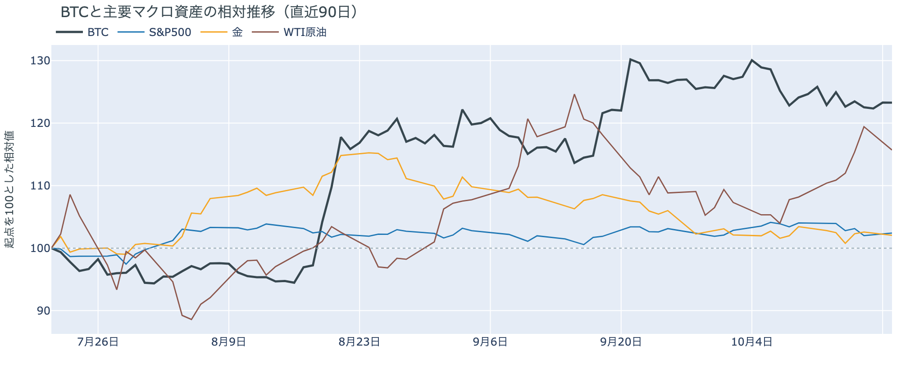

*図の見方: 同じ起点から何%動いたかで重ねたもの。線の向きが揃っているかを見ます。*

| この5営業日の動き（ビットコインは7日間） | 変化 |
|---|---:|
| ビットコイン | +0.3% |
| 金 | −0.7% |
| 米国株（S&P500） | −1.5% |
| 原油 | +4.8% |

* 建玉は95,106BTCで、前日の93,513BTCから1.7%増えた。
* 資金調達率から短期金利を引いた上乗せは+4.29ptで、前日の+2.60ptから増えた。

月曜日の足踏みは、新しいきっかけなしに、日中に積まれた先物のロングと夜に積まれたショートが打ち消し合うことで起きました。

1. きっかけ：週明けの証券市場では、株が反発し原油が下げました。原油の下げは、トランプ大統領が金曜に署名した大統領令でロシア制裁法の関税と銀行制裁の適用が見送られ、ロシアからの供給が増えるとの見方によるものと報じられています。ホルムズ海峡は閉じたままで、ロシアのラブロフ外相が月曜にテヘランを訪れ、フーシ派のサウジアラビア攻撃も続いていますが、原油はそれでも下げています。株が上げ原油が下げた22時以降にビットコインは下げたので、月曜の夜の動きは株と逆向きで、共通のきっかけではありません。ビットコインに固有の出来事では、2013年から動いていなかったアドレスの411BTCが日曜に動きましたが、送り先は取引所ではなく新しいアドレスで、月曜の日中はそのなかで価格が上げていたので、きっかけではありません。はっきりしたきっかけは見当たりません。この5営業日では、株と金が下げて原油が上げるなかでビットコインはほぼ動いておらず、先週の株安がビットコインを引きずり下ろした形にもなっていません。
2. 伝わり方：通り道は先物の両側でした。日中は価格と一緒に建玉が増えたのでロングが積まれて$83,000の手前まで上げ、夜は価格が下げながら建玉が増えたのでショートが積まれて$81,800へ戻しました。資金調達率（＝ロングが払う金利。プラス＝ロングがショートより多い）は、1日をならした年率で+8.37%と、短期金利（＝ドルを米国の短期国債で持つだけで受け取れる金利。13週Tビル 4.07%）を引いた上乗せは+4.29ptで、日曜の+2.60ptからさらに増えました。夜にショートが積まれてもロングのほうが多いままで、ロングは払う分を増やしながら持ち続けています。アメリカの現物の買い手は引いたまま（図①-1）、ETFは流出の向きのまま（図①-2）なので、価格を$82,000に置いているのは現物の買い手ではなく、先物のロングとショートのつり合いです。

## 3. 市場参加者はいまどう見ているか

### ① アメリカの買い手は引いたままで、市場心理は「中立」から「強欲」へ戻った

**図①-1 Coinbase Premium（アメリカとそれ以外の価格差・直近90日）**

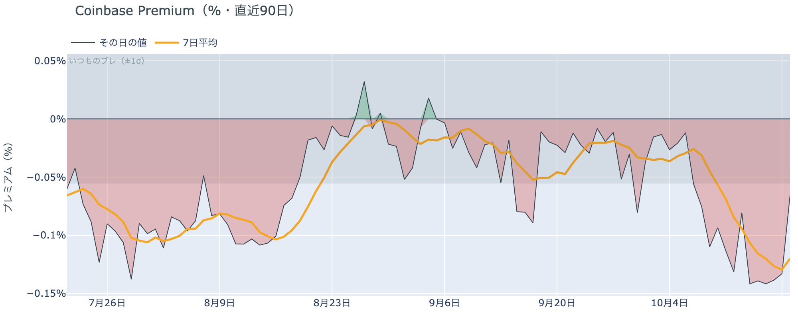

*図の見方: プラス＝アメリカで買いが強い。太線が1週間平均、細線がその日の値。薄い帯は「いつものブレの範囲」です。*

* 1週間平均は−0.12%で、前の週の−0.08%より沈んだまま。
* その日の値は−0.07%で、いつものブレの範囲内。

アメリカの買い手は引いたままで、週明けに戻ってきた形にはなっていません。Coinbase Premiumの1週間平均は前の週より沈んだままで、1か月前の−0.02%の6倍の深さにあるからです。その日の値は日曜の帯の外から内側へ戻りましたが、1週間平均を動かすほどではなく、アメリカだけが安く取引される形は10月9日から12日続いています。

**図①-2 ETFの日ごとの資金の出入り（直近90日）**

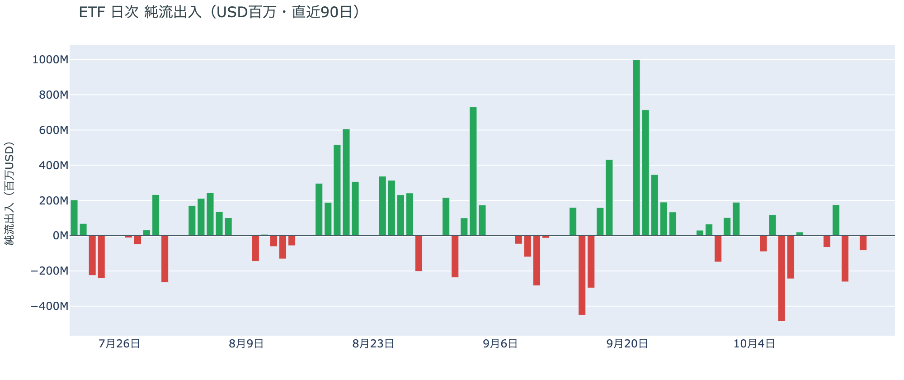

*図の見方: 入ったお金と出たお金の差。上に伸びれば入り超、下に伸びれば出超。*

| ETFの日ごとの出入り | 億ドル |
|---|---:|
| 10月9日 | +0.2 |
| 10月12日 | −0.7 |
| 10月13日 | +1.8 |
| 10月14日 | −2.6 |
| 10月15日 | +0.1 |
| 10月16日 | −0.8 |
| 10月19日（集計途中） | 0.0 |
| 直近7営業日の合計 | −2.1 |

ETFの買い手は戻っていません。週明け10月19日分はまだ集計途中で、確定している直近の10月16日分は流出だったからです。7営業日の合計は流出のままで、先週水曜の米CPIの日に出た分は戻っておらず、ETFの買い手は先週からの下げを買い増す側にはいません。

**図①-3 Fear & Greed（市場心理の指数・直近90日）**

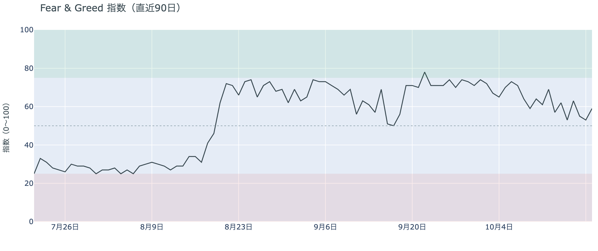

*図の見方: 0〜100で、50より上が「強欲」、下が「恐怖」。*

* 59の「強欲」。前日の53から6pt上げ、1週間前は69、1か月前は71。

市場心理は「中立」から「強欲」へ戻り、先週からの下げを流れの変化と見る人は増えていません。Fear & Greed（＝市場心理の指数）の10月19日の確定値は、日曜に下がった「中立」から1日で「強欲」へ戻ったもので、日中の$83,000近くへの上げがそのまま心理に出た形です。ただし1週間前より10pt低いので、先週の水準の期待が戻ったわけではありません。

### ② 長期保有者の利益確定の売りは続き、減り方は前の週の約2倍のまま

**図②-1 長期保有者の保有量の30日変化とSOPR（直近90日）**

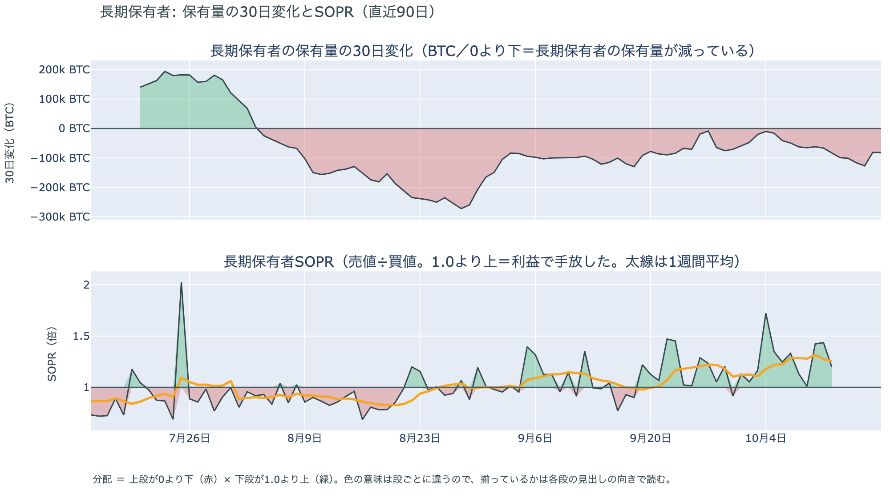

*図の見方: 上段は、長期保有者の保有量が30日でどれだけ増減したか。マイナス＝手放している。下段は長期保有者SOPRで、1より上なら利益で手放した。どちらも1週間平均で読みます。*

| 10月18日時点 | 1週間平均 | 前の週の平均 |
|---|---:|---:|
| 長期保有者SOPR（1より上＝利益で手放した） | 1.25 | 1.22 |
| 長期保有者の保有量の30日変化（万BTC） | −9.8 | −5.2 |

* 1週間平均の減り方は、1か月前（9月18日）の−13.0万BTCの4分の3。

長期保有者は利益確定の売りを続けていて、減り方は前の週の約2倍に広がったままです。保有量は30日で減り、動いたコインは平均して買値より高く動いていて、その差は前の週より少し大きくなっています。減り方は先週の$80,000台への下げをまたいでも縮んでいないので、長期保有者はいまの価格を、売りを止める水準とは見ていません。向きは前日と同じで、ビットコイン自身の需給の土台が変わった日ではありませんが、売りが続いている分、価格を支える側にはいません。

長期保有者のほかに、売りに回りそうな持ち手は見当たりません。長く眠っていたコインが急に動いた記録はなく、マイナーの収入は平年をやや上回る程度（Puell Multiple（＝マイナー収入の平年比）が1週間平均で1.11）で、売りを急ぐ状況ではありません。コインが最後に動いた価格の分布にも、今日は新しい材料がありません。

### ③ 先物：ロングは払う分をさらに増やし、夜に積まれたショートを含めてもロングのほうが多い

**図③-1 資金調達率と建玉（直近30日）**

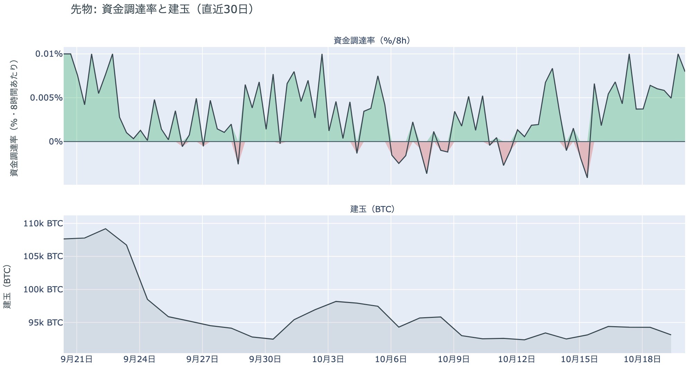

*図の見方: 上段は資金調達率（8時間ごと・日本時間）。プラスが続く＝ロングがショートより多い。下段は建玉。*

* 資金調達率のプラスは14回連続（約5日）。
* 上乗せの直近34日の平均は+0.02ptで、いまはそれを4.3pt上回る。

先物の参加者は、上げへの確信を日曜からさらに強めています。ロングが短期金利より余分に払う分は日曜の+2.60ptから+4.29ptへ増え、この1か月の平均を大きく上回っているので、短期金利の2倍を超える金利を払ってでも上げに賭けたい人が増えているということです。月曜の米国の取引時間には、価格が下げながら建玉が増えたのでショートが新しく積まれましたが、ロングが払う金利が上がっているのは、そのショートを含めてもロングのほうが多いということです。前日は「残ったロングは短期金利より余分に払う分を増やし、10月末までに流れが変わるとは見ていない」と説明しました。月曜にロングは降りず、上乗せはさらに増えたので、前日の説明は今日の数値と合っています。

### ④ オプション：今週の満期の上乗せは1日で剥がれ、備えはFOMCの前後の満期へ移った

オプションには2種類あります。コール（＝決めた価格で買う権利）とプット（＝決めた価格で売る権利）で、価格が上がればコールの価値が上がり、価格が下がればプットの価値が上がります。プットは「価格が下がったときの保険」として買われます。オプションを買う人は、その権利と引き換えに権利料（＝オプションを買う人が払う金額）を払います。

**図④-1 満期ごとのIV（年率%）**

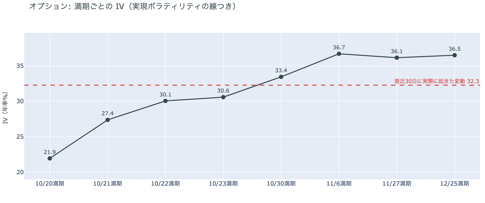

*図の見方: IVを満期ごとに並べたもの。点線は実現ボラティリティ。IVが点線より下なら、市場はこの先の値動きを過去の値動きより小さいと見ています。*

| 満期 | IV |
|---|---:|
| 10月20日 | 22 |
| 10月21日 | 27 |
| 10月22日・23日 | 30〜31 |
| 10月30日 | 33 |
| 11月6日・27日・12月25日 | 36〜37 |

* IVは全体で38.8で、実現ボラティリティ32.3より6.6pt高い。過去1年で下から21%。

オプションの参加者は、この先の値動きを過去の値動きより大きいと見ていますが、怖がってはいません。IV（＝値動きの幅の予想）は全体で前日とほぼ同じ水準なのに対し、実現ボラティリティ（＝過去の値動きの幅）が縮んだのでIVのほうが高くなり、備えが買われている側に移りました。ただしIVは過去1年の中で低いほうから2割の位置なので、恐怖の水準ではありません。例外は手前の満期（＝権利の期限）です。日曜まで19日と20日の満期の権利料に乗っていた10月30日の満期に対する上乗せは、月曜が1.8%の値幅で終わると1日で剥がれ、今週の満期のIVは37台から20台へ下がりました。前日は「参加者は今週の最初の2日を、FOMCまでの残りの日より荒れると見ている」と説明しましたが、その見方は月曜のうちに取り下げられています。手前ほど低く先ほど高い平常の形に戻り、特定の日だけ権利料が高い満期はありません。

**図④-2 満期ごとのプットとコールの差**

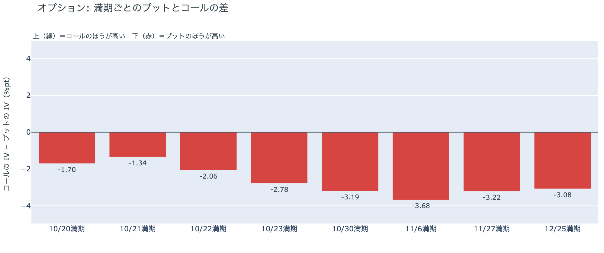

*図の見方: 満期ごとに、プットとコールのどちらが高く売れているか。ゼロより上ならコールのほうが高く、下ならプットのほうが高い。*

| 満期 | どちらが高いか |
|---|---|
| 10月20日 | プットがやや高い |
| 10月21日 | プットがやや高い |
| 10月22日 | プットが高い |
| 10月23日 | プットが高い |
| 10月30日 | プットがはっきり高い |
| 11月6日 | プットがはっきり高い |
| 11月27日 | プットがはっきり高い |
| 12月25日 | プットがはっきり高い |

参加者は下げへの備えを、今週の満期からFOMCをまたぐ10月30日とその先の満期へ置き直しました。全部の満期でプットのほうが高い形は先週から変わりませんが、日曜まで備えがいちばん厚かった20日と21日の満期ではプットの高さが小さくなり、10月30日から先の満期で大きくなったからです。持ち高（図④-3）は動いていないので、備えを買い足したのではなく、今週の初めに置いていた備えの値付けが、FOMCの前後へ移った形です。参加者は今週の残りの日に大きく下げるとは見なくなり、次に下げに備える区間をFOMCとその直後に置いています。

**図④-3 10月30日満期の持ち高（権利の価格ごと）**

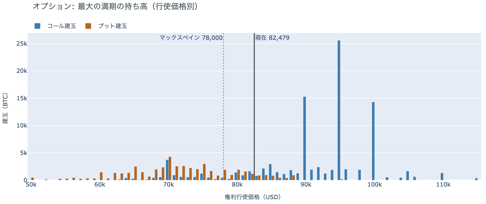

*図の見方: 青＝コール、橙＝プット。現値より上にコールが、下にプットが積まれるのが普通です。*

| 10月30日満期のオプション | 量（万BTC） | 意味 |
|---|---:|---|
| コール | 約9.9 | 「価格が上がる」に賭けた分 |
| プット | 約5.0 | 「価格が下がる」への保険 |
| うち、いまより15%以上高い価格のコール | 約4.9 | 大きな上げへの賭け |
| うち、いまより15%以上安い価格のプット | 約2.3 | 大きな下げへの保険 |

* 10月30日満期の持ち高は約14.9万BTCと全満期の38%で、前日とほぼ同じ。コールがプットの2.0倍。
* コールが集まっている価格は$95,000に約2.6万BTC、$90,000と$100,000に約1.5万BTCずつ。

「価格が上がる」に賭けた人たちは、週明けも降りていません。10月30日満期の持ち高は日曜から動かず、コールの大半はいまより高い$90,000から$100,000に積まれたままだからです。その賭けが報われるには、FOMCを越えて10月30日までに$90,000を超える必要があり、いまの価格からは10%上です。同じ満期でプットの高さを置きながらコールは外していないので、参加者はFOMCの前後で下げに備えつつ、10月末までに上げが来る側の賭けも持ち続けています。

## 4. 価格に影響しうる直近のイベント

オプション市場が下げへの備えを厚く置いているのは10月30日と11月6日の満期で、この区間に当たるのはFOMCと、その翌日の米国の7〜9月期GDP・9月のPCE物価、日銀の会合です。今週の満期に置かれていた備えは月曜のうちに薄くなり、週半ばの大手テックの決算や金曜の米国のPMI速報をまたぐ満期に、ほかの満期に対する上乗せは乗っていません。原油の側では、ホルムズ海峡は閉じたままで、イランの7日間の再開案は条件が変わらず、ロシアのラブロフ外相が月曜にテヘランを訪れました。ロシア制裁法の関税と銀行制裁は金曜の大統領令で適用が見送られ、月曜の原油の下げはその見送りで説明されています。FRBはFOMCまでブラックアウトに入っていて、利上げの織り込みは約2割で1週間前と変わっていません。

| 日付 | イベント | 何に効くか |
|---|---|---|
| 日程未定 | イランの7日間のホルムズ海峡再開案。イラン外相は19日、再開の条件は変わっていないと述べた。ロシアのラブロフ外相が19日にテヘランを訪問 | 原油 |
| 日程未定 | ロシア制裁法の100%関税とロシアの銀行への制裁。16日の大統領令で適用が見送られ、見送りの期限は決まっていない | 原油 |
| 10/21（水）米国の引け後 | Meta・Teslaなど大手テックの決算（日本時間22日朝）。AI関連の設備投資への不安で株が下げた先週のあとの、最初の大手テックの決算 | 米国株 |
| 10/23（金） | 米国の10月PMI速報とミシガン大学の消費者態度指数 | 金利・株 |
| 10/27（火）〜28（水） | FOMC。利上げの織り込みは約2割で、1週間前と同じ。結果は日本時間29日未明。FRBは17日からブラックアウト | 金利。プットがはっきり高い10月30日の満期がまたぐ |
| 10/29（木） | 米国の7〜9月期GDPと9月のPCE物価 | 金利 |
| 10/29（木）〜30（金） | 日銀の会合。展望レポートも出る | 円 |
| 10/30（金）17:00 | オプションの最も大きな満期（約14.9万BTC、全満期の38%）。FOMCの2日後 | $90,000以上のコールの期限 |
| 11/1（日） | OPEC+の会合。12月の生産目標を決める | 原油 |
| 11/3（火） | 米国の中間選挙。トランプ大統領は「それまでイランを攻撃しない」と述べている | 原油 |
| 11/6（金）17:00 | オプションの満期。プットの高さが全満期でいちばん大きい | 下げへの備えの期限 |
| 11/11（水） | MSCIが株価指数から外す企業の最終一覧を公表。ビットコインを大量に持つ企業を外しうる規則を10月15日に確定し、Strategyが対象になりうる。入れ替えは11月30日 | 指数に連動する資金による、それらの企業の株の売買 |

## まとめ：月曜日の動きは何だったか

月曜日は、新しいきっかけなしに、日中に積まれた先物のロングが$83,000の手前まで上げ、株が反発した夜に積まれたショートが$82,000へ戻した日でした。ビットコイン自身の需給の土台は変わっていません。アメリカの買い手は引いたまま戻らず、長期保有者の利益確定の売りは減り方を広げたまま続いています。参加者は、週明けの2日で荒れるという見方を1日で取り下げ、ロングは短期金利の2倍を超える金利を払ってでも上げに賭け続けながら、下げへの備えはFOMCの前後の満期へ置き直したので、今週の残りは静かでも、FOMCの前後は動くと見ています。

---

<small>（数値は10月20日7時5分（日本時間）までのデータに基づきます。価格・先物・オプション・Coinbase Premiumはその時点の値、市場心理は10月19日の確定値、オンチェーン（＝ブロックチェーン上の記録）の長期保有者の保有量は10月18日時点、長期保有者SOPRとマイナーの収入は10月12日分まで、ETF資金フローは10月19日分までで、10月19日分は集計途中です。証券市場の終値は10月19日時点です。FOMCの織り込みは10月19日のFF金利先物の終値から計算したものです。オンチェーンの長期保有者の数値には、ETFや取引所が預かっている分も含まれます。オプションはDeribit（BTCオプションの大半を占める取引所）の全銘柄です。）</small>

*本稿は情報提供を目的としたものであり、投資助言ではありません。将来の価格動向を保証・示唆するものではなく、投資判断は各自の責任において行ってください。*
