# 米イラン妥協案の報道で$83,000へ上げて戻す ― ショートの買い戻しが運び、10月末のコールは一部外れる

**2026年10月21日**

ビットコインは火曜日、日中は$81,500前後で動かず、米国とイランの妥協案が報じられた夜に$83,000台へ2%上げたあと、報道が後退した深夜に$82,500へ戻しました。

* **価格**：24時間の値幅は2.8%で月曜の1.8%から広がり、朝7時5分の時点で約$82,975は24時間前より1.2%高い水準です。夜の2時間で上げた分の半分を、次の1時間で戻した形です
* **きっかけ**：カタールとパキスタンが仲介する米国とイランの妥協案の報道です。報道と同じ時間に原油が$100超から$95台へ下げ、米10年債利回りが下がり、株が上げるなかでビットコインも上げ、「合意は近くない」との報道で原油と利回りが戻ると、ビットコインも同じ時間に戻しました
* **先物**：上げは、月曜の夜に積まれた売り持ち（ショート）の買い戻しが運び、戻しは$83,000台で入った買い持ち（ロング）の清算（＝証拠金不足で強制的に閉じられた取引）が加速させました。下げに賭けた人は1日も持たず、上げを追いかけた人は1時間で振り落とされたので、持ち高は往復して前日より少し減っています
* **需給の土台**：米国の買い手は、ETFでは月曜に1か月ぶりの大きさの流入が1本のファンドに入りましたが、取引所の価格差では引いたままで、Coinbase Premium（＝アメリカとそれ以外の価格差）はいつものブレの3倍沈みました。長期保有者（＝155日以上保有者）の利益確定の売りは続き、減り方は前の週の1.7倍に広がりました。土台の向きは前日から変わっていません
* **オプションの見方**：今週の手前の満期では下げへの備えが剥がれてコールのほうが高くなり、参加者は今週は下げないと見ています。下げへの備えはFOMC（＝米国の金利を決める会合）をまたぐ10月30日と11月6日の満期に据え置かれ、10月末の$90,000以上のコールは1割強が外されました

## 1. 何が起きたか

**図1-1 価格の推移（1時間足・直近7日）**

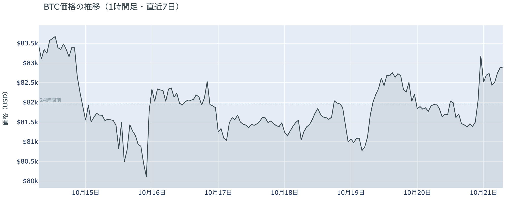

*図の見方: 1時間ごとの価格（日本時間）。点線は24時間前の水準。火曜の夜に点線の上へ一段上がり、深夜にその半分を戻しています。*

* 24時間の値幅は2.8%で、月曜の1.8%から広がった。
* 建玉は前日の朝より0.7%減り、1週間前より1.7%多い。

火曜日は、朝8時から夜9時まで$81,400から$82,000の間で動かず、米国の証券市場が開いた22時台と23時台に$81,500から$83,200へ上げ、0時台に$82,500へ戻して、そのあとは$82,400から$82,900で朝を迎えた日でした。22時台は価格と一緒に建玉（＝先物の未決済残高。証拠金で張っている人の量）が増えたのでロングが新しく積まれ、23時台は価格が1.4%上げながら建玉が減ったので、ショートの買い戻しが上げを運んでいます。Hyperliquid（＝オンチェーンの先物取引所）で見える清算は71件で、23時台にショートが、0時台にロングが焼けました。0時台は価格が0.8%下げながら建玉が1.3%減ったのでロングの手仕舞いで、その大半を占めるロングの大口1件が、24時間でいちばん値動きの速い0時15分の5分足に入っています。清算が戻しを加速させた形です。

**図1-2 価格と50日・200日移動平均**

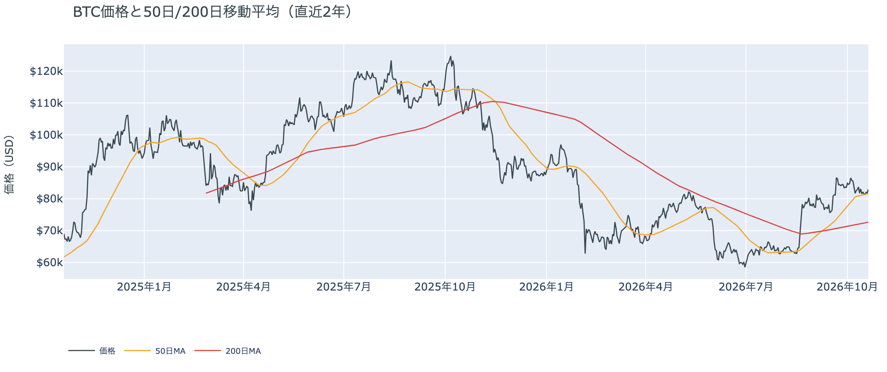

*図の見方: 2本の平均線の上下関係を見ます。50日線が200日線の上にあるのがゴールデンクロスです。*

* 50日線と200日線の差は約$8,900（12.3%）で、前日と同じ。
* 朝7時5分の価格は50日線の$81,568を1.7%上回る。

長い目で見た流れの向きは変わっていません。ゴールデンクロス（＝50日線が200日線を上抜けること）の状態が43日目で、2本の平均線の差は開いたままです。価格は火曜の夜の上げで50日線から1.7%上へ離れましたが、先週の木曜から張りついていた線のすぐ上にいることに変わりはありません。

証券市場は火曜10月20日に、米国株（S&P500）が+0.3%で続伸し、原油（WTI）が−5.3%の$98へ下げ、米10年債利回りは5.12%へ下がりました。先週から続いていた原油高と金利高という重しが火曜の夜に一段軽くなった夜で、ビットコインはその同じ時間に上げています。

## 2. なぜ動いたか：きっかけと、需給のどこが動いたか

**図2-1 ビットコインと株・金・原油の相対推移（起点＝100）**

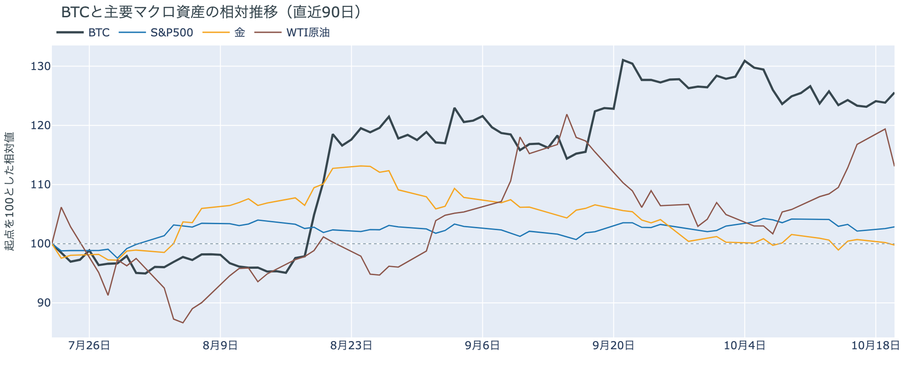

*図の見方: 同じ起点から何%動いたかで重ねたもの。線の向きが揃っているかを見ます。*

| この5営業日の動き（ビットコインは7日間） | 変化 |
|---|---:|
| ビットコイン | −0.2% |
| 金 | −0.8% |
| 米国株（S&P500） | −1.2% |
| 原油 | +4.3% |

* 建玉は94,439BTCで、前日の95,106BTCから0.7%減った。
* 資金調達率から短期金利を引いた上乗せは+4.74ptで、前日の+4.29ptから増えた。

火曜日の上げと戻しは、米国とイランの妥協案の報道をきっかけに、先物のショートの買い戻しとロングの手仕舞いを通って起きました。

1. きっかけ：火曜の米国の取引時間に、カタールとパキスタンが仲介する妥協案が報じられました。イランの核施設への国際原子力機関（IAEA）の非公開の訪問と、カタールで凍結されている約60億ドルのイラン資金の利子の支払いを組み合わせたもので、米国が了承しイランも暫定的に受け入れたと伝えられましたが、公式の確認はありません。報道と同じ時間に原油は$100超から$95台へ下げ、米10年債利回りは下がり、株は上げ、ビットコインは$83,000台へ上げました。そのあと「協議は続いているが合意は近くない」との報道で原油は$97台へ、利回りも元の水準へ戻り、ビットコインも同じ時間に$82,500へ戻しました。株と同じ向きに動いただけでは共通のきっかけとは言えませんが、上げと戻しの両方が報道の時刻と重なり、その時間にビットコイン自身の出来事は無かったので、きっかけは外部環境の報道です。規制では、スイスの金融規制当局が同国初の個人向けの現物ビットコインETFを承認したと20日に発表しました。発行会社と上場日は公表されていません。この5営業日では、株と金が下げて原油が上げるなかでビットコインはほぼ動いておらず、先週の株安と原油高に引きずり下ろされた形にはなっていません。
2. 伝わり方：通り道は先物の両側でした。報道で上げた22時台はロングが新しく積まれ、23時台は月曜の夜に積まれたショートが買い戻されて$83,000台へ届きました。報道が後退した0時台は、$83,000台で入ったロングが手仕舞われ、清算が戻しを加速させて$82,500まで下げました。往復のあと建玉は前日より減ったので、下げに賭けた人も上げを追いかけた人も、どちらも持ち高を手放しています。資金調達率（＝ロングが払う金利。プラス＝ロングがショートより多い）は、1日をならした年率で+8.82%と、短期金利（＝ドルを米国の短期国債で持つだけで受け取れる金利。13週Tビル 4.08%）を引いた上乗せは+4.74ptで、月曜の+4.29ptからさらに増えました。残ったロングは払う分を増やしながら持ち続けています。アメリカの取引所の買い手は火曜に一段引き（図①-1）、ETFの流入は月曜の分なので火曜の夜の往復には関わっておらず（図①-2）、往復は先物の中で完結しています。

## 3. 市場参加者はいまどう見ているか

### ① アメリカの買い手は、ETFの1本に大きな買いが戻ったが、取引所では引いたまま

**図①-1 Coinbase Premium（アメリカとそれ以外の価格差・直近90日）**

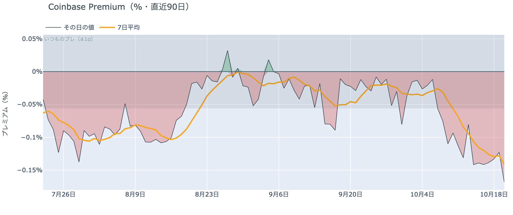

*図の見方: プラス＝アメリカで買いが強い。太線が1週間平均、細線がその日の値。薄い帯は「いつものブレの範囲」です。*

* 1週間平均は−0.14%で、前の週の−0.09%より沈んだ。
* その日の値は−0.17%で、いつものブレの3倍。1か月前は−0.02%。

アメリカの取引所の買い手は引いたままで、火曜はさらに弱まりました。Coinbase Premiumの1週間平均は3週続けて沈み、その日の値は帯の外へ出たので、火曜の夜の$83,000台への上げを運んだのはアメリカの現物の買いではありません。アメリカだけが安く取引される形は10月9日から13日続いています。

**図①-2 ETFの日ごとの資金の出入り（直近90日）**

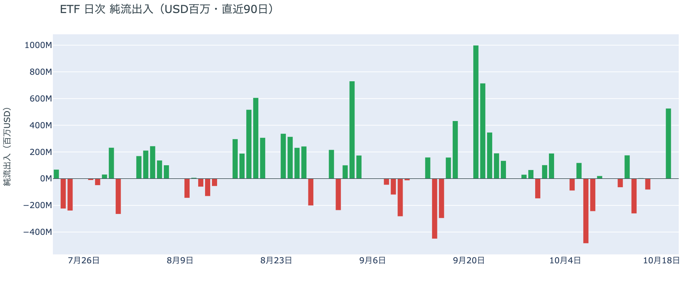

*図の見方: 入ったお金と出たお金の差。上に伸びれば入り超、下に伸びれば出超。*

| ETFの日ごとの出入り | 億ドル |
|---|---:|
| 10月13日 | +1.8 |
| 10月14日 | −2.6 |
| 10月15日 | +0.1 |
| 10月16日 | −0.8 |
| 10月19日 | +5.3 |
| 10月20日（集計途中） | 0.0 |
| 直近7営業日の合計 | +3.0 |

ETFの買い手は月曜に戻りましたが、幅はまだ狭いです。10月19日の流入は9月22日以来の大きさで、先週水曜の米CPIの日に出た分を1日で埋め、7営業日の合計は流出から入り超へ転じました。ただし報道では流入は最大手の1本のファンドに集中し、ほかの2本は流出だったので、ETFの買い手が幅広く戻ったのではなく、1社を通じた買いが先行している形です。

**図①-3 Fear & Greed（市場心理の指数・直近90日）**

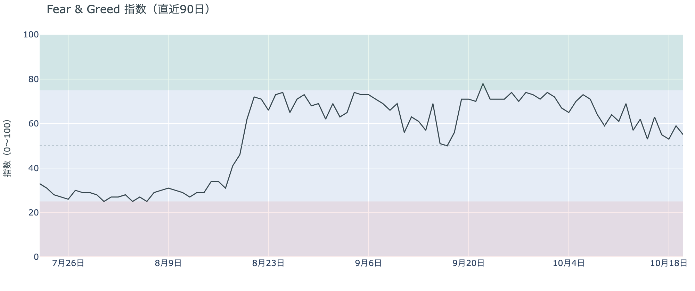

*図の見方: 0〜100で、50より上が「強欲」、下が「恐怖」。*

* 55の「強欲」。前日の59から4pt下げ、1週間前は57、1か月前は71。

市場心理は「強欲」の下限まで下がり、1か月前からの冷え方は続いています。Fear & Greed（＝市場心理の指数）の10月20日の確定値は、月曜の$83,000近くへの上げで戻した分を1日で返し、「中立」との境目にあります。先週からの$80,000台での足踏みを流れの変化と見る人が増えたわけではありませんが、1か月前の熱は戻っていません。

### ② 長期保有者の利益確定の売りは続き、減り方は前の週の1.7倍に広がった

**図②-1 長期保有者の保有量の30日変化とSOPR（直近90日）**

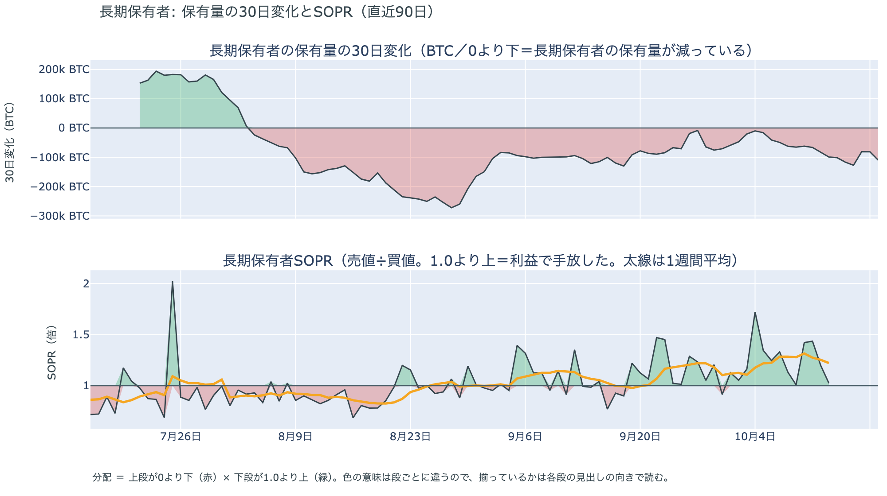

*図の見方: 上段は、長期保有者の保有量が30日でどれだけ増減したか。マイナス＝手放している。下段は長期保有者SOPRで、1より上なら利益で手放した。どちらも1週間平均で読みます。*

| 10月19日時点 | 1週間平均 | 前の週の平均 |
|---|---:|---:|
| 長期保有者SOPR（1より上＝利益で手放した。10月13日分まで） | 1.22 | 1.23 |
| 長期保有者の保有量の30日変化（万BTC） | −10.2 | −6.1 |

* 1週間平均の減り方は、1か月前（9月19日）の−9.2万BTCをやや上回る。

長期保有者は利益確定の売りを続けていて、減り方は前の週の1.7倍に広がりました。保有量は30日で減り、動いたコインは平均して買値より高く動いています。減り方は先週からの$80,000台での足踏みをまたいで広がったので、長期保有者はいまの価格を、売りを止める水準とは見ていません。向きは前日と同じで、ビットコイン自身の需給の土台が変わった日ではありませんが、売りが続いている分、価格を支える側にはいません。

長期保有者のほかに、売りに回りそうな持ち手は見当たりません。長く眠っていたコインが急に動いた記録はなく、マイナーの収入は平年をやや上回る程度（Puell Multiple（＝マイナー収入の平年比）が1週間平均で1.12）で、売りを急ぐ状況ではありません。コインが最後に動いた価格の分布にも、今日は新しい材料がありません。

### ③ 先物：月曜の夜のショートは1日で買い戻され、残ったロングは払う分をさらに増やした

**図③-1 資金調達率と建玉（直近30日）**

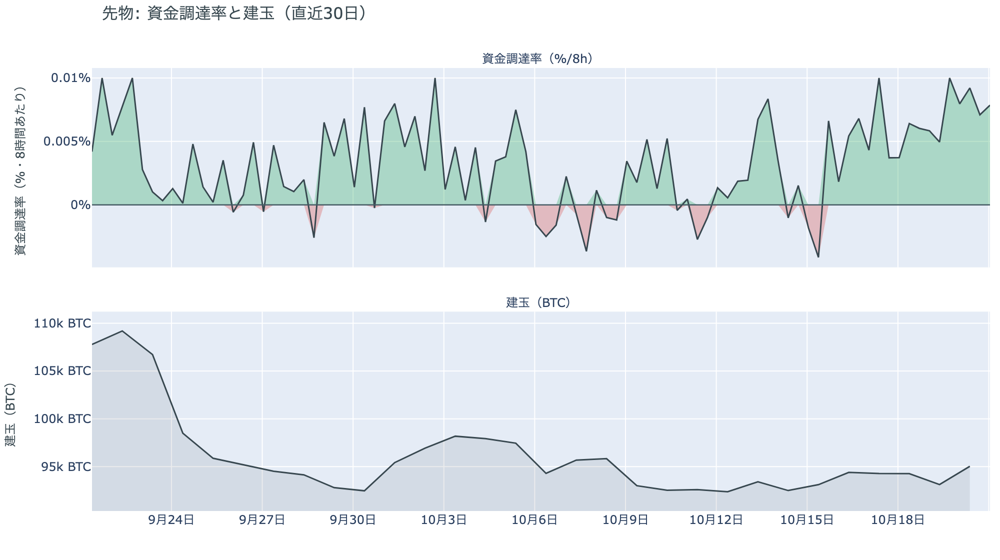

*図の見方: 上段は資金調達率（8時間ごと・日本時間）。プラスが続く＝ロングがショートより多い。下段は建玉。*

* 資金調達率のプラスは17回連続（約6日）。
* 上乗せの直近34日の平均は+0.15ptで、いまはそれを4.6pt上回る。

先物の参加者は、下げに賭けた側が1日で退き、上げへの確信を保っています。前日は「米国の取引時間にショートが新しく積まれた」と説明しました。火曜の夜に妥協案の報道で価格が上げると、そのショートは買い戻され、下げに賭けた人は1日も持たなかったので、前日の説明は今日の数値と合っています。一方で$83,000台で新しく入ったロングは1時間で清算され、建玉は前日より減ったので、上げを追いかけた人は振り落とされ、賭けの量は増えていません。残ったロングが短期金利より余分に払う分は+4.74ptへ増え、この1か月の平均を大きく上回っているので、短期金利の2倍を超える金利を払ってでも持ち続けたい人が中心に残っています。確信は強いまま、人数は増えていない形です。

### ④ オプション：今週の満期ではコールが高くなり、10月末の大きな上げへの賭けは一部外された

オプションには2種類あります。コール（＝決めた価格で買う権利）とプット（＝決めた価格で売る権利）で、価格が上がればコールの価値が上がり、価格が下がればプットの価値が上がります。プットは「価格が下がったときの保険」として買われます。オプションを買う人は、その権利と引き換えに権利料（＝オプションを買う人が払う金額）を払います。

**図④-1 満期ごとのIV（年率%）**

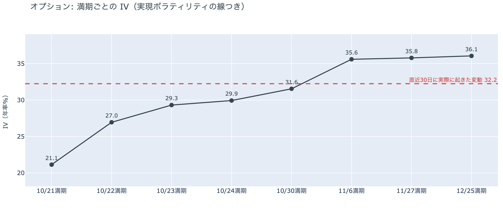

*図の見方: IVを満期ごとに並べたもの。点線は実現ボラティリティ。IVが点線より下なら、市場はこの先の値動きを過去の値動きより小さいと見ています。*

| 満期 | IV |
|---|---:|
| 10月21日 | 21 |
| 10月22日 | 27 |
| 10月23日・24日 | 29〜30 |
| 10月30日 | 32 |
| 11月6日・27日・12月25日 | 36 |

* IVは全体で37.3で、実現ボラティリティ32.2より5.1pt高い。過去1年で下から17%。

オプションの参加者は、この先の値動きを過去の値動きより大きいと見ていますが、怖がってはいません。IV（＝値動きの幅の予想）は実現ボラティリティ（＝過去の値動きの幅）より高く備えが買われている側にありますが、その差は前日の6.6ptから縮み、IVは過去1年の中で低いほうから2割の位置にあります。満期（＝権利の期限）ごとに見ると手前ほど低く先ほど高い平常の形で、特定の日だけ権利料に、ほかの満期に対する上乗せが乗っている満期はありません。参加者は今週を静かな週と見て、値動きが大きくなるのはFOMCをまたいだ先だと値付けしています。

**図④-2 満期ごとのプットとコールの差**

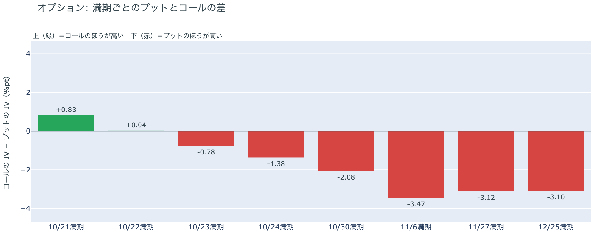

*図の見方: 満期ごとに、プットとコールのどちらが高く売れているか。ゼロより上ならコールのほうが高く、下ならプットのほうが高い。*

| 満期 | どちらが高いか |
|---|---|
| 10月21日 | コールが高い |
| 10月22日 | ほぼ差なし |
| 10月23日 | プットがやや高い |
| 10月24日 | プットが高い |
| 10月30日 | プットが高い |
| 11月6日 | プットがはっきり高い |
| 11月27日 | プットがはっきり高い |
| 12月25日 | プットがはっきり高い |

参加者は今週の前半は下げないと値付けし、下げへの備えは金曜23日から先、とくにFOMCをまたぐ10月30日以降の満期に置いています。前日まで全部の満期でプットのほうが高かったのが、火曜の上げで今週の手前の満期では下げへの備えが剥がれ、21日の満期ではコールのほうが高くなりました。プットとコールのどちらが高いかが途中の満期で入れ替わるのは今朝が初めてで、「今週は荒れない、その先は備える」という形です。持ち高（図④-3）ではプットが動いていないので、備えを売ったのではなく、手前の満期の値付けだけが変わっています。

**図④-3 10月30日満期の持ち高（権利の価格ごと）**

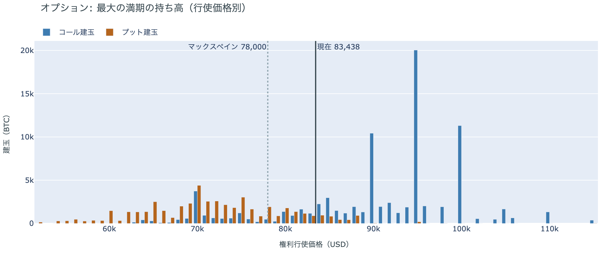

*図の見方: 青＝コール、橙＝プット。現値より上にコールが、下にプットが積まれるのが普通です。*

| 10月30日満期のオプション | 量（万BTC） | 意味 |
|---|---:|---|
| コール | 約8.6 | 「価格が上がる」に賭けた分 |
| プット | 約5.0 | 「価格が下がる」への保険 |
| うち、いまより15%以上高い価格のコール | 約2.0 | 大きな上げへの賭け |
| うち、いまより15%以上安い価格のプット | 約2.3 | 大きな下げへの保険 |

* 10月30日満期の持ち高は約13.5万BTCと全満期の35%で、前日の約14.9万BTCから減った。減ったのはコールで、前日の約9.9万BTCから1割強縮んだ。
* コールが集まっている価格は$95,000に約2.0万BTC、$100,000に約1.1万BTC、$90,000に約1.0万BTC。

「価格が上がる」に賭けた人たちの一部が降り、10月末までの大きな上げへの確信は弱まりました。減ったのは$90,000から$100,000に積まれていたコールで、10月30日までに1割以上上げるという賭けが1割強外されています。ただし大半は残っていて、コールはプットの1.7倍のままなので、上げへの賭けそのものを畳んだわけではありません。残った賭けが報われるには、FOMCを越えて10月30日までに$90,000を超える必要があり、いまの価格からは約8%上です。プットは前日と同じ量で残っているので、参加者はFOMCの前後の下げへの備えを据え置いたまま、10月末までの大きな上げの見込みだけを小さくしています。

## 4. 価格に影響しうる直近のイベント

オプション市場が下げへの備えを厚く置いているのは10月30日と11月6日の満期で、この区間に当たるのはFOMCと、その翌日の米国の7〜9月期GDP・9月のPCE物価、日銀の会合です。今週の手前の満期ではコールのほうが高く、水曜の米国の引け後のTeslaの決算と金曜の米国のPMI速報をまたぐ満期に、ほかの満期に対する上乗せは乗っていません。原油の側では、火曜に報じられた米国とイランの妥協案（カタールとパキスタンの仲介で、IAEAの非公開の訪問と凍結資金の利子の支払いを組み合わせたもの）は公式に確認されておらず、イラン側は「協議は続いているが合意は近くない」としています。ロシア制裁法の関税と銀行制裁は16日の大統領令で適用が見送られたままです。FRBはFOMCまでブラックアウトに入っていて、利上げの織り込みは約2割で1週間前と変わっていません。

| 日付 | イベント | 何に効くか |
|---|---|---|
| 日程未定 | 米国とイランの妥協案（カタール・パキスタンの仲介。IAEAの非公開の訪問と、カタールで凍結された約60億ドルの利子の支払い）。公式の確認はなく、イラン側は合意は近くないとしている | 原油 |
| 日程未定 | ロシア制裁法の100%関税とロシアの銀行への制裁。16日の大統領令で適用が見送られ、見送りの期限は決まっていない | 原油 |
| 10/21（水）米国の引け後 | Teslaの7〜9月期決算（日本時間22日朝）。AI関連の設備投資への不安で株が下げた先週のあとの、最初の大手テックの決算 | 米国株 |
| 10/23（金） | 米国の10月PMI速報とミシガン大学の消費者態度指数 | 金利・株。この日からプットがやや高い |
| 10/27（火）〜28（水） | FOMC。利上げの織り込みは約2割で、1週間前と同じ。結果は日本時間29日未明。FRBは17日からブラックアウト | 金利。プットが高い10月30日の満期がまたぐ |
| 10/29（木） | 米国の7〜9月期GDPと9月のPCE物価 | 金利 |
| 10/29（木）〜30（金） | 日銀の会合。展望レポートも出る | 円 |
| 10/30（金）17:00 | オプションの最も大きな満期（約13.5万BTC、全満期の35%）。FOMCの2日後 | $90,000以上のコールの期限 |
| 11/1（日） | OPEC+の会合。12月の生産目標を決める | 原油 |
| 11/3（火） | 米国の中間選挙。トランプ大統領は「それまでイランを攻撃しない」と述べている | 原油 |
| 11/6（金）17:00 | オプションの満期。プットの高さが全満期でいちばん大きい | 下げへの備えの期限 |
| 11/11（水） | MSCIが株価指数から外す企業の最終一覧を公表。ビットコインを大量に持つ企業を外しうる規則を10月15日に確定し、Strategyが対象になりうる。入れ替えは11月30日 | 指数に連動する資金による、それらの企業の株の売買 |

## まとめ：火曜日の動きは何だったか

火曜日は、米国とイランの妥協案の報道をきっかけに、月曜の夜に積まれたショートの買い戻しが$83,000台へ上げ、報道が後退すると$83,000台で入ったロングの清算が$82,500へ戻した日でした。ビットコイン自身の需給の土台は変わっていません。アメリカの買い手はETFの1本を通じて戻り始めましたが取引所では引いたままで、長期保有者の利益確定の売りは減り方を広げながら続いています。参加者は、今週は下げないと見てロングは短期金利を大きく上回る金利を払い続けていますが、10月末までの大きな上げへの賭けは一部を外し、下げへの備えはFOMCの前後の満期に据え置いたので、次に大きく動くのはFOMCの前後で、その向きは上げより下げに重く備えています。

---

<small>（数値は10月21日7時5分（日本時間）までのデータに基づきます。価格・先物・オプション・Coinbase Premiumはその時点の値、市場心理は10月20日の確定値、オンチェーン（＝ブロックチェーン上の記録）の長期保有者の保有量は10月19日時点、長期保有者SOPRとマイナーの収入は10月13日分まで、ETF資金フローは10月20日分までで、10月20日分は集計途中です。証券市場の終値は10月20日時点です。FOMCの織り込みは10月20日のFF金利先物の終値から計算したものです。オンチェーンの長期保有者の数値には、ETFや取引所が預かっている分も含まれます。オプションはDeribit（BTCオプションの大半を占める取引所）の全銘柄です。）</small>

*本稿は情報提供を目的としたものであり、投資助言ではありません。将来の価格動向を保証・示唆するものではなく、投資判断は各自の責任において行ってください。*
