# 米国株が3日続けて上げた夜に$84,500台へ ― ロングが積まれ、今週の満期にも下げへの備えが戻る

**2026年10月22日**

ビットコインは水曜日、日中は$82,600から$83,300でじりじり上げ、米国の株式市場が開いた夜に$84,500台へ上げて、1週間の高値を付けたまま朝を迎えました。

* **価格**：24時間の値幅は2.8%で火曜と同じ幅ですが、火曜のように上げた分を戻さず、朝7時5分の時点で約$84,636は24時間前より2.0%高く、この1週間でいちばん高い水準です
* **きっかけ**：はっきりした外部環境の出来事はありません。米国の株式市場が開いてテック株が上げた時間に、同じ向きに上げました。米国の銀行監督当局（OCC）がステーブルコインの規則を確定したという規制の進展はありましたが、その報道のあと2時間、価格は動いていません
* **先物**：上げは新しく積まれた買い持ち（ロング）が運び、売り持ち（ショート）の清算（＝証拠金不足で強制的に閉じられた取引）が加速させました。建玉は1日で4%増えて上げに賭ける人は増えましたが、ロングが短期金利より余分に払う分は前日より縮んだので、ロングに大きく偏った形ではありません
* **需給の土台**：米国の買い手は、ETFでは月曜の大きな流入のあと火曜は細い流入にとどまり、取引所では引いたままです。長期保有者（＝155日以上保有者）の利益確定の売りは続き、減り方は前の週の1.5倍に広がりました。土台の向きは前日から変わっていません
* **オプションの見方**：火曜に今週の満期で剥がれた下げへの備えが水曜には戻り、今朝はすべての満期でプットのほうが高くなっています。参加者は上げた日でも今週の下げへの備えを外さず、FOMC（＝米国の金利を決める会合）をまたぐ10月30日と11月6日の満期に厚く置いたままです

## 1. 何が起きたか

**図1-1 価格の推移（1時間足・直近7日）**

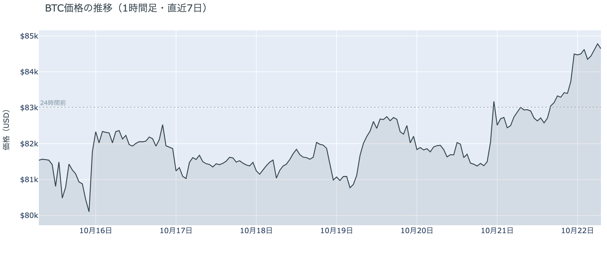

*図の見方: 1時間ごとの価格（日本時間）。点線は24時間前の水準です。水曜の夜に線が一段上がり、そのまま朝まで保っています。*

* 24時間の値幅は2.8%で、前日と同じ幅。
* 建玉は前日の朝より4.2%増え、1週間前より2.5%多い。

水曜日は、朝8時から昼過ぎまで$82,600から$82,900で動かず、夕方16時から18時に$83,300へ上げ、米国の株式市場が開いた22時台と23時台に$84,500へ上げて、そのあとは$84,300から$84,800で朝を迎えた日でした。16時から18時台は価格と一緒に建玉（＝先物の未決済残高。証拠金で張っている人の量）が増えたのでロングが新しく積まれ、いちばん上げた23時台も同じ組み合わせで、ロングが上げを運んでいます。Hyperliquid（＝オンチェーンの先物取引所）で見える清算は169件で全部がショートで、半分が23時台に集まりました。多数のアドレスに分かれていて、大口1件が占めるのは半分弱です。24時間でいちばん値動きの速かった5分足の上位4本には清算が入っていないので、上げは清算なしで始まり、23時台と深夜1時台のショートの清算が上げを加速させた形です。

**図1-2 価格と50日・200日移動平均**

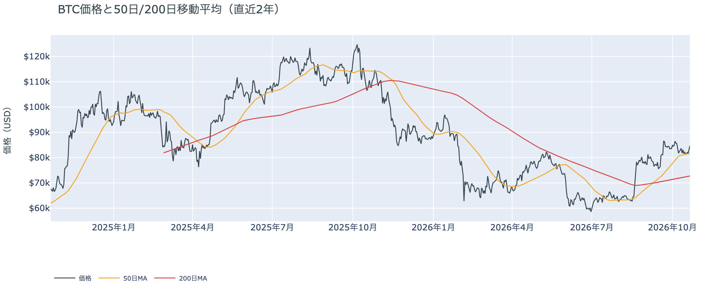

*図の見方: 2本の平均線の上下関係を見ます。50日線が200日線の上にあるのがゴールデンクロスです。*

* 50日線と200日線の差は約$9,000（12.3%）で、前日と同じ。
* 朝7時5分の価格は50日線の$81,712を3.6%上回る。

長い目で見た流れの向きは変わっていません。ゴールデンクロス（＝50日線が200日線を上抜けること）の状態が44日目で、2本の平均線の差は開いたままです。価格は先週の木曜から50日線に張りついていましたが、火曜の夜に1.7%、水曜の夜に3.6%と、2日続けて50日線の上へ離れました。

証券市場は水曜10月21日に、米国株（S&P500）が+0.6%の7,757で3日続けて上げ、米10年債利回りは5.15%へわずかに上げ、原油（WTI）は$98前後で前日からほぼ変わらず、金は横ばいでした。ビットコインにとっては、株と同じ向きに上げた夜ですが、先週から続く金利の高さと原油の高さという重しが外れたわけではありません。

## 2. なぜ動いたか：きっかけと、需給のどこが動いたか

**図2-1 ビットコインと株・金・原油の相対推移（起点＝100）**

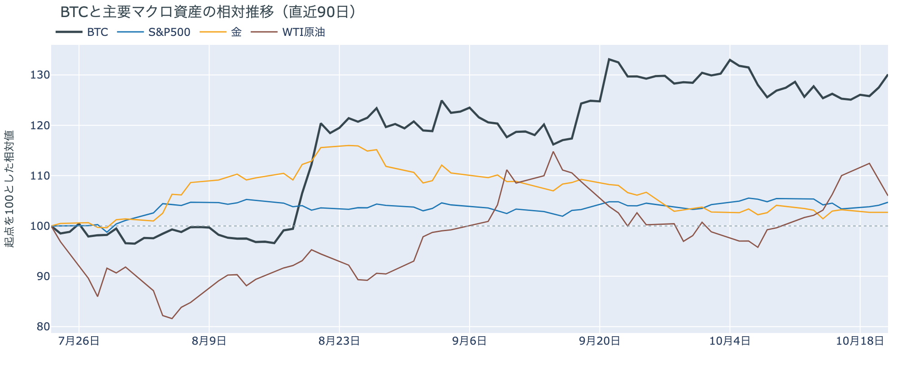

*図の見方: 同じ起点から何%動いたかで重ねたもの。線の向きが揃っているかを見ます。*

| この5営業日の動き（ビットコインは7日間） | 変化 |
|---|---:|
| ビットコイン | +3.8% |
| 金 | −0.4% |
| 米国株（S&P500） | +0.5% |
| 原油 | +3.8% |

* 建玉は98,371BTCで、前日の94,439BTCから4.2%増えた。
* 資金調達率から短期金利を引いた上乗せは+3.23ptで、前日の+4.74ptから縮んだ。

水曜日の上げは、はっきりした外部環境の出来事がないまま、米国の株式市場が開いてテック株が上げた時間に、先物で新しく積まれたロングを通って起きました。

1. きっかけ：外部環境に、水曜のビットコインを動かすほどの出来事はありませんでした。米国では大手テック企業の決算を受けてテック株が上げ、ビットコインは米国の株式市場が開いた22時台と23時台に、株と同じ向きに上げました。同じ向きに動いたことは共通のきっかけがありえたことを示すだけで、原因の証明ではありませんが、その時間にビットコイン自身の出来事は無く、米10年債利回りはむしろ上げていたので、金利の低下が運んだのでもありません。規制では、米国の銀行監督当局（OCC）がステーブルコインの発行会社に関する GENIUS 法の規則を確定しました。準備資産・償還・資本の基準を定めるもので、施行は2027年1月18日と決まりました。日本時間21日の夜に報じられ、報道から米国株が開くまでの2時間、価格は$83,400前後で動いていないので、水曜の上げのきっかけではありません。イランとの協議は、イランの外相が「パキスタンとカタールを通じて続いている」と述べ、ホルムズ海峡の全面再開を6日目に置く7日間の案を米国に示したと伝えられましたが、合意には至っていません。深夜4時台にサウジアラビアの油田が攻撃されたと報じられて原油が上げましたが、ビットコインはその時間に0.1%しか動いておらず、効いた形跡はありません。この5営業日では、株と原油が上げて金が下げるなかで、ビットコインは株より大きく上げています。
2. 伝わり方：通り道は先物のロングでした。夕方16時から18時台と夜23時台に、価格と一緒に建玉が増えたので、新しく積まれたのはロングです。23時台と深夜1時台にはショートの清算が重なり、上げを加速させました。資金調達率（＝ロングが払う金利。プラス＝ロングがショートより多い）は、1日をならした年率で+7.29%と、短期金利（＝ドルを米国の短期国債で持つだけで受け取れる金利。13週Tビル 4.06%）を引いた上乗せは+3.23ptで、前日の+4.74ptから縮みました。賭けの量は増えたのに払う分は減ったので、新しく入ったロングは、火曜まで残っていたロングほど余分に払ってまで買う熱を持っていません。ETFの流入は火曜の分が細く（図①-2）、アメリカの取引所の買い手も引いたままなので（図①-1）、水曜の上げはアメリカの現物の買いではなく、先物の中で起きています。

## 3. 市場参加者はいまどう見ているか

### ① アメリカの買い手は、ETFでは細い流入にとどまり、取引所では引いたまま

**図①-1 Coinbase Premium（アメリカとそれ以外の価格差・直近90日）**

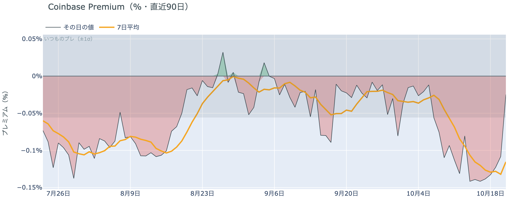

*図の見方: プラス＝アメリカで買いが強い。太線が1週間平均、細線がその日の値。薄い帯は「いつものブレの範囲」です。*

* 1週間平均は−0.12%で、前の週の−0.11%とほぼ同じ。
* 1か月前の1週間平均は−0.03%。

アメリカの取引所の買い手は引いたままで、水曜の上げを運んだのはアメリカの現物の買いではありません。Coinbase Premium（＝アメリカとそれ以外の価格差）の1週間平均は3週続けて沈んだ水準にとどまっていて、1か月前の4倍の深さです。アメリカだけが安く取引される形は10月9日から2週間続いています。

**図①-2 ETFの日ごとの資金の出入り（直近90日）**

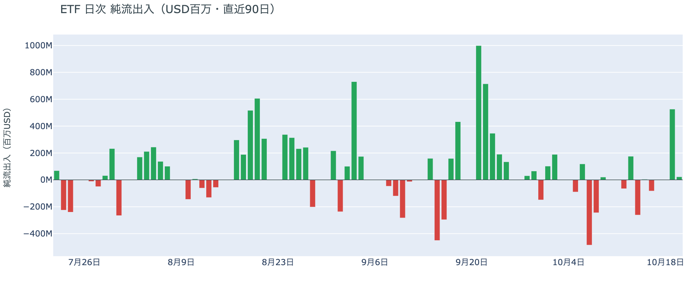

*図の見方: 入ったお金と出たお金の差。上に伸びれば入り超、下に伸びれば出超。*

| ETFの日ごとの出入り | 億ドル |
|---|---:|
| 10月14日 | −2.6 |
| 10月15日 | +0.1 |
| 10月16日 | −0.8 |
| 10月19日 | +5.3 |
| 10月20日 | +0.2 |
| 直近7営業日の合計 | +3.2 |

ETFの買い手は月曜に戻ったものの、火曜は細い流入にとどまり、幅広く戻った形にはなっていません。7営業日の合計は入り超を保っていますが、その大半は月曜の1日分です。火曜の流入は最大手の1本に偏り、1本は流出だったので、1社を通じた買いが先行している形は変わっていません。

**図①-3 Fear & Greed（市場心理の指数・直近90日）**

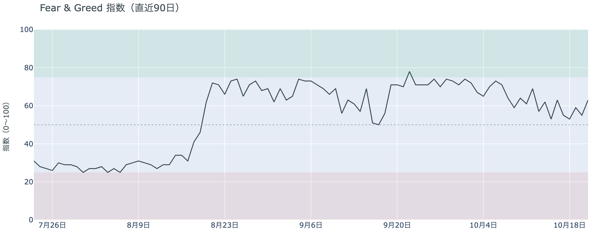

*図の見方: 0〜100で、50より上が「強欲」、下が「恐怖」。*

* 63の「強欲」。前日の55から8pt戻し、1週間前は62、1か月前は70。

市場心理は「中立」との境目から「強欲」の真ん中へ戻りました。Fear & Greed（＝市場心理の指数）の10月21日の確定値は、火曜に1日で返した分を水曜の上げで取り返し、1週間前と同じ水準です。先週からの$80,000台での足踏みを流れの変化と見る人は増えていませんが、1か月前の熱にも戻っていません。

### ② 長期保有者の利益確定の売りは続き、減り方は前の週の1.5倍に広がった

**図②-1 長期保有者の保有量の30日変化とSOPR（直近90日）**

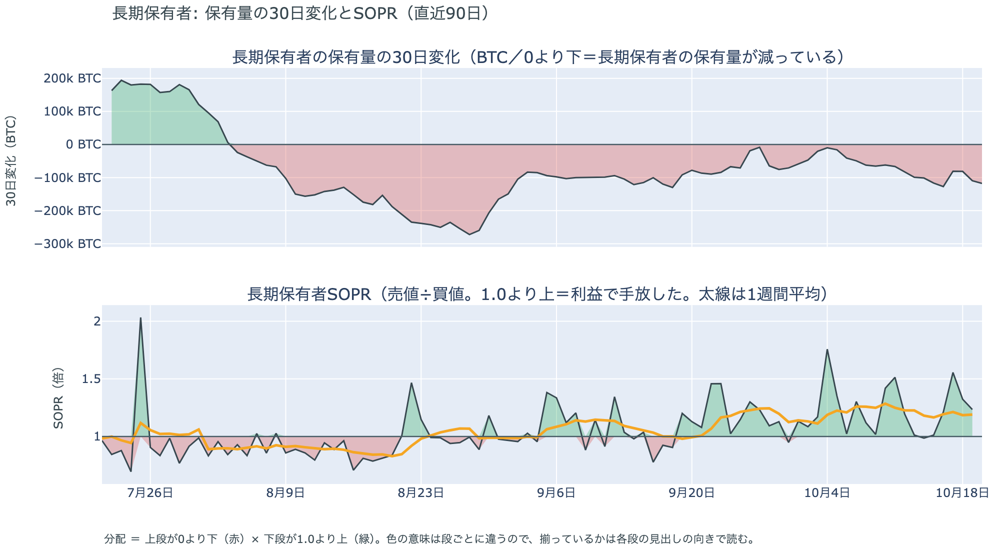

*図の見方: 上段は、長期保有者の保有量が30日でどれだけ増減したか。マイナス＝手放している。下段は長期保有者SOPRで、1より上なら利益で手放した。どちらも太線の1週間平均で読みます。*

| 10月20日時点 | 1週間平均 | 前の週の平均 |
|---|---:|---:|
| 長期保有者SOPR（1より上＝利益で手放した。10月19日分まで） | 1.19 | 1.23 |
| 長期保有者の保有量の30日変化（万BTC） | −10.5 | −7.0 |

* 1週間平均の減り方は、1か月前（9月20日）の−7.8万BTCを上回る。

長期保有者は利益確定の売りを続けていて、減り方は前の週より広がっています。保有量は30日で減り、動いたコインは平均して買値より高く動いています。価格が1週間の高値へ戻った日も売りは止まっていないので、長期保有者はいまの価格を、売りを止める水準とは見ていません。向きは前日と同じで、ビットコイン自身の需給の土台が変わった日ではありませんが、売りが続いている分、価格を支える側にはいません。

長期保有者のほかに、売りに回りそうな持ち手は見当たりません。長く眠っていたコインが急に動いた記録はなく、マイナーの収入は平年をやや上回る程度（Puell Multiple（＝マイナー収入の平年比）が1週間平均で1.12）で、売りを急ぐ状況ではありません。コインが最後に動いた価格の分布にも、今日は新しい材料がありません。

### ③ 先物：ロングは1日で4%積まれたが、払う分は縮んだ

**図③-1 資金調達率と建玉（直近30日）**

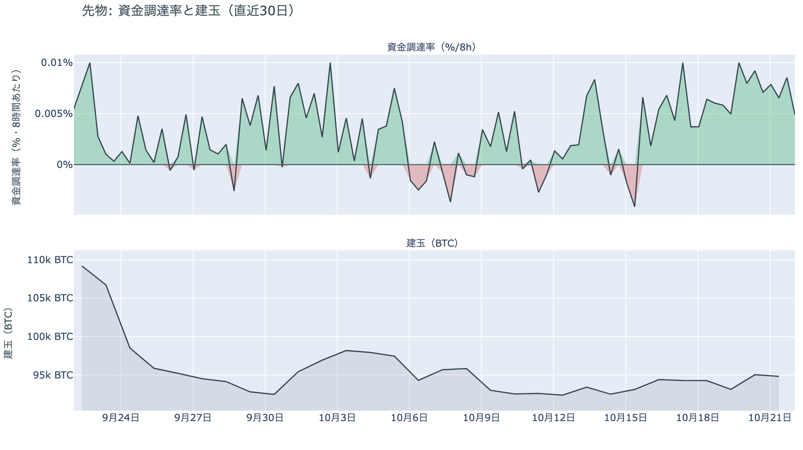

*図の見方: 上段は資金調達率（8時間ごと・日本時間）。プラスが続く＝ロングがショートより多い。下段は建玉。*

* 資金調達率のプラスは20回連続（約7日）。
* 上乗せの直近34日の平均は+0.07ptで、いまはそれを3.2pt上回る。

先物の参加者は、上げに乗る側へ賭けを増やしましたが、ロングに大きく偏っているわけではありません。建玉は1日で4%増え、価格と一緒に増えたので、新しく積まれたのはロングです。一方で、ロングが短期金利より余分に払う分は+3.23ptと、前日の+4.74ptから縮みました。火曜までは少人数が高い金利を払って持ち続ける形でしたが、水曜は人数が増えて払う分が下がったので、上げへの確信は広がりつつ、過熱ではありません。前日は「下げに賭けた側が1日で退いた」と説明しました。水曜はショートが積み直された形跡がなく、増えたのはロングなので、前日の説明は今日の数値と合っています。

### ④ オプション：今週の満期にも下げへの備えが戻り、すべての満期でプットが高い

オプションには2種類あります。コール（＝決めた価格で買う権利）とプット（＝決めた価格で売る権利）で、価格が上がればコールの価値が上がり、価格が下がればプットの価値が上がります。プットは「価格が下がったときの保険」として買われます。オプションを買う人は、その権利と引き換えに権利料（＝オプションを買う人が払う金額）を払います。

**図④-1 満期ごとのIV（年率%）**

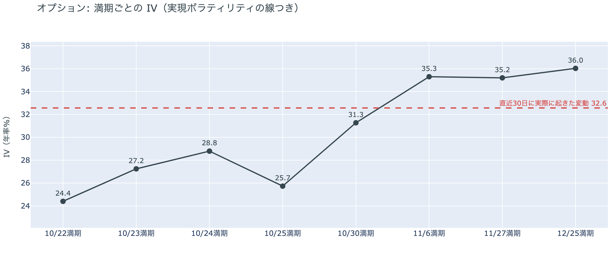

*図の見方: IVを満期ごとに並べたもの。点線は実現ボラティリティ。IVが点線より下なら、市場はこの先の値動きを過去の値動きより小さいと見ています。*

| 満期 | IV |
|---|---:|
| 10月22日 | 24 |
| 10月23日・24日 | 27〜29 |
| 10月25日 | 26 |
| 10月30日 | 31 |
| 11月6日・27日・12月25日 | 35〜36 |

* IVは全体で36.9で、実現ボラティリティ32.6より4.3pt高い。過去1年で下から18%。

オプションの参加者は、この先の値動きを過去の値動きより大きいと見ていますが、怖がってはいません。IV（＝値動きの幅の予想）は実現ボラティリティ（＝過去の値動きの幅）より高く備えが買われている側にありますが、その差は前日の5.1ptから縮み、3日続けて縮んでいます。IVは過去1年の中で低いほうから2割の位置です。満期（＝権利の期限）ごとに見ると手前ほど低く先ほど高い平常の形で、特定の日だけ権利料に、ほかの満期に対する上乗せが乗っている満期はありません。参加者は値動きが大きくなるのはFOMCをまたいだ先だと値付けしていて、その見方は水曜の上げでも変わっていません。

**図④-2 満期ごとのプットとコールの差**

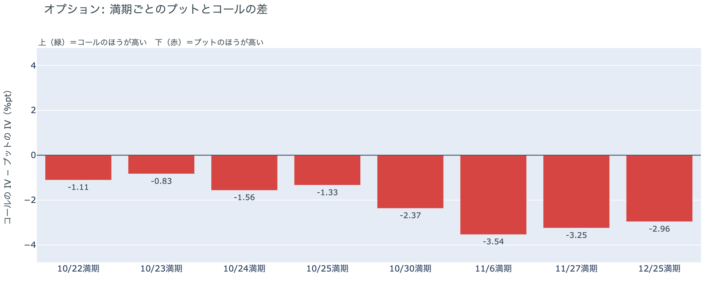

*図の見方: 満期ごとに、プットとコールのどちらが高く売れているか。ゼロより上ならコールのほうが高く、下ならプットのほうが高い。*

| 満期 | どちらが高いか |
|---|---|
| 10月22日 | プットが高い |
| 10月23日 | プットがやや高い |
| 10月24日 | プットが高い |
| 10月25日 | プットが高い |
| 10月30日 | プットが高い |
| 11月6日 | プットがはっきり高い |
| 11月27日 | プットがはっきり高い |
| 12月25日 | プットがはっきり高い |

参加者は上げた日でも、今週の下げへの備えを外しませんでした。前日は「今週の前半は下げないと値付けし、備えは金曜から先に置いている」と説明しましたが、今朝は今週の満期でもプットのほうが高く戻り、すべての満期でプットが高い形になったので、その説明は1日で合わなくなりました。持ち高（図④-3）は変わっていないので、備えを買い足したのではなく、火曜の上げで手前の満期から一時的に剥がれた値付けが、水曜に戻った形です。備えがいちばん厚いのはFOMCをまたぐ10月30日と11月6日の満期で、ここは変わっていません。

**図④-3 10月30日満期の持ち高（権利の価格ごと）**

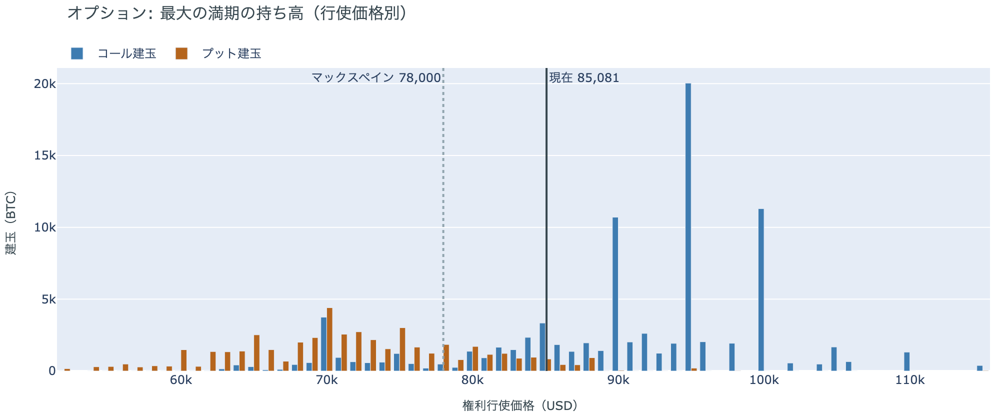

*図の見方: 青＝コール、橙＝プット。現値より上にコールが、下にプットが積まれるのが普通です。*

| 10月30日満期のオプション | 量（万BTC） | 意味 |
|---|---:|---|
| コール | 約8.8 | 「価格が上がる」に賭けた分 |
| プット | 約4.9 | 「価格が下がる」への保険 |
| うち、いまより15%以上高い価格のコール | 約1.8 | 大きな上げへの賭け |
| うち、いまより15%以上安い価格のプット | 約2.8 | 大きな下げへの保険 |

* 10月30日満期の持ち高は約13.7万BTCと全満期の35%で、前日の約13.5万BTCとほぼ同じ。前日に1割強減ったコールは、それ以上減っていない。
* コールが集まっている価格は$95,000に約2.0万BTC、$100,000に約1.1万BTC、$90,000に約1.1万BTCで、前日と同じ。

「価格が上がる」に賭けた人たちは、火曜に一部が降りたあと、水曜はそのまま残っています。コールはプットの1.8倍で、$90,000から$100,000に積まれたコールの量は前日から動いていないので、水曜の上げで賭けを足した人も、さらに降りた人もいません。残った賭けが報われるには、FOMCを越えて10月30日までに$90,000を超える必要があり、いまの価格からは約6%上です。プットも前日と同じ量で残っているので、参加者はFOMCの前後の下げへの備えを据え置いたまま、10月末までの大きな上げの見込みを、前日に小さくした水準から動かしていません。

## 4. 価格に影響しうる直近のイベント

オプション市場が下げへの備えを厚く置いているのは10月30日と11月6日の満期で、この区間に当たるのはFOMCと、その翌日の米国の7〜9月期GDP・9月のPCE物価、日銀の会合です。今週の満期にもプットのほうが高く戻ったので、金曜の米国のPMI速報をまたぐ満期にも備えが置かれています。原油の側では、イランの外相が米国との協議はパキスタンとカタールを通じて続いていると述べ、ホルムズ海峡の全面再開を6日目に置く7日間の案を示したと伝えられましたが、米国は追加の条項を求めているとされ、合意はしていません。21日の深夜にはサウジアラビアの油田への攻撃が報じられています。規制では、OCCが GENIUS 法の規則を確定し、施行は2027年1月18日と決まりました。FRBはFOMCまでブラックアウトに入っていて、利上げの織り込みは約1割で、1週間前の約3割から下がっています。

| 日付 | イベント | 何に効くか |
|---|---|---|
| 日程未定 | 米国とイランの協議（パキスタン・カタールの仲介）。イランはホルムズ海峡の全面再開を6日目に置く7日間の案を示し、米国は追加の条項を求めていると伝えられる。合意はしていない | 原油 |
| 10/23（金） | 米国の10月PMI速報とミシガン大学の消費者態度指数 | 金利・株。この日の満期でもプットがやや高い |
| 10/27（火）〜28（水） | FOMC。利上げの織り込みは約1割で、1週間前の約3割から下がった。結果は日本時間29日未明。FRBは17日からブラックアウト | 金利。プットが高い10月30日の満期がまたぐ |
| 10/29（木） | 米国の7〜9月期GDPと9月のPCE物価 | 金利 |
| 10/29（木）〜30（金） | 日銀の会合。展望レポートも出る | 円 |
| 10/30（金）17:00 | オプションの最も大きな満期（約13.7万BTC、全満期の35%）。FOMCの2日後 | $90,000以上のコールの期限 |
| 11/1（日） | OPEC+の会合。12月の生産目標を決める | 原油 |
| 11/3（火） | 米国の中間選挙。トランプ大統領は「それまでイランを攻撃しない」と述べている | 原油 |
| 11/6（金）17:00 | オプションの満期。プットの高さが全満期でいちばん大きい | 下げへの備えの期限 |
| 11/11（水） | MSCIが株価指数から外す企業の最終一覧を公表。ビットコインを大量に持つ企業を外しうる規則を10月15日に確定し、Strategyが対象になりうる。入れ替えは11月30日 | 指数に連動する資金による、それらの企業の株の売買 |
| 2027/1/18 | OCCの GENIUS 法の規則の施行（10月21日に確定）。ステーブルコインの発行会社の準備資産・償還・資本の基準 | ステーブルコインの発行会社 |

## まとめ：水曜日の動きは何だったか

水曜日は、はっきりした外部環境の出来事がないまま、米国の株式市場が開いてテック株が上げた時間に、先物で新しく積まれたロングが$84,500台へ運び、1週間の高値を付けた日でした。ビットコイン自身の需給の土台は変わっていません。アメリカの買い手はETFの細い流入にとどまって取引所では引いたままで、長期保有者は高値へ戻った日も利益確定の売りを止めていません。参加者は上げに賭ける人を増やしながらも、火曜に外した今週の下げへの備えを1日で戻し、FOMCの前後に厚い備えを据え置いているので、この上げを流れの変化とは見ておらず、FOMCを越えるまでは上げに大きく傾かないでいます。

---

<small>（数値は10月22日7時5分（日本時間）までのデータに基づきます。価格・先物・オプションはその時点の値、市場心理は10月21日の確定値、オンチェーン（＝ブロックチェーン上の記録）は10月20日時点（長期保有者SOPRは10月19日分まで）、ETF資金フローは10月20日分までです。証券市場の終値は10月21日時点です。オンチェーンの長期保有者の数値には、ETFや取引所が預かっている分も含まれます。オプションはDeribit（BTCオプションの大半を占める取引所）の全銘柄です。）</small>

*本稿は情報提供を目的としたものであり、投資助言ではありません。将来の価格動向を保証・示唆するものではなく、投資判断は各自の責任において行ってください。*
