# アジア株安と原油高の午前に$81,000台へ ― 水曜のロングは1日で手仕舞われ、下げへの備えは手前の満期へ

**2026年10月23日**

ビットコインは木曜日、アジアの株式市場でAI関連株が売られ原油が上げた午前中に$84,000から$82,800へ下げ、夕方にかけて$81,600台までもう一段下げたあと、米国の株式市場が大きく下げた夜はほとんど動きませんでした。

* **価格**：24時間の値幅は4.3%と火曜・水曜の2.8%から広がり、朝7時5分の時点で約$81,397は24時間前より3.5%低い水準です。水曜に上げた分を1日で全部返し、先週の水準に戻りました
* **きっかけ**：ビットコイン固有の出来事はありません。韓国と日本の株式市場でAI関連株が売られ、イランがホルムズ海峡でタンカー7隻の損傷を発表して原油が5か月ぶりの高値へ上げた午前中に、株と同じ向きに下げました。夜に米国株が7月以来の大きさで下げた時間には、ビットコインは動いていません
* **先物**：下げは、水曜に積まれた買い持ち（ロング）の手仕舞いが運び、夕方と深夜のロングの清算（＝証拠金不足で強制的に閉じられた取引）が加速させました。ロングが短期金利より余分に払う分は1日でマイナスに沈んだので、水曜に広がった上げへの確信は消えました
* **需給の土台**：米国の買い手はETFでは10月21日まで3営業日続けて買い、2社目にも広がりましたが、取引所では引いたままです。長期保有者（＝155日以上保有者）の利益確定の売りは続き、減り方は前の週より広いままです。土台の向きは前日から変わっていません
* **オプションの見方**：すべての満期でプットが高いのは前日と同じですが、プットの高さがいちばん大きいのは今日・明日の満期で、FOMC（＝米国の金利を決める会合）をまたぐ10月30日の満期はいちばん小さくなりました。参加者は備えをFOMCより手前へ寄せ、目先の数日に下げが続くことに身構えています

## 1. 何が起きたか

**図1-1 価格の推移（1時間足・直近7日）**

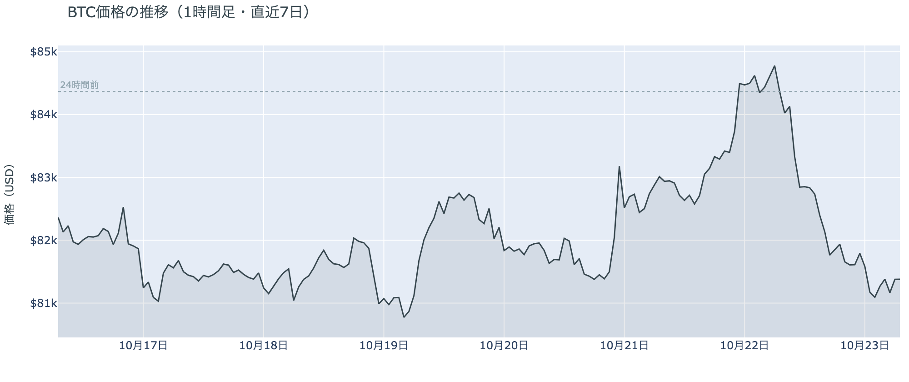

*図の見方: 1時間ごとの価格（日本時間）。点線は24時間前の水準です。木曜の午前に線が一段下がり、夕方にもう一段下がってから、夜は平らです。*

* 24時間の値幅は4.3%で、火曜・水曜の2.8%から広がった。
* 建玉は前日の朝より2.8%減り、午前8時から13時台までの6時間だけで約6%減った。

木曜日は、朝8時の$84,000から午前10時台と11時台に$82,800へ下げ、15時から17時台に$81,800へもう一段下げ、米国の株式市場が開いた22時以降は$81,600前後で動かず、深夜1時台に$81,200へ下げて朝を迎えた日でした。午前中は価格と一緒に建玉（＝先物の未決済残高。証拠金で張っている人の量）が減ったので、消えたのは水曜に積まれたロングです。

**図1-2 価格と50日・200日移動平均**

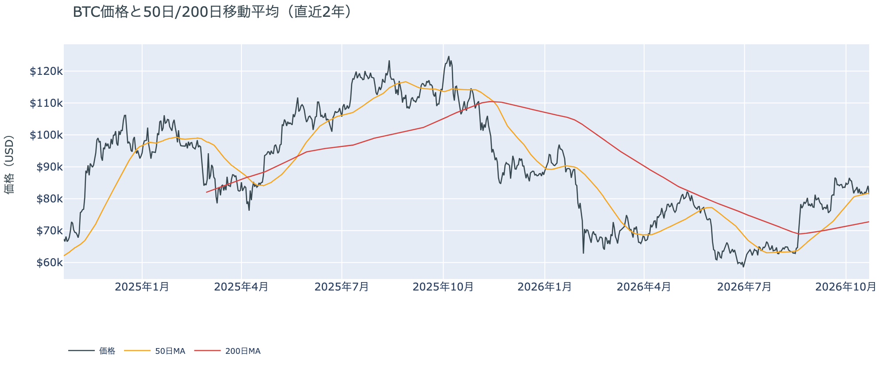

*図の見方: 2本の平均線の上下関係を見ます。50日線が200日線の上にあるのがゴールデンクロスです。*

* 50日線と200日線の差は約$9,000（12.3%）で、前日と同じ。
* 朝7時5分の価格は50日線の$81,781を0.5%下回る。

長い目で見た流れの向きは変わっていません。ゴールデンクロス（＝50日線が200日線を上抜けること）の状態が45日目で、2本の平均線の差は開いたままです。ただし価格は、火曜と水曜に2日続けて50日線の上へ離れた分を木曜の1日で返し、先週の木曜から張りついていた50日線のわずかに下へ戻りました。

**図1-3 実際に起きた清算（Hyperliquid・直近24時間）**

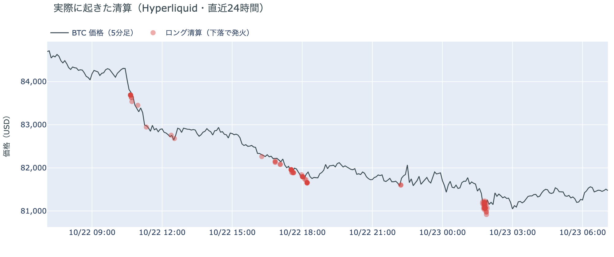

*図の見方: 5分ごとの価格（日本時間）に、Hyperliquidで見えた清算を重ねたもの。赤がロング、緑がショートの清算で、点の大きさが量です。*

* 196件のうち最大の1件は全体の44%で、全体の9割が$81,000台で出た。
* 値動きの速い5分足に入った清算は60%で、深夜1時50分の1本だけで57%。

焼かれたのは夕方と深夜のロングで、午前の最初の下げには清算が入っていません。Hyperliquid（＝オンチェーンの先物取引所）で見える清算は全部がロングで、8割が深夜1時台に集まり、156のアドレスに分かれていて大口1件が占めるのは半分弱です。午前10時35分の速い足には清算が無く、深夜1時50分の速い足に1日の清算の6割近くが入ったので、木曜の下げは清算なしで始まり、深夜の1段を清算が加速させた形です。

証券市場は木曜10月22日に、米国株（S&P500）が7,663へ1%強下げて7月以来の大きな下げ幅になり、米10年債利回りは4.95%へ1日で0.2pt下げて約1か月ぶりに5%を割り、金は−2.7%の$4,040、原油（WTI）は+2.0%の$99でした。ビットコインにとっては、先週から続いた金利の重しが1日で軽くなった一方で、株の下げと原油の高さは残ったまま週末に入る形です。

## 2. なぜ動いたか：きっかけと、需給のどこが動いたか

**図2-1 ビットコインと株・金・原油の相対推移（起点＝100）**

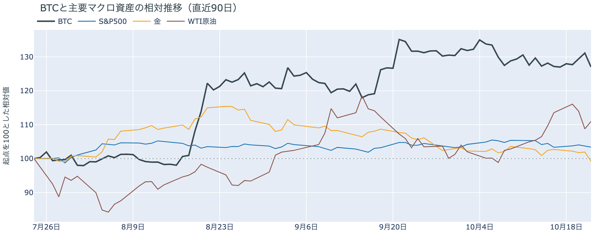

*図の見方: 同じ起点から何%動いたかで重ねたもの。線の向きが揃っているかを見ます。*

| この5営業日の動き（ビットコインは7日間） | 変化 |
|---|---:|
| ビットコイン | −0.9% |
| 金 | −3.1% |
| 米国株（S&P500） | −0.7% |
| 原油 | +1.2% |

* 建玉は95,609BTCで、前日の98,371BTCから2.8%減った。
* 資金調達率から短期金利を引いた上乗せは−3.89ptで、前日の+3.23ptからマイナスに沈んだ。

木曜日の下げは、アジアの株式市場でAI関連株が売られ原油が上げた午前中に、水曜に積まれたロングの手仕舞いを通って起きました。

1. きっかけ：ビットコイン固有の出来事はありませんでした。米国の大手テック企業（Meta）の決算が日本時間の木曜早朝に出て利益が市場の予想に届かず、AI関連株の比重が大きい韓国の株価指数は3.5%、日経平均は2.7%下げました。同じ午前中に、イランがホルムズ海峡でタンカー7隻が損傷したと発表し、北海ブレント原油は5か月ぶりの高値へ上げました。ビットコインが下げたのはこの時間で、株と同じ向きです。同じ向きに動いたことは共通のきっかけがありえたことを示すだけで原因の証明ではありませんが、その時間にビットコイン自身の出来事は無く、夜に米国の株式市場が7月以来の大きさで下げた時間にはビットコインは$81,600前後で動いていないので、木曜の下げはアジアの時間の株安と原油高と一緒に起き、米国の株安には反応していません。報道には「原油高で利上げ観測が再燃した」としたものがありますが、FF金利先物が示すFOMCでの利上げの織り込みは木曜に約1割台半ばから1割未満へ下がり、米10年債利回りも1日で0.2pt下げたので、金利の上昇が押したのではありません。この5営業日では、金と株が下げて原油が上げるなかで、ビットコインは金より小さい下げにとどまっています。
2. 伝わり方：通り道は先物のロングの手仕舞いでした。午前10時台と11時台に価格と一緒に建玉が約4%減り、午前中だけで水曜に積まれた4%を上回る量が消えたので、水曜に積まれたロングは木曜の午前中に手仕舞われました。夕方17時台と深夜1時台にはロングの清算が重なり、下げを加速させました。資金調達率（＝ロングが払う金利。プラス＝ロングがショートより多い）は、1日をならした年率で+0.14%と、短期金利（＝ドルを米国の短期国債で持つだけで受け取れる金利。13週Tビル 4.02%）を引いた上乗せは−3.89ptで、前日の+3.23ptからマイナスに沈みました。余分に払ってでも上げに賭けたい人は、1日でいなくなりました。ETFの流入は10月21日まで3営業日続いていて（図①-2）、アメリカの現物の買い手が引いた形跡はまだ無いので、木曜の下げは先物の中で起きています。

## 3. 市場参加者はいまどう見ているか

### ① アメリカの買い手は、ETFでは3営業日続けて買い、取引所では引いたまま

**図①-1 Coinbase Premium（アメリカとそれ以外の価格差・直近90日）**

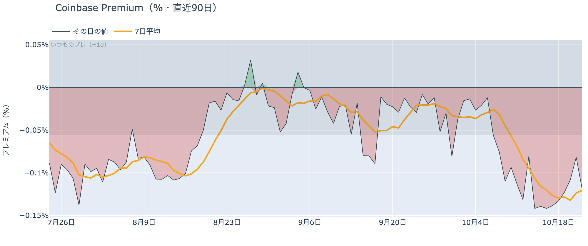

*図の見方: プラス＝アメリカで買いが強い。太線が1週間平均、細線がその日の値。薄い帯は「いつものブレの範囲」です。*

* 1週間平均は−0.12%で、前の週の−0.12%と同じ。
* その日の値は−0.12%で、いつものブレの2.1倍の深さ。

アメリカの取引所の買い手は引いたままで、木曜の下げた価格でも戻っていません。Coinbase Premium（＝アメリカとそれ以外の価格差）の1週間平均は4週続けて沈んだ水準にとどまり、その日の値もいつものブレの2倍の深さで帯の外にあります。アメリカだけが安く取引される形は10月9日から2週間続いています。

**図①-2 ETFの日ごとの資金の出入り（直近90日）**

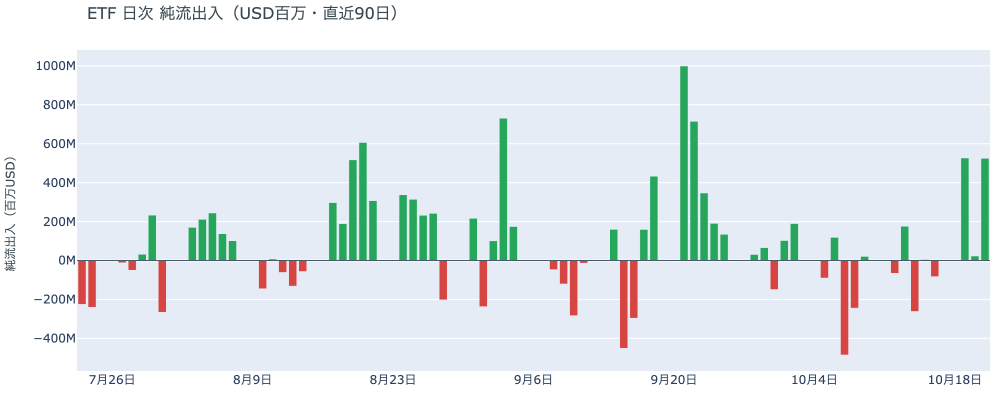

*図の見方: 入ったお金と出たお金の差。上に伸びれば入り超、下に伸びれば出超。*

| ETFの日ごとの出入り | 億ドル |
|---|---:|
| 10月15日 | +0.1 |
| 10月16日 | −0.8 |
| 10月19日 | +5.3 |
| 10月20日 | +0.2 |
| 10月21日 | +5.2 |
| 直近7営業日の合計 | +9.1 |

ETFの買い手は戻りつつあり、1社に偏った形から広がり始めました。10月21日の流入は最大手と2番手の2社がそれぞれ2億ドル超で、月曜の1社偏重とは違う形です。7営業日の合計は前日の+3.2億ドルから+9.1億ドルへ膨らみました。ただし10月21日分までの数字で、木曜の下げの日にETFの買い手がどう動いたかは、まだ映っていません。

**図①-3 Fear & Greed（市場心理の指数・直近90日）**

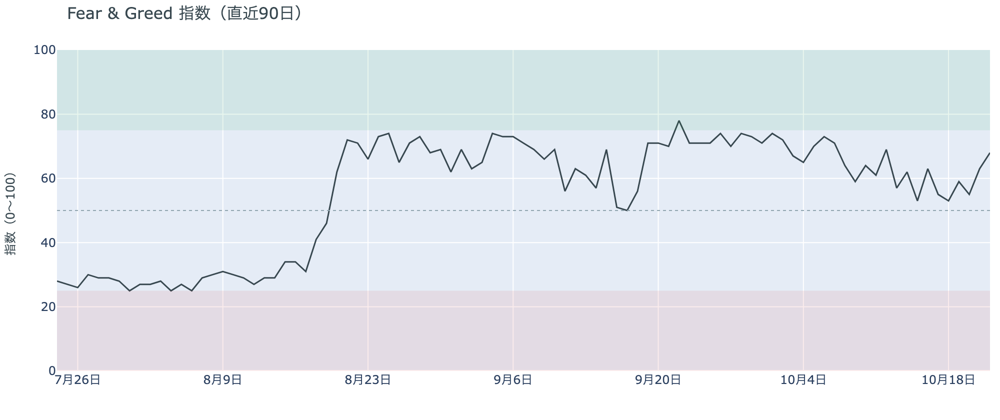

*図の見方: 0〜100で、50より上が「強欲」、下が「恐怖」。*

* 68の「強欲」。前日の63から5pt上がり、1週間前は53、1か月前は78。

市場心理は「強欲」の側で、木曜の下げの前までは3日続けて上がっていました。Fear & Greed（＝市場心理の指数）の10月22日の確定値は、1週間前の「中立」との境目から「強欲」の真ん中より上へ戻っています。木曜の下げが心理に映るのは10月23日の値からです。

### ② 長期保有者の利益確定の売りは続き、減り方は前の週より広いまま

**図②-1 長期保有者の保有量の30日変化とSOPR（直近90日）**

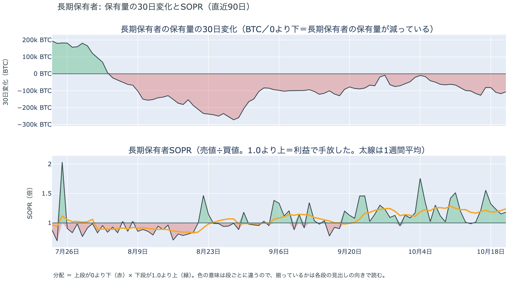

*図の見方: 上段は、長期保有者の保有量が30日でどれだけ増減したか。マイナス＝手放している。下段は長期保有者SOPRで、1より上なら利益で手放した。どちらも太線の1週間平均で読みます。*

| 10月21日時点 | 1週間平均 | 前の週の平均 |
|---|---:|---:|
| 長期保有者SOPR（1より上＝利益で手放した） | 1.24 | 1.18 |
| 長期保有者の保有量の30日変化（万BTC） | −10.6 | −7.7 |

* 1週間平均の減り方は、1か月前（9月21日）の−8.7万BTCを上回る。

長期保有者は利益確定の売りを続けていて、減り方は前の週より広いまま、前日からほぼ変わっていません。保有量は30日で減り、動いたコインは平均して買値より高く動いています。これは価格が$84,000へ戻った10月21日までの数値で、長期保有者は上げた日も売りを止めなかったので、いまの価格を売りを止める水準とは見ていません。向きは前日と同じで、ビットコイン自身の需給の土台が変わった日ではありませんが、売りが続いている分、価格を支える側にはいません。

長期保有者のほかに、売りに回りそうな持ち手は見当たりません。長く眠っていたコインが急に動いた記録はなく、マイナーの収入は平年をやや上回る程度（Puell Multiple（＝マイナー収入の平年比）が1週間平均で1.12）で、売りを急ぐ状況ではありません。コインが最後に動いた価格の分布にも、今日は新しい材料がありません。

### ③ 先物：水曜に積まれたロングは1日で手仕舞われ、払う分はマイナスに沈んだ

**図③-1 資金調達率と建玉（直近30日）**

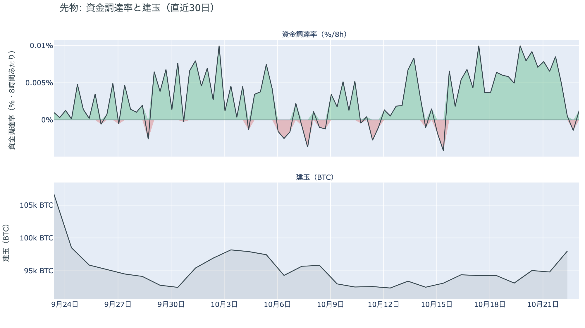

*図の見方: 上段は資金調達率（8時間ごと・日本時間）。プラスが続く＝ロングがショートより多い。下段は建玉。*

* 資金調達率は木曜のうちにマイナスの回があり、プラスは直近の1回だけ。
* 上乗せの直近34日の平均は−0.11ptで、いまはそれを3.8pt下回る。

先物の参加者は、上げにも下げにも強い確信を持たずに様子を見ています。水曜に積んだロングを木曜の午前中に手仕舞ったので、上げへの確信は1日で消えました。ロングが短期金利より余分に払う分は−3.89ptと、直近1か月の平均も大きく下回ります。余分に払ってでも上げに賭けたい人はいなくなり、木曜のうちにはショートがロングに払う時間帯もありました。一方で、夜の米国時間には価格が動かないまま建玉が2%強増えたので、下げた水準で新しい持ち高も入っています。資金調達率は深夜にわずかなプラスへ戻ったので、ショートに大きく傾いたわけでもありません。前日は「新しく入ったロングは、火曜まで残っていたロングほど余分に払ってまで買う熱を持っていない」と説明しました。その熱の薄いロングが木曜の最初の下げで手仕舞われたので、前日の説明は今日の数値と合っています。

### ④ オプション：下げへの備えは今日・明日の満期へ寄り、FOMCの満期がいちばん薄い

オプションには2種類あります。コール（＝決めた価格で買う権利）とプット（＝決めた価格で売る権利）で、価格が上がればコールの価値が上がり、価格が下がればプットの価値が上がります。プットは「価格が下がったときの保険」として買われます。オプションを買う人は、その権利と引き換えに権利料（＝オプションを買う人が払う金額）を払います。

**図④-1 満期ごとのIV（年率%）**

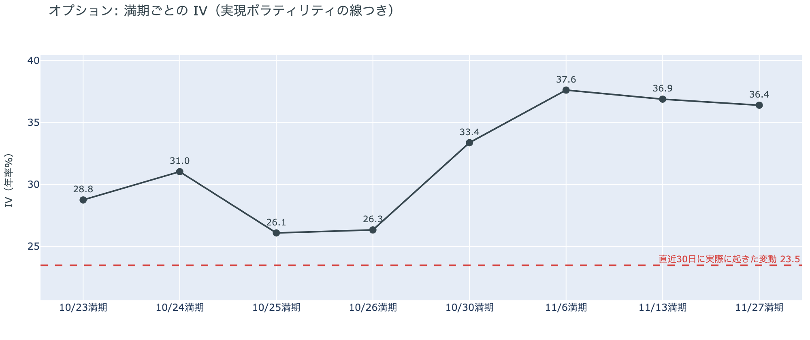

*図の見方: IVを満期ごとに並べたもの。点線は実現ボラティリティ。IVが点線より下なら、市場はこの先の値動きを過去の値動きより小さいと見ています。*

| 満期 | IV |
|---|---:|
| 10月23日 | 29 |
| 10月24日 | 31 |
| 10月25日・26日 | 26 |
| 10月30日 | 33 |
| 11月6日・13日・27日 | 36〜38 |

* IVは全体で37.1で、前日の36.9とほぼ同じ。過去1年で下から27%。
* 実現ボラティリティは23.5で、前日の32.6から下がった。

オプションの参加者は、この先の値動きを過去1か月の値動きより大きいと見ていますが、怖がってはいません。IV（＝値動きの幅の予想）は実現ボラティリティ（＝過去の値動きの幅）より13.6pt高く、差は前日の4.3ptから一気に開きました。ただし開いたのはIVが上がったからではなく、1か月前に大きく動いた日が過去30日の計算から外れて実現ボラティリティが下がったためで、IV自体は木曜の下げでも上がっていません。IVは過去1年の中で低いほうから3割の位置です。満期（＝権利の期限）ごとに見ると、土曜10月24日の満期の権利料にだけ、ほかの満期に対する上乗せが乗っています。今夜の米国のPMI速報とミシガン大学の消費者態度指数、そして木曜に大きく下げた米国の株式市場の金曜の取引をまたぐ満期で、参加者は木曜の株安が今夜も続くかに身構えています。FOMCをまたぐ10月30日とその先の満期が手前より高い形は、前日と同じです。

**図④-2 満期ごとのプットとコールの差**

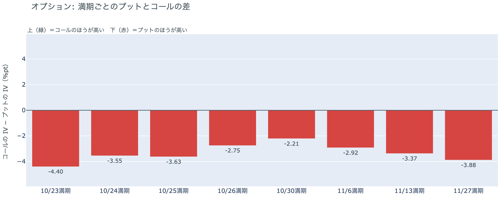

*図の見方: 満期ごとに、プットとコールのどちらが高く売れているか。ゼロより上ならコールのほうが高く、下ならプットのほうが高い。*

| 満期 | どちらが高いか |
|---|---|
| 10月23日 | プットがはっきり高い |
| 10月24日 | プットが高い |
| 10月25日 | プットが高い |
| 10月26日 | プットがやや高い |
| 10月30日 | プットがやや高い |
| 11月6日 | プットがやや高い |
| 11月13日 | プットが高い |
| 11月27日 | プットが高い |

参加者は下げへの備えを、FOMCより手前の今日・明日の満期へ寄せました。前日はFOMCをまたぐ10月30日と11月6日の満期でプットの高さがいちばん大きかったのですが、今朝はいちばん大きいのが今日10月23日の満期で、10月30日はすべての満期の中でいちばん小さくなりました。10月30日の持ち高（図④-3）は変わっていないので、FOMC前後の備えを減らしたのではなく、木曜の下げを受けて目先の満期のプットの値付けが上がった形です。参加者は、FOMCで大きく動くことより、その前の数日に下げが続くことに身構えています。

**図④-3 10月30日満期の持ち高（権利の価格ごと）**

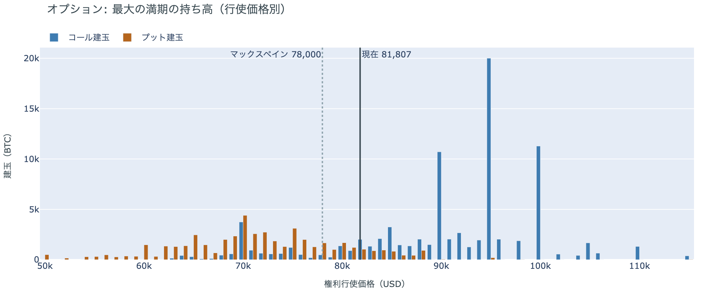

*図の見方: 青＝コール、橙＝プット。現値より上にコールが、下にプットが積まれるのが普通です。*

| 10月30日満期のオプション | 量（万BTC） | 意味 |
|---|---:|---|
| コール | 約8.7 | 「価格が上がる」に賭けた分 |
| プット | 約4.9 | 「価格が下がる」への保険 |
| うち、いまより15%以上高い価格のコール | 約4.0 | 大きな上げへの賭け |
| うち、いまより15%以上安い価格のプット | 約1.8 | 大きな下げへの保険 |

* 10月30日満期の持ち高は約13.6万BTCと全満期の35%で、前日の約13.7万BTCとほぼ同じ。
* コールが集まっている価格は$95,000に約2.0万BTC、$100,000と$90,000に約1.1万BTCずつで、前日と同じ。

「価格が上がる」に賭けた人たちは、木曜の下げでも降りていません。コールはプットの1.8倍で、$90,000から$100,000に積まれたコールの量は前日から動いていません。価格が3.5%下げた分、「15%以上高い価格」の区分に$95,000のコールが入って表の数字は大きく見えますが、持ち高が増えたのではありません。残った賭けが報われるには10月30日までに$90,000を超える必要があり、いまの価格からは約11%上と、前日の約6%から遠のきました。参加者はFOMC前後の下げへの備えもコールもそのまま持ち、賭けの形を変えずに木曜の下げを受け止めています。

## 4. 価格に影響しうる直近のイベント

オプション市場が下げへの備えをいちばん厚く置いているのは今日と明日の満期で、土曜10月24日の満期の権利料にはほかの満期に対する上乗せが乗っています。この区間に当たるのは、今夜の米国のPMI速報とミシガン大学の消費者態度指数と、木曜に7月以来の下げ幅だった米国の株式市場の金曜の取引です。FOMCをまたぐ10月30日の満期も、手前の満期より高いIVを保っています。原油の側では、イランが木曜にホルムズ海峡でタンカー7隻が損傷したと発表し、北海ブレント原油は5か月ぶりの高値へ上げました。イランの外相は米国との協議がパキスタンとカタールを通じて続いていると述べる一方、トランプ大統領は協議そのものを否定していて、ホルムズ海峡の再開は決まっていません。FOMCでの利上げの織り込みは1割未満で、1週間前の約3割から下がりました。

| 日付 | イベント | 何に効くか |
|---|---|---|
| 日程未定 | 米国とイランの協議（パキスタン・カタールの仲介）。イランは協議が続いていると言い、米国の大統領は否定している。ホルムズ海峡の再開は決まっていない | 原油 |
| 10/23（金） | 米国の10月PMI速報とミシガン大学の消費者態度指数。木曜に7月以来の下げ幅だった米国株の金曜の取引 | 金利・株。10月24日の満期の権利料に上乗せが乗る区間 |
| 10/27（火）〜28（水） | FOMC。利上げの織り込みは1割未満で、1週間前の約3割から下がった。結果は日本時間29日未明 | 金利。10月30日の満期がまたぐ |
| 10/29（木） | 米国の7〜9月期GDPと9月のPCE物価 | 金利 |
| 10/29（木）〜30（金） | 日銀の会合。展望レポートも出る | 円 |
| 10/30（金）17:00 | オプションの最も大きな満期（約13.6万BTC、全満期の35%）。FOMCの2日後 | $90,000以上のコールの期限 |
| 11/1（日） | OPEC+の会合。12月の生産目標を決める | 原油 |
| 11/3（火） | 米国の中間選挙。トランプ大統領は「それまでイランを攻撃しない」と述べている | 原油 |
| 11/6（金）17:00 | オプションの満期。IVが全満期でいちばん高い | 下げへの備えの期限 |
| 11/11（水） | MSCIが株価指数から外す企業の最終一覧を公表。ビットコインを大量に持つ企業を外しうる規則を10月15日に確定し、Strategyが対象になりうる。入れ替えは11月30日 | 指数に連動する資金による、それらの企業の株の売買 |

## まとめ：木曜日の動きは何だったか

木曜日は、アジアの株式市場でAI関連株が売られ原油が5か月ぶりの高値へ上げた午前中に、水曜に積まれたロングの手仕舞いが$81,000台へ運び、水曜の上げを1日で返した日でした。ビットコイン自身の需給の土台は変わっていません。アメリカの買い手はETFでは3営業日続けて買いながら取引所では引いたままで、長期保有者は利益確定の売りを続けています。参加者は、上げへの賭けを1日で引っ込めて下げへの備えを今日・明日の満期へ寄せる一方、FOMC前後の備えも10月末のコールも動かしていないので、木曜の下げを流れの変化とは見ておらず、目先の数日が荒れることに身構えながら、FOMCを越えるまでは上げにも下げにも大きく傾かないでいます。

---

<small>（数値は10月23日7時5分（日本時間）までのデータに基づきます。価格・先物・オプションはその時点の値、市場心理は10月22日の確定値、オンチェーン（＝ブロックチェーン上の記録）は10月21日時点、ETF資金フローは10月21日分までです。証券市場の終値は10月22日時点です。オンチェーンの長期保有者の数値には、ETFや取引所が預かっている分も含まれます。オプションはDeribit（BTCオプションの大半を占める取引所）の全銘柄です。）</small>

*本稿は情報提供を目的としたものであり、投資助言ではありません。将来の価格動向を保証・示唆するものではなく、投資判断は各自の責任において行ってください。*
