# 原油$100超えの夜も$81,300で動かず ― ETFは6月末以来の流出、ロングもショートも減って週末へ

**2026年10月24日**

ビットコインは金曜日、原油が4%上げて米国株が下げた夜も$81,300前後から離れず、24時間ではほぼ横ばいでした。

* **価格**：24時間の値幅は1.3%と前日の4.3%から大きく縮み、朝7時5分の時点で約$81,300は24時間前と同じ水準です。木曜に下げた水準で止まり、戻しも続落もしていません
* **きっかけ**：ビットコイン固有の出来事はありません。米国の大統領が石油に国防生産法を発動した翌日の金曜に原油は4%上げて$103を付け、米国株は下げましたが、ビットコインはその時間に動いていません。木曜に続いて、米国の時間の株と原油の動きには反応しませんでした
* **先物**：建玉（＝先物の未決済残高。証拠金で張っている人の量）は1日で3.6%減り、木曜の夜に入った売り持ち（ショート）の買い戻しと、残っていた買い持ち（ロング）の手仕舞いが両方出ました。ロングが払う金利は1日でプラスへ戻ったので下げに賭けた人はいなくなりましたが、上げに賭け直したのでもなく、持ち高を軽くして週末に入っています
* **需給の土台**：米国の買い手は、木曜の下げの日にETFで6月末以来の大きさの売りを出し、取引所でも引いたままです。長期保有者（＝155日以上保有者）の利益確定の売りは続き、減り方は前の週より広がりました。土台の向きは前日と同じですが、弱い側へ一歩寄っています
* **オプションの見方**：金曜の米国の取引をまたぐ満期（＝権利の期限）に乗っていた上乗せは剥がれ、FOMC（＝米国の金利を決める会合）をまたぐ10月30日までの満期は、どれもIV（＝値動きの幅の予想）が実現ボラティリティ（＝過去の値動きの幅）を下回りました。参加者はFOMCまでは荒れないと見ていて、下げへの備えを厚く残しているのは11月の満期です

## 1. 何が起きたか

**図1-1 価格の推移（1時間足・直近7日）**

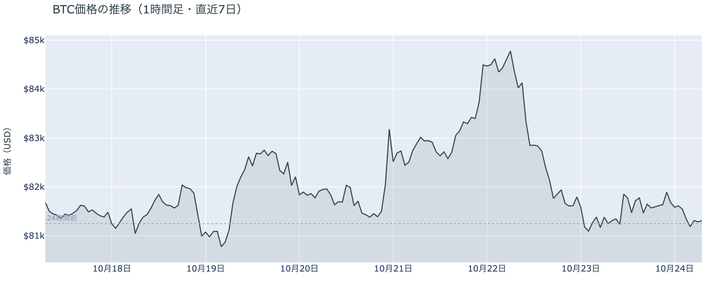

*図の見方: 1時間ごとの価格（日本時間）。点線は24時間前の水準です。木曜に二段で下がった線が、金曜は点線をはさんでほぼ平らです。*

* 24時間の値幅は1.3%で、前日の4.3%から縮んだ。
* 建玉は前日の朝より3.6%減り、米国の株式市場が開く前後の21時から23時台だけで2.3%減った。

金曜日は、朝7時の$81,300から昼前に$81,900へ上げ、夕方に$81,500へ戻り、米国の株式市場が開いた22時台にもう一度$81,900へ上げたあと、深夜に$81,200へ下げて朝を迎えた日でした。1日を通して$81,000台から出ていません。昼前の上げは価格と逆に建玉が減ったのでショートの買い戻しで、夜は価格が動かないまま建玉が減ったのでロングの手仕舞いです。どちらも新しい持ち高ではありません。Hyperliquid（＝オンチェーンの先物取引所）で見える清算（＝証拠金不足で強制的に閉じられた取引）は2件だけで、どちらも22時から23時台のショートです。値動きを広げるほどの量ではなく、金曜の値動きは清算の無い日の形です。

**図1-2 価格と50日・200日移動平均**

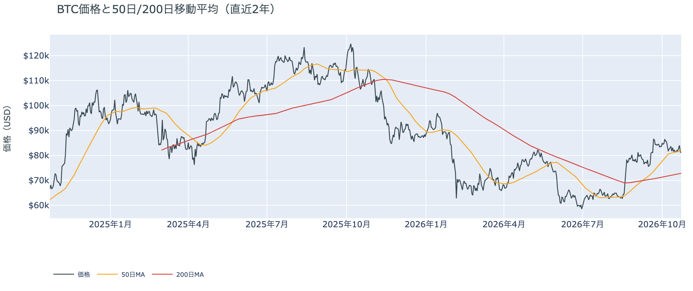

*図の見方: 2本の平均線の上下関係を見ます。50日線が200日線の上にあるのがゴールデンクロスです。*

* 50日線と200日線の差は約$8,900（12.3%）で、前日と同じ。
* 朝7時5分の価格は50日線の$81,780を0.6%下回る。

長い目で見た流れの向きは変わっていません。ゴールデンクロス（＝50日線が200日線を上抜けること）の状態が46日目で、2本の平均線の差は開いたままです。価格は木曜に50日線のわずかに下へ戻ったあと、金曜はその線をはさんで上下し、朝の時点で線のすぐ下にいます。50日線の上に定着も、下に離れもしていません。

証券市場は金曜10月23日に、米国株（S&P500）が−0.5%の7,624で週を終え、原油（WTI）は+4.0%の$103と、$100を超えて週末に入りました。金は下げ、米10年債利回りは木曜に割った5%の手前で止まっています。ビットコインにとっては、株安と原油高が週末へ持ち越され、金利の重しは軽いまま、という形です。

## 2. なぜ動いたか：きっかけと、需給のどこが動いたか

**図2-1 ビットコインと株・金・原油の相対推移（起点＝100）**

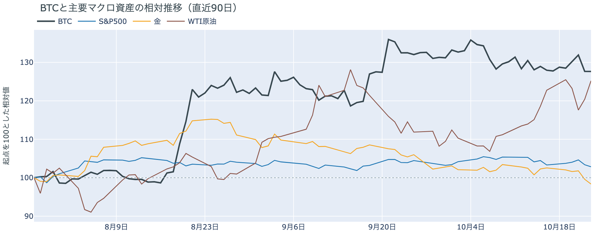

*図の見方: 同じ起点から何%動いたかで重ねたもの。線の向きが揃っているかを見ます。*

| この5営業日の動き（ビットコインは7日間） | 変化 |
|---|---:|
| ビットコイン | −0.3% |
| 金 | −4.1% |
| 米国株（S&P500） | −0.5% |
| 原油 | +2.0% |

* 建玉は92,175BTCで、前日の95,609BTCから3.6%減った。
* 資金調達率から短期金利を引いた上乗せは+4.16ptで、前日の−3.89ptからプラスへ戻った。

金曜日に価格が動かなかったのは、原油高と株安が米国の時間に来てもビットコインの買い手も売り手も動かず、先物では木曜の夜に入ったショートの買い戻しと残っていたロングの手仕舞いが打ち消し合ったからです。

1. きっかけ：ビットコイン固有の出来事はありませんでした。外部環境では、米国の大統領が10月22日（米国時間）に国内の石油の生産と精製を増やすため国防生産法を石油に発動し、イランがホルムズ海峡でタンカーの損傷を発表したなかで、金曜の原油（WTI）は4%上げて$103を付けました。米国株と金は同じ夜に下げました。ビットコインはこの時間に$81,600から$81,900の間で動かず、金曜の株安と原油高が効いた形跡はありません。木曜はアジアの時間の株安と一緒に下げましたが、米国の時間の株の動きには木曜も金曜も反応していません。米10年債利回りは金曜に4.99%と5%の手前で止まり、FOMCでの利上げの織り込みは1割未満で、1週間前の1割台半ばから下がったままです。この5営業日では、金が4%下げて原油が上げるなかで、ビットコインはほぼ横ばいです。金と同じ向きではないので、金を押した材料がビットコインを押したのではありません。
2. 伝わり方：通り道は先物で、持ち高の両側が減りました。昼前の上げでは価格と逆に建玉が減ったのでショートの買い戻し、夜は価格が動かないまま建玉が2%強減ったのでロングの手仕舞いです。前日に「夜の米国時間に下げた水準で新しい持ち高が入った」と書いた分は、金曜のうちに消えました。資金調達率（＝ロングが払う金利。プラス＝ロングがショートより多い）は、1日をならした年率で+8.19%と、短期金利（＝ドルを米国の短期国債で持つだけで受け取れる金利。13週Tビル 4.03%）を引いた上乗せは+4.16ptで、前日の−3.89ptからプラスへ戻りました。ショートが減ったので、残った持ち高はロングに偏っています。ただし建玉は減ったので、余分に払ってでも上げに賭ける人が増えたのではなく、下げに賭けた人が降りた結果です。現物の側では、ETFの買い手が木曜（10月22日）に6月末以来の大きさで売っていたことが分かり（図①-2）、木曜の下げは先物の中だけでは終わっていませんでした。

## 3. 市場参加者はいまどう見ているか

### ① アメリカの買い手は、木曜の下げの日にETFでも売り、取引所では引いたまま

**図①-1 Coinbase Premium（アメリカとそれ以外の価格差・直近90日）**

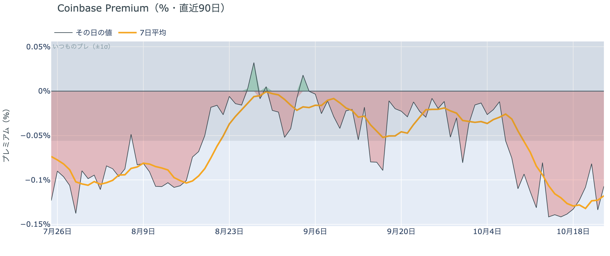

*図の見方: プラス＝アメリカで買いが強い。太線が1週間平均、細線がその日の値。薄い帯は「いつものブレの範囲」です。*

* 1週間平均は−0.12%で、前の週の−0.12%と同じ。
* その日の値は−0.11%で、いつものブレの1.9倍の深さ。

アメリカの取引所の買い手は引いたままで、金曜の$81,000台でも戻っていません。Coinbase Premium（＝アメリカとそれ以外の価格差）の1週間平均は4週続けて沈んだ水準にとどまり、その日の値もいつものブレの2倍近い深さで帯の外にあります。アメリカだけが安く取引される形は10月9日から続いています。

**図①-2 ETFの日ごとの資金の出入り（直近90日）**

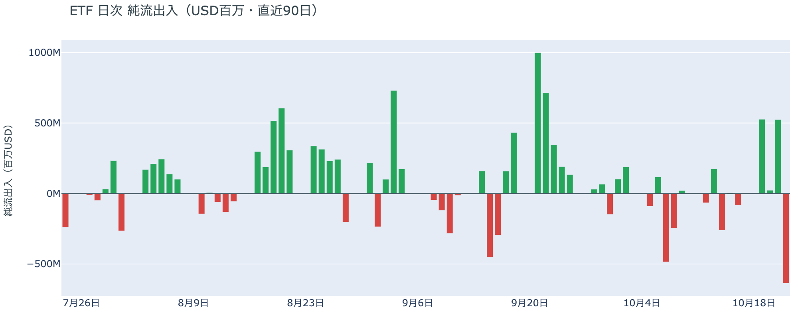

*図の見方: 入ったお金と出たお金の差。上に伸びれば入り超、下に伸びれば出超。*

| ETFの日ごとの出入り | 億ドル |
|---|---:|
| 10月16日 | −0.8 |
| 10月19日 | +5.3 |
| 10月20日 | +0.2 |
| 10月21日 | +5.2 |
| 10月22日 | −6.4 |
| 直近7営業日の合計 | +1.0 |

* 10月22日の流出は6月25日以来の大きさで、最大手と2番手を含む複数の会社から出た。

ETFの買い手は、木曜の下げの日に、月曜と水曜に入れた買いの6割を1日で手放しました。1社の解約ではなく最大手と2番手を含む複数の会社から出たので、特定の投資家の都合ではなく、下げた日に売る動きが広がった形です。7営業日の合計はまだ入り超ですが、前日の+9.1億ドルから+1.0億ドルへ縮みました。前日は「木曜の下げは先物の中で起きている」と説明しましたが、同じ日にETFの買い手も売っていたので、木曜の下げは先物のロングの手仕舞いに加えて、アメリカの現物の買い手の売りも通っていました。

**図①-3 Fear & Greed（市場心理の指数・直近90日）**

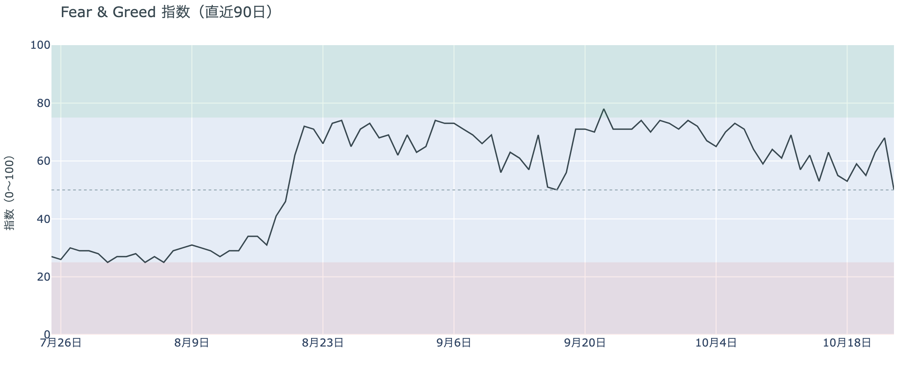

*図の見方: 0〜100で、50より上が「強欲」、下が「恐怖」。*

* 50の「中立」。前日の68から18pt下がり、1週間前は63、1か月前は71。

市場心理は木曜の下げで一気に冷え、「強欲」から「中立」の真ん中へ落ちました。Fear & Greed（＝市場心理の指数）の10月23日の確定値は1日で18pt下がり、9月中旬以来の大きさです。価格は木曜に先週の水準へ戻っただけですが、心理は1週間前の「強欲」より下まで冷えています。

### ② 長期保有者の利益確定の売りは続き、減り方は前の週より広がった

**図②-1 長期保有者の保有量の30日変化とSOPR（直近90日）**

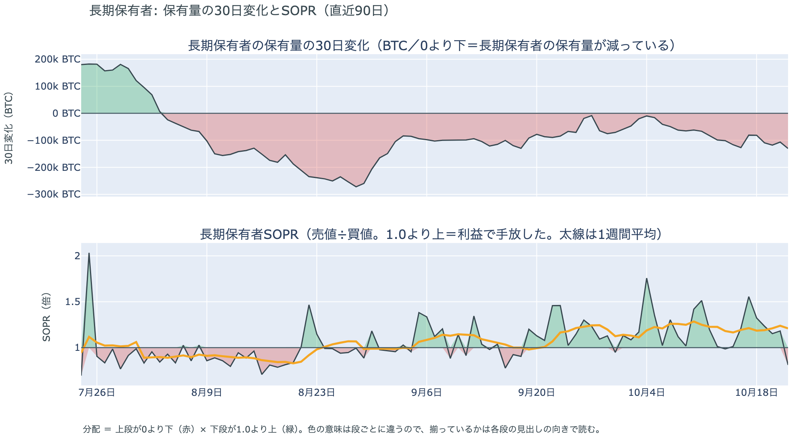

*図の見方: 上段は、長期保有者の保有量が30日でどれだけ増減したか。マイナス＝手放している。下段は長期保有者SOPRで、1より上なら利益で手放した。どちらも太線の1週間平均で読みます。*

| 10月22日時点 | 1週間平均 | 前の週の平均 |
|---|---:|---:|
| 長期保有者SOPR（1より上＝利益で手放した） | 1.21 | 1.17 |
| 長期保有者の保有量の30日変化（万BTC） | −10.8 | −8.5 |

* 1週間平均の減り方は、1か月前（9月22日）の−9.0万BTCを上回る。

長期保有者は利益確定の売りを続けていて、減り方は前の週より広がりました。保有量は30日で減り、動いたコインは平均して買値より高く動いています。これは木曜の下げの日（10月22日）までの数値で、価格が$84,000から$81,000台へ下げた日も売りは止まっていないので、長期保有者はいまの価格を売りを止める水準とは見ていません。向きは前日と同じで、ビットコイン自身の需給の土台が変わった日ではありませんが、減り方が広がった分、価格を支える側からはさらに離れています。

長期保有者のほかに、売りに回りそうな持ち手は見当たりません。長く眠っていたコインが急に動いた記録はなく、マイナーの収入は平年並み（Puell Multiple（＝マイナー収入の平年比）が1週間平均で1.09）で、売りを急ぐ状況ではありません。コインが最後に動いた価格の分布にも、今日は新しい材料がありません。

### ③ 先物：ショートは1日で買い戻され、ロングも減り、持ち高は週末前に軽くなった

**図③-1 資金調達率と建玉（直近30日）**

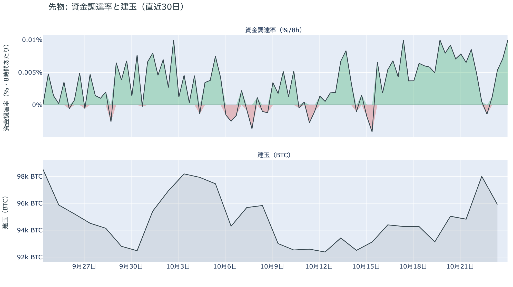

*図の見方: 上段は資金調達率（8時間ごと・日本時間）。プラスが続く＝ロングがショートより多い。下段は建玉。*

* 資金調達率はプラスが4回連続（約1.3日）。上乗せの直近34日の平均は−0.25ptで、いまはそれを4.4pt上回る。
* 建玉の1週間の変化は+1.6%で、先週の金曜とほぼ同じ水準に戻った。

先物の参加者は、木曜の下げが続くとは見なくなりましたが、上げに大きく賭け直してもいません。木曜の夜に入ったショートは金曜のうちに買い戻され、ロングが短期金利より余分に払う分は直近1か月でいちばん大きい部類に戻ったので、下げに賭けた人はいなくなりました。一方で建玉は前日より3.6%減り、夜に残っていたロングも手仕舞われたので、残った持ち高はロングに偏ってはいても、上げへの確信が戻ったのではありません。両側が持ち高を軽くして週末に入った形です。前日は「下げた水準で新しい持ち高も入っている」「ショートに大きく傾いたわけでもない」と説明しました。その持ち高が1日で消えたので、木曜の夜に入ったのは週末をまたがない短い賭けでした。

### ④ オプション：金曜の満期の上乗せは剥がれ、FOMCまでは荒れないと見る形に戻った

オプションには2種類あります。コール（＝決めた価格で買う権利）とプット（＝決めた価格で売る権利）で、価格が上がればコールの価値が上がり、価格が下がればプットの価値が上がります。プットは「価格が下がったときの保険」として買われます。オプションを買う人は、その権利と引き換えに権利料（＝オプションを買う人が払う金額）を払います。

**図④-1 満期ごとのIV（年率%）**

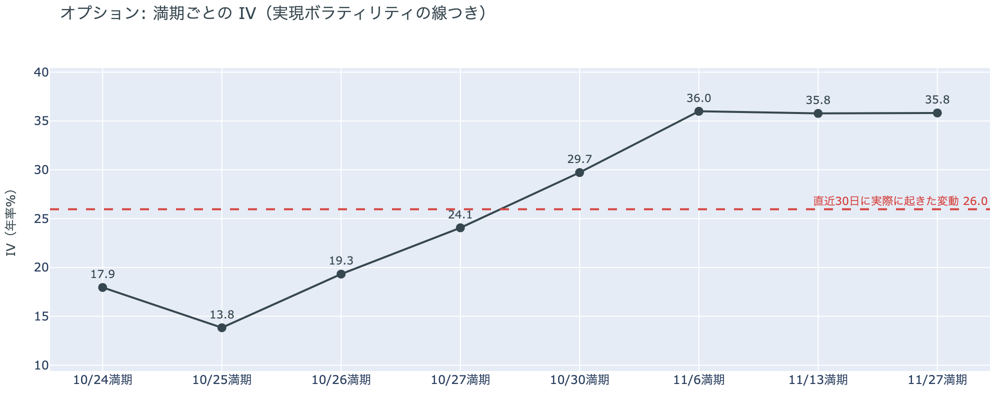

*図の見方: IVを満期ごとに並べたもの。点線は実現ボラティリティ。IVが点線より下なら、市場はこの先の値動きを過去の値動きより小さいと見ています。*

| 満期 | IV |
|---|---:|
| 10月24日 | 18 |
| 10月25日・26日 | 14〜19 |
| 10月27日 | 24 |
| 10月30日 | 30 |
| 11月6日・13日・27日 | 36 |

* IVは全体で38.0で、前日の37.1とほぼ同じ。過去1年で下から18%。
* 実現ボラティリティは26.0で、木曜の下げが入って前日の23.5から上がった。

オプションの参加者は、FOMCまでは荒れないと見ていて、怖がってはいません。IVは全体では実現ボラティリティより12pt高く、この先の値動きを過去1か月より大きいと見ていますが、満期ごとに見ると、週末からFOMCをまたぐ10月30日までの満期はどれも実現ボラティリティを下回っています。IVが実現ボラティリティを上回るのは11月6日以降の満期だけです。前日に土曜10月24日の満期の権利料に乗っていた、ほかの満期に対する上乗せは、金曜の米国の取引を越えてほぼ剥がれました。木曜の株安が金曜も続くことに身構えていた参加者は、ビットコインが動かなかったのを見て、その備えを解いています。

**図④-2 満期ごとのプットとコールの差**

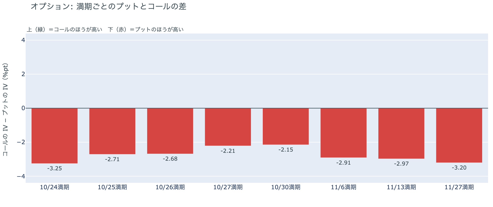

*図の見方: 満期ごとに、プットとコールのどちらが高く売れているか。ゼロより上ならコールのほうが高く、下ならプットのほうが高い。*

| 満期 | どちらが高いか |
|---|---|
| 10月24日 | プットがはっきり高い |
| 10月25日 | プットが高い |
| 10月26日 | プットが高い |
| 10月27日 | プットがやや高い |
| 10月30日 | プットがやや高い |
| 11月6日 | プットが高い |
| 11月13日 | プットが高い |
| 11月27日 | プットがはっきり高い |

参加者はすべての満期でプットを高く値付けしていて、形は前日から変わっていません。いちばん高いのは今日17時の満期で、FOMCをまたぐ10月30日がいちばん小さいのも前日と同じです。10月30日の持ち高（図④-3）も変わっていないので、金曜の1日で備えを買い足しても解いてもいません。参加者は、FOMCで大きく動くことより目先の数日と11月後半の下げに身構える形を保ったまま、週末に入りました。

**図④-3 10月30日満期の持ち高（権利の価格ごと）**

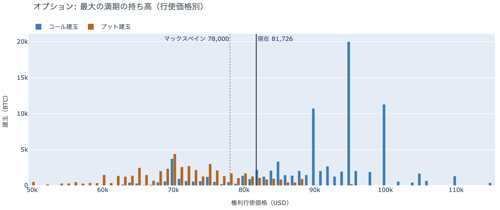

*図の見方: 青＝コール、橙＝プット。現値より上にコールが、下にプットが積まれるのが普通です。*

| 10月30日満期のオプション | 量（万BTC） | 意味 |
|---|---:|---|
| コール | 約8.8 | 「価格が上がる」に賭けた分 |
| プット | 約4.9 | 「価格が下がる」への保険 |
| うち、いまより15%以上高い価格のコール | 約4.2 | 大きな上げへの賭け |
| うち、いまより15%以上安い価格のプット | 約1.8 | 大きな下げへの保険 |

* 10月30日満期の持ち高は約13.7万BTCと全満期の35%で、前日と同じ。
* コールが集まっている価格は$95,000に約2.0万BTC、$90,000と$100,000に約1.1万BTCずつで、前日と同じ。

「価格が上がる」に賭けた人たちは、金曜も降りていません。コールはプットの1.8倍で、$90,000から$100,000に積まれたコールの量は木曜の下げの前から動いていません。残った賭けが報われるには10月30日までに$90,000を超える必要があり、いまの価格から約11%上です。いまの価格は、全満期で持ち高がいちばん集まっている$80,000から$82,000の帯の中にあり、金曜はその帯から出ませんでした。参加者はコールも下げへの備えもそのまま持ち、賭けの形を変えずにFOMCの週へ入ります。

## 4. 価格に影響しうる直近のイベント

オプション市場が下げへの備えをいちばん厚く置いているのは今日17時の満期で、その次に厚いのは11月27日と11月6日・13日の満期です。FOMCをまたぐ10月30日の満期はプットの高さもIVも手前の満期より軽く、参加者はFOMCの結果そのものより、その先の11月に備えを置いています。FOMCでの利上げの織り込みは1割未満で、1週間前の1割台半ばから下がったままです。原油の側では、米国の大統領が10月22日に国内の石油の生産と精製を増やすため国防生産法を石油に発動し、イランがホルムズ海峡でタンカーの損傷を発表したなかで、原油（WTI）は金曜に$103で週を終えました。米国とイランの協議の日程は決まっていません。

| 日付 | イベント | 何に効くか |
|---|---|---|
| 日程未定 | 米国とイランの協議（パキスタン・カタールの仲介）。ホルムズ海峡の再開は決まっていない | 原油 |
| 10/27（火）〜28（水） | FOMC。利上げの織り込みは1割未満で、1週間前の1割台半ばから下がった。結果は日本時間29日未明 | 金利。10月30日の満期がまたぐ |
| 10/29（木）21:30 日本時間 | 米国の7〜9月期GDPと9月のPCE物価 | 金利 |
| 10/29（木）〜30（金） | 日銀の会合。展望レポートも出る | 円 |
| 10/30（金）17:00 | オプションの最も大きな満期（約13.7万BTC、全満期の35%）。FOMCの2日後 | $90,000以上のコールの期限 |
| 11/1（日） | OPEC+の会合。12月の生産目標を決める | 原油 |
| 11/3（火） | 米国の中間選挙 | 株・原油 |
| 11/6（金）17:00 | オプションの満期。IVが全満期でいちばん高く、プットもFOMCの満期より高い | 下げへの備えの期限 |

## まとめ：金曜日の動きは何だったか

金曜日は、原油が$100を超え米国株が下げた夜もビットコインは動かず、先物で木曜の夜に入ったショートの買い戻しと残っていたロングの手仕舞いが打ち消し合って、$81,300前後のまま週末に入った日でした。ビットコイン自身の需給の土台は変わっていませんが、弱い側へ寄っています。アメリカの買い手は木曜の下げの日にETFでも売り、取引所では引いたままで、長期保有者は利益確定の売りを広げています。参加者は木曜の下げが続くとは見なくなり、FOMCまでは荒れないと値付けしていますが、上げに賭け直してもおらず、持ち高を軽くしたまま、下げへの備えは11月の満期に残してFOMCを待っています。

---

<small>（数値は10月24日7時5分（日本時間）までのデータに基づきます。価格・先物・オプションはその時点の値、市場心理は10月23日の確定値、オンチェーン（＝ブロックチェーン上の記録）は10月22日時点、ETF資金フローは10月22日分までです。証券市場の終値は10月23日時点です。オンチェーンの長期保有者の数値には、ETFや取引所が預かっている分も含まれます。オプションはDeribit（BTCオプションの大半を占める取引所）の全銘柄です。）</small>

*本稿は情報提供を目的としたものであり、投資助言ではありません。将来の価格動向を保証・示唆するものではなく、投資判断は各自の責任において行ってください。*
