# 週末深夜に$79,100まで下げて戻る ― 米国の中東退避の報道と時刻が重なり、清算が加速させた

**2026年10月25日**

ビットコインは土曜日、夜11時から深夜0時台にかけて$81,000近くから$79,100まで下げ、朝までに$80,400近くへ戻しました。

* **価格**：24時間の値幅は2.5%と前日の1.3%から広がり、朝7時5分の時点で約$80,350は24時間前より0.5%低い水準です。下げた分の6割を戻していて、週末の深夜に一度沈んで戻った形です
* **きっかけ**：ビットコイン固有の出来事はありません。米国が中東の大使館と軍の基地から人員を退避させていると米紙が土曜の朝（米国時間）に報じた時間と、下げ始めた日本時間23時台が重なります。証券市場は週末で閉まっていたので、株や原油が同じ向きに動いたかは確かめられません
* **先物**：下げの時間に建玉（＝先物の未決済残高。証拠金で張っている人の量）は増えたので売り持ち（ショート）が新しく積まれ、買い持ち（ロング）の清算（＝証拠金不足で強制的に閉じられた取引）が速い5分足に集まって下げを加速させました。戻しの時間にはロングも入って建玉は1日で3.8%増えましたが、ロングが払う金利は短期金利を下回り、上げへの確信は前日より弱まっています
* **需給の土台**：米国の買い手はETFで2営業日続けて売り（10月23日分まで）、取引所では土曜にいつものブレを超えて引きました。長期保有者（＝155日以上保有者）の利益確定の売りは続き、減り方は前の週より広がっています。土台の向きは前日と同じで、弱い側へさらに寄りました
* **オプションの見方**：前日まで実現ボラティリティ（＝過去の値動きの幅）を下回っていた、FOMC（＝米国の金利を決める会合）をまたぐ満期（＝権利の期限）までのIV（＝値動きの幅の予想）が、土曜の下げで実現ボラティリティの上に出ました。参加者はFOMCの週も静かには済まないと見るようになりましたが、下げへの備えをいちばん厚く置くのは今日と明日の満期と11月の満期で、備えの置き場は変わっていません

## 1. 何が起きたか

**図1-1 価格の推移（1時間足・直近7日）**

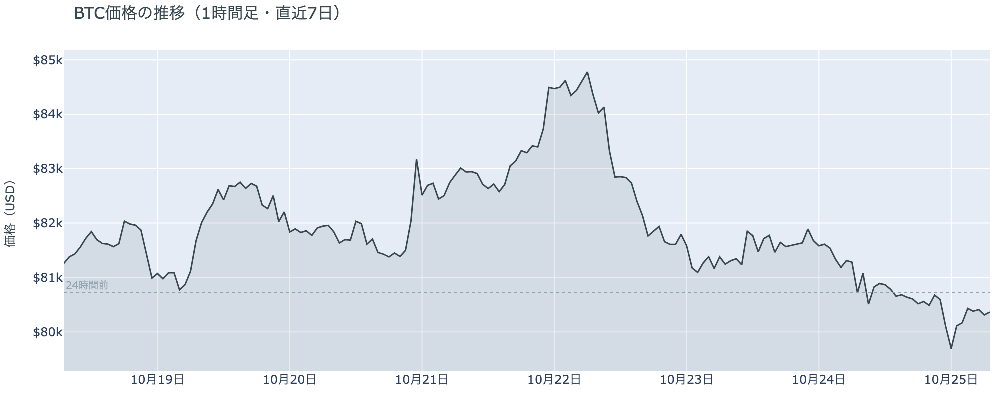

*図の見方: 1時間ごとの価格（日本時間）。点線は24時間前の水準です。土曜の夜11時から深夜0時台に線が点線の下へ沈み、朝にかけて半分以上戻しています。*

* 24時間の値幅は2.5%で、前日の1.3%から広がった。
* 値動きの速い5分足に、拾えた清算の97%が入っていた。

土曜日は、朝7時の$81,100から昼過ぎにかけて$80,600へじり下げ、夕方は$80,500から$80,700で止まり、夜11時台に$80,100、深夜0時台に$79,100まで下げたあと、1時台に$80,100へ戻して、朝は$80,400前後でした。Hyperliquid（＝オンチェーンの先物取引所）で見える清算はほぼすべてロングで、夜11時台と深夜0時台の2時間に7割が集まっています。大口1件が全体の4割を占め、残りは多数の小口です。深夜0時台の速い下げは、最初の5分足に清算が無く、次の5分足に24時間の清算の半分が集まったので、清算なしで始まり、清算で加速しました。下げの時間に建玉は増えたので、新しく入った持ち高はショートです。

**図1-2 価格と50日・200日移動平均**

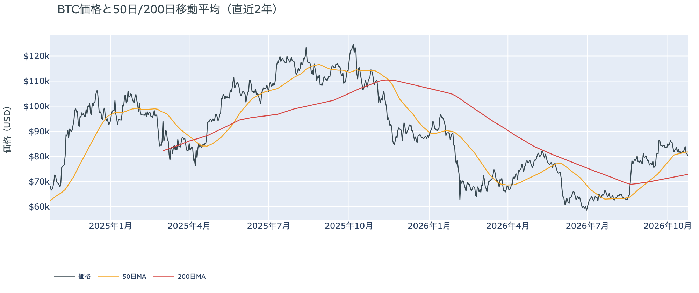

*図の見方: 2本の平均線の上下関係を見ます。50日線が200日線の上にあるのがゴールデンクロスです。*

* 50日線と200日線の差は約$8,900（12.2%）で、前日と同じ。
* 朝7時5分の価格は50日線の$81,790を1.8%下回り、前日の0.6%から離れた。

長い目で見た流れの向きは変わっていません。ゴールデンクロス（＝50日線が200日線を上抜けること）の状態が47日目で、2本の平均線の差は開いたままです。ただし価格は、金曜まで50日線をはさんで上下していたのが、土曜の下げでその線から離れました。木曜から3日続けて50日線の下にいて、距離は日ごとに広がっています。

証券市場は週末で休みです。金曜10月23日は米国株（S&P500）が−0.5%、原油（WTI）が+3.8%の$103で週を終え、金は−1.3%でした。ビットコインにとっては、金曜の株安と原油高が週末へ持ち越されたところへ、土曜に中東からの退避の報道が加わり、証券市場がそれにどう反応するかは週明けまで見えない、という形です。

## 2. なぜ動いたか：きっかけと、需給のどこが動いたか

**図2-1 ビットコインと株・金・原油の相対推移（起点＝100）**

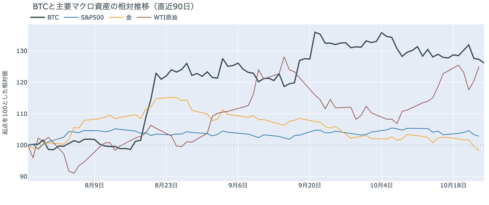

*図の見方: 同じ起点から何%動いたかで重ねたもの。線の向きが揃っているかを見ます。*

| この5営業日の動き（ビットコインは7日間） | 変化 |
|---|---:|
| ビットコイン | −1.3% |
| 金 | −4.1% |
| 米国株（S&P500） | −0.5% |
| 原油 | +1.8% |

* 建玉は95,682BTCで、前日の92,175BTCから3.8%増えた。
* 夜11時台と深夜0時台の下げで建玉は0.6%増え、1時台の戻しでさらに0.9%増えた。

土曜日の下げは、米国が中東から人員を退避させているという報道と同じ時間に、先物でショートが新しく積まれ、ロングの清算が加速させて起きました。

1. きっかけ：ビットコイン固有の出来事はありません。外部環境では、米紙ウォール・ストリート・ジャーナルが土曜の朝（米国時間）に、イランが米国人への攻撃を準備しているとの情報を受けて、米国が中東の大使館と軍の基地から人員を急いで退避させていると報じました。前日までに国務省がサウジアラビアの一部の外交官に退去を命じていたのを、中東全体へ広げる動きです。ビットコインが下げ始めた日本時間23時台は、この報道の時間と重なります。証券市場は閉まっていたので、株や原油が同じ向きに動いたかは週明けまで分からず、きっかけだったと確かめられるのは時刻の重なりまでです。金曜までの5営業日では、金が4%下げて原油が上げるなかで、ビットコインは1%強の下げでした。FOMCでの利上げの織り込みは約1割で、1週間前の1割台半ばから下がったままです。
2. 伝わり方：通り道は先物です。夕方から夜にかけて価格が動かないまま建玉が増え、夜11時台と深夜0時台の下げでも建玉は増えたので、新しく積まれたのはショートです。そこにロングの清算が速い5分足に集まって、下げを加速させました。深夜1時台の戻しでは価格と一緒に建玉が増えたので、下げた水準でロングも新しく入っています。金曜に軽くなった持ち高は、土曜に両側で積み直されました。資金調達率（＝ロングが払う金利。プラス＝ロングがショートより多い）は、1日をならした年率で+3.04%と、短期金利（＝ドルを米国の短期国債で持つだけで受け取れる金利。13週Tビル 4.03%）を引いた上乗せは−0.99ptで、前日の+4.16ptからマイナスへ沈みました。ロングはまだショートより多いものの、短期金利より余分に払ってまで上げに賭ける人はいなくなりました。現物の側では、ETFの買い手が金曜（10月23日）も売り（図①-2）、アメリカの取引所の買い手は土曜にいつものブレを超えて引いた（図①-1）ので、土曜の下げは、アメリカの現物の買い手が引いたままのところへ来ました。

この説明が違うなら、つまり中東の報道ではなく、週末の薄い取引で$80,000の下に置かれていた売り注文が巻き込まれただけなら、週明けに証券市場が開いても株と原油は土曜の報道に反応せず、ビットコインは戻した水準にとどまります。その形が出たら、きっかけの部分は取り下げます。

## 3. 市場参加者はいまどう見ているか

### ① アメリカの買い手は、ETFで2日続けて売り、取引所では土曜にこの3か月でいちばん深く引いた

**図①-1 Coinbase Premium（アメリカとそれ以外の価格差・直近90日）**

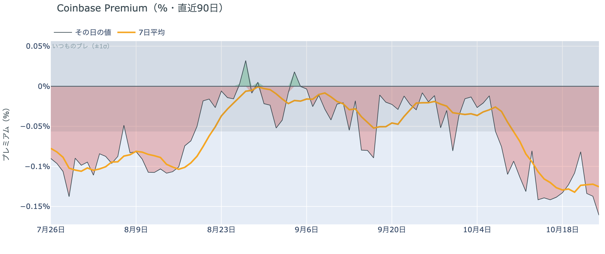

*図の見方: プラス＝アメリカで買いが強い。太線が1週間平均、細線がその日の値。薄い帯は「いつものブレの範囲」です。*

* 1週間平均は−0.13%で、前の週の−0.13%と同じ。
* その日の値は−0.16%で、いつものブレの2.9倍。昨年末からの約10か月で下から3%の深さ。

アメリカの取引所の買い手は、土曜の下げの日に、この3か月でいちばん深く引きました。Coinbase Premium（＝アメリカとそれ以外の価格差）の1週間平均は4週続けて沈んだまま動いていませんが、その日の値はいつものブレを3倍近く超えて帯の外に出ました。アメリカだけが安く取引される形は10月9日から続いていて、土曜はそれがさらに深まりました。下げたところで買いに回る動きは、アメリカの取引所には出ていません。

**図①-2 ETFの日ごとの資金の出入り（直近90日）**

*図の見方: 入ったお金と出たお金の差。上に伸びれば入り超、下に伸びれば出超。*

| ETFの日ごとの出入り | 億ドル |
|---|---:|
| 10月19日 | +5.3 |
| 10月20日 | +0.2 |
| 10月21日 | +5.2 |
| 10月22日 | −6.4 |
| 10月23日 | −1.4 |
| 直近7営業日の合計 | +2.2 |

* 10月23日の流出は最大手と2番手の2社から出て、ほかの会社は出入りがほぼ無かった。

ETFの買い手は、木曜の大きな売りのあと金曜も売り、2営業日続けて手放しました。金曜の量は木曜の4分の1ほどに縮みましたが、買いに戻ってはいません。7営業日の合計はまだ入り超ですが、月曜と水曜に入れた買いの大半を木曜と金曜に手放した形です。前日は「下げた日に売る動きが広がった」と説明しました。金曜も最大手と2番手が売っていて、1日限りの解約ではなかったので、前日の説明は今日の数値と合っています。

**図①-3 Fear & Greed（市場心理の指数・直近90日）**

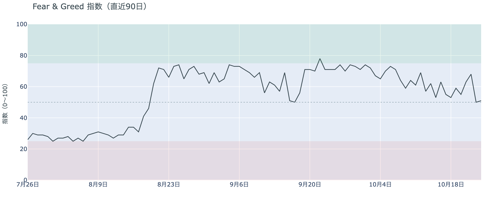

*図の見方: 0〜100で、50より上が「強欲」、下が「恐怖」。*

* 51の「中立」。前日の50から1pt上がり、1週間前は55、1か月前は71。

市場心理は、木曜に冷えた水準のまま止まっています。Fear & Greed（＝市場心理の指数）の10月24日の確定値は「中立」の真ん中で、1か月前の「強欲」から、価格が5%下げるあいだに20pt冷えました。上げへの期待は、価格より先にしぼんでいます。

### ② 長期保有者の利益確定の売りは続き、減り方は前の週より広がった

**図②-1 長期保有者の保有量の30日変化とSOPR（直近90日）**

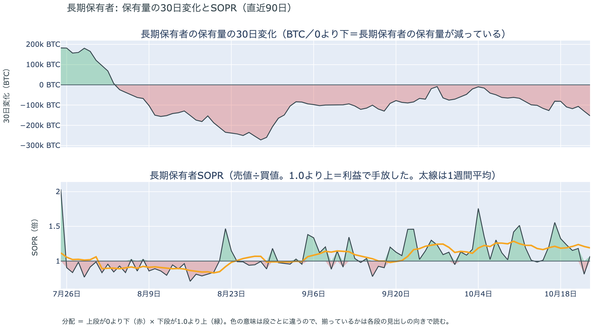

*図の見方: 上段は、長期保有者の保有量が30日でどれだけ増減したか。マイナス＝手放している。下段は長期保有者SOPRで、1より上なら利益で手放した。どちらも太線の1週間平均で読みます。*

| 10月23日時点 | 1週間平均 | 前の週の平均 |
|---|---:|---:|
| 長期保有者SOPR（1より上＝利益で手放した） | 1.19 | 1.19 |
| 長期保有者の保有量の30日変化（万BTC） | −11.1 | −9.4 |

* 1週間平均の減り方は、1か月前（9月23日）の−8.4万BTCより広がっている。

長期保有者は利益確定の売りを続けていて、減り方は前の週より広がりました。保有量は30日で減り、動いたコインは平均して買値より高く動いています。これは金曜（10月23日）までの数値で、価格が木曜に$81,000台へ下げたあとも売りは細っていないので、長期保有者はこの水準を売りを止める水準とは見ていません。向きは前日と同じで、ビットコイン自身の需給の土台が変わった日ではありませんが、減り方が広がったぶん、価格を支える側からはさらに離れています。

長期保有者のほかに、売りに回りそうな持ち手は見当たりません。長く眠っていたコインが急に動いた記録はなく、マイナーの収入は平年並み（Puell Multiple（＝マイナー収入の平年比）が1週間平均で1.12）で、売りを急ぐ状況ではありません。

### ③ 先物：下げでショートが積まれ、ロングが払う金利は短期金利を下回った

**図③-1 資金調達率と建玉（直近30日）**

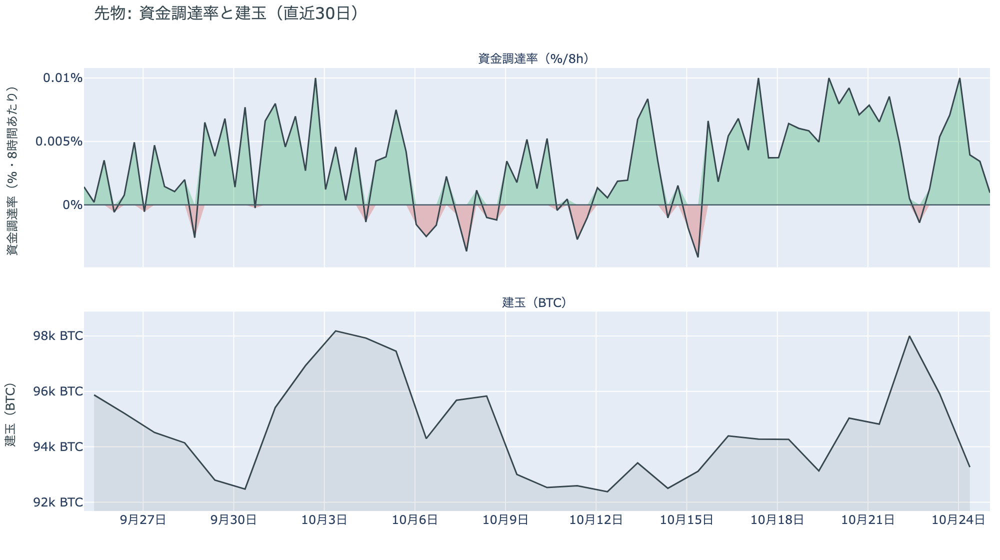

*図の見方: 上段は資金調達率（8時間ごと・日本時間）。プラスが続く＝ロングがショートより多い。下段は建玉。*

* 資金調達率はプラスが7回連続（約2.3日）。上乗せの直近34日の平均は−0.44ptで、いまはそれを0.6pt下回る。
* 建玉の1週間の変化は−1.1%で、金曜に減った分を土曜にほぼ積み直した。

先物の参加者は、上げへの確信を弱め、下げに賭ける側が増えました。土曜の下げの時間に建玉が増えたのでショートが新しく入り、ロングの一部は清算で強制的に閉じられています。資金調達率はプラスのままですが、短期金利を引いた上乗せはマイナスへ沈んだので、ロングはまだショートより多いものの、余分に払ってでも上げに賭けたい人はいなくなりました。一方で深夜の戻しではロングも新しく入っていて、$79,000台を買う人がいなくなったわけではありません。前日は「両側が持ち高を軽くして週末に入った」と説明しました。土曜にその両側が積み直されたので、週末は動かないと見ていた参加者は、動いたあとに賭けを置き直しています。上げにも下げにも強い確信は無く、どちらにも張っておく構えです。

### ④ オプション：FOMCまでの満期もIVが実現ボラティリティの上に出て、「FOMCまでは荒れない」の形は崩れた

オプションには2種類あります。コール（＝決めた価格で買う権利）とプット（＝決めた価格で売る権利）で、価格が上がればコールの価値が上がり、価格が下がればプットの価値が上がります。プットは「価格が下がったときの保険」として買われます。オプションを買う人は、その権利と引き換えに権利料（＝オプションを買う人が払う金額）を払います。

**図④-1 満期ごとのIV（年率%）**

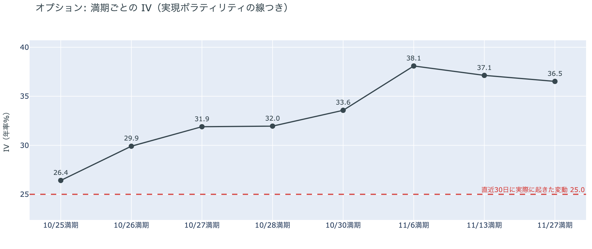

*図の見方: IVを満期ごとに並べたもの。点線は実現ボラティリティ。IVが点線より下なら、市場はこの先の値動きを過去の値動きより小さいと見ています。*

| 満期 | IV |
|---|---:|
| 10月25日 | 26 |
| 10月26日〜28日 | 30〜32 |
| 10月30日 | 34 |
| 11月6日・13日・27日 | 37〜38 |

* IVは全体で37.4で、前日の38.0とほぼ同じ。過去1年で下から33%。
* 実現ボラティリティは25.0で、前日の26.0から下がった。

オプションの参加者は、FOMCの週も静かには済まないと見るようになりましたが、怖がってはいません。前日まで、FOMCをまたぐ10月30日までの満期はどれもIVが実現ボラティリティを下回っていましたが、土曜の下げでそれらの満期のIVが上がり、今日17時の満期を含めて全部が実現ボラティリティの上に出ました。ただし特定の満期だけ跳ねているのではなく、手前が低く先が高い普通の形で、IVは全体では過去1年の下から3分の1の位置です。参加者は土曜の下げを受けて、FOMCまでの数日の値動きの見積もりを引き上げた、という形です。

**図④-2 満期ごとのプットとコールの差**

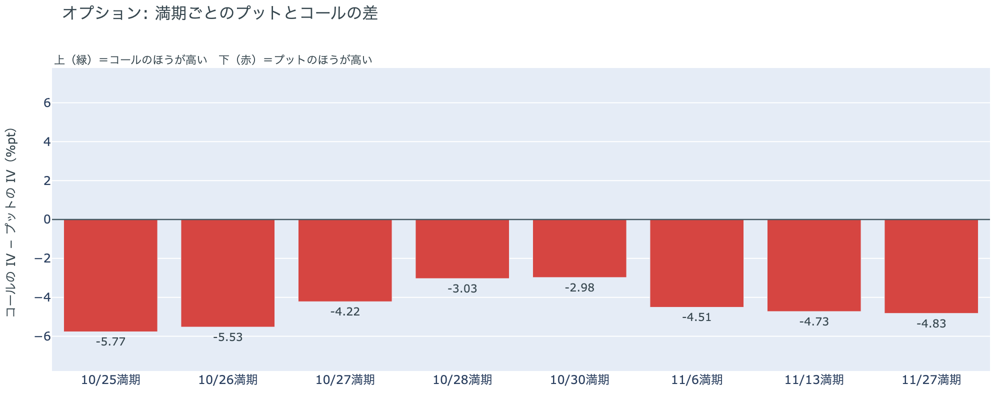

*図の見方: 満期ごとに、プットとコールのどちらが高く売れているか。ゼロより上ならコールのほうが高く、下ならプットのほうが高い。*

| 満期 | どちらが高いか |
|---|---|
| 10月25日 | プットがはっきり高い |
| 10月26日 | プットがはっきり高い |
| 10月27日 | プットが高い |
| 10月28日 | プットがやや高い |
| 10月30日 | プットがやや高い |
| 11月6日 | プットが高い |
| 11月13日 | プットが高い |
| 11月27日 | プットが高い |

参加者はすべての満期でプットを高く値付けしていて、形は前日から変わっていません。いちばん高いのは今日17時と明日の満期で、FOMCをまたぐ10月28日と30日がいちばん小さいのも前日と同じです。土曜の下げで値動きの見積もりは上がりましたが、下げへの備えの置き場は動いていません。参加者は、FOMCの結果そのものより、その手前の数日と11月の下げに身構えています。

**図④-3 10月30日満期の持ち高（権利の価格ごと）**

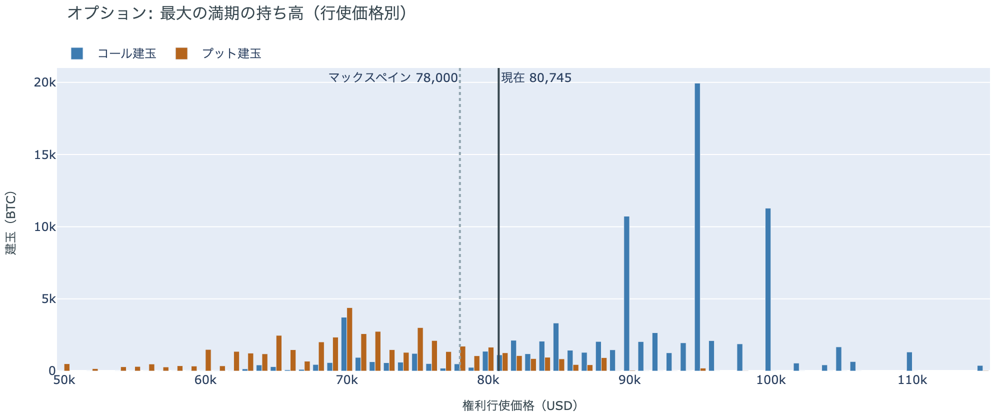

*図の見方: 青＝コール、橙＝プット。現値より上にコールが、下にプットが積まれるのが普通です。*

| 10月30日満期のオプション（価格は約$80,350） | 量（万BTC） | 意味 |
|---|---:|---|
| コール | 約7.5 | 「価格が上がる」に賭けた分 |
| プット | 約4.2 | 「価格が下がる」への保険 |
| うち、いまより15%以上高い価格のコール | 約4.3 | 大きな上げへの賭け |
| うち、いまより15%以上安い価格のプット | 約1.6 | 大きな下げへの保険 |

* 10月30日満期の持ち高は約13.6万BTCと全満期の35%で、前日と同じ。
* コールが集まっている価格は$95,000に約2.0万BTC、$90,000と$100,000に約1.1万BTCずつで、前日と同じ。

「価格が上がる」に賭けた人たちは、土曜の下げでも降りていません。コールはプットの1.8倍で、$90,000から$100,000に積まれたコールの量は木曜の下げの前から動いていません。その賭けが報われるには10月30日までに$90,000を超える必要があり、いまの価格から約12%上です。一方で、全満期で持ち高がいちばん集まっている価格は$80,000で、土曜の深夜はその下へ一度抜けて戻りました。参加者はコールも下げへの備えも持ったまま、持ち高がいちばん集まる価格のすぐ上でFOMCの週に入ります。

### ⑤ 価格は、コインが最後に動いた価格の分布でいちばん厚い帯の下端まで下げた

**図⑤-1 コインが最後に動いた価格の分布（10月23日時点）**

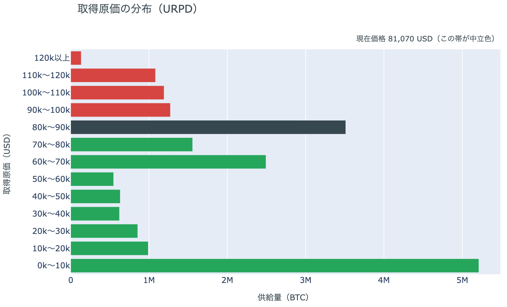

*図の見方: いま存在するコインを、最後にオンチェーンで動いた日の価格で束ねたもの。横棒が長い帯ほど、その価格帯で最後に動いたコインが多い。*

| 価格帯 | 全供給に占める割合 |
|---|---:|
| $90,000〜$100,000 | 6.3% |
| $80,000〜$90,000（いまの価格の帯） | 17.5% |
| $70,000〜$80,000 | 7.7% |
| $60,000〜$70,000 | 12.4% |

* 朝7時5分の価格$80,350は、$80,000〜$90,000の帯の下端から0.4%上。前日は1.3%上で、1%以内に入ったのは今日が初日。

10月23日時点の分布にいまの価格を重ねると、価格は、初期に生成された$10,000未満の帯を除いていちばん厚い帯の下端にいます。$80,000〜$90,000で最後に動いたコインは全供給の17.5%で、土曜の深夜はこの帯の下へ一度抜け、$79,100から帯の中へ戻ってきました。帯は「その値段で買った人」の量ではなく、その価格帯で最後に動いた供給の量です。すぐ下の$70,000〜$80,000の帯は7.7%と薄く、その下の$60,000〜$70,000に12.4%があります。価格より上の帯には全供給の18%、下の帯には64%があり、いまの価格より安い価格で最後に動いた供給のほうが、はるかに多い状態です。

## 4. 価格に影響しうる直近のイベント

オプション市場が下げへの備えをいちばん厚く置いているのは今日17時と明日の満期で、その次が11月の満期です。FOMCをまたぐ10月28日と30日の満期はプットの高さが手前より軽いままですが、土曜の下げでIVは実現ボラティリティの上に出ました。FOMCでの利上げの織り込みは約1割で、1週間前の1割台半ばから下がったままです。中東では、米国が大使館と軍の基地から人員を退避させていると米紙が土曜に報じ、米国の大統領は金曜の集会で、中間選挙のあとにイランへ再び軍事行動を取る可能性に触れました。米国とイランの協議の日程は決まっていません。

| 日付 | イベント | 何に効くか |
|---|---|---|
| 日程未定 | 米国とイランの協議（パキスタン・カタールの仲介）。米国は中東の大使館・基地から人員を退避中 | 原油 |
| 10/27（火）〜28（水） | FOMC。利上げの織り込みは約1割で、1週間前の1割台半ばから下がった。結果は日本時間29日未明 | 金利。10月28日・30日の満期がまたぐ |
| 10/29（木）21:30 日本時間 | 米国の7〜9月期GDPと9月のPCE物価 | 金利 |
| 10/29（木）〜30（金） | 日銀の会合。展望レポートも出る | 円 |
| 10/30（金）17:00 | オプションの最も大きな満期（約13.6万BTC、全満期の35%）。FOMCの2日後 | $90,000以上のコールの期限 |
| 11/1（日） | OPEC+の会合。12月の生産目標を決める | 原油 |
| 11/3（火） | 米国の中間選挙。米国の大統領は、その後のイランへの再度の軍事行動に言及 | 株・原油 |
| 11/6（金）17:00 | オプションの満期。IVが全満期でいちばん高く、プットもFOMCの満期より高い | 下げへの備えの期限 |

## まとめ：土曜日の動きは何だったか

土曜日は、米国が中東から人員を退避させているという報道と同じ時間に、先物でショートが積まれ、ロングの清算が加速させて$79,100まで下げ、朝までに6割を戻した日でした。ビットコイン自身の需給の土台は変わっていませんが、弱い側へさらに寄っています。アメリカの買い手はETFで2日続けて売ったうえ、取引所でも土曜にこの3か月でいちばん深く引き、長期保有者は利益確定の売りを広げています。参加者は、FOMCの週が静かに済むとは見なくなり、ロングが余分に払ってまで上げに賭ける構えは消えましたが、$90,000超のコールも下げへの備えも手放していません。近いうちに崩れるとも、すぐ戻るとも決めておらず、動いたあとに両側へ持ち高を置き直してFOMCを待っています。

---

<small>（数値は10月25日7時5分（日本時間）までのデータに基づきます。価格・先物・オプションはその時点の値、市場心理は10月24日の確定値、オンチェーン（＝ブロックチェーン上の記録）は10月23日時点、ETF資金フローは10月23日分までです。証券市場の終値は10月23日時点で、週末のため更新がありません。オンチェーンの長期保有者の数値には、ETFや取引所が預かっている分も含まれます。オプションはDeribit（BTCオプションの大半を占める取引所）の全銘柄です。）</small>

*本稿は情報提供を目的としたものであり、投資助言ではありません。将来の価格動向を保証・示唆するものではなく、投資判断は各自の責任において行ってください。*
