# $80,000台前半で静かな日曜 ― 米国の取引所だけが10か月で最も安く、ショートは手仕舞う

**2026年10月26日**

ビットコインは日曜日、土曜の下げから戻した$80,000台前半で、ほとんど動きませんでした。

* **価格**：24時間の値幅は1.2%と前日の2.5%から半分に縮み、朝7時5分の時点で約$80,615と24時間前とほぼ同じです。土曜の下げのあと、戻した水準で止まった静かな日曜でした
* **きっかけ**：新しいきっかけはありませんでした。中東ではイエメンのフーシ派がサウジアラビアの首都を狙い、米国の大統領がイランとの合意か攻撃かを量っていると語りましたが、ビットコインに効いた形跡はありません。証券市場は週末で閉まっていました
* **先物**：建玉（＝先物の未決済残高。証拠金で張っている人の量）は日中に約3%減り、土曜の夜に積まれた持ち高の一部が手仕舞われました。資金調達率（＝ロングが払う金利。プラス＝ロングがショートより多い）は短期金利（＝ドルを米国の短期国債で持つだけで受け取れる金利）を上回る側へ戻ったので、手仕舞ったのは主に売り持ち（ショート）の側で、買い持ち（ロング）は残っています
* **需給の土台**：米国の買い手はアメリカの取引所で日曜にさらに深く引き、ビットコインはこの約10か月でいちばん安く取引されました。長期保有者（＝155日以上保有者）の利益確定の売りも、減り方が広がっています（10月24日時点）。土台の向きは前日と同じで、弱い側へもう一段寄りました
* **オプションの見方**：IV（＝値動きの幅の予想）は実現ボラティリティ（＝過去の値動きの幅）より高いままで、下げへの備えのいちばん厚い置き場は、今日・明日の満期（＝権利の期限）から11月の満期へ移りました。参加者が身構えているのはFOMC（＝米国の金利を決める会合）そのものより、その先の11月です

## 1. 何が起きたか

**図1-1 価格の推移（1時間足・直近7日）**

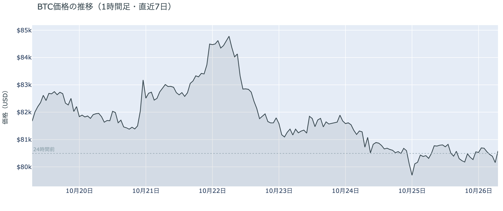

*図の見方: 1時間ごとの価格（日本時間）。点線は24時間前の水準です。土曜の深夜に沈んで戻したあと、日曜は線が点線のまわりでほぼ平らです。*

* 24時間の値幅は1.2%で、前日の2.5%から半分に縮んだ。
* Hyperliquid（＝オンチェーンの先物取引所）で見える清算は、この24時間で0件。

日曜日は、土曜の深夜に$79,100まで下げて戻した水準から、上にも下にも離れませんでした。清算（＝証拠金不足で強制的に閉じられた取引）は1件も出ておらず、土曜の夜のように誰かが強制的に閉じられて値が走る場面はありません。価格がほとんど動かないまま、昼の間に建玉が減り、夜はほぼ横ばいだったので、日曜に起きたのは新しい賭けではなく、土曜の夜に積まれた持ち高の手仕舞いです。

**図1-2 価格と50日・200日移動平均**

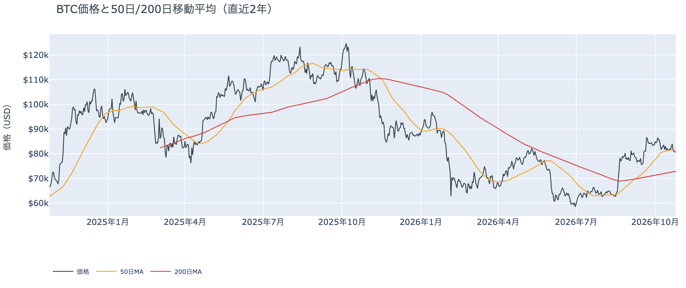

*図の見方: 2本の平均線の上下関係を見ます。50日線が200日線の上にあるのがゴールデンクロスです。*

* 50日線（$81,813）と200日線の差は約$8,900（12.2%）で、前日と同じ。
* 朝7時5分の価格は50日線を1.5%下回る。

長い目で見た流れの向きは変わっていません。ゴールデンクロス（＝50日線が200日線を上抜けること）の状態が48日目で、2本の平均線の差は開いたままです。価格は木曜から4日続けて50日線の下にいますが、日曜は土曜より50日線に少し近づき、離れていく動きは止まりました。

証券市場は週末で休みです。金曜10月23日は米国株（S&P500）が−0.5%、原油（WTI）が+3.8%の$103で週を終えています。ビットコインにとっては、金曜の原油高に、土曜・日曜の中東の報道が重なったまま、証券市場がそれにまだ値を付けていない状態で週明けを迎えます。

## 2. なぜ動いたか：きっかけと、需給のどこが動いたか

**図2-1 ビットコインと株・金・原油の相対推移（起点＝100）**

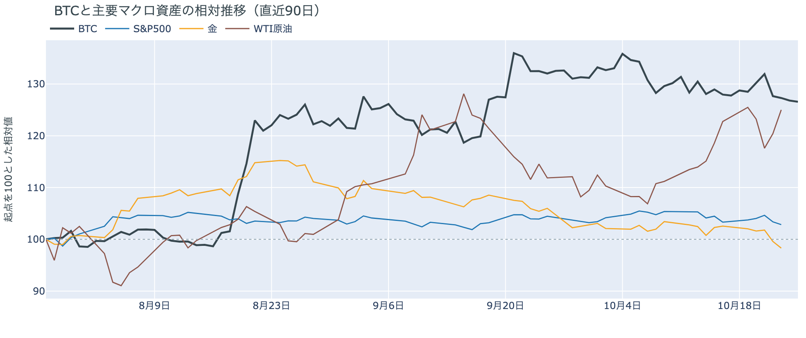

*図の見方: 同じ起点から何%動いたかで重ねたもの。線の向きが揃っているかを見ます。*

| この5営業日の動き（ビットコインは7日間） | 変化 |
|---|---:|
| ビットコイン | −1.7% |
| 金 | −4.1% |
| 米国株（S&P500） | −0.5% |
| 原油 | +1.8% |

* 建玉は93,299BTCで、前日の95,682BTCから2.5%減った。
* 資金調達率の上乗せは+4.52ptで、前日の−0.99ptからプラスへ戻った。

日曜日は、新しいきっかけが来ないまま、先物で土曜の夜に積まれたショートが手仕舞われるだけだったので、価格はほとんど動きませんでした。

1. きっかけ：ビットコイン固有の出来事はありません。外部環境では中東の緊張が週末も続き、イエメンのフーシ派がサウジアラビアの首都リヤドの空港や軍の施設を狙ったと主張し、サウジ側はミサイルを迎撃しています。米国の大統領は日曜（米国時間）のテレビのインタビューで、イランとは合意か、それとも攻撃で「片を付ける」かを量っていると語り、同じ日のうちに「今日は攻撃しない」とも述べました。イランは仲介国を通じて米国とのやりとりを続けているとしています。インタビューが流れた日本時間の深夜0時台も、その後の未明も、ビットコインの1時間ごとの値動きは0.4%に届いておらず、今日の値動きに効いた形跡はありません。
2. 伝わり方：通り道は先物で、動いたのは持ち高の量だけです。価格がほとんど動かないまま建玉が減ったので、土曜の夜に両側で積まれた持ち高の一部が閉じられました。同じ1日で、資金調達率は短期金利より余分に払う側へ戻っています。ロングとショートが同じだけ閉じたのなら、ロングの払う金利は上がりません。上がったので、閉じたのは主にショートで、土曜の夜に$79,000台で入ったロングは残っています。現物の側では、アメリカの取引所の買い手が日曜もさらに引いていて（図①-1）、先物のロングが残ったことと、アメリカの現物の買い手が引いたことが、同じ日に並んでいます。

## 3. 市場参加者はいまどう見ているか

### ① アメリカの買い手は、取引所でこの約10か月でいちばん深く引いたが、価格は沈んでいない

**図①-1 Coinbase Premium（アメリカとそれ以外の価格差・直近90日）**

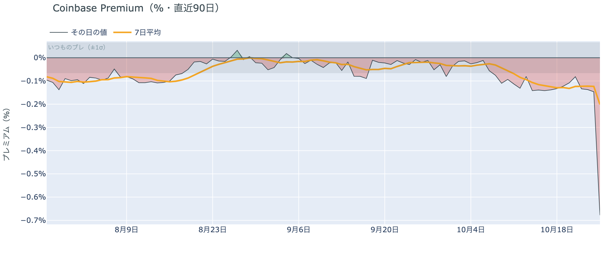

*図の見方: プラス＝アメリカで買いが強い。太線が1週間平均、細線がその日の値。薄い帯は「いつものブレの範囲」です。*

| Coinbase Premium | 値 |
|---|---:|
| 1週間平均 | −0.20% |
| 前の週の1週間平均 | −0.13% |
| 日曜のその日の値（朝7時5分の時点） | −0.68% |

* その日の値はいつものブレの10倍で、昨年末からの約10か月でいちばん深い。

アメリカの取引所の買い手は、日曜にさらに深く引きました。Coinbase Premium（＝アメリカとそれ以外の価格差）の1週間平均は前の週より沈み、日曜のその日の値は、土曜の3倍に近かった深さをさらに大きく超えて、帯のはるか外に出ています。アメリカの取引所では、ほかの取引所より目に見えて安くしか売れない状態で、アメリカの買い手は下げたところを買いに回っていません。それでも価格の値幅は1.2%にとどまっていて、アメリカの取引所の売りは、ビットコイン全体の価格を押し下げるところまでは届いていません。前日は「土曜の下げは、アメリカの現物の買い手が引いたままのところへ来た」と説明しました。日曜はその引き方がさらに深まったので、前日の説明は今日の数値と合っています。

**図①-2 ETFの日ごとの資金の出入り（直近90日）**

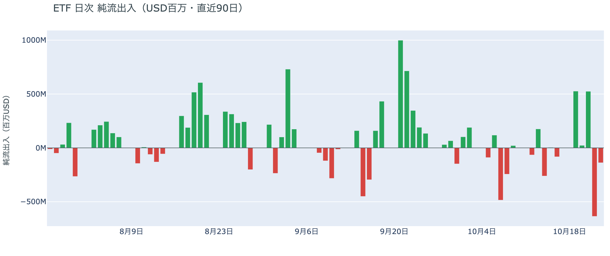

*図の見方: 入ったお金と出たお金の差。上に伸びれば入り超、下に伸びれば出超。*

| ETFの日ごとの出入り | 億ドル |
|---|---:|
| 10月19日 | +5.3 |
| 10月20日 | +0.2 |
| 10月21日 | +5.2 |
| 10月22日 | −6.4 |
| 10月23日 | −1.4 |
| 直近7営業日の合計 | +2.2 |

ETFの買い手は、木曜と金曜に続けて売ったところで週末に入りました。7営業日の合計はまだ入り超ですが、週の前半に入れた買いの大半を後半に手放しています。ETFは週末に取引が無いので、アメリカの買い手は、ETFでは売りの側、取引所では日曜にさらに引いた側にいる、という形のまま週明けを迎えます。

**図①-3 Fear & Greed（市場心理の指数・直近90日）**

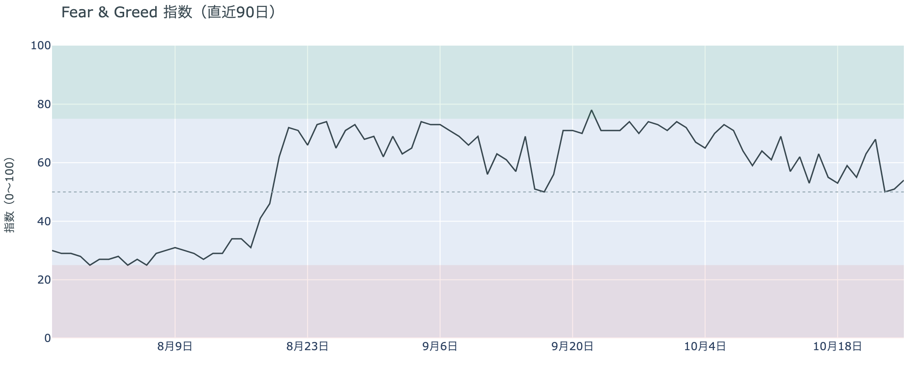

*図の見方: 0〜100で、50より上が「強欲」、下が「恐怖」。*

* 54の「中立」。前日の51から3pt上がり、1週間前は53、1か月前は71。

市場心理は、土曜の下げでも冷えませんでした。Fear & Greed（＝市場心理の指数）の10月25日の確定値は「中立」のまま、土曜の下げのあとの日曜に、むしろ少し戻っています。1か月前の「強欲」からは冷えたままですが、土曜の下げを怖がって逃げる人が増えた形にはなっていません。

### ② 長期保有者の利益確定の売りは続き、減り方はさらに広がった

**図②-1 長期保有者の保有量の30日変化とSOPR（直近90日）**

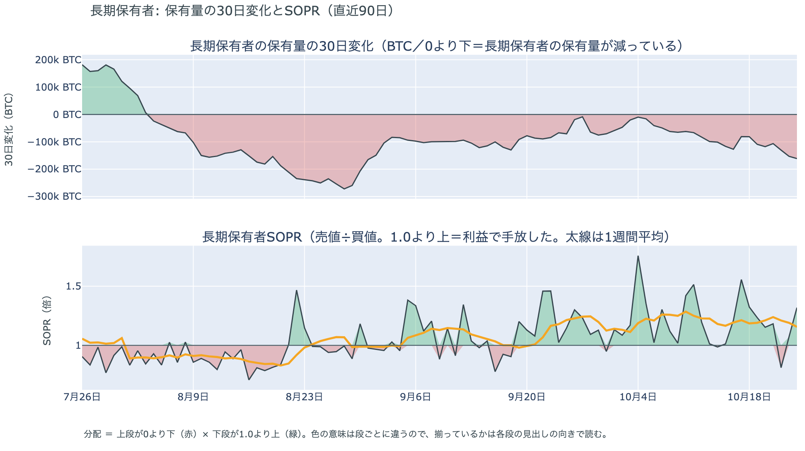

*図の見方: 上段は、長期保有者の保有量が30日でどれだけ増減したか。マイナス＝手放している。下段は長期保有者SOPRで、1より上なら利益で手放した。どちらも太線の1週間平均で読みます。*

| 10月24日時点 | 1週間平均 | 前の週の平均 |
|---|---:|---:|
| 長期保有者SOPR（1より上＝利益で手放した） | 1.16 | 1.21 |
| 長期保有者の保有量の30日変化（万BTC） | −12.3 | −9.6 |

* 10月24日の30日変化は−16.1万BTCで、1か月前（9月24日）の−6.7万BTCの2倍を超える。

長期保有者は利益確定の売りを続けていて、減り方は前の週よりさらに広がりました。保有量は30日で減り、動いたコインは平均して買値より高く動いています。10月24日は$79,100まで下げた土曜日で、その日を含めても減り方は細っていないので、長期保有者は$80,000前後を売りを止める水準とは見ていません。向きは前日と同じで、ビットコイン自身の需給の土台が変わった日ではありません。

長期保有者のほかに、売りに回りそうな持ち手は見当たりません。長く眠っていたコインが急に動いた記録はなく、マイナーの収入は平年並み（Puell Multiple（＝マイナー収入の平年比）が1週間平均で1.13）で、売りを急ぐ状況ではありません。

### ③ 先物：土曜に積まれたショートが手仕舞われ、ロングが上乗せを払う側に戻った

**図③-1 資金調達率と建玉（直近30日）**

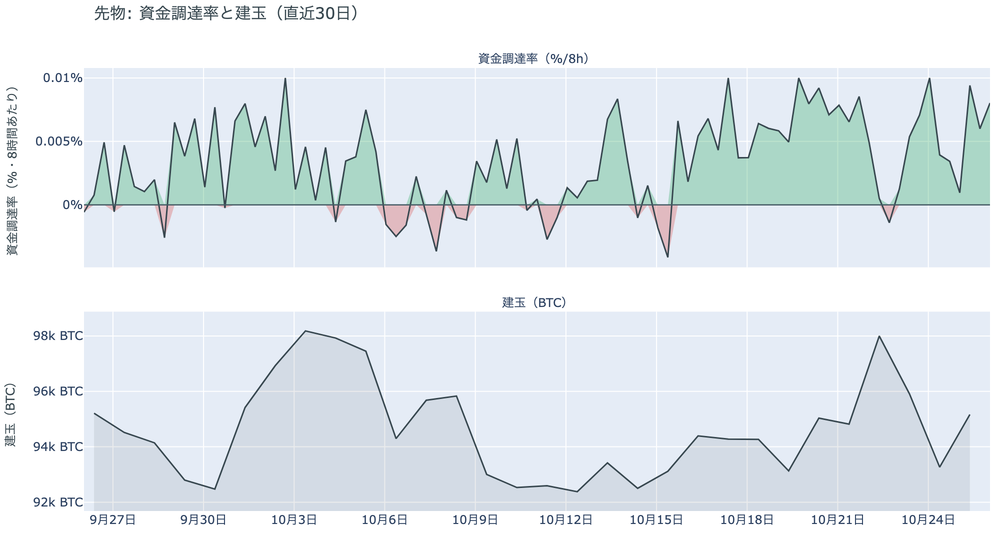

*図の見方: 上段は資金調達率（8時間ごと・日本時間）。プラスが続く＝ロングがショートより多い。下段は建玉。*

* 1日をならした年率は+8.56%で、短期金利（13週Tビル 4.03%）を引いた上乗せは+4.52pt。
* 上乗せの直近34日の平均は−0.49ptで、いまはその範囲の最大（+4.74pt）に近い。

先物の参加者は、土曜の下げを「流れの変化」ではなく、その水準で買える押しと見ています。日曜に閉じられたのは主に土曜の夜のショートで、$79,000台で入ったロングは残り、短期金利という普通の資金のコストを上回る金利を払ってまで持ち続けています。前日は、余分に払ってでも上げに賭けたい人はいなくなったと説明しましたが、日曜にはその人たちが戻りました。資金調達率はプラスが10回（約3日）続いています。ただし建玉は1週間で見ればほぼ増えておらず、ロングは持ち続けていても、賭けを大きくするほどの確信はまだありません。

### ④ オプション：下げへの備えの置き場は11月の満期へ移り、FOMCの満期には上乗せが無い

オプションには2種類あります。コール（＝決めた価格で買う権利）とプット（＝決めた価格で売る権利）で、価格が上がればコールの価値が上がり、価格が下がればプットの価値が上がります。プットは「価格が下がったときの保険」として買われます。オプションを買う人は、その権利と引き換えに権利料（＝オプションを買う人が払う金額）を払います。

**図④-1 満期ごとのIV（年率%）**

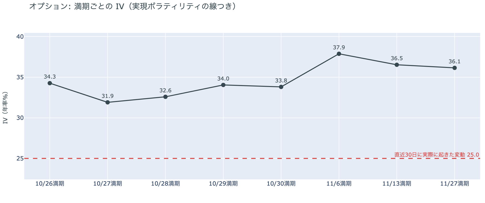

*図の見方: IVを満期ごとに並べたもの。点線は実現ボラティリティ。IVが点線より下なら、市場はこの先の値動きを過去の値動きより小さいと見ています。*

| 満期 | IV |
|---|---:|
| 10月26日 | 34 |
| 10月27日〜28日 | 32〜33 |
| 10月29日〜30日 | 34 |
| 11月6日・13日・27日 | 36〜38 |

* IVは全体で37.9で、実現ボラティリティ25.0より12.9pt高い。過去1年では下から30%。

オプションの参加者は、この先の値動きをこれまでより大きいと見ていますが、怖がってはいません。IVはどの満期でも実現ボラティリティより高く、それでも全体では過去1年の下から3割の位置です。FOMCの結果が出たあとの10月29日・30日の満期のIVは、その手前の満期とほとんど変わらず、FOMCの満期に上乗せは乗っていません。参加者はFOMCで大きく動くとは見ておらず、値動きの見積もりがはっきり上がるのは11月の満期からです。例外は今日17時に満期が来るオプションで、その権利料には、明日以降の数日の満期に対する上乗せが少し乗っています。週末に中東の報道が続いたあと、証券市場が初めて開く時間をまたぐのがこの満期です。

**図④-2 満期ごとのプットとコールの差**

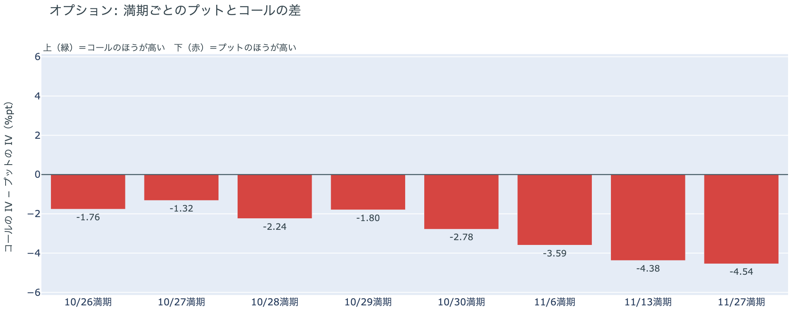

*図の見方: 満期ごとに、プットとコールのどちらが高く売れているか。ゼロより上ならコールのほうが高く、下ならプットのほうが高い。*

| 満期 | どちらが高いか |
|---|---|
| 10月26日 | プットがやや高い |
| 10月27日 | プットがやや高い |
| 10月28日 | プットが高い |
| 10月29日 | プットがやや高い |
| 10月30日 | プットが高い |
| 11月6日 | プットがはっきり高い |
| 11月13日 | プットがはっきり高い |
| 11月27日 | プットがはっきり高い |

参加者は下げへの備えを、目先の数日ではなく11月に置くようになりました。すべての満期でプットのほうが高いのは前日と同じですが、前日いちばん高かった今日と明日の満期は軽くなり、いまいちばん高いのは11月の3つの満期です。土曜の深夜の下げを受けて目先に置いた備えは、日曜に価格が崩れなかったことで薄まり、参加者はFOMC・米GDP・日銀を越えた先の下げに身構えています。

**図④-3 10月30日満期の持ち高（権利の価格ごと）**

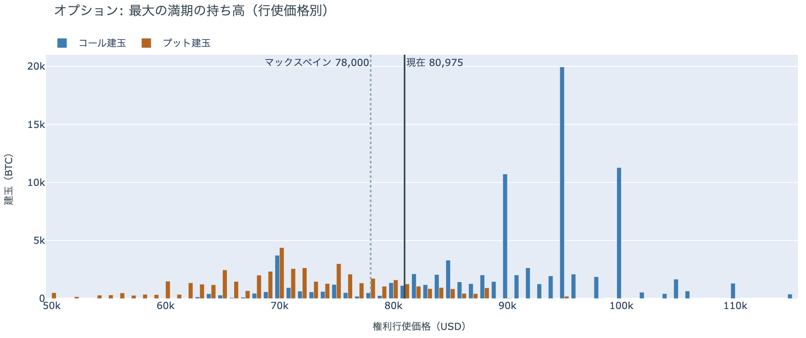

*図の見方: 青＝コール、橙＝プット。現値より上にコールが、下にプットが積まれるのが普通です。*

| 10月30日満期のオプション（価格は約$80,600） | 量（万BTC） | 意味 |
|---|---:|---|
| コール | 約7.5 | 「価格が上がる」に賭けた分 |
| プット | 約4.1 | 「価格が下がる」への保険 |
| うち、いまより15%以上高い価格のコール | 約4.2 | 大きな上げへの賭け |
| うち、いまより15%以上安い価格のプット | 約1.6 | 大きな下げへの保険 |

* 10月30日満期の持ち高は約13.6万BTCと全満期の35%で、コールがプットの1.8倍。前日と同じ形。

「価格が上がる」に賭けた人たちは、土曜の下げのあとも降りていません。コールのおよそ半分はいまより15%以上高い価格に積まれていて、その賭けが報われるには、10月30日までに$90,000を超える必要があります。いまの価格から約12%上です。全満期で持ち高がいちばん集まっている価格は$80,000で、価格はそのすぐ上にとどまっています。参加者は上げへの賭けを手放さないまま、持ち高の集まる$80,000のすぐ上でFOMCの週に入ります。

長く眠っていたコインの目立った動きや、コインが最後に動いた価格の分布で帯をまたぐ動きは、今日はありません。

## 4. 価格に影響しうる直近のイベント

オプション市場が下げへの備えをいちばん厚く置いているのは11月6日以降の満期で、FOMC、米GDP・PCE物価、日銀、米国の中間選挙を越えた先に当たります。FOMCの結果が出たあとの10月29日・30日の満期には、ほかの満期に対する上乗せは乗っていません。FOMCでの利上げの織り込みは約1割で、1週間前の1割台半ばから下がったままです。中東では、米国の大統領がイランとの合意か攻撃かを量っていると日曜に語り、イランは仲介国を通じたやりとりを続けています。

| 日付 | イベント | 何に効くか |
|---|---|---|
| 日程未定 | 米国とイランの協議（パキスタン・カタールの仲介）。米国は中東の大使館の人員を削減中 | 原油 |
| 10/26（月）17:00 | オプションの満期。翌日以降の数日の満期に対して上乗せが少し乗っている | 週明けに証券市場が開く時間をまたぐ |
| 10/27（火） | イスラエルの総選挙。イスラエルの首相は、イランが妨害を試みうると警告 | 原油 |
| 10/27（火）〜28（水） | FOMC。利上げの織り込みは約1割。結果は日本時間29日未明 | 金利。10月28日・30日の満期がまたぐ |
| 10/29（木）21:30 日本時間 | 米国の7〜9月期GDPと9月のPCE物価 | 金利 |
| 10/29（木）〜30（金） | 日銀の会合。展望レポートも出る | 円 |
| 10/30（金）17:00 | オプションの最も大きな満期（約13.6万BTC、全満期の35%） | $90,000以上のコールの期限 |
| 11/1（日） | OPEC+の会合。12月の生産目標を決める | 原油 |
| 11/3（火） | 米国の中間選挙。米国の大統領は、その後のイランへの再度の軍事行動に言及 | 株・原油 |
| 11/6（金）17:00 | オプションの満期。11月の3つの満期はプットの高さが全満期でいちばん大きい | 下げへの備えの期限 |

## まとめ：日曜日の動きは何だったか

日曜日は、新しいきっかけが来ないまま、先物で土曜の夜に積まれたショートが手仕舞われただけで、価格が$80,000台前半から動かなかった日でした。ビットコイン自身の需給の土台は変わっていませんが、アメリカの取引所の買い手はさらに深く引き、長期保有者の利益確定の売りも広がっていて、現物の側は弱いままです。参加者は、土曜の下げを流れの変化ではなく押しと見てロングを持ち続け、下げへの備えは目先から11月へ移しました。FOMCで崩れるとは見ていませんが、その先の11月には身構えていて、上げへの賭けを大きくするほどの確信はまだ持っていません。

---

<small>（数値は10月26日7時5分（日本時間）までのデータに基づきます。価格・先物・オプションはその時点の値、市場心理は10月25日の確定値、オンチェーン（＝ブロックチェーン上の記録）は10月24日時点、ETF資金フローは10月23日分までです。証券市場の終値は10月23日時点で、週末のため更新がありません。オンチェーンの長期保有者の数値には、ETFや取引所が預かっている分も含まれます。オプションはDeribit（BTCオプションの大半を占める取引所）の全銘柄です。）</small>

*本稿は情報提供を目的としたものであり、投資助言ではありません。将来の価格動向を保証・示唆するものではなく、投資判断は各自の責任において行ってください。*
