# 株高の月曜に$80,000をわずかに割る ― 下げの場面でショートが積まれ、ロングは残る

**2026年10月27日**

ビットコインは月曜日、$80,000を挟んで上下したあと、その少し下で朝を迎えました。

* **価格**：24時間の値幅は1.8%と前日の1.2%から少し広がりましたが、朝7時5分の時点で約$79,913と、24時間前より0.6%低いだけです。$80,000のまわりから離れきれない、向きの出ない1日でした
* **きっかけ**：はっきりしたきっかけはありませんでした。月曜は米国株が上げ、原油は米国とイランの協議への期待で2%下げましたが、ビットコインは株と逆にわずかに下げたので、共通のきっかけではありません
* **先物**：朝と夜の下げの場面で、売り持ち（ショート）が新しく積まれ、朝の下げでは買い持ち（ロング）の清算（＝証拠金不足で強制的に閉じられた取引）が動きを加速させました。積まれたショートは数時間のうちに買い戻されていて、先物は下げを運びかけては戻す、の往復でした
* **需給の土台**：米国の買い手は引いたままで、深さは前の週と同じです。長期保有者（＝155日以上保有者）の利益確定の売りは、減り方がさらに広がりました（10月25日時点）。土台の向きは前日と同じで、弱い側にとどまっています
* **オプションの見方**：IV（＝値動きの幅の予想）は実現ボラティリティ（＝過去の値動きの幅）より高いままで、すべての満期でプットのほうが高く値付けされています。参加者はFOMC（＝米国の金利を決める会合）で崩れるとは見ていませんが、その先の11月から12月には厚く身構えています

## 1. 何が起きたか

**図1-1 価格の推移（1時間足・直近7日）**

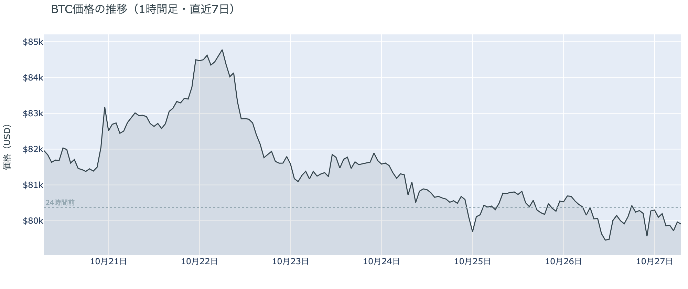

*図の見方: 1時間ごとの価格（日本時間）。点線は24時間前の水準です。月曜は朝と夜に一度ずつ沈み、そのたびに点線の近くまで戻っています。*

* 24時間の値幅は1.8%で、前日の1.2%から広がった。
* 清算はロングが大半で、38の口座に分かれ、10時台の1時間に9割が集まった。

月曜日は、朝と夜の2回、下げの場面で新しいショートが積まれ、そのたびに買い戻されて、価格は$80,000のまわりへ戻りました。朝8時から11時にかけて価格が$79,500を割るまで下げる間、建玉は増え続けていたので、この下げを運んだのは新しく積まれたショートです。10時台の値動きの速い5分足にはHyperliquid（＝オンチェーンの先物取引所）で見える清算が集まっていて、ロングの清算が下げを加速させました。大口1件ではなく、多数のロングが$79,000台で閉じられています。昼からは建玉が減りながら価格が$80,000台へ戻ったので、朝のショートは買い戻されました。米国の株式市場が開く夜10時台にも、ショートが積まれて下げ、次の1時間で戻す同じ形が繰り返されています。

**図1-2 価格と50日・200日移動平均**

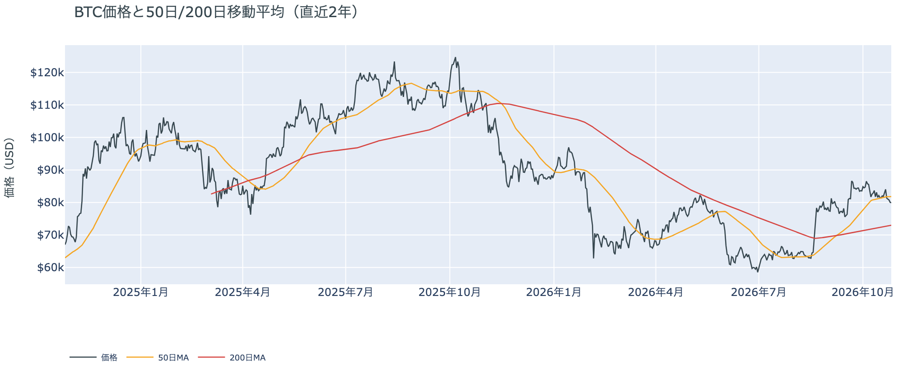

*図の見方: 2本の平均線の上下関係を見ます。50日線が200日線の上にあるのがゴールデンクロスです。*

* 50日線（$81,794）と200日線の差は約$8,800（12.1%）で、前日とほぼ同じ。
* 朝7時5分の価格は50日線を2.3%下回り、前日の1.5%から離れた。

長い目で見た流れの向きは変わっていません。ゴールデンクロス（＝50日線が200日線を上抜けること）の状態が49日目で、2本の平均線の差も開いたままです。ただし価格は木曜から5日続けて50日線の下にいて、日曜に少し近づいたあと、月曜はまた離れました。短い目で見た価格の弱さは、まだ戻っていません。

月曜10月26日の証券市場は、米国株（S&P500）が+0.7%、原油（WTI）が−2.0%の$101で終わりました。週末に積み残された中東の材料は、証券市場では株の上げと原油の下げという、和らぐ向きで値が付きましたが、ビットコインはその流れに乗っていません。

## 2. なぜ動いたか：きっかけと、需給のどこが動いたか

**図2-1 ビットコインと株・金・原油の相対推移（起点＝100）**

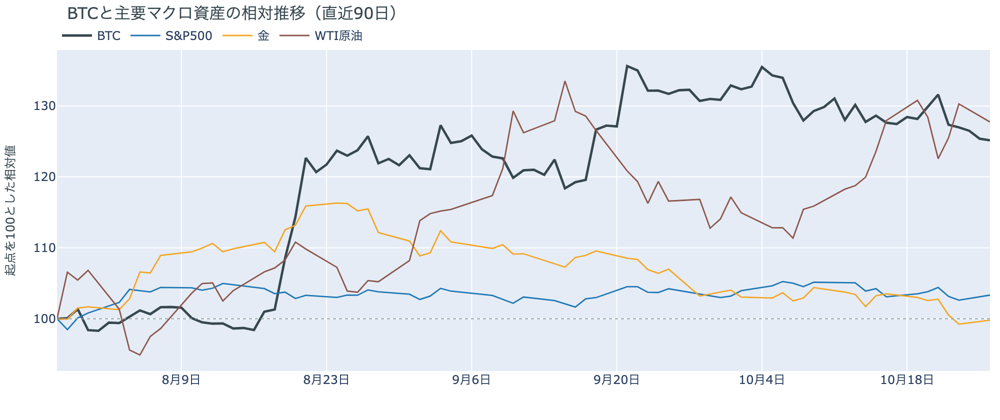

*図の見方: 同じ起点から何%動いたかで重ねたもの。線の向きが揃っているかを見ます。*

| この5営業日の動き（ビットコインは7日間） | 変化 |
|---|---:|
| ビットコイン | −2.4% |
| 金 | −3.1% |
| 米国株（S&P500） | −0.2% |
| 原油 | −2.3% |

* 建玉は95,199BTCで、前日の93,299BTCから2.0%増えた。
* 資金調達率の上乗せは+3.15ptで、前日の+4.52ptから縮んだがプラスのまま。

月曜日は、はっきりしたきっかけが無いまま、アメリカの取引所の買い手が引いたところで、先物の下げの場面ごとにショートが積まれたので、株が上げた日にビットコインは$80,000をわずかに割りました。

1. きっかけ：外部環境にも、ビットコイン固有の出来事にも見当たりません。中東では、サウジアラビア・トルコ・パキスタンの高官が月曜にテヘランでイラン側と会うと報じられ、前日にはカタールの仲介者もテヘランに入っていて、原油はこれを受けて2%下げました。株は上げ、ビットコインはわずかに下げたので、この流れは共通のきっかけではありません。米10年債利回りも、ビットコインが沈んで戻った夜10時台から未明まで4.98%前後で横ばいでした。ビットコインを最も多く持つ上場企業のStrategyは月曜、前の週（10月19日〜25日）はビットコインを買わなかったと公表しましたが、月曜の下げはどれも数時間のうちに戻っていて、今日の値動きに効いた形跡はありません。
2. 伝わり方：通り道は先物とアメリカの現物の両方です。先物では、朝と夜の下げのたびに建玉（＝先物の未決済残高。証拠金で張っている人の量）が増えたので、下げを運んだのは新しく積まれたショートで、朝の下げはロングの清算が加速させました。そのショートは数時間で買い戻されましたが、1日で見れば建玉は2%増えていて、$80,000を挟んでロングとショートの両方が賭けを大きくしています。現物では、アメリカの取引所の買い手が月曜もいつものブレを超えて引いていて（図①-1）、株が上げた日でも下げたところを買いに来ていません。下げの場面で買い支える手が薄いので、先物のショートが積まれるたびに、価格が$80,000の下へ押し出されました。

## 3. 市場参加者はいまどう見ているか

### ① アメリカの買い手は前の週と同じ深さで引いたまま、戻ってはいない

**図①-1 Coinbase Premium（アメリカとそれ以外の価格差・直近90日）**

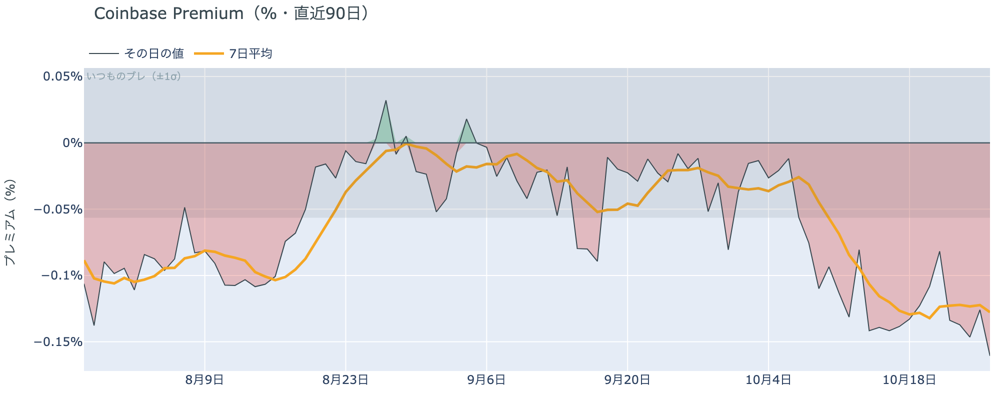

*図の見方: プラス＝アメリカで買いが強い。太線が1週間平均、細線がその日の値。薄い帯は「いつものブレの範囲」です。*

| Coinbase Premium | 値 |
|---|---:|
| 1週間平均 | −0.13% |
| 前の週の1週間平均 | −0.13% |
| 月曜のその日の値（朝7時5分の時点） | −0.16% |

* 月曜のその日の値は、いつものブレの2.8倍。

アメリカの買い手は、前の週と同じ深さで引いたままで、戻ってきてはいません。Coinbase Premium（＝アメリカとそれ以外の価格差）の1週間平均は前の週と変わらず、月曜のその日の値はいつものブレを超えて沈んでいます。アメリカの取引所では、ほかの取引所より安くしか売れない状態が続いているので、アメリカの買い手は$80,000を割る下げを買いの機会とは見ていません。前日は、日曜にアメリカの買い手がさらに深く引いたと説明しました。日曜の値は1日を終えてみると−0.13%に収まっていて、引き方が一段深まったのではなく、前の週と同じ深さで引き続けている、が正しい説明です。

**図①-2 ETFの日ごとの資金の出入り（直近90日）**

*図の見方: 入ったお金と出たお金の差。上に伸びれば入り超、下に伸びれば出超。*

| ETFの日ごとの出入り | 億ドル |
|---|---:|
| 10月19日 | +5.3 |
| 10月20日 | +0.2 |
| 10月21日 | +5.2 |
| 10月22日 | −6.4 |
| 10月23日 | −1.4 |
| 直近7営業日の合計 | +2.2 |

ETFの買い手は、木曜と金曜に続けて売った側のまま、週明けの分の数字はまだ出ていません。7営業日の合計は入り超ですが、週の前半に入れた買いの大半を後半に手放していて、ETFの買い手も、アメリカの取引所の買い手と同じく、いまは買いを急いでいません。

**図①-3 Fear & Greed（市場心理の指数・直近90日）**

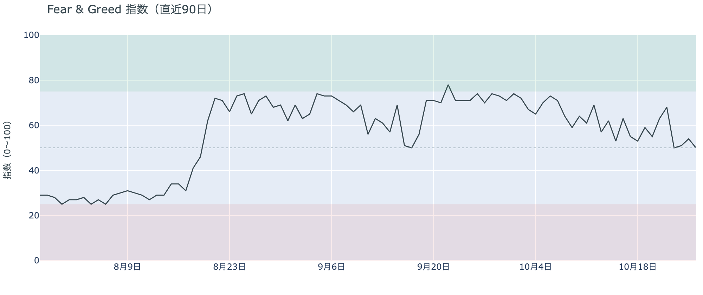

*図の見方: 0〜100で、50より上が「強欲」、下が「恐怖」。*

* 50の「中立」。前日の54から4pt下がり、1週間前は59、1か月前は74。

市場心理は、1か月かけて「強欲」から「中立」のちょうど真ん中まで冷えましたが、恐怖には傾いていません。Fear & Greed（＝市場心理の指数）の10月26日の確定値は前日より下がったものの、$80,000をわずかに割った日でも、怖がって逃げる人が増えた形にはなっていません。

### ② 長期保有者の利益確定の売りは続き、減り方はさらに広がった

**図②-1 長期保有者の保有量の30日変化とSOPR（直近90日）**

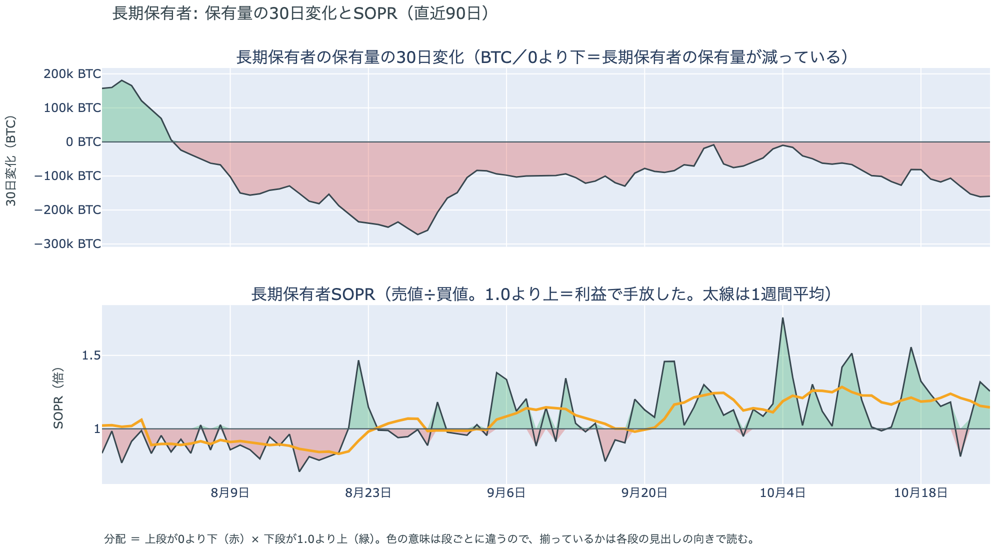

*図の見方: 上段は、長期保有者の保有量が30日でどれだけ増減したか。マイナス＝手放している。下段は長期保有者SOPRで、1より上なら利益で手放した。どちらも太線の1週間平均で読みます。*

| 10月25日時点 | 1週間平均 | 前の週の平均 |
|---|---:|---:|
| 長期保有者SOPR（1より上＝利益で手放した） | 1.15 | 1.19 |
| 長期保有者の保有量の30日変化（万BTC） | −13.4 | −9.8 |

* 10月25日の30日変化は−16.0万BTCで、1か月前（9月25日）の−7.1万BTCの2倍を超える。

長期保有者は利益確定の売りを続けていて、減り方は前の週よりさらに広がりました。保有量は30日で減り、動いたコインは平均して買値より高く動いています。10月25日は価格が$80,000近くまで下げていた日曜で、その日まで減り方が細っていないので、長期保有者は$80,000前後を売りを止める水準とは見ていません。向きは前日と同じで、ビットコイン自身の需給の土台が変わった日ではありません。

長期保有者のほかに、売りに回りそうな持ち手は見当たりません。長く眠っていたコインが急に動いた記録はなく、マイナーの収入は平年をやや上回る程度（Puell Multiple（＝マイナー収入の平年比）が1週間平均で1.12）で、売りを急ぐ状況ではありません。

### ③ 先物：朝の下げで一部のロングが降ろされたが、残りは上乗せを払って持ち続けている

**図③-1 資金調達率と建玉（直近30日）**

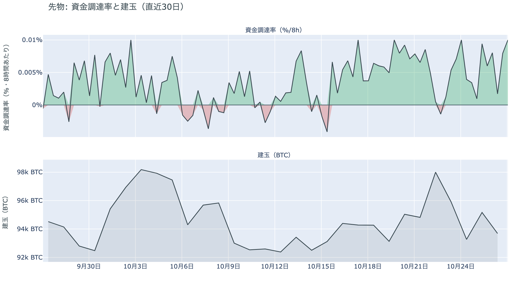

*図の見方: 上段は資金調達率（8時間ごと・日本時間）。プラスが続く＝ロングがショートより多い。下段は建玉。*

* 1日をならした年率は+7.18%で、短期金利（13週Tビル 4.03%）を引いた上乗せは+3.15pt。
* 上乗せの直近34日の平均は−0.36ptで、いまはそれより大きい。

先物の参加者は、$80,000を割る下げを流れの変化とまでは見ていませんが、上げへの確信は前日より少し弱まりました。前日は「土曜の夜に$79,000台で入ったロングは残っている」と説明しました。月曜の朝、価格が$79,500を割った10時台には、まさにその価格帯でロングの清算が集まったので、残っていたロングの一部は月曜に降ろされています。それでも資金調達率（＝ロングが払う金利。プラス＝ロングがショートより多い）は短期金利（＝ドルを米国の短期国債で持つだけで受け取れる金利）を上回ったままで、プラスは13回（約4日）続いています。残ったロングは、普通の資金のコストより高い金利を払ってでも持ち続けているということです。ただ、その上乗せは前日より縮んでいて、余分に払ってでも上げに賭けたい人は、前日より減りました。

### ④ オプション：FOMCで崩れるとは見ていないが、11月から12月には厚く備えている

オプションには2種類あります。コール（＝決めた価格で買う権利）とプット（＝決めた価格で売る権利）で、価格が上がればコールの価値が上がり、価格が下がればプットの価値が上がります。プットは「価格が下がったときの保険」として買われます。オプションを買う人は、その権利と引き換えに権利料（＝オプションを買う人が払う金額）を払います。

**図④-1 満期ごとのIV（年率%）**

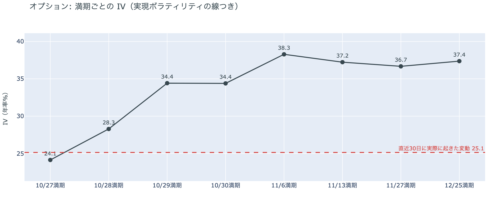

*図の見方: IVを満期ごとに並べたもの。点線は実現ボラティリティ。IVが点線より下なら、市場はこの先の値動きを過去の値動きより小さいと見ています。*

| 満期 | IV |
|---|---:|
| 10月27日 | 24 |
| 10月28日 | 28 |
| 10月29日〜30日 | 34 |
| 11月6日〜12月25日 | 37〜38 |

* IVは全体で38.8で、実現ボラティリティ25.1より13.7pt高い。過去1年では下から30%。

オプションの参加者は、この先の値動きをこれまでより大きいと見ていますが、怖がってはいません。IVは全体で実現ボラティリティより高く、それでも過去1年では下から3割の位置です。満期（＝権利の期限）ごとに見ると、今日と明日の満期はほとんど動かないと見込まれていて、値動きの見積もりはFOMCの結果をまたぐ10月29日の満期から上がり、11月以降でいちばん高くなります。FOMCの満期だけが突き出ているわけではないので、参加者はFOMCの夜1回の値動きより、そこから先の数週間に続く値動きの幅を見込んでいます。

**図④-2 満期ごとのプットとコールの差**

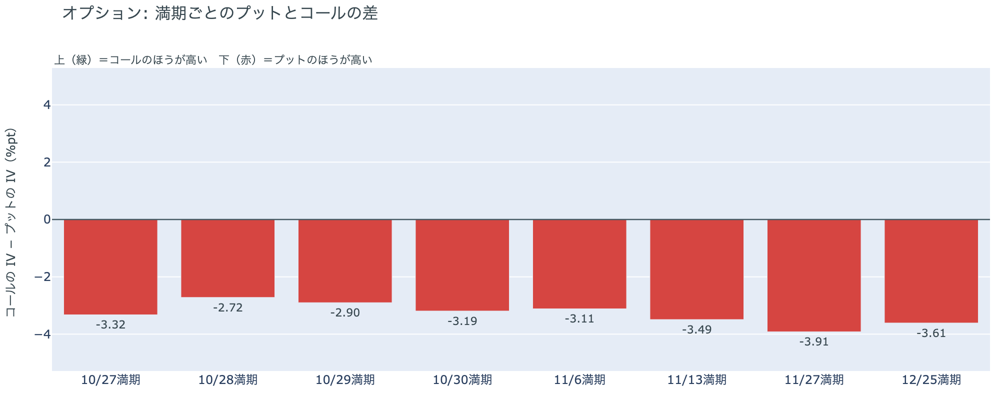

*図の見方: 満期ごとに、プットとコールのどちらが高く売れているか。ゼロより上ならコールのほうが高く、下ならプットのほうが高い。*

| 満期 | どちらが高いか |
|---|---|
| 10月27日 | プットが高い |
| 10月28日 | プットがやや高い |
| 10月29日 | プットがやや高い |
| 10月30日 | プットが高い |
| 11月6日 | プットが高い |
| 11月13日 | プットがはっきり高い |
| 11月27日 | プットがはっきり高い |
| 12月25日 | プットがはっきり高い |

参加者は下げへの備えをすべての満期に置いていて、いちばん厚いのは11月中旬から12月です。FOMCの結果をまたぐ10月28日・29日の満期は、プットの高さが全満期でいちばん小さく、参加者はFOMCそのもので大きく崩れるとは見ていません。身構えているのは、FOMC・日銀・米国の中間選挙を越えた先です。この形は前日と同じで、$80,000をわずかに割った月曜を経ても、備えの置き場は動いていません。

**図④-3 10月30日満期の持ち高（権利の価格ごと）**

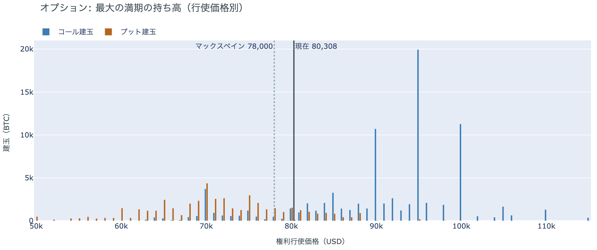

*図の見方: 青＝コール、橙＝プット。現値より上にコールが、下にプットが積まれるのが普通です。*

| 10月30日満期のオプション（価格は約$80,300） | 量（万BTC） | 意味 |
|---|---:|---|
| コール | 約7.5 | 「価格が上がる」に賭けた分 |
| プット | 約4.1 | 「価格が下がる」への保険 |
| うち、いまより15%以上高い価格のコール | 約4.3 | 大きな上げへの賭け |
| うち、いまより15%以上安い価格のプット | 約1.6 | 大きな下げへの保険 |

* 10月30日満期の持ち高は約13.6万BTCと全満期の34%で、コールがプットの1.8倍。前日と同じ形。

「価格が上がる」に賭けた人たちは、$80,000を割っても降りていません。コールのおよそ6割はいまより15%以上高い価格に積まれていて、その賭けが報われるには、10月30日までに$90,000を超える必要があります。いまの価格から約13%上です。全満期でオプションの持ち高がいちばん集まっている価格は$80,000で、月曜の価格はちょうどその上下を行き来しました。参加者は上げへの賭けを手放さないまま、持ち高の集まる$80,000の上下でFOMCを迎えます。

### ⑤ 価格は、コインが最後に動いた価格の分布でいちばん厚い帯の下へ、わずかに出た

**図⑤-1 コインが最後に動いた価格の分布（10月25日時点）**

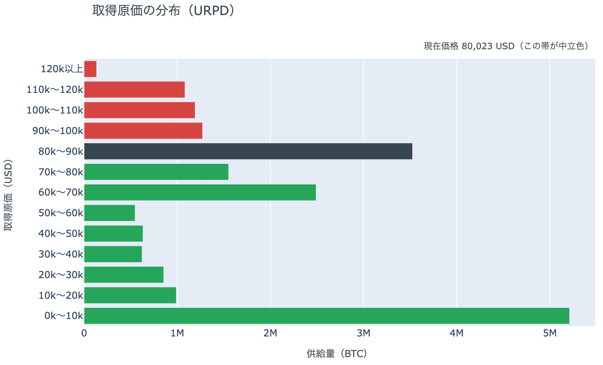

*図の見方: いま存在するコインを、最後にオンチェーンで動いた日の価格で束ねたもの。横棒が長い帯ほど、その価格帯で最後に動いたコインが多い。*

| 価格帯 | 全供給に占める割合 |
|---|---:|
| $90,000〜$100,000 | 6.3% |
| $80,000〜$90,000 | 17.5% |
| $70,000〜$80,000（いまの価格の帯） | 7.7% |
| $60,000〜$70,000 | 12.4% |

* 朝7時5分の価格$79,913は$80,000の境目を0.1%下回り、価格より上の帯は全供給の18.3%から35.8%になった。

10月25日時点の分布にいまの価格を重ねると、価格は、初期に生成された$10,000未満の帯を除いていちばん厚い$80,000〜$90,000の帯の下へ出て、$70,000〜$80,000の帯に入りました。帯をまたいだといっても、境目の$80,000を$90ほど下回っただけで、帯の上端に貼りついた位置です。それでも、いまの価格より高い価格で最後に動いた供給は、全体の約3分の1を超えました。帯は「その値段で買った人」の量ではなく、その価格帯で最後に動いた供給の量です。すぐ下の$70,000〜$80,000の帯は薄く、その下の$60,000〜$70,000の帯が次に厚い、という形の中に価格がいます。

## 4. 価格に影響しうる直近のイベント

オプション市場が下げへの備えをいちばん厚く置いているのは11月中旬から12月の満期で、FOMC、米GDP・PCE物価、日銀、米国の中間選挙を越えた先に当たります。FOMCの結果をまたぐ10月28日・29日の満期は、プットの高さが全満期でいちばん小さくなっています。FOMCでの利上げの織り込みは約1割で、1週間前の約2割から下がりました。中東では、サウジアラビア・トルコ・パキスタンの高官とカタールの仲介者がテヘランでイラン側と協議を続けていて、月曜の原油はこれを受けて下げています。

| 日付 | イベント | 何に効くか |
|---|---|---|
| 日程未定 | 米国とイランの協議（カタールなどの仲介） | 原油 |
| 10/27（火） | イスラエルの総選挙 | 原油 |
| 10/27（火）〜28（水） | FOMC。利上げの織り込みは約1割。結果は日本時間29日3時 | 金利。10月29日以降の満期がまたぐ |
| 10/29（木）21:30 日本時間 | 米国の7〜9月期GDPと9月のPCE物価 | 金利 |
| 10/29（木）〜30（金） | 日銀の会合。展望レポートも出る | 円 |
| 10/30（金）17:00 | オプションの最も大きな満期（約13.6万BTC、全満期の34%） | $90,000以上のコールの期限 |
| 11/1（日） | OPEC+の会合。12月の生産目標を決める | 原油 |
| 11/3（火） | 米国の中間選挙 | 株・原油 |
| 11/13（金）・27（金）17:00 | オプションの満期。プットの高さが全満期でいちばん大きい | 下げへの備えの期限 |

## まとめ：月曜日の動きは何だったか

月曜日は、はっきりしたきっかけが無いまま、アメリカの取引所の買い手が引いたところで、先物の下げの場面ごとにショートが積まれたので、株が上げた日にビットコインは$80,000をわずかに割りました。ビットコイン自身の需給の土台は変わっていませんが、アメリカの買い手は前の週と同じ深さで引き続け、長期保有者の利益確定の売りも広がっていて、現物の側は弱いままです。参加者は、$80,000を割る下げを流れの変化とまでは見ず、ロングもコールも持ち続けていますが、FOMCを越えた先の11月から12月には厚く身構えていて、上げへの確信は前日より少し弱まっています。

---

<small>（数値は10月27日7時5分（日本時間）までのデータに基づきます。価格・先物・オプションはその時点の値、市場心理は10月26日の確定値、オンチェーン（＝ブロックチェーン上の記録）は10月25日時点、ETF資金フローは10月23日分までです。証券市場の終値は10月26日時点です。オンチェーンの長期保有者の数値には、ETFや取引所が預かっている分も含まれます。オプションはDeribit（BTCオプションの大半を占める取引所）の全銘柄です。）</small>

*本稿は情報提供を目的としたものであり、投資助言ではありません。将来の価格動向を保証・示唆するものではなく、投資判断は各自の責任において行ってください。*
