# FOMC初日に$80,000の上へ戻す ― 運んだのはショートの買い戻し、米国の取引所は今年最も安い

**2026年10月28日**

ビットコインは火曜日、$80,000の少し下から夜にかけて持ち直し、その上で朝を迎えました。

* **価格**：24時間の値幅は2.3%と前日の1.8%から少し広がり、朝7時5分の時点で約$80,875と、24時間前より1.3%高い水準です。前日に割った$80,000を取り戻した1日でした
* **きっかけ**：はっきりしたきっかけはありませんでした。火曜は米国株が上げ、原油はイランをめぐる外交の動きで2日続けて下げ、ビットコインも株と同じ向きに上げましたが、上げを運んだのは米国の買い手ではありません
* **先物**：昼に積まれた売り持ち（ショート）が、夜から朝にかけて買い戻されて上げを運び、朝6時台にはショートの清算（＝証拠金不足で強制的に閉じられた取引）が上げを加速させました。残った買い持ち（ロング）は直近1か月でいちばん高い上乗せを払っていて、上げへの期待は前日より強まっています
* **需給の土台**：米国の買い手は上げた日にもかえって深く引き、長期保有者（＝155日以上保有者）の利益確定の売りも減り方がさらに広がりました（10月26日時点）。現物の側は前日と同じく弱いままで、土台は変わっていません
* **オプションの見方**：前日はすべての満期でプットのほうが高かったのが、10月末までの満期はコールのほうが高くなりました。参加者はFOMC（＝米国の金利を決める会合）と10月末までは上げに備え、下げへの備えは米国の中間選挙を越えた11月6日以降の満期に寄せています

## 1. 何が起きたか

**図1-1 価格の推移（1時間足・直近7日）**

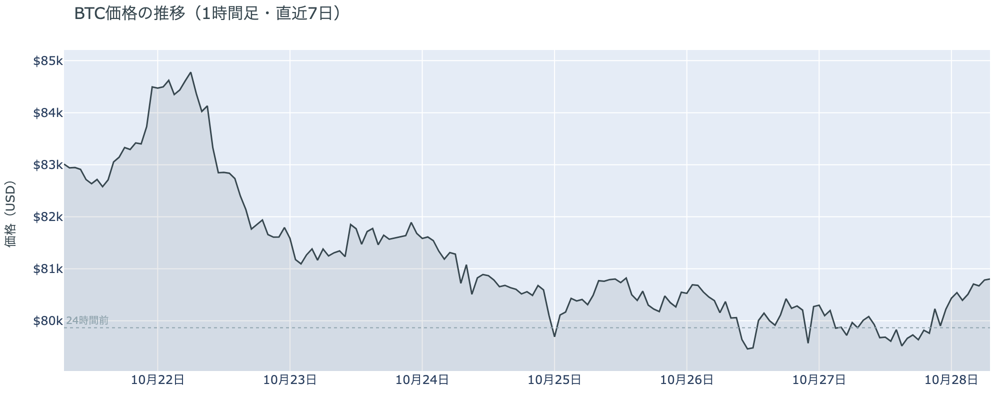

*図の見方: 1時間ごとの価格（日本時間）。点線は24時間前の水準です。火曜は昼から夕方に点線の下で横ばい、夜9時ごろから朝にかけて点線の上へ持ち上がっています。*

* 24時間の値幅は2.3%で、前日の1.8%から広がった。
* 清算はショートが大半で、26の口座に分かれ、すべてが値動きの速い5分足に入っていた。

火曜日の上げは、昼に積まれたショートが夜から朝にかけて買い戻されたものです。昼の11時から夕方7時ごろまで、価格は$79,500〜$80,000でわずかに沈みながら、建玉は増え続けていたので、この間に新しく積まれたのはショートです。夜9時台から朝にかけては、価格が上がる一方で建玉が減り続けたので、上げを運んだのは、そのショートの手仕舞いです。0時台と朝6時台の値動きの速い5分足には、Hyperliquid（＝オンチェーンの先物取引所）で見える清算が集まっていて、ショートの清算が上げを加速させました。とくに朝6時台は、24時間でいちばん大きく動いた5分足に清算が重なり、価格は$81,000を一時上回っています。大口1件ではなく、多数のショートが$80,000台から$81,000台で閉じられました。

**図1-2 価格と50日・200日移動平均**

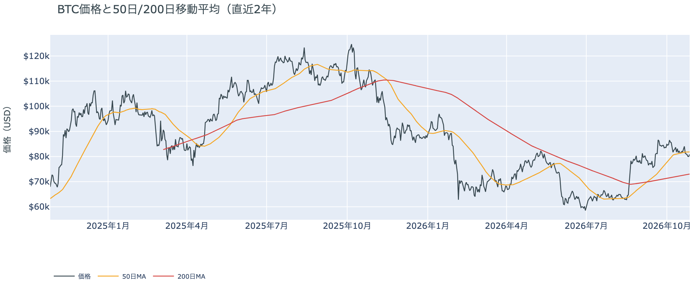

*図の見方: 2本の平均線の上下関係を見ます。50日線が200日線の上にあるのがゴールデンクロスです。*

* 50日線（$81,831）と200日線の差は約$8,800（12.1%）で、前日とほぼ同じ。
* 朝7時5分の価格は50日線を1.2%下回り、前日の2.3%から近づいた。

長い目で見た流れの向きは変わっていません。ゴールデンクロス（＝50日線が200日線を上抜けること）の状態が50日目で、2本の平均線の差も開いたままです。価格は火曜の上げで50日線に近づきましたが、まだその下にいて、木曜から6日続けて50日線を下回っています。短い目で見た価格の弱さは、半分ほど戻したところです。

火曜10月27日の証券市場は、米国株（S&P500）が+0.6%、金が+0.9%で上げ、原油（WTI）は−1.5%の$100で終わりました。中東の材料は、前日に続いて和らぐ向きで値が付いていて、外部環境から売りの材料が持ち越された夜ではありません。

## 2. なぜ動いたか：きっかけと、需給のどこが動いたか

**図2-1 ビットコインと株・金・原油の相対推移（起点＝100）**

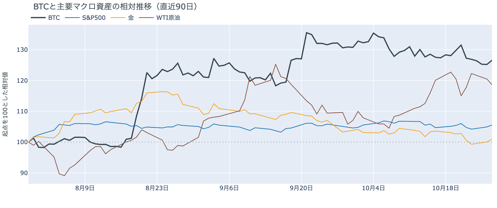

*図の見方: 同じ起点から何%動いたかで重ねたもの。線の向きが揃っているかを見ます。*

| この5営業日の動き（ビットコインは7日間） | 変化 |
|---|---:|
| ビットコイン | −2.5% |
| 金 | −1.7% |
| 米国株（S&P500） | +0.1% |
| 原油 | −1.6% |

* 建玉は95,835BTCで、前日の95,199BTCとほぼ同じ。昼に増えた分を夜に減らした。
* 資金調達率の上乗せは+6.43ptで、前日の+3.15ptから広がった。

火曜日は、はっきりしたきっかけが無いまま、昼に積まれたショートが夜から朝にかけて買い戻されたので、米国の取引所の買い手が今年いちばん深く引いた日に、ビットコインは$80,000の上へ戻りました。

1. きっかけ：外部環境にも、ビットコイン固有の出来事にも見当たりません。火曜の米国株は半導体やAI関連の株に引かれて上げ、原油は、サウジアラビア・トルコ・パキスタンとイランの協議が続くとの報道を受けて2日続けて下げました。ビットコインも株と同じ向きに上げましたが、上げたのは、アメリカの買い手が引く中で先物のショートが降りた時間で、株の流れに乗った買いが入った形はありません。米10年債利回りは、ビットコインが持ち上がった夜9時台から未明まで4.98〜5.00%で横ばいで、金利の側から押された形跡もありません。FOMCでの利上げの織り込みは約1割弱で、1週間前の約1割半から下がっていて、FOMCを前にした身構えが強まった夜でもありません。
2. 伝わり方：通り道は先物です。建玉（＝先物の未決済残高。証拠金で張っている人の量）は昼に増えて夜に同じくらい減っていて、1日を通すとほぼ変わっていません。昼の下げの場面で積まれたショートが、価格が$80,000の上へ戻ると降り、その買い戻しと清算が上げを運びました。現物は上げを運んでいません。アメリカの取引所の買い手は、上げた火曜日にかえって今年いちばん深く引いていて（図①-1）、上げはアメリカの現物の買いが来たからではありません。前日は「先物の下げの場面ごとにショートが積まれ、数時間で買い戻される往復」と説明しました。火曜日も同じ形が昼と夜で繰り返され、夜の買い戻しのほうが大きかった、というのが今日の動きです。

## 3. 市場参加者はいまどう見ているか

### ① アメリカの買い手は上げた日にも戻らず、引き方はかえって深まった

**図①-1 Coinbase Premium（アメリカとそれ以外の価格差・直近90日）**

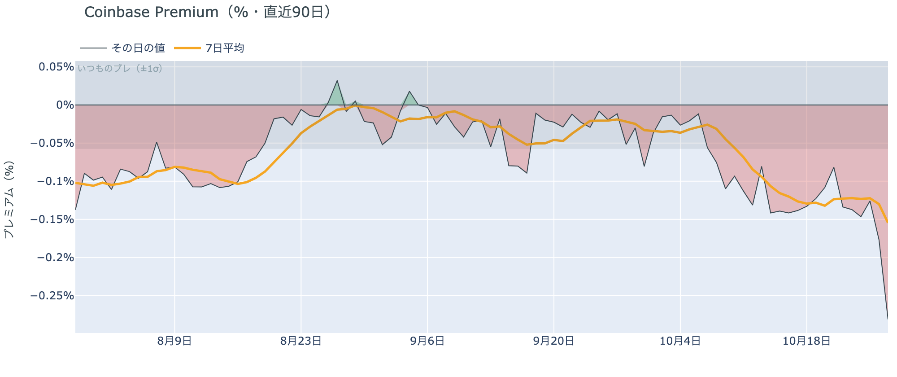

*図の見方: プラス＝アメリカで買いが強い。太線が1週間平均、細線がその日の値。薄い帯は「いつものブレの範囲」です。*

| Coinbase Premium | 値 |
|---|---:|
| 1週間平均 | −0.16% |
| 前の週の1週間平均 | −0.13% |
| 火曜のその日の値（朝7時5分の時点） | −0.28% |

* 火曜のその日の値はいつものブレの4.9倍で、今年に入っていちばん低い。

アメリカの買い手は、価格が戻った日にも買いに来ず、引き方はかえって深まりました。Coinbase Premium（＝アメリカとそれ以外の価格差）は、1週間平均で前の週より沈み、火曜のその日の値はいつものブレを大きく超えています。アメリカの取引所では、ほかの取引所よりはっきり安くしか売れない状態なので、アメリカの買い手は$80,000への戻りを買いの機会とは見ておらず、売る側に回っています。

**図①-2 ETFの日ごとの資金の出入り（直近90日）**

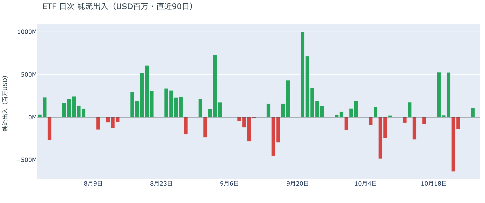

*図の見方: 入ったお金と出たお金の差。上に伸びれば入り超、下に伸びれば出超。*

| ETFの日ごとの出入り | 億ドル |
|---|---:|
| 10月21日 | +5.2 |
| 10月22日 | −6.4 |
| 10月23日 | −1.4 |
| 10月26日 | +1.1 |
| 10月27日（集計途中） | 0.0 |
| 直近7営業日の合計 | +4.1 |

ETFの買い手は、木曜と金曜に売ったあと、月曜に小さく買い戻しましたが、流れを戻すほどではありません。月曜の入り超は、木曜の出超の6分の1ほどです。ETFの買い手も、アメリカの取引所の買い手と同じく、FOMCを前に買いを急いでいません。

**図①-3 Fear & Greed（市場心理の指数・直近90日）**

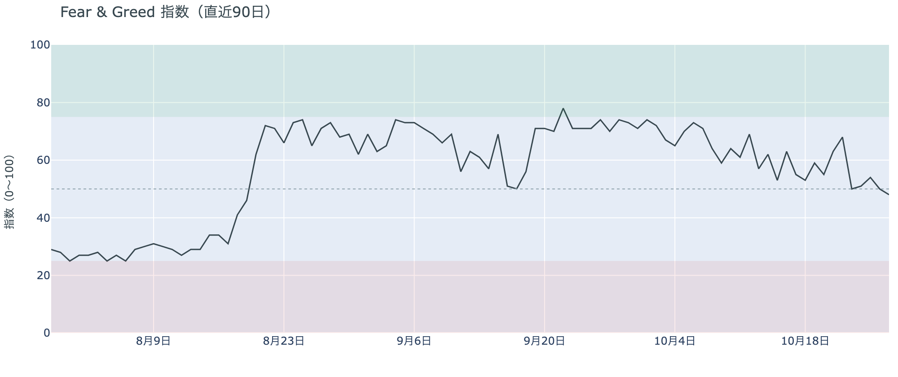

*図の見方: 0〜100で、50より上が「強欲」、下が「恐怖」。*

* 48の「中立」。前日の50から2pt下がり、1週間前は55、1か月前は70。

市場心理は、中立の真ん中からわずかに冷えた側へ移りましたが、恐怖には傾いていません。Fear & Greed（＝市場心理の指数）の10月27日の確定値は、価格が$80,000を取り戻す前の値です。それでも1か月で「強欲」から下がり続けていて、上げを期待して前のめりになる人は減っています。

### ② 長期保有者の利益確定の売りは続き、減り方は前の週より広がった

**図②-1 長期保有者の保有量の30日変化とSOPR（直近90日）**

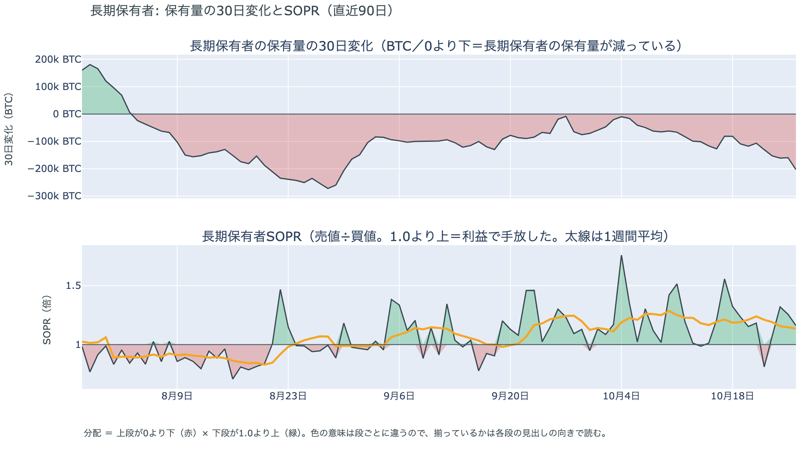

*図の見方: 上段は、長期保有者の保有量が30日でどれだけ増減したか。マイナス＝手放している。下段は長期保有者SOPRで、1より上なら利益で手放した。どちらも太線の1週間平均で読みます。*

| 10月26日時点 | 1週間平均 | 前の週の平均 |
|---|---:|---:|
| 長期保有者SOPR（1より上＝利益で手放した） | 1.14 | 1.19 |
| 長期保有者の保有量の30日変化（万BTC） | −14.7 | −10.2 |

* 10月26日の30日変化は−20.3万BTCで、1か月前（9月26日）の−1.9万BTCの10倍を超える。

長期保有者は利益確定の売りを続けていて、減り方は前の週よりさらに広がりました。保有量は30日で減り、動いたコインは平均して買値より高く動いています。10月26日は価格が$80,000の上で終わった月曜で、その日まで減り方が細っていないので、長期保有者は$80,000前後を売りを止める水準とは見ていません。向きは前日と同じで、ビットコイン自身の需給の土台が変わった日ではありません。

長期保有者のほかに、売りに回りそうな持ち手は見当たりません。長く眠っていたコインが急に動いた記録はなく、マイナーの収入は平年をやや上回る程度（Puell Multiple（＝マイナー収入の平年比）が1週間平均で1.13）で、売りを急ぐ状況ではありません。

### ③ 先物：ショートが降り、残ったロングは1か月でいちばん高い上乗せを払っている

**図③-1 資金調達率と建玉（直近30日）**

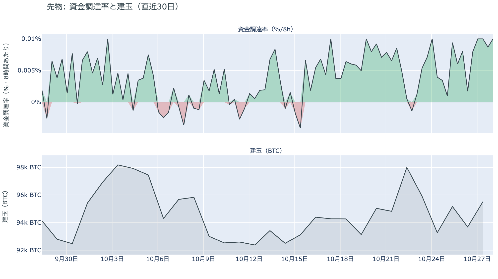

*図の見方: 上段は資金調達率（8時間ごと・日本時間）。プラスが続く＝ロングがショートより多い。下段は建玉。*

* 1日をならした年率は+10.47%で、短期金利（13週Tビル 4.04%）を引いた上乗せは+6.43pt。
* 上乗せは直近34日でいちばん大きく、その間の平均は−0.12pt。

先物の参加者は、上げへの期待を前日より強めています。夜にショートが降りたあとも、ロングは降りずに残っていて、資金調達率（＝ロングが払う金利。プラス＝ロングがショートより多い）は短期金利（＝ドルを米国の短期国債で持つだけで受け取れる金利）をはっきり上回りました。プラスは16回（約5日）続いています。普通の資金のコストより高い金利を払ってでもロングを持ち続けている、ということで、余分に払ってでも上げに賭けたい人は前日より増えました。ただし建玉は1日を通してほぼ変わっておらず、賭けの量そのものを大きくしたわけではありません。傾きが強まったのは、ショートが降りてロングの側が残ったからです。

### ④ オプション：10月末までは上げに備え、下げへの備えは中間選挙の先へ寄せた

オプションには2種類あります。コール（＝決めた価格で買う権利）とプット（＝決めた価格で売る権利）で、価格が上がればコールの価値が上がり、価格が下がればプットの価値が上がります。プットは「価格が下がったときの保険」として買われます。オプションを買う人は、その権利と引き換えに権利料（＝オプションを買う人が払う金額）を払います。

**図④-1 満期ごとのIV（年率%）**

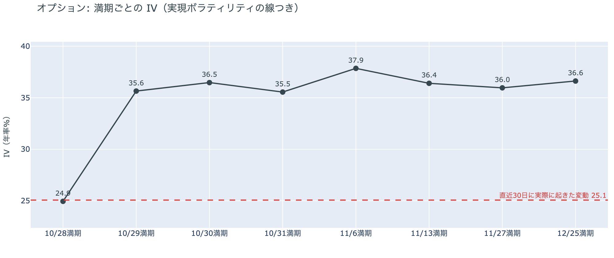

*図の見方: IVを満期ごとに並べたもの。点線は実現ボラティリティ。IVが点線より下なら、市場はこの先の値動きを過去の値動きより小さいと見ています。*

| 満期 | IV |
|---|---:|
| 10月28日 | 25 |
| 10月29日〜31日 | 36 |
| 11月6日 | 38 |
| 11月13日〜12月25日 | 36〜37 |

* IVは全体で38.6で、実現ボラティリティ25.1より13.5pt高い。過去1年では下から23%。

オプションの参加者は、この先の値動きをこれまでより大きいと見ていますが、怖がってはいません。IV（＝値動きの幅の予想）は全体で実現ボラティリティ（＝過去の値動きの幅）より高く、それでも過去1年では下から4分の1に満たない位置です。FOMCの結果が出る前に終わる今日の満期だけが低く、結果をまたぐ10月29日から先は、どの満期もほぼ同じ幅を見込んでいます。参加者は、FOMCの夜1回だけで大きく動くとは見ておらず、そこから先の数週間に同じくらいの値動きが続くと見ています。

**図④-2 満期ごとのプットとコールの差**

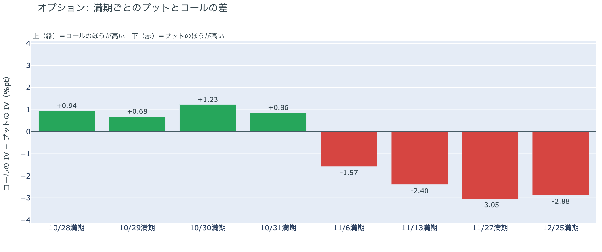

*図の見方: 満期ごとに、プットとコールのどちらが高く売れているか。ゼロより上ならコールのほうが高く、下ならプットのほうが高い。*

| 満期 | どちらが高いか |
|---|---|
| 10月28日 | コールがやや高い |
| 10月29日 | コールがやや高い |
| 10月30日 | コールが高い |
| 10月31日 | コールがやや高い |
| 11月6日 | プットが高い |
| 11月13日 | プットがはっきり高い |
| 11月27日 | プットがはっきり高い |
| 12月25日 | プットがはっきり高い |

参加者は、FOMC・日銀と10月30日の大きな満期までは下げに備えておらず、上げへの備えのほうを高く値付けしています。前日はすべての満期でプットのほうが高かったので、1日で入れ替わったのは10月末までの満期です。下げへの備えは、米国の中間選挙をまたぐ11月6日の満期から始まり、11月中旬から12月でいちばん厚くなっています。ショートが降りた夜を経て、参加者は手前の下げへの備えを外し、身構える先を中間選挙の後ろへ寄せました。

**図④-3 10月30日満期の持ち高（権利の価格ごと）**

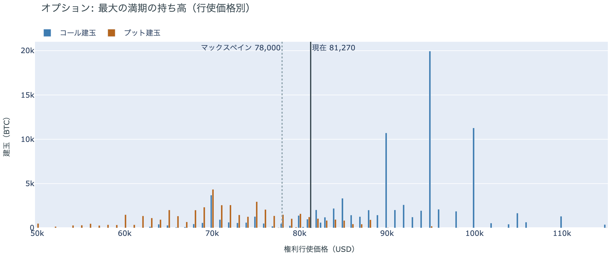

*図の見方: 青＝コール、橙＝プット。現値より上にコールが、下にプットが積まれるのが普通です。*

| 10月30日満期のオプション（価格は約$81,300） | 量（万BTC） | 意味 |
|---|---:|---|
| いまより高い価格のコール | 約7.4 | 「価格が上がる」に賭けた分 |
| いまより安い価格のプット | 約4.1 | 「価格が下がる」への保険 |
| うち、いまより15%以上高い価格のコール | 約4.2 | 大きな上げへの賭け |
| うち、いまより15%以上安い価格のプット | 約1.7 | 大きな下げへの保険 |

* 10月30日満期の持ち高は約13.6万BTCと全満期の34%で、コールがプットの1.9倍。前日とほぼ同じ形。

「価格が上がる」に賭けた人たちは、10月30日の満期を前に降りていません。いまより高い価格のコールのうち6割近くは15%以上高い価格に積まれていて、その賭けが報われるには、10月30日までに$90,000を超える必要があります。いまの価格から1割余り上です。全満期でオプションの持ち高がいちばん集まっている価格は$80,000で、価格は火曜の夜にその下から上へ抜けました。参加者は上げへの賭けを手放さないまま、持ち高の集まる$80,000のすぐ上でFOMCの結果を待っています。

## 4. 価格に影響しうる直近のイベント

オプション市場は、FOMC・日銀と10月30日の大きな満期までの区間ではプットよりコールを高く値付けしていて、下げへの備えは米国の中間選挙をまたぐ11月6日以降の満期に置いています。FOMCでの利上げの織り込みは約1割弱です。中東では、サウジアラビア・トルコ・パキスタンとイランの協議が続いていて、米国とイランの協議の日程はまだ決まっていません。

| 日付 | イベント | 何に効くか |
|---|---|---|
| 日程未定 | 米国とイランの協議（カタールなどの仲介） | 原油 |
| 10/28（水） | FOMC。利上げの織り込みは約1割弱。結果は日本時間29日3時 | 金利。10月29日以降の満期がまたぐ |
| 10/29（木）21:30 日本時間 | 米国の7〜9月期GDPと9月のPCE物価 | 金利 |
| 10/29（木）〜30（金） | 日銀の会合。展望レポートも出る | 円 |
| 10/30（金）17:00 | オプションの最も大きな満期（約13.6万BTC、全満期の34%） | $90,000以上のコールの期限 |
| 11/1（日） | OPEC+の会合。12月の生産目標を決める | 原油 |
| 11/3（火） | 米国の中間選挙 | 株・原油。11月6日以降の満期がまたぐ |
| 11/6（金）17:00 | オプションの満期。プットのほうが高くなる最初の満期 | 下げへの備えの始まり |

## まとめ：火曜日の動きは何だったか

火曜日は、はっきりしたきっかけが無いまま、昼に積まれたショートが夜から朝にかけて買い戻され、清算がそれを加速させたので、ビットコインは$80,000の上へ戻りました。上げは先物の中で起きたもので、アメリカの買い手はかえって深く引き、長期保有者の利益確定の売りも広がっていて、現物の側は弱いままです。参加者は、FOMCと10月末までの短い期間では崩れるとは見ず、ロングにもコールにも上げへの賭けを残していますが、米国の中間選挙を越えた先の11月から12月には、下げへの備えを厚く置いています。

---

<small>（数値は10月28日7時5分（日本時間）までのデータに基づきます。価格・先物・オプションはその時点の値、市場心理は10月27日の確定値、オンチェーン（＝ブロックチェーン上の記録）は10月26日時点、ETF資金フローは10月27日分までです（10月27日分は集計途中）。証券市場の終値は10月27日時点です。オンチェーンの長期保有者の数値には、ETFや取引所が預かっている分も含まれます。オプションはDeribit（BTCオプションの大半を占める取引所）の全銘柄です。）</small>

*本稿は情報提供を目的としたものであり、投資助言ではありません。将来の価格動向を保証・示唆するものではなく、投資判断は各自の責任において行ってください。*
