# 据え置きのFOMCを越えて$81,000台へ ― 前の晩に積まれたショートが未明に買い戻される

**2026年10月29日**

ビットコインは水曜日、夜に$80,300台まで下げる場面がありましたが、FOMC（＝米国の金利を決める会合）の据え置きをはさんで未明に持ち直し、$81,000台で朝を迎えました。

* **価格**：24時間の値幅は1.8%と前日の2.3%から縮み、朝7時5分の時点で約$81,173と、24時間前より0.5%高い水準です。下げと戻りが1日の中で打ち消し合った、方向の出ない日でした
* **きっかけ**：FOMCは市場の織り込みどおり金利を据え置き、12月の利上げの見込みも1週間前から変わりませんでした。新しい材料が出なかったので、結果を見込んで積まれた持ち高が降りる形になりました
* **先物**：夜の下げの場面で積まれた売り持ち（ショート）が、FOMCの結果をはさんで買い戻され、戻りを運びました。夕方と未明の上げはショートの清算（＝証拠金不足で強制的に閉じられた取引）が、夜の下げは買い持ち（ロング）の清算が加速させています。ロングは残っていますが、払う上乗せは前日のほぼ半分に縮み、上げへの期待は強まっていません
* **需給の土台**：米国の買い手は前の週と同じ深さで引いたまま、長期保有者（＝155日以上保有者）の利益確定の売りは減り方がさらに広がりました（10月27日時点）。現物の側は弱いままで、前日から変わっていません
* **オプションの見方**：FOMCを越えた手前の満期では、参加者は値動きの幅を小さく見直し、上げへの備えもほぼ外しました。下げへの備えは、米国の中間選挙をまたぐ11月6日以降の満期に置いたままです

## 1. 何が起きたか

**図1-1 価格の推移（1時間足・直近7日）**

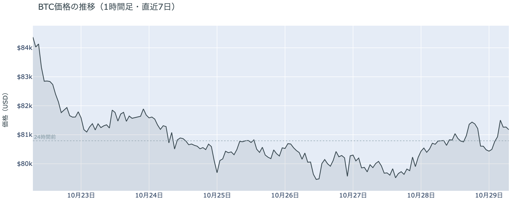

*図の見方: 1時間ごとの価格（日本時間）。点線は24時間前の水準です。水曜の夕方に点線の上へ出て、夜9時ごろに下へ沈み、未明から朝にかけて再び上へ戻っています。*

* 24時間の値幅は1.8%で、前日の2.3%から縮んだ。
* 清算は多数の口座に分かれ、最大1件でも全体の2割に届かない。

水曜日の値動きは、FOMCをはさんだ先物の持ち高の出し入れでした。夜9時台は清算なしで下げ始め、途中からロングの清算が重なって下げを加速させました。続く10時台は、価格が$80,600前後で止まる中で建玉が1%余り増えていて、下げた水準で新しく積まれたのはショートです。未明の2時台から4時台は、FOMCの結果が出た3時をはさんで、価格が上がる一方で建玉が減り続けたので、戻りを運んだのはそのショートの買い戻しです。4時台には、Hyperliquid（＝オンチェーンの先物取引所）で見えるショートの清算が上げを加速させ、価格は$81,500まで戻りました。夕方5時台の$81,400台への上げも、ショートの清算が加速させたものです。

**図1-2 価格と50日・200日移動平均**

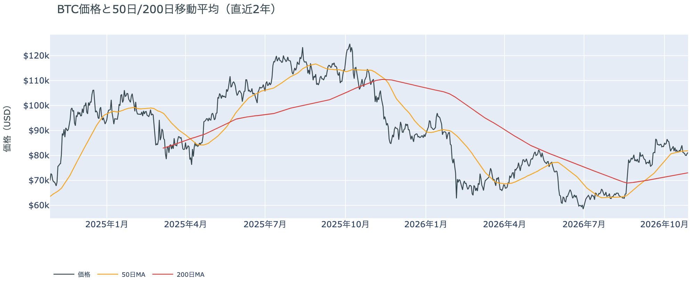

*図の見方: 2本の平均線の上下関係を見ます。50日線が200日線の上にあるのがゴールデンクロスです。*

* 50日線（$81,884）と200日線の差は約$8,800（12.1%）で、前日とほぼ同じ。
* 朝7時5分の価格は50日線を0.9%下回り、前日の1.2%から近づいた。

長い目で見た流れの向きは変わっていません。ゴールデンクロス（＝50日線が200日線を上抜けること）の状態が51日目で、2本の平均線の差も開いたままです。価格は先週の木曜から1週間、50日線のすぐ下にとどまっていて、短い目で見た弱さは、上にも下にも抜けずに続いています。

水曜10月28日の証券市場は、米国株（S&P500）が+0.3%、金が+0.2%と小さく上げ、米10年債利回りは5.05%で終わりました。FOMCの据え置きを、株も金も大きく動かずに受け止めていて、外部環境から売りの材料が持ち越された朝ではありません。原油（WTI）は+2.0%の$101.9と前日の下げを取り戻しましたが、今日のビットコインの値動きに効いた形跡はありません。

## 2. なぜ動いたか：きっかけと、需給のどこが動いたか

**図2-1 ビットコインと株・金・原油の相対推移（起点＝100）**

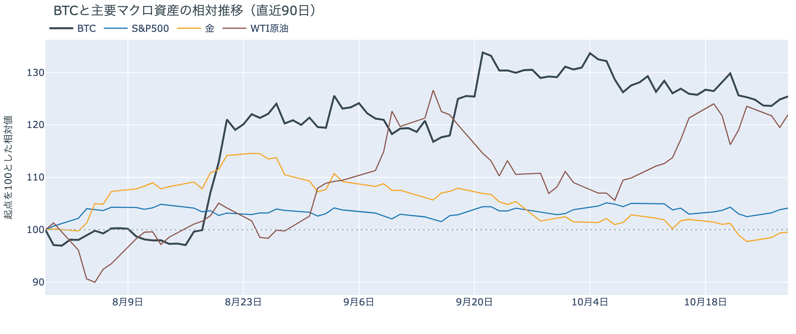

*図の見方: 同じ起点から何%動いたかで重ねたもの。線の向きが揃っているかを見ます。*

| この5営業日の動き（ビットコインは7日間） | 変化 |
|---|---:|
| ビットコイン | −3.4% |
| 金 | −1.7% |
| 米国株（S&P500） | −0.2% |
| 原油 | +4.9% |

* 建玉は95,719BTCで、前日の95,835BTCとほぼ同じ。夜に増えた分を未明に減らした。
* 12月のFOMCでの利上げの織り込みは、10月28日の先物の終値で約10割。1週間前と同じ。

水曜日は、FOMCが織り込みどおり金利を据え置いたことをきっかけに、結果を前に積まれたショートが買い戻され、ビットコインは$81,000台へ戻りました。

1. きっかけ：FOMCです。ただし、結果が新しい材料を出したのではありません。金利は据え置かれ、12名のうち2名が利上げを主張しましたが、12月の利上げを見込む先物の織り込みは1週間前から動いていません。米国の金利の見通しは変わらず、結果を待って積まれていた持ち高が、待つ理由を失った夜でした。夜9時台からの下げと同じ時間に、米10年債利回りは5.00%から5.03%へ上がっていて、時刻は重なります。一方、未明の戻りの間も利回りは5.02〜5.05%と高いままで、戻りは金利が下がったから起きたのではありません。
2. 伝わり方：通り道は先物です。夜の下げの場面でロングが手仕舞われ、代わりにショートが積まれ、そのショートがFOMCをはさんで買い戻されました。建玉（＝先物の未決済残高。証拠金で張っている人の量）は夜に増えて未明に同じくらい減っていて、1日を通すとほぼ変わっていません。結果を見込んで積まれた持ち高が、結果のあとに手仕舞われた形です。現物は戻りを運んでいません。アメリカの買い手は引いたままで（図①-1）、戻りはアメリカの現物の買いが来たからではありません。前日は「先物の下げの場面ごとにショートが積まれ、数時間で買い戻される往復」と説明しました。水曜日も、夜に積まれたショートが未明に降りるという同じ往復で、前日の説明は今日の数値と合っています。

## 3. 市場参加者はいまどう見ているか

### ① アメリカの買い手は引いたままで、戻りを買いに来ていない

**図①-1 Coinbase Premium（アメリカとそれ以外の価格差・直近90日）**

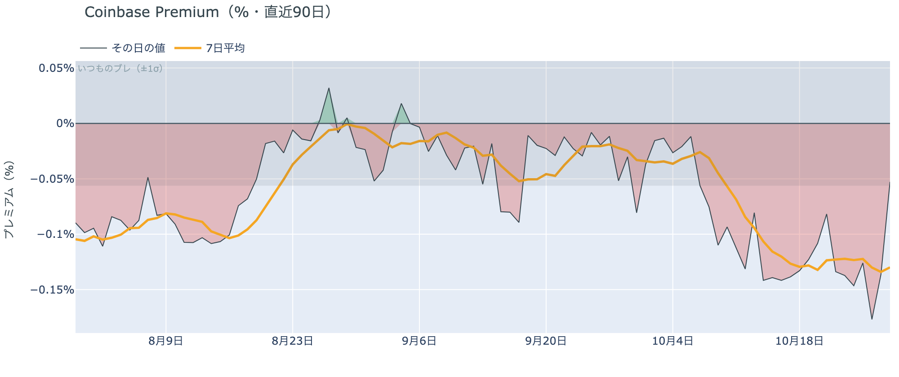

*図の見方: プラス＝アメリカで買いが強い。太線が1週間平均、細線がその日の値。薄い帯は「いつものブレの範囲」です。*

* 1週間平均は−0.13%で、前の週の1週間平均−0.12%とほぼ同じ。
* 水曜のその日の値（朝7時5分の時点）は−0.05%で、いつものブレの範囲内。

アメリカの買い手は、FOMCを越えても買いに戻っていません。Coinbase Premium（＝アメリカとそれ以外の価格差）は1週間平均で前の週と同じ深さのマイナスで、アメリカの取引所では、ほかの取引所より安くしか売れない状態が続いています。アメリカの買い手は、$80,000前後の水準を買いの機会とは見ていません。水曜のその日の値は浅くなりましたが、いつものブレの内側の動きで、引き方が変わった印ではありません。

**図①-2 ETFの日ごとの資金の出入り（直近90日）**

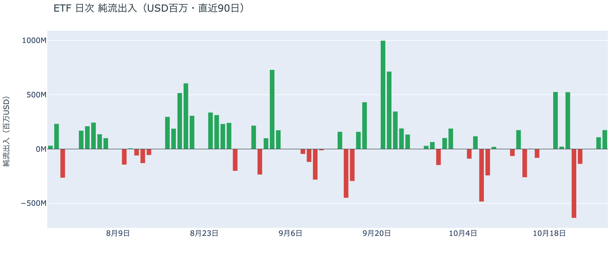

*図の見方: 入ったお金と出たお金の差。上に伸びれば入り超、下に伸びれば出超。*

| ETFの日ごとの出入り | 億ドル |
|---|---:|
| 10月21日 | +5.2 |
| 10月22日 | −6.4 |
| 10月23日 | −1.4 |
| 10月26日 | +1.1 |
| 10月27日 | +1.8 |
| 直近7営業日の合計 | +5.9 |

ETFの買い手は少しずつ戻っていますが、先週の売りを埋めるほどではありません。月曜と火曜は2日続けて入り超でしたが、2日を合わせても、先週木曜の出超の半分に届きません。ETFの買い手はFOMCを前に売るのはやめましたが、買いを急ぐほどの確信は持っていません。

**図①-3 Fear & Greed（市場心理の指数・直近90日）**

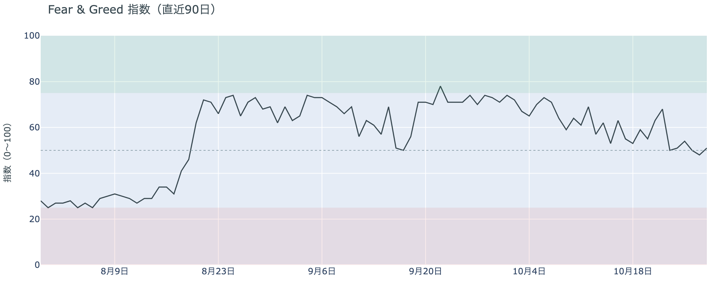

*図の見方: 0〜100で、50より上が「強欲」、下が「恐怖」。*

* 51の「中立」。前日の48から3pt戻し、1週間前は63、1か月前は74。

市場心理は「中立」の真ん中で止まっていて、恐怖にも強欲にも傾いていません。Fear & Greed（＝市場心理の指数）は1か月で「強欲」から下がってきましたが、水曜日は$80,000を取り戻した動きに合わせて少し戻しました。上げを期待して前のめりになる人も、下げを怖がる人も多くありません。

### ② 長期保有者の利益確定の売りは続き、減り方はさらに広がった

**図②-1 長期保有者の保有量の30日変化とSOPR（直近90日）**

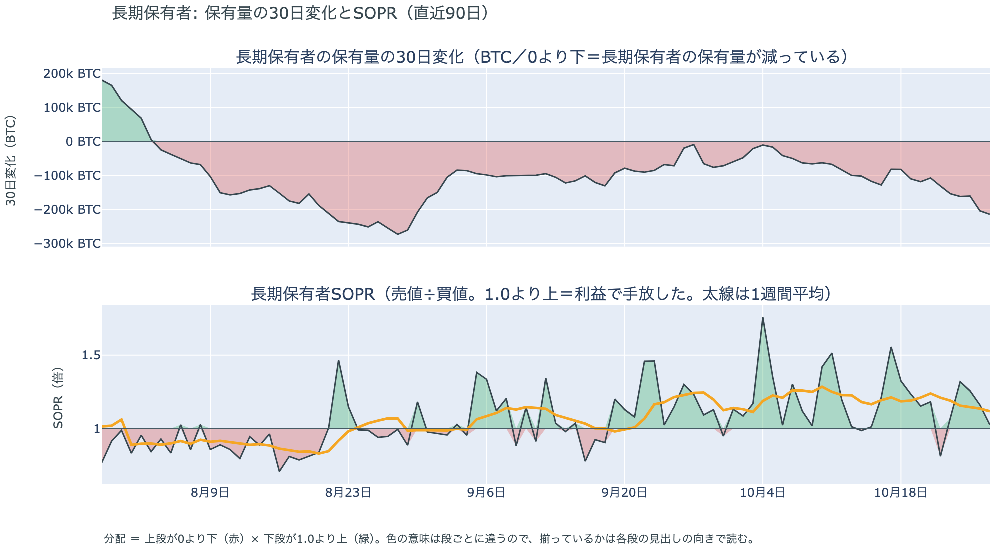

*図の見方: 上段は、長期保有者の保有量が30日でどれだけ増減したか。マイナス＝手放している。下段は長期保有者SOPRで、1より上なら利益で手放した。どちらも太線の1週間平均で読みます。*

| 10月27日時点 | 1週間平均 | 前の週の平均 |
|---|---:|---:|
| 長期保有者SOPR（1より上＝利益で手放した） | 1.12 | 1.21 |
| 長期保有者の保有量の30日変化（万BTC） | −16.1 | −10.5 |

* 10月27日の30日変化は−21.3万BTCで、1か月前（9月27日）の−0.9万BTCから大きく広がった。

長期保有者は利益確定の売りを続けていて、減り方は前の週よりさらに広がりました。保有量は30日で減り、動いたコインは平均して買値より高く動いています。10月27日は価格が$80,000の上へ戻った火曜日で、その日まで減り方が細っていないので、長期保有者は$80,000前後の戻りを、売りを止める水準ではなく売る機会と見ています。向きは前日と同じで、ビットコイン自身の需給の土台が変わった日ではありません。

長期保有者のほかに、売りに回りそうな持ち手は見当たりません。長く眠っていたコインが急に動いた記録はなく、マイナーの収入は平年をやや上回る程度（Puell Multiple（＝マイナー収入の平年比）が1週間平均で1.12）で、売りを急ぐ状況ではありません。

### ③ 先物：ロングは残っているが、余分に払う金利は前日の半分に縮んだ

**図③-1 資金調達率と建玉（直近30日）**

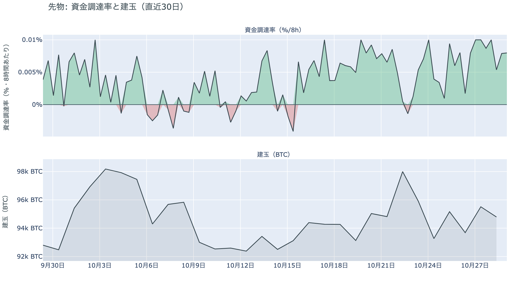

*図の見方: 上段は資金調達率（8時間ごと・日本時間）。プラスが続く＝ロングがショートより多い。下段は建玉。*

* 1日をならした年率は+7.76%で、短期金利（13週Tビル 4.00%）を引いた上乗せは+3.76pt。
* 上乗せは前日の+6.43ptから縮んだが、直近34日の平均+0.02ptはまだ上回る。

先物の参加者は、上げへの期待を保っていますが、前日より強めてはいません。資金調達率（＝ロングが払う金利。プラス＝ロングがショートより多い）はプラスが19回（約6日）続き、短期金利（＝ドルを米国の短期国債で持つだけで受け取れる金利）を上回ったままなので、ロングは降りずに残っています。一方で、普通の資金のコストに上乗せして払う金利は1日でほぼ半分になりました。FOMCを越えても、余分に払ってでも上げに賭けたい人は増えていないということです。建玉も1日を通してほぼ変わっておらず、参加者は賭けの量を大きくしないまま、夜に積んだショートを降ろしただけです。

### ④ オプション：FOMCを越えた手前の満期は落ち着き、下げへの備えは中間選挙の先に残る

オプションには2種類あります。コール（＝決めた価格で買う権利）とプット（＝決めた価格で売る権利）で、価格が上がればコールの価値が上がり、価格が下がればプットの価値が上がります。プットは「価格が下がったときの保険」として買われます。オプションを買う人は、その権利と引き換えに権利料（＝オプションを買う人が払う金額）を払います。

**図④-1 満期ごとのIV（年率%）**

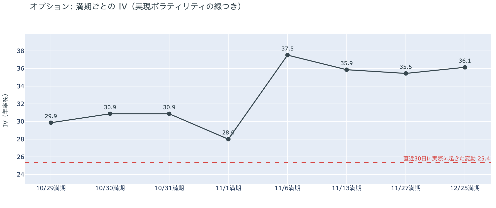

*図の見方: IVを満期ごとに並べたもの。点線は実現ボラティリティ。IVが点線より下なら、市場はこの先の値動きを過去の値動きより小さいと見ています。*

| 満期 | IV |
|---|---:|
| 10月29日〜11月1日 | 28〜31 |
| 11月6日 | 38 |
| 11月13日〜12月25日 | 36 |

* IVは全体で37.7で、実現ボラティリティ25.4より12.3pt高い。過去1年では下から22%。

オプションの参加者は、FOMCを越えた目先の数日は落ち着くと見直し、値動きが大きくなるのはその先だと見ています。IV（＝値動きの幅の予想）は全体で実現ボラティリティ（＝過去の値動きの幅）より高く、この先の値動きをこれまでより大きいと見ていますが、過去1年では下から4分の1に満たず、怖がってはいません。前日はFOMCの結果をまたぐ10月29日から先がどれも36前後でしたが、結果が出たあとは11月1日までの満期が30前後へ下がりました。いちばん大きな幅を見込んでいるのは、米国の中間選挙をまたぐ11月6日の満期です。

**図④-2 満期ごとのプットとコールの差**

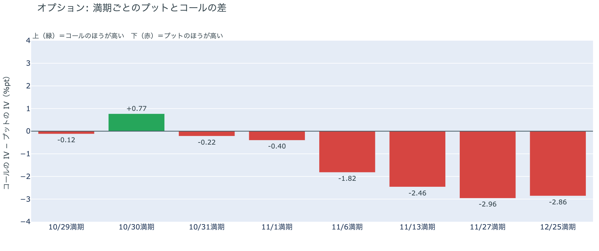

*図の見方: 満期ごとに、プットとコールのどちらが高く売れているか。ゼロより上ならコールのほうが高く、下ならプットのほうが高い。*

| 満期 | どちらが高いか |
|---|---|
| 10月29日 | ほぼ差なし |
| 10月30日 | コールがやや高い |
| 10月31日 | ほぼ差なし |
| 11月1日 | プットがわずかに高い |
| 11月6日 | プットが高い |
| 11月13日 | プットがはっきり高い |
| 11月27日 | プットがはっきり高い |
| 12月25日 | プットがはっきり高い |

参加者は、FOMCを越えた手前の上げへの期待を外し、下げへの備えは中間選挙の先に置いたままです。前日は10月末までの満期すべてでコールのほうが高かったのが、今日は10月30日の大きな満期を除いて差がほぼ消えました。FOMCで上げに備える理由がなくなったので、上げへの備えを高く値付けする人がいなくなったということです。下げへの備えは11月6日の満期から始まり、11月中旬から12月でいちばん厚い形が前日から変わっていません。

**図④-3 10月30日満期の持ち高（権利の価格ごと）**

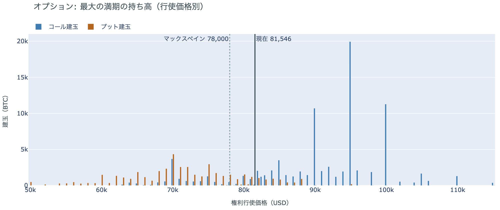

*図の見方: 青＝コール、橙＝プット。現値より上にコールが、下にプットが積まれるのが普通です。*

| 10月30日満期のオプション（価格は約$81,500） | 量（万BTC） | 意味 |
|---|---:|---|
| いまより高い価格のコール | 約7.5 | 「価格が上がる」に賭けた分 |
| いまより安い価格のプット | 約4.1 | 「価格が下がる」への保険 |
| うち、いまより15%以上高い価格のコール | 約4.2 | 大きな上げへの賭け |
| うち、いまより15%以上安い価格のプット | 約1.7 | 大きな下げへの保険 |

* 10月30日満期の持ち高は約13.6万BTCと全満期の34%で、コールがプットの1.9倍。前日とほぼ同じ形。

「価格が上がる」に賭けた人たちは、満期を翌日に控えても降りていません。いまより高い価格のコールの半分以上は15%以上高い価格に積まれていて、その賭けが報われるには、10月30日の夕方5時までに$90,000を超える必要があります。いまの価格から1割余り上です。全満期でオプションの持ち高が集まっているのは$80,000〜$82,000の帯で、価格はいまその帯の中にいます。参加者は、大きな上げへの賭けを満期まで持ち切る構えで、FOMCのあとも持ち高の形を変えていません。

長期保有者とマイナーのほかに、今日のオンチェーン（＝ブロックチェーン上の記録）で特筆すべき事象はありません。コインが最後に動いた価格の分布に対しても、価格は同じ価格帯の中にとどまっています。

## 4. 価格に影響しうる直近のイベント

オプション市場は、FOMCを越えた11月1日までの満期では値動きの幅を小さく見込み、プットとコールの差もほぼ消しています。値動きの幅をいちばん大きく見込み、プットのほうが高くなり始めるのは、米国の中間選挙をまたぐ11月6日の満期です。12月のFOMCでの利上げは、10月28日の先物の終値で約10割織り込まれています。

| 日付 | イベント | 何に効くか |
|---|---|---|
| 10/29（木）21:30 日本時間 | 米国の7〜9月期GDP（速報値）と9月のPCE物価 | 金利 |
| 10/29（木）〜30（金） | 日銀の会合。展望レポートも出る | 円 |
| 10/30（金）17:00 | オプションの最も大きな満期（約13.6万BTC、全満期の34%） | $90,000以上のコールの期限 |
| 11/1（日） | OPEC+の会合。12月の生産目標を決める | 原油 |
| 11/3（火） | 米国の中間選挙 | 株・原油。11月6日以降の満期がまたぐ |
| 11/6（金）17:00 | オプションの満期。中間選挙をまたぐ最初の満期 | IVがいちばん高く、プットが高くなり始める満期 |
| 11/6（金）22:30 日本時間 | 米国の10月の雇用統計 | 金利 |
| 12/9（水） | FOMC。利上げの織り込みは約10割。結果は日本時間10日早朝 | 金利 |

## まとめ：水曜日の動きは何だったか

水曜日は、FOMCが織り込みどおり金利を据え置いたことをきっかけに、前の晩の下げの場面で積まれたショートが未明に買い戻され、ビットコインは$81,000台へ戻りました。動いたのは先物の持ち高の出し入れだけで、アメリカの買い手は引いたまま、長期保有者は戻りを売る機会と見て利益確定の売りを広げていて、現物の側は弱いままです。参加者は、FOMCを越えた目先の数日は荒れないと見てロングもコールも手放していませんが、上げへの賭けを大きくすることはせず、下げへの備えは米国の中間選挙を越えた11月から12月に置き続けています。

---

<small>（数値は10月29日7時5分（日本時間）までのデータに基づきます。価格・先物・オプションはその時点の値、市場心理は10月28日の確定値、オンチェーン（＝ブロックチェーン上の記録）は10月27日時点、ETF資金フローは10月27日分までです。証券市場の終値は10月28日時点です。オンチェーンの長期保有者の数値には、ETFや取引所が預かっている分も含まれます。オプションはDeribit（BTCオプションの大半を占める取引所）の全銘柄です。）</small>

*本稿は情報提供を目的としたものであり、投資助言ではありません。将来の価格動向を保証・示唆するものではなく、投資判断は各自の責任において行ってください。*
