# 未明に$78,000台へ一段安 ― 引け後のハイテク株安とBinanceの流出疑いの時間に、清算が加速

**2026年10月30日**

ビットコインは木曜日、$80,000前後で1日を過ごしたあと、米国の株式市場が閉まった直後の金曜未明5時台に2%余り下げ、この1週間の安値の$78,000台で朝を迎えました。

* **価格**：24時間の値幅は4.7%と前日の1.8%から大きく広がり、朝7時5分の時点で約$78,671と、24時間前より3.1%低い水準です。前日の戻りを返し、1週間の下げ幅がもう一段深くなった朝でした
* **きっかけ**：金利や物価の新しい材料ではありません。下げ始めは米国の引け後の取引でハイテク株が売られた時間に、いちばん速く下げた時間は、暗号資産の取引所 Binance から不審な資金の流出が続いた40分に重なります
* **先物**：下げを運んだのは買い持ち（ロング）の手仕舞いで、5時台のロングの清算（＝証拠金不足で強制的に閉じられた取引）が下げを加速させました。それでも残ったロングは短期金利より余分に払い続けていて、下げを流れの変化とまでは見ていません
* **需給の土台**：米国の買い手は取引所では引いたまま、ETFでは10月28日まで3営業日続けて買っていました。長期保有者（＝155日以上保有者）の利益確定の売りは続き、減り方は前の週より広がっています（10月28日時点）。どちらも前日から変わっておらず、下げを受け止める買いにはなっていません
* **オプションの見方**：前日は11月6日より先に置いていた下げへの備えを、今日からの手前の満期へ寄せました。参加者は、未明の下げのあとの数日にもう一段の下げが来ることに身構えています

## 1. 何が起きたか

**図1-1 価格の推移（1時間足・直近7日）**

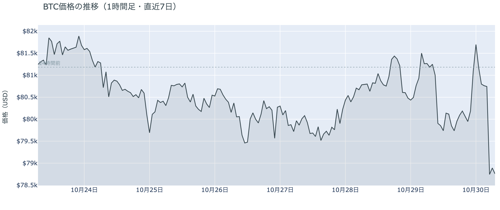

*図の見方: 1時間ごとの価格（日本時間）。点線は24時間前の水準です。木曜は点線の下で平らに動き、深夜に点線の上へ出たあと、金曜の未明に一段下へ落ちています。*

* 24時間の値幅は4.7%で、前日の1.8%の2.6倍に広がった。
* 1時間で−2.5%の金曜5時台に、この24時間で最も大きく動いた5分足が入った。

木曜日の値動きは、昼と深夜の小さな往復のあと、未明の1時間で1日分を大きく超える下げが来た形です。午前10時台の$80,000割れのあと、昼にかけて価格がほとんど動かない中で建玉が1.6%増えていて、この時間に新しく積まれたのはショートです。深夜11時台から0時台にかけての$81,700までの戻りは、価格が上がる一方で建玉が減っていたので、そのショートの買い戻しが運びました。前日に「下げの場面でショートが積まれ、数時間で買い戻される」と説明した往復が、木曜の日中にもう一度起きています。形が違ったのは、そのあとです。1時から3時にかけては価格が下がりながら建玉が減っていて、ロングが手仕舞われ始め、5時台の急な下げにつながりました。

**図1-2 価格と50日・200日移動平均**

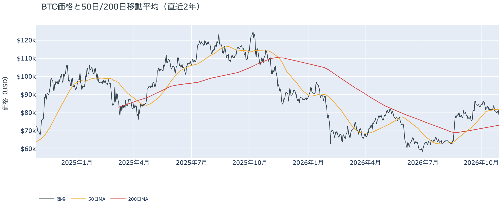

*図の見方: 2本の平均線の上下関係を見ます。50日線が200日線の上にあるのがゴールデンクロスです。*

* 50日線と200日線の差は約$8,800（12.0%）で、前日とほぼ同じ。
* 朝7時5分の価格は50日線を3.9%下回り、前日の0.9%から離れた。

長い目で見た流れの向きは変わっていませんが、短い目で見た弱さは一段深くなりました。ゴールデンクロス（＝50日線が200日線を上抜けること）の状態が52日目で、2本の平均線の差も開いたままです。一方で価格は、先週の木曜から1週間とどまっていた50日線のすぐ下から、はっきり下へ離れました。

木曜10月29日の証券市場は、米国株（S&P500）が−0.3%、金が−0.5%と小さく下げ、米10年債利回りは4.99%へ下がって終わりました。ナスダックはハイテク株の決算を受けて1.4%下げています。株安の流れが引け後まで続いたまま、ビットコインの未明の時間に持ち越された夜でした。

**図1-3 実際に起きた清算（Hyperliquid・直近24時間）**

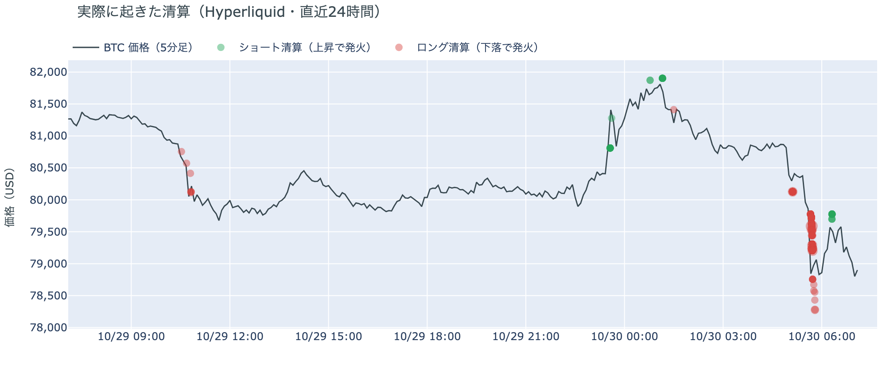

*図の見方: 5分ごとの価格（日本時間）に、Hyperliquidで見えた清算を重ねたもの。赤がロング、緑がショートの清算で、点の大きさが量です。*

* 544の口座に分かれ、最大の1件でも全体の1割。ほぼ全部がロングだった。
* 清算の95%が金曜5時台に、8割が$79,000台に出た。

焼かれたのは、多数の口座のロングです。Hyperliquid（＝オンチェーンの先物取引所）で見える清算は、ほぼ全部が金曜5時台の$79,000台に集まっています。5時台の下げは、最初の5時5分の足では清算が出ておらず、清算なしで始まりました。そのあと5時45分の、この24時間でいちばん速く下げた5分足に清算の8割近くが入り、この1本が下げを加速させました。

## 2. なぜ動いたか：きっかけと、需給のどこが動いたか

**図2-1 ビットコインと株・金・原油の相対推移（起点＝100）**

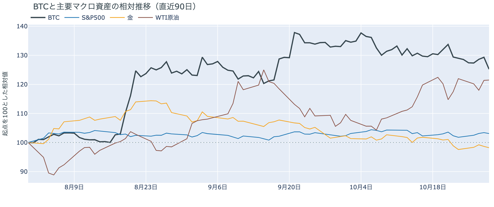

*図の見方: 同じ起点から何%動いたかで重ねたもの。線の向きが揃っているかを見ます。*

| この5営業日の動き（ビットコインは7日間） | 変化 |
|---|---:|
| ビットコイン | −3.2% |
| 金 | −0.7% |
| 米国株（S&P500） | +0.7% |
| 原油 | +3.4% |

* 建玉は93,240BTCで、前日の95,719BTCから2.6%減った。
* 12月のFOMCでの利上げの織り込みは、10月29日の先物の終値で約8割。前日は約10割。

木曜日は、米国の引け後のハイテク株安と、Binance の不審な資金の流出が重なった未明に、ロングの手仕舞いと清算を通って$78,000台へ下げました。

1. きっかけ：金融政策や物価の新しい出来事ではありません。米国の7〜9月期GDPと9月のPCE物価が出た21時30分のあと、ビットコインはむしろ深夜に上げています。12月のFOMC（＝米国の金利を決める会合）での利上げの織り込みも前日の約10割から約8割へ下がり、米10年債利回りも下がったので、金利の見通しが下げを押したのではありません。下げ始めの5時5分は、米国の株式市場が閉まった直後に引け後の取引でハイテク株が売られ、ナスダック100の先物が約1%下げた時間に重なります。いちばん速く下げた5時45分の足は、世界最大の暗号資産取引所 Binance から不審な資金の流出が続いた5時24分〜6時4分の中に入ります。Binance は調査中としたうえで6時半前に「利用者の資金は完全に安全」と出し、価格は6時台に下げ止まりました。1週間で見ると、ビットコインは株が上げた中で下げていて、この1週間の下げは株と共通のきっかけではありません。
2. 伝わり方：速い側の先物が運びました。建玉（＝先物の未決済残高。証拠金で張っている人の量）は1日で2.6%減り、未明の1時から5時台にかけての下げは、価格と建玉が同じ向きに減ったロングの手仕舞いで、最後は清算が加速させています。遅い側のアメリカの買い手と長期保有者までは、今朝の下げは届いていません。ただ、その2つは下げの前から弱く、アメリカの取引所はほかの取引所より安いまま（図①-1）、長期保有者は利益確定の売りを広げていて（図②-1）、未明の下げを買って受け止める側にはいませんでした。

この説明が違うなら、つまり今朝の下げが先物の手仕舞いで終わらずアメリカの買い手まで届いていたのなら、10月29日・30日分のETFの出入りが出超に転じ、Coinbase Premium の1週間平均がもう一段沈みます。

## 3. 市場参加者はいまどう見ているか

### ① アメリカの買い手は取引所で引いたままで、ETFの買いも下げを支えるほどではない

**図①-1 Coinbase Premium（アメリカとそれ以外の価格差・直近90日）**

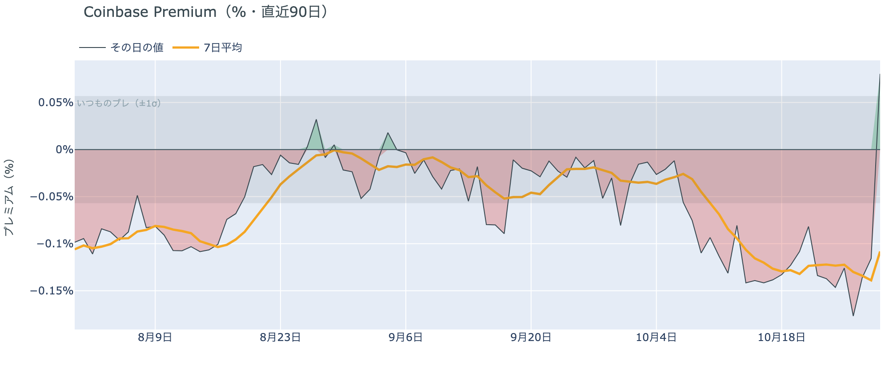

*図の見方: プラス＝アメリカで買いが強い。太線が1週間平均、細線がその日の値。薄い帯は「いつものブレの範囲」です。*

* 1週間平均は−0.11%で、前の週の1週間平均−0.12%とほぼ同じ。
* 木曜のその日の値（朝7時5分の時点）は+0.08%で、いつものブレの範囲内。

アメリカの買い手は、$80,000前後の水準を買いの機会とは見ていません。Coinbase Premium（＝アメリカとそれ以外の価格差）は1週間平均で前の週とほぼ同じ深さのマイナスで、アメリカの取引所ではほかの取引所より安くしか売れない状態が続いています。木曜のその日の値はプラスになりましたが、いつものブレの内側の動きで、引き方が変わった印ではありません。

**図①-2 ETFの日ごとの資金の出入り（直近90日）**

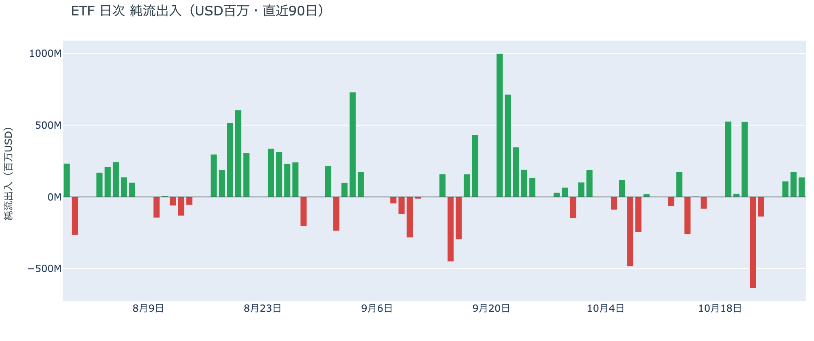

*図の見方: 入ったお金と出たお金の差。上に伸びれば入り超、下に伸びれば出超。*

| ETFの日ごとの出入り | 億ドル |
|---|---:|
| 10月22日 | −6.4 |
| 10月23日 | −1.4 |
| 10月26日 | +1.1 |
| 10月27日 | +1.8 |
| 10月28日 | +1.4 |
| 直近7営業日の合計 | +2.0 |

* 10月28日の入り超はほぼ全部がIBITの1本だった。

ETFの買い手は売るのをやめましたが、買いを急いではいません。10月28日まで3営業日続けて入り超でしたが、3日を合わせても先週木曜の出超の7割に届かず、買いは1本のファンドに偏っています。10月28日はFOMCの結果が出た日で、ETFの買い手は今朝の下げの前から、小さな買いを続けるだけの構えでした。

**図①-3 Fear & Greed（市場心理の指数・直近90日）**

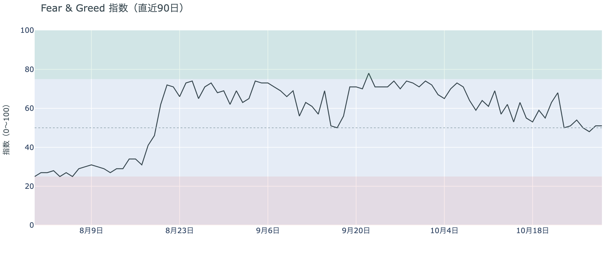

*図の見方: 0〜100で、50より上が「強欲」、下が「恐怖」。*

* 51の「中立」。前日と同じで、1週間前は68、1か月前は73。

市場心理は「中立」の真ん中で止まっていて、恐怖にも強欲にも傾いていません。Fear & Greed（＝市場心理の指数）は1か月で「強欲」から下がってきましたが、木曜日も前日から動いていません。$80,000を割った水準でも、下げを怖がる人が急に増えたわけではありません。

### ② 長期保有者の利益確定の売りは続き、減り方はさらに広がった

**図②-1 長期保有者の保有量の30日変化とSOPR（直近90日）**

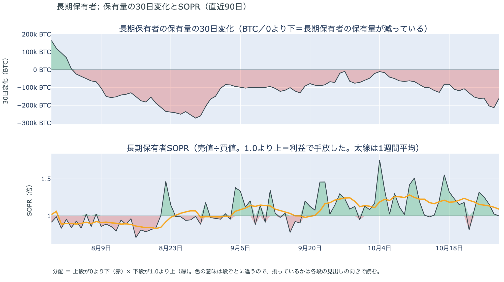

*図の見方: 上段は、長期保有者の保有量が30日でどれだけ増減したか。マイナス＝手放している。下段は長期保有者SOPRで、1より上なら利益で手放した。どちらも太線の1週間平均で読みます。*

| 10月28日時点 | 1週間平均 | 前の週の平均 |
|---|---:|---:|
| 長期保有者SOPR（1より上＝利益で手放した） | 1.09 | 1.24 |
| 長期保有者の保有量の30日変化（万BTC） | −16.9 | −10.6 |

* 1か月前（9月28日）の30日変化は−6.5万BTCで、減り方は1か月で2倍余りに広がった。

長期保有者は利益確定の売りを続けていて、減り方は前の週よりさらに広がりました。保有量は30日で減り、動いたコインは平均して買値より高く動いています。10月28日は価格が$81,000台へ戻った日で、その水準でも売りが細っていないので、長期保有者は$80,000台の戻りを、売りを止める水準ではなく売る機会と見ています。向きは前日と同じで、長期保有者の持ち方が変わった日ではありません。

長期保有者のほかに、売りに回りそうな持ち手は見当たりません。長く眠っていたコインが急に動いた記録はなく、マイナーの収入は平年をやや上回る程度（Puell Multiple（＝マイナー収入の平年比）が1週間平均で1.11）で、売りを急ぐ状況ではありません。

### ③ 先物：ロングは減ったが、残ったロングは余分な金利を払い続けている

**図③-1 資金調達率と建玉（直近30日）**

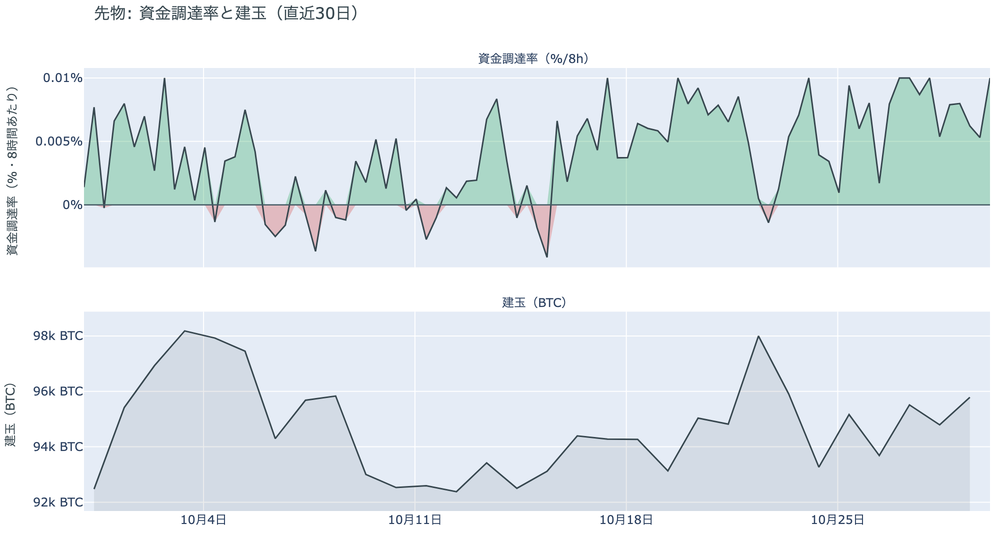

*図の見方: 上段は資金調達率（8時間ごと・日本時間）。プラスが続く＝ロングがショートより多い。下段は建玉。*

* 1日をならした年率は+7.86%で、短期金利（13週Tビル 4.00%）を引いた上乗せは+3.86pt。
* 上乗せは直近34日の平均+0.20ptを大きく上回り、前日の+3.76ptとほぼ同じ。

先物の参加者は、未明の下げを流れの変化とは見ておらず、上げへの期待を捨てていません。資金調達率（＝ロングが払う金利。プラス＝ロングがショートより多い）はプラスが22回（約7日）続き、短期金利（＝ドルを米国の短期国債で持つだけで受け取れる金利）に上乗せして払う分も、下げのあとで前日から縮んでいません。清算と手仕舞いで降りたロングがいる一方、残ったロングは余分に払ってでも持ち続けているということです。建玉は1日で減りましたが、減ったのは降りた人の分だけで、下げに乗じてショートを積み増した人が増えたわけではありません。

### ④ オプション：下げへの備えを、今日から数日の手前の満期へ寄せた

オプションには2種類あります。コール（＝決めた価格で買う権利）とプット（＝決めた価格で売る権利）で、価格が上がればコールの価値が上がり、価格が下がればプットの価値が上がります。プットは「価格が下がったときの保険」として買われます。オプションを買う人は、その権利と引き換えに権利料（＝オプションを買う人が払う金額）を払います。

**図④-1 満期ごとのIV（年率%）**

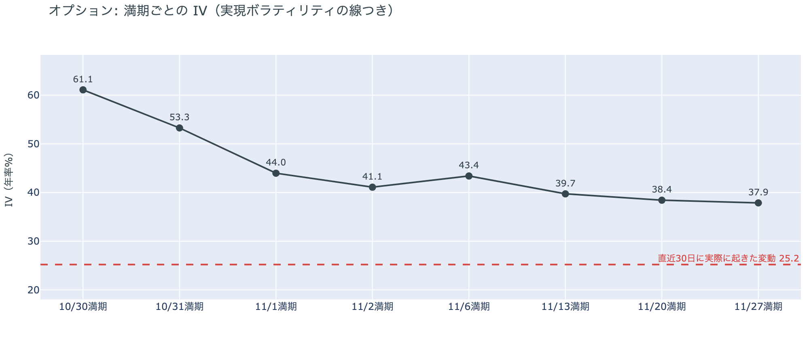

*図の見方: IVを満期ごとに並べたもの。点線は実現ボラティリティ。IVが点線より下なら、市場はこの先の値動きを過去の値動きより小さいと見ています。*

| 満期 | IV |
|---|---:|
| 10月30日 | 61 |
| 10月31日 | 53 |
| 11月1日〜11月2日 | 41〜44 |
| 11月6日 | 43 |
| 11月13日〜11月27日 | 38〜40 |

* IVは全体で37.3で、実現ボラティリティ25.2より12.1pt高い。過去1年では下から43%。

オプションの参加者は、未明の下げのあとの数日に、値動きがいちばん大きくなると見ています。IV（＝値動きの幅の予想）は全体で実現ボラティリティ（＝過去の値動きの幅）より高く、この先の値動きをこれまでより大きいと見ていますが、過去1年では真ん中より下で、怖がっているとまでは言えません。前日はFOMCを越えた11月1日までの満期が30前後まで下がっていましたが、今朝は今日10月30日と明日31日に満期が来るオプションの権利料に、ほかの満期に対して大きな上乗せが乗りました。下げのあとの値動きが続くと見られているからです。米国の中間選挙をまたぐ11月6日の満期が手前の11月2日より高い形も、前日から残っています。

**図④-2 満期ごとのプットとコールの差**

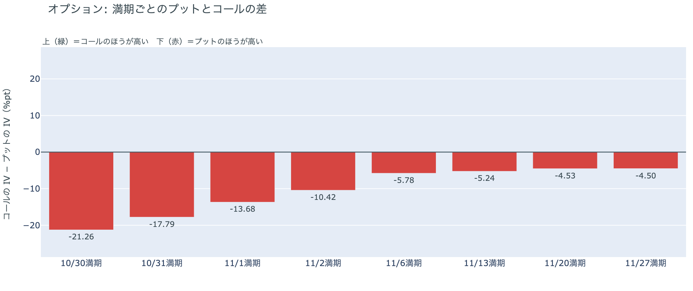

*図の見方: 満期ごとに、プットとコールのどちらが高く売れているか。ゼロより上ならコールのほうが高く、下ならプットのほうが高い。*

| 満期 | どちらが高いか |
|---|---|
| 10月30日 | プットがかなり高い |
| 10月31日 | プットがかなり高い |
| 11月1日 | プットがはっきり高い |
| 11月2日 | プットがはっきり高い |
| 11月6日 | プットが高い |
| 11月13日 | プットが高い |
| 11月20日 | プットが高い |
| 11月27日 | プットが高い |

参加者は、目先の数日に下げが続くことにいちばん強く身構えています。前日は10月末までの満期でプットとコールの差がほぼ無く、下げへの備えは中間選挙をまたぐ11月6日から先に置かれていました。今朝はすべての満期でプットのほうが高く、プットの高さは手前の満期ほど大きくなっています。下げへの備えが、先の満期から目の前の満期へ移ったということです。

**図④-3 12月25日満期の持ち高（権利の価格ごと）**

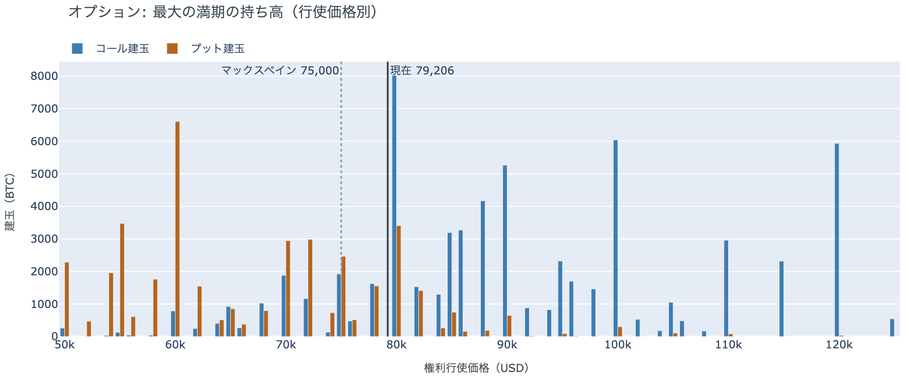

*図の見方: 青＝コール、橙＝プット。現値より上にコールが、下にプットが積まれるのが普通です。*

| 12月25日満期のオプション（価格は約$79,200） | 量（万BTC） | 意味 |
|---|---:|---|
| いまより高い価格のコール | 約7.0 | 「価格が上がる」に賭けた分 |
| いまより安い価格のプット | 約4.6 | 「価格が下がる」への保険 |
| うち、いまより15%以上高い価格のコール | 約4.3 | 大きな上げへの賭け |
| うち、いまより15%以上安い価格のプット | 約3.4 | 大きな下げへの保険 |

* 12月25日満期の持ち高は約13.5万BTCと全満期の33%で、コールがプットの1.5倍。

年末の最大の満期では、「価格が上がる」に賭けた持ち高のほうが多いままです。いまより高い価格のコールの6割は15%以上高い価格に積まれていて、その賭けが報われるには、12月25日の夕方5時までに$91,000を超える必要があります。いまの価格から約15%上です。全満期でオプションの持ち高が集まっているのは$78,000〜$80,000の帯で、価格はいまその帯の下の端にいます。参加者は、目先の下げには備えを買い足しながらも、年末に向けた上げへの賭けは手放していません。

### ⑤ 価格は、コインが最後に送金された日の価格の分布でいちばん厚い帯の下へ出た

**図⑤-1 コインが最後に送金された日の価格の分布（10月28日時点）**

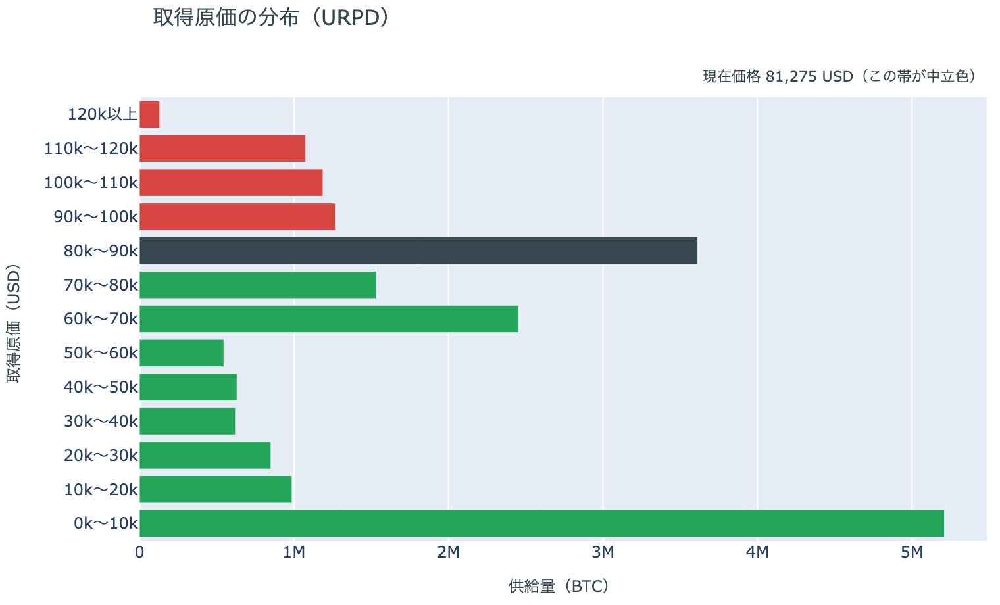

*図の見方: ビットコインはアドレスからアドレスへ送金されるたびに、受け取った側に新しい記録ができる。この図は、いまあるコインを、最後に送金された日の価格で束ねたもの。送金には売買のほか、取引所への入金・引き出しや自分のウォレット間の移し替えも含み、取引所の中での売買は含まない。*

| 価格帯 | 全供給に占める割合 |
|---|---:|
| $90,000〜$100,000 | 6.3% |
| $80,000〜$90,000 | 18.0% |
| $70,000〜$80,000（いまの価格の帯） | 7.6% |
| $60,000〜$70,000 | 12.2% |

* 価格より上の帯は全供給の18.2%から36.2%になった。

10月28日時点の分布にいまの価格を重ねると、価格は、初期に生成された$10,000未満の帯を除いていちばん厚い$80,000〜$90,000の帯の下へ出て、$70,000〜$80,000の帯に入りました。今朝の価格は境目の$80,000を約2%下回っていて、いまの価格より高い価格で最後に送金されたコインは、全体の3分の1を超えています。帯は「その値段で買った人」の量ではなく、その価格帯で最後に送金されたコインの量です。いまいる$70,000〜$80,000の帯は薄く、その下の$60,000〜$70,000の帯が次に厚い、という形の中に価格があります。

## 4. 価格に影響しうる直近のイベント

オプション市場が下げへの備えをいちばん厚く置いているのは、今日10月30日から11月2日までの手前の満期で、日銀の会合の結果とOPEC+の会合をまたぐ区間に当たります。値動きの幅を次に大きく見込んでいるのは、米国の中間選挙と米10月雇用統計をまたぐ11月6日の満期です。12月のFOMCでの利上げは、10月29日の先物の終値で約8割織り込まれています。

| 日付 | イベント | 何に効くか |
|---|---|---|
| 10/30（金）昼 | 日銀の会合の結果。展望レポートも出る | 円 |
| 10/30（金）17:00 | オプションの満期（10月末） | IVがいちばん高く、プットがかなり高い満期 |
| 日程未定 | Binanceの不審な資金の流出について、調査結果の公表 | ビットコイン |
| 11/1（日） | OPEC+の会合。12月の生産目標を決める | 原油 |
| 11/3（火） | 米国の中間選挙 | 株・原油。11月6日以降の満期がまたぐ |
| 11/6（金）22:30 日本時間 | 米国の10月の雇用統計 | 金利 |
| 12/9（水） | FOMC。利上げの織り込みは約8割。結果は日本時間10日早朝 | 金利 |
| 12/25（金）17:00 | オプションの最も大きな満期（約13.5万BTC、全満期の33%） | $91,000以上のコールの期限 |

## まとめ

木曜日は、米国の引け後のハイテク株安と Binance の不審な資金の流出が重なった未明に、ロングの手仕舞いと清算を通って、ビットコインは$78,000台へ下げました。下げを運んだのは先物で、アメリカの買い手は引いたまま、長期保有者は利益確定の売りを広げていて、下げを受け止める買いは現物の側にもありませんでした。参加者は流れが変わったとまでは見ておらず、ロングも年末のコールも手放していませんが、未明の下げのあとの数日はもう一段の下げが来ることに身構えています。

---

<small>（数値は10月30日7時5分（日本時間）までのデータに基づきます。価格・先物・オプションはその時点の値、市場心理は10月29日の確定値、オンチェーン（＝ブロックチェーン上の記録）は10月28日時点、ETF資金フローは10月28日分までです。証券市場の終値は10月29日時点です。オンチェーンの長期保有者の数値には、ETFや取引所が預かっている分も含まれます。オプションはDeribit（BTCオプションの大半を占める取引所）の全銘柄です。）</small>

*本稿は情報提供を目的としたものであり、投資助言ではありません。将来の価格動向を保証・示唆するものではなく、投資判断は各自の責任において行ってください。*
