# Binanceの出金停止の朝に$76,000台へ ― 下げの中でショートが積まれ、米国の取引所はさらに安く

**2026年10月31日**

ビットコインは金曜日、Binance の出金停止が伝わった朝に$76,000台へ下げ、昼に$78,000台へ戻したものの、米国株が大きく売られた夜にかけて押し戻され、$76,000台で朝を迎えました。

* **価格**：24時間の値幅は3.6%と前日の4.7%より狭まりましたが、朝7時5分の時点で約$76,700と24時間前より2.7%低く、1週間で5%余り下げてきた流れがもう一段進んだ朝でした
* **きっかけ**：朝の下げは、Binance が約63億ドル規模のハッキングで出金を止めたと伝わった時間に、夕方からの下げは、決算を受けて米国のハイテク株が売られた金曜の取引時間に重なります。金利の新しい材料ではありません
* **先物**：下げの中で新しく積まれたのは売り持ち（ショート）で、朝の下げは買い持ち（ロング）の清算（＝証拠金不足で強制的に閉じられた取引）が加速させました。ロングはまだ余分な金利を払って持ち続けていますが、その額は縮み、上げへの確信は弱まっています
* **需給の土台**：米国の取引所はほかの取引所よりさらに安くなり、米国の買い手は下げの中で引き方を強めました。ETF の買いは10月29日にほぼ止まり、長期保有者（＝155日以上保有者）の利益確定の売りも広がっていて（10月29日時点）、下げを受け止める買いは現物の側にもありません
* **オプションの見方**：前日に目の前の満期へ乗っていた、ほかの満期に対する上乗せは剥がれ、値動きの幅をいちばん大きく見込むのは米国の中間選挙をまたぐ11月6日の満期に移りました。すべての満期でプットが高いままで、下げへの備えは崩していません

## 1. 何が起きたか

**図1-1 価格の推移（1時間足・直近7日）**

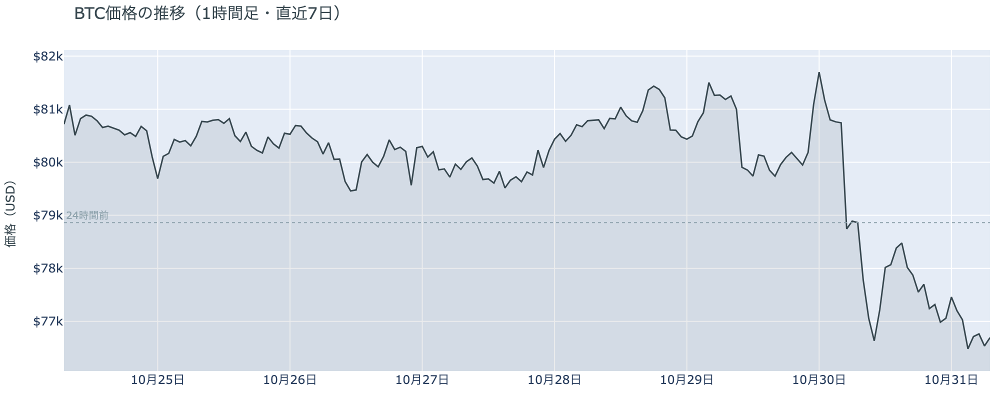

*図の見方: 1時間ごとの価格（日本時間）。点線は24時間前の水準です。金曜の朝に一段下げ、昼に戻したあと、夕方から朝にかけて点線の下でじりじり下げています。*

* 朝7時5分の時点で約$76,700で、24時間前より2.7%低い。

金曜日は、朝と夜の2回の下げを、昼の戻りがはさんだ1日でした。8時から10時台の下げでは、価格が下がる一方で建玉（＝先物の未決済残高。証拠金で張っている人の量）が増えていて、下げを見て新しくショートを積む人が増えています。12時から15時台の$78,000台への戻りは、価格が上がる一方で建玉が減っていたので、朝に積まれたショートの買い戻しが運びました。夕方からの下げは、米国の取引が始まった22時台に再び建玉が増え、ショートが積み直されています。深夜0時台の小さな戻りもショートの買い戻しで、そのあとは$76,000台へ下げて朝を迎えました。

**図1-2 価格と50日・200日移動平均**

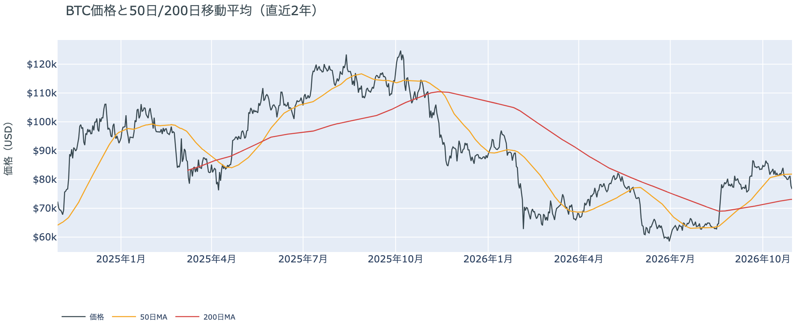

*図の見方: 2本の平均線の上下関係を見ます。50日線が200日線の上にあるのがゴールデンクロスです。*

* 50日線と200日線の差は約$8,800（12.0%）で、前日とほぼ同じ。
* 朝7時5分の価格は50日線を6.3%下回り、前日の3.9%から離れた。

長い目で見た流れの向きは変わっていませんが、短い目で見た弱さはもう一段深くなりました。ゴールデンクロス（＝50日線が200日線を上抜けること）の状態が53日目で、2本の平均線の差も開いたままです。一方で価格は、50日線の下へ2日続けて離れていきました。

金曜10月30日の証券市場は、米国株（S&P500）が−1.8%、金が−3.6%と、株と金がそろって大きく下げて終わりました。金は約1年ぶりの安値です。株にも金にも買い手がいないまま週末に入ったので、外部環境から週末へ持ち越された材料は売りの側にあります。

**図1-3 実際に起きた清算（Hyperliquid・直近24時間）**

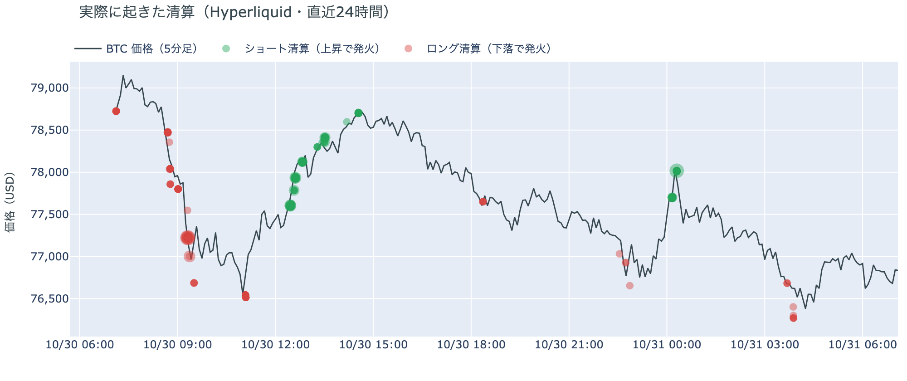

*図の見方: 5分ごとの価格（日本時間）に、Hyperliquidで見えた清算を重ねたもの。赤がロング、緑がショートの清算で、点の大きさが量です。*

* 清算の6割はショートで、その大半は1つの口座が昼から深夜にかけて段階的に焼けたもの。
* 値動きの速い5分足（24時間の上位1割）に、清算の6割が入っていた。

朝の下げを加速させたのは多数の口座のロングの清算で、昼の戻りを押し上げたのは大口のショート1つの清算です。Hyperliquid（＝オンチェーンの先物取引所）で見える清算のうち、朝の分は9時20分の、この24時間でいちばん速く下げた5分足に集まっていて、この1本が朝の下げを加速させました。昼の12時台からは1つの口座のショートが$77,000台後半から$78,000台で何度にも分けて清算されていて、大口が1つ飛んだ形です。この清算が昼の戻りを押し広げました。

## 2. なぜ動いたか：きっかけと、需給のどこが動いたか

**図2-1 ビットコインと株・金・原油の相対推移（起点＝100）**

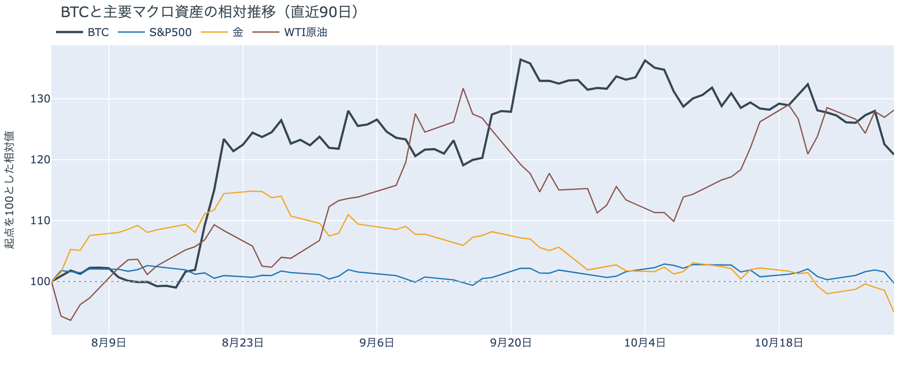

*図の見方: 同じ起点から何%動いたかで重ねたもの。線の向きが揃っているかを見ます。*

| この5営業日の動き（ビットコインは7日間） | 変化 |
|---|---:|
| ビットコイン | −5.4% |
| 金 | −3.1% |
| 米国株（S&P500） | −0.6% |
| 原油 | −0.3% |

* 建玉は95,919BTCで、前日の93,240BTCから2.9%増えた。
* 12月のFOMCでの利上げの織り込みは、10月30日の先物の終値で約8割。前日は約10割。

金曜日は、Binance のハッキングによる出金停止と米国のハイテク株安という2つの出来事の時間に、新しく積まれたショートとロングの清算を通って$76,000台へ下げました。

1. きっかけ：金融政策や物価の新しい出来事ではありません。12月のFOMC（＝米国の金利を決める会合）での利上げの織り込みは前日の約10割から約8割へ下がり、米10年債利回りも1日を通して4.9%台で動いていないので、金利の見通しが下げを押したのではありません。朝の下げは、世界最大の暗号資産取引所 Binance が、前日未明の不審な資金の流出を約63億ドル規模のハッキングと認め、出金を止めたと伝わった時間に重なります（米国の報道は日本時間7時半ごろ）。盗まれた資産には約1万8,000BTCが含まれますが、そのビットコインは19のアドレスに分けられたあと、日本時間13時過ぎの時点でどこにも送られていないので、朝の下げは盗まれたビットコインが売られた下げではありません。夕方からの下げは、Intel が決算で3割近く下げ、ナスダックが3%近く下げた米国の取引時間をまたいでいて、ビットコインは株・金と同じ向きに下げました。
2. 伝わり方：速い側の先物が運びました。建玉は1日で増えていて、価格が下がる中で増えたのはショートです。朝の下げはそこへロングの清算が重なって加速しています。遅い側では、アメリカの取引所の買い手がもう一段引きました（図①-1）。ETFの買い手は10月29日まで売りに回っておらず（図①-2）、長期保有者は下げの前からの利益確定の売りを続けていて（図②-1）、どちらも下げを受け止める側にはいません。下げはアメリカの取引所の買い手まで届きましたが、ETFと長期保有者の持ち方を変えたところまでは届いていません。

## 3. 市場参加者はいまどう見ているか

### ① アメリカの買い手は取引所でさらに引き、ETFの買いもほぼ止まった

**図①-1 Coinbase Premium（アメリカとそれ以外の価格差・直近90日）**

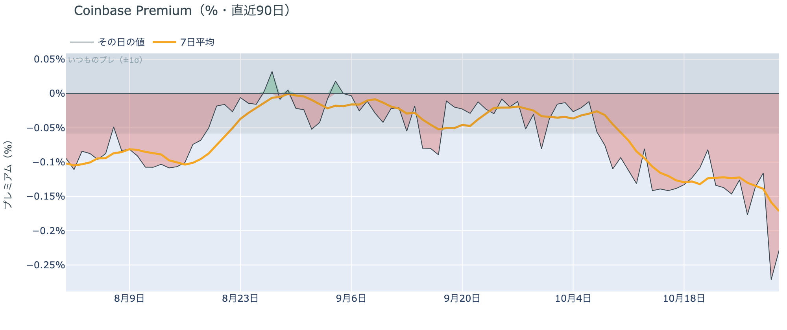

*図の見方: プラス＝アメリカで買いが強い。太線が1週間平均、細線がその日の値。薄い帯は「いつものブレの範囲」です。*

* 1週間平均は−0.17%で、前の週の1週間平均−0.12%より深い。
* 金曜のその日の値は−0.23%で、いつものブレの約4倍。

アメリカの買い手は、$70,000台への下げを買いの機会とは見ておらず、取引所では引き方を強めています。Coinbase Premium（＝アメリカとそれ以外の価格差）は1週間平均で前の週より深く沈み、木曜と金曜のその日の値は、今年に入って最も深い2日です。前日は「下げがアメリカの買い手まで届いていたなら、Coinbase Premium の1週間平均がもう一段沈む」と書きました。今朝はその形が出ているので、金曜未明からの下げは、アメリカの取引所の買い手まで届いていたと説明し直します。

**図①-2 ETFの日ごとの資金の出入り（直近90日）**

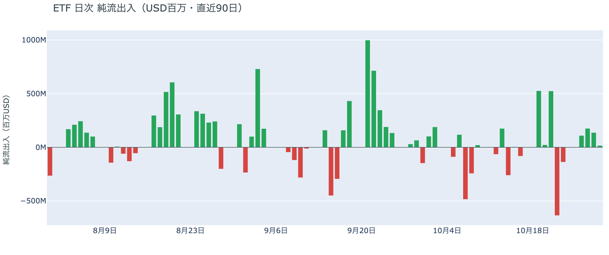

*図の見方: 入ったお金と出たお金の差。上に伸びれば入り超、下に伸びれば出超。*

| ETFの日ごとの出入り | 億ドル |
|---|---:|
| 10月23日 | −1.4 |
| 10月26日 | +1.1 |
| 10月27日 | +1.8 |
| 10月28日 | +1.4 |
| 10月29日 | +0.2 |
| 直近7営業日の合計 | +1.9 |

ETFの買い手は売りには回っていませんが、買う勢いは失っています。入り超は10月29日まで4営業日続いたものの、木曜の29日はほぼゼロまで縮みました。29日は金曜未明の下げの直前の取引日で、ETFの買い手は下げの前から、もう買い増しを急いでいませんでした。

**図①-3 Fear & Greed（市場心理の指数・直近90日）**

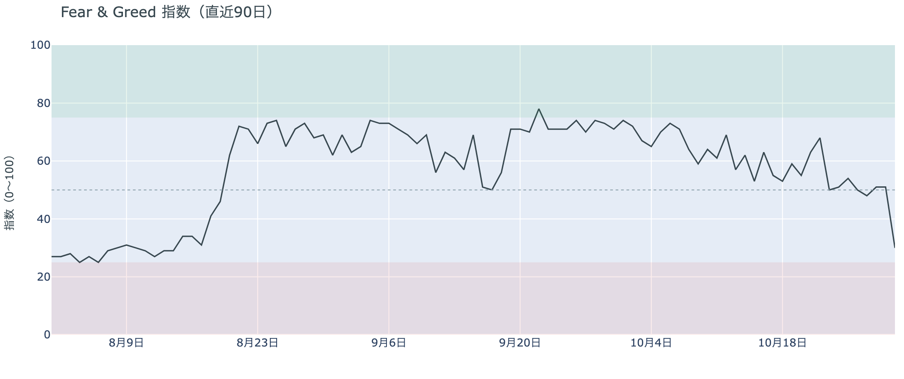

*図の見方: 0〜100で、50より上が「強欲」、下が「恐怖」。*

* 30の「恐怖」。前日の51から21pt下げた。1週間前は50、1か月前は71。

下げを怖がる人が、1日で一気に増えました。Fear & Greed（＝市場心理の指数）は前日まで「中立」の真ん中にいましたが、直近90日でいちばん大きな1日の下げで「恐怖」に入りました。前日の未明の下げのあとも冷めていなかった市場心理が、Binance の出金停止と$76,000台への下げで、守りの側へ傾いています。

### ② 長期保有者の利益確定の売りは続き、減り方はさらに広がった

**図②-1 長期保有者の保有量の30日変化とSOPR（直近90日）**

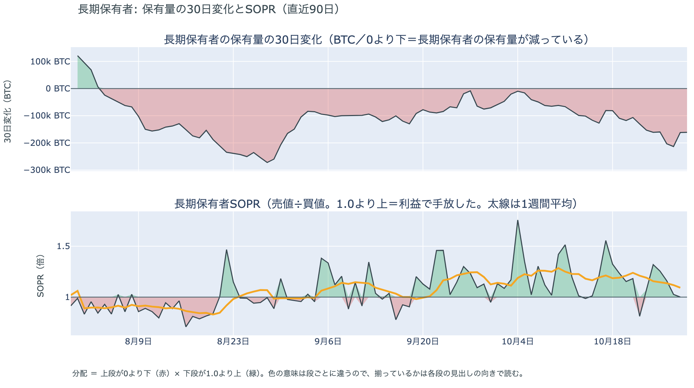

*図の見方: 上段は、長期保有者の保有量が30日でどれだけ増減したか。マイナス＝手放している。下段は長期保有者SOPRで、1より上なら利益で手放した。どちらも太線の1週間平均で読みます。*

| 10月28〜29日時点 | 1週間平均 | 前の週の平均 |
|---|---:|---:|
| 長期保有者SOPR（1より上＝利益で手放した） | 1.09 | 1.24 |
| 長期保有者の保有量の30日変化（万BTC） | −17.3 | −10.8 |

* 1か月前（9月29日）の30日変化は−7.5万BTCで、減り方は1か月で2倍余りに広がった。

長期保有者は利益確定の売りを続けていて、減り方は前の週よりさらに広がりました。保有量は30日で減り、動いたコインは平均して買値より高く動いています。10月29日は価格が$77,000台へ下げた日で、その水準でも売りが細っていないので、長期保有者は$70,000台後半を、売りを止める水準とは見ていません。向きは前日と同じで、長期保有者の持ち方が変わった日ではありません。

長期保有者のほかに、売りに回りそうな持ち手は見当たりません。長く眠っていたコインが急に動いた記録はなく、マイナーの収入は平年をやや上回る程度（Puell Multiple（＝マイナー収入の平年比）が1週間平均で1.11）で、売りを急ぐ状況ではありません。

### ③ 先物：下げの中でショートが積まれ、ロングの上げへの確信は弱まった

**図③-1 資金調達率と建玉（直近30日）**

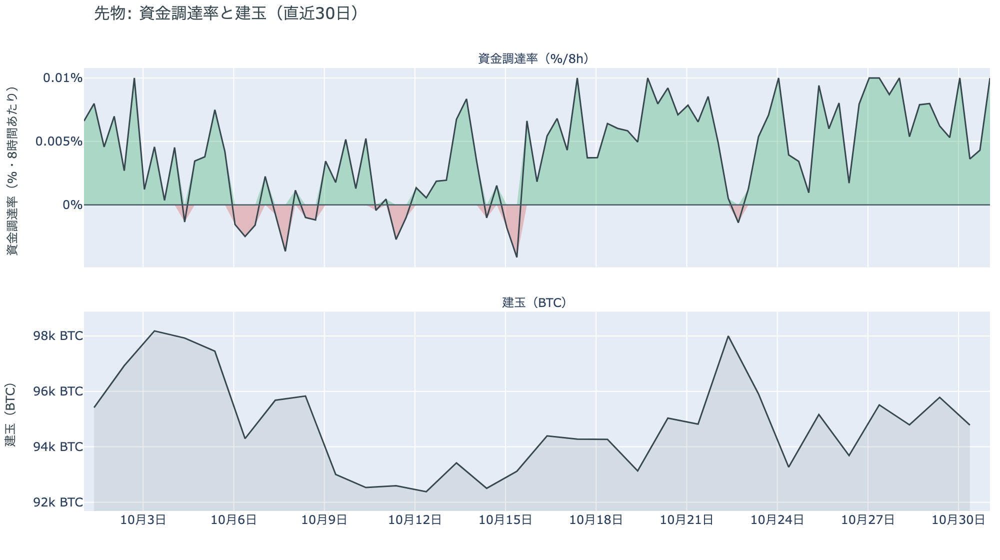

*図の見方: 上段は資金調達率（8時間ごと・日本時間）。プラスが続く＝ロングがショートより多い。下段は建玉。*

* 1日をならした年率は+6.54%で、短期金利（13週Tビル 3.97%）を引いた上乗せは+2.57pt。
* 上乗せは前日の+3.86ptから縮んだが、直近34日の平均+0.36ptはまだ上回る。

先物の参加者は、下げが続くほうに賭ける人が増え、ロングの上げへの確信は弱まりました。建玉が増える中で価格が下がったので、この1日に新しく積まれたのはショートです。資金調達率（＝ロングが払う金利。プラス＝ロングがショートより多い）はプラスが25回（約8日）続き、残ったロングは短期金利（＝ドルを米国の短期国債で持つだけで受け取れる金利）より余分に払ってでも持ち続けています。ただ、その上乗せは1日で3分の1ほど縮んだので、余分に払ってでも上げに賭けたい人は減っています。ロングは下げを流れの変化とまでは見ていませんが、前日ほどの強気ではありません。

### ④ オプション：目の前の上乗せは剥がれ、備えは中間選挙をまたぐ満期とプットに残る

オプションには2種類あります。コール（＝決めた価格で買う権利）とプット（＝決めた価格で売る権利）で、価格が上がればコールの価値が上がり、価格が下がればプットの価値が上がります。プットは「価格が下がったときの保険」として買われます。オプションを買う人は、その権利と引き換えに権利料（＝オプションを買う人が払う金額）を払います。

**図④-1 満期ごとのIV（年率%）**

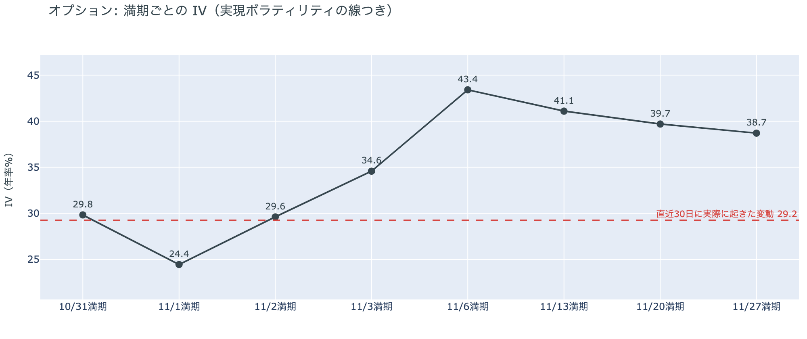

*図の見方: IVを満期ごとに並べたもの。点線は実現ボラティリティ。IVが点線より下なら、市場はこの先の値動きを過去の値動きより小さいと見ています。*

| 満期 | IV |
|---|---:|
| 10月31日 | 30 |
| 11月1日〜11月2日 | 24〜30 |
| 11月3日 | 35 |
| 11月6日 | 43 |
| 11月13日〜11月27日 | 39〜41 |

* IVは全体で42.0で、実現ボラティリティ29.2より12.7pt高い。過去1年では下から48%。

参加者はこの先の値動きをこれまでより大きいと見ていて、いちばん大きく動くと見ているのは米国の中間選挙の直後です。IV（＝値動きの幅の予想）は全体で実現ボラティリティ（＝過去の値動きの幅）より高く、これから先の値動きを、これまでの値動きより大きいと見ています。ただ、過去1年ではちょうど真ん中で、怖がっているとまでは言えません。週末に満期が来るオプションのIVは低く、前日に目の前の満期へ乗っていた上乗せは剥がれました。例外は11月6日に満期が来るオプションの権利料で、ほかの満期に対して上乗せが乗っています。11月3日の中間選挙のあとで最初に来る満期で、選挙の結果で大きく動くと見られているからです。

**図④-2 満期ごとのプットとコールの差**

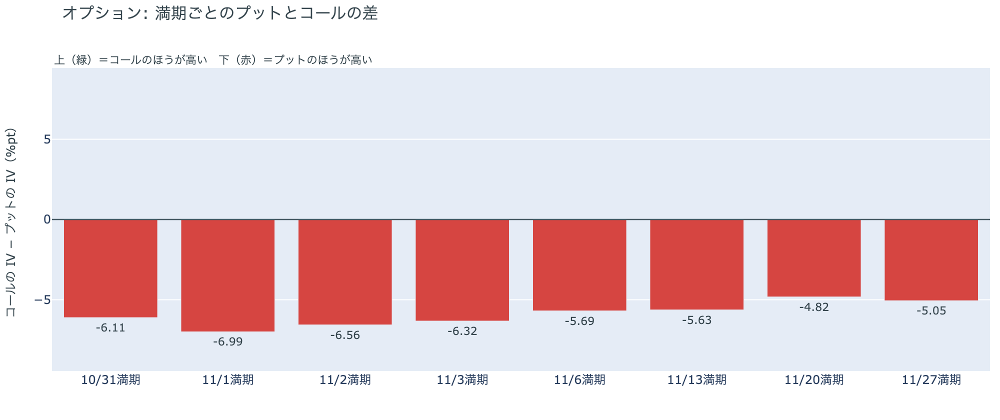

*図の見方: 満期ごとに、プットとコールのどちらが高く売れているか。ゼロより上ならコールのほうが高く、下ならプットのほうが高い。*

| 満期 | どちらが高いか |
|---|---|
| 10月31日 | プットがはっきり高い |
| 11月1日 | プットがはっきり高い |
| 11月2日 | プットがはっきり高い |
| 11月3日 | プットがはっきり高い |
| 11月6日 | プットが高い |
| 11月13日 | プットが高い |
| 11月20日 | プットが高い |
| 11月27日 | プットが高い |

参加者は、価格がもう一段下げた今朝も、下げへの備えを手放していません。すべての満期でプットのほうが高く、プットの高さは手前の満期ほど少し大きくなっています。前日の下げのあとに買われた下げへの備えが、そのまま目の前から11月末まで残っているということで、下げが続くことへの身構えは解けていません。

**図④-3 12月25日満期の持ち高（権利の価格ごと）**

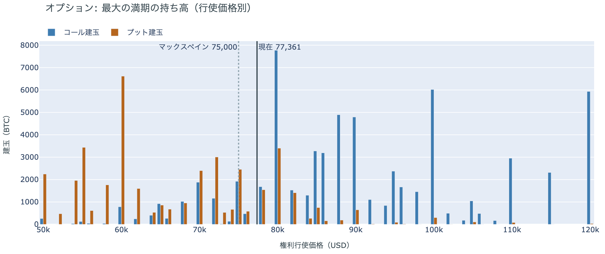

*図の見方: 青＝コール、橙＝プット。現値より上にコールが、下にプットが積まれるのが普通です。*

| 12月25日満期のオプション（価格は約$77,400） | 量（万BTC） | 意味 |
|---|---:|---|
| いまより高い価格のコール | 約7.2 | 「価格が上がる」に賭けた分 |
| いまより安い価格のプット | 約4.5 | 「価格が下がる」への保険 |
| うち、いまより15%以上高い価格のコール | 約4.8 | 大きな上げへの賭け |
| うち、いまより15%以上安い価格のプット | 約3.4 | 大きな下げへの保険 |

* 12月25日満期の持ち高は約13.6万BTCと全満期の45%で、コールがプットの1.5倍。

年末の最大の満期では、「価格が上がる」に賭けた人たちは降りていません。いまより高い価格のコールの3分の2は15%以上高い価格に積まれていて、その賭けが報われるには、12月25日の夕方5時までに約$89,000を超える必要があります。全満期でオプションの持ち高が集まっているのは$75,000〜$80,000の帯で、価格はいまその帯の中にいます。参加者は、目先の下げには備えを残しながらも、年末に向けた上げへの賭けは手放していません。

## 4. 価格に影響しうる直近のイベント

オプション市場が値動きの幅をいちばん大きく見込んでいるのは11月6日の満期で、11月3日の米国の中間選挙をまたぐ最初の満期に当たります。米10月雇用統計は同じ11月6日の夜に出るので、11月6日の満期のあとになります。12月のFOMCでの利上げは、10月30日の先物の終値で約8割織り込まれています。

| 日付 | イベント | 何に効くか |
|---|---|---|
| 11/1（日）まで | Binance の出金の再開（共同CEOは「48時間以内」とした） | ビットコイン |
| 11/1（日） | OPEC+の会合。12月の生産量を決める | 原油 |
| 11/3（火） | 米国の中間選挙。結果は日本時間4日以降 | 株・金利。11月6日満期のIVがいちばん高い |
| 11/6（金）22:30 日本時間 | 米10月雇用統計 | 金利 |
| 12/9（水） | FOMC。利上げの織り込みは約8割。結果は日本時間10日早朝 | 金利 |
| 12/25（金）17:00 | オプションの最も大きな満期（約13.6万BTC、全満期の45%） | 約$89,000以上のコールの期限 |

## まとめ

金曜日は、Binance の出金停止が伝わった朝と、米国のハイテク株と金が売られた夜に、新しく積まれたショートとロングの清算を通って、ビットコインは$76,000台へ下げました。下げはアメリカの取引所の買い手がもう一段引くところまで届きましたが、ETFの買い手と長期保有者の持ち方を変えたところまでは届いておらず、長期保有者は下げの前からの利益確定の売りを続けています。参加者は、流れが変わったとまでは見ておらずロングも年末のコールも手放していませんが、下げが続くことへの備えはすべての満期に残し、次に大きく動く材料を11月3日の中間選挙と見ています。

---

<small>（数値は10月31日7時5分（日本時間）までのデータに基づきます。価格・先物・オプションはその時点の値、市場心理は10月30日の確定値、オンチェーン（＝ブロックチェーン上の記録）は10月28〜29日時点、ETF資金フローは10月29日分までです。証券市場の終値は10月30日時点です。オンチェーンの長期保有者の数値には、ETFや取引所が預かっている分も含まれます。オプションはDeribit（BTCオプションの大半を占める取引所）の全銘柄です。）</small>

*本稿は情報提供を目的としたものであり、投資助言ではありません。将来の価格動向を保証・示唆するものではなく、投資判断は各自の責任において行ってください。*
