# $77,000台で足踏みの土曜日 ― 先物はロングを積み増し、ETFは8月以降で最大の流出

**2026年11月1日**

ビットコインは土曜日、証券市場が閉まった24時間を$77,000台で小さく上下し、24時間前より1%ほど高い水準で朝を迎えました。

* **価格**：24時間の値幅は1.2%と、前日の3.6%から大きく狭まり、この1週間でいちばん静かな24時間でした。朝7時5分の時点で約$77,600です
* **きっかけ**：新しいきっかけはありませんでした。証券市場は週末で閉まっていて、Binance の出金停止にも値動きを変える続報は出ていません
* **先物**：小さな戻りの中で買い持ち（ロング）が新しく積まれ、ロングが余分に払う金利はこの1か月でいちばん高くなりました。先物の参加者は、金曜の下げを一時的な押しと見て上げに賭け直しています
* **需給の土台**：戻りは現物の側には届いていません。米国の取引所はほかの取引所より安いまま沈み方を深め、遅れて出た10月30日分では ETF も8月以降で最大の流出でした。長期保有者（＝155日以上保有者）の利益確定の売りも広がっていて（10月30日時点）、米国の買い手と長期保有者はそろって売りの側にいます
* **オプションの見方**：すべての満期でプットが高いままで、下げへの備えは崩していません。値動きの幅をいちばん大きく見込み、下げへの備えもいちばん厚いのは、米国の中間選挙の結果が出る11月4日の満期です

## 1. 何が起きたか

**図1-1 価格の推移（1時間足・直近7日）**

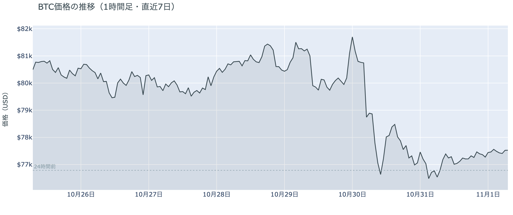

*図の見方: 1時間ごとの価格（日本時間）。点線は24時間前の水準です。金曜までの下げのあと、土曜は点線のすぐ上でほぼ平らに推移しています。*

* 24時間の値幅は1.2%で、前日の3.6%の3分の1。
* Hyperliquid で見えた清算は2件で、どちらもショート。ほぼ全部が1つの口座。

土曜日は、金曜までの下げが止まり、$77,000台で小さく戻しただけの1日でした。深夜0時から2時台には、価格が上がる一方で建玉（＝先物の未決済残高。証拠金で張っている人の量）が増えていて、戻りの中で新しくロングを積む人が出ています。朝6時台の小さな上げは、建玉が減っていたので、売り持ち（ショート）の買い戻しです。清算（＝証拠金不足で強制的に閉じられた取引）は、Hyperliquid（＝オンチェーンの先物取引所）で朝9時台に大口のショートが1つ飛んだだけで、値動きを押し広げるほどの量は出ていません。

**図1-2 価格と50日・200日移動平均**

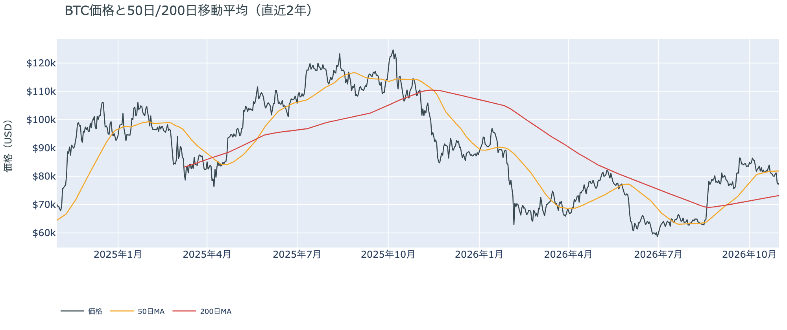

*図の見方: 2本の平均線の上下関係を見ます。50日線が200日線の上にあるのがゴールデンクロスです。*

* 50日線と200日線の差は約$8,800（12.0%）で、前日とほぼ同じ。
* 朝7時5分の価格は50日線を5.2%下回り、前日の6.3%から少し縮んだ。

長い目で見た流れの向きは変わっていません。ゴールデンクロス（＝50日線が200日線を上抜けること）の状態が54日目で、2本の平均線の差も開いたままです。短い目で見た弱さも、前日から深まってはいません。価格は50日線の下にいますが、土曜日の戻りで、離れ方はわずかに縮みました。

証券市場は週末で休みです。金曜10月30日は米国株（S&P500）が−1.8%、金が−3.3%と、株と金がそろって下げて終わっていて、外部環境から週末へ持ち越された材料は売りの側のままです。それでも土曜日のビットコインはその売りを引き継がず、下げを止めています。

## 2. なぜ動いたか：きっかけと、需給のどこが動いたか

**図2-1 ビットコインと株・金・原油の相対推移（起点＝100）**

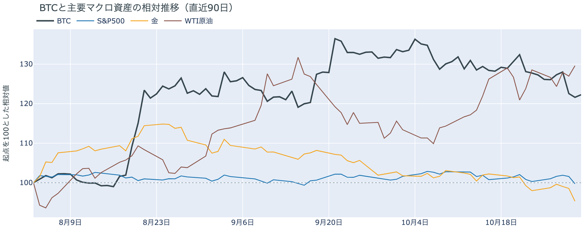

*図の見方: 同じ起点から何%動いたかで重ねたもの。線の向きが揃っているかを見ます。*

| この5営業日の動き（ビットコインは7日間） | 変化 |
|---|---:|
| ビットコイン | −3.9% |
| 金 | −2.7% |
| 米国株（S&P500） | −0.6% |
| 原油 | +0.8% |

* 建玉は97,099BTCで、前日の95,919BTCから1.2%増えた。
* 12月のFOMCでの利上げの織り込みは、10月30日の先物の終値で約8割。1週間前と同じ。

土曜日は、新しいきっかけが無いまま、先物で新しく積まれたロングに運ばれて、$77,000台でわずかに戻しました。

1. きっかけ：外部環境にも、ビットコインに固有の出来事にも、新しいきっかけはありません。証券市場は週末で閉まっていて、12月のFOMC（＝米国の金利を決める会合）の織り込みも1週間前と変わっていないので、金利の見通しが動いた日でもありません。金曜の朝の下げと重なった Binance のハッキングでは、土曜日も続報が出ました。出金はまだ止まったままで、Binance は日曜までの再開を目指しています。盗まれた資産のうち約30億ドルは凍結されたか所在が分かっていますが、攻撃者の手元には約1万8,000BTCが残っています。ただ、土曜日のビットコインはどの続報の時間にも0.3%を超えて動いていないので、今日の値動きに効いた形跡はありません。
2. 伝わり方：速い側の先物が運びました。価格が上がる中で建玉が増え、ロングが払う金利も上がったので、この小さな戻りを支えたのは、新しく積まれたロングです。遅い側はその逆を向いています。アメリカの取引所の買い手は1週間平均で引き方を強め（図①-1）、ETF の買い手は10月30日に大きく売りに回り（図①-2）、長期保有者は利益確定の売りを広げています（図②-1）。戻りは、アメリカの買い手と長期保有者までは届いていません。

## 3. 市場参加者はいまどう見ているか

### ① アメリカの買い手は、取引所でも ETF でも引いている

**図①-1 Coinbase Premium（アメリカとそれ以外の価格差・直近90日）**

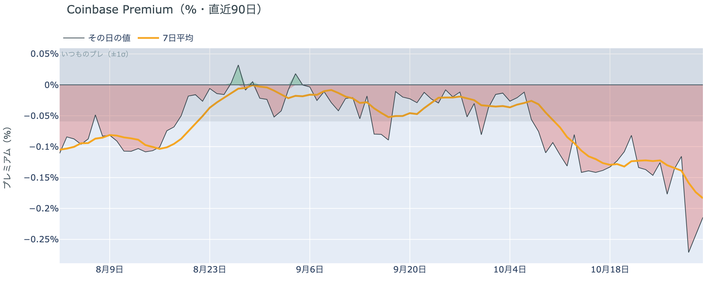

*図の見方: プラス＝アメリカで買いが強い。太線が1週間平均、細線がその日の値。薄い帯は「いつものブレの範囲」です。*

* 1週間平均は−0.18%で、前の週の1週間平均−0.12%より深い。
* 土曜のその日の値は−0.21%で、いつものブレの約3.6倍。

アメリカの買い手は、土曜日の戻りにも乗っていません。Coinbase Premium（＝アメリカとそれ以外の価格差）の1週間平均は前の週よりさらに沈み、土曜のその日の値も、いつものブレを大きく超えたマイナスのままです。先物でロングを積み増す人が出た一方で、アメリカの取引所では現物を買い戻す人が戻っていないので、アメリカの買い手は$77,000台を買いの機会とは見ていません。

**図①-2 ETFの日ごとの資金の出入り（直近90日）**

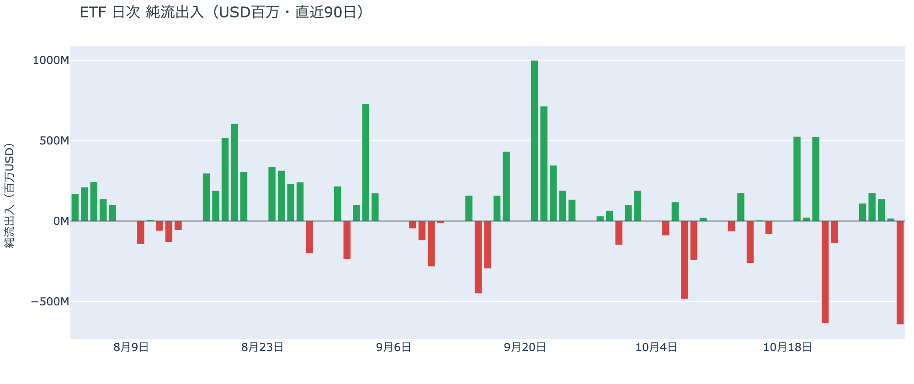

*図の見方: 入ったお金と出たお金の差。上に伸びれば入り超、下に伸びれば出超。*

| ETFの日ごとの出入り | 億ドル |
|---|---:|
| 10月26日 | +1.1 |
| 10月27日 | +1.8 |
| 10月28日 | +1.4 |
| 10月29日 | +0.2 |
| 10月30日 | −6.4 |
| 直近7営業日の合計 | −9.8 |

* 10月30日は IBIT・FBTC・ARKB など5本のファンドがそろって流出した。

ETF の買い手は、金曜の下げで売りに回りました。10月30日の流出は8月以降でいちばん大きく、それまで4営業日続いた入り超を1日で打ち消して、1週間の合計も出超に変わっています。1本のファンドの事情ではなく、主なファンドがそろって流出しているので、ETF の買い手全体が引いた日です。前日は、金曜の下げは「ETF の買い手の持ち方を変えたところまでは届いていない」と説明しました。遅れて出た10月30日の分がこの流出だったので、金曜の下げは ETF の買い手まで届いていたと説明し直します。

**図①-3 Fear & Greed（市場心理の指数・直近90日）**

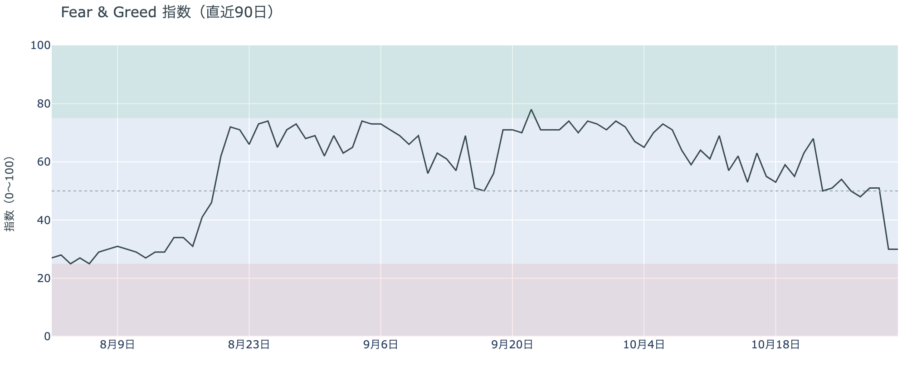

*図の見方: 0〜100で、50より上が「強欲」、下が「恐怖」。*

* 30の「恐怖」。前日と同じで、1週間前は51、1か月前は74。

市場心理は、金曜の下げで「恐怖」に入ったまま戻っていません。Fear & Greed（＝市場心理の指数）は土曜日に動かず、価格が下げ止まっても、下げを怖がる人は減っていません。1か月前の「強欲」から、守りの側へ傾いたままです。

### ② 長期保有者は、$70,000台でも利益確定の売りを広げている

**図②-1 長期保有者の保有量の30日変化とSOPR（直近90日）**

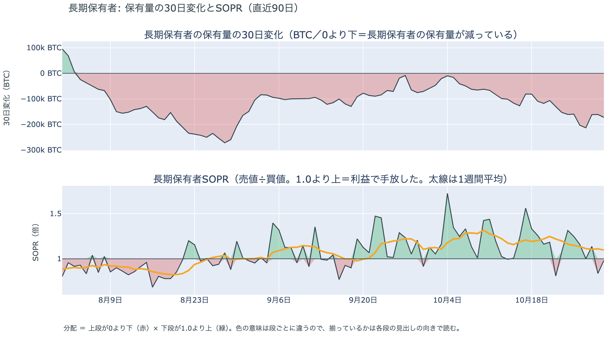

*図の見方: 上段は、長期保有者の保有量が30日でどれだけ増減したか。マイナス＝手放している。下段は長期保有者SOPRで、1より上なら利益で手放した。どちらも太線の1週間平均で読みます。*

| 10月30日時点 | 1週間平均 | 前の週の平均 |
|---|---:|---:|
| 長期保有者SOPR（1より上＝利益で手放した） | 1.10 | 1.20 |
| 長期保有者の保有量の30日変化（万BTC） | −17.6 | −11.1 |

* 1か月前（9月30日）の30日変化は−7.1万BTCで、減り方は1か月で2.5倍に広がった。

長期保有者は利益確定の売りを続けていて、減り方は前の週よりさらに広がりました。保有量は30日で減り、動いたコインは平均して買値より高く動いています。10月30日はビットコインが$77,000台へ下げた日で、その水準でも売りが細っていないので、長期保有者は$70,000台を、売りを止める水準とは見ていません。向きは前日と同じで、長期保有者の持ち方が変わった日ではありません。

長期保有者のほかに、売りに回りそうな持ち手は見当たりません。長く眠っていたコインが急に動いた記録はなく、マイナーの収入は平年をやや上回る程度（Puell Multiple（＝マイナー収入の平年比）が10月24日時点の1週間平均で1.13）で、売りを急ぐ状況ではありません。

### ③ 先物：ロングは下げを一時的な押しと見て積み増している

**図③-1 資金調達率と建玉（直近30日）**

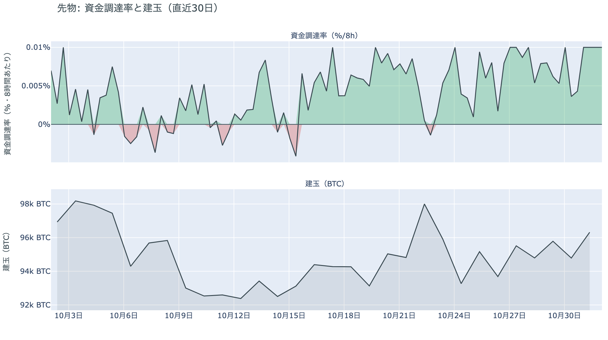

*図の見方: 上段は資金調達率（8時間ごと・日本時間）。プラスが続く＝ロングがショートより多い。下段は建玉。*

* 1日をならした年率は+10.95%で、短期金利（13週Tビル 3.97%）を引いた上乗せは+6.98pt。
* 上乗せは直近34日でいちばん大きく、34日の平均+0.80ptを大きく上回る。

先物の参加者は、金曜の下げを流れの変化ではなく一時的な押しと見て、上げに賭け直しています。建玉が増える中で価格が上がったので、この1日に新しく積まれたのはロングです。資金調達率（＝ロングが払う金利。プラス＝ロングがショートより多い）はプラスが28回（約9日）続いていて、ロングが短期金利（＝ドルを米国の短期国債で持つだけで受け取れる金利）より余分に払う額は、前日の3分の1ほど縮んだところから一転して、この1か月でいちばん大きくなりました。余分に払ってでも上げに賭けたい人が、下げのあとで増えたということです。前日に弱まった上げへの確信は、先物の側では戻っています。

### ④ オプション：下げへの備えは崩さず、いちばん身構えているのは中間選挙の直後

オプションには2種類あります。コール（＝決めた価格で買う権利）とプット（＝決めた価格で売る権利）で、価格が上がればコールの価値が上がり、価格が下がればプットの価値が上がります。プットは「価格が下がったときの保険」として買われます。オプションを買う人は、その権利と引き換えに権利料（＝オプションを買う人が払う金額）を払います。

**図④-1 満期ごとのIV（年率%）**

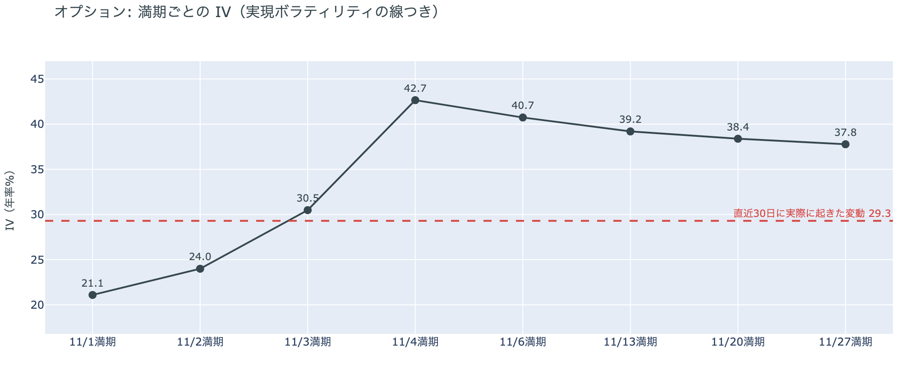

*図の見方: IVを満期ごとに並べたもの。点線は実現ボラティリティ。IVが点線より下なら、市場はこの先の値動きを過去の値動きより小さいと見ています。*

| 満期 | IV |
|---|---:|
| 11月1日 | 21 |
| 11月2日 | 24 |
| 11月3日 | 31 |
| 11月4日 | 43 |
| 11月6日 | 41 |
| 11月13日〜11月27日 | 38〜39 |

* IVは全体で40.6で、実現ボラティリティ29.3より11.3pt高い。過去1年では下から43%。

参加者はこの先の値動きをこれまでより大きいと見ていて、いちばん大きく動くと見ているのは米国の中間選挙の結果が出た直後です。IV（＝値動きの幅の予想）は全体で実現ボラティリティ（＝過去の値動きの幅）より高く、これから先の値動きを、これまでの値動きより大きいと見ています。ただ、過去1年では真ん中より少し下で、怖がっているとまでは言えません。週末から11月3日までに満期が来るオプションの IV は低く、選挙の前に大きく動くとは見られていません。例外は11月4日と11月6日に満期が来るオプションの権利料で、11月13日以降の満期に対して上乗せが乗っています。11月3日の中間選挙の結果が出たあとで最初に来る満期で、選挙の結果で大きく動くと見られているからです。

**図④-2 満期ごとのプットとコールの差**

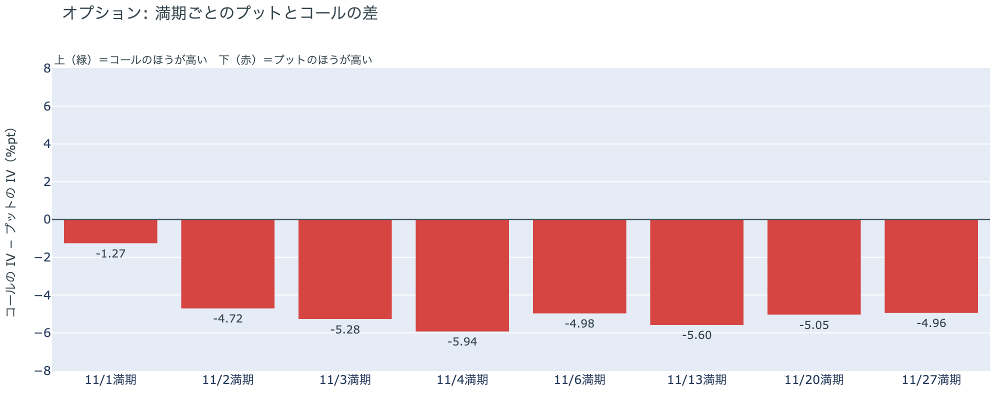

*図の見方: 満期ごとに、プットとコールのどちらが高く売れているか。ゼロより上ならコールのほうが高く、下ならプットのほうが高い。*

| 満期 | どちらが高いか |
|---|---|
| 11月1日 | プットがやや高い |
| 11月2日 | プットがはっきり高い |
| 11月3日 | プットがはっきり高い |
| 11月4日 | プットがいちばん高い |
| 11月6日 | プットがはっきり高い |
| 11月13日 | プットがはっきり高い |
| 11月20日 | プットがはっきり高い |
| 11月27日 | プットがはっきり高い |

参加者は、先物でロングが積み増された土曜日も、下げへの備えを手放していません。すべての満期でプットのほうが高く、いちばん高いのは中間選挙の結果が出る11月4日の満期です。選挙で大きく動くなら、上げよりも下げのほうに身構えているということです。

**図④-3 12月25日満期の持ち高（権利の価格ごと）**

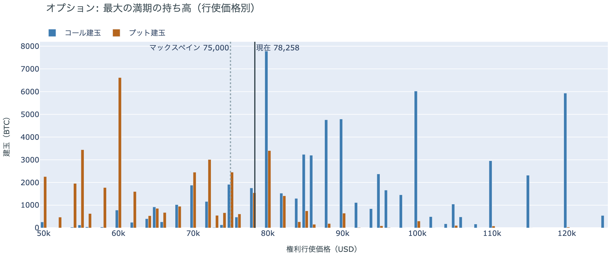

*図の見方: 青＝コール、橙＝プット。現値より上にコールが、下にプットが積まれるのが普通です。*

| 12月25日満期のオプション（価格は約$78,300） | 量（万BTC） | 意味 |
|---|---:|---|
| いまより高い価格のコール | 約7.0 | 「価格が上がる」に賭けた分 |
| いまより安い価格のプット | 約4.6 | 「価格が下がる」への保険 |
| うち、いまより15%以上高い価格のコール | 約4.8 | 大きな上げへの賭け |
| うち、いまより15%以上安い価格のプット | 約3.4 | 大きな下げへの保険 |

* 12月25日満期の持ち高は約13.6万BTCと全満期の45%で、コールがプットの1.5倍。前日とほぼ同じ形。

年末の最大の満期でも、「価格が上がる」に賭けた人たちは降りていません。いまより高い価格のコールの7割近くは15%以上高い価格に積まれていて、その賭けが報われるには、12月25日の夕方5時までに約$90,000を超える必要があります。全満期でオプションの持ち高が集まっているのは$78,000〜$82,000の帯で、価格はいまその帯の下の端にいます。参加者は、目先の下げには備えを残しながらも、年末に向けた上げへの賭けは手放していません。

## 4. 価格に影響しうる直近のイベント

オプション市場が値動きの幅をいちばん大きく見込み、下げへの備えもいちばん厚く置いているのは11月4日の満期で、11月3日の米国の中間選挙の結果が出たあとの最初の満期に当たります。11月6日の満期も同じく選挙をまたぎ、米10月雇用統計はその満期のあとの夜に出ます。12月のFOMCでの利上げは、10月30日の先物の終値で約8割織り込まれています。

| 日付 | イベント | 何に効くか |
|---|---|---|
| 11/1（日） | Binance の出金の再開（Binance は日曜までの再開を目指す） | ビットコイン |
| 11/1（日） | OPEC+の7か国の会合。12月の生産量を決める | 原油 |
| 11/3（火） | 米国の中間選挙。結果は日本時間4日以降 | 株・金利。11月4日満期の IV とプットの高さがいちばん大きい |
| 11/6（金）22:30 日本時間 | 米10月雇用統計 | 金利 |
| 12/9（水） | FOMC。利上げの織り込みは約8割。結果は日本時間10日早朝 | 金利 |
| 12/25（金）17:00 | オプションの最も大きな満期（約13.6万BTC、全満期の45%） | 約$90,000以上のコールの期限 |

## まとめ

土曜日は、新しいきっかけが無いまま、先物で新しく積まれたロングに運ばれて、ビットコインは$77,000台でわずかに戻しました。戻りはアメリカの買い手と長期保有者までは届いておらず、遅れて出た10月30日の分では、ETF の買い手も金曜の下げで売りに回っていました。金曜の下げは、アメリカの買い手の持ち方が取引所だけでなく ETF まで変わった下げで、長期保有者も利益確定の売りを広げています。参加者は、下げを一時的な押しと見てロングを積み増しながらも、下げへの備えは崩しておらず、次に大きく動く材料を11月3日の中間選挙と見ています。

---

<small>（数値は11月1日7時7分（日本時間）までのデータに基づきます。価格・先物・オプションはその時点の値、市場心理は10月31日の確定値、オンチェーン（＝ブロックチェーン上の記録）は10月30日時点（マイナーの収入は10月24日時点）、ETF資金フローは10月30日分までです。証券市場の終値は10月30日時点で、週末のため更新がありません。オンチェーンの長期保有者の数値には、ETFや取引所が預かっている分も含まれます。オプションはDeribit（BTCオプションの大半を占める取引所）の全銘柄です。）</small>

*本稿は情報提供を目的としたものであり、投資助言ではありません。将来の価格動向を保証・示唆するものではなく、投資判断は各自の責任において行ってください。*
