# 値幅1%の日曜、Binanceの出金再開でも$77,000台 ― 昼に積まれたロングは未明に手仕舞われる

**2026年11月2日**

ビットコインは日曜日、Binance が出金を再開した24時間を$77,000台で小さく上下し、24時間前とほぼ同じ水準で朝を迎えました。

* **価格**：24時間の値幅は1.0%と、前日の1.2%よりさらに狭く、この1週間でいちばん静かな24時間でした。朝7時5分の時点で約$77,755です
* **きっかけ**：新しいきっかけはありませんでした。証券市場は週末で閉まっていて、Binance が出金を再開した時間の上げも0.5%ほどで、夜には戻しています
* **先物**：昼に新しく積まれた買い持ち（ロング）が、夜から未明にかけて手仕舞われました。ロングが余分に払う金利は高いままでも、賭けを増やす人はいなくなり、上げへの確信は前日より弱まりました
* **需給の土台**：米国の取引所はほかの取引所より安いままで、1週間平均では沈み方を深めています。長期保有者（＝155日以上保有者）の利益確定の売りも広がっていて（10月31日時点）、米国の買い手と長期保有者がそろって売りの側にいる形は、前日から変わっていません
* **オプションの見方**：すべての満期でプットが高いままで、下げへの備えは崩していません。値動きの幅をいちばん大きく見込んでいるのは中間選挙の結果が出る11月4日の満期で、下げへの備えは選挙の手前の満期まで厚くなっています

## 1. 何が起きたか

**図1-1 価格の推移（1時間足・直近7日）**

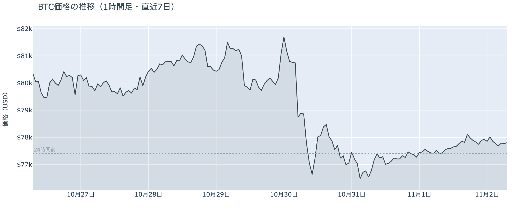

*図の見方: 1時間ごとの価格（日本時間）。点線は24時間前の水準です。金曜までの下げのあと、土曜・日曜は点線の近くでほぼ平らに推移しています。*

* 24時間の値幅は1.0%で、前日の1.2%からさらに狭まった。
* Hyperliquid で見えた清算は2件で、どちらもショート。ほぼ全部が1つの口座。

日曜日は、昼に積まれたロングが未明までに手仕舞われ、価格は$77,000台を行って戻っただけの1日でした。昼から夕方は、価格が上がる中で建玉（＝先物の未決済残高。証拠金で張っている人の量）が増えていて、上げの中で新しくロングを積む人が出ています。夜9時台と未明4時台は、価格が小さく下がる中で建玉が減っていて、昼に積まれたロングの手仕舞いです。清算（＝証拠金不足で強制的に閉じられた取引）は、Hyperliquid（＝オンチェーンの先物取引所）で15時台と17時台の上げの時間に大口の売り持ち（ショート）が1つ飛んだだけで、値動きを押し広げるほどの量は出ていません。

**図1-2 価格と50日・200日移動平均**

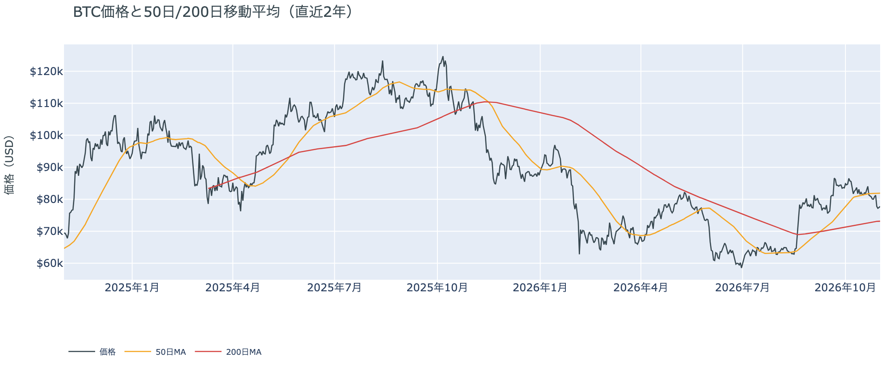

*図の見方: 2本の平均線の上下関係を見ます。50日線が200日線の上にあるのがゴールデンクロスです。*

* 50日線と200日線の差は約$8,760（12.0%）で、前日とほぼ同じ。
* 朝7時5分の価格は50日線を5.1%下回り、前日の5.2%とほぼ同じ。

長い目で見た流れの向きは変わっていません。ゴールデンクロス（＝50日線が200日線を上抜けること）の状態が55日目で、2本の平均線の差も開いたままです。価格は50日線の下にいますが、日曜日もその離れ方は広がっておらず、短い目で見た弱さは前日から深まっていません。

証券市場は週末で休みです。金曜10月30日は米国株（S&P500）が−1.8%、金が−3.3%と、株と金がそろって下げて終わっていて、外部環境から週明けへ持ち越された材料は売りの側のままです。それでも週末のビットコインはその売りを引き継がず、$77,000台にとどまりました。

## 2. なぜ動いたか：きっかけと、需給のどこが動いたか

**図2-1 ビットコインと株・金・原油の相対推移（起点＝100）**

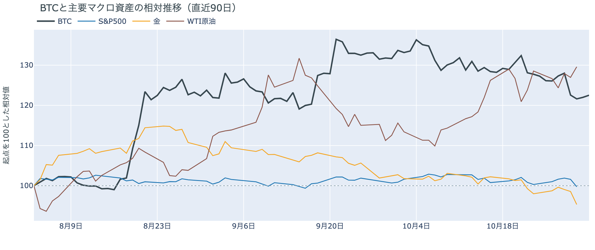

*図の見方: 同じ起点から何%動いたかで重ねたもの。線の向きが揃っているかを見ます。*

| この5営業日の動き（ビットコインは7日間） | 変化 |
|---|---:|
| ビットコイン | −2.9% |
| 金 | −2.7% |
| 米国株（S&P500） | −0.6% |
| 原油 | +0.8% |

* 建玉は95,914BTCで、前日の97,099BTCから1.2%減った。
* 12月のFOMCでの利上げの織り込みは、10月30日の先物の終値で約8割。1週間前と同じ。

日曜日は、新しいきっかけが無いまま、先物で昼に積まれたロングが夜から未明に手仕舞われ、$77,000台を行って戻りました。

1. きっかけ：外部環境にも、ビットコインに固有の出来事にも、値動きを変えたきっかけはありません。証券市場は週末で閉まっていて、12月のFOMC（＝米国の金利を決める会合）の織り込みも1週間前と変わっていないので、金利の見通しが動いた日でもありません。Binance は日曜日に、ハッキングのあと止めていた出金をビットコインから再開し、被害を受けた資産の約95%を自社で補ったと発表しました。再開が予定されていた日本時間15時から18時には価格が上がり建玉も増えましたが、上げは0.5%ほどで夜には戻しているので、24時間の値動きを変えてはいません。原油では、イランの海峡管理当局が、ホルムズ海峡から出る原油の約4割を運ぶ韓国の海運会社 Sinokor の船を、11月1日から締め出すと通告していました。日曜日のビットコインに効いた形跡はありません。
2. 伝わり方：速い側の先物が運びました。昼の上げは新しく積まれたロングが、夜から未明の小さな下げはそのロングの手仕舞いが運んでいて、24時間で見ると建玉は減り、価格はほぼ元の水準に戻っています。遅い側は売りの側を向いたままです。アメリカの取引所の買い手は1週間平均で引き方を強め（図①-1）、ETF の買い手は10月30日に大きく売りに回ったあと週末で新しい分が無く（図①-2）、長期保有者は利益確定の売りを広げています（図②-1）。日曜日の上げ下げは、アメリカの買い手と長期保有者までは届いていません。

## 3. 市場参加者はいまどう見ているか

### ① アメリカの買い手は引いたままで、売りを強めてはいない

**図①-1 Coinbase Premium（アメリカとそれ以外の価格差・直近90日）**

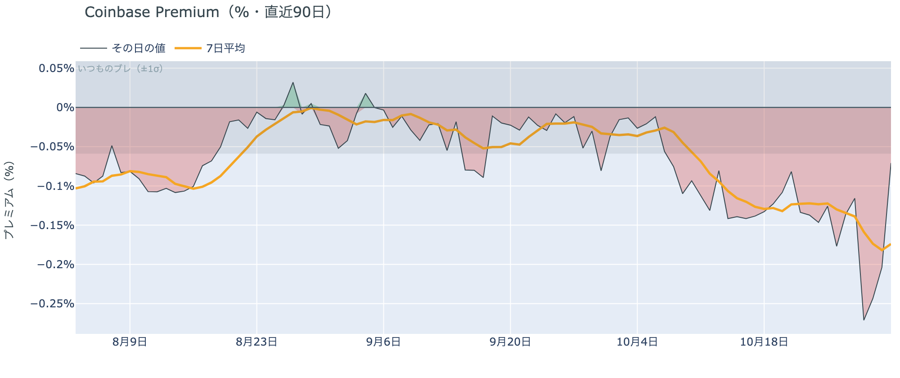

*図の見方: プラス＝アメリカで買いが強い。太線が1週間平均、細線がその日の値。薄い帯は「いつものブレの範囲」です。*

* 1週間平均は−0.17%で、前の週の1週間平均−0.12%より深い。
* 日曜のその日の値は−0.07%で、いつものブレの範囲内。前日は約3.6倍だった。

アメリカの買い手は、$77,000台をまだ買いの機会とは見ていません。Coinbase Premium（＝アメリカとそれ以外の価格差）の1週間平均は前の週よりさらに沈んでいて、アメリカの取引所で現物を買い戻す人は戻っていません。ただ、日曜のその日の値は、前日にいつものブレを大きく超えたマイナスから帯の内側まで戻ったので、引き方を一段と強めたわけでもありません。

**図①-2 ETFの日ごとの資金の出入り（直近90日）**

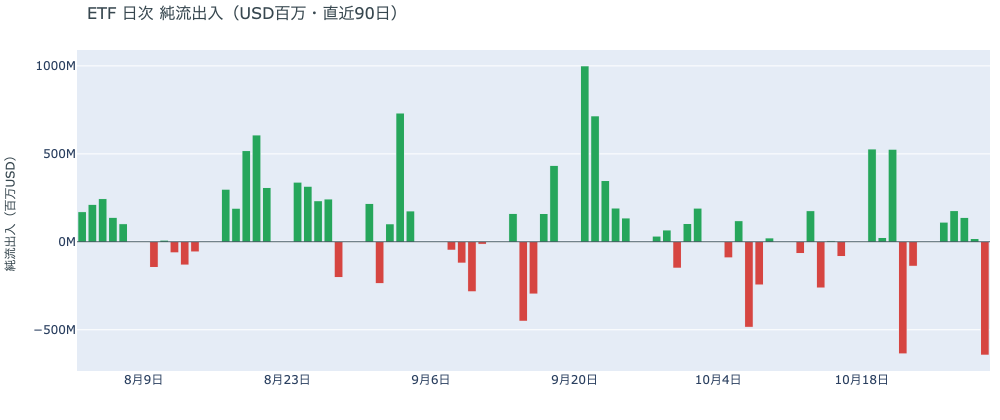

*図の見方: 入ったお金と出たお金の差。上に伸びれば入り超、下に伸びれば出超。*

| ETFの日ごとの出入り | 億ドル |
|---|---:|
| 10月26日 | +1.1 |
| 10月27日 | +1.8 |
| 10月28日 | +1.4 |
| 10月29日 | +0.2 |
| 10月30日 | −6.4 |
| 直近7営業日の合計 | −9.8 |

* 10月30日は IBIT・FBTC・ARKB など5本のファンドがそろって流出した。

ETF の買い手は、金曜の下げで売りに回ったところで週末に入りました。10月30日の流出は8月以降でいちばん大きく、それまで4営業日続いた入り超を1日で打ち消して、1週間の合計を出超に変えています。週末は取引が無く、その後に買い戻した分はまだ出ていないので、ETF の買い手の見方は売りの側のままです。

**図①-3 Fear & Greed（市場心理の指数・直近90日）**

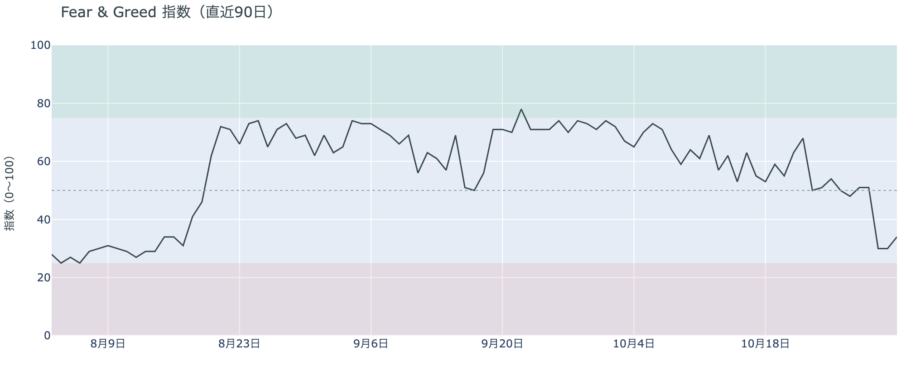

*図の見方: 0〜100で、50より上が「強欲」、下が「恐怖」。*

* 34の「恐怖」。前日の30から4pt戻した。1週間前は54、1か月前は72。

市場心理は「恐怖」に入ったままで、日曜日にわずかに戻しただけです。Fear & Greed（＝市場心理の指数）は1週間で「中立」から「恐怖」へ下がっていて、価格が下げ止まっても、下げを怖がる人はまだ多いままです。

### ② 長期保有者は、$70,000台でも利益確定の売りを広げている

**図②-1 長期保有者の保有量の30日変化とSOPR（直近90日）**

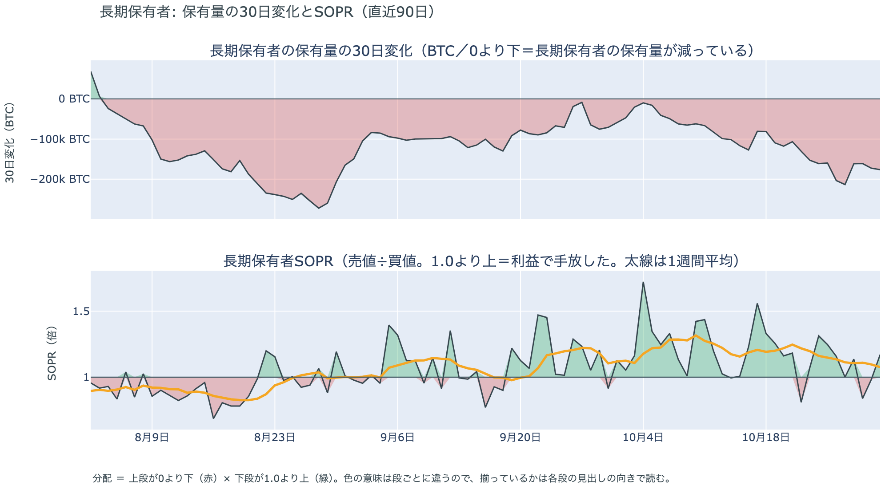

*図の見方: 上段は、長期保有者の保有量が30日でどれだけ増減したか。マイナス＝手放している。下段は長期保有者SOPRで、1より上なら利益で手放した。どちらも太線の1週間平均で読みます。*

| 10月31日時点 | 1週間平均 | 前の週の平均 |
|---|---:|---:|
| 長期保有者SOPR（1より上＝利益で手放した） | 1.08 | 1.16 |
| 長期保有者の保有量の30日変化（万BTC） | −17.8 | −12.3 |

* 1か月前（10月1日）の30日変化は−5.9万BTCで、減り方は1か月で約3倍に広がった。

長期保有者は利益確定の売りを続けていて、減り方は前の週よりさらに広がりました。保有量は30日で減り、動いたコインは平均して買値より高く動いています。ビットコインが$77,000台まで下げた週にも売りが細っていないので、長期保有者はこの水準を、売りを止める水準とは見ていません。向きは前日と同じで、長期保有者の持ち方が変わった日ではありません。

長期保有者のほかに、売りに回りそうな持ち手は見当たりません。長く眠っていたコインが急に動いた記録はなく、マイナーの収入は平年をやや上回る程度（Puell Multiple（＝マイナー収入の平年比）が10月25日時点の1週間平均で1.12）で、売りを急ぐ状況ではありません。

### ③ 先物：積み増されたロングの一部は降り、上げへの確信は弱まった

**図③-1 資金調達率と建玉（直近30日）**

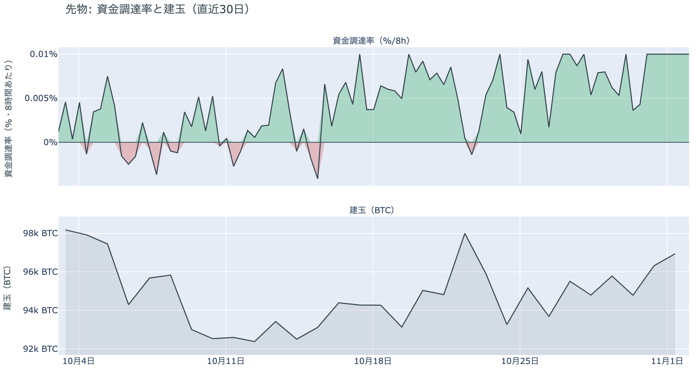

*図の見方: 上段は資金調達率（8時間ごと・日本時間）。プラスが続く＝ロングがショートより多い。下段は建玉。*

* 1日をならした年率は+10.95%で、短期金利（13週Tビル 3.97%）を引いた上乗せは+6.98pt。
* 上乗せは直近34日でいちばん大きく、34日の平均+0.83ptを大きく上回る。

先物の参加者は、下げを一時的な押しと見る見方を残しながらも、上げへの確信を前日より弱めています。前日は「金曜の下げを一時的な押しと見て、上げに賭け直している」と説明しました。日曜日は資金調達率（＝ロングが払う金利。プラス＝ロングがショートより多い）が高いまま建玉が減ったので、積み増されたロングの一部は降りています。残ったロングが短期金利（＝ドルを米国の短期国債で持つだけで受け取れる金利）より余分に払う額は前日と同じくこの1か月でいちばん大きく、上げへの賭けそのものは手放されていません。ただ、賭けを増やす人はいなくなったので、上げに賭け直す動きは1日で止まったということです。

### ④ オプション：下げへの備えは選挙の手前まで厚くなり、いちばん大きく動くと見ているのは選挙の直後

オプションには2種類あります。コール（＝決めた価格で買う権利）とプット（＝決めた価格で売る権利）で、価格が上がればコールの価値が上がり、価格が下がればプットの価値が上がります。プットは「価格が下がったときの保険」として買われます。オプションを買う人は、その権利と引き換えに権利料（＝オプションを買う人が払う金額）を払います。

**図④-1 満期ごとのIV（年率%）**

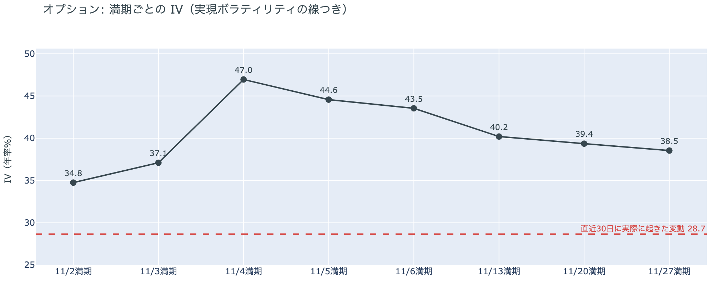

*図の見方: IVを満期ごとに並べたもの。点線は実現ボラティリティ。IVが点線より下なら、市場はこの先の値動きを過去の値動きより小さいと見ています。*

| 満期 | IV |
|---|---:|
| 11月2日 | 35 |
| 11月3日 | 37 |
| 11月4日 | 47 |
| 11月5日 | 45 |
| 11月6日 | 44 |
| 11月13日〜11月27日 | 39〜40 |

* IVは全体で40.0で、実現ボラティリティ28.7より11.4pt高い。過去1年では下から47%。

参加者は、いちばん大きく動くのは米国の中間選挙の結果が出た直後だと見ています。IV（＝値動きの幅の予想）は全体で実現ボラティリティ（＝過去の値動きの幅）より高く、これから先の値動きを、これまでの値動きより大きいと見ています。ただ、過去1年ではほぼ真ん中で、怖がっているとまでは言えません。11月3日までに満期が来るオプションの IV は低く、選挙の前に大きく動くとは見られていません。例外は11月4日から6日に満期が来るオプションの権利料で、11月13日以降の満期に対して上乗せが乗っています。11月3日の中間選挙の結果が出たあとで最初に来る満期で、選挙の結果で大きく動くと見られているからです。

**図④-2 満期ごとのプットとコールの差**

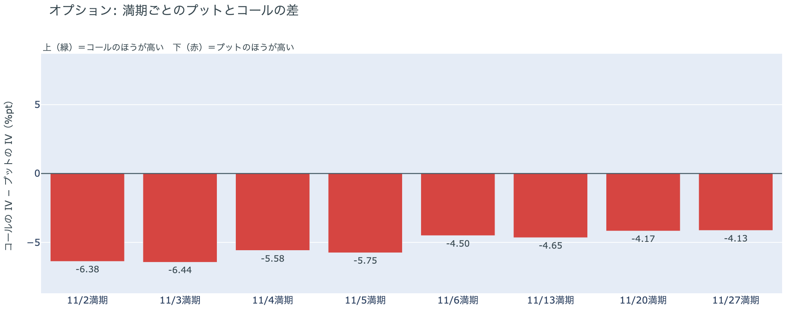

*図の見方: 満期ごとに、プットとコールのどちらが高く売れているか。ゼロより上ならコールのほうが高く、下ならプットのほうが高い。*

| 満期 | どちらが高いか |
|---|---|
| 11月2日 | プットがいちばん高い |
| 11月3日 | プットがいちばん高い |
| 11月4日 | プットがはっきり高い |
| 11月5日 | プットがはっきり高い |
| 11月6日 | プットが高い |
| 11月13日 | プットが高い |
| 11月20日 | プットが高い |
| 11月27日 | プットが高い |

参加者は、選挙の結果を待たずに、その手前から下げに備えています。すべての満期でプットのほうが高く、いちばん高いのは選挙の前に満期が来る11月2日と3日です。前日にプットがいちばん高かったのは選挙直後の11月4日の満期だったので、下げへの備えは1日で手前の満期へ寄りました。目先の満期は動く幅を小さく見ながら（図④-1）、動くなら上げより下げのほうに身構えているということです。

**図④-3 12月25日満期の持ち高（権利の価格ごと）**

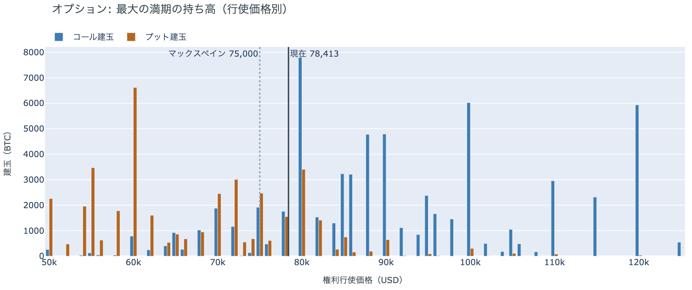

*図の見方: 青＝コール、橙＝プット。現値より上にコールが、下にプットが積まれるのが普通です。*

| 12月25日満期のオプション（価格は約$78,400） | 量（万BTC） | 意味 |
|---|---:|---|
| いまより高い価格のコール | 約7.0 | 「価格が上がる」に賭けた分 |
| いまより安い価格のプット | 約4.7 | 「価格が下がる」への保険 |
| うち、いまより15%以上高い価格のコール | 約4.3 | 大きな上げへの賭け |
| うち、いまより15%以上安い価格のプット | 約3.4 | 大きな下げへの保険 |

* 12月25日満期の持ち高は約13.6万BTCと全満期の46%で、コールがプットの1.5倍。前日とほぼ同じ形。

年末の最大の満期でも、「価格が上がる」に賭けた人たちは降りていません。いまより高い価格のコールの6割は15%以上高い価格に積まれていて、その賭けが報われるには、12月25日の夕方5時までに約$90,000を超える必要があります。全満期でオプションの持ち高が集まっているのは$78,000〜$82,000の帯で、価格はいまその帯の下の端にいます。参加者は、目先の下げへの備えを厚くしながらも、年末に向けた上げへの賭けは手放していません。

## 4. 価格に影響しうる直近のイベント

オプション市場が値動きの幅をいちばん大きく見込んでいるのは11月4日の満期で、11月3日の米国の中間選挙の結果が出たあとの最初の満期に当たります。下げへの備えがいちばん厚いのはその手前の11月2日と3日の満期で、選挙の前の区間です。米10月雇用統計は、11月6日の満期のあとの夜に出ます。12月のFOMCでの利上げは、10月30日の先物の終値で約8割織り込まれています。

| 日付 | イベント | 何に効くか |
|---|---|---|
| 11/1（日）〜 | イランの海峡管理当局が通告した、Sinokor の船のホルムズ海峡からの締め出し | 原油 |
| 11/3（火） | 米国の中間選挙。結果は日本時間4日以降 | 株・金利。11月4日満期の IV がいちばん高い |
| 11/6（金）22:30 日本時間 | 米10月雇用統計 | 金利 |
| 12/9（水） | FOMC。利上げの織り込みは約8割。結果は日本時間10日早朝 | 金利 |
| 12/25（金）17:00 | オプションの最も大きな満期（約13.6万BTC、全満期の46%） | 約$90,000以上のコールの期限 |

## まとめ

日曜日は、新しいきっかけが無いまま、先物で昼に積まれたロングが未明までに手仕舞われ、ビットコインは$77,000台を行って戻りました。上げ下げはアメリカの買い手と長期保有者までは届いておらず、どちらも売りの側にいる形は前日から変わっていません。参加者は、下げを一時的な押しと見る見方を残しながらも賭けを増やすのはやめ、11月3日の中間選挙を前に、下げへの備えを選挙の手前の満期まで厚くしています。

---

<small>（数値は11月2日7時7分（日本時間）までのデータに基づきます。価格・先物・オプションはその時点の値、市場心理は11月1日の確定値、オンチェーン（＝ブロックチェーン上の記録）は10月31日時点（マイナーの収入は10月25日時点）、ETF資金フローは10月30日分までです。証券市場の終値は10月30日時点で、週末のため更新がありません。オンチェーンの長期保有者の数値には、ETFや取引所が預かっている分も含まれます。オプションはDeribit（BTCオプションの大半を占める取引所）の全銘柄です。）</small>

*本稿は情報提供を目的としたものであり、投資助言ではありません。将来の価格動向を保証・示唆するものではなく、投資判断は各自の責任において行ってください。*
