# 中間選挙の前夜に$76,000台へじり安 ― 清算は少なく、積み増されたのはショート

**2026年11月3日**

ビットコインは月曜日、米国の中間選挙を翌日に控えた夕方から未明にかけてじりじり下げ、$76,000台で朝を迎えました。

* **価格**：24時間の値幅は2.9%と、前日の1.0%から広がりました。朝7時5分の時点で約$76,679と、この1週間の安値に近いところまで下げています
* **きっかけ**：はっきりしたきっかけはありませんでした。米国株は小さく下げ、金は上げ、原油は米国とイランの協議への期待で7%を超えて下げましたが、どれもビットコインの下げ方を変えた形跡はありません
* **先物**：下げの時間に建玉が増え、新しく売り持ち（ショート）が積まれました。買い持ち（ロング）も降りておらず、上げに賭ける側と下げに賭ける側がそろって賭けを大きくしていて、どちらも相手に譲っていません
* **需給の土台**：米国の取引所はほかの取引所より安いままで、1週間平均では沈み方をさらに深めました。長期保有者（＝155日以上保有者）の利益確定の売りも広がっていて（11月1日時点）、米国の買い手と長期保有者がそろって売りの側にいる形は、前日から変わっていません
* **オプションの見方**：すべての満期でプットが高いままで、下げへの備えは崩していません。値動きの幅をいちばん大きく見込んでいるのは、中間選挙の結果が出たあとで最初に来る11月4日の満期です

## 1. 何が起きたか

**図1-1 価格の推移（1時間足・直近7日）**

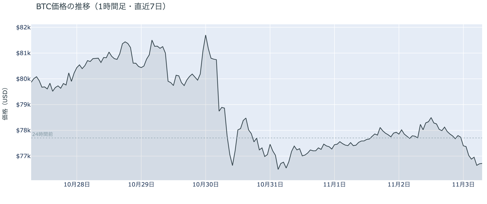

*図の見方: 1時間ごとの価格（日本時間）。点線は24時間前の水準です。週末の平らな動きのあと、月曜の夕方から線が右下へ傾いています。*

* 24時間の値幅は2.9%で、前日の1.0%から広がった。
* 清算は12件でほぼ全部がロング。最大の1件でも全体の2割に満たない。

月曜日は、昼まで$78,000台で動かなかった価格が、夕方から未明にかけて、新しく積まれたショートに押されて$76,000台までじりじり下がった1日でした。夜9時台から未明2時台は、価格が下がる中で建玉（＝先物の未決済残高。証拠金で張っている人の量）が毎時間増えていて、下げに新しく賭ける人が出ています。清算（＝証拠金不足で強制的に閉じられた取引）は Hyperliquid（＝オンチェーンの先物取引所）で夜10時台と未明1時台・2時台にロングが焼けましたが、どれも小口の集まりです。値動きの速い5分足にはそのごく一部しか入っておらず、速く動いた5分足はむしろ上げの側だったので、清算が下げを加速させた形はありません。下げは、ショートが積まれるのに合わせてゆっくり進みました。

**図1-2 価格と50日・200日移動平均**

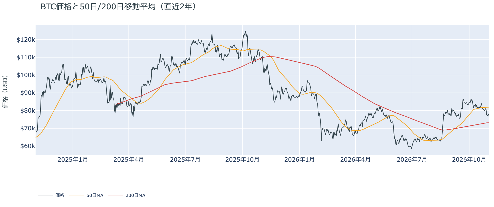

*図の見方: 2本の平均線の上下関係を見ます。50日線が200日線の上にあるのがゴールデンクロスです。*

* 50日線と200日線の差は約$8,755（12.0%）で、前日とほぼ同じ。
* 朝7時5分の価格は50日線を6.4%下回り、前日の5.1%から離れた。

長い目で見た流れの向きは変わっていません。ゴールデンクロス（＝50日線が200日線を上抜けること）の状態が56日目で、2本の平均線の差も開いたままです。ただ、価格は50日線からさらに下へ離れていて、短い目で見た弱さは前日より1段深まりました。

月曜11月2日の証券市場は、米国株（S&P500）が−0.5%、金が+1.5%で終わりました。株が小さく下げて金が買われた、リスクを取りにいく人が少ない日で、ビットコインはその株と同じ向きに下げています。外部環境から火曜日へ持ち越された一番の材料は、中間選挙の結果です。

## 2. なぜ動いたか：きっかけと、需給のどこが動いたか

**図2-1 ビットコインと株・金・原油の相対推移（起点＝100）**

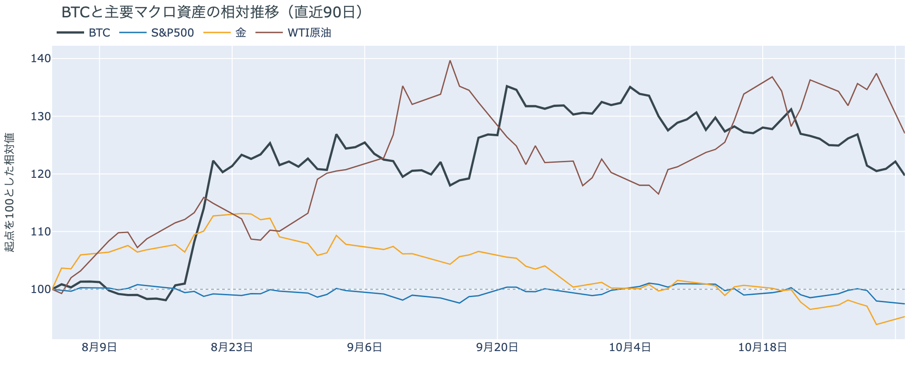

*図の見方: 同じ起点から何%動いたかで重ねたもの。線の向きが揃っているかを見ます。*

| この5営業日の動き（ビットコインは7日間） | 変化 |
|---|---:|
| ビットコイン | −4.2% |
| 金 | −2.1% |
| 米国株（S&P500） | −1.8% |
| 原油 | −5.4% |

* 建玉は98,870BTCで、前日の95,914BTCから3.1%増えた。
* 12月のFOMCでの利上げの織り込みは、11月2日の先物の終値で約8割。1週間前は約9割。

月曜日は、はっきりしたきっかけが無いまま、先物で下げに新しく賭けたショートを通って、$76,000台へ下がりました。

1. きっかけ：外部環境にも、ビットコインに固有の出来事にも、下げ方を変えたきっかけは見当たりません。米国株は中間選挙を前にハイテク株が遅れて小さく下げ、ビットコインも同じ向きでしたが、それは共通のきっかけがありえたことを示すだけです。金は上げていて、ビットコインとは逆向きなので、金と共通のきっかけではありません。原油は、米国とイランの大統領が外交での解決に前向きな姿勢を示したことで7%を超えて下げましたが、その日のビットコインに効いた形跡はありません。金利の見通しも、12月のFOMC（＝米国の金利を決める会合）での利上げの織り込みがむしろ1週間で下がっていて、下げの側には動いていません。日中の米10年債利回りも、ビットコインが下げた夜から未明に向きを変えていません。
2. 伝わり方：下げを運んだのは速い側の先物です。夕方からの下げの間、建玉は増え続けていて、下げに新しく賭けたショートが価格を押しています。清算は少なく、ロングがまとめて投げ出された下げではありません。遅い側は、この1週間を通して売りの側にいます。アメリカの取引所の買い手は1週間平均で引き方をさらに深め（図①-1）、ETF の買い手は10月30日に売りに回ったところから新しい分が出ておらず（図①-2）、長期保有者は11月1日時点で利益確定の売りを広げています（図②-1）。月曜日の下げそのものを運んだのは先物ですが、アメリカの買い手と長期保有者が下支えに回らないので、下げは押し返されずに続いています。

## 3. 市場参加者はいまどう見ているか

### ① アメリカの買い手は引き方を深め、$76,000台でも買い戻しに回っていない

**図①-1 Coinbase Premium（アメリカとそれ以外の価格差・直近90日）**

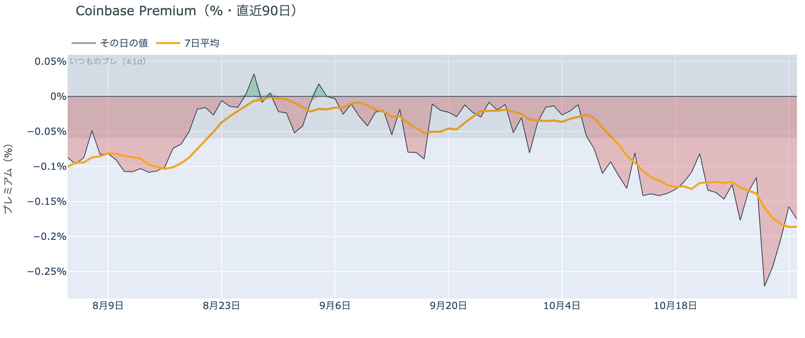

*図の見方: プラス＝アメリカで買いが強い。太線が1週間平均、細線がその日の値。薄い帯は「いつものブレの範囲」です。*

* 1週間平均は−0.19%で、前の週の1週間平均−0.13%より深い。
* 月曜のその日の値は−0.18%で、いつものブレの約3倍のマイナス。

アメリカの買い手は、$76,000台への下げを買いの機会とは見ていません。Coinbase Premium（＝アメリカとそれ以外の価格差）の1週間平均は前の週よりさらに沈み、月曜のその日の値も、前日に一度帯の内側へ戻したあと、またいつものブレを大きく超えて沈みました。アメリカの取引所では、下げの日にも買い戻す人より手放す人のほうが多いということです。

**図①-2 ETFの日ごとの資金の出入り（直近90日）**

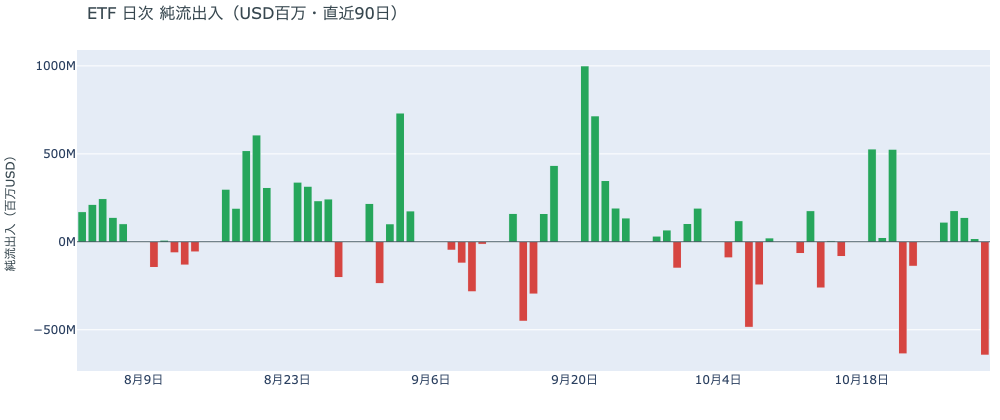

*図の見方: 入ったお金と出たお金の差。上に伸びれば入り超、下に伸びれば出超。*

| ETFの日ごとの出入り | 億ドル |
|---|---:|
| 10月26日 | +1.1 |
| 10月27日 | +1.8 |
| 10月28日 | +1.4 |
| 10月29日 | +0.2 |
| 10月30日 | −6.4 |
| 直近7営業日の合計 | −9.8 |

ETF の買い手は、売りに回ったまま週をまたいでいます。10月30日の流出は8月以降でいちばん大きく、それまで4営業日続いた入り超を1日で打ち消して、1週間の合計を出超に変えました。月曜日の分はまだ出ていないので、ETF の買い手の見方は売りの側のままです。

**図①-3 Fear & Greed（市場心理の指数・直近90日）**

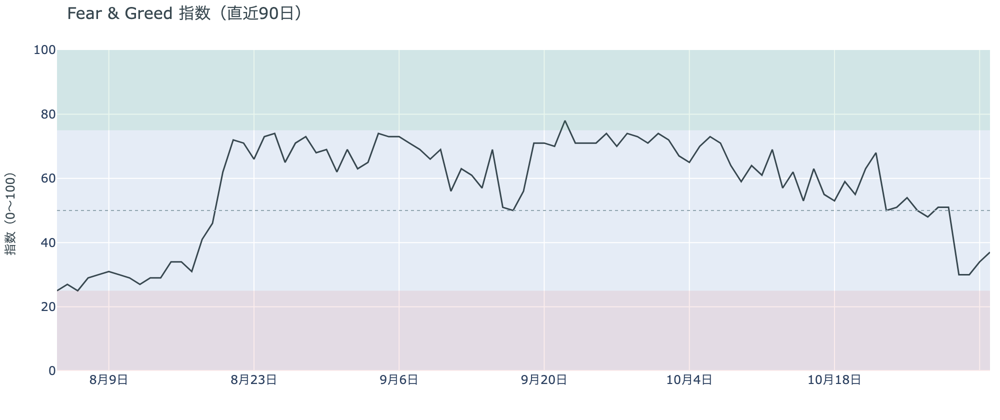

*図の見方: 0〜100で、50より上が「強欲」、下が「恐怖」。*

* 37の「恐怖」。前日の34から3pt戻した。1週間前は50、1か月前は67。

市場心理は「恐怖」に入ったままですが、怖がり方はそれ以上深まっていません。Fear & Greed（＝市場心理の指数）は1か月で「強欲」から「恐怖」まで下がったあと、ここ数日は小さく戻していて、下げが続いても慌てて逃げる人が増えている形ではありません。

### ② 長期保有者は利益確定の売りを広げ、減り方は前の週より大きい

**図②-1 長期保有者の保有量の30日変化とSOPR（直近90日）**

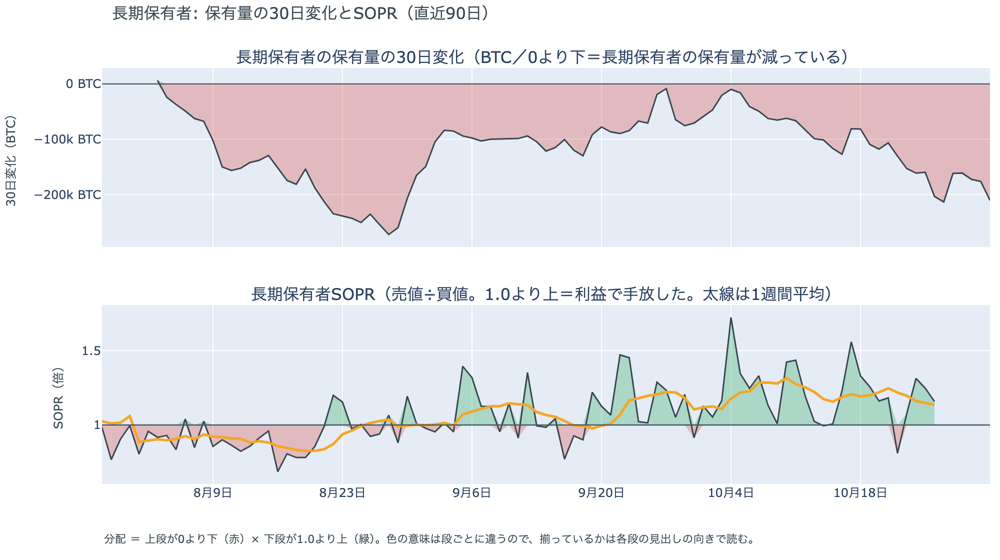

*図の見方: 上段は、長期保有者の保有量が30日でどれだけ増減したか。マイナス＝手放している。下段は長期保有者SOPRで、1より上なら利益で手放した。どちらも太線の1週間平均で読みます。*

| | 1週間平均 | 前の週の平均 |
|---|---:|---:|
| 長期保有者SOPR（1より上＝利益で手放した・10月26日時点） | 1.14 | 1.20 |
| 長期保有者の保有量の30日変化（万BTC・11月1日時点） | −18.5 | −13.4 |

* 11月1日時点の30日変化は−21.0万BTCで、1か月前（10月2日）の−4.7万BTCの約4.5倍。

長期保有者は利益確定の売りを続けていて、減り方は前の週よりさらに大きくなりました。保有量は30日で減り、動いたコインは平均して買値より高く動いています。ただ、買値との差は前の週より縮んでいて、価格が下がった分だけ、手放すときの利益も小さくなっています。それでも売りが細っていないので、長期保有者は$70,000台を、売りを止める水準とは見ていません。向きは前日と同じで、長期保有者の持ち方が変わった日ではありません。

長期保有者のほかに、売りに回りそうな持ち手は見当たりません。長く眠っていたコインが急に動いた記録はなく、マイナーの収入は平年をやや上回る程度（Puell Multiple（＝マイナー収入の平年比）が10月26日時点の1週間平均で1.13）で、売りを急ぐ状況ではありません。

### ③ 先物：ロングは降りず、下げの中でショートが積み増された

**図③-1 資金調達率と建玉（直近30日）**

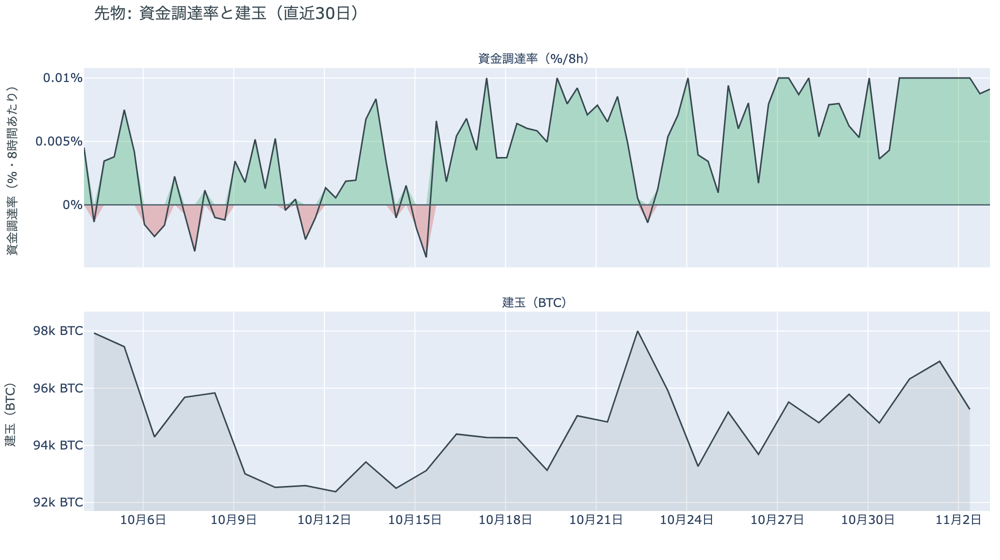

*図の見方: 上段は資金調達率（8時間ごと・日本時間）。プラスが続く＝ロングがショートより多い。下段は建玉。*

* 1日をならした年率は+10.17%で、短期金利（13週Tビル 3.98%）を引いた上乗せは+6.19pt。
* 上乗せは前日の+6.98ptから少し縮んだが、直近34日の平均+1.15ptの5倍を超える。

先物の参加者は、上げに賭ける側と下げに賭ける側に割れていて、どちらも引かずに賭けを大きくしています。資金調達率（＝ロングが払う金利。プラス＝ロングがショートより多い）は高いままで、ロングが短期金利（＝ドルを米国の短期国債で持つだけで受け取れる金利）より余分に払う額はこの1か月の平均を大きく上回っています。上げへの確信を持つロングは、$76,000台への下げでも降りていないということです。一方で、建玉は下げの時間に増えていて、下げに新しく賭けるショートも厚くなりました。前日は「賭けを増やす人はいなくなった」と説明しましたが、月曜の夜から賭けは再び増えていて、増やしたのは主に下げに賭ける側です。上げへの確信が崩れたのではなく、下げを見込む人がその反対側に積み上がった日でした。

### ④ オプション：下げへの備えは全満期に残り、いちばん大きく動くと見ているのは選挙の結果が出た直後

オプションには2種類あります。コール（＝決めた価格で買う権利）とプット（＝決めた価格で売る権利）で、価格が上がればコールの価値が上がり、価格が下がればプットの価値が上がります。プットは「価格が下がったときの保険」として買われます。オプションを買う人は、その権利と引き換えに権利料（＝オプションを買う人が払う金額）を払います。

**図④-1 満期ごとのIV（年率%）**

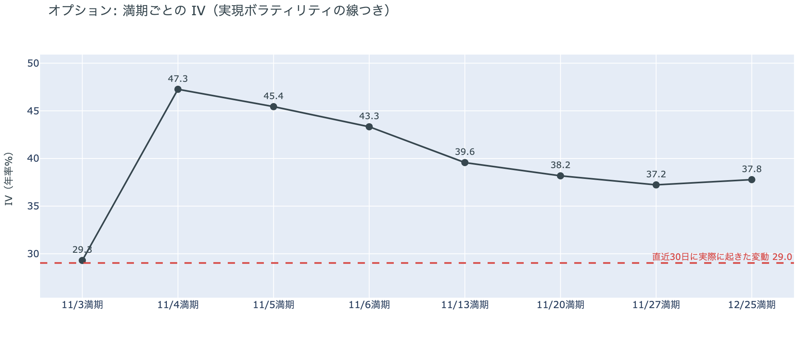

*図の見方: IVを満期ごとに並べたもの。点線は実現ボラティリティ。IVが点線より下なら、市場はこの先の値動きを過去の値動きより小さいと見ています。*

| 満期 | IV |
|---|---:|
| 11月3日 | 29 |
| 11月4日 | 47 |
| 11月5日 | 45 |
| 11月6日 | 43 |
| 11月13日〜12月25日 | 37〜40 |

* IVは全体で40.3で、実現ボラティリティ29.0より11.2pt高い。過去1年では下から40%。

参加者は、いちばん大きく動くのは米国の中間選挙の結果が出た直後だと見ています。IV（＝値動きの幅の予想）は全体で実現ボラティリティ（＝過去の値動きの幅）より高く、これから先の値動きを、これまでの値動きより大きいと見ています。ただ、過去1年では真ん中より少し下で、怖がっているとまでは言えません。今日の夕方に満期が来るオプションの IV は低く、結果が出る前に大きく動くとは見られていません。例外は11月4日から6日に満期が来るオプションの権利料で、11月13日以降の満期に対して上乗せが乗っています。中間選挙の結果が出たあとで最初に来る満期で、結果を受けて大きく動くと見られているからです。

**図④-2 満期ごとのプットとコールの差**

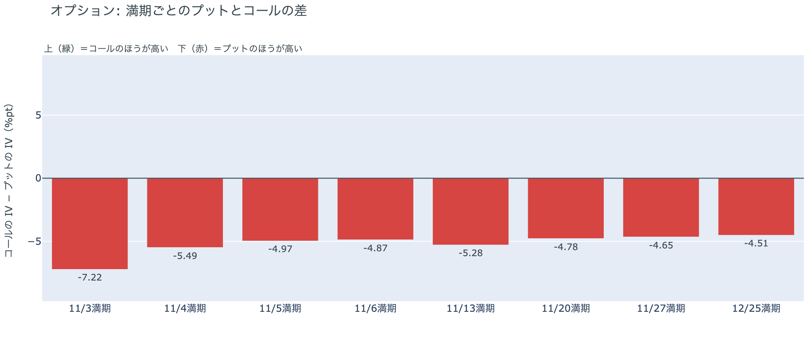

*図の見方: 満期ごとに、プットとコールのどちらが高く売れているか。ゼロより上ならコールのほうが高く、下ならプットのほうが高い。*

| 満期 | どちらが高いか |
|---|---|
| 11月3日 | プットがいちばん高い |
| 11月4日 | プットが高い |
| 11月5日 | プットが高い |
| 11月6日 | プットが高い |
| 11月13日 | プットが高い |
| 11月20日 | プットが高い |
| 11月27日 | プットが高い |
| 12月25日 | プットが高い |

参加者は、動くなら上げより下げのほうに身構えていて、その構えは選挙の結果を待たずに年末の満期まで続いています。すべての満期でプットのほうが高く、いちばん高いのは結果が出る前に満期が来る今日の11月3日です。11月4日から先はプットの高さがほぼそろっていて、選挙の直後の満期だけ下げへの備えを特に厚くしているわけではありません。前日は「下げへの備えを選挙の手前の満期まで厚くしている」と説明しました。今日もいちばん厚いのは選挙の手前の満期なので、前日の説明は今日の数値と合っています。

**図④-3 12月25日満期の持ち高（権利の価格ごと）**

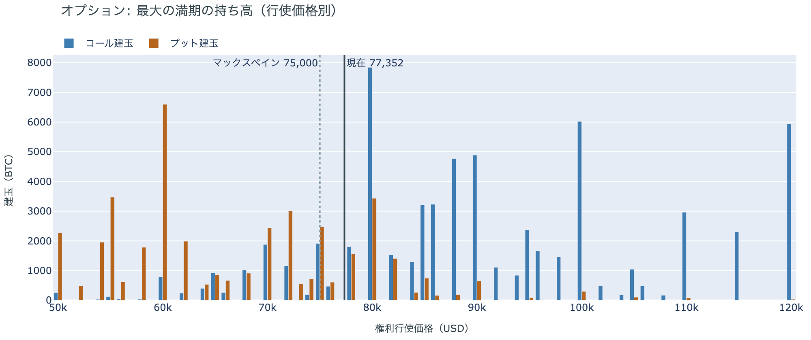

*図の見方: 青＝コール、橙＝プット。現値より上にコールが、下にプットが積まれるのが普通です。*

| 12月25日満期のオプション（価格は約$77,350） | 量（万BTC） | 意味 |
|---|---:|---|
| いまより高い価格のコール | 約7.2 | 「価格が上がる」に賭けた分 |
| いまより安い価格のプット | 約4.6 | 「価格が下がる」への保険 |
| うち、いまより15%以上高い価格のコール | 約4.8 | 大きな上げへの賭け |
| うち、いまより15%以上安い価格のプット | 約3.4 | 大きな下げへの保険 |

* 12月25日満期の持ち高は約13.7万BTCと全満期の44%で、コールがプットの1.5倍。前日とほぼ同じ形。

年末の最大の満期でも、「価格が上がる」に賭けた人たちは降りていません。いまより高い価格のコールの3分の2は15%以上高い価格に積まれていて、その賭けが報われるには、12月25日の夕方5時までに約$89,000を超える必要があります。全満期でオプションの持ち高が集まっているのは$74,000〜$82,000の帯で、価格はいまその帯の中にいます。参加者は、目先の下げへの備えを解かずにいながら、年末に向けた上げへの賭けも手放していません。

## 4. 価格に影響しうる直近のイベント

オプション市場が値動きの幅をいちばん大きく見込んでいるのは11月4日から6日の満期で、11月3日の米国の中間選挙の結果が出たあとの区間に当たります。下げへの備えがいちばん厚いのは今日11月3日の満期で、結果が出る前の区間です。米10月雇用統計は、11月6日の満期のあとの夜に出ます。

| 日付 | イベント | 何に効くか |
|---|---|---|
| 11/2（月）〜 | 米国とイランの協議（カタールが仲介）。両国の大統領が外交での解決に前向きな姿勢を示した | 原油 |
| 11/3（火） | 米国の中間選挙。結果は日本時間4日以降 | 株・金利。11月4日〜6日満期の IV が高い |
| 11/6（金）22:30 日本時間 | 米10月雇用統計 | 金利 |
| 12/9（水） | FOMC。利上げの織り込みは約8割。結果は日本時間10日早朝 | 金利 |
| 12/25（金）17:00 | オプションの最も大きな満期（約13.7万BTC、全満期の44%） | 約$89,000以上のコールの期限 |

## まとめ

月曜日は、はっきりしたきっかけが無いまま、先物で下げに新しく賭けたショートを通って、ビットコインは$76,000台へじりじり下がりました。清算が下げを速めた形はなく、アメリカの買い手と長期保有者は前日から売りの側にいたままで、持ち方が変わった日ではありません。参加者は、上げへの賭けを降りずに持ちながらも、中間選挙の結果が出るまでは下げへの備えを解かず、結果のあとに大きく動くと見て構えています。

---

<small>（数値は11月3日7時7分（日本時間）までのデータに基づきます。価格・先物・オプションはその時点の値、市場心理は11月2日の確定値、オンチェーン（＝ブロックチェーン上の記録）は11月1日時点（長期保有者SOPRとマイナーの収入は10月26日時点）、ETF資金フローは10月30日分までです。証券市場の終値は11月2日時点です。オンチェーンの長期保有者の数値には、ETFや取引所が預かっている分も含まれます。オプションはDeribit（BTCオプションの大半を占める取引所）の全銘柄です。）</small>

*本稿は情報提供を目的としたものであり、投資助言ではありません。将来の価格動向を保証・示唆するものではなく、投資判断は各自の責任において行ってください。*
