# 投票日に$77,700台へ戻す ― 運んだのはショートの買い戻し、ETFは流出が続く

**2026年11月4日**

ビットコインは火曜日、米国の中間選挙の投票が続くなか、夕方まで$76,000台で足踏みしたあと夜にじわじわ戻し、$77,000台で朝を迎えました。

* **価格**：24時間の値幅は2.3%と、前日の2.9%より小さくなりました。朝7時5分の時点で約$77,733と、前日の下げの3分の2ほどを取り戻した水準です
* **きっかけ**：はっきりしたきっかけはありませんでした。米国株は小さく上げ、金は下げ、原油はほぼ変わらずで、中間選挙の結果もまだ出ていません
* **先物**：戻りを運んだのは売り持ち（ショート）の買い戻しです。ただ、建玉（＝先物の未決済残高。証拠金で張っている人の量）は前日の朝とほぼ同じで、月曜の夜に増えた賭けは残っています。買い持ち（ロング）もショートも、賭けを持ったまま選挙の結果を待っています
* **需給の土台**：ETF は11月2日にも約4億ドルの流出で、長期保有者（＝155日以上保有者）の減り方も同じ時点でさらに大きくなりました。米国の買い手と長期保有者が売りの側にいる形は、戻りのあとも前日から変わっていません
* **オプションの見方**：すべての満期でプットが高いままで、下げへの備えは解いていません。いちばん身構えているのは、選挙の結果が出始めた直後に満期が来る今日の夕方5時の満期です

## 1. 何が起きたか

**図1-1 価格の推移（1時間足・直近7日）**

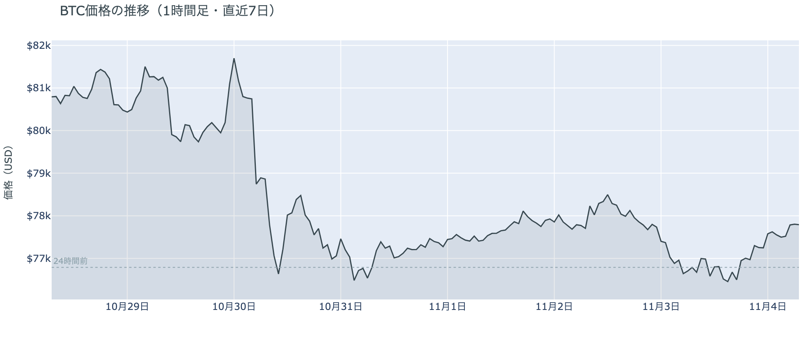

*図の見方: 1時間ごとの価格（日本時間）。点線は24時間前の水準です。火曜の夕方まで平らだった線が、夜から右上へ傾いています。*

* 24時間の値幅は2.3%で、朝7時5分の価格は24時間前より+1.2%。
* 清算は14件でほぼ全部がロングだが、最大の1件が全体の75%を占める。

火曜日は、月曜の夜の下げのあと動きが止まり、夜から未明にかけて、ショートが引くのに合わせてゆっくり戻った1日でした。夕方までは価格が$76,000台で止まったまま建玉が増え、夜に入ると価格が上がりながら建玉が減っています。上げの中で建玉が減るのは、下げに賭けていたショートが買い戻して降りている形です。清算（＝証拠金不足で強制的に閉じられた取引）は Hyperliquid（＝オンチェーンの先物取引所）の午後3時台に$76,000台でロングの大口が1つ飛びましたが、そこで下げは広がっていません。いちばん速く動いた5本の5分足はどれも上げの側で、清算は入っていないので、戻りは清算に押されたものではなく、ショートが自分から降りて進みました。

**図1-2 価格と50日・200日移動平均**

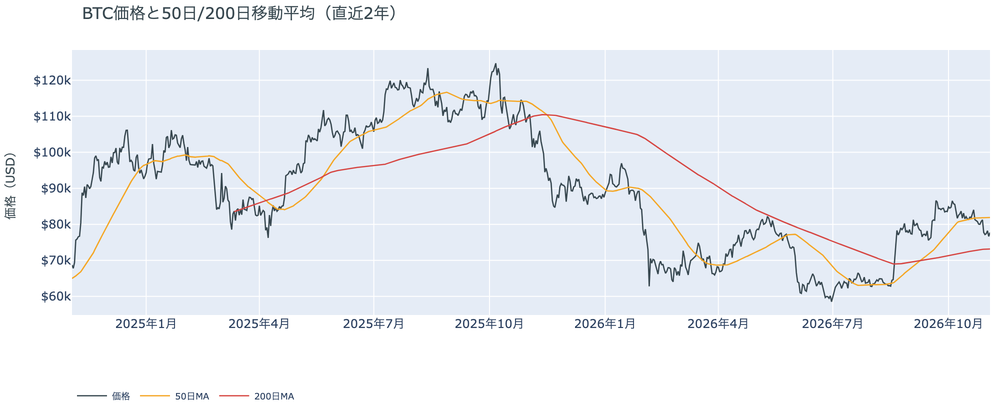

*図の見方: 2本の平均線の上下関係を見ます。50日線が200日線の上にあるのがゴールデンクロスです。*

* 50日線と200日線の差は約$8,743（12.0%）で、前日とほぼ同じ。
* 朝7時5分の価格は50日線を5.1%下回り、前日の6.4%から少し戻した。

長い目で見た流れの向きは変わっていません。ゴールデンクロス（＝50日線が200日線を上抜けること）の状態が57日目で、2本の平均線の差も開いたままです。価格は50日線の下にいて、短い目で見た弱さは、この戻りでも解消していません。

火曜11月3日の証券市場は、米国株（S&P500）が+0.4%、金が−0.8%で終わりました。半導体株が買われて株が持ち直した日で、ビットコインの戻りと同じ向きです。外部環境から水曜日へ持ち越された一番の材料は、まだ出ていない中間選挙の結果です。

## 2. なぜ動いたか：きっかけと、需給のどこが動いたか

**図2-1 ビットコインと株・金・原油の相対推移（起点＝100）**

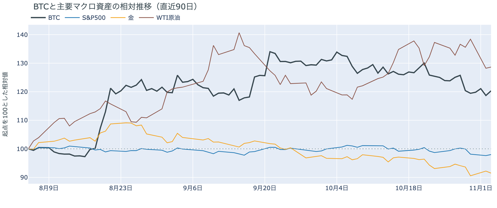

*図の見方: 同じ起点から何%動いたかで重ねたもの。線の向きが揃っているかを見ます。*

| この5営業日の動き（ビットコインは7日間） | 変化 |
|---|---:|
| ビットコイン | −3.8% |
| 金 | −3.3% |
| 米国株（S&P500） | −2.0% |
| 原油 | −3.1% |

* 建玉は98,760BTCで、前日の98,870BTCとほぼ同じ。
* 12月のFOMCでの利上げの織り込みは、11月3日の先物の終値で約10割。1週間前も約10割。

火曜日は、はっきりしたきっかけが無いまま、先物のショートの買い戻しを通って、$77,000台へ戻りました。

1. きっかけ：外部環境にも、ビットコインに固有の出来事にも、戻り方を変えたきっかけは見当たりません。米国株はビットコインと同じ向きに上げましたが、それは共通のきっかけがありえたことを示すだけです。金は下げていて、ビットコインとは逆向きなので、金と共通のきっかけではありません。原油はほぼ変わらず、今日の値動きに効いた形跡はありません。金利の見通しも、12月のFOMC（＝米国の金利を決める会合）での利上げの織り込みが1週間変わっておらず、日中の米10年債利回りはビットコインが上げた夜にむしろ小さく上がっています。Binance の不正流出では攻撃の経緯についての続報が未明に出ましたが、その時間の価格は動いていません。中間選挙は日本時間の朝の時点で投票が続いていて、結果はまだ値動きの材料になっていません。
2. 伝わり方：戻りを運んだのは速い側の先物で、昼に増えた建玉と同じくらいの量が、夜の上げの間に減りました。ショートが買い戻して降りた分だけ価格が戻った形です。遅い側のアメリカの買い手と長期保有者までは届いていません。アメリカの取引所の買い手は1週間平均で引いたままで（図①-1）、ETF の買い手は11月2日にも売りの側にいて（図①-2）、長期保有者は同じ時点で利益確定の売りを広げています（図②-1）。月曜の夜の下げを運んだのも先物で、火曜の戻りもその先物の持ち高の出入りの範囲に収まっています。

## 3. 市場参加者はいまどう見ているか

### ① アメリカの買い手は引いたままで、戻りを追って買いに回っていない

**図①-1 Coinbase Premium（アメリカとそれ以外の価格差・直近90日）**

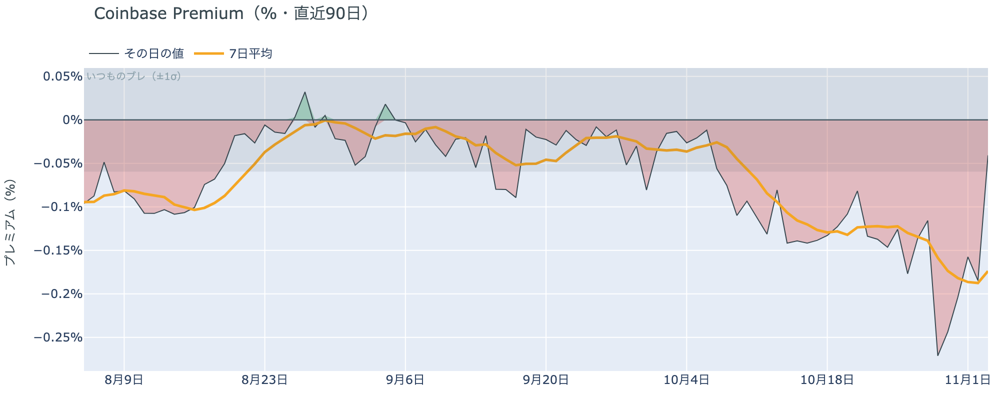

*図の見方: プラス＝アメリカで買いが強い。太線が1週間平均、細線がその日の値。薄い帯は「いつものブレの範囲」です。*

* 1週間平均は−0.17%で、前の週の1週間平均−0.13%より深い。
* 火曜のその日の値は−0.04%で、いつものブレの範囲内（約0.7倍）。

アメリカの買い手は、$77,000台への戻りを買いの合図とは見ていません。Coinbase Premium（＝アメリカとそれ以外の価格差）の1週間平均は前の週より沈んだままです。その日の値は帯の内側まで戻しましたが、この範囲の上下は毎日起きているので、買い手が戻ってきた形ではありません。この1週間を通して、アメリカの取引所では買いより売りが勝っています。

**図①-2 ETFの日ごとの資金の出入り（直近90日）**

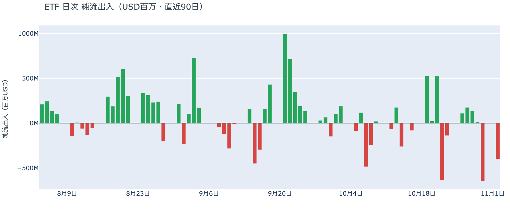

*図の見方: 入ったお金と出たお金の差。上に伸びれば入り超、下に伸びれば出超。*

| ETFの日ごとの出入り | 億ドル |
|---|---:|
| 10月27日 | +1.8 |
| 10月28日 | +1.4 |
| 10月29日 | +0.2 |
| 10月30日 | −6.4 |
| 11月2日 | −4.0 |
| 直近7営業日の合計 | −7.4 |

* 確定分の流出は2営業日連続で、11月2日の流出はほぼ IBIT 1本（−4.1億ドル）から出ている。

ETF の買い手は、8月以降で最大だった10月30日の流出のあとも売りの側にいて、下げを買いの機会とは見ていません。11月2日にも流出が続いたので、前週に入った分は2日で消え、1週間の合計は出超のままです。火曜日の分はまだ出ていません。

**図①-3 Fear & Greed（市場心理の指数・直近90日）**

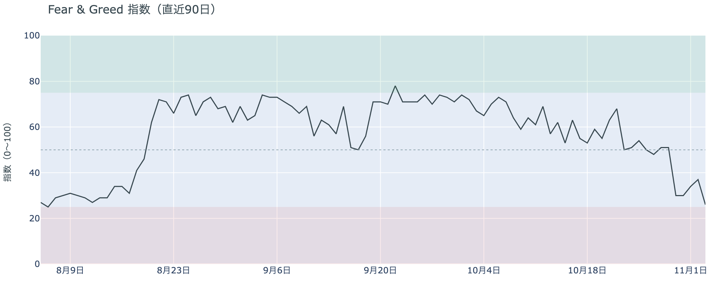

*図の見方: 0〜100で、50より上が「強欲」、下が「恐怖」。*

* 26の「恐怖」。前日の37から11pt下げた。1週間前は48、1か月前は65。

市場心理は1段冷えて、下げを怖がる人が増えました。Fear & Greed（＝市場心理の指数）は8月上旬以来の低さで、「極度の恐怖」の境目の25に近づいています。前日は「怖がり方はそれ以上深まっていない」と説明しましたが、この数字とは合わなくなりました。$76,000台まで下げたあとで、不安はもう一段強まっています。

### ② 長期保有者は利益確定の売りを広げ、減り方は前の週より大きい

**図②-1 長期保有者の保有量の30日変化とSOPR（直近90日）**

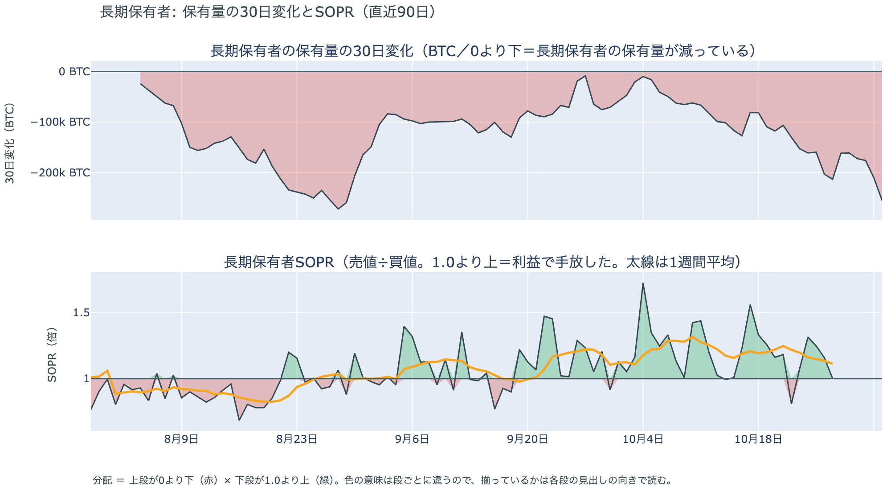

*図の見方: 上段は、長期保有者の保有量が30日でどれだけ増減したか。マイナス＝手放している。下段は長期保有者SOPRで、1より上なら利益で手放した。どちらも太線の1週間平均で読みます。*

| | 1週間平均 | 前の週の平均 |
|---|---:|---:|
| 長期保有者SOPR（1より上＝利益で手放した・10月27日時点） | 1.11 | 1.22 |
| 長期保有者の保有量の30日変化（万BTC・11月2日時点） | −19.3 | −14.7 |

* 11月2日時点の30日変化は−25.5万BTCで、1か月前（10月3日）の−2.1万BTCの約12倍。

長期保有者は利益確定の売りを続けていて、減り方は前の週よりさらに大きくなりました。保有量は30日で減り、動いたコインは平均して買値より高く動いています。ただ、買値との差は前の週より縮んでいて、手放すときの利益は小さくなっています。利益が細っても売りが止まらないので、長期保有者は$70,000台を、売りを止める水準とは見ていません。向きは前日と同じで、長期保有者の持ち方が変わった日ではありません。

長期保有者のほかに、売りに回りそうな持ち手は見当たりません。長く眠っていたコインが急に動いた記録はなく、マイナーの収入は平年をやや上回る程度（Puell Multiple（＝マイナー収入の平年比）が10月27日時点の1週間平均で1.12）で、売りを急ぐ状況ではありません。

### ③ 先物：ショートの一部は降りたが、ロングもショートも賭けを持ったまま選挙の結果を待っている

**図③-1 資金調達率と建玉（直近30日）**

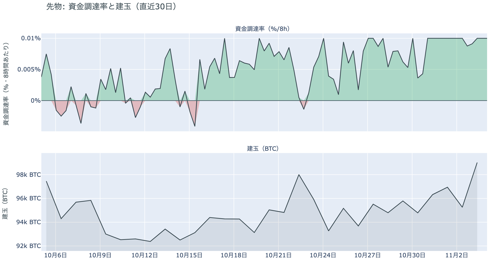

*図の見方: 上段は資金調達率（8時間ごと・日本時間）。プラスが続く＝ロングがショートより多い。下段は建玉。*

* 1日をならした年率は+10.95%で、短期金利（13週Tビル 4.03%）を引いた上乗せは+6.92pt。
* 上乗せは直近34日の平均+1.28ptの5倍を超え、この間の最大+6.98ptに近い。

先物の参加者は、上げ下げのどちらにも賭けを降ろさないまま、中間選挙の結果を待っています。資金調達率（＝ロングが払う金利。プラス＝ロングがショートより多い）は高いままで、ロングが短期金利（＝ドルを米国の短期国債で持つだけで受け取れる金利）より余分に払う額はこの1か月の平均を大きく上回っています。余分を払ってでも持ち続けているので、上げへの確信を持つロングは残っているということです。ショートは夜の上げで一部が買い戻しましたが、建玉が前日の朝とほぼ同じなので、月曜の夜に増えた賭けはほとんど残っています。前日は「どちらも相手に譲っていない」と説明しました。火曜の出入りはその範囲に収まっていて、前日の説明は今日の数値と合っています。

### ④ オプション：下げへの備えは全満期に残り、いちばん身構えているのは選挙の結果が出始めた直後

オプションには2種類あります。コール（＝決めた価格で買う権利）とプット（＝決めた価格で売る権利）で、価格が上がればコールの価値が上がり、価格が下がればプットの価値が上がります。プットは「価格が下がったときの保険」として買われます。オプションを買う人は、その権利と引き換えに権利料（＝オプションを買う人が払う金額）を払います。

**図④-1 満期ごとのIV（年率%）**

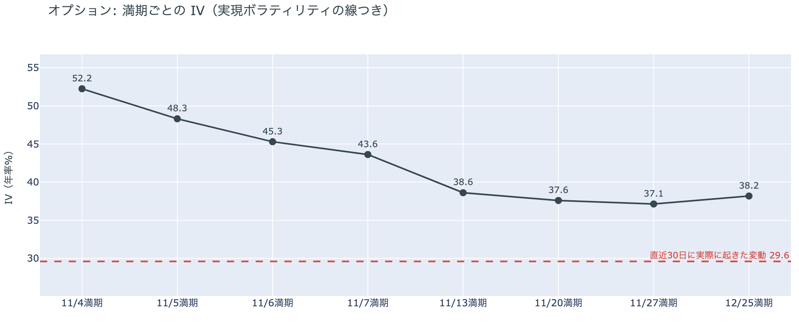

*図の見方: IVを満期ごとに並べたもの。点線は実現ボラティリティ。IVが点線より下なら、市場はこの先の値動きを過去の値動きより小さいと見ています。*

| 満期 | IV |
|---|---:|
| 11月4日 | 52 |
| 11月5日 | 48 |
| 11月6日 | 45 |
| 11月7日 | 44 |
| 11月13日〜12月25日 | 37〜39 |

* IVは全体で39.3で、実現ボラティリティ29.6より9.7pt高い。過去1年では下から43%。

参加者は、いちばん大きく動くのは中間選挙の結果が出始めた直後だと見ています。IV（＝値動きの幅の予想）は全体で実現ボラティリティ（＝過去の値動きの幅）より高く、これから先の値動きを、これまでの値動きより大きいと見ています。ただ、過去1年では真ん中より少し下で、怖がっているとまでは言えません。例外は今日の夕方5時に満期が来るオプションの権利料で、11月13日以降の満期に対して上乗せが乗っています。今日の夕方までの半日で結果を受けて大きく動くと見られているからです。上乗せは11月7日の満期にかけて小さくなっていて、米10月雇用統計をまたいでも増えていません。

**図④-2 満期ごとのプットとコールの差**

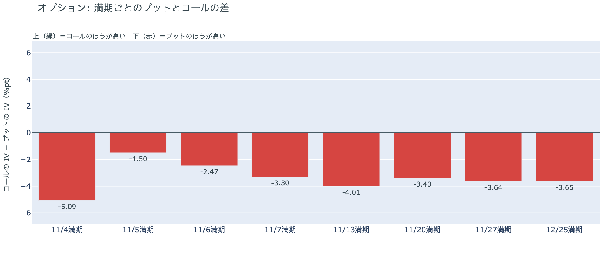

*図の見方: 満期ごとに、プットとコールのどちらが高く売れているか。ゼロより上ならコールのほうが高く、下ならプットのほうが高い。*

| 満期 | どちらが高いか |
|---|---|
| 11月4日 | プットがいちばん高い |
| 11月5日 | プットが高い（差は小さい） |
| 11月6日 | プットが高い |
| 11月7日 | プットが高い |
| 11月13日 | プットが高い |
| 11月20日 | プットが高い |
| 11月27日 | プットが高い |
| 12月25日 | プットが高い |

参加者は、動くなら上げより下げのほうに身構えていて、その構えは年末の満期まで続いています。価格が戻っても、どの満期でもコールがプットを上回っていないので、下げへの備えを解くほどの安心はしていないということです。下げへの備えがいちばん高く値付けされているのは、今日の夕方に満期が来る11月4日で、選挙の結果が出始めた直後の半日に当たります。前日は「下げへの備えを選挙の手前の満期まで厚くしている」と説明しました。今日もいちばん手前の満期に備えが集まっているので、前日の説明は今日の数値と合っています。

**図④-3 12月25日満期の持ち高（権利の価格ごと）**

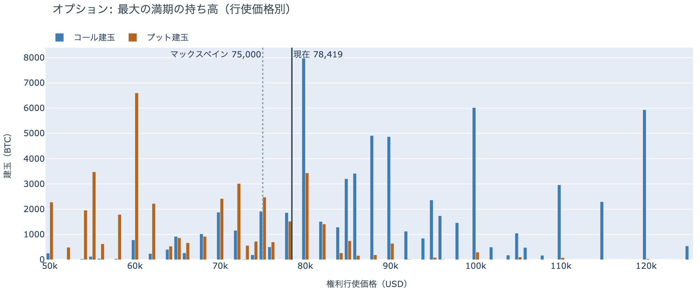

*図の見方: 青＝コール、橙＝プット。現値より上にコールが、下にプットが積まれるのが普通です。*

| 12月25日満期のオプション（価格は約$78,400） | 量（万BTC） | 意味 |
|---|---:|---|
| いまより高い価格のコール | 約7.0 | 「価格が上がる」に賭けた分 |
| いまより安い価格のプット | 約4.8 | 「価格が下がる」への保険 |
| うち、いまより15%以上高い価格のコール | 約4.3 | 大きな上げへの賭け |
| うち、いまより15%以上安い価格のプット | 約3.5 | 大きな下げへの保険 |

* 12月25日満期の持ち高は約13.8万BTCと全満期の43%で、コールがプットの1.5倍。前日とほぼ同じ形。

年末の最大の満期でも、「価格が上がる」に賭けた人たちは降りておらず、年末までの上げへの期待は保たれています。いまより高い価格のコールの6割は15%以上高い価格に積まれていて、その賭けが報われるには、12月25日の夕方5時までに約$90,000を超える必要があります。全満期でオプションの持ち高が集まっているのは$75,000〜$82,000の帯で、価格はいまその帯の中にいます。参加者は、目先の下げへの備えを解かずにいながら、年末に向けた上げへの賭けも手放していません。

## 4. 価格に影響しうる直近のイベント

オプション市場が値動きの幅をいちばん大きく見込み、下げへの備えもいちばん高く値付けしているのは、今日11月4日の夕方5時の満期で、中間選挙の結果が出始めた直後の区間に当たります。11月5日から7日の満期にかけて値動きの幅の見込みは小さくなり、米10月雇用統計と米10月CPI をまたぐ満期に大きな上乗せはありません。

| 日付 | イベント | 何に効くか |
|---|---|---|
| 11/3（火）〜 | 米国の中間選挙。日本時間4日の朝の時点で投票が続いていて、結果はそのあと | 株・金利・CLARITY法案（＝暗号資産の市場構造法案）の行方。11月4日満期の IV がいちばん高い |
| 11/2（月）〜 | 米国とイランの協議（カタールが仲介） | 原油 |
| 11/6（金）22:30 日本時間 | 米10月雇用統計 | 金利 |
| 11/10（火）22:30 日本時間 | 米10月CPI | 金利 |
| 12/9（水） | FOMC。利上げの織り込みは約10割。結果は日本時間10日早朝 | 金利 |
| 12/25（金）17:00 | オプションの最も大きな満期（約13.8万BTC、全満期の43%） | 約$90,000以上のコールの期限 |

## まとめ

火曜日は、はっきりしたきっかけが無いまま、先物のショートの買い戻しを通って、ビットコインは$77,000台へ戻りました。アメリカの買い手と長期保有者は売りの側にいたままで、持ち方までは変わっていません。参加者は、上げと下げの賭けをどちらも降ろさないまま中間選挙の結果を待っていて、いちばん身構えているのは結果が出始めた直後の下げです。

---

<small>（数値は11月4日7時7分（日本時間）までのデータに基づきます。価格・先物・オプションはその時点の値、市場心理は11月3日の確定値、オンチェーン（＝ブロックチェーン上の記録）は11月2日時点（長期保有者SOPRとマイナーの収入は10月27日時点）、ETF資金フローは11月2日分までです。証券市場の終値は11月3日時点です。オンチェーンの長期保有者の数値には、ETFや取引所が預かっている分も含まれます。オプションはDeribit（BTCオプションの大半を占める取引所）の全銘柄です。）</small>

*本稿は情報提供を目的としたものであり、投資助言ではありません。将来の価格動向を保証・示唆するものではなく、投資判断は各自の責任において行ってください。*
