# 民主党が両院を制し$75,000台から$80,000台へ ― ショートの買い戻しが運び、ETFは流出のまま

**2026年11月5日**

ビットコインは水曜日、米国の中間選挙で民主党が上下両院を制した結果が出た昼に$75,000台まで下げたあと、夜に米国株の取引が始まると一気に$80,000台へ上げました。

* **価格**：24時間の値幅は7.3%と、前日の2.3%から大きく広がりました。朝7時5分の時点で約$80,210と、月曜の夜の下げをすべて取り戻した水準です
* **きっかけ**：中間選挙の結果です。昼の下げはその結果が出た時間に、夜の上げは米国株の上げと原油の急落と同じ時間に起きました。外部環境の材料が大きく動かした1日です
* **先物**：夜の上げを運んだのは売り持ち（ショート）の買い戻しです。建玉（＝先物の未決済残高。証拠金で張っている人の量）が減りながら価格が上がっているので、新しい買いが積まれたのではなく、下げに賭けていた人が降りた上げです
* **需給の土台**：ETF は11月3日にも流出で、長期保有者（＝155日以上保有者）の減り方も同じ時点でさらに大きくなりました。米国の買い手と長期保有者が売りの側にいる形は、前日から変わっていません
* **オプションの見方**：選挙の結果への身構えは解け、次の山は米10月雇用統計へ移りました。ただ、明日以降の満期はプットが高いままで、$80,000台に戻っても下げへの備えは外していません

## 1. 何が起きたか

**図1-1 価格の推移（1時間足・直近7日）**

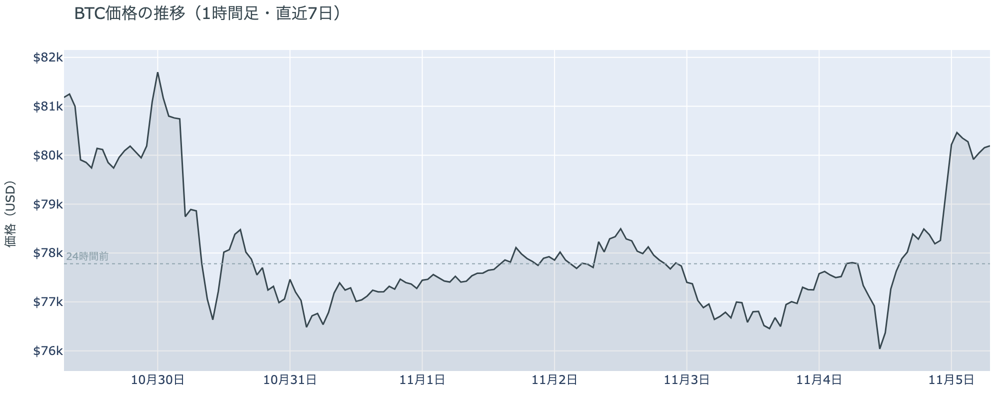

*図の見方: 1時間ごとの価格（日本時間）。点線は24時間前の水準です。水曜の昼に谷を作った線が、夜の一段で$80,000台へ跳ねています。*

* 朝7時5分の価格は24時間前より+3.1%。
* 夜の上げの2時間（23時台〜0時台）で価格は+2.5%、建玉は−1.9%。

水曜日は、まず下げ、そのあと午後にゆっくり戻し、夜に一気に上げた1日でした。午後の戻しでは建玉はほとんど変わっていません。いちばん速く動いたのは米国株の取引が始まった23時30分の直後で、23時台から0時台にかけては価格が上がりながら建玉が減っています。これは下げに賭けていたショートが買い戻して降りる形です。上げたあとの未明も価格は$80,000前後にとどまり、大きくは戻していません。

**図1-2 価格と50日・200日移動平均**

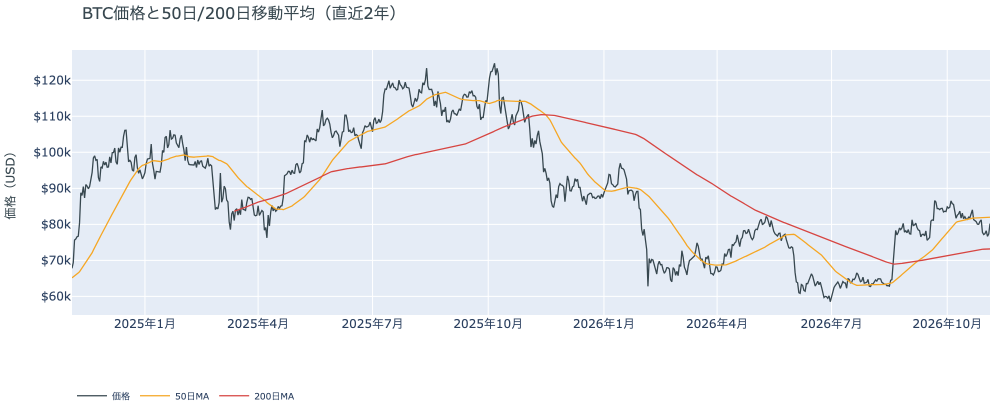

*図の見方: 2本の平均線の上下関係を見ます。50日線が200日線の上にあるのがゴールデンクロスです。*

* 50日線と200日線の差は約$8,807（12.0%）で、前日とほぼ同じ。
* 朝7時5分の価格は50日線を2.2%下回り、前日の5.1%から大きく戻した。

長い目で見た流れの向きは変わっていません。ゴールデンクロス（＝50日線が200日線を上抜けること）の状態が58日目です。$80,000台まで戻しても価格はまだ50日線の下にいるので、この1週間の下げで生まれた短い目の弱さは、解消しきっていません。

水曜11月4日の証券市場は、米国株（S&P500）が+1.6%、原油（WTI）が−8.3%で終わりました。ビットコインの夜の上げと同じ時間の株高で、前日まで持ち越されていた中間選挙の結果という材料は、ここで消えています。木曜の朝に残っている一番の材料は、金曜の米10月雇用統計です。

**図1-3 実際に起きた清算（Hyperliquid・直近24時間）**

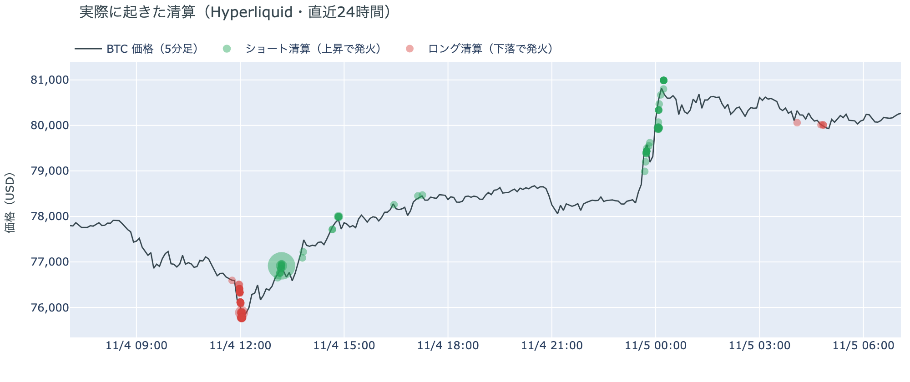

*図の見方: 5分ごとの価格（日本時間）に、Hyperliquidで見えた清算を重ねたもの。赤がロング、緑がショートの清算で、点の大きさが量です。*

* 清算の6割はショートで、最大の1つの口座が全体の4割を占める。
* 夜の上げの清算の大半は、上げの速い3本の5分足に入っていた。

清算（＝証拠金不足で強制的に閉じられた取引）は、両方向に出ました。Hyperliquid（＝オンチェーンの先物取引所）では、昼の$75,000〜$76,000台で買い持ち（ロング）が多数焼け、その1時間後に$76,000台でショートの大きな口座が1つ焼けました。下げと上げの両方の賭けが同じ昼に焼けたことになります。夜の上げでは、$79,000台を中心にショートの清算が続き、速い5分足に集まっているので、清算が上げを加速させました。

## 2. なぜ動いたか：きっかけと、需給のどこが動いたか

**図2-1 ビットコインと株・金・原油の相対推移（起点＝100）**

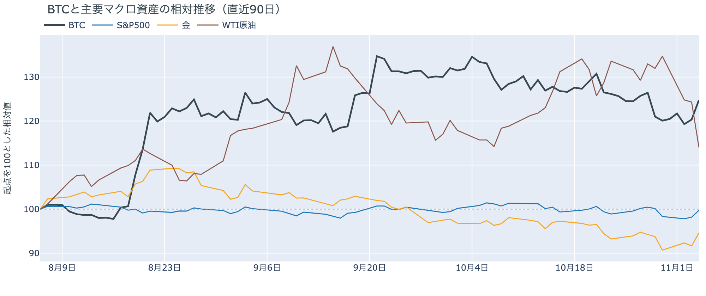

*図の見方: 同じ起点から何%動いたかで重ねたもの。線の向きが揃っているかを見ます。*

| この5営業日の動き（ビットコインは7日間） | 変化 |
|---|---:|
| ビットコイン | −1.3% |
| 金 | +0.4% |
| 米国株（S&P500） | −0.7% |
| 原油 | −14.3% |

* 建玉は96,484BTCで、前日の98,760BTCから2.3%減った。
* 12月のFOMCでの利上げの織り込みは、11月4日の先物の終値で約10割。1週間前も約10割。

水曜日は、中間選挙の結果をきっかけに、先物のショートの買い戻しを通って、$80,000台へ上げました。

1. きっかけ：中間選挙で民主党が上下両院を制した結果です。昼の下げは結果が固まっていった時間と重なり、米国株の先物も取引開始の前に下げてから戻しています。夜の上げは、米国株が上げ、原油が急落し、米10年債利回りが下げ始めたのと同じ時間に起きました。原油の急落は、選挙の結果を受けて米国とイランの戦争が早く終わるという期待が広がったためと報じられていますが、合意に至ったわけではありません。株も金も上げた1日で、ビットコインは同じ向きに動いているので、共通のきっかけがありえます。ただ、金利の見通しまで変わったわけではありません。12月のFOMC（＝米国の金利を決める会合）での利上げの織り込みは約10割のままです。ビットコインに固有の出来事で、この値動きに合うものは見当たりません。民主党の勝利は暗号資産の法案には逆風と受け止められていて、9月に上院で止まったCLARITY法案（＝暗号資産の市場構造法案）は、今の議会で動かなければ1月からの新しい議会で作り直しになります。それでも価格は上げたので、法案の見通しは夜の上げを決めた材料ではありません。
2. 伝わり方：夜の上げを運んだのは速い側の先物で、建玉が減りながら、清算を交えてショートが降りました。上げの大きさのわりに新しいロングは積まれていません。遅い側のアメリカの買い手と長期保有者までは届いていません。アメリカの取引所の買い手は1週間平均で引いたままで（図①-1）、ETF の買い手は11月3日にも売りの側にいて（図①-2）、長期保有者も同じ時点で利益確定の売りを広げています（図②-1）。

## 3. 市場参加者はいまどう見ているか

### ① アメリカの買い手は引いたままで、$80,000台への上げを運んだのは米国の買いではない

**図①-1 Coinbase Premium（アメリカとそれ以外の価格差・直近90日）**

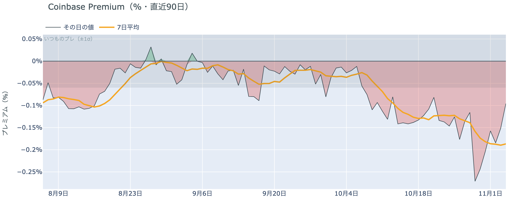

*図の見方: プラス＝アメリカで買いが強い。太線が1週間平均、細線がその日の値。薄い帯は「いつものブレの範囲」です。*

* 1週間平均は−0.19%で、前の週の1週間平均−0.14%より深い。
* 水曜のその日の値は−0.10%で、いつものブレの1.6倍。

アメリカの買い手は、$80,000台への上げを追って買いに回っていません。価格が大きく上げた日でも、Coinbase Premium（＝アメリカとそれ以外の価格差）は帯の下に沈んだままなので、この上げを運んだのはアメリカの取引所の買いではないということです。その日の値は10月30日の−0.24%から縮んできていて、売りの偏りは和らいでいますが、買いの側には戻っていません。

**図①-2 ETFの日ごとの資金の出入り（直近90日）**

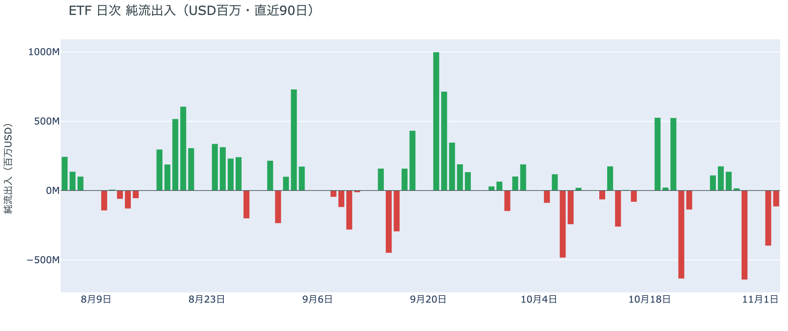

*図の見方: 入ったお金と出たお金の差。上に伸びれば入り超、下に伸びれば出超。*

| ETFの日ごとの出入り | 億ドル |
|---|---:|
| 10月28日 | +1.4 |
| 10月29日 | +0.2 |
| 10月30日 | −6.4 |
| 11月2日 | −4.0 |
| 11月3日 | −1.2 |
| 直近7営業日の合計 | −7.2 |

ETF の買い手は、選挙の結果が出る前まで売りの側にいて、下げを買いの機会とは見ていませんでした。ただ流出の額は日ごとに縮んでいて、売りを急ぐ動きは弱まっています。水曜の夜の上げに ETF の買い手がどう応じたかは、11月4日の分が出るまで分かりません。

**図①-3 Fear & Greed（市場心理の指数・直近90日）**

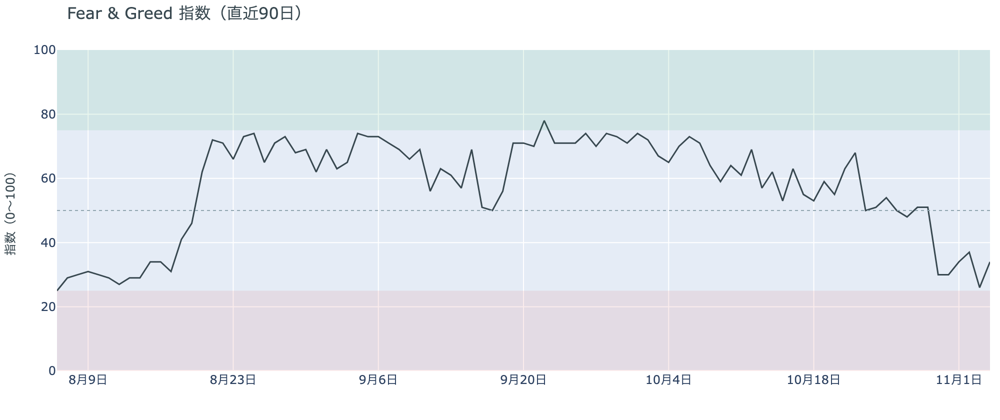

*図の見方: 0〜100で、50より上が「強欲」、下が「恐怖」。*

* 34の「恐怖」。前日の26から8pt戻した。1週間前は51、1か月前は70。

市場心理は少し持ち直しましたが、不安はまだ残っています。Fear & Greed（＝市場心理の指数）は「極度の恐怖」の境目の25から離れた一方で、1週間前の51には遠く、「恐怖」の区分のままです。

### ② 長期保有者は利益確定の売りを広げ、減り方は前の週より大きい

**図②-1 長期保有者の保有量の30日変化とSOPR（直近90日）**

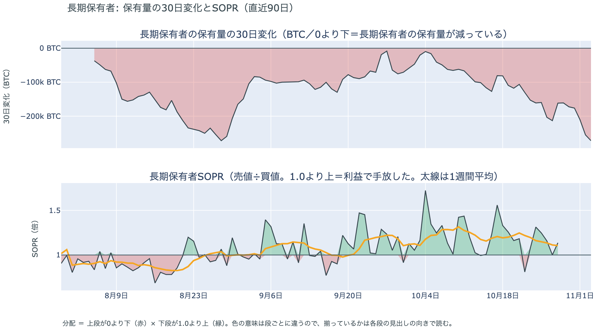

*図の見方: 上段は、長期保有者の保有量が30日でどれだけ増減したか。マイナス＝手放している。下段は長期保有者SOPRで、1より上なら利益で手放した。どちらも太線の1週間平均で読みます。*

| | 1週間平均 | 前の週の平均 |
|---|---:|---:|
| 長期保有者SOPR（1より上＝利益で手放した・10月28日時点） | 1.11 | 1.25 |
| 長期保有者の保有量の30日変化（万BTC・11月3日時点） | −20.1 | −16.1 |

* 11月3日時点の30日変化は−27.2万BTCで、1か月前（10月4日）の−1.0万BTCから大きく膨らんだ。

長期保有者は利益確定の売りを続けていて、減り方は前の週よりさらに大きくなりました。保有量は30日で減り、動いたコインは平均して買値より高く動いています。買値との差は前の週より縮んでいるので、手放すときの利益は細っていますが、それでも売りは止まっていません。長期保有者は$70,000台を、売りを止める水準とは見ていないということです。11月3日時点までの数字なので、水曜の上げのあとの動きはまだ入っていません。

長期保有者のほかに、売りに回りそうな持ち手は見当たりません。長く眠っていたコインが急に動いた記録はなく、マイナーの収入は平年をやや上回る程度（Puell Multiple（＝マイナー収入の平年比）が10月28日時点の1週間平均で1.11）で、売りを急ぐ状況ではありません。

### ③ 先物：ショートは降りたが、ロングは余分な金利を払って持ち続けている

**図③-1 資金調達率と建玉（直近30日）**

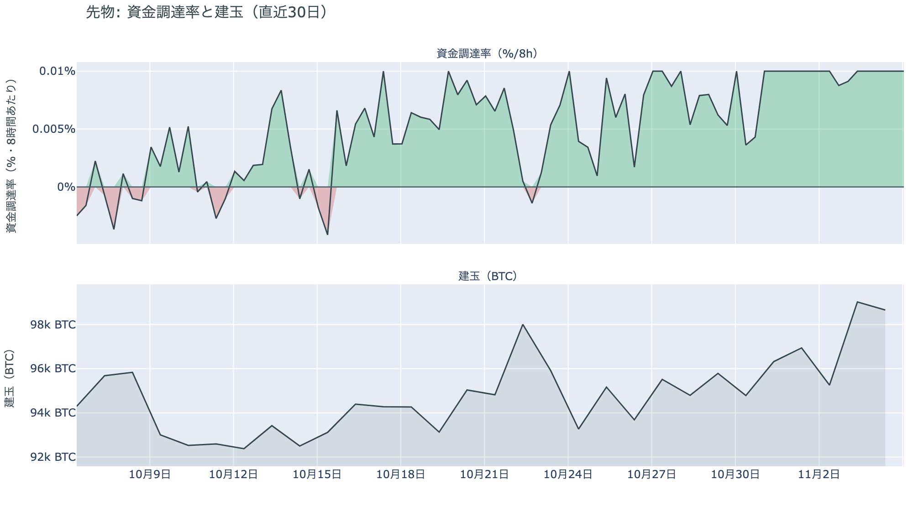

*図の見方: 上段は資金調達率（8時間ごと・日本時間）。プラスが続く＝ロングがショートより多い。下段は建玉。*

* 1日をならした年率は+10.95%で、短期金利（13週Tビル 4.03%）を引いた上乗せは+6.92pt。
* 上乗せは直近34日の平均+1.26ptの5倍を超える。建玉は1週間前より4.1%多い。

先物の参加者は下げへの賭けを減らしましたが、上げへの確信は保っています。資金調達率（＝ロングが払う金利。プラス＝ロングがショートより多い）はプラスのままで、ロングが短期金利（＝ドルを米国の短期国債で持つだけで受け取れる金利）より余分に払う額はこの1か月の平均を大きく上回っています。余分を払ってでも持ち続けているので、上げをまだ見ている人が残っているということです。一方で建玉が減った分、賭けの傾きは弱まりました。ただ1週間前と比べれば建玉はまだ多く、月曜の夜に増えた賭けのすべてが消えたわけではありません。前日は「どちらも賭けを降ろさないまま結果を待っている」と説明しました。結果を受けて先に降ろされたのは昼のロング、続いて夜のショートで、前日の説明は今日の数値と合っています。

### ④ オプション：選挙の上乗せは剥がれ、次の山は米10月雇用統計。下げへの備えは明日以降の満期に残る

オプションには2種類あります。コール（＝決めた価格で買う権利）とプット（＝決めた価格で売る権利）で、価格が上がればコールの価値が上がり、価格が下がればプットの価値が上がります。プットは「価格が下がったときの保険」として買われます。オプションを買う人は、その権利と引き換えに権利料（＝オプションを買う人が払う金額）を払います。

**図④-1 満期ごとのIV（年率%）**

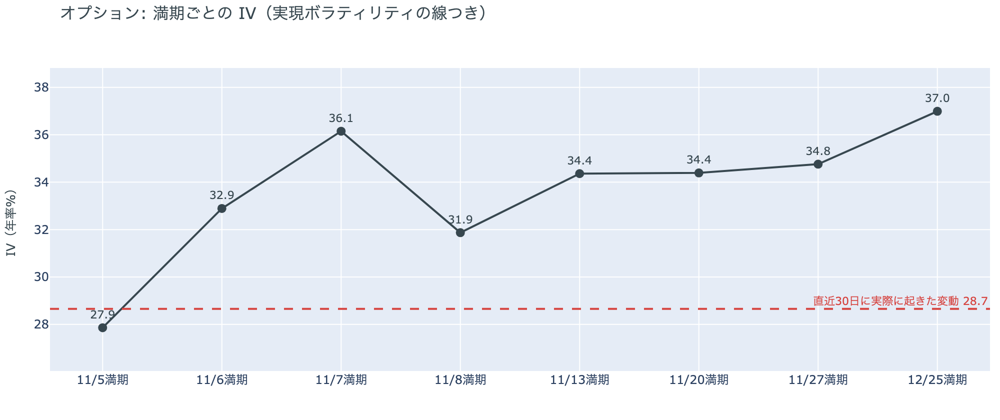

*図の見方: IVを満期ごとに並べたもの。点線は実現ボラティリティ。IVが点線より下なら、市場はこの先の値動きを過去の値動きより小さいと見ています。*

| 満期 | IV | 前日のIV |
|---|---:|---:|
| 11月5日 | 28 | 48 |
| 11月6日 | 33 | 45 |
| 11月7日 | 36 | 44 |
| 11月8日 | 32 | — |
| 11月13日〜12月25日 | 34〜37 | 37〜39 |

* IVは全体で39.7で、実現ボラティリティ28.7より11.1pt高い。

参加者は、選挙という大きな山を越えたと見ていて、次に身構えているのは金曜の夜の米10月雇用統計です。IV（＝値動きの幅の予想）は全体で実現ボラティリティ（＝過去の値動きの幅）より高く、これから先の値動きを、これまでの値動きより大きいと見ています。ただ、過去1年では真ん中より下で、怖がっているとは言えません。前日は手前の満期の権利料に、11月13日以降の満期に対する上乗せが乗っていましたが、選挙の結果が出て剥がれました。例外は11月7日に満期が来るオプションの権利料で、前後の満期に対して上乗せが乗っています。金曜の夜の米10月雇用統計をまたぐ最初の満期だからです。

**図④-2 満期ごとのプットとコールの差**

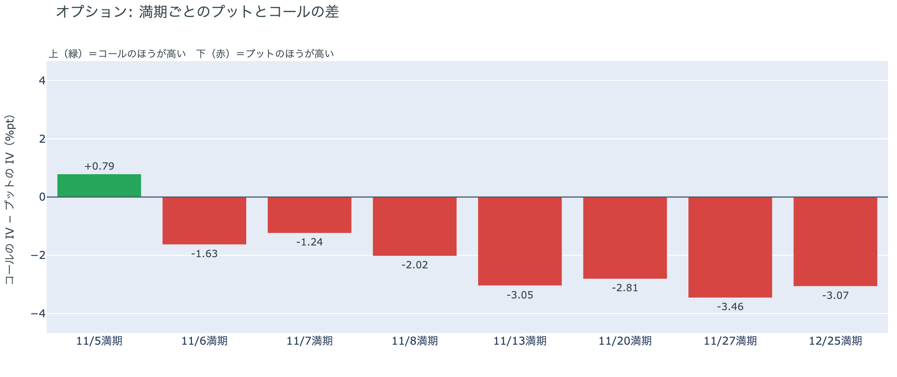

*図の見方: 満期ごとに、プットとコールのどちらが高く売れているか。ゼロより上ならコールのほうが高く、下ならプットのほうが高い。*

| 満期 | どちらが高いか |
|---|---|
| 11月5日 | コールが高い（前日はプットが高かった） |
| 11月6日 | プットが高い（差は小さい） |
| 11月7日 | プットが高い（差は小さい） |
| 11月8日 | プットが高い |
| 11月13日 | プットがはっきり高い |
| 11月20日 | プットがはっきり高い |
| 11月27日 | プットがはっきり高い |
| 12月25日 | プットがはっきり高い |

参加者は、$80,000台に戻っても、先の下げへの備えを外していません。今日の夕方に満期が来る分だけはコールが高くなりましたが、明日以降の満期はすべてプットが高いので、上げが続くと確信しているわけではないということです。差が大きくなるのは11月13日の満期からで、11月10日の米10月CPI をまたいだ先に当たります。前日は「いちばん身構えているのは結果が出始めた直後の下げ」と説明しました。実際に結果が出た昼に下げ、その身構えは今日の満期からは消えているので、前日の説明は今日の数値と合っています。

**図④-3 12月25日満期の持ち高（権利の価格ごと）**

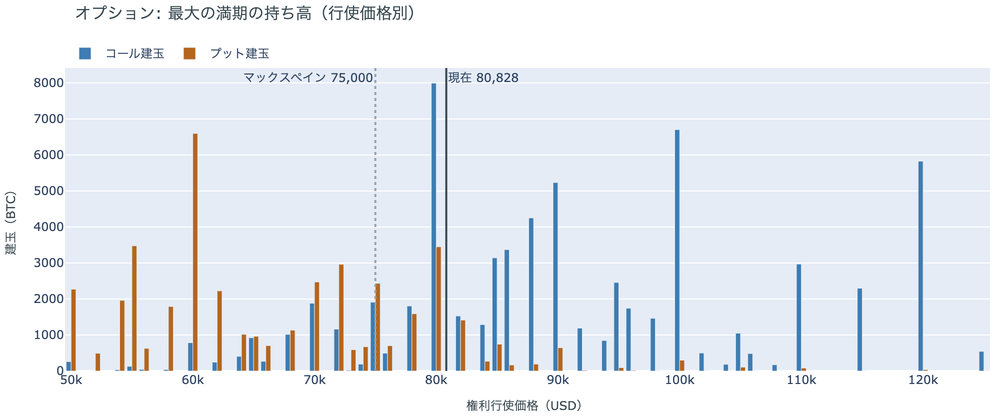

*図の見方: 青＝コール、橙＝プット。現値より上にコールが、下にプットが積まれるのが普通です。*

| 12月25日満期のオプション（基準の価格は約$80,800） | 量（万BTC） | 意味 |
|---|---:|---|
| いまより高い価格のコール | 約6.3 | 「価格が上がる」に賭けた分 |
| いまより安い価格のプット | 約5.2 | 「価格が下がる」への保険 |
| うち、いまより15%以上高い価格のコール | 約4.3 | 大きな上げへの賭け |
| うち、いまより15%以上安い価格のプット | 約3.7 | 大きな下げへの保険 |

* 12月25日満期の持ち高は約13.9万BTCと全満期の41%で、コールがプットの1.5倍。前日とほぼ同じ形。

年末の最大の満期でも、「価格が上がる」に賭けた人たちは降りておらず、年末までの上げへの期待は保たれています。いまより高い価格のコールの7割近くは15%以上高い価格に積まれていて、その賭けが報われるには、12月25日の夕方5時までに約$93,000を超える必要があります。全満期でオプションの持ち高が集まっているのは$78,000〜$82,000の帯で、$80,000がいちばん多く、価格はいまその帯の真ん中にいます。

## 4. 価格に影響しうる直近のイベント

オプション市場が上乗せを置いているのは金曜の夜の米10月雇用統計をまたぐ11月7日の満期で、プットがはっきり高くなるのは、米10月CPI をまたぐ11月13日の満期から先です。

| 日付 | イベント | 何に効くか |
|---|---|---|
| 11/2（月）〜 | 米国とイランの協議（カタールが仲介）。合意には至っていない | 原油 |
| 11/6（金）22:30 日本時間 | 米10月雇用統計 | 金利。11月7日満期の上乗せはこの日 |
| 11/10（火）22:30 日本時間 | 米10月CPI | 金利 |
| 12/9（水） | FOMC。利上げの織り込みは約10割。結果は日本時間10日早朝 | 金利 |
| 12/25（金）17:00 | オプションの最も大きな満期（約13.9万BTC、全満期の41%） | 約$93,000以上のコールの期限 |
| 2027年1月 | 中間選挙で選ばれた新しい議会が始まる | CLARITY法案の行方 |

## まとめ

水曜日は、中間選挙の結果をきっかけに、昼の下げのあと夜に先物のショートの買い戻しを通って、ビットコインは$80,000台へ上げました。動いたのは先物の持ち高で、アメリカの買い手と長期保有者は売りの側にいたままです。参加者は選挙という山を越えて先物の下げへの賭けを一部降ろしましたが、上げが続くとまでは見ておらず、オプションでは米10月雇用統計から先の下げへの備えを外していません。

---

<small>（数値は11月5日7時7分（日本時間）までのデータに基づきます。価格・先物・オプションはその時点の値、市場心理は11月4日の確定値、オンチェーン（＝ブロックチェーン上の記録）は11月3日時点（長期保有者SOPRとマイナーの収入は10月28日時点）、ETF資金フローは11月3日分までです。証券市場の終値は11月4日時点です。オンチェーンの長期保有者の数値には、ETFや取引所が預かっている分も含まれます。オプションはDeribit（BTCオプションの大半を占める取引所）の全銘柄です。）</small>

*本稿は情報提供を目的としたものであり、投資助言ではありません。将来の価格動向を保証・示唆するものではなく、投資判断は各自の責任において行ってください。*
