# 米国株4%安の夜に$75,000台へ ― ロングの手仕舞いで前夜の上げが消え、備えは手前の満期へ

**2026年11月6日**

ビットコインは木曜日の夜、米国株が急落した時間に$80,000台から$75,000台へ下げ、前の晩の上げをすべて失いました。

* **価格**：24時間の値幅は7.2%と前日に続いて大きく、朝7時5分の時点で約$75,854。この1週間の安値の近くまで戻された水準です
* **きっかけ**：AI関連と半導体の株を中心にした米国株の急落と同じ時間でした。金は上げ、米10年債利回りは下げていたので、金利の上昇に押された下げではありません
* **先物**：下げを運んだのは買い持ち（ロング）の手仕舞いです。建玉（＝先物の未決済残高。証拠金で張っている人の量）が減りながら価格が下げ、清算（＝証拠金不足で強制的に閉じられた取引）がその動きを加速させました。未明には新しい持ち高が積まれていて、参加者はこの水準で賭けをやめてはいません
* **需給の土台**：下げの夜に米国の取引所の売りが一段と強まりました。米国の買い手と長期保有者（＝155日以上保有者）が売りの側にいる形は前日から変わっておらず、売りは続いています
* **オプションの見方**：下げへの備えが手前の満期まで広がり、今夜の米10月雇用統計を前に身構えを強めました。一方で年末に向けたコールは降ろしておらず、流れが変わったとまでは見ていません

## 1. 何が起きたか

**図1-1 価格の推移（1時間足・直近7日）**

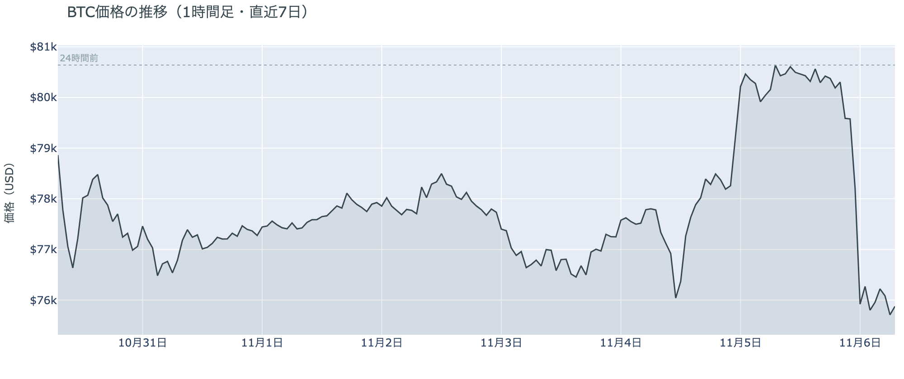

*図の見方: 1時間ごとの価格（日本時間）。点線は24時間前の水準です。木曜の夜に線が一段で落ち、金曜の未明からは$76,000前後で平らになっています。*

* 朝7時5分の価格は24時間前より−5.95%。7日間の安値$75,431もこの夜に付いた。
* 21時台から0時台の4時間で、価格は−5.5%、建玉は−5.2%。

木曜日の夜の下げは、持っていたロングを手仕舞う動きが運んだ下げでした。昼のあいだ$80,000台で動かなかった価格は、21時台に一段下げ、米国株の取引が始まる23時30分の前後から一気に$76,000台まで落ちています。この間は価格と建玉がほぼ同じ割合で減っているので、新しい売りが積まれたのではなく、上げに賭けていた人が降りた形です。下げが止まった1時台から2時台には建玉が3%あまり戻っていて、$76,000前後で新しい持ち高が積まれました。

**図1-2 価格と50日・200日移動平均**

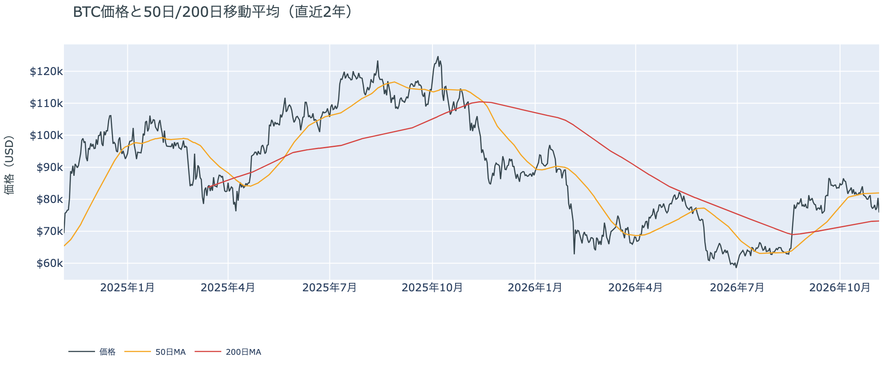

*図の見方: 2本の平均線の上下関係を見ます。50日線が200日線の上にあるのがゴールデンクロスです。*

* 50日線と200日線の差は約$8,795（12.0%）で、前日とほぼ同じ。
* 朝7時5分の価格は50日線を7.5%下回り、前日の2.2%から下へ開いた。

長い目で見た流れの向きは変わっていません。ゴールデンクロス（＝50日線が200日線を上抜けること）の状態が59日目です。ただ、価格は50日線からさらに離れて下にいるので、この1週間の下げで生まれた短い目の弱さは、前の晩の上げで解消しないまま戻ってきました。

木曜11月5日の証券市場は、米国株（S&P500）が−4.4%で終わり、VIX（＝株式市場の恐怖指数）は28まで上がりました。株の売りが取引の終わりまで続いたので、ビットコインから見ると、株安という材料を抱えたまま今夜の米10月雇用統計を迎える状態です。

**図1-3 実際に起きた清算（Hyperliquid・直近24時間）**

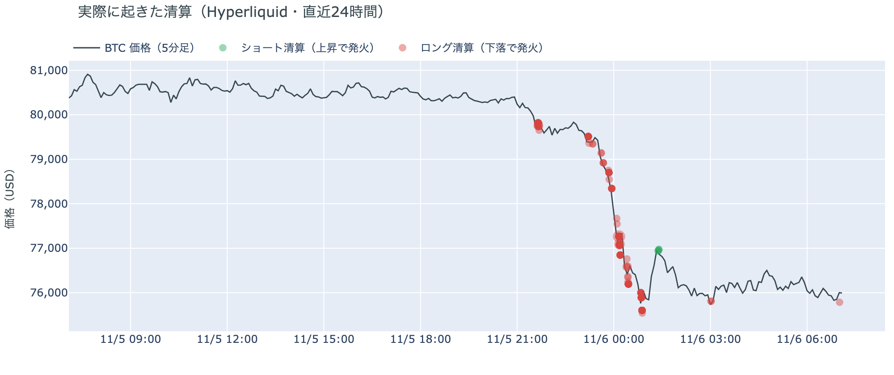

*図の見方: 5分ごとの価格（日本時間）に、Hyperliquidで見えた清算を重ねたもの。赤がロング、緑がショートの清算で、点の大きさが量です。*

* 拾えた清算の93%は、値動きの速い上位1割の5分足に入っていた。
* ほぼすべてがロングの清算で、0時台に全体の66%が集まった。

清算が下げを加速させました。Hyperliquid（＝オンチェーンの先物取引所）では、$79,000台から$76,000台にかけてロングの清算が続いています。ただ、最も大きい1つの口座が半分以上を占め、残りが小さな口座の多数なので、大口が1つ飛んだ夜です。

## 2. なぜ動いたか：きっかけと、需給のどこが動いたか

**図2-1 ビットコインと株・金・原油の相対推移（起点＝100）**

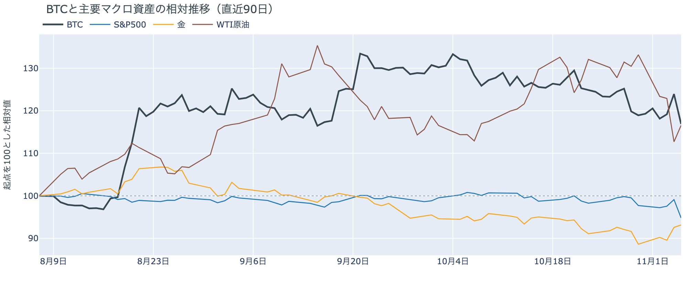

*図の見方: 同じ起点から何%動いたかで重ねたもの。線の向きが揃っているかを見ます。*

| この5営業日の動き（ビットコインは7日間） | 変化 |
|---|---:|
| ビットコイン | −2.5% |
| 金 | +1.7% |
| 米国株（S&P500） | −4.8% |
| 原油 | −10.7% |

* 建玉は94,627BTCで、前日の96,484BTCから1.9%減った。
* 12月のFOMCでの利上げの織り込みは、11月5日の先物の終値で約8割。前日は約10割。

木曜日は、米国株の急落をきっかけに、先物のロングの手仕舞いと清算を通って、$75,000台へ下げました。

1. きっかけ：AI関連と半導体の株を中心にした米国株の急落です。S&P500 の下げは2025年4月以来の大きさで、前夜に出た半導体企業の決算と、中間選挙で民主党が勝ったことによる AI のデータセンターへの規制の懸念が売りの材料と報じられています。ビットコインの速い下げは米国株の取引開始と同じ時間で、向きも同じです。一方で、金は+0.6%と逆向きで、米10年債利回りも同じ時間に4.90%から4.84%へ下げ、12月の FOMC（＝米国の金利を決める会合）での利上げの織り込みも薄れました。金と共通のきっかけではなく、金利の上昇に押された下げでもありません。原油は米国とイランの協議の行方が定まらないとして+3.4%と、前日の急落の一部を戻しましたが、金利の見通しが和らいだ夜なので、この下げに効いた形跡はありません。ビットコインに固有の出来事で、この値動きに合うものは見当たりません。同じ夜に伝わった Binance のハッキング（10月29日）の続報は米当局が銀行への影響を確かめているという話で、新しい資金の流出ではありません。マイナー企業の Keel が保有するビットコインを売り切ったという開示も、売却自体は7〜9月のことです。
2. 伝わり方：速い側では、先物のロングの手仕舞いが下げを運び、清算がそれを加速させました。遅い側のアメリカの買い手は、もともと売りの側にいたところへ、この夜はさらに売りを強めています（図①-1）。長期保有者の利益確定の売りも続いています（図②-1）。どちらも1週間平均で見た向きは前からのもので、この夜に向きが変わったのではありません。

米国株はその後も取引の終わりまで下げ幅を広げましたが、ビットコインは0時台に付けた安値を割っていません。建玉も1時台から戻っているので、ロングの手仕舞いは0時台でひと区切りつき、株に引きずられた売りはそれ以上続かなかったということです。

前日は「$80,000台への上げは、新しい買いが積まれたのではなく、下げに賭けていた人が降りた上げ」と説明しました。新しい買いに支えられていなかった上げが、株安の夜に1日で消えたので、前日の説明は今日の数値と合っています。

## 3. 市場参加者はいまどう見ているか

### ① アメリカの買い手は下げの夜に売りを強め、買いの側には戻っていない

**図①-1 Coinbase Premium（アメリカとそれ以外の価格差・直近90日）**

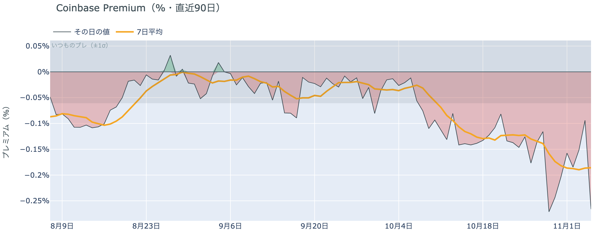

*図の見方: プラス＝アメリカで買いが強い。太線が1週間平均、細線がその日の値。薄い帯は「いつものブレの範囲」です。*

* 1週間平均は−0.19%で、前の週の1週間平均−0.16%より深い。
* 木曜のその日の値は−0.27%で、いつものブレの4.4倍。

アメリカの買い手は、この下げを買いの機会とは見ていません。Coinbase Premium（＝アメリカとそれ以外の価格差）がいつものブレを大きく超えて沈んだので、下げの夜にアメリカの取引所で、ほかの取引所より強く売られたということです。同じ深さまで沈んだのは10月29日の下げの日で、大きく下げる日にアメリカの側から売りが出る形が続いています。

**図①-2 ETFの日ごとの資金の出入り（直近90日）**

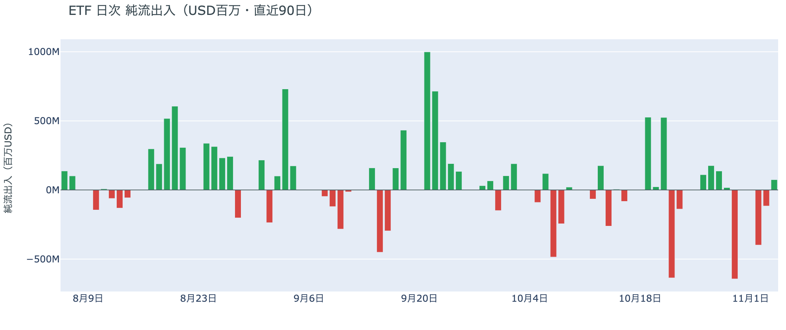

*図の見方: 入ったお金と出たお金の差。上に伸びれば入り超、下に伸びれば出超。*

| ETFの日ごとの出入り | 億ドル |
|---|---:|
| 10月29日 | +0.2 |
| 10月30日 | −6.4 |
| 11月2日 | −4.0 |
| 11月3日 | −1.2 |
| 11月4日 | +0.7 |
| 直近7営業日の合計 | −7.5 |

ETF の買い手は、売りを急ぐのはやめましたが、上げを追って買うほどの確信は持っていません。3営業日続いた流出は11月4日に入り超へ変わったものの、$80,000台へ上げたその日でも額は小さく、1週間の合計はまだ流出です。木曜の夜の下げにどう応じたかは、11月5日の分に出ます。

**図①-3 Fear & Greed（市場心理の指数・直近90日）**

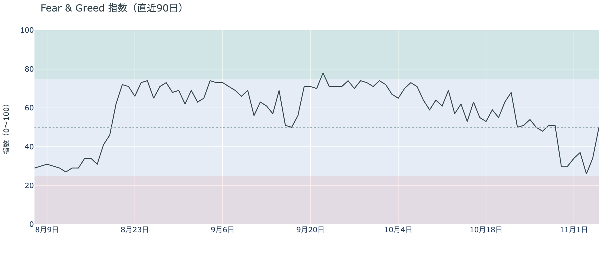

*図の見方: 0〜100で、50より上が「強欲」、下が「恐怖」。*

* 50の「中立」。前日の34から16pt上げた。1週間前は51、1か月前は73。

この数字は、前の晩の上げを映したものです。Fear & Greed（＝市場心理の指数）は水曜の夜の上げで「恐怖」から「中立」へ戻りましたが、11月5日の値なので、木曜の夜の下げはまだ入っていません。1日の上げで大きく振れたので、この指数はいまの参加者の確信より、直前の値動きをそのまま映しています。

### ② 長期保有者は利益確定の売りを続け、減り方は前の週より大きい

**図②-1 長期保有者の保有量の30日変化とSOPR（直近90日）**

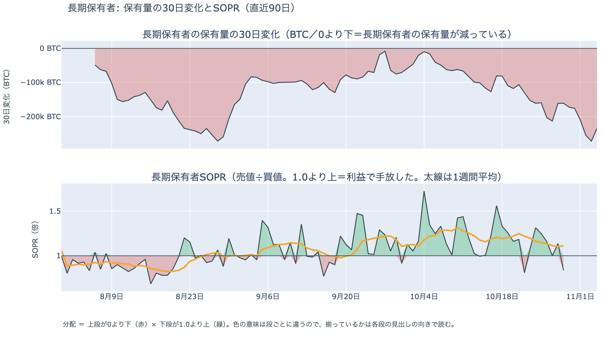

*図の見方: 上段は、長期保有者の保有量が30日でどれだけ増減したか。マイナス＝手放している。下段は長期保有者SOPRで、1より上なら利益で手放した。どちらも太線の1週間平均で読みます。*

| | 1週間平均 | 前の週の平均 |
|---|---:|---:|
| 長期保有者SOPR（1より上＝利益で手放した・10月29日時点） | 1.11 | 1.22 |
| 長期保有者の保有量の30日変化（万BTC・11月4日時点） | −21.2 | −16.9 |

* 11月4日時点の30日変化は−23.5万BTCで、1か月前（10月5日）の−1.6万BTCから大きく膨らんだ。

長期保有者は、$70,000台を売りを止める水準とは見ていません。保有量は30日で減り、動いたコインは平均して買値より高く動いているので、利益確定の売りが続いていて、減り方は前の週より大きくなっています。買値との差は前の週より縮んでいて、手放すときの利益は細っていますが、それでも売りは止まっていません。11月4日時点までの数字なので、木曜の夜の下げのあとの動きはまだ入っていません。

長期保有者のほかに、売りに回りそうな持ち手は見当たりません。長く眠っていたコインが急に動いた記録はなく、マイナーの収入は平年をやや上回る程度（Puell Multiple（＝マイナー収入の平年比）が10月29日時点の1週間平均で約1.1）で、売りを急ぐ状況ではありません。

### ③ 先物：ロングは減ったが、余分な金利を払って持ち続ける人が残っている

**図③-1 資金調達率と建玉（直近30日）**

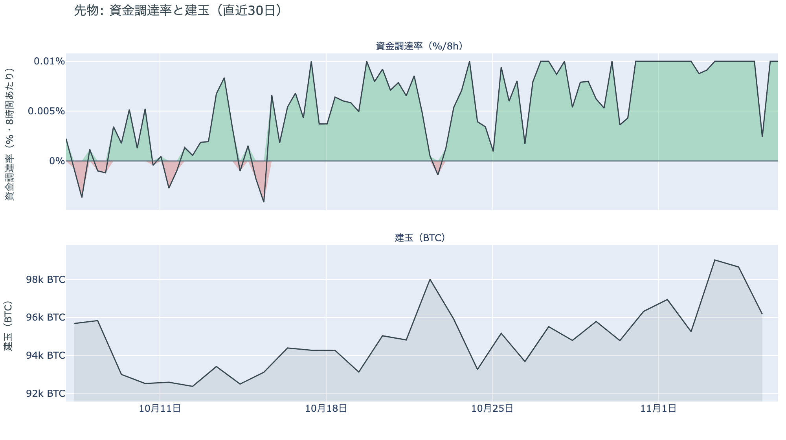

*図の見方: 上段は資金調達率（8時間ごと・日本時間）。プラスが続く＝ロングがショートより多い。下段は建玉。*

* 1日をならした年率は+8.18%で、短期金利（13週Tビル 3.99%）を引いた上乗せは+4.19pt。
* 上乗せは直近34日の平均+1.51ptの約2.8倍。建玉は1週間前より0.4%多い。

先物の参加者は下げでロングを減らしましたが、上げへの見方を捨ててはいません。資金調達率（＝ロングが払う金利。プラス＝ロングがショートより多い）がプラスのまま建玉が減ったので、ロングへの傾きは弱まりました。それでも、ロングが短期金利（＝ドルを米国の短期国債で持つだけで受け取れる金利）より余分に払う額はこの1か月の平均を大きく上回っています。余分を払ってでも持ち続けているので、上げをまだ見ている人が残っているということです。未明に積まれた持ち高を入れると建玉は1週間前とほぼ同じで、この下げでロングが一掃された形にはなっていません。

### ④ オプション：下げへの備えは手前の満期まで広がり、年末のコールは残っている

オプションには2種類あります。コール（＝決めた価格で買う権利）とプット（＝決めた価格で売る権利）で、価格が上がればコールの価値が上がり、価格が下がればプットの価値が上がります。プットは「価格が下がったときの保険」として買われます。オプションを買う人は、その権利と引き換えに権利料（＝オプションを買う人が払う金額）を払います。

**図④-1 満期ごとのIV（年率%）**

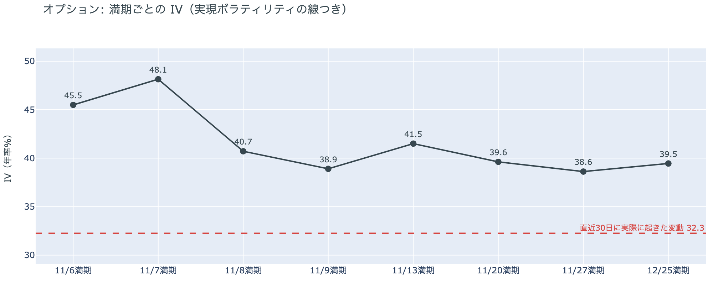

*図の見方: IVを満期ごとに並べたもの。点線は実現ボラティリティ。IVが点線より下なら、市場はこの先の値動きを過去の値動きより小さいと見ています。*

| 満期 | IV | 前日のIV |
|---|---:|---:|
| 11月6日 | 46 | 33 |
| 11月7日 | 48 | 36 |
| 11月8日 | 41 | 32 |
| 11月9日 | 39 | — |
| 11月13日〜12月25日 | 39〜42 | 34〜37 |

* IVは全体で38.1で、実現ボラティリティ32.3より5.8pt高い。

参加者は、木曜の下げのあと、次に大きく動くのは今夜の米10月雇用統計だと見ています。IV（＝値動きの幅の予想）は全体で実現ボラティリティ（＝過去の値動きの幅）より高いので、これから先の値動きを、これまでの値動きより大きいと見ているということです。ただ、全体の IV は過去1年のちょうど真ん中で、怖がっているとまでは言えません。満期ごとに見ると、どの満期でも IV は前日より上がりました。その中でも11月7日に満期が来るオプションの権利料には、前後の満期に対する上乗せが乗っています。今夜の米10月雇用統計をまたぐ最初の満期だからです。

**図④-2 満期ごとのプットとコールの差**

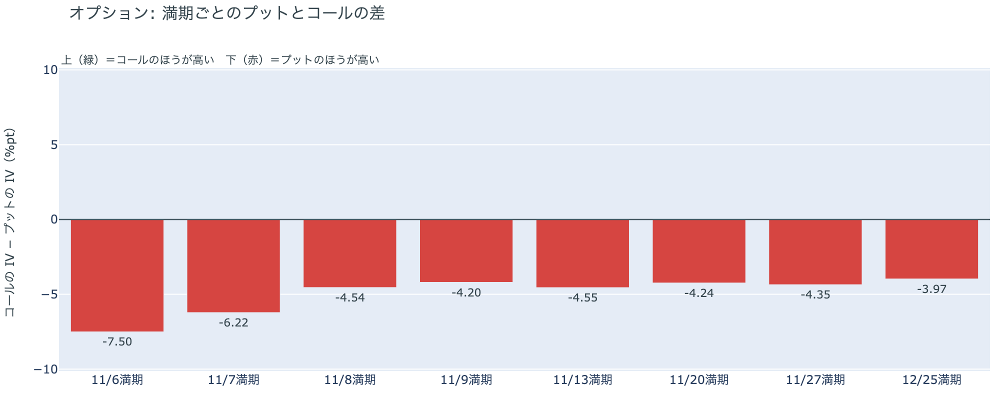

*図の見方: 満期ごとに、プットとコールのどちらが高く売れているか。ゼロより上ならコールのほうが高く、下ならプットのほうが高い。*

| 満期 | どちらが高いか |
|---|---|
| 11月6日 | プットがいちばんはっきり高い（前日は差が小さかった） |
| 11月7日 | プットがはっきり高い（前日は差が小さかった） |
| 11月8日 | プットが高い |
| 11月9日 | プットが高い |
| 11月13日 | プットが高い |
| 11月20日 | プットが高い |
| 11月27日 | プットが高い |
| 12月25日 | プットが高い |

参加者は$75,000台まで下げても、さらなる下げへの備えを外さず、手前の満期まで広げました。前日は差が小さかった今日と明日の満期でプットの高さがいちばん目立つので、いま最も警戒しているのは目の前の下げだということです。前日は「$80,000台に戻っても下げへの備えを外していない」と説明しました。備えていた側へ価格が実際に下げたので、前日の説明は今日の数値と合っています。

**図④-3 12月25日満期の持ち高（権利の価格ごと）**

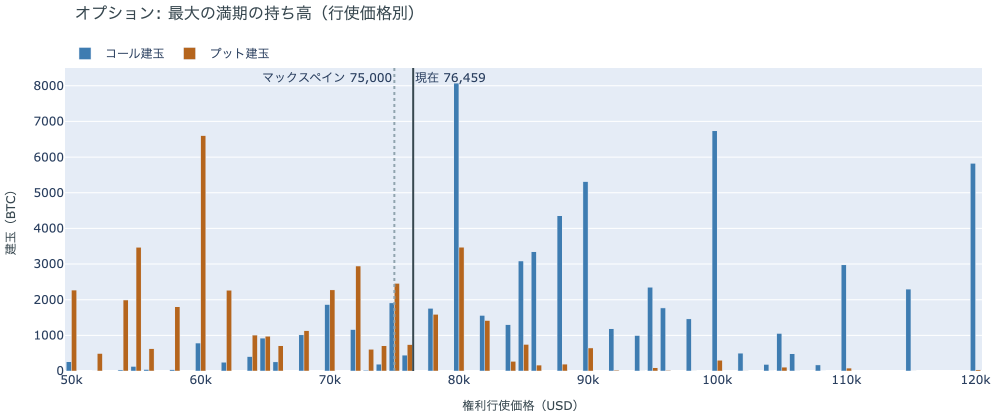

*図の見方: 青＝コール、橙＝プット。現値より上にコールが、下にプットが積まれるのが普通です。*

| 12月25日満期のオプション（基準の価格は約$76,500） | 量（万BTC） | 意味 |
|---|---:|---|
| いまより高い価格のコール | 約7.3 | 「価格が上がる」に賭けた分 |
| いまより安い価格のプット | 約4.7 | 「価格が下がる」への保険 |
| うち、いまより15%以上高い価格のコール | 約5.4 | 大きな上げへの賭け |
| うち、いまより15%以上安い価格のプット | 約3.4 | 大きな下げへの保険 |

* 12月25日満期の持ち高は約13.9万BTCと全満期の40%で、コールがプットの1.5倍。前日とほぼ同じ形。

年末の最大の満期では、「価格が上がる」に賭けた人たちが$75,000台への下げでも降りておらず、年末までの上げへの期待は保たれています。手前の満期で下げに備えながら年末の賭けを残しているので、参加者はこの下げを流れの変化とまでは見ていないということです。その賭けが報われるには、12月25日の夕方5時までに約$88,000を超える必要があります。全満期でオプションの持ち高が集まっているのは$74,000〜$80,000の帯で、価格はいまその帯の中にいます。

## 4. 価格に影響しうる直近のイベント

オプション市場が上乗せを置いているのは今夜の米10月雇用統計をまたぐ11月7日の満期で、プットの高さがいちばん目立つのも今日と明日の満期です。

| 日付 | イベント | 何に効くか |
|---|---|---|
| 11/2（月）〜 | 米国とイランの協議（カタールが仲介）。イランは仲介案を検討中と報じられ、合意には至っていない | 原油 |
| 11/6（金）22:30 日本時間 | 米10月雇用統計 | 金利。11月7日満期の上乗せはこの日 |
| 11/10（火）22:30 日本時間 | 米10月CPI | 金利 |
| 12/9（水） | FOMC。利上げの織り込みは約8割。結果は日本時間10日早朝 | 金利 |
| 12/25（金）17:00 | オプションの最も大きな満期（約13.9万BTC、全満期の40%） | 約$88,000以上のコールの期限 |
| 2027年1月 | 中間選挙で選ばれた新しい議会が始まる | CLARITY法案（＝暗号資産の市場構造法案）の行方 |

## まとめ

木曜日は、米国株の急落をきっかけに、先物のロングの手仕舞いと清算を通って、ビットコインは$75,000台へ下げました。アメリカの買い手は下げの夜に売りを強めましたが、長期保有者とともに前から売りの側にいたので、持ち方まで変わったわけではありません。参加者は手前で下げへの備えを厚くしながらも、残ったロングと年末のコールは降ろしておらず、今夜の米10月雇用統計を警戒しつつ、流れが変わったとまでは見ていません。

---

<small>（数値は11月6日7時7分（日本時間）までのデータに基づきます。価格・先物・オプションはその時点の値、市場心理は11月5日の確定値、オンチェーン（＝ブロックチェーン上の記録）は11月4日時点（長期保有者SOPRとマイナーの収入は10月29日時点）、ETF資金フローは11月4日分までです。証券市場の終値は11月5日時点です。オンチェーンの長期保有者の数値には、ETFや取引所が預かっている分も含まれます。オプションはDeribit（BTCオプションの大半を占める取引所）の全銘柄です。）</small>

*本稿は情報提供を目的としたものであり、投資助言ではありません。将来の価格動向を保証・示唆するものではなく、投資判断は各自の責任において行ってください。*
