# 足踏みの$75,000台 ― 米10月雇用統計でも動かず、新しいショートが積まれた

**2026年11月7日**

ビットコインは金曜日、米10月雇用統計が強く出ても$75,000台からほとんど離れず、24時間ではほぼ横ばいでした。

* **価格**：24時間の値幅は2.1%と前日の7.2%から3分の1以下に縮み、朝7時5分の時点で約$75,950。前夜の急落のあと、下げも戻しも続かなかった1日です
* **きっかけ**：米10月雇用統計は予想を大きく上回りましたが、出た前後で価格はほとんど動いていません。はっきりしたきっかけは見当たりません
* **先物**：0時前後の短い下げで建玉（＝先物の未決済残高。証拠金で張っている人の量）が増え、売り持ち（ショート）が新しく積まれました。買い持ち（ロング）も降りていないので、$75,000台への見方は上下に割れています
* **需給の土台**：米国の買い手は前夜の下げで ETF から資金を引き、長期保有者（＝155日以上保有者）の利益確定の売りも続いています。売りは止まっていませんが、金曜の夜の動きで強まった形もありません
* **オプションの見方**：米10月雇用統計を通過して目先の身構えは解け、下げへの備えの厚みは11月13日以降の満期へ移りました。年末に向けたコールは残したままで、流れが変わったとまでは見ていません

## 1. 何が起きたか

**図1-1 価格の推移（1時間足・直近7日）**

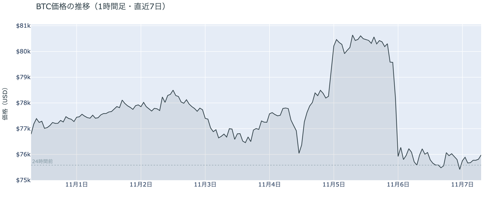

*図の見方: 1時間ごとの価格（日本時間）。点線は24時間前の水準です。木曜の夜に一段で落ちたあと、線は$76,000のすぐ下でほぼ平らです。*

* 朝7時5分の価格は24時間前より+0.5%で、1日を通してほとんど変わらなかった。
* 拾えた清算の64%は朝9時台のショートの大口1件。0時台のロングに32%が集まった。

前夜の急落のあと、価格は動くのをやめました。ひとつだけ動いたのは米国株の取引が始まったあとの0時前後で、$74,722まで下げて前日の安値を一時割りましたが、15分ほどで$75,700台へ戻しています。この直前の23時台は価格が下げながら建玉が増えているので、手仕舞いではなく、下げに賭ける新しいショートが積まれた形です。Hyperliquid（＝オンチェーンの先物取引所）で見える清算（＝証拠金不足で強制的に閉じられた取引）は0時直後の速い下げに入っていて、清算がこの下げを加速させました。

**図1-2 価格と50日・200日移動平均**

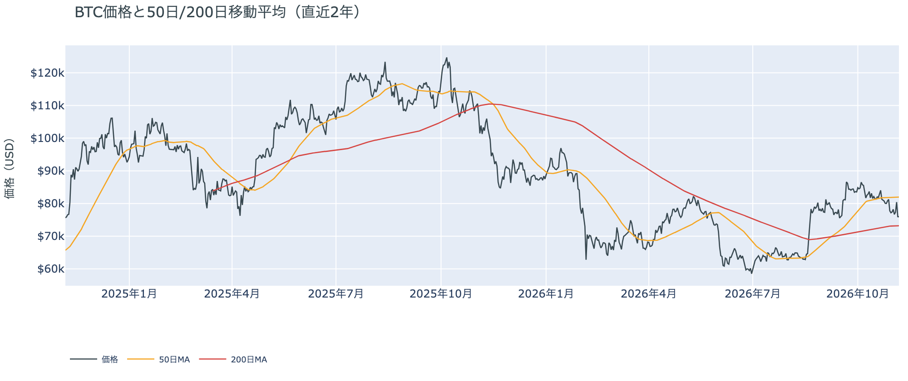

*図の見方: 2本の平均線の上下関係を見ます。50日線が200日線の上にあるのがゴールデンクロスです。*

* 50日線と200日線の差は約$8,788（12.0%）で、前日とほぼ同じ。
* 朝7時5分の価格は50日線を7.4%下回っている。

長い目で見た流れの向きは変わっていません。ゴールデンクロス（＝50日線が200日線を上抜けること）の状態が60日目です。ただ、価格は50日線の下にとどまったままで、木曜の夜に開いた差は埋まっていないので、短い目の弱さは続いています。

金曜11月6日の米国株（S&P500）は+0.3%と小さく戻して終わり、VIX（＝株式市場の恐怖指数）は25.6と1週間前の19台より高いままです。ビットコインから見ると、前夜の株安は止まったものの、株の不安が消えないまま週末に入った状態です。

## 2. なぜ動いたか：きっかけと、需給のどこが動いたか

**図2-1 ビットコインと株・金・原油の相対推移（起点＝100）**

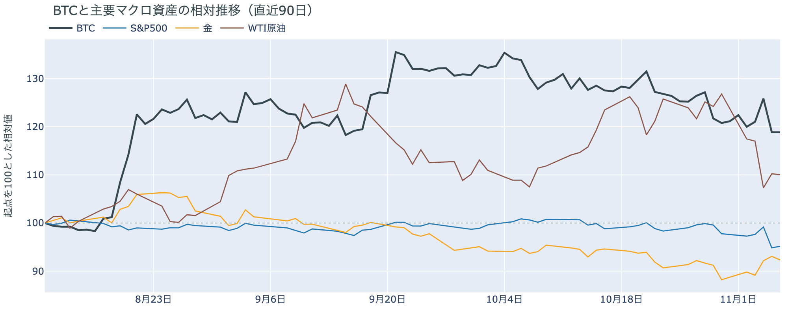

*図の見方: 同じ起点から何%動いたかで重ねたもの。線の向きが揃っているかを見ます。*

| この5営業日の動き（ビットコインは7日間） | 変化 |
|---|---:|
| ビットコイン | −1.6% |
| 金 | +4.7% |
| 米国株（S&P500） | −2.7% |
| 原油 | −13.2% |

* 建玉は96,277BTCで、前日の94,627BTCから1.7%増えた。
* 12月のFOMCでの利上げの織り込みは、11月6日の先物の終値で約9割。前日は約8割。

金曜日は、はっきりしたきっかけが無いまま、先物に新しいショートが積まれただけで、価格は$75,000台からほとんど離れませんでした。

1. きっかけ：はっきりしたきっかけは見当たりません。米10月雇用統計は雇用者数が16.5万人増と予想を大きく上回り、失業率も4.1%へ下がって、12月の FOMC（＝米国の金利を決める会合）での利上げの織り込みを押し戻しました。ただ、22時30分に米10月雇用統計が出た前後で価格はほとんど動いていません。0時前後の下げは、米国株が取引開始から上げていた時間に起きているので、米国株と共通のきっかけではありません。同じ時間の米10年債利回りも4.86〜4.88%の幅に収まっていて、金利の上昇に押された下げでもありません。原油はこの5営業日で大きく下げました。米国とイランの協議が進むとの報道と、サウジアラビアとUAEの輸出の回復が材料とされていますが、合意には至っておらず、ホルムズ海峡では船舶への攻撃が続いています。金曜の原油は−0.2%で、今日の値動きに効いた形跡はありません。同じ金曜に米財務省が暗号資産取引所の MEXC を米国の金融システムから遮断する命令を出しましたが、これも値動きに効いた形跡はありません。
2. 伝わり方：速い側では、先物の新しいショートが0時前後の下げを運び、清算がそれを加速させました。ただ、すぐに戻しているので、値動きとして残っていません。遅い側のアメリカの買い手と長期保有者は、前から売りの側にいます。1週間平均で見たアメリカの買い手は前の週より深く沈んでおらず（図①-1）、金曜の夜の動きはアメリカの買い手と長期保有者までは届いていません。

前日は「ロングの手仕舞いは0時台でひと区切りつき、株に引きずられた売りはそれ以上続かなかった」と説明しました。金曜の夜は前日の安値を一時割りましたが、建玉は減らずに増えていて、米国株も戻しています。ロングの手仕舞いが再開した形ではないので、前日の説明は今日の数値と合っています。

## 3. 市場参加者はいまどう見ているか

### ① アメリカの買い手は売りの側のままで、買いには戻っていない

**図①-1 Coinbase Premium（アメリカとそれ以外の価格差・直近90日）**

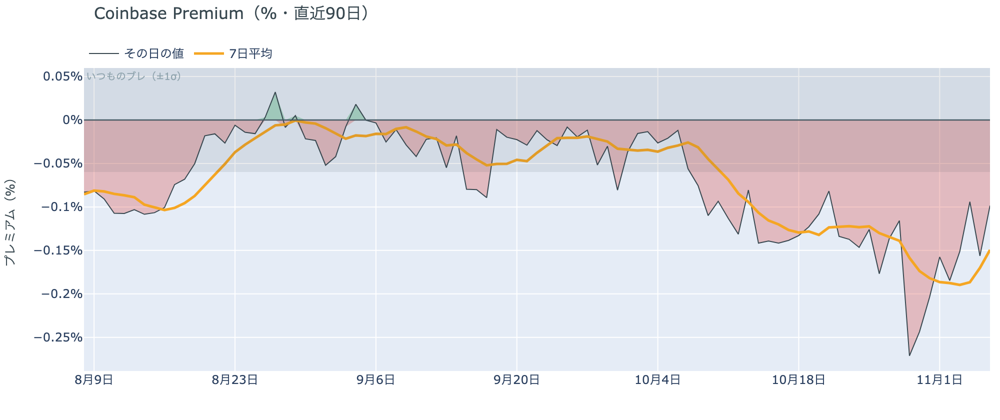

*図の見方: プラス＝アメリカで買いが強い。太線が1週間平均、細線がその日の値。薄い帯は「いつものブレの範囲」です。*

* 1週間平均は−0.15%で、前の週の1週間平均−0.17%より少し浅い。
* 11月6日の値は−0.10%で、いつものブレの1.6倍。1週間平均より浅い。

アメリカの買い手は、$75,000台を買いの機会とは見ていません。Coinbase Premium（＝アメリカとそれ以外の価格差）は1週間平均でマイナスのままなので、アメリカの取引所のほうがほかの取引所より弱く、売りの側にいるということです。ただ、前の週より深くはなっていないので、売りをさらに強めているわけでもありません。前日は木曜の値を−0.27%と書きましたが、これは下げの直後の数字で、1日を終えた値は−0.16%まで戻りました。10月29日の下げの日ほど深くは沈んでいません。

**図①-2 ETFの日ごとの資金の出入り（直近90日）**

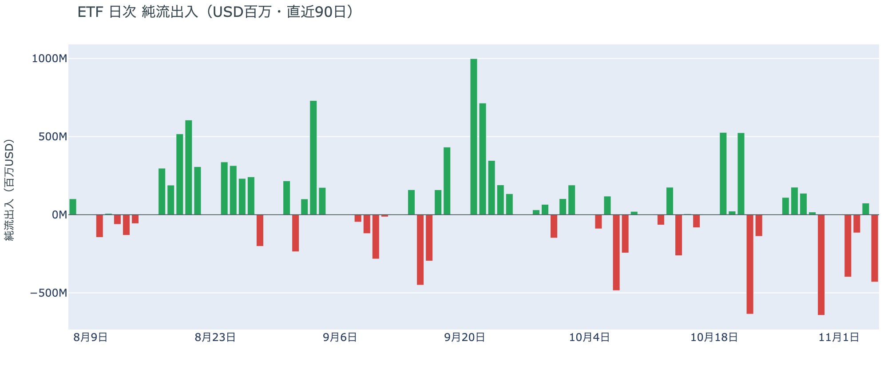

*図の見方: 入ったお金と出たお金の差。上に伸びれば入り超、下に伸びれば出超。*

| ETFの日ごとの出入り | 億ドル |
|---|---:|
| 10月30日 | −6.4 |
| 11月2日 | −4.0 |
| 11月3日 | −1.2 |
| 11月4日 | +0.7 |
| 11月5日 | −4.3 |
| 直近7営業日の合計 | −13.6 |

ETF の買い手は、木曜の夜の下げを買いの機会とは見ず、資金を引いて応じました。小さな入り超は11月4日の1日だけで、この1週間は流出の側に戻っているので、ETF の買い手に下げを拾うほどの確信はありません。金曜の夜の動きにどう応じたかは、11月6日の分に出ます。

**図①-3 Fear & Greed（市場心理の指数・直近90日）**

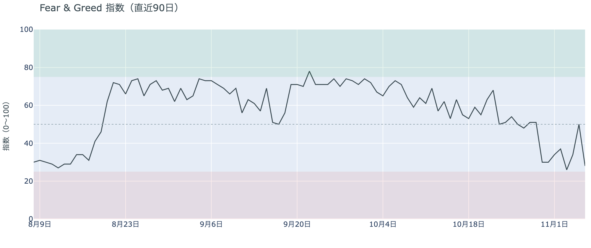

*図の見方: 0〜100で、50より上が「強欲」、下が「恐怖」。*

* 28の「恐怖」。前日の50から22pt下げた。1週間前は30、1か月前は71。

木曜の夜の急落で、市場心理は1日で「恐怖」へ戻りました。Fear & Greed（＝市場心理の指数）が「中立」にいたのは水曜の上げを映した1日だけで、この1週間はほぼ「恐怖」の側にいます。参加者の多くは、いまは上げより下げを気にしているということです。

### ② 長期保有者は利益確定の売りを続け、減り方は前の週より大きい

**図②-1 長期保有者の保有量の30日変化とSOPR（直近90日）**

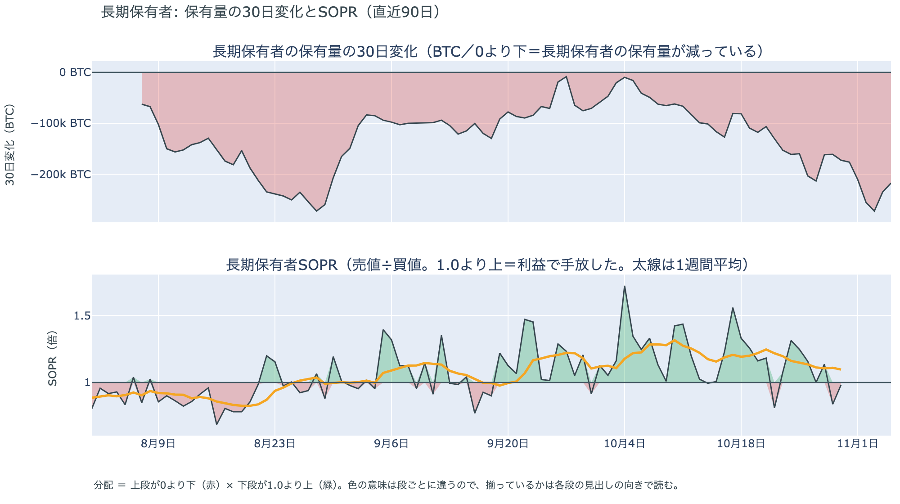

*図の見方: 上段は、長期保有者の保有量が30日でどれだけ増減したか。マイナス＝手放している。下段は長期保有者SOPRで、1より上なら利益で手放した。どちらも太線の1週間平均で読みます。*

| | 1週間平均 | 前の週の平均 |
|---|---:|---:|
| 長期保有者SOPR（1より上＝利益で手放した・10月30日時点） | 1.10 | 1.20 |
| 長期保有者の保有量の30日変化（万BTC・11月5日時点） | −22.0 | −17.3 |

* 11月5日時点の30日変化は−21.7万BTCで、1か月前（10月6日）の−4.1万BTCから大きく膨らんだ。

長期保有者は、いまの価格を売りを止めるほど安いとは見ていません。保有量は30日で減り、動いたコインは平均して買値より高く動いているので、利益確定の売りが続いていて、減り方は前の週より大きくなっています。買値との差は前の週より縮んでいて、手放すときの利益は細っていますが、それでも売りは止まっていません。

長期保有者のほかに、売りに回りそうな持ち手は見当たりません。長く眠っていたコインが急に動いた記録はなく、マイナーの収入は平年をやや上回る程度（Puell Multiple（＝マイナー収入の平年比）が10月30日時点の1週間平均で約1.1）で、売りを急ぐ状況ではありません。

### ③ 先物：ロングは降りず、下げの途中では新しいショートが積まれた

**図③-1 資金調達率と建玉（直近30日）**

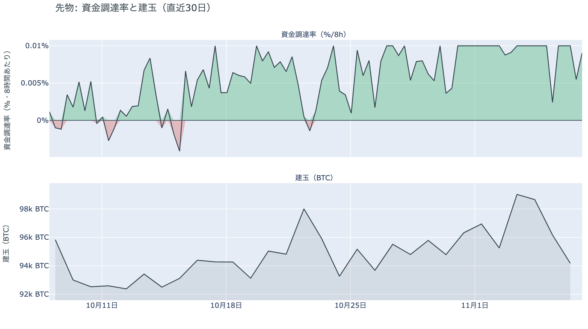

*図の見方: 上段は資金調達率（8時間ごと・日本時間）。プラスが続く＝ロングがショートより多い。下段は建玉。*

* 1日をならした年率は+8.95%で、短期金利（13週Tビル 4.00%）を引いた上乗せは+4.95pt。
* 上乗せは直近34日の平均+1.68ptの約3倍。建玉は1週間前より0.6%少ない。

先物の参加者の見方は、$75,000台で上下に割れています。下げの途中で建玉が増えたので、下げに賭ける人が新しく入りました。一方で資金調達率（＝ロングが払う金利。プラス＝ロングがショートより多い）はプラスのままで、ロングが短期金利（＝ドルを米国の短期国債で持つだけで受け取れる金利）より余分に払う額はこの1か月の平均を大きく上回っています。余分を払ってでも持ち続ける人が残っているので、上げへの見方も消えていません。どちらかが一掃された形ではないということです。

### ④ オプション：目先の身構えは解け、下げへの備えは11月13日以降の満期へ移った

オプションには2種類あります。コール（＝決めた価格で買う権利）とプット（＝決めた価格で売る権利）で、価格が上がればコールの価値が上がり、価格が下がればプットの価値が上がります。プットは「価格が下がったときの保険」として買われます。オプションを買う人は、その権利と引き換えに権利料（＝オプションを買う人が払う金額）を払います。

**図④-1 満期ごとのIV（年率%）**

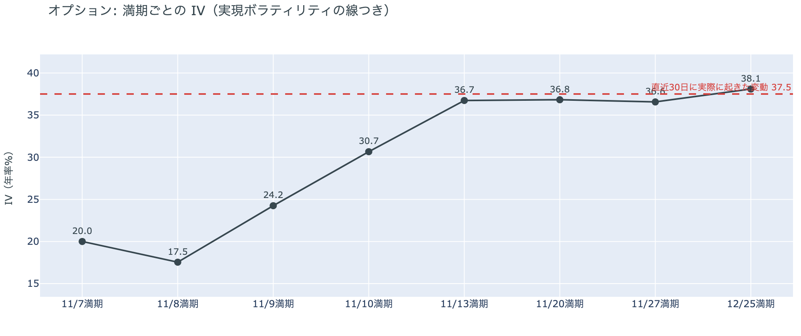

*図の見方: IVを満期ごとに並べたもの。点線は実現ボラティリティ。IVが点線より下なら、市場はこの先の値動きを過去の値動きより小さいと見ています。*

| 満期 | IV | 前日のIV |
|---|---:|---:|
| 11月7日 | 20 | 48 |
| 11月8日 | 18 | 41 |
| 11月9日 | 24 | 39 |
| 11月10日 | 31 | — |
| 11月13日〜12月25日 | 37〜38 | 39〜42 |

* 11月13日以降の満期のIVは、実現ボラティリティ37.5とほぼ同じ。

参加者は、この先を特別に怖がってはいません。IV（＝値動きの幅の予想）は11月13日の満期から先で実現ボラティリティ（＝過去の値動きの幅）とほぼ同じで、これから先の値動きを、これまでの値動きと同じくらいと見ています。11月10日の米10月CPI（＝米国の物価統計）をまたぐ11月13日の満期のオプションの権利料にも、ほかの満期に対する上乗せは乗っていません。手前の満期だけは大きく変わりました。11月7日に満期が来るオプションの権利料に前日まで乗っていた上乗せが、米10月雇用統計が過ぎて剥がれたからです。

**図④-2 満期ごとのプットとコールの差**

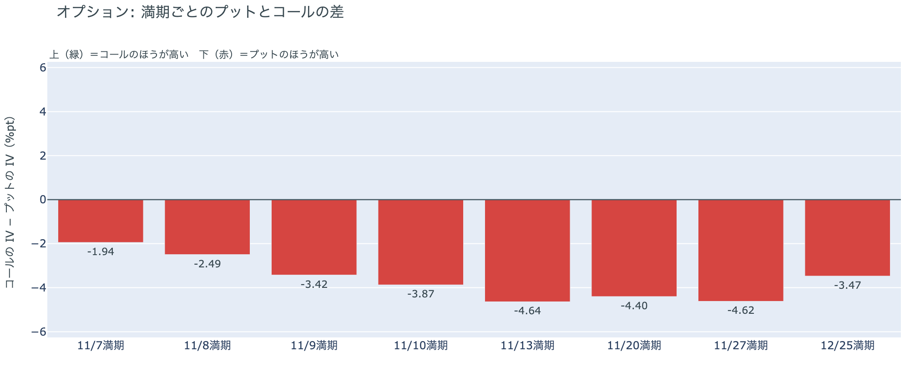

*図の見方: 満期ごとに、プットとコールのどちらが高く売れているか。ゼロより上ならコールのほうが高く、下ならプットのほうが高い。*

| 満期 | どちらが高いか |
|---|---|
| 11月7日 | プットが高い（前日より差が小さい） |
| 11月8日 | プットが高い |
| 11月9日 | プットが高い |
| 11月10日 | プットが高い |
| 11月13日 | プットがいちばんはっきり高い |
| 11月20日 | プットがはっきり高い |
| 11月27日 | プットがはっきり高い |
| 12月25日 | プットが高い |

参加者は、目先の下げより、その少し先の下げに備えています。前日にプットの高さがいちばん目立っていた手前の満期は差が小さくなり、いまいちばん差が大きいのは11月13日から27日の満期です。全部の満期でプットのほうが高いので、下げへの備えそのものは外していません。米10月雇用統計という目の前の材料が過ぎて、警戒する先を米10月CPIのあとへ移したということです。

**図④-3 12月25日満期の持ち高（権利の価格ごと）**

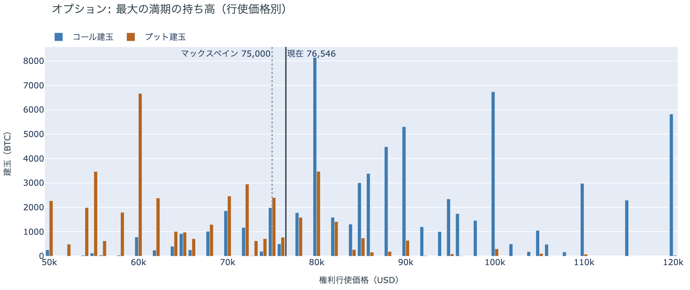

*図の見方: 青＝コール、橙＝プット。現値より上にコールが、下にプットが積まれるのが普通です。*

| 12月25日満期のオプション（基準の価格は約$76,500） | 量（万BTC） | 意味 |
|---|---:|---|
| いまより高い価格のコール | 約7.3 | 「価格が上がる」に賭けた分 |
| いまより安い価格のプット | 約4.7 | 「価格が下がる」への保険 |
| うち、いまより15%以上高い価格のコール | 約4.9 | 大きな上げへの賭け |
| うち、いまより15%以上安い価格のプット | 約3.5 | 大きな下げへの保険 |

* 12月25日満期の持ち高は約14.0万BTCと全満期の41%で、コールがプットの1.5倍。前日とほぼ同じ形。

年末の最大の満期では、「価格が上がる」に賭けた人たちが降りておらず、年末までの上げへの期待は保たれています。その手前で下げに備えながら年末の賭けを残しているので、参加者はいまの弱さを流れの変化とまでは見ていないということです。大きな上げに賭けた分が報われるには、12月25日の夕方5時までに約$88,000を超える必要があります。全満期でオプションの持ち高が集まっているのは$74,000〜$80,000の帯で、価格はいまその帯の中にいます。

## 4. 価格に影響しうる直近のイベント

オプション市場が下げへの備えをいちばん厚く置いているのは11月13日から27日の満期で、11月10日の米10月CPIのあとの区間です。ただ、どの満期の権利料にも、ほかの満期に対する上乗せは乗っていません。

| 日付 | イベント | 何に効くか |
|---|---|---|
| 11/10（火）22:30 日本時間 | 米10月CPI | 金利 |
| 11/13（金）22:30 日本時間 | 米10月の生産者物価指数 | 金利 |
| 11/19（木）4:00 日本時間 | FOMC の議事要旨（10月27〜28日分） | 金利 |
| 日程は未定 | 米国とイランの協議。合意には至っておらず、ホルムズ海峡では船舶への攻撃が続く | 原油 |
| 日程は未定 | 米労働省の、401(k)（＝米国の確定拠出年金）で暗号資産などを扱いやすくする規則。11月5日にホワイトハウスの最終審査に入った | アメリカの買い手 |
| 12/9（水） | FOMC。利上げの織り込みは約9割。結果は日本時間10日早朝 | 金利 |
| 12/25（金）17:00 | オプションの最も大きな満期（約14.0万BTC、全満期の41%） | 約$88,000以上のコールの期限 |
| 2027年1月 | 中間選挙で選ばれた新しい議会が始まる | CLARITY法案（＝暗号資産の市場構造法案）の行方 |

## まとめ

金曜日は、はっきりしたきっかけが無いまま、ビットコインは$75,000台で動きを止めました。0時前後の短い下げは先物の新しいショートと清算が運んだもので、すぐに戻しています。売りの側にいるアメリカの買い手と長期保有者の持ち方まで、この動きで変わったわけではありません。参加者は目先の身構えを解きながらも、少し先の下げへの備えは残し、ロングと年末のコールも降ろしていないので、流れが変わったとまでは見ていませんが、上げに賭けを増やすほどの確信も持っていません。

---

<small>（数値は11月7日7時7分（日本時間）までのデータに基づきます。価格・先物・オプションはその時点の値、市場心理は11月6日の確定値、オンチェーン（＝ブロックチェーン上の記録）は11月5日時点（長期保有者SOPRとマイナーの収入は10月30日時点）、ETF資金フローは11月5日分までです。証券市場の終値は11月6日時点です。オンチェーンの長期保有者の数値には、ETFや取引所が預かっている分も含まれます。オプションはDeribit（BTCオプションの大半を占める取引所）の全銘柄です。）</small>

*本稿は情報提供を目的としたものであり、投資助言ではありません。将来の価格動向を保証・示唆するものではなく、投資判断は各自の責任において行ってください。*
