# 値幅0.9%の土曜日も$75,000台 ― ロングの上乗せは縮み、心理は「極度の恐怖」へ

**2026年11月8日**

ビットコインは土曜日、$75,000台の中ほどから一度も離れず、24時間ではほぼ横ばいでした。

* **価格**：24時間の値幅は0.9%と、前日の2.1%からさらに縮み、この1週間でいちばん静かな24時間でした。朝7時5分の時点で約$75,657です
* **きっかけ**：証券市場は週末で閉まっていて、新しいきっかけは来ませんでした
* **先物**：建玉（＝先物の未決済残高。証拠金で張っている人の量）はほとんど変わらず、清算（＝証拠金不足で強制的に閉じられた取引）も0件でした。買い持ち（ロング）が余分に払う金利は大きく縮み、上げに賭けたい気持ちは前日より弱まっています
* **需給の土台**：米国の買い手は ETF から金曜も資金を引き、売りの側のままです。長期保有者（＝155日以上保有者）の保有量も11月6日時点で減り続けていますが、手放すときの利益は消え、前日まで続いていた利益確定の売りとは呼べない形に変わりました
* **オプションの見方**：米10月CPI（＝米国の物価統計）から11月末までの満期で、下げへの備えを広く置いたままです。年末に向けたコールも残しているので、流れが変わったとまでは見ていません

## 1. 何が起きたか

**図1-1 価格の推移（1時間足・直近7日）**

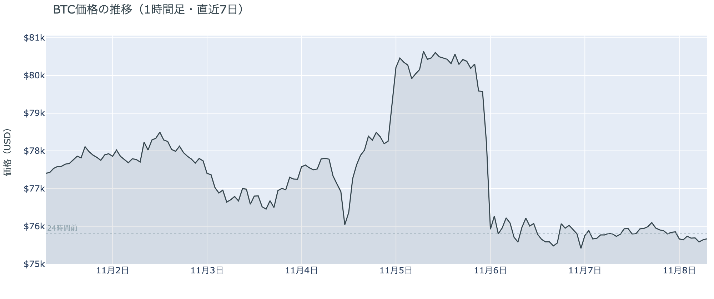

*図の見方: 1時間ごとの価格（日本時間）。点線は24時間前の水準です。木曜の夜に一段で落ちたあと、土曜は線が$76,000のすぐ下でほぼ平らです。*

* 24時間の値幅は0.9%で、前日の2.1%、木曜の7.2%から続けて縮んだ。
* Hyperliquid（＝オンチェーンの先物取引所）で見える清算は、この24時間で0件。

土曜日は、上にも下にも動く力がどこからも来ませんでした。1時間ごとの値動きはどれも0.3%に届かず、建玉も1時間で1%以上動いた時間はありません。新しく積まれた持ち高も、手仕舞われた持ち高も無かったということです。

**図1-2 価格と50日・200日移動平均**

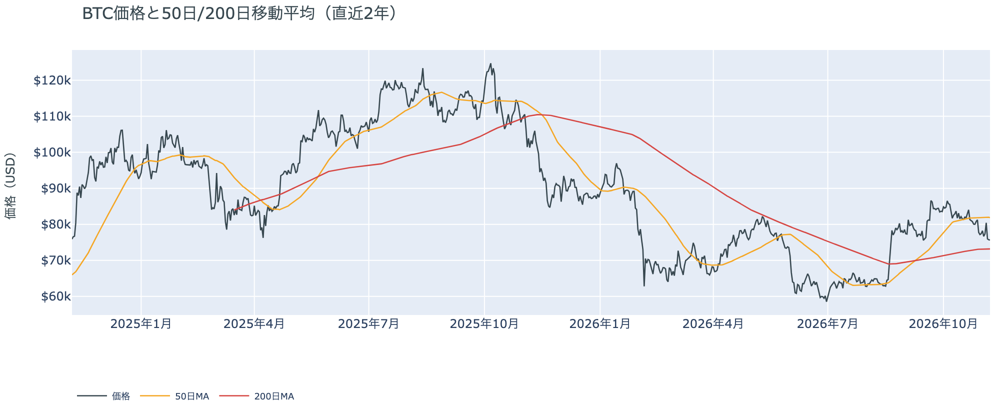

*図の見方: 2本の平均線の上下関係を見ます。50日線が200日線の上にあるのがゴールデンクロスです。*

* 50日線と200日線の差は約$8,684（11.9%）で、前日とほぼ同じ。
* 朝7時5分の価格は50日線を7.6%下回っている。

長い目で見た流れの向きは変わっていません。ゴールデンクロス（＝50日線が200日線を上抜けること）の状態が61日目です。ただ、価格は木曜の夜に50日線の下へ落ちたまま戻っておらず、短い目の弱さは週末に入っても続いています。

証券市場は週末で閉まっています。金曜11月6日の米国株（S&P500）は+0.3%と小さく戻して終わりましたが、VIX（＝株式市場の恐怖指数）は25.6と高いままです。株の不安が片づかないまま週末に持ち越されていて、ビットコインもそれを晴らす材料を持たずに土曜日を過ごしました。

## 2. なぜ動いたか：きっかけと、需給のどこが動いたか

**図2-1 ビットコインと株・金・原油の相対推移（起点＝100）**

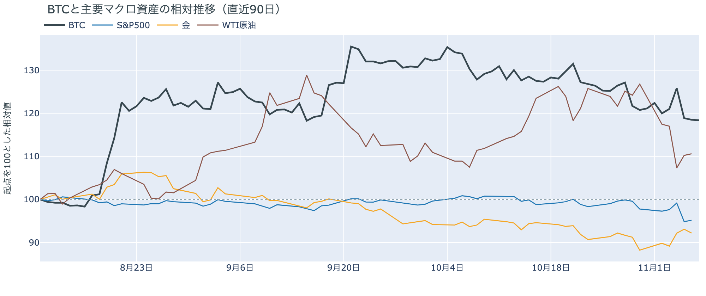

*図の見方: 同じ起点から何%動いたかで重ねたもの。線の向きが揃っているかを見ます。*

| この5営業日の動き（ビットコインは7日間） | 変化 |
|---|---:|
| ビットコイン | −2.3% |
| 金 | +4.5% |
| 米国株（S&P500） | −2.7% |
| 原油 | −12.8% |

* 建玉は96,130BTCで、前日の96,277BTCとほぼ同じ。
* 1日をならした資金調達率の年率は+4.61%で、前日の+8.95%からほぼ半分になった。

土曜日は、はっきりしたきっかけが無く、先物にも新しい持ち高が積まれなかったので、価格は$75,000台からほとんど動きませんでした。

1. きっかけ：証券市場は週末で閉まっていて、外部環境から新しい出来事は来ていません。金曜に米財務省が暗号資産取引所の MEXC を米国の金融システムから遮断する命令を出したことや、米国とイランの協議が合意に至っていないことは、金曜までに出ていた材料で、土曜日の値動きに効いた形跡はありません。
2. 伝わり方：速い側の先物では、建玉がほぼ変わらず清算も出ていないので、価格を運ぶ動きそのものがありませんでした。変わったのは、ロングが払う資金調達率（＝ロングが払う金利。プラス＝ロングがショートより多い）が下がったことだけで、ロングは降りずに残りながら、上げへの賭けに余分を払う人が減りました。遅い側のアメリカの買い手と長期保有者は、前から売りの側にいます。土曜日の静かな値動きは、アメリカの買い手と長期保有者までは届いていません。

前日は「金曜の夜の短い下げはロングの手仕舞いの再開ではない」と説明しました。土曜日も建玉は減らず、前夜に積まれたショートもロングも残ったままなので、前日の説明は今日の数値と合っています。

## 3. 市場参加者はいまどう見ているか

### ① アメリカの買い手は売りの側にとどまり、下げを拾いには来ていない

**図①-1 Coinbase Premium（アメリカとそれ以外の価格差・直近90日）**

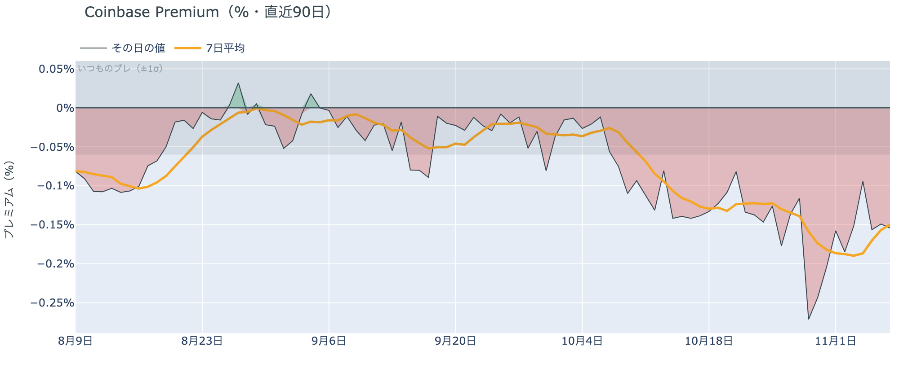

*図の見方: プラス＝アメリカで買いが強い。太線が1週間平均、細線がその日の値。薄い帯は「いつものブレの範囲」です。*

* 1週間平均は−0.15%で、前の週の1週間平均−0.18%より少し浅い。
* 11月7日の値は−0.15%で、いつものブレの2.6倍。

アメリカの買い手は、$75,000台を買いの機会とは見ていません。Coinbase Premium（＝アメリカとそれ以外の価格差）は1週間平均でマイナスのままで、アメリカの取引所のほうがほかの取引所より弱い状態が続いています。土曜日の値はいつものブレを超えて沈んでいますが、1週間平均と同じ深さなので、売りが新しく強まったのではなく、前からの弱さがそのまま続いているということです。

**図①-2 ETFの日ごとの資金の出入り（直近90日）**

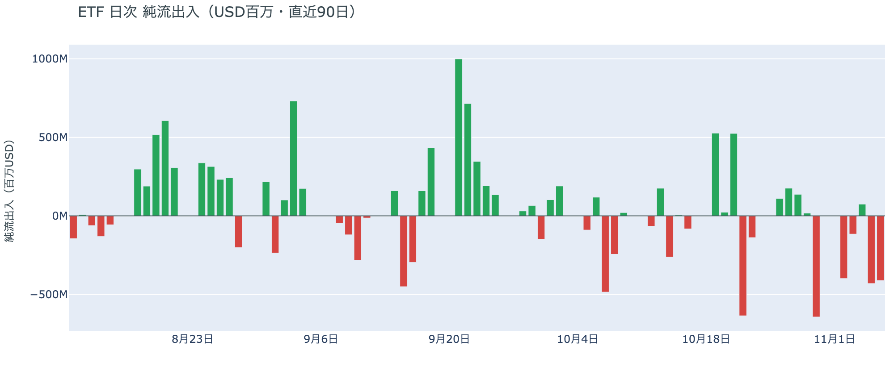

*図の見方: 入ったお金と出たお金の差。上に伸びれば入り超、下に伸びれば出超。*

| ETFの日ごとの出入り | 億ドル |
|---|---:|
| 11月2日 | −4.0 |
| 11月3日 | −1.2 |
| 11月4日 | +0.7 |
| 11月5日 | −4.3 |
| 11月6日 | −4.1 |
| 直近7営業日の合計 | −19.1 |

* 11月6日の流出のほとんどは、いちばん大きい IBIT の−4.0億ドル。

ETF の買い手は、木曜の夜の急落のあとも下げを拾わず、資金を引き続けました。前日は「金曜の夜の動きにどう応じたかは11月6日の分に出る」と書きましたが、その日も木曜とほぼ同じ規模の流出で、2営業日続けて出超です。ETF の買い手は、いまの価格に買い向かうほどの確信をまだ持っていません。

**図①-3 Fear & Greed（市場心理の指数・直近90日）**

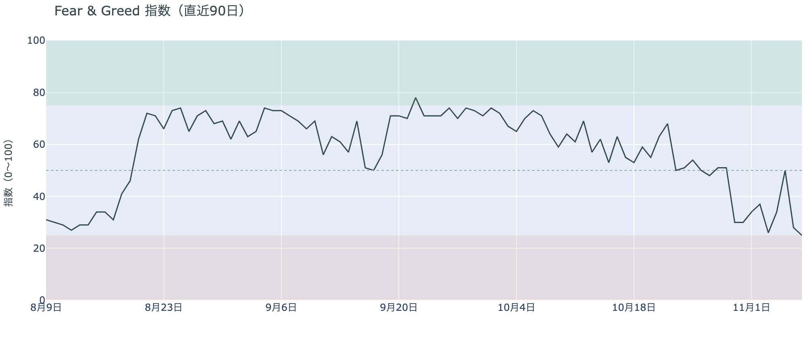

*図の見方: 0〜100で、50より上が「強欲」、下が「恐怖」。*

* 25で、区分は「極度の恐怖」。前日の28から3pt下げた。1週間前は30、1か月前は64。

市場心理は、静かな土曜日にも戻らず、「極度の恐怖」まで冷えました。Fear & Greed（＝市場心理の指数）は1か月前には「強欲」の側にいましたが、この1週間はずっと「恐怖」の側です。価格が止まっても安心は戻っておらず、参加者の多くはいまも上げより下げを気にしているということです。

### ② 長期保有者は保有量を減らし続けているが、手放すときの利益は消えた

**図②-1 長期保有者の保有量の30日変化とSOPR（直近90日）**

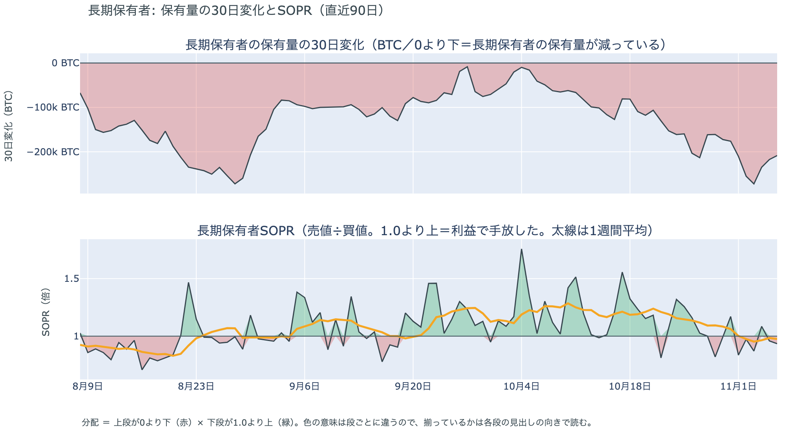

*図の見方: 上段は、長期保有者の保有量が30日でどれだけ増減したか。マイナス＝手放している。下段は長期保有者SOPRで、1より上なら利益で手放した。どちらも太線の1週間平均で読みます。*

| 11月6日時点 | 1週間平均 | 前の週の平均 |
|---|---:|---:|
| 長期保有者SOPR（1より上＝利益で手放した） | 0.98 | 1.08 |
| 長期保有者の保有量の30日変化（万BTC） | −22.5 | −17.6 |

* 30日変化は、1か月前（10月7日）の−4.9万BTCから大きく膨らんだ。

長期保有者は、利益が出ない価格になっても、コインを手元に置き続けようとはしていません。保有量は30日で減り続け、減り方は前の週より大きくなっています。一方で、動いたコインは平均して買値より安く動くようになりました。前の週までは利益の側で手放していたので「利益確定の売り」と呼べましたが、11月6日時点では利益が消え、そう呼べる形ではなくなっています。

長期保有者のほかに、売りに回りそうな持ち手は見当たりません。長く眠っていたコインが急に動いた記録はなく、マイナーの収入は平年をわずかに下回る程度（Puell Multiple（＝マイナー収入の平年比）が11月6日時点の1週間平均で0.98）で、売りを急ぐ状況ではありません。

### ③ 先物：ロングは残っているが、上げに余分を払う人は減った

**図③-1 資金調達率と建玉（直近30日）**

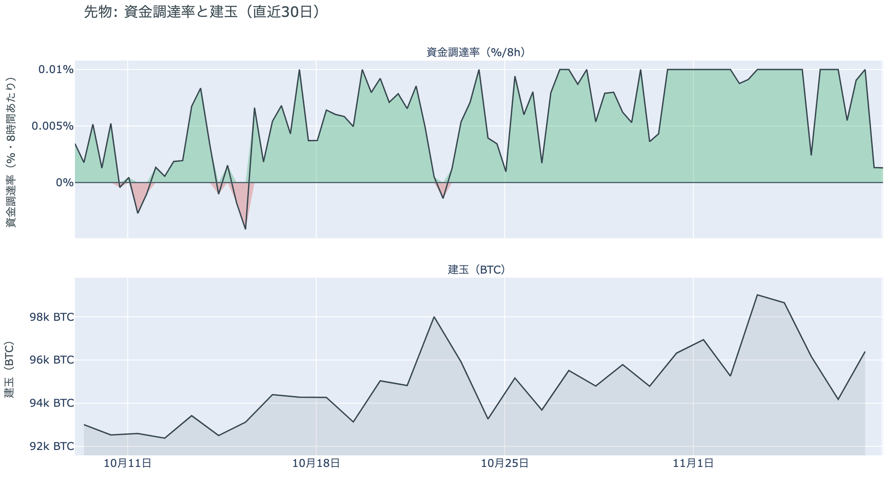

*図の見方: 上段は資金調達率（8時間ごと・日本時間）。プラスが続く＝ロングがショートより多い。下段は建玉。*

* 1日をならした年率は+4.61%で、短期金利（13週Tビル 4.00%）を引いた上乗せは+0.61pt。
* 上乗せは前日の+4.95ptから縮み、直近34日の平均+1.54ptを下回った。

先物の参加者は、上げにも下げにも強い確信を持たずに週末を過ごしています。資金調達率はプラスのままなので、ロングはまだショートより多く残っています。ただ、ロングが短期金利（＝ドルを米国の短期国債で持つだけで受け取れる金利）より余分に払う分はほとんど消えました。前日は余分を払ってでも持ち続ける人がいましたが、その熱は1日で冷めたので、上げへの確信は弱まっています。金曜の夜に積まれたショートも建玉に残っていて、下げに賭ける人も降りていません。

### ④ オプション：下げへの備えは米10月CPIから11月末まで広く置かれたまま

オプションには2種類あります。コール（＝決めた価格で買う権利）とプット（＝決めた価格で売る権利）で、価格が上がればコールの価値が上がり、価格が下がればプットの価値が上がります。プットは「価格が下がったときの保険」として買われます。オプションを買う人は、その権利と引き換えに権利料（＝オプションを買う人が払う金額）を払います。

**図④-1 満期ごとのIV（年率%）**

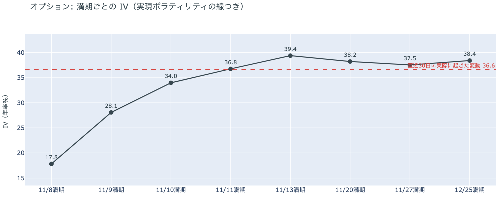

*図の見方: IVを満期ごとに並べたもの。点線は実現ボラティリティ。IVが点線より下なら、市場はこの先の値動きを過去の値動きより小さいと見ています。*

| 満期 | IV |
|---|---:|
| 11月8日 | 18 |
| 11月9日 | 28 |
| 11月10日 | 34 |
| 11月11日 | 37 |
| 11月13日〜12月25日 | 38〜39 |

* IVは全体で39.4で、実現ボラティリティ36.6より2.8pt高い。過去1年では真ん中ほどの位置。

参加者は、この先の値動きを、これまでの値動きより少し大きいと見ています。IV（＝値動きの幅の予想）が実現ボラティリティ（＝過去の値動きの幅）をわずかに上回っているので、備えが少し買われているということです。ただ、過去1年で見れば高くも低くもなく、恐怖で備えに殺到している形ではありません。11月10日の米10月CPIをまたぐ11月11日の満期のオプションの権利料にも、ほかの満期に対する上乗せは乗っていません。

**図④-2 満期ごとのプットとコールの差**

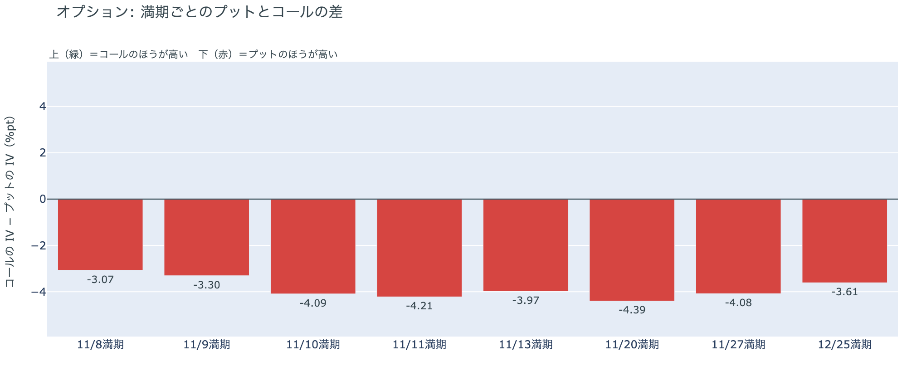

*図の見方: 満期ごとに、プットとコールのどちらが高く売れているか。ゼロより上ならコールのほうが高く、下ならプットのほうが高い。*

| 満期 | どちらが高いか |
|---|---|
| 11月8日 | プットが高い |
| 11月9日 | プットが高い |
| 11月10日 | プットがはっきり高い |
| 11月11日 | プットがはっきり高い |
| 11月13日 | プットがはっきり高い |
| 11月20日 | プットがいちばんはっきり高い |
| 11月27日 | プットがはっきり高い |
| 12月25日 | プットが高い |

参加者は、特定の1日ではなく、米10月CPIから11月末までの期間全体で下げに備えています。前日はいちばん差が目立つのが11月13日の満期でしたが、今朝は11月10日から27日までの満期がそろってはっきりプットのほうが高くなっています。全部の満期でプットが高いままなので、下げへの備えを外した人はいません。

**図④-3 12月25日満期の持ち高（権利の価格ごと）**

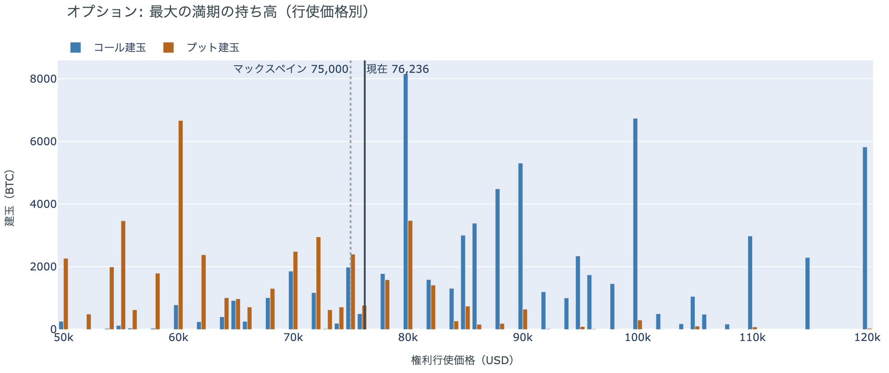

*図の見方: 青＝コール、橙＝プット。現値より上にコールが、下にプットが積まれるのが普通です。*

| 12月25日満期のオプション（基準の価格は約$76,200） | 量（万BTC） | 意味 |
|---|---:|---|
| いまより高い価格のコール | 約7.3 | 「価格が上がる」に賭けた分 |
| いまより安い価格のプット | 約4.7 | 「価格が下がる」への保険 |
| うち、いまより15%以上高い価格のコール | 約5.4 | 大きな上げへの賭け |
| うち、いまより15%以上安い価格のプット | 約3.4 | 大きな下げへの保険 |

* 12月25日満期の持ち高は約14.0万BTCと全満期の41%で、コールがプットの1.5倍。前日とほぼ同じ形。

年末の最大の満期では、「価格が上がる」に賭けた人たちが降りておらず、年末までの上げへの期待は保たれています。手前の満期で下げに備えながら年末の賭けを残しているので、参加者はいまの弱さを流れの変化とまでは見ていないということです。大きな上げに賭けた分が報われるには、12月25日の夕方5時までに約$88,000を超える必要があります。全満期でオプションの持ち高が集まっているのは$74,000〜$80,000の帯で、価格はいまその帯の中にいます。

## 4. 価格に影響しうる直近のイベント

オプション市場が下げへの備えを置いているのは11月10日から27日の満期で、米10月CPI、米10月の生産者物価指数、FOMC の議事要旨が並ぶ区間に当たります。どの満期の権利料にも、ほかの満期に対する上乗せは乗っていません。

| 日付 | イベント | 何に効くか |
|---|---|---|
| 11/10（火）22:30 日本時間 | 米10月CPI | 金利 |
| 11/13（金）22:30 日本時間 | 米10月の生産者物価指数 | 金利 |
| 11/19（木）4:00 日本時間 | FOMC の議事要旨（10月27〜28日分） | 金利 |
| 日程は未定 | 米国とイランの協議。合意には至っておらず、ホルムズ海峡の航行は戻っていない | 原油 |
| 日程は未定 | 米労働省の、401(k)（＝米国の確定拠出年金）で暗号資産などを扱いやすくする規則。11月5日にホワイトハウスの最終審査に入った | アメリカの買い手 |
| 12/9（水） | FOMC。利上げの織り込みは約8割。結果は日本時間10日早朝 | 金利 |
| 12/25（金）17:00 | オプションの最も大きな満期（約14.0万BTC、全満期の41%） | 約$88,000以上のコールの期限 |

## まとめ

土曜日は、はっきりしたきっかけが無く、先物にも新しい持ち高が積まれなかったので、ビットコインは$75,000台からほとんど動きませんでした。売りの側にいるアメリカの買い手は ETF から資金を引き続け、長期保有者は利益の出ない価格になっても保有量を減らし続けています。土曜日の値動きがアメリカの買い手と長期保有者の持ち方を変えたわけではありませんが、11月6日時点の長期保有者は、利益確定の売りとは呼べない形に変わっていました。参加者は、ロングと年末のコールを残して流れが変わったとまでは見ていない一方、上げに余分を払う熱は冷め、米10月CPIから11月末までの下げには備えを置いたままでいます。

---

<small>（数値は11月8日7時5分（日本時間）までのデータに基づきます。価格・先物・オプションはその時点の値、市場心理は11月7日の確定値、オンチェーン（＝ブロックチェーン上の記録）は11月6日時点、ETF資金フローは11月6日分までです。証券市場の終値は11月6日時点で、週末のため更新がありません。オンチェーンの長期保有者の数値には、ETFや取引所が預かっている分も含まれます。オプションはDeribit（BTCオプションの大半を占める取引所）の全銘柄です。）</small>

*本稿は情報提供を目的としたものであり、投資助言ではありません。将来の価格動向を保証・示唆するものではなく、投資判断は各自の責任において行ってください。*
