# 日曜夜に$73,000台へ一段安 ― ロングの清算が加速、備えは今週の満期に厚く

**2026年11月9日**

ビットコインは日曜日を$75,000台でほぼ横ばいのまま過ごしたあと、日本時間の月曜の明け方に一段下げました。

* **価格**：静かな週末の最後の1時間で崩れ、一時$73,477と、この1週間でいちばん安い価格をつけました。朝7時5分の時点で約$74,591です
* **きっかけ**：下げと時刻の合う出来事は見当たりません。日曜日の朝（現地時間）に中東でサウジアラムコへのミサイル攻撃とホルムズ海峡でのタンカー炎上が伝えられましたが、ビットコインはその後も半日以上動いていません
* **先物**：買い持ち（ロング）の手仕舞いが下げを運び、清算（＝証拠金不足で強制的に閉じられた取引）がそれを加速させました。建玉（＝先物の未決済残高。証拠金で張っている人の量）は減りましたが、ロングはまだショートより多く、下げを流れの変化とまでは見ていません
* **需給の土台**：米国の買い手は下げの間に一段と売りへ傾きましたが、1週間で見た深さは前の週と同じで、売りの側にいる形は変わっていません。長期保有者（＝155日以上保有者）も11月7日時点で、利益の出ない価格で保有量を減らし続けています
* **オプションの見方**：前日まで手前ほど穏やかだった値動きの予想が逆になり、下げの直後の今週を、その先より大きく動く期間と見ています。下げへの備えも今週の満期にいちばん厚く置き直しました

## 1. 何が起きたか

**図1-1 価格の推移（1時間足・直近7日）**

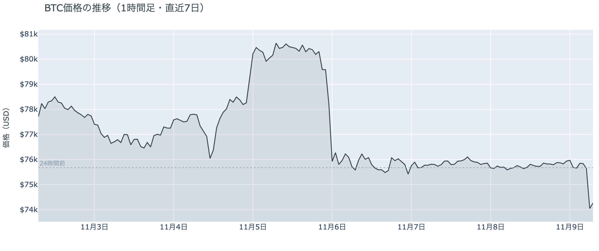

*図の見方: 1時間ごとの価格（日本時間）。点線は24時間前の水準です。日曜日はほぼ平らで、最後の1時間だけ線が落ちています。*

* 24時間の値幅は3.6%で、前日の0.9%から大きく広がった。
* 今朝6時台の1時間で価格は−2.1%、建玉は−1.0%。

静かだった週末は、最後の1時間で崩れました。日曜日の日中から深夜まで、1時間ごとの値動きはどれも0.4%に届かず、下げは今朝5時台に小さく始まって6時台に一気に進んでいます。価格が下がりながら建玉も減ったので、新しく売りに賭けた人が押し下げたのではなく、残っていたロングが手仕舞われた下げです。

**図1-2 価格と50日・200日移動平均**

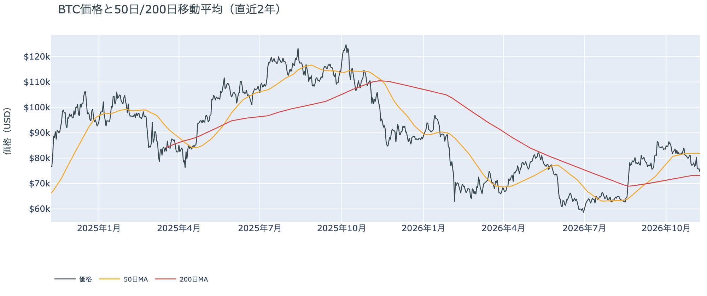

*図の見方: 2本の平均線の上下関係を見ます。50日線が200日線の上にあるのがゴールデンクロスです。*

* 50日線と200日線の差は約$8,570（11.7%）で、前日とほぼ同じ。
* 朝7時5分の価格は50日線を8.7%下回っている。

長い目で見た流れの向きは、今朝の下げでも変わっていません。ゴールデンクロス（＝50日線が200日線を上抜けること）の状態が62日目です。ただ、価格は先週の木曜に50日線の下へ落ちてから戻れず、50日線との開きは前日の7.6%からさらに広がりました。短い目の弱さは、週末を越えて深まっています。

証券市場は週末で閉まっています。金曜11月6日の米国株（S&P500）は+0.3%と小さく戻して終わりましたが、VIX（＝株式市場の恐怖指数）は25.6と高いままでした。株の不安が片づかないまま週末に入り、週末のうちに中東で新しい出来事が加わったところで、ビットコインは月曜の朝を迎えています。

**図1-3 清算（直近24時間）**

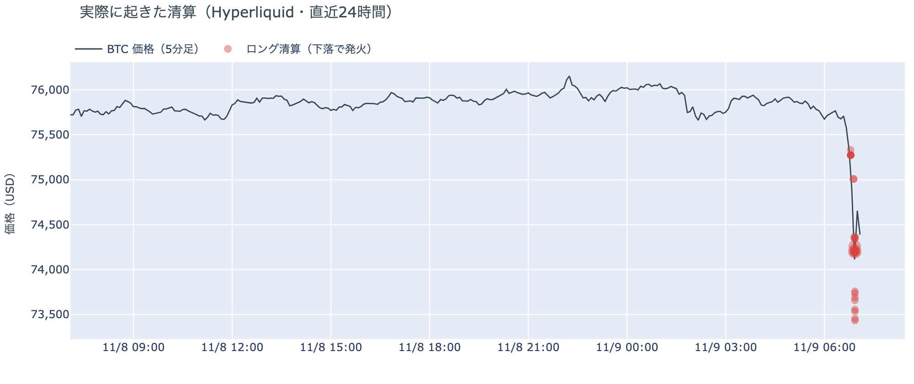

*図の見方: Hyperliquid で実際に清算された取引を、時刻（日本時間）と価格に重ねたもの。*

* 清算はすべてロングで、今朝6時台の1時間に集中した。
* 清算された相手は60のアドレスに分かれ、最大の1件でも全体の4分の1ほど。

大口が1つ飛んだのではなく、$74,000台に置かれていた多くのロングの清算が続けて出て、下げを加速させました。Hyperliquid（＝オンチェーンの先物取引所）で拾えた清算は、この24時間で値動きの速かった5分足にすべて入っています。清算が出尽くした直後の5分足では、価格は0.6%戻しました。

## 2. なぜ動いたか：きっかけと、需給のどこが動いたか

**図2-1 ビットコインと株・金・原油の相対推移（起点＝100）**

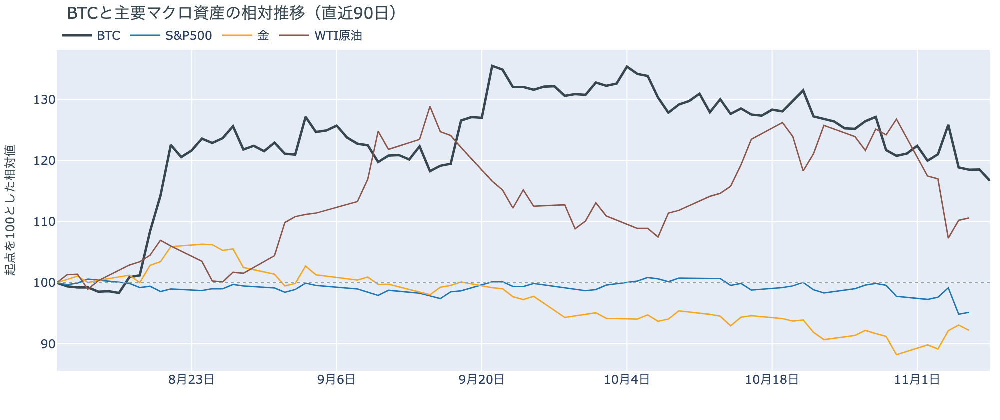

*図の見方: 同じ起点から何%動いたかで重ねたもの。線の向きが揃っているかを見ます。*

| この5営業日の動き（ビットコインは7日間） | 変化 |
|---|---:|
| ビットコイン | −4.7% |
| 金 | +4.5% |
| 米国株（S&P500） | −2.7% |
| 原油 | −12.8% |

* 建玉は94,279BTCで、前日の96,130BTCから1.9%減った。
* 1日をならした年率は+5.78%で、短期金利（13週Tビル 4.00%）を引いた上乗せは+1.78pt。

日曜日の夜の下げは、はっきりしたきっかけが無いまま、先物のロングの手仕舞いと清算を通って価格になりました。

1. きっかけ：外部環境では、日曜日の朝（現地時間）にイエメンのフーシ派のミサイルがリヤドのサウジアラムコの建物に当たり、イランの革命防衛隊はホルムズ海峡でタンカー3隻が炎上したと伝えました。ただ、ビットコインはその後も半日以上$75,000台から離れておらず、下げが始まったのは今朝5時台です。時刻が合わないので、中東の出来事はきっかけではありません。原油の先物も下げの時点ではまだ週明けの取引が始まっておらず、証券市場から届いた材料もありません。この1週間で見ると、ビットコインは株と同じ向きに下げ、金とは逆向きでした。
2. 伝わり方：速い側の先物では、価格と建玉がそろって減り、ロングが手仕舞われました。資金調達率（＝ロングが払う金利。プラス＝ロングがショートより多い）はプラスのままなので、降りたのはロングの一部で、ショートが新しく押し下げた形ではありません。遅い側では、アメリカの買い手が下げの間に一段と売りへ傾きましたが、1週間平均は前の週と同じ深さです（図①-1）。長期保有者も、11月7日時点で前日と同じ形のままです（図②-1）。下げを運んだのは先物で、アメリカの買い手と長期保有者の持ち方を変えるところまでは届いていません。

前日は、土曜日の静けさを「先物にも新しい持ち高が積まれなかった」と説明し、ロングもショートも残ったままだと書きました。その残っていたロングの一部が、日曜日の夜に手仕舞われたのが今朝の下げです。

## 3. 市場参加者はいまどう見ているか

### ① アメリカの買い手は下げの間に一段と売りへ傾いたが、1週間で見た深さは変わっていない

**図①-1 Coinbase Premium（アメリカとそれ以外の価格差・直近90日）**

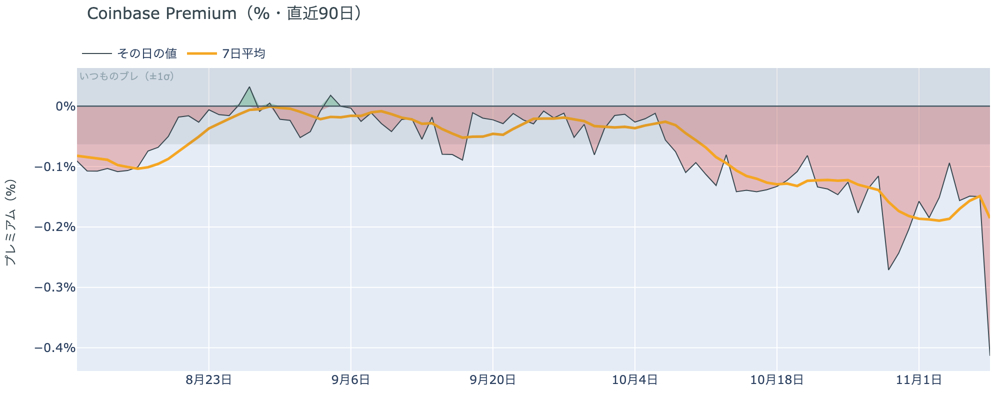

*図の見方: プラス＝アメリカで買いが強い。太線が1週間平均、細線がその日の値。薄い帯は「いつものブレの範囲」です。*

* 1週間平均は−0.19%で、前の週の1週間平均−0.19%と同じ。
* 11月8日の値は−0.41%で、いつものブレの6.5倍。1月以降でいちばん深い。

アメリカの買い手は、日曜日の下げを買いの機会とは見ず、ほかの取引所より強く売る側に回りました。Coinbase Premium（＝アメリカとそれ以外の価格差）のその日の値は、いつものブレを大きく超えて沈んでいます。ただ1週間平均は前の週と同じ深さなので、売りの側にいる状態が日曜日の1日で深まったのであって、1週間を通した持ち方が新しく変わったわけではありません。

**図①-2 ETFの日ごとの資金の出入り（直近90日）**

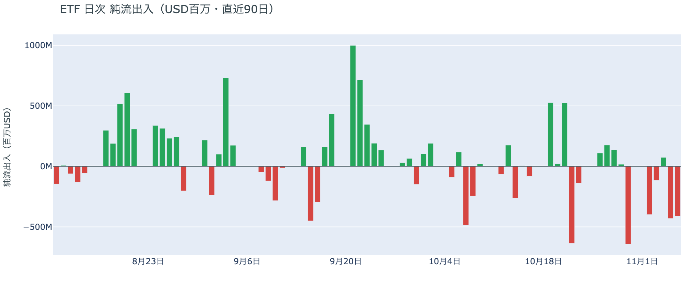

*図の見方: 入ったお金と出たお金の差。上に伸びれば入り超、下に伸びれば出超。*

| ETFの日ごとの出入り | 億ドル |
|---|---:|
| 11月2日 | −4.0 |
| 11月3日 | −1.2 |
| 11月4日 | +0.7 |
| 11月5日 | −4.3 |
| 11月6日 | −4.1 |
| 直近7営業日の合計 | −19.1 |

ETF の買い手は、いまの価格に買い向かうほどの確信を持たないまま週末に入りました。週末のため数字は11月6日分から更新がなく、2営業日続けて出超の状態で止まっています。木曜の急落のあとも下げを拾わなかった買い手が、日曜日の夜の下げにどう応じたかは、11月9日分の出入りに表れます。

**図①-3 Fear & Greed（市場心理の指数・直近90日）**

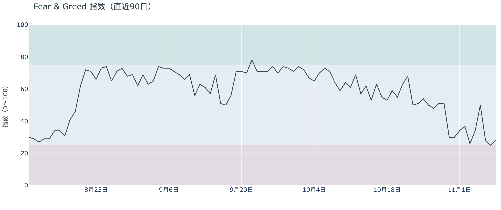

*図の見方: 0〜100で、50より上が「強欲」、下が「恐怖」。*

* 28の「恐怖」。前日の25（極度の恐怖）から3pt戻した。1週間前は34、1か月前は59。

参加者の多くは、上げより下げを気にしたままです。Fear & Greed（＝市場心理の指数）は日曜日に「極度の恐怖」からわずかに戻りましたが、区分は「恐怖」のままで、1か月前の「強欲」の側からは遠く離れています。静かな日が1日続いても、安心が戻るところまではいきませんでした。

### ② 長期保有者は保有量を減らし続け、手放すときの利益は出ていない

**図②-1 長期保有者の保有量の30日変化とSOPR（直近90日）**

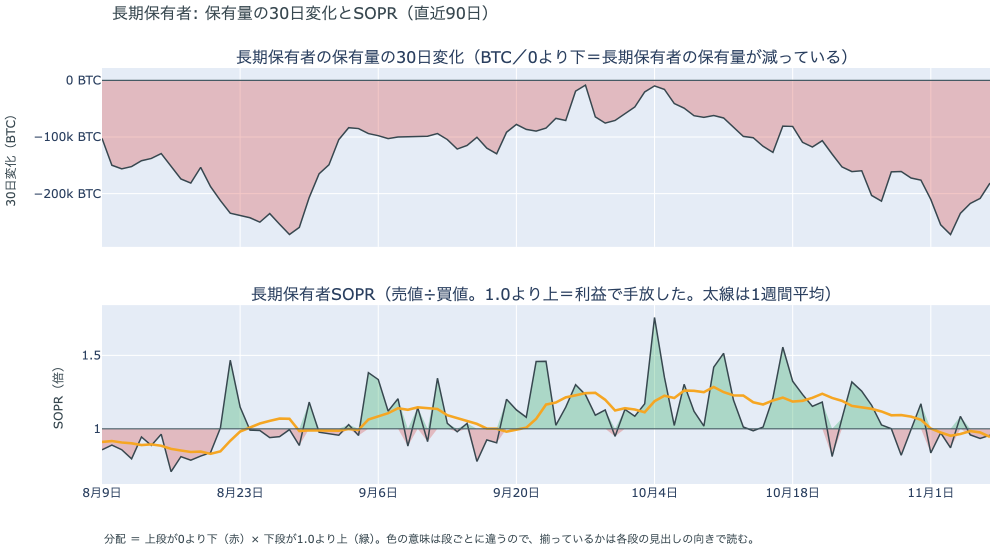

*図の見方: 上段は、長期保有者の保有量が30日でどれだけ増減したか。マイナス＝手放している。下段は長期保有者SOPRで、1より上なら利益で手放した。どちらも太線の1週間平均で読みます。*

| 11月7日時点 | 1週間平均 | 前の週の平均 |
|---|---:|---:|
| 長期保有者SOPR（1より上＝利益で手放した） | 0.95 | 1.06 |
| 長期保有者の保有量の30日変化（万BTC） | −22.6 | −17.8 |

* 30日変化は、1か月前（10月8日）の−6.2万BTCから大きく膨らんだ。

長期保有者は、利益が出ない価格になっても、コインを手元に置き続けようとはしていません。保有量は30日で減り、減り方は前の週より大きくなっています。一方で、動いたコインは平均して買値より安く動いているので、利益確定の売りとは呼べない形です。前日は11月6日時点で「利益確定の売りとは呼べない形に変わった」と説明しました。11月7日時点でも量は減り、動いたコインは買値を下回ったままなので、前日の説明は1日後の数値とも合っています。

長期保有者のほかに、売りに回りそうな持ち手は見当たりません。長く眠っていたコインが急に動いた記録はなく、マイナーの収入は平年をわずかに下回る程度（Puell Multiple（＝マイナー収入の平年比）が11月7日時点の1週間平均で0.96）で、売りを急ぐ状況ではありません。今日はほかに、特筆するオンチェーンの出来事もありません。

### ③ 先物：ロングの一部は振り落とされたが、残ったロングは降りていない

**図③-1 資金調達率と建玉（直近30日）**

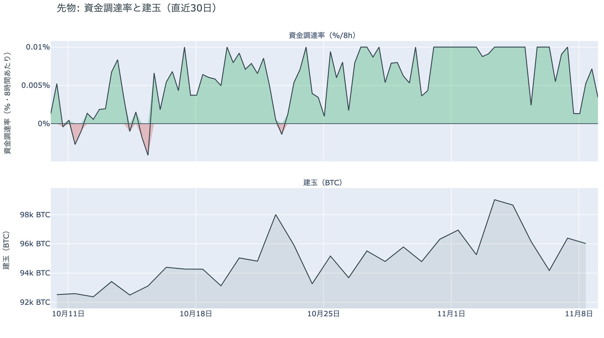

*図の見方: 上段は資金調達率（8時間ごと・日本時間）。プラスが続く＝ロングがショートより多い。下段は建玉。*

* 上乗せは前日の+0.61ptから戻り、直近34日の平均+1.85ptとほぼ同じ。
* 資金調達率はプラスが52回連続（約17日）。

先物の参加者は、日曜日の夜の下げを流れの変化とは見ていません。資金調達率はプラスのままで、下げのあともロングはショートより多く残っています。日曜日の日中には、ロングが短期金利（＝ドルを米国の短期国債で持つだけで受け取れる金利）より余分に払う分がいつもの水準まで戻っていて、前日に冷めた上げへの賭けを積み直す人が出ていました。その一部が夜の下げで清算されたので、上げへの確信は、戻りかけたところで揺さぶられた形です。それでも残ったロングは降りておらず、下げに賭け直す人が増えたわけでもありません。

### ④ オプション：下げの直後の今週を、いちばん警戒している

オプションには2種類あります。コール（＝決めた価格で買う権利）とプット（＝決めた価格で売る権利）で、価格が上がればコールの価値が上がり、価格が下がればプットの価値が上がります。プットは「価格が下がったときの保険」として買われます。オプションを買う人は、その権利と引き換えに権利料（＝オプションを買う人が払う金額）を払います。

**図④-1 満期ごとのIV（年率%）**

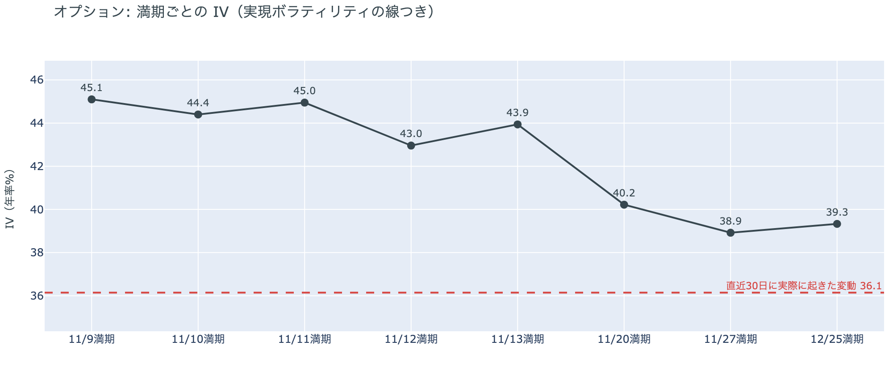

*図の見方: IVを満期ごとに並べたもの。点線は実現ボラティリティ。IVが点線より下なら、市場はこの先の値動きを過去の値動きより小さいと見ています。*

| 満期 | IV |
|---|---:|
| 11月9日 | 45 |
| 11月10日 | 44 |
| 11月11日 | 45 |
| 11月12日〜13日 | 43〜44 |
| 11月20日 | 40 |
| 11月27日〜12月25日 | 39 |

* IVは全体で40.2で、実現ボラティリティ36.1より4.1pt高い。過去1年では真ん中ほどの位置。

参加者は、ここから数日の値動きを、その先より大きいと見ています。IV（＝値動きの幅の予想）は全体で実現ボラティリティ（＝過去の値動きの幅）を上回っていて、とくに今週の満期の権利料には、11月20日から先の満期に対する上乗せが乗っています。前日は手前の満期ほど IV が低かったので、日曜日の夜の下げで、近い先への見方が「穏やか」から「荒れる」へ入れ替わったということです。11月10日の米10月CPI（＝米国の物価統計）をまたぐ11月11日の満期だけが高いわけではないので、身構えているのは米CPIの1日ではなく、下げのあとの今週全体です。

**図④-2 満期ごとのプットとコールの差**

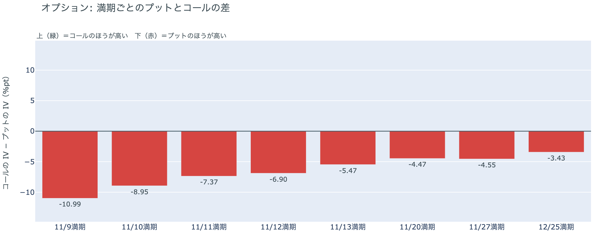

*図の見方: 満期ごとに、プットとコールのどちらが高く売れているか。ゼロより上ならコールのほうが高く、下ならプットのほうが高い。*

| 満期 | どちらが高いか |
|---|---|
| 11月9日 | プットがいちばんはっきり高い |
| 11月10日 | プットがはっきり高い |
| 11月11日 | プットがはっきり高い |
| 11月12日 | プットがはっきり高い |
| 11月13日 | プットが高い |
| 11月20日 | プットが高い |
| 11月27日 | プットが高い |
| 12月25日 | プットが高い（差はいちばん小さい） |

参加者は、下げへの備えをいちばん手前の満期に厚く置き直しました。前日は11月20日の満期あたりで差が目立っていましたが、今朝は満期が近いほどプットがはっきり高く、先へ行くほど差が小さくなっています。全部の満期でプットが高いままなので、下げへの備えを外した人はおらず、そのうえで下げが来た直後のここ数日をいちばん警戒しているということです。

**図④-3 12月25日満期の持ち高（権利の価格ごと）**

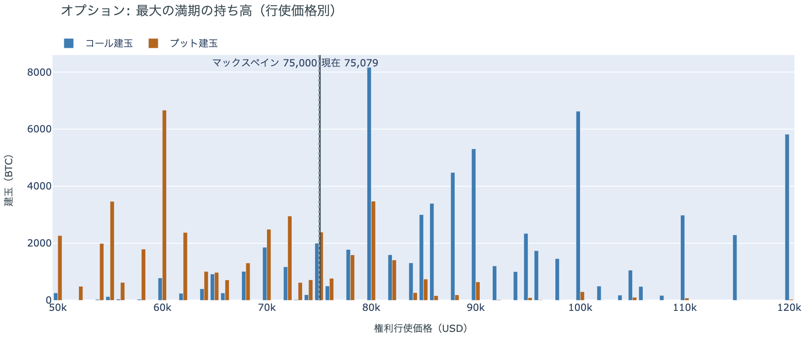

*図の見方: 青＝コール、橙＝プット。現値より上にコールが、下にプットが積まれるのが普通です。*

| 12月25日満期のオプション（基準の価格は約$75,100） | 量（万BTC） | 意味 |
|---|---:|---|
| いまより高い価格のコール | 約7.4 | 「価格が上がる」に賭けた分 |
| いまより安い価格のプット | 約4.7 | 「価格が下がる」への保険 |
| うち、いまより15%以上高い価格のコール | 約5.4 | 大きな上げへの賭け |
| うち、いまより15%以上安い価格のプット | 約3.4 | 大きな下げへの保険 |

* 12月25日満期の持ち高は約14.0万BTCと全満期の41%で、コールがプットの1.5倍。前日とほぼ同じ形。

年末の最大の満期では、日曜日の夜の下げのあとも「価格が上がる」に賭けた人たちが降りておらず、年末までの上げへの期待は保たれています。手前の満期で下げに身構えながら年末のコールを残しているので、参加者は今回の下げを、流れの変化とまでは見ていません。大きな上げに賭けた分が報われるには、12月25日の夕方5時までに約$86,000を超える必要があります。全満期でオプションの持ち高が集まっているのは$74,000〜$80,000の帯で、価格はいまその帯の下の端にいます。

## 4. 価格に影響しうる直近のイベント

オプション市場が下げへの備えと上乗せをいちばん厚く置いているのは今週の満期で、米10月CPIと米10月の生産者物価指数が入る区間に当たります。ただ上乗せは米CPIの日の満期だけに乗っているのではなく、今週の満期全体に乗っています。

| 日付 | イベント | 何に効くか |
|---|---|---|
| 11/10（火）22:30 日本時間 | 米10月CPI | 金利 |
| 11/13（金）22:30 日本時間 | 米10月の生産者物価指数 | 金利 |
| 11/19（木）4:00 日本時間 | FOMC（＝米国の金利を決める会合）の議事要旨（10月27〜28日分） | 金利 |
| 日程は未定 | 米国とイランの協議。合意には至っておらず、11月8日にはホルムズ海峡でタンカー3隻の炎上が伝えられた | 原油 |
| 日程は未定 | 米労働省の、401(k)（＝米国の確定拠出年金）で暗号資産などを扱いやすくする規則。11月5日にホワイトハウスの最終審査に入った | アメリカの買い手 |
| 12/9（水） | FOMC。利上げの織り込みは約8割。結果は日本時間10日早朝 | 金利 |
| 12/25（金）17:00 | オプションの最も大きな満期（約14.0万BTC、全満期の41%） | 約$86,000以上のコールの期限 |

## まとめ

日曜日の夜の下げは、はっきりしたきっかけが無いまま、先物のロングの手仕舞いと清算に加速されて、ビットコインを一時$73,000台まで押し下げました。アメリカの買い手は下げの間に一段と売りへ傾いたものの、1週間で見た深さは前の週と同じで、長期保有者も利益の出ない価格で減らし続ける形のままです。今朝の下げで、アメリカの買い手と長期保有者の持ち方までは変わっていません。参加者は残ったロングと年末のコールを手放しておらず、今回の下げを流れの変化とまでは見ていませんが、下げの直後の今週は大きく動くと見て、下げへの備えを手前の満期に厚く置き直しています。

---

<small>（数値は11月9日7時5分（日本時間）までのデータに基づきます。価格・先物・オプションはその時点の値、市場心理は11月8日の確定値、オンチェーン（＝ブロックチェーン上の記録）は11月7日時点、ETF資金フローは11月6日分までです。証券市場の終値は11月6日時点で、週末のため更新がありません。オンチェーンの長期保有者の数値には、ETFや取引所が預かっている分も含まれます。清算は Hyperliquid で拾えた分だけで、市場全体のごく一部です。オプションはDeribit（BTCオプションの大半を占める取引所）の全銘柄です。）</small>

*本稿は情報提供を目的としたものであり、投資助言ではありません。将来の価格動向を保証・示唆するものではなく、投資判断は各自の責任において行ってください。*
