# 米国株2%高に乗り切れず$74,000台 ― ロングは積み増し、今週への警戒は和らぐ

**2026年11月10日**

ビットコインは月曜日、米国株が2%を超えて戻した日にもほとんど戻らず、$74,000台にとどまりました。

* **価格**：24時間の値幅は2.7%で、前日の3.6%より狭く、朝7時5分の時点で約$74,912と、前日の下げを取り戻すところまでは戻っていません
* **きっかけ**：米国とイランの協議が再開するとの期待で原油が5%近く下げ、米国株が戻しました。ビットコインも米国の取引時間には上げましたが、戻りは株の3分の1に届かず、株高をそのまま受け取ってはいません
* **先物**：上げた時間帯を運んだのは売り持ち（ショート）の買い戻しでした。そのうえで1日を通すと建玉（＝先物の未決済残高。証拠金で張っている人の量）は約4%増え、買い持ち（ロング）が積み増されたので、前日の下げのあとも上げへの期待は崩れていません
* **需給の土台**：米国の買い手は売りの側にいるままですが、売りは前の週より浅くなりました。長期保有者（＝155日以上保有者）は11月8日時点でも、利益の出ない価格で保有量を減らし続けていて、どちらも前日から形は変わっていません
* **オプションの見方**：前日に今週の満期へ厚く置いた警戒は和らぎ、今夜の米10月CPIをまたぐ満期にも、ほかの満期に対する上乗せはわずかしか乗っていません。下げへの備えは全部の満期で残したままです

## 1. 何が起きたか

**図1-1 価格の推移（1時間足・直近7日）**

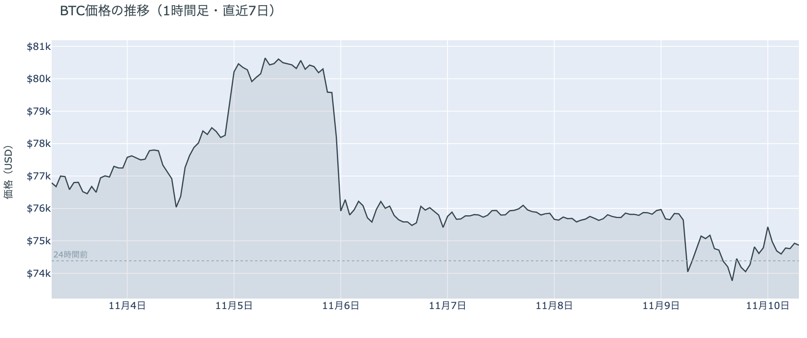

*図の見方: 1時間ごとの価格（日本時間）。点線は24時間前の水準です。*

* 24時間の値幅は2.7%で、上げた3つの時間帯（17時台・21時台・0時台）はどれも建玉が減った。
* 拾えた清算は25のアドレスに分かれ、最大の1件で全体の3割弱。向きはショートが6割。

月曜日のビットコインは、日本の日中に$73,770まで下げてから、欧州と米国の取引時間に少しずつ戻した1日でした。戻した時間帯はどれも建玉が減っているので、新しく買いに来た人ではなく、ショートが買い戻して押し上げた上げです。値動きの大きかった5分足の多くは清算（＝証拠金不足で強制的に閉じられた取引）なしで動いていて、前日のように清算が動きを加速させた形ではありません。Hyperliquid（＝オンチェーンの先物取引所）で拾えた清算は小口に散らばっていて、大口が1つ飛んだ日でもありません。

**図1-2 価格と50日・200日移動平均**

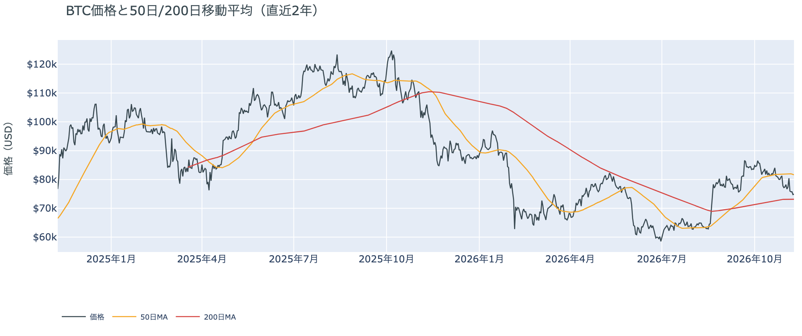

*図の見方: 2本の平均線の上下関係を見ます。50日線が200日線の上にあるのがゴールデンクロスです。*

* 50日線と200日線の差は約$8,465（11.6%）で、前日とほぼ同じ。
* 朝7時5分の価格は50日線を8.2%下回っている。

長い目で見た流れの向きは変わっていません。ゴールデンクロス（＝50日線が200日線を上抜けること）の状態が63日目です。50日線との開きは前日の8.7%からわずかに縮みましたが、価格は先週の木曜に50日線の下へ落ちてから戻れないままで、短い目の弱さは片づいていません。

証券市場は月曜日に大きく戻しました。11月9日の米国株（S&P500）は+2.4%、VIX（＝株式市場の恐怖指数）は2割下げて19.9です。週末に持ち越された株の不安は月曜日のうちにかなり解けましたが、ビットコインはその戻りにほとんど乗っておらず、株とは別に、前日の下げを引きずったまま火曜日の朝を迎えています。

## 2. なぜ動いたか：きっかけと、需給のどこが動いたか

**図2-1 ビットコインと株・金・原油の相対推移（起点＝100）**

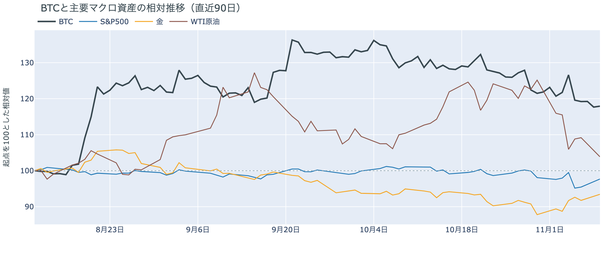

*図の見方: 同じ起点から何%動いたかで重ねたもの。線の向きが揃っているかを見ます。*

| この5営業日の動き（ビットコインは7日間） | 変化 |
|---|---:|
| ビットコイン | −2.3% |
| 金 | +4.6% |
| 米国株（S&P500） | +0.1% |
| 原油 | −10.4% |

* 建玉は97,910BTCで、前日の94,279BTCから3.9%増えた。
* 1日をならした年率は+9.46%で、短期金利（13週Tビル 4.03%）を引いた上乗せは+5.43pt。

月曜日の小さな戻りは、原油安と株高をきっかけに、先物のショートの買い戻しを通って価格になりましたが、ビットコインが受け取ったのは株の戻りの一部だけでした。

1. きっかけ：外部環境では、カタールの首相がホルムズ海峡の再開をめぐるイランの暫定案をホワイトハウスへ持ち込むと伝えられ、トランプ大統領もイランへの追加の攻撃は考えにくいと述べました。原油（WTI）は11月9日に−4.9%、米国株は+2.4%です。ビットコインが上げたのは米国の取引が始まった0時台を含む時間帯で、時刻は合っています。ただ24時間で+0.7%と、株の3分の1にも届いていません。この1週間で見ても、株がほぼ元の水準まで戻ったのに、ビットコインは2%あまり下にいます。原油安と株高は月曜日の上げの時間帯を説明しますが、ビットコインの1週間の弱さは、株とは別のところにあります。
2. 伝わり方：速い側の先物では、上げた時間帯にショートが買い戻され、それが戻りを運びました。1日を通すと、資金調達率（＝ロングが払う金利。プラス＝ロングがショートより多い）がプラスのまま建玉が増えたので、ロングが積み増されています。遅い側では、アメリカの買い手の売りは1週間平均で前の週より浅くなりました（図①-1）が、買いの側へ戻ったわけではなく、長期保有者も11月8日時点で保有量を減らし続けています（図②-1）。戻りを運んだのは先物で、アメリカの買い手と長期保有者の持ち方を変えるところまでは届いていません。

前日は「残っていたロングの一部が手仕舞われた」のが日曜日の夜の下げだと説明し、残ったロングは降りていないと書きました。月曜日には、その残ったロングの上にさらにロングが積まれたので、前日の説明は今日の数値と合っています。

## 3. 市場参加者はいまどう見ているか

### ① アメリカの買い手は売りの側にいるが、売りは前の週より浅くなった

**図①-1 Coinbase Premium（アメリカとそれ以外の価格差・直近90日）**

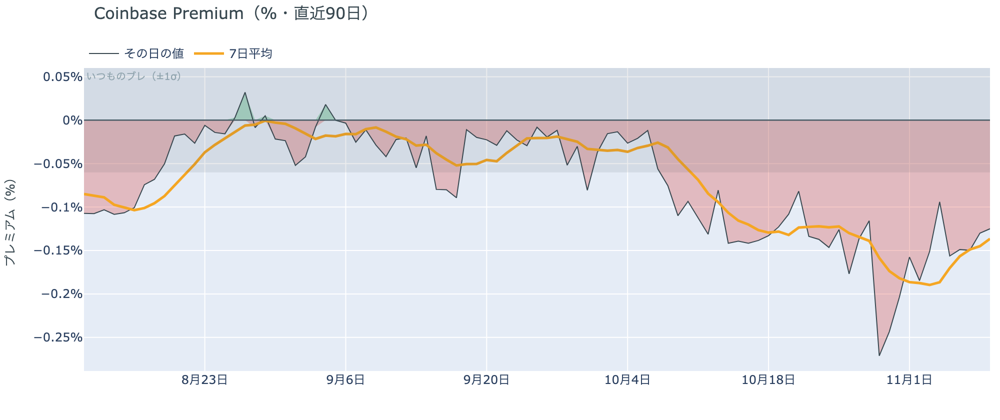

*図の見方: プラス＝アメリカで買いが強い。太線が1週間平均、細線がその日の値。薄い帯は「いつものブレの範囲」です。*

* 1週間平均は−0.14%で、前の週の1週間平均−0.19%より浅い。
* 11月9日の値は−0.13%で、いつものブレの2.1倍。

アメリカの買い手は、まだ下げを拾いに来てはいませんが、売りの手は緩めています。Coinbase Premium（＝アメリカとそれ以外の価格差）は1週間平均で浅くなり、月曜日の値もいつものブレは超えているものの、10月末のいちばん深かった時期の半分ほどです。前日は、日曜日の下げの間に一段と売りへ傾いたと書きました。11月8日の値は1日を通すと−0.13%に収まっていて、売りが深まったのは下げの最中の数時間だけでした。

**図①-2 ETFの日ごとの資金の出入り（直近90日）**

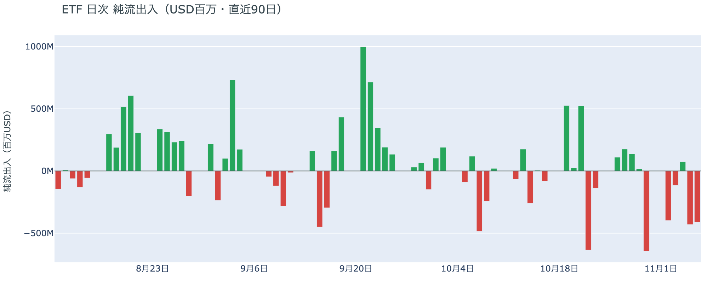

*図の見方: 入ったお金と出たお金の差。上に伸びれば入り超、下に伸びれば出超。*

| ETFの日ごとの出入り | 億ドル |
|---|---:|
| 11月2日 | −4.0 |
| 11月3日 | −1.2 |
| 11月4日 | +0.7 |
| 11月5日 | −4.3 |
| 11月6日 | −4.1 |
| 直近7営業日の合計 | −19.1 |

ETF の買い手は、いまの価格に買い向かうほどの確信をまだ持っていません。数字は11月6日分から更新がなく、2営業日続けて出超の状態のままです。7営業日で20億ドル近くが出ていった流れは、先週の木曜と金曜の時点では止まっていませんでした。

**図①-3 Fear & Greed（市場心理の指数・直近90日）**

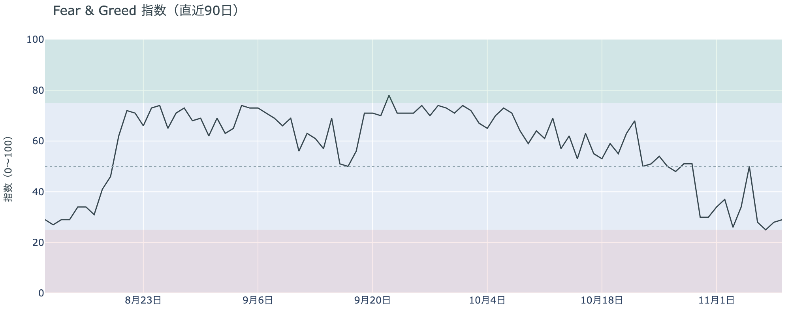

*図の見方: 0〜100で、50より上が「強欲」、下が「恐怖」。*

* 29の「恐怖」。前日の28から1pt戻した。1週間前は37、1か月前は64。

参加者の多くは、上げより下げを気にしたままです。Fear & Greed（＝市場心理の指数）は株が大きく戻した日にもほとんど動かず、「恐怖」の区分にとどまりました。株の安心は、ビットコインの市場心理にまでは移っていません。

### ② 長期保有者は保有量を減らし続け、手放すときの利益は出ていない

**図②-1 長期保有者の保有量の30日変化とSOPR（直近90日）**

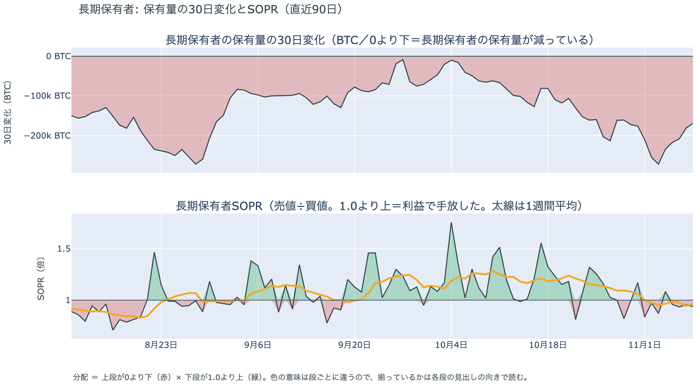

*図の見方: 上段は、長期保有者の保有量が30日でどれだけ増減したか。マイナス＝手放している。下段は長期保有者SOPRで、1より上なら利益で手放した。どちらも太線の1週間平均で読みます。*

| 11月8日時点 | 1週間平均 | 前の週の平均 |
|---|---:|---:|
| 長期保有者SOPR（1より上＝利益で手放した） | 0.96 | 1.00 |
| 長期保有者の保有量の30日変化（万BTC） | −22.0 | −18.5 |

* 30日変化は、1か月前（10月9日）の−6.5万BTCから3倍あまりに膨らんだ。

長期保有者は、利益が出ない価格になっても、手元に置き続けることを選んでいません。保有量は30日で減り、減り方は前の週より大きくなっています。動いたコインは平均して買値より安く動いているので、利益確定の売りとは呼べない形のままです。前日に11月7日時点で書いた形は、11月8日時点でも変わっていません。

長期保有者のほかに、売りに回りそうな持ち手は見当たりません。長く眠っていたコインが急に動いた記録はなく、マイナーの収入は平年を下回っています（Puell Multiple（＝マイナー収入の平年比）が11月8日時点の1週間平均で0.92）が、売りを急ぐほどの水準ではありません。今日はほかに、特筆するオンチェーンの出来事もありません。

### ③ 先物：振り落とされたロングは、1日で積み直された

**図③-1 資金調達率と建玉（直近30日）**

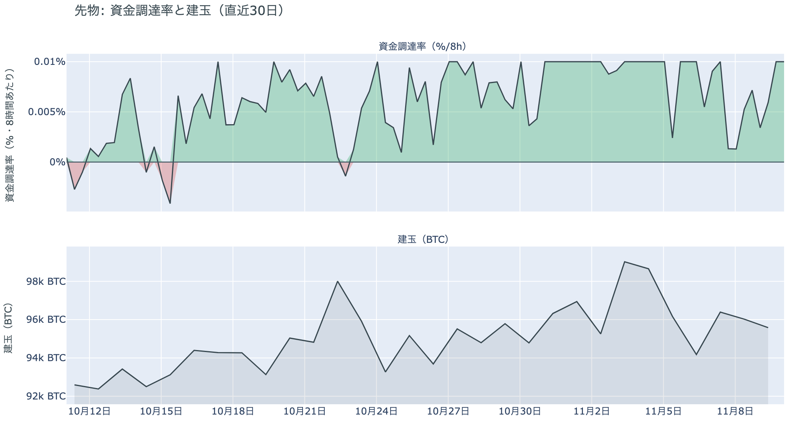

*図の見方: 上段は資金調達率（8時間ごと・日本時間）。プラスが続く＝ロングがショートより多い。下段は建玉。*

* 上乗せは直近34日の平均+2.13ptの2.5倍で、前日の+1.78ptから大きく広がった。
* 資金調達率はプラスが55回連続（約18日）。

先物の参加者は、日曜日の夜の下げを流れの変化とは見ておらず、上げへの賭けをむしろ増やしています。清算で一部が振り落とされたあとも、建玉は1日で前日の減り分を取り戻し、資金調達率はプラスのまま上がりました。ロングが短期金利（＝ドルを米国の短期国債で持つだけで受け取れる金利）より余分に払う分が、この1か月の平均を大きく上回っているので、余分に払ってでも上げに賭けたい人が戻ってきたということです。ただ、ショートも日中の下げで積まれては米国の時間に買い戻されていて、どちらかが相手を押し切った1日ではありません。

### ④ オプション：今週への警戒は和らぎ、下げへの備えは全部の満期で同じ厚さに戻った

オプションには2種類あります。コール（＝決めた価格で買う権利）とプット（＝決めた価格で売る権利）で、価格が上がればコールの価値が上がり、価格が下がればプットの価値が上がります。プットは「価格が下がったときの保険」として買われます。オプションを買う人は、その権利と引き換えに権利料（＝オプションを買う人が払う金額）を払います。

**図④-1 満期ごとのIV（年率%）**

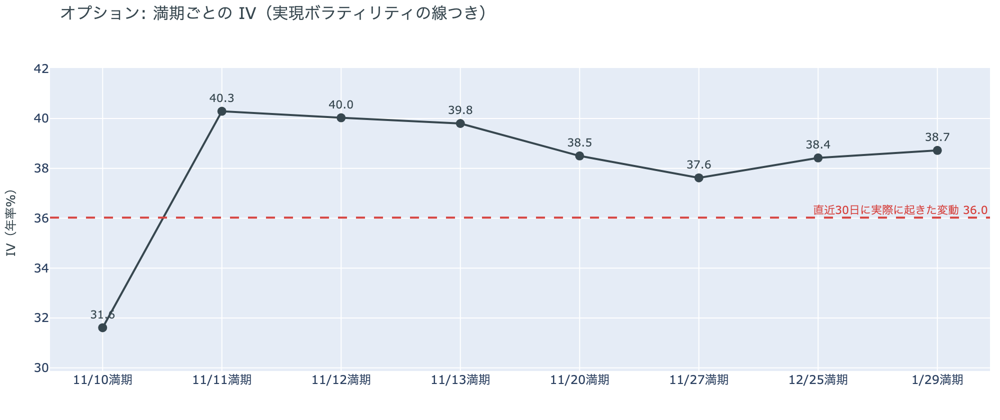

*図の見方: IVを満期ごとに並べたもの。点線は実現ボラティリティ。IVが点線より下なら、市場はこの先の値動きを過去の値動きより小さいと見ています。*

| 満期 | IV |
|---|---:|
| 11月10日 | 32 |
| 11月11日 | 40 |
| 11月12日〜13日 | 40 |
| 11月20日 | 39 |
| 11月27日〜1月29日 | 38〜39 |

* IVは全体で41.0で、実現ボラティリティ36.0より5.0pt高い。過去1年では真ん中より少し下。

参加者は、この先の値動きを過去より大きいと見ていますが、今週だけを特別に警戒するのはやめました。IV（＝値動きの幅の予想）は全体で実現ボラティリティ（＝過去の値動きの幅）を上回ったままですが、前日に今週の満期の権利料へ乗っていた、11月20日から先の満期に対する上乗せは、ほとんど剥がれています。今夜の米10月CPI（＝米国の物価統計）をまたぐ最初の満期は11月11日で、IV はそこがわずかに高いだけです。米CPIの1日に大きく動くとは、それほど見ていないということです。

**図④-2 満期ごとのプットとコールの差**

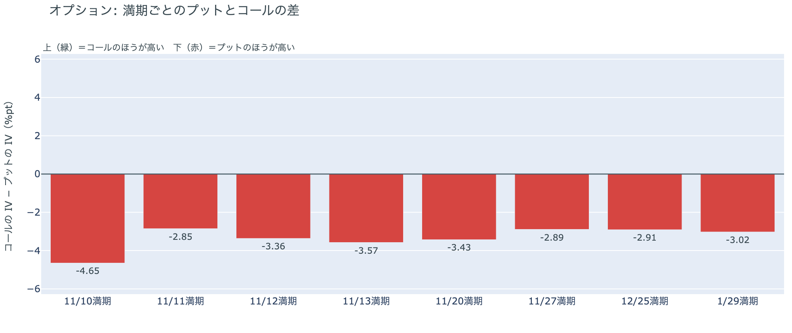

*図の見方: 満期ごとに、プットとコールのどちらが高く売れているか。ゼロより上ならコールのほうが高く、下ならプットのほうが高い。*

| 満期 | どちらが高いか |
|---|---|
| 11月10日 | プットがいちばんはっきり高い |
| 11月11日 | プットが高い（差はいちばん小さい） |
| 11月12日 | プットが高い |
| 11月13日 | プットが高い |
| 11月20日 | プットが高い |
| 11月27日 | プットが高い |
| 12月25日 | プットが高い |
| 1月29日 | プットが高い |

参加者は下げへの備えを外していませんが、手前に厚く寄せる構えはやめました。前日は満期が近いほどプットがはっきり高かったのに、今朝は今日満期の分を除くと、どの満期もほぼ同じ差に戻っています。米10月CPIをまたぐ11月11日の満期でプットの差がいちばん小さいので、米CPIで崩れることに特に身構えているわけではありません。

**図④-3 12月25日満期の持ち高（権利の価格ごと）**

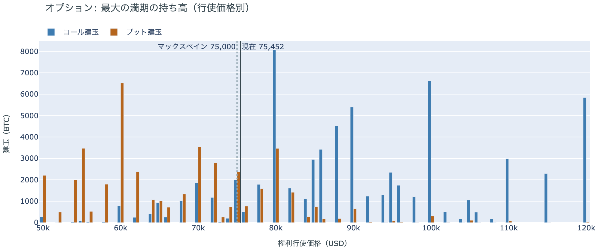

*図の見方: 青＝コール、橙＝プット。現値より上にコールが、下にプットが積まれるのが普通です。*

| 12月25日満期のオプション（基準の価格は約$75,500） | 量（万BTC） | 意味 |
|---|---:|---|
| いまより高い価格のコール | 約7.3 | 「価格が上がる」に賭けた分 |
| いまより安い価格のプット | 約4.7 | 「価格が下がる」への保険 |
| うち、いまより15%以上高い価格のコール | 約5.4 | 大きな上げへの賭け |
| うち、いまより15%以上安い価格のプット | 約3.5 | 大きな下げへの保険 |

* 12月25日満期の持ち高は約14.1万BTCと全満期の41%で、コールがプットの1.5倍。前日とほぼ同じ形。

年末の最大の満期では、「価格が上がる」に賭けた人たちが降りておらず、年末までの上げへの期待は保たれています。先物でロングが積み増されたのと同じ向きで、参加者は前日の下げを流れの変化とは見ていません。大きな上げに賭けた分が報われるには、12月25日の夕方5時までに約$86,800を超える必要があります。全満期でオプションの持ち高が集まっているのは$74,000〜$80,000の帯で、価格はいまもその帯の下の端にいます。

## 4. 価格に影響しうる直近のイベント

オプション市場が今週の満期に置いていた上乗せは小さくなり、今夜の米10月CPIをまたぐ11月11日の満期にも、ほかの満期に対する上乗せはわずかです。下げへの備えは今週に寄せず、12月25日の満期までほぼ同じ厚さで置かれています。

| 日付 | イベント | 何に効くか |
|---|---|---|
| 11/10（火）22:30 日本時間 | 米10月CPI | 金利 |
| 11/13（金）22:30 日本時間 | 米10月の生産者物価指数 | 金利 |
| 11/19（木）4:00 日本時間 | FOMC（＝米国の金利を決める会合）の議事要旨（10月27〜28日分） | 金利 |
| 日程は未定 | 米国とイランの協議。カタールの首相がホルムズ海峡の再開をめぐるイランの暫定案をホワイトハウスへ持ち込むと伝えられたが、両国とも中身を認めていない | 原油 |
| 12/9（水） | FOMC。利上げの織り込みは9割を超え、1週間前の約9割から高まった。結果は日本時間10日早朝 | 金利 |
| 12/25（金）17:00 | オプションの最も大きな満期（約14.1万BTC、全満期の41%） | 約$86,800以上のコールの期限 |

## まとめ

月曜日のビットコインは、原油安と株高をきっかけに先物のショートの買い戻しで小さく戻しましたが、株の戻りの一部しか受け取らず、$74,000台にとどまりました。アメリカの買い手の売りは浅くなったものの買いには戻っておらず、長期保有者も利益の出ない価格で減らし続けているので、株高の日でも、アメリカの買い手と長期保有者の持ち方までは変わっていません。参加者は前日の下げを流れの変化とは見ておらず、ロングを積み増し、年末のコールも残したうえで、今夜の米10月CPIで崩れることには前日ほど身構えていません。

---

<small>（数値は11月10日7時5分（日本時間）までのデータに基づきます。価格・先物・オプションはその時点の値、市場心理は11月9日の確定値、オンチェーン（＝ブロックチェーン上の記録）は11月8日時点、ETF資金フローは11月6日分までです。証券市場の終値は11月9日時点です。オンチェーンの長期保有者の数値には、ETFや取引所が預かっている分も含まれます。清算は Hyperliquid で拾えた分だけで、市場全体のごく一部です。オプションはDeribit（BTCオプションの大半を占める取引所）の全銘柄です。）</small>

*本稿は情報提供を目的としたものであり、投資助言ではありません。将来の価格動向を保証・示唆するものではなく、投資判断は各自の責任において行ってください。*
