# 米10月CPIの上振れで$72,000台へ ― 清算が下げを速め、ロングは降りず

**2026年11月11日**

ビットコインは火曜日、米10月CPIが予想を上回った夜に2段で下げ、一時$73,000を割り込みました。

* **価格**：24時間の値幅は3.7%と前日の2.7%から広がり、この1週間の安値を更新した。朝7時5分の時点で約$73,804と、前日の小さな戻りは消えている
* **きっかけ**：米10月CPI（＝米国の消費者物価指数）が予想を上回り、12月のFOMC（＝米国の金利を決める会合）での利上げの織り込みが一段と高まった。続く米国株の取引時間にはNVIDIAが売られてナスダック100も下げ、ビットコインはそこでもう一段下げた
* **先物**：下げた2つの時間帯で買い持ち（ロング）の清算（＝証拠金不足で強制的に閉じられた取引）が出て、下げを加速させた。ただ資金調達率（＝ロングが払う金利。プラス＝ロングがショートより多い）は高いままで、ロングの多くは降りておらず、上げへの期待は崩れていない
* **需給の土台**：米国の買い手は売りの側にいるが、米CPIの夜にも売りを深めてはいない。長期保有者（＝155日以上保有者）は11月9日時点でも利益の出ない価格で保有量を減らし続けていて、どちらも前日から形は変わっていない
* **オプションの見方**：米CPIを越えたあとも、この先の値動きを過去より大きいと見る構えは変わらない。下げへの備えはどの満期にもほぼ同じ厚さで置いていて、特定の日に崩れるとは見ていない

## 1. 何が起きたか

**図1-1 価格の推移（1時間足・直近7日）**

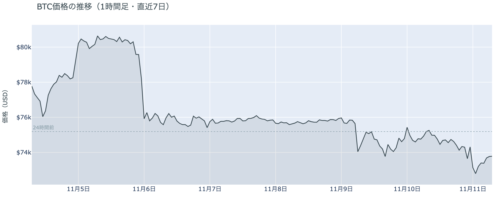

*図の見方: 1時間ごとの価格（日本時間）。点線は24時間前の水準です。*

* 24時間の値幅は3.7%で、前日の2.7%から広がった。
* 値動きの速い5分足（24時間の上位1割）に、拾えた清算の約半分が入っていた。

火曜日のビットコインは、米10月CPIが出た22時台と、米国株の取引が始まったあとの0時台の2段で下げました。2段とも、ロングの清算（＝証拠金不足で強制的に閉じられた取引）が値動きの速い5分足に集まっていて、清算が下げを加速させています。22時台は下げながら建玉（＝先物の未決済残高。証拠金で張っている人の量）が増えたので、売り持ち（ショート）が新しく積まれた下げでした。0時台は建玉が減ったので、ロングが手仕舞われた下げです。そのあと明け方にかけての戻りは、建玉が減りながらの上げで、積まれたショートの買い戻しが運んでいます。

**図1-2 価格と50日・200日移動平均**

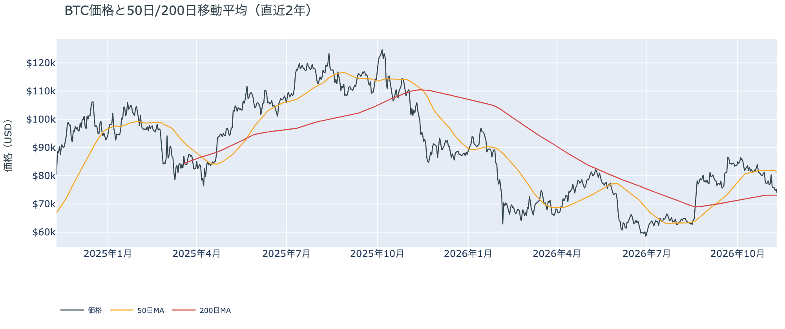

*図の見方: 2本の平均線の上下関係を見ます。50日線が200日線の上にあるのがゴールデンクロスです。*

* 50日線と200日線の差は約$8,232（11.3%）で、前日とほぼ同じ。
* 朝7時5分の価格は50日線を9.3%下回っている。

長い目で見た流れの向きは変わっていませんが、短い目の弱さは一段と深まりました。ゴールデンクロス（＝50日線が200日線を上抜けること）の状態が64日目です。一方で価格は先週の木曜に50日線の下へ落ちてから戻れず、50日線との開きは前日の8.2%から広がっています。

11月10日の証券市場では、米CPIのあと米10年債利回りが5%近くまで上がり、米国株（S&P500）は−0.4%、金は−1.8%と、どちらも下げました。12月の利上げが前提になったという材料を外部環境から抱えたまま、ビットコインは水曜日の朝を迎えています。

**図1-3 清算（直近24時間）**

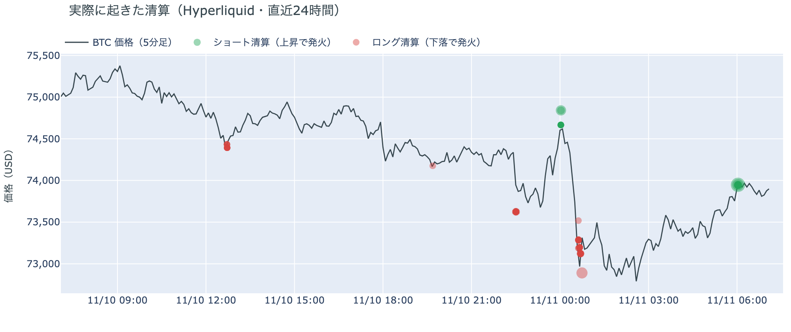

*図の見方: Hyperliquid で実際に清算された取引を、時刻（日本時間）と価格に重ねたもの。*

* 下げた22時台と0時台の清算はロングで、0時台の1時間だけで24時間の4割。
* 最大の1件は今朝6時台のショートで、24時間の半分を占める。

下げを加速させた清算は、1つの大口ではなく、$73,000台に置かれていた多くのロングに散らばっていました。Hyperliquid（＝オンチェーンの先物取引所）で拾えた清算のうち、戻りの側に出たのは大口のショートが1つ飛んだもので、下げの側とは形が違います。

## 2. なぜ動いたか：きっかけと、需給のどこが動いたか

**図2-1 ビットコインと株・金・原油の相対推移（起点＝100）**

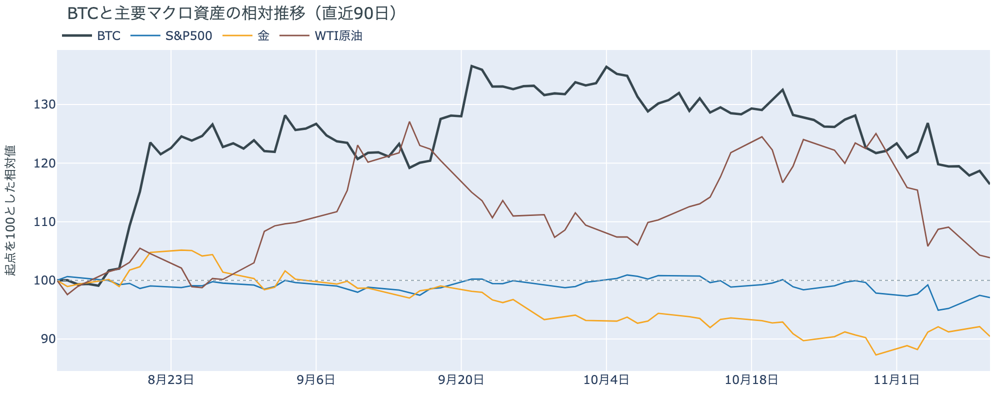

*図の見方: 同じ起点から何%動いたかで重ねたもの。線の向きが揃っているかを見ます。*

| この5営業日の動き（ビットコインは7日間） | 変化 |
|---|---:|
| ビットコイン | −4.6% |
| 金 | +2.5% |
| 米国株（S&P500） | −0.6% |
| 原油 | −10.0% |

* 建玉は99,676BTCで、前日の97,910BTCから1.8%増えた。
* 1日をならした年率は+9.46%で、短期金利（13週Tビル 4.12%）を引いた上乗せは+5.35pt。

火曜日の下げは、米10月CPIの上振れをきっかけに、先物のロングの清算と手仕舞いを通って価格になりました。

1. きっかけ：外部環境では、米10月CPIが前月比+0.4%と、予想の+0.3%を上回りました。変動の大きい食品とエネルギーを除いた分も予想を上回っています。ビットコインの1段目の下げは、米10月CPIが出た22時台と時刻が重なります。FF金利先物では、12月9日のFOMCで0.25ptの利上げは確実視され、0.5ptの利上げも約4割まで織り込まれました（1週間前は0.25ptの利上げが約9割）。2段目の0時台は米国株の取引時間で、NVIDIAが、CEOの交友関係をめぐって共和党の下院外交委員長が召喚状を出す構えを示したことなどで1日に5%あまり売られ、ナスダック100も下げた時間と重なります。ただナスダック100は1日を通すと−0.6%にとどまり、株安が広がった夜ではありません。株も金も同じ向きに下げたのは、金利の上昇という共通のきっかけがありえたことを示す材料です。
2. 伝わり方：速い側の先物では、22時台にショートが新しく積まれ、0時台にロングが手仕舞われ、どちらの時間もロングの清算が下げを加速させました。それでも1日を通すと建玉は増え、資金調達率もプラスのまま高いので、清算されたのはロングの一部です。遅い側では、アメリカの買い手の売りは1週間平均で前の週より浅いまま（図①-1）で、長期保有者も11月9日時点で前の週と同じ形で減らし続けています（図②-1）。下げを運んだのは先物で、アメリカの買い手と長期保有者の持ち方を変えるところまでは届いていません。

原油は11月10日に−0.4%とほとんど動いておらず、米国とイランの協議をめぐる材料が今日の値動きに効いた形跡はありません。

## 3. 市場参加者はいまどう見ているか

### ① アメリカの買い手は売りの側にいるが、米CPIの夜にも売りは深まっていない

**図①-1 Coinbase Premium（アメリカとそれ以外の価格差・直近90日）**

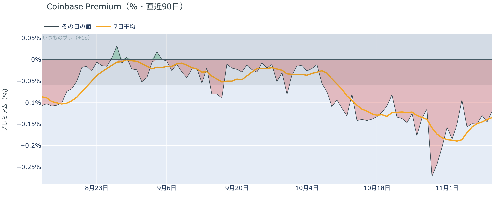

*図の見方: プラス＝アメリカで買いが強い。太線が1週間平均、細線がその日の値。薄い帯は「いつものブレの範囲」です。*

* 1週間平均は−0.14%で、前の週の1週間平均−0.19%より浅い。
* 11月10日の値は−0.12%で、いつものブレの2.0倍。

アメリカの買い手は、まだ下げを拾いに来てはいませんが、米CPIの夜にも売りを深めてはいません。Coinbase Premium（＝アメリカとそれ以外の価格差）は1週間平均で前の週より浅く、ビットコインが2段で下げた火曜日の値も、その1週間平均より浅いところにとどまりました。火曜日の下げを運んだのは、アメリカの現物の売りではなかったということです。

**図①-2 ETFの日ごとの資金の出入り（直近90日）**

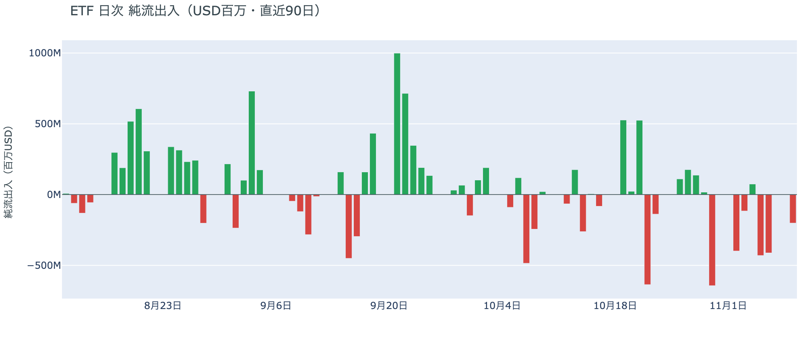

*図の見方: 入ったお金と出たお金の差。上に伸びれば入り超、下に伸びれば出超。*

| ETFの日ごとの出入り | 億ドル |
|---|---:|
| 11月3日 | −1.2 |
| 11月4日 | +0.7 |
| 11月5日 | −4.3 |
| 11月6日 | −4.1 |
| 11月9日 | −2.0 |
| 直近7営業日の合計 | −21.3 |

* 11月9日の出超は、ほぼ全部がIBIT（ブラックロックのETF）からだった。

ETFの買い手は、いまの価格に買い向かうほどの確信をまだ持っていません。週明けの月曜日も出超で、資金が出ていく日は3営業日続きました。出ていく額は先週の木曜・金曜より小さくなりましたが、資金が出ていく流れは月曜日の時点でも続いています。

**図①-3 Fear & Greed（市場心理の指数・直近90日）**

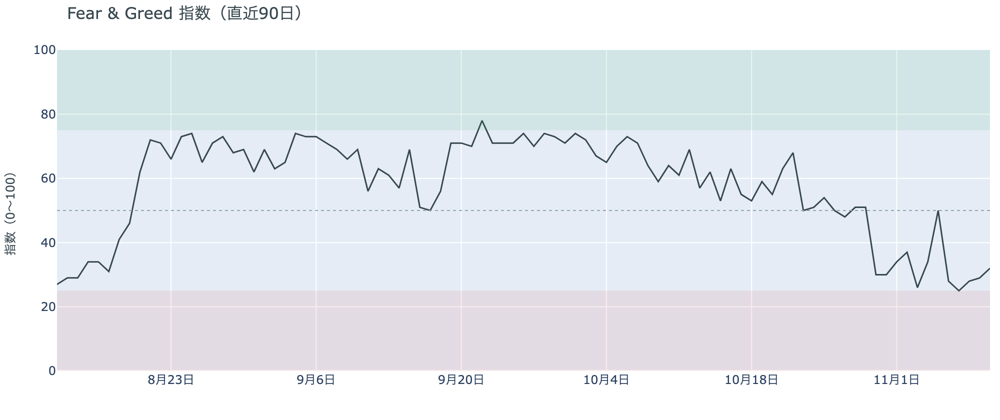

*図の見方: 0〜100で、50より上が「強欲」、下が「恐怖」。*

* 32の「恐怖」。前日の29から3pt戻した。1週間前は26、1か月前は61。

参加者の多くは、上げより下げを気にしたままです。Fear & Greed（＝市場心理の指数）は11月10日に少し戻しましたが、「恐怖」の区分からは出ていません。この値は火曜日の朝までの分で、米CPIの夜の下げはまだ入っていません。

### ② 長期保有者は保有量を減らし続け、手放すときの利益は前の週より小さい

**図②-1 長期保有者の保有量の30日変化とSOPR（直近90日）**

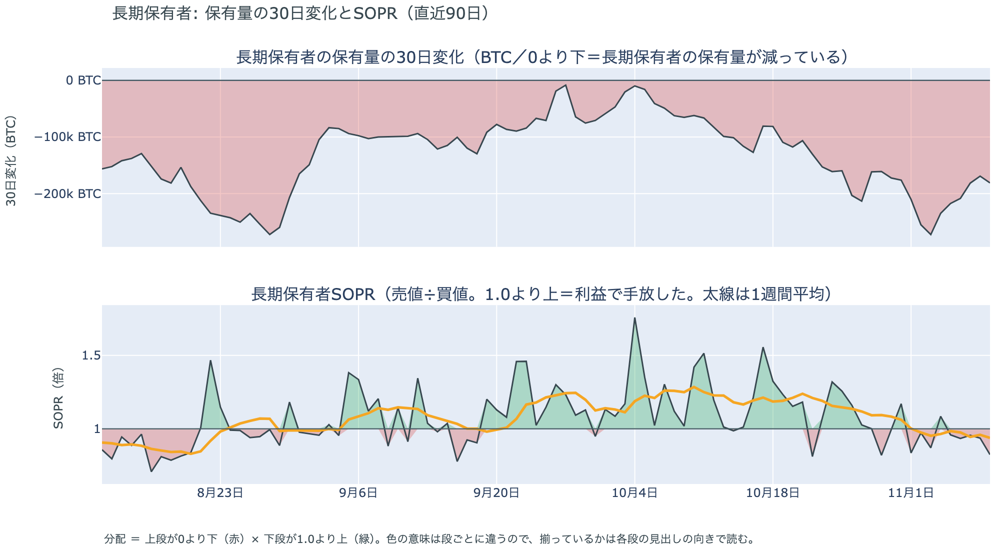

*図の見方: 上段は、長期保有者の保有量が30日でどれだけ増減したか。マイナス＝手放している。下段は長期保有者SOPRで、1より上なら利益で手放した。どちらも太線の1週間平均で読みます。*

| 11月9日時点 | 1週間平均 | 前の週の平均 |
|---|---:|---:|
| 長期保有者SOPR（1より上＝利益で手放した） | 0.94 | 0.98 |
| 長期保有者の保有量の30日変化（万BTC） | −20.9 | −19.3 |

* 30日変化は、1か月前（10月10日）の−6.2万BTCから3倍あまりに膨らんだ。

長期保有者（＝155日以上保有者）は、利益が出ない価格になっても、手元に置き続けることを選んでいません。保有量は30日で減り、減り方は前の週より大きくなっています。動いたコインは平均して買値より安く動いていて、その開きも前の週より広がりました。利益確定の売りとは呼べない形のままで、前日に11月8日時点で書いた形は、11月9日時点でも変わっていません。

長期保有者のほかに、売りに回りそうな持ち手は見当たりません。長く眠っていたコインが急に動いた記録はなく、マイナーの収入は平年を下回っています（Puell Multiple（＝マイナー収入の平年比）が11月9日時点の1週間平均で0.90）が、売りを急ぐほどの水準ではありません。今日はほかに、特筆するオンチェーンの出来事もありません。

### ③ 先物：清算で一部が振り落とされても、ロングは降りきっていない

**図③-1 資金調達率と建玉（直近30日）**

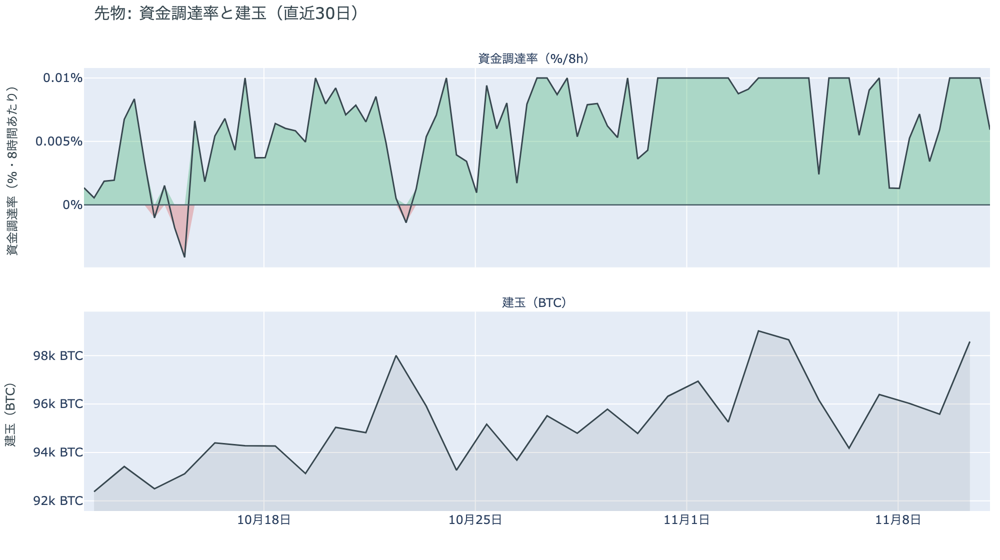

*図の見方: 上段は資金調達率（8時間ごと・日本時間）。プラスが続く＝ロングがショートより多い。下段は建玉。*

* 上乗せは直近34日の平均+2.47ptの2倍あまりで、前日の+5.43ptとほぼ同じ。
* 資金調達率はプラスが58回連続（約19日）。

先物の参加者は、米CPIの夜の下げを流れの変化とは見ておらず、上げへの賭けを降ろしていません。前日は、月曜日に残ったロングの上にさらにロングが積まれたと説明しました。そのうち一部は火曜日の夜に清算されましたが、資金調達率は下がらずにプラスのまま高い水準を保っています。ロングが短期金利（＝ドルを米国の短期国債で持つだけで受け取れる金利）より余分に払う分は、この1か月の平均を大きく上回ったままなので、余分に払ってでも上げに賭けたい人は、下げのあとも残っているということです。ただ、下げの途中ではショートも新しく積まれていて、ロングが相手を押し切れる1日でもありませんでした。

### ④ オプション：米CPIのあとも構えは変わらず、下げへの備えはどの満期にも同じ厚さ

オプションには2種類あります。コール（＝決めた価格で買う権利）とプット（＝決めた価格で売る権利）で、価格が上がればコールの価値が上がり、価格が下がればプットの価値が上がります。プットは「価格が下がったときの保険」として買われます。オプションを買う人は、その権利と引き換えに権利料（＝オプションを買う人が払う金額）を払います。

**図④-1 満期ごとのIV（年率%）**

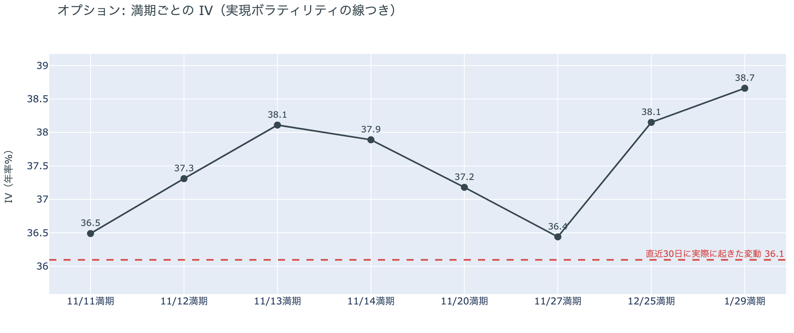

*図の見方: IVを満期ごとに並べたもの。点線は実現ボラティリティ。IVが点線より下なら、市場はこの先の値動きを過去の値動きより小さいと見ています。*

| 満期 | IV |
|---|---:|
| 11月11日 | 37 |
| 11月12日〜14日 | 37〜38 |
| 11月20日 | 37 |
| 11月27日 | 36 |
| 12月25日〜1月29日 | 38〜39 |

* IVは全体で39.9で、実現ボラティリティ36.1より3.8pt高い。前日の41.0から少し下がった。

参加者は、米CPIを越えたあともこの先の値動きを過去より大きいと見ていますが、特定の日に大きく動くとは見ていません。IV（＝値動きの幅の予想）は全体で実現ボラティリティ（＝過去の値動きの幅）を上回ったままで、満期ごとに見ても、どこか1つの満期の権利料にだけ、ほかの満期に対する上乗せが乗っていることはありません。米CPIの夜に3.7%動いたあとでもIVが前日より下がったのは、米CPIの1日を越えて、目の前の警戒がほどけたということです。

**図④-2 満期ごとのプットとコールの差**

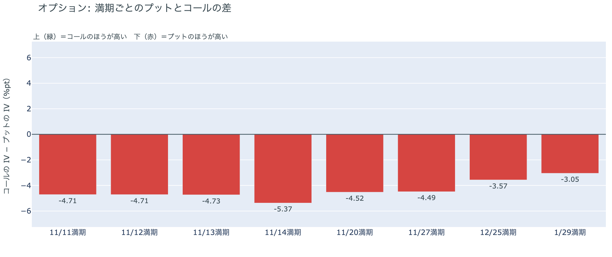

*図の見方: 満期ごとに、プットとコールのどちらが高く売れているか。ゼロより上ならコールのほうが高く、下ならプットのほうが高い。*

| 満期 | どちらが高いか |
|---|---|
| 11月11日 | プットが高い |
| 11月12日 | プットが高い |
| 11月13日 | プットが高い |
| 11月14日 | プットが高い（差はいちばん大きい） |
| 11月20日 | プットが高い |
| 11月27日 | プットが高い |
| 12月25日 | プットが高い（差は小さめ） |
| 1月29日 | プットが高い（差は小さめ） |

参加者は下げへの備えを外していませんが、米CPIの夜の下げのあとも、手前の満期に寄せ直してはいません。どの満期もプットのほうが高く、差はほぼ同じ厚さです。米10月の生産者物価指数をまたぐ11月14日の満期で差がわずかに大きいだけで、その日に崩れることを特に警戒しているわけではありません。

**図④-3 12月25日満期の持ち高（権利の価格ごと）**

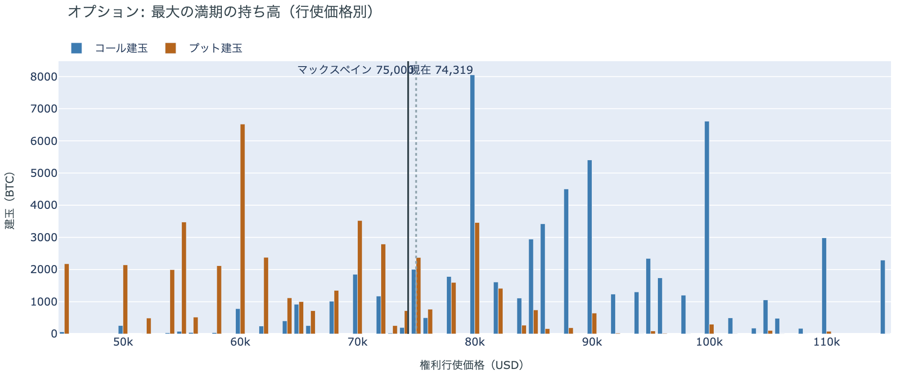

*図の見方: 青＝コール、橙＝プット。現値より上にコールが、下にプットが積まれるのが普通です。*

| 12月25日満期のオプション（基準の価格は約$74,300） | 量（万BTC） | 意味 |
|---|---:|---|
| いまより高い価格のコール | 約7.5 | 「価格が上がる」に賭けた分 |
| いまより安い価格のプット | 約4.5 | 「価格が下がる」への保険 |
| うち、いまより15%以上高い価格のコール | 約5.7 | 大きな上げへの賭け |
| うち、いまより15%以上安い価格のプット | 約3.4 | 大きな下げへの保険 |

* 12月25日満期の持ち高は約14.1万BTCと全満期の41%で、コールがプットの1.4倍。前日とほぼ同じ形。

年末の最大の満期では、「価格が上がる」に賭けた人たちが米CPIの夜のあとも降りておらず、年末までの上げへの期待は保たれています。先物でロングが降りきっていないのと同じ向きです。大きな上げに賭けた分が報われるには、12月25日の夕方5時までに約$85,500を超える必要があります。全満期でオプションの持ち高が集まっているのは$72,000〜$75,000の帯で、価格はいまその帯の中にいます。

## 4. 価格に影響しうる直近のイベント

オプション市場は、米10月CPIを越えたあとも、特定の満期に上乗せを置いていません。下げへの備えはどの満期にもほぼ同じ厚さで置かれ、米10月の生産者物価指数をまたぐ11月14日の満期で、プットの高さがわずかに目立つだけです。

| 日付 | イベント | 何に効くか |
|---|---|---|
| 11/11（水）米国時間 | 下院外交委員長がNVIDIAのCEOに求めた非公開の説明への回答期限。応じなければ召喚状を出すとしている | 米国株（NVIDIA・ナスダック100） |
| 11/13（金）22:30 日本時間 | 米10月の生産者物価指数 | 金利 |
| 11/17（火）米国時間 | NVIDIAの決算 | 米国株（ナスダック100） |
| 11/19（木）4:00 日本時間 | FOMCの議事要旨（10月27〜28日分） | 金利 |
| 12/9（水） | FOMC。0.25ptの利上げは確実視され、0.5ptの利上げも約4割まで織り込まれている。結果は日本時間10日早朝 | 金利 |
| 12/25（金）17:00 | オプションの最も大きな満期（約14.1万BTC、全満期の41%） | 約$85,500以上のコールの期限 |

## まとめ

火曜日のビットコインは、米10月CPIの上振れをきっかけに、先物のロングの清算と手仕舞いを通って2段で下げ、$73,000台で水曜日の朝を迎えました。アメリカの買い手は売りの側にいても売りを深めておらず、長期保有者も前の週と同じ形で減らし続けているので、米CPIの夜でも、アメリカの買い手と長期保有者の持ち方までは変わっていません。参加者は今回の下げを流れの変化とは見ておらず、先物のロングも年末のコールも降ろさないまま、下げへの備えはどの満期にも同じ厚さで置いています。

---

<small>（数値は11月11日7時5分（日本時間）までのデータに基づきます。価格・先物・オプションはその時点の値、市場心理は11月10日の確定値、オンチェーン（＝ブロックチェーン上の記録）は11月9日時点、ETF資金フローは11月9日分までです。証券市場の終値は11月10日時点です。オンチェーンの長期保有者の数値には、ETFや取引所が預かっている分も含まれます。清算は Hyperliquid で拾えた分だけで、市場全体のごく一部です。オプションはDeribit（BTCオプションの大半を占める取引所）の全銘柄です。）</small>

*本稿は情報提供を目的としたものであり、投資助言ではありません。将来の価格動向を保証・示唆するものではなく、投資判断は各自の責任において行ってください。*
