# ショートの買い戻しで$74,000台へ小戻し ― 米国株高の夜も現物の売りは止まず

**2026年11月12日**

ビットコインは水曜日、米CPIの夜の下げを少しだけ取り戻しました。

* **価格**：24時間の値幅は2.2%と前日の3.7%から縮み、朝7時5分の時点で約$74,334。前日の下げのあとに、落ち着きを取り戻した1日だった
* **きっかけ**：外部環境に新しい出来事は無かった。米国株は半導体株の買い戻しで上げたが、株がいちばん大きく上げた取引開始直後の1時間にビットコインは下げていて、株高に引かれた戻りではない
* **先物**：前日の米CPIの夜に積まれた売り持ち（ショート）が買い戻され、小さな戻りを運んだ。買い持ち（ロング）は降りておらず、上げへの期待は保たれている
* **需給の土台**：米国の買い手は株高の水曜日にもむしろ売りを深め、長期保有者（＝155日以上保有者）も11月10日時点で利益の出ない価格で保有量を減らし続けている。どちらも戻りには加わっておらず、前日から形は変わっていない
* **オプションの見方**：この先の値動きを過去より大きいと見る構えは変わらない。下げへの備えは先の満期ほど厚くなり、目の前の米10月の生産者物価指数より年末に向けた下げを気にしている

## 1. 何が起きたか

**図1-1 価格の推移（1時間足・直近7日）**

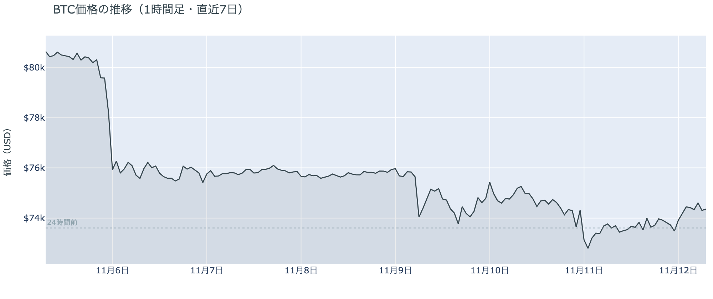

*図の見方: 1時間ごとの価格（日本時間）。点線は24時間前の水準です。*

* 24時間の値幅は2.2%で、前日の3.7%から縮んだ。
* 拾えた清算はすべてショートで、0時台の1時間に24時間の8割が集まった。

水曜日のビットコインは、日中はほぼ横ばいで、0時台から明け方にかけて小さく戻しました。戻った時間帯は、価格が上げながら建玉（＝先物の未決済残高。証拠金で張っている人の量）が減っていて、ショートの買い戻しが運んだ上げです。ショートの清算（＝証拠金不足で強制的に閉じられた取引）も0時台に出ましたが、値動きの速い5分足に入っていたのはその1割ほどで、戻りを運んだのは清算ではなく、自分から手仕舞ったショートの買い戻しです。

**図1-2 価格と50日・200日移動平均**

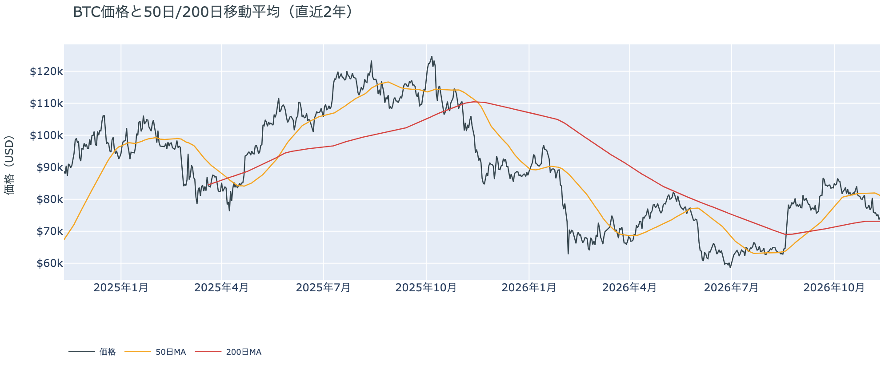

*図の見方: 2本の平均線の上下関係を見ます。50日線が200日線の上にあるのがゴールデンクロスです。*

* 50日線と200日線の差は約$8,010（11.0%）で、前日とほぼ同じ。
* 朝7時5分の価格は50日線を8.4%下回り、前日の9.3%から縮んだ。

長い目で見た流れの向きは変わっておらず、短い目の弱さもまだ戻りきっていません。ゴールデンクロス（＝50日線が200日線を上抜けること）の状態が65日目です。価格は先週の木曜に50日線の下へ落ちたままで、水曜日の戻りはその開きを少し縮めただけです。

11月11日の証券市場では、米国株（S&P500）が+1.3%と前日の下げを取り戻し、金は−0.9%でした。米国の債券市場は退役軍人の日で休場です。FF金利先物では、12月のFOMC（＝米国の金利を決める会合）で0.5ptの利上げが約4割まで織り込まれたままで、米CPIの夜に抱えた利上げの材料は、株高の水曜日にも外部環境から消えていません。

## 2. なぜ動いたか：きっかけと、需給のどこが動いたか

**図2-1 ビットコインと株・金・原油の相対推移（起点＝100）**

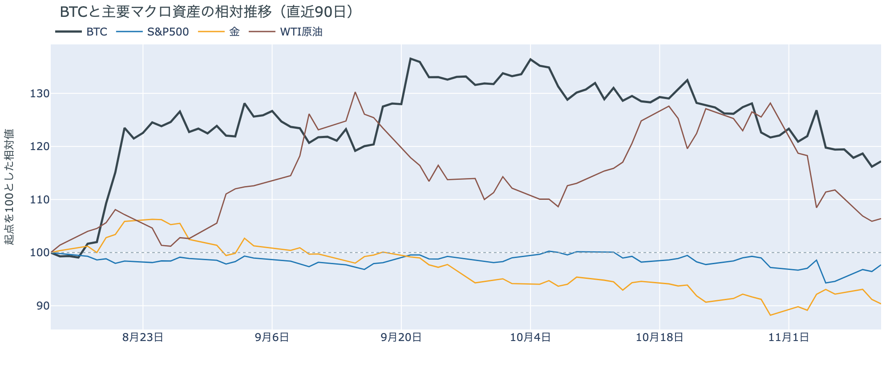

*図の見方: 同じ起点から何%動いたかで重ねたもの。線の向きが揃っているかを見ます。*

| この5営業日の動き（ビットコインは7日間） | 変化 |
|---|---:|
| ビットコイン | −7.6% |
| 金 | −1.9% |
| 米国株（S&P500） | −0.9% |
| 原油 | −1.9% |

* 建玉は97,480BTCで、前日の99,676BTCから2.2%減った。
* 1日をならした年率は+8.27%で、短期金利（13週Tビル 4.12%）を引いた上乗せは+4.15pt。

水曜日の小さな戻りは、はっきりしたきっかけが無いまま、前日に積まれたショートの買い戻しを通って価格になりました。

1. きっかけ：外部環境に新しい出来事はありませんでした。米国株は、AI向けクラウドのCoreWeaveの決算が予想を上回ったことで半導体株を中心に買い戻され、前日まで売られていたNVIDIAも+2.9%、ナスダック100は+2.3%で終えています。ただ、株がいちばん大きく上げた取引開始直後の23時台に、ビットコインは逆に下げていました。ビットコインが上げ始めたのは0時台からで、値動きの速い5分足と同じ5分に、株はほとんど動いていません。1日を通すと同じ向きでも、時刻で見ると株高は戻りのきっかけではありません。
2. 伝わり方：速い側の先物では、0時台から明け方にかけて建玉が減りながら価格が上げていて、前日の米CPIの夜に積まれたショートが買い戻されています。それでも資金調達率（＝ロングが払う金利。プラス＝ロングがショートより多い）はプラスのまま高く、ロングは残っています。遅い側では、アメリカの買い手は株高の水曜日にもむしろ売りを深め（図①-1）、長期保有者も11月10日時点で前の週と同じ形で減らし続けています（図②-1）。戻りを運んだのは先物のショートの買い戻しで、アメリカの買い手と長期保有者までは届いていません。

原油は11月11日に+0.5%とほとんど動いておらず、中東をめぐる材料が今日の値動きに効いた形跡はありません。

## 3. 市場参加者はいまどう見ているか

### ① アメリカの買い手は株高の夜にも買いに回らず、売りの側にとどまっている

**図①-1 Coinbase Premium（アメリカとそれ以外の価格差・直近90日）**

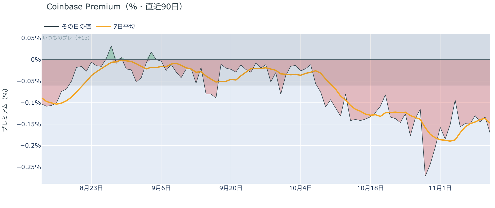

*図の見方: プラス＝アメリカで買いが強い。太線が1週間平均、細線がその日の値。薄い帯は「いつものブレの範囲」です。*

* 1週間平均は−0.15%で、前の週の1週間平均−0.19%より浅い。
* 11月11日の値は−0.17%で、いつものブレの2.8倍。

アメリカの買い手は、米国株が上げた水曜日にもビットコインを拾いに来ず、その日はむしろ売りを深めました。Coinbase Premium（＝アメリカとそれ以外の価格差）は1週間平均では前の週より浅いままですが、11日の値はいつものブレを超えて沈んでいます。水曜日の戻りを運んだのはアメリカの現物の買いではなく、アメリカの買い手は、まだ下げを買い場とは見ていないということです。

**図①-2 ETFの日ごとの資金の出入り（直近90日）**

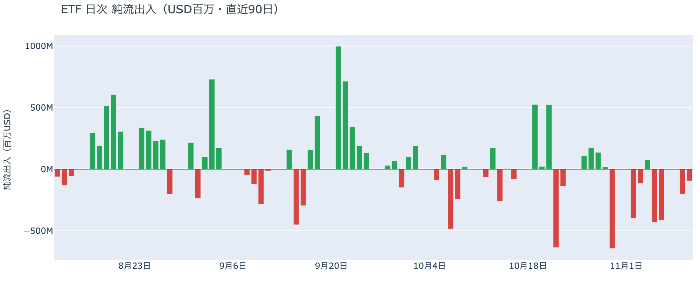

*図の見方: 入ったお金と出たお金の差。上に伸びれば入り超、下に伸びれば出超。*

| ETFの日ごとの出入り | 億ドル |
|---|---:|
| 11月4日 | +0.7 |
| 11月5日 | −4.3 |
| 11月6日 | −4.1 |
| 11月9日 | −2.0 |
| 11月10日 | −1.0 |
| 直近7営業日の合計 | −15.8 |

* 11月10日の出超は、IBIT（ブラックロックのETF）とFBTC（フィデリティのETF）から。

ETFの買い手は、米CPIの出た11月10日にも資金を引き揚げる側にいて、いまの価格に買い向かう確信をまだ持っていません。出ていく額は日を追って小さくなっていますが、出超は4営業日続いていて、流れの向きは変わっていません。

**図①-3 Fear & Greed（市場心理の指数・直近90日）**

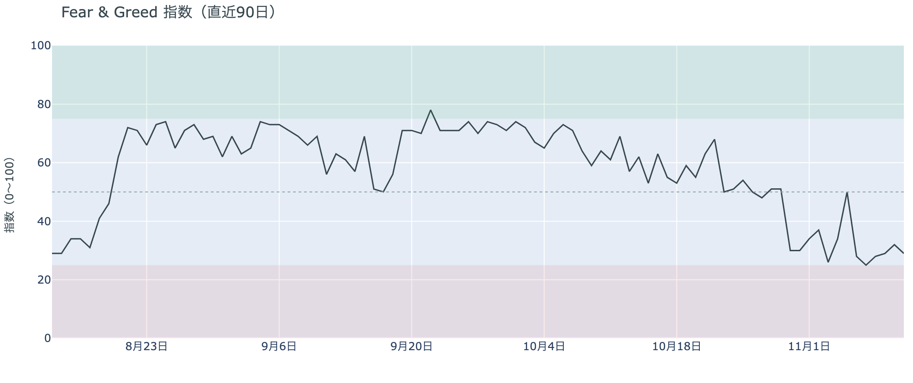

*図の見方: 0〜100で、50より上が「強欲」、下が「恐怖」。*

* 29の「恐怖」。前日の32から3pt下げた。1週間前は34、1か月前は69。

参加者の多くは、上げより下げを気にしたままです。Fear & Greed（＝市場心理の指数）の11月11日の値は米CPIの夜の下げを映していて、「恐怖」の区分の中で一段下がりました。1か月前の「強欲」から、心理はすっかり入れ替わっています。

### ② 長期保有者は利益の出ない価格でも保有量を減らし続け、形は前の週と同じ

**図②-1 長期保有者の保有量の30日変化とSOPR（直近90日）**

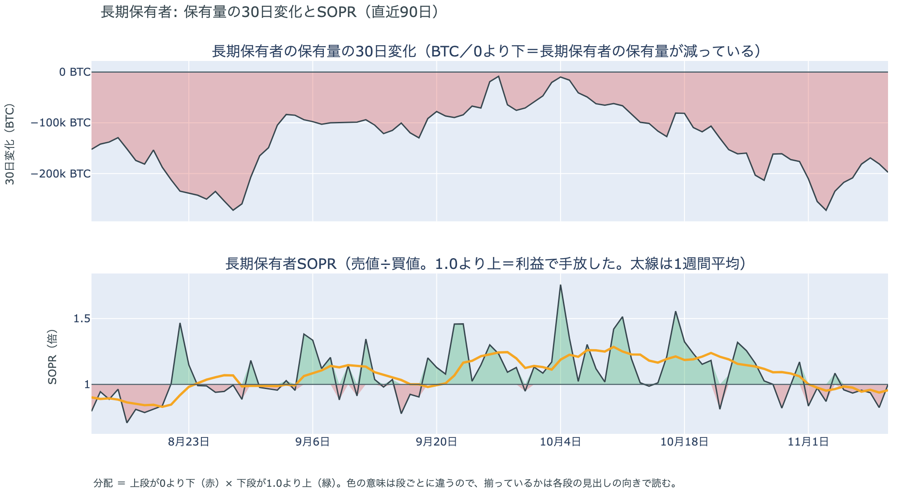

*図の見方: 上段は、長期保有者の保有量が30日でどれだけ増減したか。マイナス＝手放している。下段は長期保有者SOPRで、1より上なら利益で手放した。どちらも太線の1週間平均で読みます。*

| 11月10日時点 | 1週間平均 | 前の週の平均 |
|---|---:|---:|
| 長期保有者SOPR（1より上＝利益で手放した） | 0.96 | 0.95 |
| 長期保有者の保有量の30日変化（万BTC） | −19.9 | −20.1 |

* 30日変化は、1か月前（10月11日）の−6.6万BTCの3倍。

長期保有者（＝155日以上保有者）は、利益が出ない価格になっても、手元に置き続けることを選んでいません。保有量は30日で減り、動いたコインは平均して買値より安く動いています。利益確定の売りとは呼べない形で、減り方も買値との開きも前の週とほぼ同じなので、11月10日時点でも長期保有者の持ち方は前日に書いた形のままです。

マイナーの収入は平年を下回っています（Puell Multiple（＝マイナー収入の平年比）が11月10日時点の1週間平均で0.89）が、売りを急ぐほどの水準ではありません。長く動いていなかったコインには、11月10日にまとまった動きがありました（⑤）。

### ③ 先物：前日に積まれたショートが買い戻され、ロングは降りていない

**図③-1 資金調達率と建玉（直近30日）**

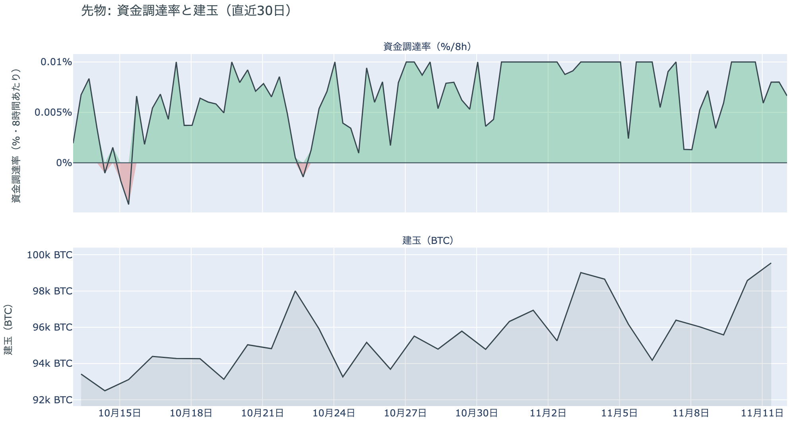

*図の見方: 上段は資金調達率（8時間ごと・日本時間）。プラスが続く＝ロングがショートより多い。下段は建玉。*

* 上乗せは直近34日の平均+2.55ptより大きく、前日の+5.35ptからは縮んだ。
* 資金調達率はプラスが61回連続（約20日）。

先物の参加者は、米CPIの夜の下げを流れの変化とは見ておらず、上げへの賭けを持ち続けています。前日は「下げを運んだのは先物で、ロングの多くは降りていない」と説明しました。水曜日は、下げの途中で積まれたショートのほうが買い戻されて価格が戻り、資金調達率はプラスのまま高いので、前日の説明は今日の数値と合っています。ロングが短期金利（＝ドルを米国の短期国債で持つだけで受け取れる金利）より余分に払う分は前日より小さくなりましたが、この1か月の平均は上回ったままで、余分に払ってでも上げに賭けたい人は残っているということです。

### ④ オプション：構えは変わらず、下げへの備えは年末に向けた満期ほど厚い

オプションには2種類あります。コール（＝決めた価格で買う権利）とプット（＝決めた価格で売る権利）で、価格が上がればコールの価値が上がり、価格が下がればプットの価値が上がります。プットは「価格が下がったときの保険」として買われます。オプションを買う人は、その権利と引き換えに権利料（＝オプションを買う人が払う金額）を払います。

**図④-1 満期ごとのIV（年率%）**

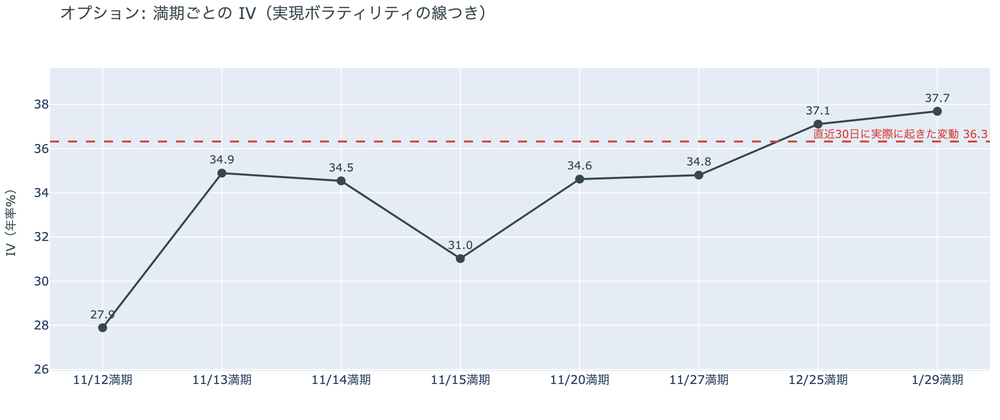

*図の見方: IVを満期ごとに並べたもの。点線は実現ボラティリティ。IVが点線より下なら、市場はこの先の値動きを過去の値動きより小さいと見ています。*

| 満期 | IV |
|---|---:|
| 11月12日 | 28 |
| 11月13日〜15日 | 31〜35 |
| 11月20日〜27日 | 35 |
| 12月25日〜1月29日 | 37〜38 |

* IVは全体で39.5で、実現ボラティリティ36.3より3.1pt高い。前日の39.9とほぼ同じ。

参加者は、この先の値動きを過去より大きいと見る構えを変えていませんが、特定の日に大きく動くとは見ていません。IV（＝値動きの幅の予想）は全体で実現ボラティリティ（＝過去の値動きの幅）を上回ったままです。満期ごとに見ると手前ほど低く先ほど高い平常の形で、11月13日の米10月の生産者物価指数をまたぐ満期にも、ほかの満期に対する上乗せは乗っていません。

**図④-2 満期ごとのプットとコールの差**

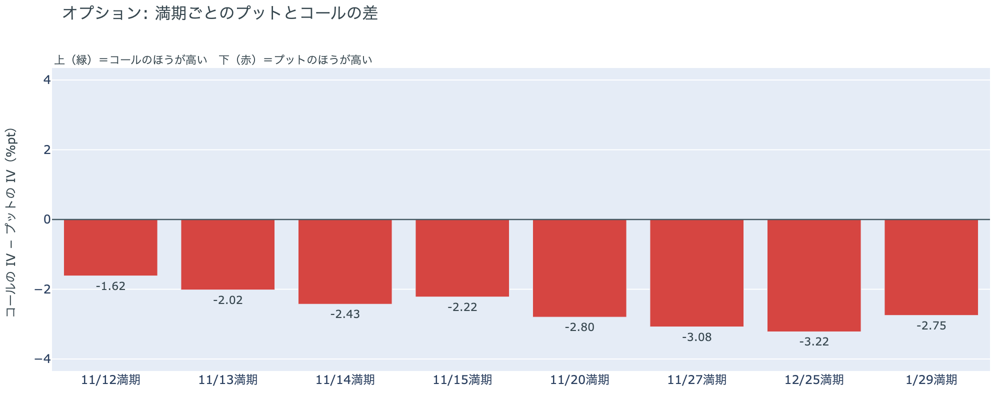

*図の見方: 満期ごとに、プットとコールのどちらが高く売れているか。ゼロより上ならコールのほうが高く、下ならプットのほうが高い。*

| 満期 | どちらが高いか |
|---|---|
| 11月12日 | プットが高い（差は小さめ） |
| 11月13日 | プットが高い |
| 11月14日 | プットが高い |
| 11月15日 | プットが高い |
| 11月20日 | プットが高い |
| 11月27日 | プットが高い（差は大きい） |
| 12月25日 | プットが高い（差はいちばん大きい） |
| 1月29日 | プットが高い |

参加者は下げへの備えを外しておらず、その厚みを年末に向けた満期へ寄せています。どの満期もプットのほうが高く、差は先の満期ほど大きくなりました。前日は米10月の生産者物価指数をまたぐ11月14日の差がわずかに目立っていましたが、今朝いちばん大きいのは12月25日です。目の前の11月14日の満期で崩れるより、12月のFOMCを越えた年末までの下げを気にしているということです。

**図④-3 12月25日満期の持ち高（権利の価格ごと）**

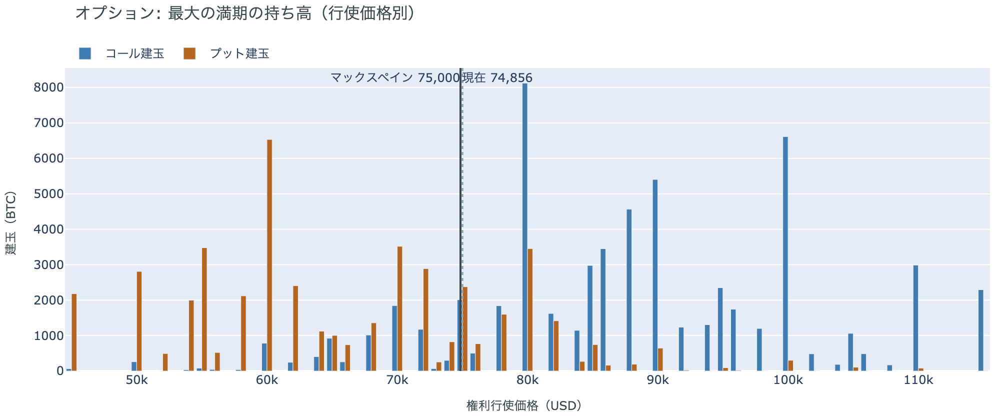

*図の見方: 青＝コール、橙＝プット。現値より上にコールが、下にプットが積まれるのが普通です。*

| 12月25日満期のオプション（基準の価格は約$74,900） | 量（万BTC） | 意味 |
|---|---:|---|
| いまより高い価格のコール | 約7.6 | 「価格が上がる」に賭けた分 |
| いまより安い価格のプット | 約4.6 | 「価格が下がる」への保険 |
| うち、いまより15%以上高い価格のコール | 約5.4 | 大きな上げへの賭け |
| うち、いまより15%以上安い価格のプット | 約3.5 | 大きな下げへの保険 |

* 12月25日満期の持ち高は約14.3万BTCと全満期の41%で、コールがプットの1.4倍。前日とほぼ同じ形。

年末の最大の満期では、「価格が上がる」に賭けた人たちが降りておらず、年末までの上げへの期待は保たれています。プットの差が年末に向けて厚くなっても、コールの持ち高は減っていないので、上げへの賭けを残したまま下げにも備えている形です。大きな上げに賭けた分が報われるには、12月25日の夕方5時までに約$86,000を超える必要があります。全満期でオプションの持ち高が集まっているのは$72,000〜$76,000の帯で、価格はいまその帯の中にいます。

### ⑤ 5年以上動いていなかったコインに、まとまった移動があった

* 11月10日に動いた5年以上前のコインは約5,700BTCで、その73%が3つの生成日に集まっていた。
* その3つを除いた分でも約1,550BTCと、平年（直近1年の中央値）の4倍あまり。今年16回目で、前回は8月21日。

11月10日には、5年以上動いていなかったコインのまとまった移動がありました。動いた量の7割あまりが3つの生成日に集まっていて、多くの古いコインが一斉に動いたのではありません。この記録は売却とは限らず、保管先の変更や取引所のウォレットの整理でも同じ形になります。量は長期保有者の保有量の30日変化（図②-1）の3%ほどで、長期保有者全体の減り方を変える大きさではありません。

## 4. 価格に影響しうる直近のイベント

オプション市場が下げへの備えをいちばん厚く置いているのは12月25日の満期で、12月9日のFOMCとその先の年末をまたぐ区間に当たります。11月13日の米10月の生産者物価指数や、11月17日のNVIDIAの決算をまたぐ手前の満期には、ほかの満期に対する上乗せは乗っていません。

| 日付 | イベント | 何に効くか |
|---|---|---|
| 11/13（金）22:30 日本時間 | 米10月の生産者物価指数 | 金利 |
| 11/18（水）7:00ごろ 日本時間 | NVIDIAの決算（米国時間17日の引け後） | 米国株（ナスダック100） |
| 11/19（木）4:00 日本時間 | FOMCの議事要旨（10月27〜28日分） | 金利 |
| 11/30（月）米国時間の引け | MSCIの指数見直しの実施日。事前の一覧では、ビットコインを大量に持つ米Strategyが除外の対象（結果は日本時間12日朝に公表予定） | Strategyの株と、指数に連動する資金 |
| 12/9（水） | FOMC。0.25ptの利上げは確実視され、0.5ptの利上げも約4割まで織り込まれている。結果は日本時間10日早朝 | 金利 |
| 12/25（金）17:00 | オプションの最も大きな満期（約14.3万BTC、全満期の41%） | 約$86,000以上のコールの期限 |

## まとめ

水曜日のビットコインは、はっきりしたきっかけが無いまま、前日に積まれたショートの買い戻しを通って小さく戻し、$74,000台で木曜日の朝を迎えました。米国株が上げた夜にもアメリカの買い手は売りの側にとどまり、長期保有者も利益の出ない価格で減らし続けているので、アメリカの買い手と長期保有者の持ち方までは変わっていません。参加者は米CPIの夜の下げを流れの変化とは見ておらず、先物のロングも年末のコールも降ろさないまま、下げへの備えだけを年末に向けた満期へ厚くしています。

---

<small>（数値は11月12日7時5分（日本時間）までのデータに基づきます。価格・先物・オプションはその時点の値、市場心理は11月11日の確定値、オンチェーン（＝ブロックチェーン上の記録）は11月10日時点、ETF資金フローは11月10日分までです。証券市場の終値は11月11日時点で、米国の債券市場は退役軍人の日で休場でした。オンチェーンの長期保有者の数値には、ETFや取引所が預かっている分も含まれます。清算は Hyperliquid で拾えた分だけで、市場全体のごく一部です。オプションはDeribit（BTCオプションの大半を占める取引所）の全銘柄です。）</small>

*本稿は情報提供を目的としたものであり、投資助言ではありません。将来の価格動向を保証・示唆するものではなく、投資判断は各自の責任において行ってください。*
