# $71,000台へ一段安、先物のショートが運ぶ ― NVIDIA急落の時間に大口ロングが清算

**2026年11月13日**

ビットコインは木曜日、前日の小さな戻りを失い、この1週間の安値を割り込みました。

* **価格**：24時間の値幅は4.2%と前日の2.2%から広がり、朝7時5分の時点で約$71,426。前日の戻りは続かず、下げの流れに戻った1日だった
* **きっかけ**：外部環境に新しい出来事は無かった。NVIDIAは最高経営責任者の辞任で大きく売られたが、ビットコインの下げはその前の20時台から始まっていて、NVIDIAの急落は下げのきっかけではない
* **先物**：下げの途中で売り持ち（ショート）が新しく積まれ、下げを運んだ。23時台には大口の買い持ち（ロング）1つの清算（＝証拠金不足で強制的に閉じられた取引）が下げを加速させたが、ロング全体は降りておらず、上げへの期待は細りながらも残っている
* **需給の土台**：米国の買い手は売りの側にとどまり、ETFからの資金の流出は5営業日続いた。長期保有者（＝155日以上保有者）も11月11日時点で利益の出ない価格で減らし続けていて、前日から形は変わっていない
* **オプションの見方**：この先の値動きを過去より大きいと見る構えは変わらない。前日まで年末に寄せていた下げへの備えを、目の前の満期へ寄せ直した

## 1. 何が起きたか

**図1-1 価格の推移（1時間足・直近7日）**

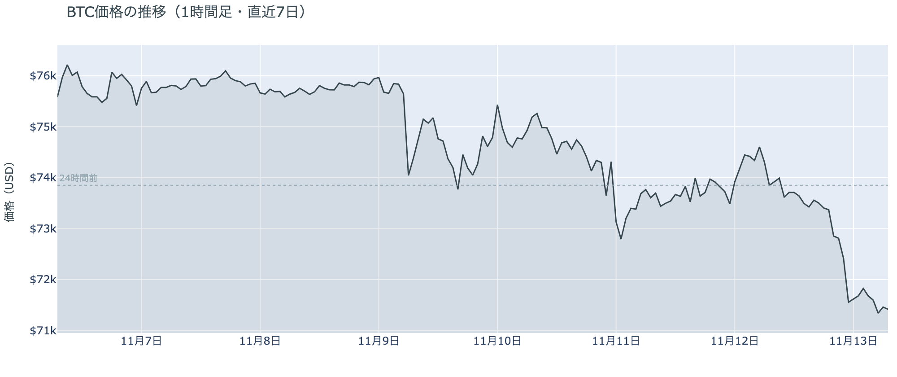

*図の見方: 1時間ごとの価格（日本時間）。点線は24時間前の水準です。*

* 24時間の値幅は4.2%で、前日の2.2%から広がった。
* 20時台から23時台の下げの間に、建玉は約3%増えた。

木曜日のビットコインは、昼までは$73,000台で横ばいで、20時台から23時台にかけて$71,000台まで下げ、そのまま朝を迎えました。下げた時間帯は、価格が下がりながら建玉（＝先物の未決済残高。証拠金で張っている人の量）が増えていて、新しく積まれたショートが運んだ下げです。いちばん速く下げたのは23時台で、値動きの速い5分足に、拾えたロングの清算のほぼすべてが入っていました。清算が下げを加速させています。

**図1-2 価格と50日・200日移動平均**

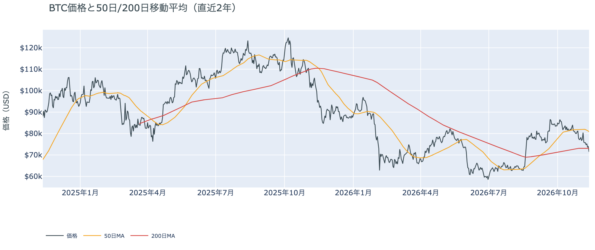

*図の見方: 2本の平均線の上下関係を見ます。50日線が200日線の上にあるのがゴールデンクロスです。*

* 50日線と200日線の差は約$7,781（10.7%）で、前日の11.0%から少し縮んだ。
* 朝7時5分の価格は50日線を11.7%下回り、前日の8.4%から開いた。

長い目で見た流れの向きはまだ変わっていませんが、短い目の弱さは一段深まりました。ゴールデンクロス（＝50日線が200日線を上抜けること）の状態は66日目です。ただ、価格は50日線から1割以上下に離れ、200日線の$73,080も割り込んでいて、2本の平均線の差は縮み始めています。

11月12日の証券市場では、米国株（S&P500）が−0.35%、金が−2.97%、米10年債利回りは5.10%まで上がりました。FF金利先物では、12月のFOMC（＝米国の金利を決める会合）で0.5ptの利上げが約4割5分まで織り込まれ、前日からさらに積み上がっています。金利の重しは外部環境から消えておらず、今夜の米10月の生産者物価指数を前に、利上げの材料を抱えたまま金曜日を迎えた形です。

**図1-3 清算（直近24時間）**

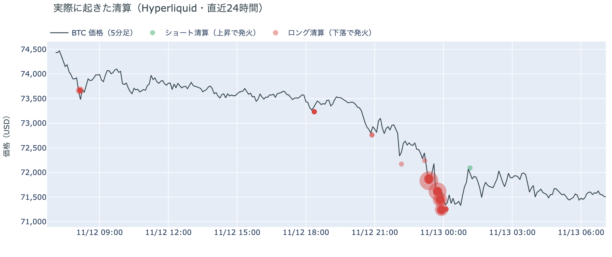

*図の見方: Hyperliquid で実際に清算された取引を、時刻（日本時間）と価格に重ねたもの。*

* 清算はほぼすべてロングで、23時台の$71,000台の1時間に24時間の98%が集まった。
* 最大の1件が全体の97%を占める。

23時台の清算は、Hyperliquid（＝オンチェーンの先物取引所）で拾えた分で見ると、多くのロングが一斉に焼けたのではなく、大口が1つ飛んだものです。ほかのロングの清算は散発的で、下げの夜でもロング全体が投げ出された形にはなっていません。

## 2. なぜ動いたか：きっかけと、需給のどこが動いたか

**図2-1 ビットコインと株・金・原油の相対推移（起点＝100）**

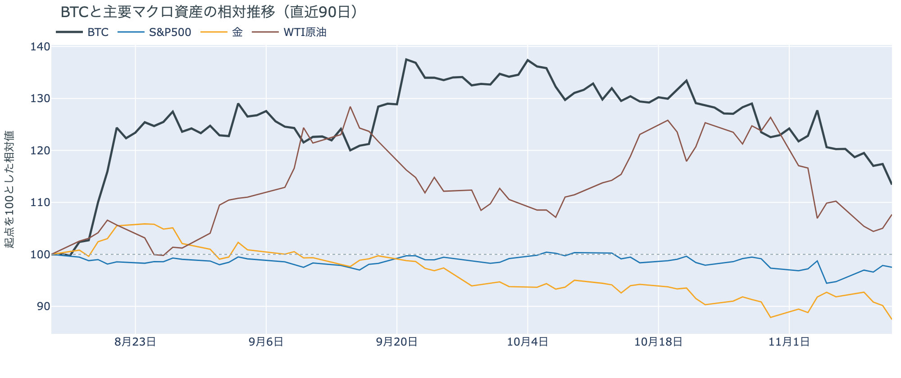

*図の見方: 同じ起点から何%動いたかで重ねたもの。線の向きが揃っているかを見ます。*

| この5営業日の動き（ビットコインは7日間） | 変化 |
|---|---:|
| ビットコイン | −6.0% |
| 金 | −5.6% |
| 米国株（S&P500） | +3.3% |
| 原油 | −2.0% |

* 建玉は101,263BTCで、前日の97,480BTCから3.9%増えた。
* 1日をならした年率は+6.78%で、短期金利（13週Tビル 4.13%）を引いた上乗せは+2.65pt。

木曜日の下げは、はっきりしたきっかけが無いまま、先物で新しく積まれたショートを通って価格になりました。

1. きっかけ：外部環境に新しい出来事はありませんでした。米国株の取引開始の23時半から、NVIDIAは最高経営責任者ジェンスン・フアン氏の辞任を受けて大きく売られ、1日で−4.41%（日中には−10%を超える場面もあった）で終えています。ただ、ナスダック100は−0.30%にとどまり、株安と括れる夜ではありません。ビットコインの下げはその3時間以上前の20時台から始まっていて、清算が出始めたのも取引開始前の23時25分ごろです。いちばん速く下げた23時45分の5分に、NVIDIAはむしろ上げていました。NVIDIAの急落と同じ時間帯に下げは速まりましたが、きっかけではありません。米Strategy（＝ビットコインを大量に持つ米企業）をMSCIが指数から外すと決めた知らせも木曜日の朝に伝わりましたが、そのあと12時間、価格はほぼ横ばいで、こちらにもきっかけになった形跡はありません。
2. 伝わり方：速い側の先物では、20時台から23時台にかけて価格が下がりながら建玉が増えていて、前日に買い戻されたショートが積み直されています。23時台の加速は、大口のロング1つの清算が押し広げたものです。資金調達率（＝ロングが払う金利。プラス＝ロングがショートより多い）はプラスのままで、ロングの多くは残っています。遅い側では、アメリカの買い手はこの1週間を通して売りの側にいて（図①-1・図①-2）、長期保有者も11月11日時点で前の週と同じ形で減らし続けています（図②-1）。下げを運んだのは先物のショートで、アメリカの買い手と長期保有者の売りは、前の週から続く下地のまま強まってはいません。

この1週間で見ると、米国株が上げた5営業日にビットコインは下げていて、株と同じ向きには動いていません。この1週間の下げは、米国株と共通のきっかけによるものではありません。原油は11月12日に+2.55%と上げましたが、同じ日にビットコインは逆に下げていて、原油を動かした材料も今日の値動きに効いた形跡はありません。

## 3. 市場参加者はいまどう見ているか

### ① アメリカの買い手は売りの側にとどまり、下げを買い場とは見ていない

**図①-1 Coinbase Premium（アメリカとそれ以外の価格差・直近90日）**

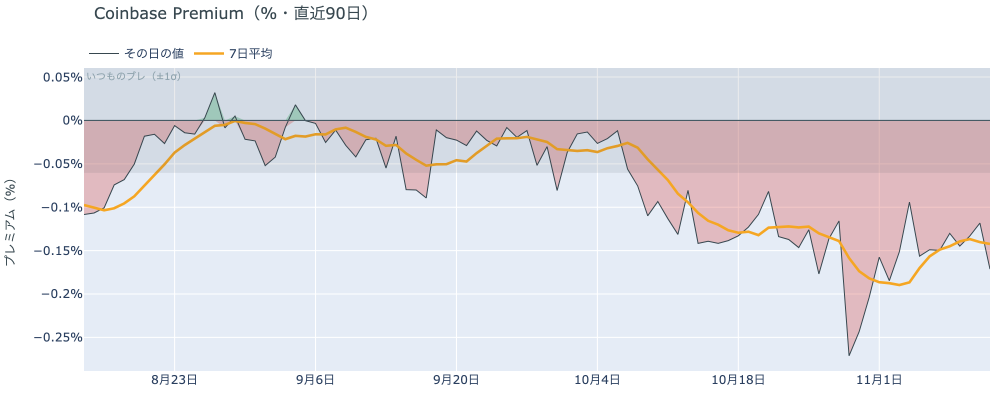

*図の見方: プラス＝アメリカで買いが強い。太線が1週間平均、細線がその日の値。薄い帯は「いつものブレの範囲」です。*

* 1週間平均は−0.14%で、前の週の1週間平均−0.17%より浅い。
* 11月12日の値は−0.17%で、いつものブレの2.8倍。

アメリカの買い手は、木曜日の下げでもビットコインを拾いに来ず、その日も売りの側にいました。Coinbase Premium（＝アメリカとそれ以外の価格差）は1週間平均では前の週より浅くなっていますが、12日の値は前日に続いていつものブレを超えて沈んでいます。$71,000台まで下げても買いが入らないので、アメリカの買い手は、まだこの水準を買い場とは見ていないということです。

**図①-2 ETFの日ごとの資金の出入り（直近90日）**

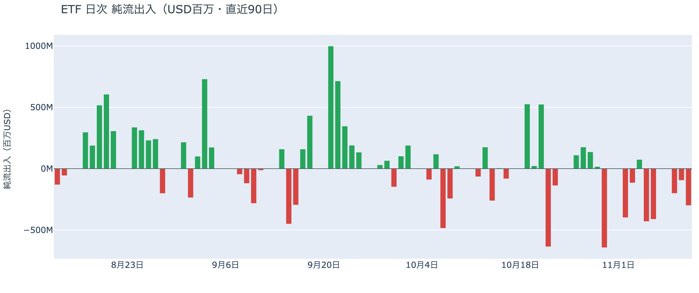

*図の見方: 入ったお金と出たお金の差。上に伸びれば入り超、下に伸びれば出超。*

| ETFの日ごとの出入り | 億ドル |
|---|---:|
| 11月5日 | −4.3 |
| 11月6日 | −4.1 |
| 11月9日 | −2.0 |
| 11月10日 | −1.0 |
| 11月11日 | −3.0 |
| 直近7営業日の合計 | −14.8 |

* 11月11日の出超は、ほとんどがIBIT（ブラックロックのETF）から。

ETFの買い手は、資金を引き揚げる側から戻っていません。前日まで日を追って小さくなっていた出超は、11月11日に再び大きくなり、5営業日続きました。いまの価格に買い向かう確信は、ETFの買い手にもまだ生まれていないということです。

**図①-3 Fear & Greed（市場心理の指数・直近90日）**

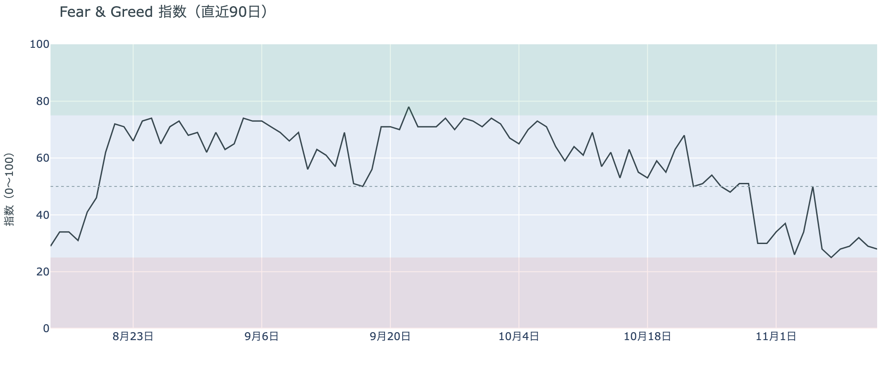

*図の見方: 0〜100で、50より上が「強欲」、下が「恐怖」。*

* 28の「恐怖」。前日の29から1pt下げた。1週間前は50、1か月前は57。

参加者の多くは、上げより下げを気にしたままです。Fear & Greed（＝市場心理の指数）の11月12日の値は「恐怖」の区分にとどまり、1週間前の「中立」の水準から戻る気配はありません。

### ② 長期保有者は利益の出ない価格でも減らし続け、形は前の週と同じ

**図②-1 長期保有者の保有量の30日変化とSOPR（直近90日）**

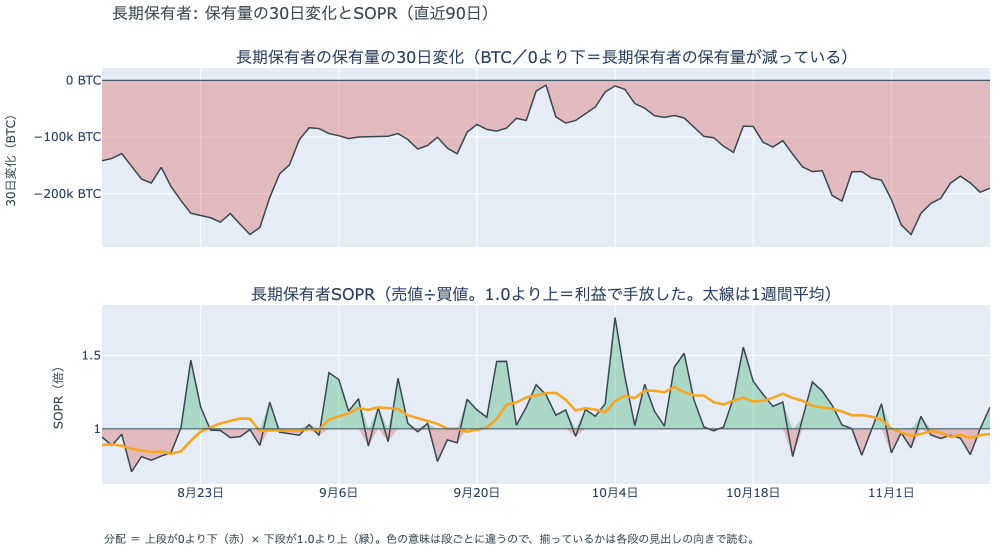

*図の見方: 上段は、長期保有者の保有量が30日でどれだけ増減したか。マイナス＝手放している。下段は長期保有者SOPRで、1より上なら利益で手放した。どちらも太線の1週間平均で読みます。*

| 11月11日時点 | 1週間平均 | 前の週の平均 |
|---|---:|---:|
| 長期保有者SOPR（1より上＝利益で手放した） | 0.97 | 0.97 |
| 長期保有者の保有量の30日変化（万BTC） | −19.2 | −21.2 |

* 30日変化は、1か月前（10月12日）の−8.2万BTCの2倍あまり。

長期保有者は、利益が出ない価格になっても、手元に置き続けることを選んでいません。保有量は30日で減り、動いたコインは平均して買値より安く動いているので、利益確定の売りとは呼べない形のまま減っています。減り方は前の週より少し小さくなりましたが、買値との開きは前の週と同じで、11月11日時点でも長期保有者の持ち方は前日に書いた形のままです。

ほかに売りに回りそうな持ち手が新しく現れた記録もありません。長く眠っていたコインのまとまった移動は11月11日には無く、マイナーの収入は平年を下回っています（Puell Multiple（＝マイナー収入の平年比）が11月11日時点の1週間平均で0.87）が、売りを急ぐほどの水準ではありません。11月11日時点のコインが最後に送金された日の価格の分布では、いまの価格は$70,000〜$80,000の帯の下端から2%のところにいます。

### ③ 先物：前日に買い戻されたショートが積み直され、ロングは降りていない

**図③-1 資金調達率と建玉（直近30日）**

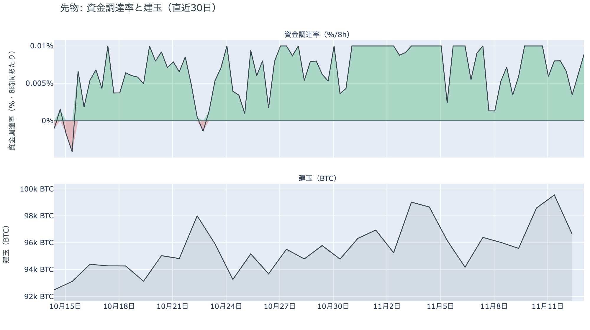

*図の見方: 上段は資金調達率（8時間ごと・日本時間）。プラスが続く＝ロングがショートより多い。下段は建玉。*

* 上乗せは直近34日の平均+2.66ptとほぼ同じで、前日の+4.15ptから縮んだ。
* 資金調達率はプラスが64回連続（約21日）。

先物の参加者は、ショートの側が下げに賭け直し、ロングの側は上げへの期待を細らせながらも降りていません。前日は「戻りを運んだのはショートの買い戻しで、ロングは降りていない」と説明しました。木曜日は、そのショートが積み直されて価格が下げ、清算で減ったのは大口の1つだけでした。資金調達率がプラスのまま続いているので、ロングの多くは残っています。ただ、ロングが短期金利（＝ドルを米国の短期国債で持つだけで受け取れる金利）より余分に払う分は、この1か月の平均まで縮みました。余分に払ってでも上げに賭けたい人は、前日より減ったということです。

### ④ オプション：構えは変わらず、下げへの備えを目の前の満期へ寄せ直した

オプションには2種類あります。コール（＝決めた価格で買う権利）とプット（＝決めた価格で売る権利）で、価格が上がればコールの価値が上がり、価格が下がればプットの価値が上がります。プットは「価格が下がったときの保険」として買われます。オプションを買う人は、その権利と引き換えに権利料（＝オプションを買う人が払う金額）を払います。

**図④-1 満期ごとのIV（年率%）**

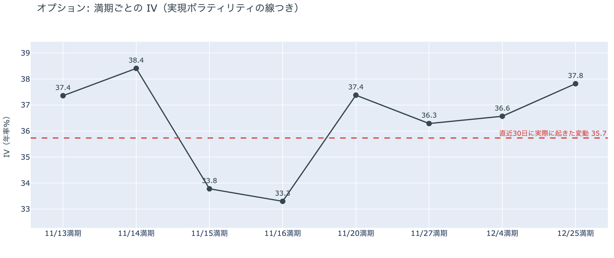

*図の見方: IVを満期ごとに並べたもの。点線は実現ボラティリティ。IVが点線より下なら、市場はこの先の値動きを過去の値動きより小さいと見ています。*

| 満期 | IV |
|---|---:|
| 11月13日〜14日 | 37〜38 |
| 11月15日〜16日 | 33〜34 |
| 11月20日〜12月4日 | 36〜37 |
| 12月25日 | 38 |

* IVは全体で38.9で、実現ボラティリティ35.7より3.2pt高い。

参加者は、この先の値動きを過去より大きいと見る構えを変えていませんが、特定の日に大きく動くとは見ていません。IV（＝値動きの幅の予想）は全体で実現ボラティリティ（＝過去の値動きの幅）を上回ったままです。手前の2つの満期は少し高めですが、今夜の米10月の生産者物価指数をまたぐ11月14日だけが突き出ているわけではなく、昨夜の下げの名残が手前に残っている形です。

**図④-2 満期ごとのプットとコールの差**

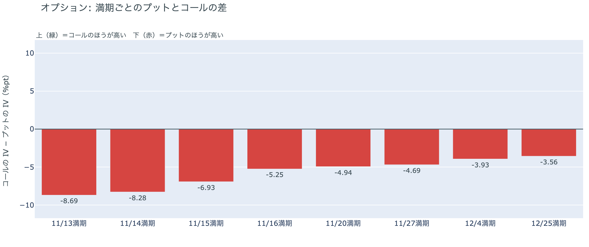

*図の見方: 満期ごとに、プットとコールのどちらが高く売れているか。ゼロより上ならコールのほうが高く、下ならプットのほうが高い。*

| 満期 | どちらが高いか |
|---|---|
| 11月13日 | プットが高い（差はいちばん大きい） |
| 11月14日 | プットが高い（差は大きい） |
| 11月15日 | プットが高い |
| 11月16日 | プットが高い |
| 11月20日 | プットが高い |
| 11月27日 | プットが高い |
| 12月4日 | プットが高い |
| 12月25日 | プットが高い（差はいちばん小さい） |

参加者は下げへの備えを外しておらず、木曜日の下げで、その重心を目の前の満期へ移しました。どの満期もプットのほうが高く、前日は先の満期ほど差が大きかったのに、今朝は手前ほど差が大きくなっています。年末までの下げより、まずこの数日の続落を気にするようになったということです。

**図④-3 12月25日満期の持ち高（権利の価格ごと）**

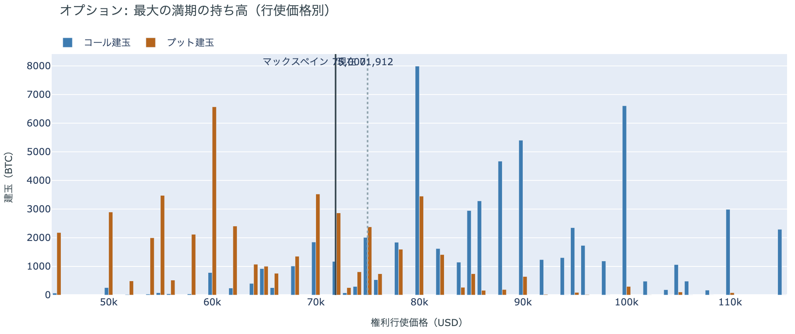

*図の見方: 青＝コール、橙＝プット。現値より上にコールが、下にプットが積まれるのが普通です。*

| 12月25日満期のオプション（基準の価格は約$71,900） | 量（万BTC） | 意味 |
|---|---:|---|
| いまより高い価格のコール | 約7.7 | 「価格が上がる」に賭けた分 |
| いまより安い価格のプット | 約4.3 | 「価格が下がる」への保険 |
| うち、いまより15%以上高い価格のコール | 約6.1 | 大きな上げへの賭け |
| うち、いまより15%以上安い価格のプット | 約3.2 | 大きな下げへの保険 |

* 12月25日満期の持ち高は約14.3万BTCと全満期の40%で、コールがプットの1.4倍。前日とほぼ同じ形。

年末の最大の満期では、「価格が上がる」に賭けた人たちが$71,000台への下げでも降りておらず、年末までの上げへの期待は保たれています。備えの重心が手前へ移っても持ち高の形は変わっていないので、動いたのは権利料の付き方であって、年末への賭けそのものではありません。大きな上げに賭けた分が報われるには、12月25日の夕方5時までに約$82,700を超える必要があります。全満期でオプションの持ち高が集まっているのは$70,000〜$72,000で、価格はいまその間にいます。

## 4. 価格に影響しうる直近のイベント

オプション市場が下げへの備えをいちばん厚く置いているのは、11月13日と14日の目の前の満期で、今夜の米10月の生産者物価指数をまたぐ区間に当たります。ただ、その満期のIVに、ほかの満期に対する上乗せは乗っていません。

| 日付 | イベント | 何に効くか |
|---|---|---|
| 11/13（金）22:30 日本時間 | 米10月の生産者物価指数 | 金利 |
| 11/18（水）7:00ごろ 日本時間 | NVIDIAの決算（米国時間17日の引け後）。フアン氏の辞任後、初めての決算 | 米国株（ナスダック100） |
| 11/19（木）4:00 日本時間 | FOMCの議事要旨（10月27〜28日分） | 金利 |
| 11/30（月）米国時間の引け | MSCIの指数から米Strategyが外れる実施日 | Strategyの株と、指数に連動する資金 |
| 12/9（水） | FOMC。0.25ptの利上げは確実視され、0.5ptの利上げも約4割5分まで織り込まれている。結果は日本時間10日早朝 | 金利 |
| 12/25（金）17:00 | オプションの最も大きな満期（約14.3万BTC、全満期の40%） | 約$82,700以上のコールの期限 |

## まとめ

木曜日のビットコインは、はっきりしたきっかけが無いまま、先物で積み直されたショートを通って下げ、大口のロングの清算で速まりながら$71,000台で金曜日の朝を迎えました。アメリカの買い手は売りの側にとどまり、長期保有者も利益の出ない価格で減らし続けていますが、どちらも前の週から続く形のままで、アメリカの買い手と長期保有者の持ち方までは変わっていません。参加者は下げが年末まで続くとまでは見ておらず、先物のロングも年末のコールも降ろさないまま、目の前の数日の続落にだけ備えを厚くしています。

---

<small>（数値は11月13日7時5分（日本時間）までのデータに基づきます。価格・先物・オプションはその時点の値、市場心理は11月12日の確定値、オンチェーン（＝ブロックチェーン上の記録）は11月11日時点、ETF資金フローは11月11日分までです。証券市場の終値は11月12日時点です。オンチェーンの長期保有者の数値には、ETFや取引所が預かっている分も含まれます。清算は Hyperliquid で拾えた分だけで、市場全体のごく一部です。オプションはDeribit（BTCオプションの大半を占める取引所）の全銘柄です。）</small>

*本稿は情報提供を目的としたものであり、投資助言ではありません。将来の価格動向を保証・示唆するものではなく、投資判断は各自の責任において行ってください。*
