# 12週ぶり安値の$68,000台へ ― 昼にロングが手仕舞われ、米生産者物価では動かず

**2026年11月14日**

ビットコインは金曜日、日本時間の昼までに$68,000台へ下げ、約3か月ぶりの安値で週末を迎えました。

* **価格**：24時間の値幅は5.8%と前日の4.2%から広がり、朝7時5分の時点で約$68,286。下げは昼までに済み、夜は$69,000前後で落ち着いたまま朝を迎えた
* **きっかけ**：下げた時間に新しい出来事は無かった。利上げの織り込みと米金利の上昇が続いた週の流れのまま下げ、夜の米10月の生産者物価指数では動かなかった
* **先物**：下げの途中で買い持ち（ロング）が手仕舞われ、大口のロング1つの清算（＝証拠金不足で強制的に閉じられた取引）が下げを加速させた。ロングはまだ残っているが、上げへの確信は前日より弱まった
* **需給の土台**：米国の買い手は売りの側にとどまり、ETFからの資金の流出は6営業日続いた。長期保有者（＝155日以上保有者）も11月12日時点で減らし続けているが、減り方は前の週より小さく、前日から形は変わっていない
* **オプションの見方**：この先の値動きを過去より大きいと見る構えは変わらず、下げへの備えは目の前の満期ほど厚い。ただ週末の満期のIVは低く、週末に大きく荒れるとは見ていない

## 1. 何が起きたか

**図1-1 価格の推移（1時間足・直近7日）**

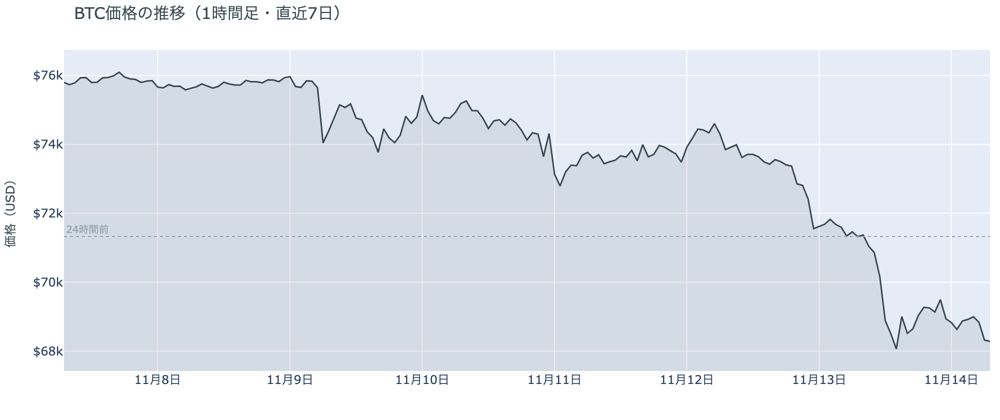

*図の見方: 1時間ごとの価格（日本時間）。点線は24時間前の水準です。*

* 24時間の値幅は5.8%で、前日の4.2%からさらに広がった。
* 24時間で建玉は約3%減り、10万BTCを割った。

金曜日の下げは、日本時間の朝9時から昼14時台までの間にまとまって起き、そのあとは$68,500〜$69,500の間で横ばいでした。下げた時間の多くは、価格が下がりながら建玉（＝先物の未決済残高。証拠金で張っている人の量）が減っていて、ロングの手仕舞いが運んだ下げです。いちばん速く下げた12時台だけは建玉が増えていて、ここでは新しいショートも積まれました。値動きの速い5分足には、拾えた清算の4割が入っていて、清算が下げを加速させています。

**図1-2 価格と50日・200日移動平均**

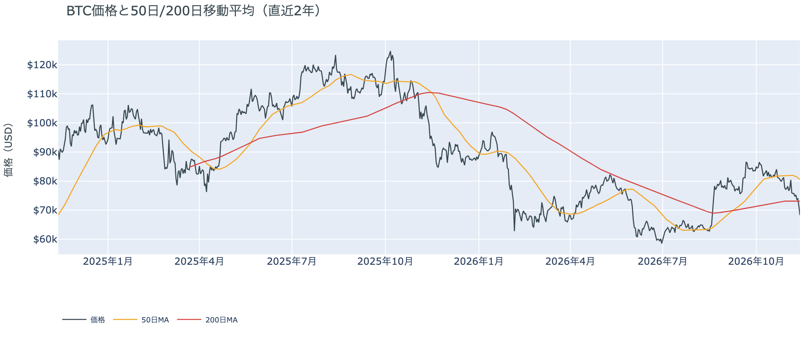

*図の見方: 2本の平均線の上下関係を見ます。50日線が200日線の上にあるのがゴールデンクロスです。*

* 50日線と200日線の差は約$7,504（10.3%）で、前日の10.7%から縮んだ。
* 朝7時5分の価格は50日線を15.2%、200日線（$73,034）を6.5%下回る。

長い目で見た流れの向きはまだ変わっていませんが、短い目の弱さはさらに深まりました。ゴールデンクロス（＝50日線が200日線を上抜けること）の状態は67日目です。ただ、価格は2本の平均線のどちらからも下に離れ、2本の差は日を追って縮んでいます。

11月13日の証券市場では、米国株（S&P500）が−0.40%、米10年債利回りは5.15%まで上がって週を終えました。証券市場は週末で閉まりますが、利上げを織り込んだ金利の高さは、外部環境から消えないまま週末へ持ち越されています。

**図1-3 清算（直近24時間）**

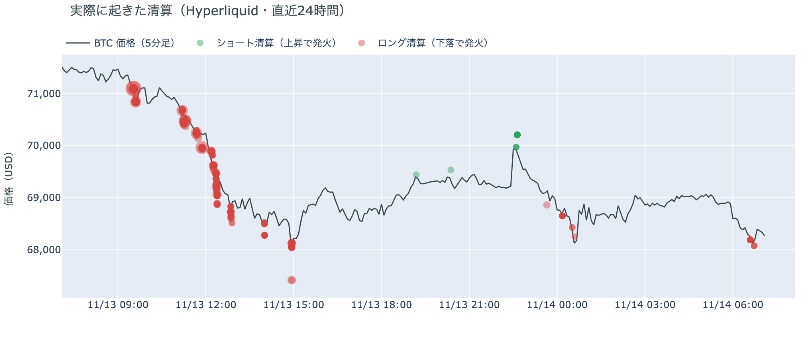

*図の見方: Hyperliquid で実際に清算された取引を、時刻（日本時間）と価格に重ねたもの。*

* 清算はほぼすべてロングで、$69,000〜$70,000台に7割が集まった。
* 最大の1件が全体の85%を占める。

昼の清算は、Hyperliquid（＝オンチェーンの先物取引所）で拾えた分で見ると、多くのロングが一斉に焼けたのではなく、大口が1つ飛んだものです。夜の横ばいの時間には、ロングの清算もショートの清算も散発的にしか出ていません。

## 2. なぜ動いたか：きっかけと、需給のどこが動いたか

**図2-1 ビットコインと株・金・原油の相対推移（起点＝100）**

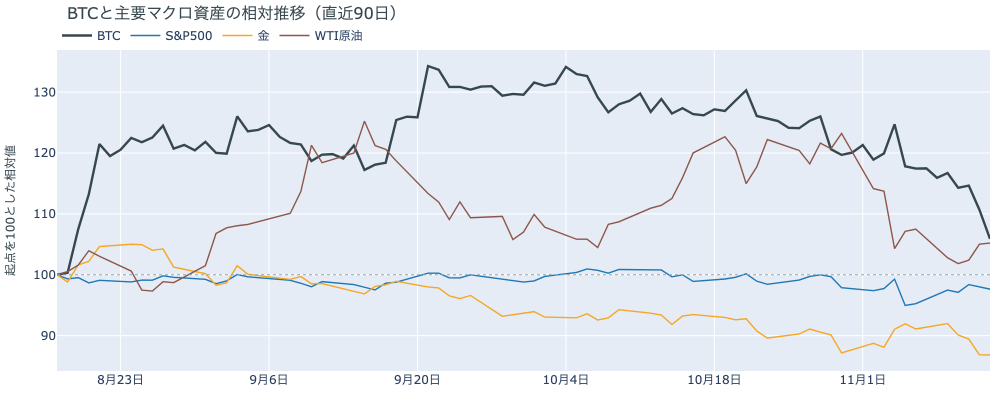

*図の見方: 同じ起点から何%動いたかで重ねたもの。線の向きが揃っているかを見ます。*

| この5営業日の動き（ビットコインは7日間） | 変化 |
|---|---:|
| ビットコイン | −9.8% |
| 金 | −4.7% |
| 米国株（S&P500） | +2.5% |
| 原油 | −2.1% |

* 建玉は98,120BTCで、前日の101,263BTCから3.1%減った。
* 1日をならした年率は+5.59%で、短期金利（13週Tビル 4.12%）を引いた上乗せは+1.47pt。

金曜日の下げは、新しいきっかけが無いまま、先物のロングの手仕舞いを通って価格になりました。

1. きっかけ：下げた日本時間の朝から昼に、外部環境の新しい出来事はありませんでした。この1週間は、米10月CPIの上振れのあと、12月のFOMC（＝米国の金利を決める会合）での利上げが織り込まれ、米10年債利回りとドルが上がり続けた週で、金曜日の下げもその流れの中で起きています。夜22時半に出た米10月の生産者物価指数は、前月比が予想を下回りました。前後の1時間、ビットコインはほぼ横ばいで、効いた形跡はありません。FF金利先物では、0.25ptの利上げは確実視されたまま、0.5ptの利上げの織り込みは約3割と、前日の約4割から下がっています。23時半の米国株の取引開始にナスダック100とNVIDIAが下げた時間に、ビットコインも小さく下げましたが、24時間の下げの大半はその10時間前に済んでいました。
2. 伝わり方：速い側の先物では、昼の下げの間に価格と建玉がそろって減っていて、前日まで降りずにいたロングの一部が手仕舞われています。12時台の加速は、大口のロング1つの清算と、新しく積まれたショートが押し広げたものです。資金調達率（＝ロングが払う金利。プラス＝ロングがショートより多い）はプラスのままで、ロングのすべてが降りたわけではありません。遅い側では、アメリカの買い手はこの1週間を通して売りの側にいて（図①-1・図①-2）、長期保有者も11月12日時点で前の週と同じ形で減らし続けています（図②-1）。下げを運んだのは先物のロングの手仕舞いで、アメリカの買い手と長期保有者の売りは、前の週から続く下地のまま強まってはいません。

この1週間で見ると、米国株が上げた5営業日にビットコインは1割近く下げていて、株と共通のきっかけによる下げではありません。同じ向きに下げたのは金で、どちらも米金利とドルが上がった週に売られています。金曜日の未明には、イラン革命防衛隊がバーレーンのレーダーを攻撃したと主張し、米中央軍は無人機2機を撃ち落としたと発表しましたが、原油は+0.18%とほぼ動かず、ビットコインの値動きに効いた形跡はありません。

## 3. 市場参加者はいまどう見ているか

### ① アメリカの買い手は売りの側にとどまり、下げを買い場とは見ていない

**図①-1 Coinbase Premium（アメリカとそれ以外の価格差・直近90日）**

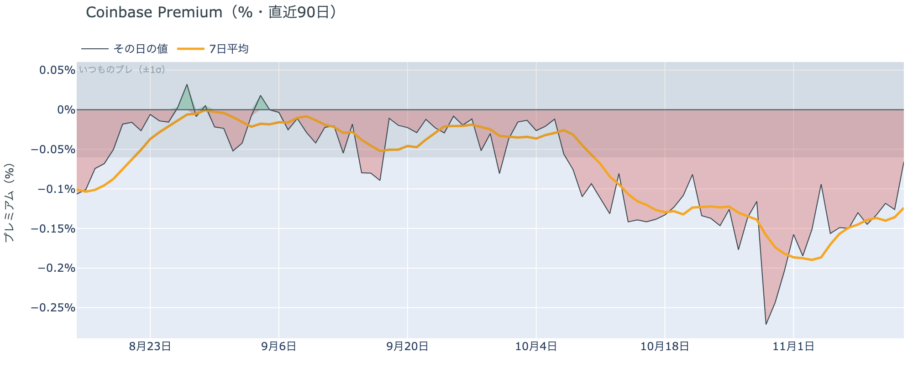

*図の見方: プラス＝アメリカで買いが強い。太線が1週間平均、細線がその日の値。薄い帯は「いつものブレの範囲」です。*

* 1週間平均は−0.12%で、前の週の1週間平均−0.16%より浅い。
* 11月13日の値は−0.07%で、いつものブレの範囲の内側。

アメリカの買い手は、$68,000台への下げでもビットコインを拾いに来ていません。Coinbase Premium（＝アメリカとそれ以外の価格差）は1週間平均でマイナスのままで、前日まで2日続いていた、いつものブレを超える沈み込みは金曜日には出ませんでした。売り急ぐ勢いは前の週より和らいでいますが、買う側に回ったわけではないので、アメリカの買い手はまだこの水準を買い場とは見ていないということです。

**図①-2 ETFの日ごとの資金の出入り（直近90日）**

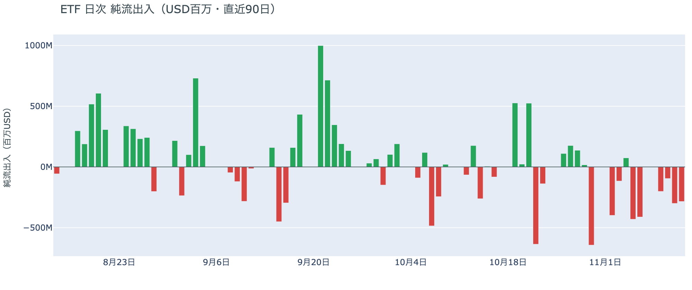

*図の見方: 入ったお金と出たお金の差。上に伸びれば入り超、下に伸びれば出超。*

| ETFの日ごとの出入り | 億ドル |
|---|---:|
| 11月6日 | −4.1 |
| 11月9日 | −2.0 |
| 11月10日 | −1.0 |
| 11月11日 | −3.0 |
| 11月12日 | −2.8 |
| 直近7営業日の合計 | −16.5 |

* 11月12日の出超のうち7割あまりがIBIT（ブラックロックのETF）から。

ETFの買い手は、資金を引き揚げる側にとどまっています。出超は6営業日続き、11月12日も前日と同じくらいの大きさでした。値下がりを買いの機会と見る確信は、ETFの買い手にもまだ生まれていません。

**図①-3 Fear & Greed（市場心理の指数・直近90日）**

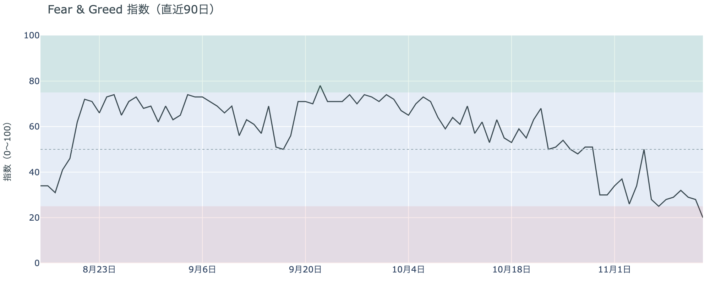

*図の見方: 0〜100で、50より上が「強欲」、下が「恐怖」。*

* 20の「極度の恐怖」。前日の28から8pt下げた。1か月前は62。

参加者の多くは、下げを強く怖がる側へ一段進みました。Fear & Greed（＝市場心理の指数）の11月13日の値は「恐怖」から「極度の恐怖」の区分へ移り、1か月前の「強欲」から大きく冷えています。

### ② 長期保有者は利益の出ない価格でも減らし続けるが、減り方は前の週より小さい

**図②-1 長期保有者の保有量の30日変化とSOPR（直近90日）**

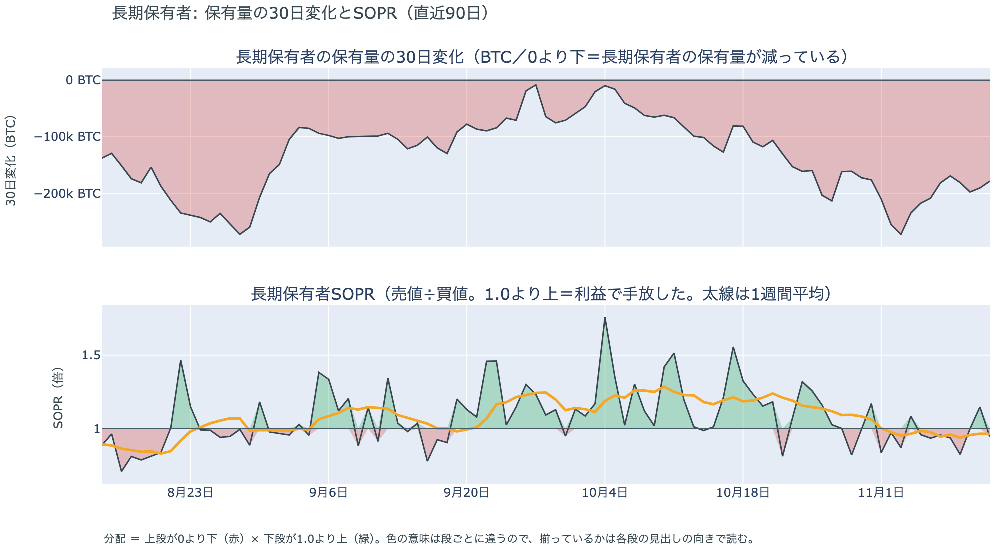

*図の見方: 上段は、長期保有者の保有量が30日でどれだけ増減したか。マイナス＝手放している。下段は長期保有者SOPRで、1より上なら利益で手放した。どちらも太線の1週間平均で読みます。*

| 11月12日時点 | 1週間平均 | 前の週の平均 |
|---|---:|---:|
| 長期保有者SOPR（1より上＝利益で手放した） | 0.96 | 0.99 |
| 長期保有者の保有量の30日変化（万BTC） | −18.7 | −22.0 |

* 30日変化は、1か月前（10月13日）の−9.9万BTCの2倍近い。

長期保有者は、利益が出ない価格になっても手放すのをやめていません。保有量は30日で減り、動いたコインは平均して買値より安く動いているので、利益確定の売りとは呼べない形のまま減っています。買値を下回る度合いは前の週より深まりましたが、減り方は前の週より小さくなっていて、11月12日時点の長期保有者の持ち方は前日に書いた形のままです。

ほかに売りに回りそうな持ち手が新しく現れた記録もありません。長く眠っていたコインのまとまった移動は11月12日には無く、マイナーの収入は平年を下回っています（Puell Multiple（＝マイナー収入の平年比）が1週間平均で0.85）が、売りを急ぐほどの水準ではありません。

### ③ 先物：ロングの一部が降り、上げへの確信は細った

**図③-1 資金調達率と建玉（直近30日）**

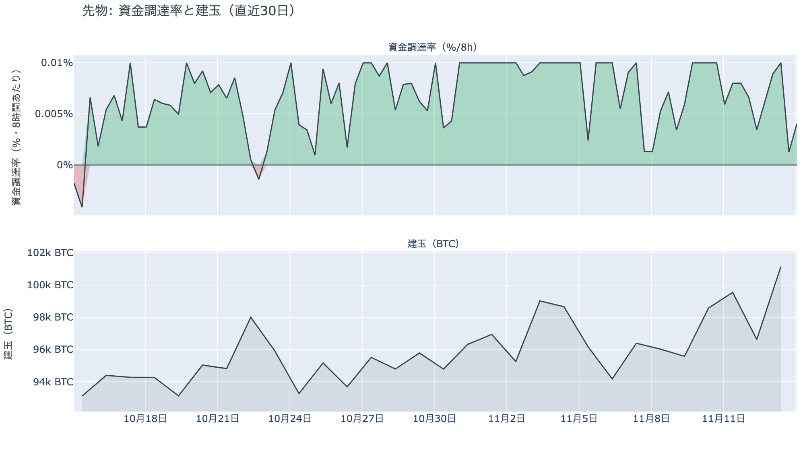

*図の見方: 上段は資金調達率（8時間ごと・日本時間）。プラスが続く＝ロングがショートより多い。下段は建玉。*

* 上乗せは直近34日の平均+2.88ptの半分で、前日の+2.65ptから縮んだ。
* 資金調達率はプラスが67回連続（約22日）。

先物の参加者は、ロングの側が上げへの確信を細らせ、一部が降り始めています。前日は「ロング全体は降りていない」と説明しましたが、金曜日は価格と建玉がそろって減っていて、そのロングの一部が手仕舞われました。それでも資金調達率はプラスのまま続いているので、ロングの多くはまだ残っています。ただ、ロングが短期金利（＝ドルを米国の短期国債で持つだけで受け取れる金利）より余分に払う分は、この1か月の平均の半分まで縮みました。余分に払ってでも上げに賭けたい人は、前日よりさらに減ったということです。

### ④ オプション：週末は荒れないと見ながら、下げへの備えは目の前の満期に厚い

オプションには2種類あります。コール（＝決めた価格で買う権利）とプット（＝決めた価格で売る権利）で、価格が上がればコールの価値が上がり、価格が下がればプットの価値が上がります。プットは「価格が下がったときの保険」として買われます。オプションを買う人は、その権利と引き換えに権利料（＝オプションを買う人が払う金額）を払います。

**図④-1 満期ごとのIV（年率%）**

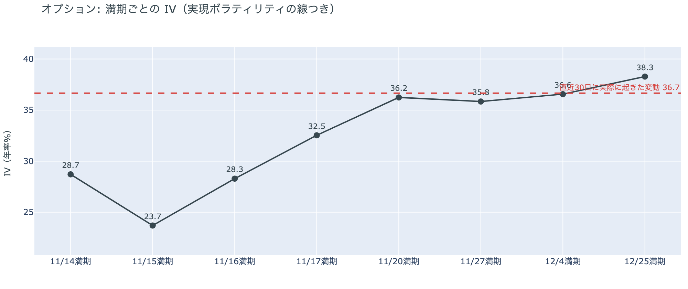

*図の見方: IVを満期ごとに並べたもの。点線は実現ボラティリティ。IVが点線より下なら、市場はこの先の値動きを過去の値動きより小さいと見ています。*

| 満期 | IV |
|---|---:|
| 11月14日〜16日 | 24〜29 |
| 11月17日 | 33 |
| 11月20日〜12月4日 | 36〜37 |
| 12月25日 | 38 |

* IVは全体で40.1で、実現ボラティリティ36.7より3.4pt高い。過去1年では下から4割ほどの位置。

参加者は、この先の値動きを過去より大きいと見る構えを変えていませんが、週末に大きく荒れるとは見ていません。IV（＝値動きの幅の予想）は全体で実現ボラティリティ（＝過去の値動きの幅）を上回ったままで、過去1年で見れば恐怖と呼ぶほどの高さではありません。前日は目の前の満期のIVも先の満期と同じくらいの高さでしたが、米10月の生産者物価指数を通過した今朝は、週末の満期だけが大きく下がっています。IVが一段上がるのは、週明けの11月20日の満期からです。

**図④-2 満期ごとのプットとコールの差**

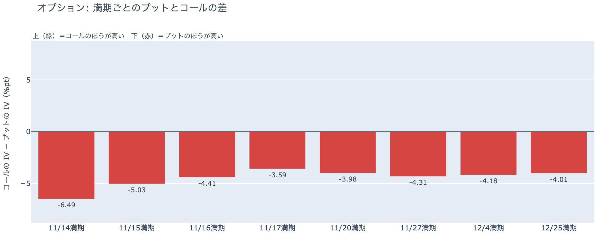

*図の見方: 満期ごとに、プットとコールのどちらが高く売れているか。ゼロより上ならコールのほうが高く、下ならプットのほうが高い。*

| 満期 | どちらが高いか |
|---|---|
| 11月14日 | プットが高い（差はいちばん大きい） |
| 11月15日 | プットが高い（差は大きい） |
| 11月16日 | プットが高い |
| 11月17日 | プットが高い（差はいちばん小さい） |
| 11月20日 | プットが高い |
| 11月27日 | プットが高い |
| 12月4日 | プットが高い |
| 12月25日 | プットが高い |

参加者は、大きく動くとは見ていない週末にも、動くなら下だと見ています。どの満期もプットのほうが高く、差は目の前の満期ほど大きいままです。前日に年末から目の前へ寄せ直した下げへの備えを、$68,000台へ下げたあとも外していないので、この数日の続落を気にする見方は前日から変わっていません。

**図④-3 12月25日満期の持ち高（権利の価格ごと）**

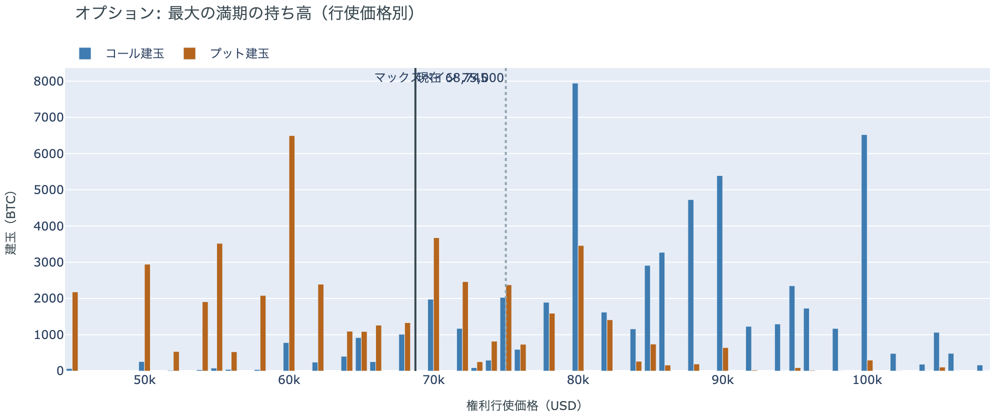

*図の見方: 青＝コール、橙＝プット。現値より上にコールが、下にプットが積まれるのが普通です。*

| 12月25日満期のオプション（基準の価格は約$68,700） | 量（万BTC） | 意味 |
|---|---:|---|
| いまより高い価格のコール | 約7.9 | 「価格が上がる」に賭けた分 |
| いまより安い価格のプット | 約4.0 | 「価格が下がる」への保険 |
| うち、いまより15%以上高い価格のコール | 約7.1 | 大きな上げへの賭け |
| うち、いまより15%以上安い価格のプット | 約2.6 | 大きな下げへの保険 |

* 12月25日満期の持ち高は約14.3万BTCと全満期の42%で、コールがプットの1.4倍。前日とほぼ同じ形。

年末の最大の満期では、「価格が上がる」に賭けた人たちが$68,000台への下げでも降りておらず、年末までの上げへの期待は保たれています。先物ではロングの一部が降りましたが、年末に向けたコールの持ち高の形は変わっていません。大きな上げに賭けた分が報われるには、12月25日の夕方5時までに約$79,100を超える必要があります。全満期でオプションの持ち高が集まっているのは$68,000〜$72,000で、価格はいまその帯の下の端にいます。

### ⑤ 値下がりしたコインは平年の2倍近いが、値下がりのまま再び送金される量は過去の大きな底の半分に届かない

**図⑤-1 コインが最後に送金された日の価格の分布**

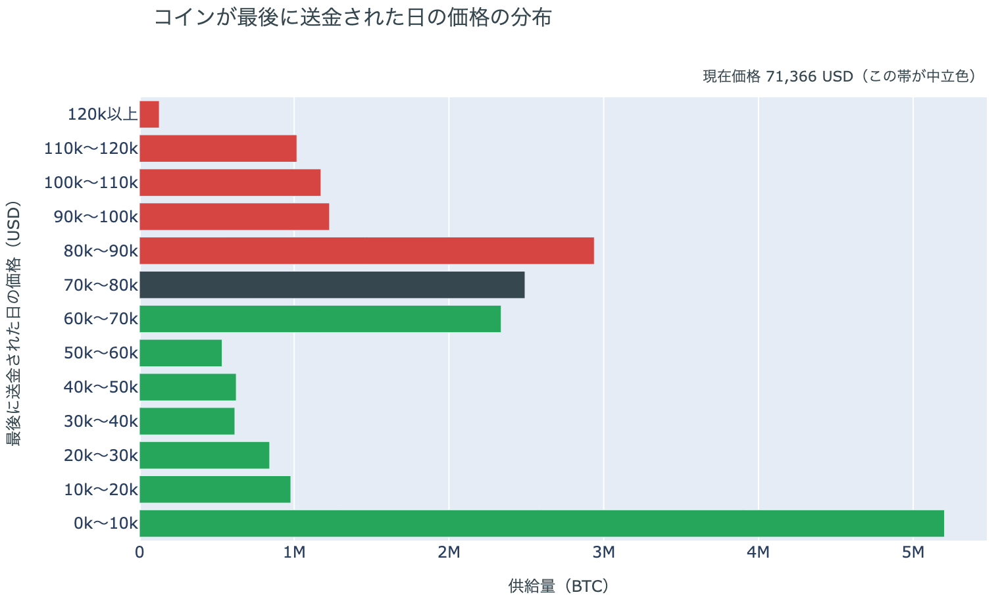

*図の見方: ビットコインはアドレスからアドレスへ送金されるたびに、受け取った側に新しい記録ができる。この図は、いまあるコインを、最後に送金された日の価格で束ねたもの。送金には売買のほか、取引所への入金・引き出しや自分のウォレット間の移し替えも含み、取引所の中での売買は含まない。*

| 過去の大きな下げの底 | 価格より上にいるコインの割合 | 値下がりした状態で再び送金された量（1日あたり） |
|---|---:|---:|
| 11月12日時点 | 43.6% | 約1.9万BTC |
| 2018年12月（2018年の冬の底） | 60.6% | 約4.1万BTC |
| 2020年3月（コロナショック） | 57.4% | 約8.4万BTC |
| 2022年6月（Luna・3ACの破綻） | 51.1% | 約7.2万BTC |
| 2022年11月（FTXの破綻） | 55.1% | 約7.1万BTC |

* 価格より上にいるコインの割合は、2017年以降の中央値24.0%の2倍近い。
* 再送金の量は1週間前の約2.7万BTCから減った。

値下がりしたコインはここ1か月で一気に増えましたが、それが値下がりのまま手元から出ていく量は、過去の大きな下げの底の半分にも届いていません。11月12日時点で、いまの価格より高い価格で最後に送金されたコインは全体の4割あまりで、2017年以降の平年の2倍近くあります。一方、そのうち30日以上置かれていたコインが値下がりした状態で再び送金された量は1週間平均で1日約1.9万BTCと、平年の約2倍にとどまり、1週間前より減りました。高値で受け取ったコインがまとめて再送金される形は、まだ出ていないということです。11月12日時点の分布にいまの価格を重ねると、価格は$70,000〜$80,000の帯を下へ抜けて$60,000〜$70,000の帯の上のほうに入り、すぐ下の$50,000台で最後に送金されたコインは全体の3%に満たない薄さです。

## 4. 価格に影響しうる直近のイベント

オプション市場は下げへの備えを目の前の満期ほど厚く置いていますが、週末の満期のIVは低く、権利料にほかの満期に対する上乗せは乗っていません。IVが一段上がるのは11月20日の満期からで、NVIDIAの決算とFOMCの議事要旨をまたぐ区間に当たります。

| 日付 | イベント | 何に効くか |
|---|---|---|
| 11/18（水）7:00ごろ 日本時間 | NVIDIAの決算（米国時間17日の引け後）。フアン氏の辞任後、初めての決算 | 米国株（ナスダック100） |
| 11/19（木）4:00 日本時間 | FOMCの議事要旨（10月27〜28日分） | 金利 |
| 11/25（水） | 米10月のPCE物価指数（米国の物価統計） | 金利 |
| 11/30（月）米国時間の引け | MSCIの指数から米Strategy（＝ビットコインを大量に持つ米企業）が外れる実施日 | Strategyの株と、指数に連動する資金 |
| 12/9（水） | FOMC。0.25ptの利上げは確実視され、0.5ptの利上げは約3割まで織り込まれている。結果は日本時間10日早朝 | 金利 |
| 12/25（金）17:00 | オプションの最も大きな満期（約14.3万BTC、全満期の42%） | 約$79,100以上のコールの期限 |

## まとめ

金曜日のビットコインは、利上げの織り込みが続く週に新しいきっかけが無いまま、先物のロングの手仕舞いを通って下げ、大口のロングの清算で速まりながら$68,000台で週末を迎えました。アメリカの買い手は売りの側にとどまり、長期保有者も利益の出ない価格で減らし続けていますが、どちらも前の週から続く形のままで、アメリカの買い手と長期保有者の持ち方までは変わっていません。参加者は週末に大きく荒れるとは見ていませんが、動くなら下と見て目の前の備えを外さず、先物で上げに賭ける確信は細らせながらも、年末のコールはまだ降ろしていません。

---

<small>（数値は11月14日7時5分（日本時間）までのデータに基づきます。価格・先物・オプションはその時点の値、市場心理は11月13日の確定値、オンチェーン（＝ブロックチェーン上の記録）は11月12日時点、ETF資金フローは11月12日分までです。証券市場の終値は11月13日時点で、週末のため更新がありません。オンチェーンの長期保有者の数値には、ETFや取引所が預かっている分も含まれます。清算は Hyperliquid で拾えた分だけで、市場全体のごく一部です。オプションはDeribit（BTCオプションの大半を占める取引所）の全銘柄です。）</small>

*本稿は情報提供を目的としたものであり、投資助言ではありません。将来の価格動向を保証・示唆するものではなく、投資判断は各自の責任において行ってください。*
