# 週末に$64,000台まで続落 ― 大口ロングの清算が加速し、目の前の満期のIVが跳ねる

**2026年11月15日**

ビットコインは土曜日、証券市場が閉まっている間に3段に分けて下げ、$64,000台で日曜日の朝を迎えました。

* **価格**：24時間の値幅は7.0%と前日の5.8%からさらに広がり、朝7時5分の時点で約$64,207。下げは昼・夜・明け方の3回に分かれ、戻りは小さかった
* **きっかけ**：下げた時間に新しい出来事は無かった。米国株は週末で取引が無く、利上げの織り込みと米金利の上昇が続いた週の流れのまま、週末の売りが進んだ
* **先物**：昼と明け方は買い持ち（ロング）の手仕舞いが下げを運び、明け方は大口のロング1つの清算（＝証拠金不足で強制的に閉じられた取引）が下げを加速させた。夜には新しい売り持ち（ショート）も積まれ、上げへの確信はさらに細った
* **需給の土台**：米国の買い手は売りの側にとどまり、ETFからの資金の流出は7営業日続いた。長期保有者（＝155日以上保有者）も11月13日時点で減らし続けているが、減り方は前の週より小さく、前日から形は変わっていない
* **オプションの見方**：前日は週末に荒れるとは見ていなかったが、土曜日の下げで見方を改めた。目の前の数日に大きく動くと見ていて、下げへの備えも目の前の満期ほど厚い

## 1. 何が起きたか

**図1-1 価格の推移（1時間足・直近7日）**

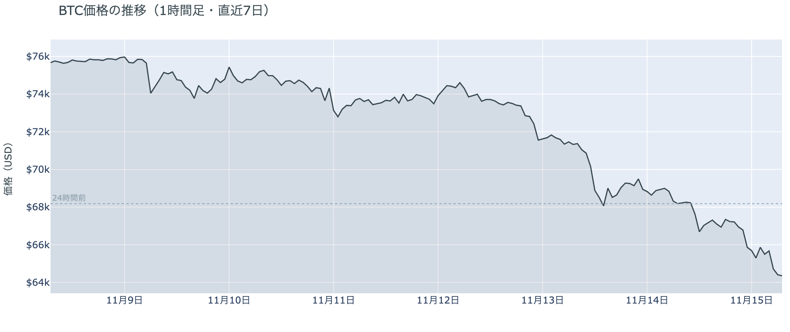

*図の見方: 1時間ごとの価格（日本時間）。点線は24時間前の水準です。*

* 24時間の値幅は7.0%で、前日の5.8%からさらに広がった。
* 値動きの速い5分足（24時間の上位1割）に、拾えた清算の8割が入っていた。

土曜日の下げは、昼・夜・明け方の3回に分かれて起き、どの回も戻りは小さいままでした。昼11時台から12時台の下げでは、価格と建玉（＝先物の未決済残高。証拠金で張っている人の量）がそろって減っていて、ロングの手仕舞いが運んでいます。夜22時台から翌1時台の下げは様子が違い、価格が下がりながら建玉が増えていて、新しいショートが積まれた下げです。明け方5時台の下げでは、再び建玉が減り、ロングの清算がまとまって出ました。値動きの速い5分足に清算が集まっているので、清算が下げを加速させています。

**図1-2 価格と50日・200日移動平均**

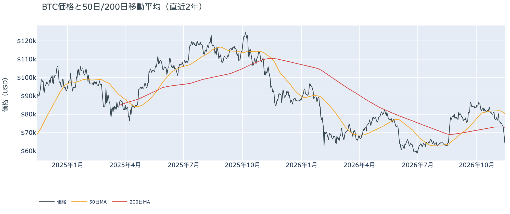

*図の見方: 2本の平均線の上下関係を見ます。50日線が200日線の上にあるのがゴールデンクロスです。*

* 50日線と200日線の差は約$7,166（9.8%）で、前日の10.3%から縮んだ。
* 朝7時5分の価格は50日線を19.9%、200日線（$72,974）を12.0%下回る。

長い目で見た流れの向きはまだ変わっていませんが、短い目の弱さは一段と深まりました。ゴールデンクロス（＝50日線が200日線を上抜けること）の状態は68日目です。ただ、価格は200日線からも1割以上下に離れ、2本の差は日を追って縮み続けています。

11月13日の米国株は、S&P500が−0.40%、ナスダック100が−1.21%で週を終え、米10年債利回りは5.15%の高さのままでした。土曜日は証券市場が閉まっていて、ビットコインの下げと同じ時間に動いた株や金利はありません。週末へ持ち越されたのは、12月の利上げを織り込んだ金利の高さです。

**図1-3 清算（直近24時間）**

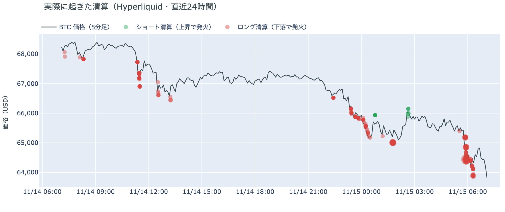

*図の見方: Hyperliquid で実際に清算された取引を、時刻（日本時間）と価格に重ねたもの。*

* 清算はほぼすべてロングで、$64,000台に6割、$65,000台に3割が集まった。
* 最大の1件が全体の7割を占め、明け方5時台に集中した。

明け方の清算は、Hyperliquid（＝オンチェーンの先物取引所）で拾えた分で見ると、多くのロングが一斉に焼けたのではなく、大口が1つ飛んだものです。昼と夜の下げでも清算は出ていますが、散らばった小口で、24時間の大半は明け方の1時間に集まっています。

## 2. なぜ動いたか：きっかけと、需給のどこが動いたか

**図2-1 ビットコインと株・金・原油の相対推移（起点＝100）**

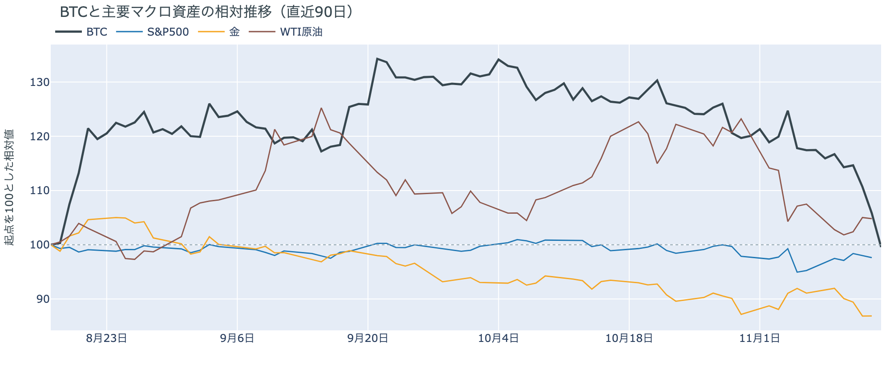

*図の見方: 同じ起点から何%動いたかで重ねたもの。線の向きが揃っているかを見ます。*

| この5営業日の動き（ビットコインは7日間） | 変化 |
|---|---:|
| ビットコイン | −15.2% |
| 金 | −4.6% |
| 米国株（S&P500） | +2.5% |
| 原油 | −2.5% |

* 建玉は96,713BTCで、前日の98,120BTCから1.4%減った。
* 1日をならした年率は+5.22%で、短期金利（13週Tビル 4.12%）を引いた上乗せは+1.10pt。

土曜日の下げは、新しいきっかけが無いまま、先物のロングの手仕舞いと新しいショートを通って価格になりました。

1. きっかけ：下げた3つの時間に、外部環境の新しい出来事は見当たりません。米国株も米国債も週末で取引が無く、ビットコインと同じ時間に動いたものはありません。背景にあるのは、この1週間続いた利上げの織り込みです。米10月CPIの上振れのあと、金曜日には米ボストン連銀とサンフランシスコ連銀の総裁が利上げの可能性に触れ、FF金利先物では12月のFOMC（＝米国の金利を決める会合）での0.25ptの利上げが確実視されたうえに、0.5ptの利上げも約5割弱まで織り込まれています（11月13日の先物の終値）。土曜日の下げは、この流れを週末に持ち越したまま起きました。
2. 伝わり方：速い側の先物では、昼と明け方に価格と建玉がそろって減り、前日まで残っていたロングがさらに手仕舞われました。夜の下げは新しく積まれたショートが運び、明け方は大口のロング1つの清算が下げを押し広げています。それでも24時間で建玉が減ったのは価格の下げの4分の1ほどで、ロングがまとめて逃げ出したわけではありません。遅い側では、アメリカの買い手はこの1週間を通して売りの側にいて（図①-1・図①-2）、長期保有者も11月13日時点で前の週と同じ形で減らし続けています（図②-1）。土曜日の下げを運んだのは先物で、アメリカの買い手と長期保有者の売りは前の週から続く下地のまま、強まってはいません。

この1週間で見ると、米国株が上げた5営業日にビットコインは15%下げていて、株と共通のきっかけによる下げではありません。同じ向きに下げたのは金で、どちらも米金利とドルが上がった週に売られています。証券市場が閉まっていた土曜日も、ビットコインは同じ向きのまま売られ続けました。

## 3. 市場参加者はいまどう見ているか

### ① アメリカの買い手は売りの側にとどまり、下げを買い場とは見ていない

**図①-1 Coinbase Premium（アメリカとそれ以外の価格差・直近90日）**

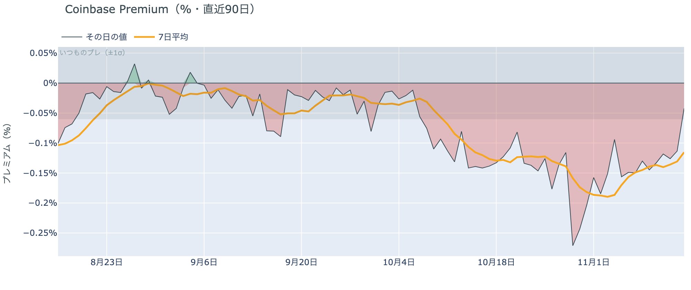

*図の見方: プラス＝アメリカで買いが強い。太線が1週間平均、細線がその日の値。薄い帯は「いつものブレの範囲」です。*

* 1週間平均は−0.12%で、前の週の1週間平均−0.15%より浅い。
* 11月14日の値は−0.04%で、いつものブレの範囲の内側。

アメリカの買い手は、$64,000台への下げでもビットコインを拾いに来ていません。Coinbase Premium（＝アメリカとそれ以外の価格差）は1週間平均でマイナスのままです。売り急ぐ勢いは前の週より和らいでいますが、買う側に回ったわけではないので、アメリカの買い手はまだこの水準を買い場とは見ていないということです。

**図①-2 ETFの日ごとの資金の出入り（直近90日）**

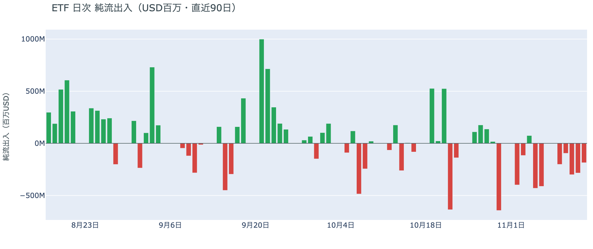

*図の見方: 入ったお金と出たお金の差。上に伸びれば入り超、下に伸びれば出超。*

| ETFの日ごとの出入り | 億ドル |
|---|---:|
| 11月9日 | −2.0 |
| 11月10日 | −1.0 |
| 11月11日 | −3.0 |
| 11月12日 | −2.8 |
| 11月13日 | −1.9 |
| 直近7営業日の合計 | −19.1 |

* 11月13日の出超のうち8割近くがIBIT（ブラックロックのETF）から。

ETFの買い手は、資金を引き揚げる側にとどまっています。出超は7営業日続き、11月13日も前日より小さいとはいえ流出のままでした。値下がりを買いの機会と見る確信は、ETFの買い手にもまだ生まれていません。

**図①-3 Fear & Greed（市場心理の指数・直近90日）**

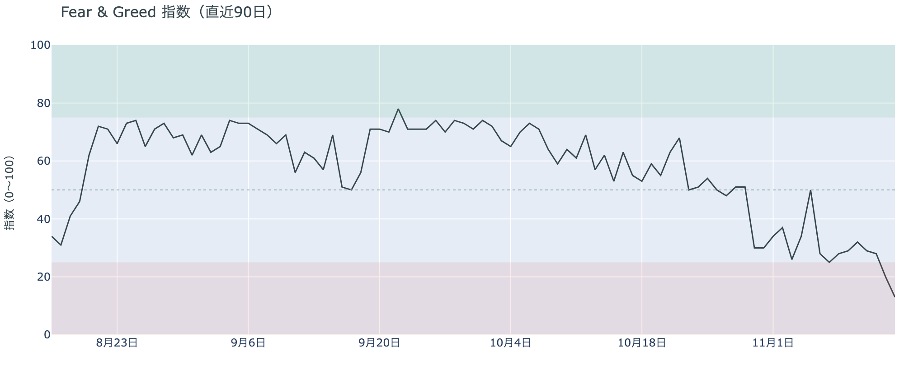

*図の見方: 0〜100で、50より上が「強欲」、下が「恐怖」。*

* 13の「極度の恐怖」。前日の20から7pt下げた。1週間前は25、1か月前は53。

参加者の多くは、下げをさらに強く怖がる側へ進みました。Fear & Greed（＝市場心理の指数）の11月14日の値は「極度の恐怖」の区分の中でも一段下がり、2018年以降で見ても下から5%ほどの低さです。1か月前の「中立」の水準から、ここまで冷えています。

### ② 長期保有者は利益の出ない価格でも減らし続けるが、減り方は前の週より小さい

**図②-1 長期保有者の保有量の30日変化とSOPR（直近90日）**

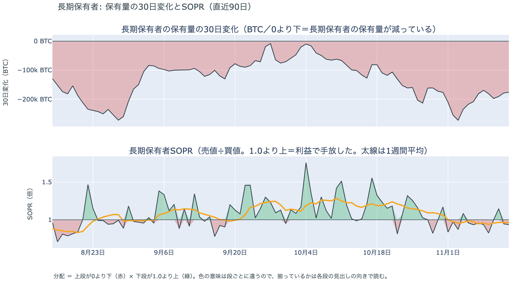

*図の見方: 上段は、長期保有者の保有量が30日でどれだけ増減したか。マイナス＝手放している。下段は長期保有者SOPRで、1より上なら利益で手放した。どちらも太線の1週間平均で読みます。*

| 11月13日時点 | 1週間平均 | 前の週の平均 |
|---|---:|---:|
| 長期保有者SOPR（1より上＝利益で手放した） | 0.96 | 0.98 |
| 長期保有者の保有量の30日変化（万BTC） | −18.2 | −22.5 |

* 30日変化は、1か月前（10月14日）の−10.1万BTCの2倍近い。

長期保有者は、利益が出ない価格になっても手放すのをやめていません。保有量は30日で減り、動いたコインは平均して買値より安く動いているので、利益確定の売りとは呼べない形のまま減っています。買値を下回る度合いは前の週より少し深まりましたが、減り方は前の週より小さくなっていて、11月13日時点の長期保有者の持ち方は前日に書いた形のままです。

マイナーの収入は平年を下回っています（Puell Multiple（＝マイナー収入の平年比）が11月13日時点の1週間平均で0.82）。土曜日には採掘の難易度が約9%下がる調整があり、マイナーの負担は軽くなる側に動いています。売りを急ぐ持ち手として新しく現れた形ではありません。

### ③ 先物：ロングは減り続け、夜には新しいショートが積まれた

**図③-1 資金調達率と建玉（直近30日）**

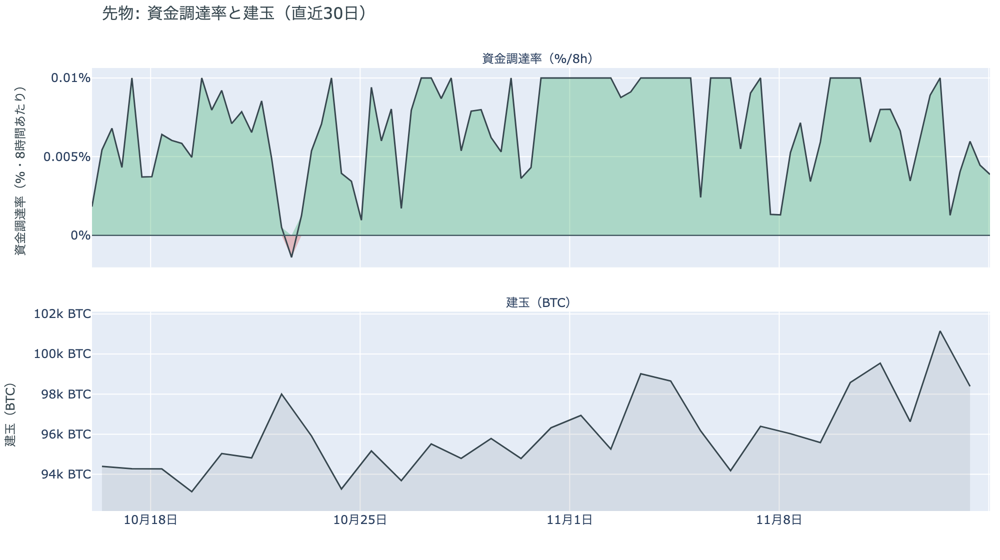

*図の見方: 上段は資金調達率（8時間ごと・日本時間）。プラスが続く＝ロングがショートより多い。下段は建玉。*

* 上乗せは直近34日の平均+3.00ptの3分の1あまりで、前日の+1.47ptからさらに縮んだ。
* 資金調達率はプラスが70回連続（約23日）。

先物の参加者は、上げへの確信をさらに細らせ、下げに賭ける人も出てきています。前日は「ロングの多くはまだ残っている」と説明しました。土曜日も資金調達率（＝ロングが払う金利。プラス＝ロングがショートより多い）はプラスのままで、その説明は今日の数値と合っていますが、昼と明け方にロングがさらに降り、夜には新しいショートが積まれました。ロングが短期金利（＝ドルを米国の短期国債で持つだけで受け取れる金利）より余分に払う分は、この1か月の平均の3分の1まで縮んでいます。余分に払ってでも上げに賭けたい人は、前日よりさらに減ったということです。

### ④ オプション：目の前の数日に大きく動くと見て、下げへの備えも目の前に厚い

オプションには2種類あります。コール（＝決めた価格で買う権利）とプット（＝決めた価格で売る権利）で、価格が上がればコールの価値が上がり、価格が下がればプットの価値が上がります。プットは「価格が下がったときの保険」として買われます。オプションを買う人は、その権利と引き換えに権利料（＝オプションを買う人が払う金額）を払います。

**図④-1 満期ごとのIV（年率%）**

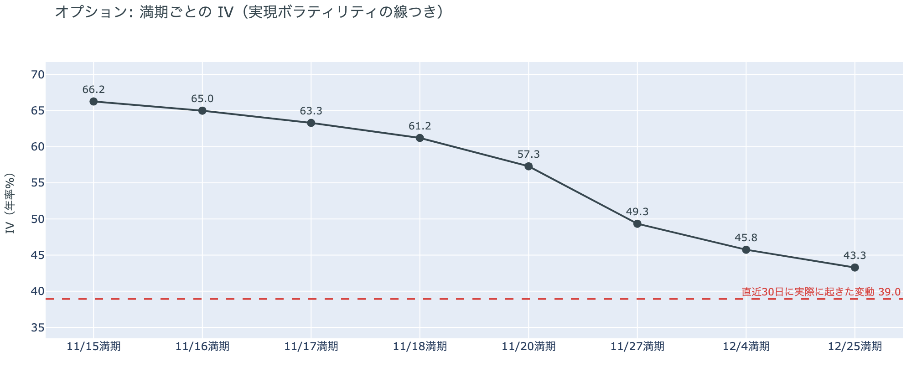

*図の見方: IVを満期ごとに並べたもの。点線は実現ボラティリティ。IVが点線より下なら、市場はこの先の値動きを過去の値動きより小さいと見ています。*

| 満期 | IV |
|---|---:|
| 11月15日〜18日 | 61〜66 |
| 11月20日 | 57 |
| 11月27日〜12月4日 | 46〜49 |
| 12月25日 | 43 |

* IVは全体で39.9で、実現ボラティリティ39.0より0.9pt高い。過去1年では下から76%の位置。

参加者は、この数日のうちにさらに大きく動くと見るようになりました。IV（＝値動きの幅の予想）は全体で実現ボラティリティ（＝過去の値動きの幅）をわずかに上回り、過去1年で見ても高い側にあります。前日は「週末に大きく荒れるとは見ていない」と説明し、週末の満期のIVは20台でしたが、土曜日の下げのあと、目の前の満期のIVは60台へ倍以上に跳ねました。目の前の満期のオプションの権利料には、先の満期に対する上乗せが乗っています。土曜日の下げを見て、この数日にまだ大きく動くと見られるようになったからです。

**図④-2 満期ごとのプットとコールの差**

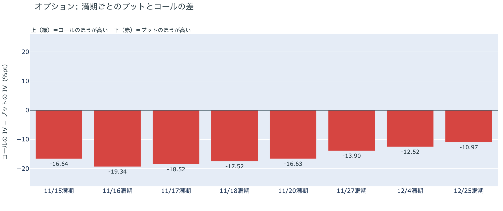

*図の見方: 満期ごとに、プットとコールのどちらが高く売れているか。ゼロより上ならコールのほうが高く、下ならプットのほうが高い。*

| 満期 | どちらが高いか |
|---|---|
| 11月15日 | プットが高い（差は大きい） |
| 11月16日 | プットが高い（差はいちばん大きい） |
| 11月17日 | プットが高い（差は大きい） |
| 11月18日 | プットが高い |
| 11月20日 | プットが高い |
| 11月27日 | プットが高い |
| 12月4日 | プットが高い |
| 12月25日 | プットが高い（差はいちばん小さい） |

参加者は、大きく動くなら下だと見ています。どの満期もプットのほうが高く、差は目の前の満期ほど大きいままです。前日に置いていた目の前の下げへの備えを、$64,000台へ下げたあとも外していないので、続落を気にする見方は前日から変わっていません。

**図④-3 12月25日満期の持ち高（権利の価格ごと）**

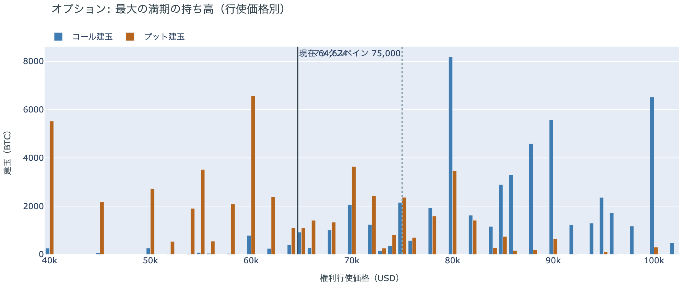

*図の見方: 青＝コール、橙＝プット。現値より上にコールが、下にプットが積まれるのが普通です。*

| 12月25日満期のオプション（基準の価格は約$64,600） | 量（万BTC） | 意味 |
|---|---:|---|
| いまより高い価格のコール | 約8.2 | 「価格が上がる」に賭けた分 |
| いまより安い価格のプット | 約3.6 | 「価格が下がる」への保険 |
| うち、いまより15%以上高い価格のコール | 約7.6 | 大きな上げへの賭け |
| うち、いまより15%以上安い価格のプット | 約2.0 | 大きな下げへの保険 |

* 12月25日満期の持ち高は約14.4万BTCと全満期の40%で、コールがプットの1.4倍。前日とほぼ同じ形。

年末の最大の満期では、「価格が上がる」に賭けた人たちが$64,000台への下げでも降りておらず、年末までの上げへの期待はまだ手放されていません。先物ではロングが減り続けていますが、年末に向けたコールの持ち高の形は変わっていません。大きな上げに賭けた分が報われるには、12月25日の夕方5時までに約$74,300を超える必要があります。全満期でオプションの持ち高が集まっているのは$60,000〜$70,000の帯で、価格はいまその帯の中ほどにいます。

### ⑤ 5年以上動いていなかったコインが、多くの生成日にわたって動いた

* 11月13日に動いた5年以上前のコインは、大きい3つの生成日を除いて約1,500BTCと、平年（直近1年の中央値）の4倍あまり。
* 動いた分は1,100を超える生成日に散らばり、大きい3つで全体の3割に満たない。

11月13日には、5年以上動いていなかったコインが、3日前の11月10日に続いて平年を大きく超えて動きました。11月10日は動いた量の7割あまりが3つの生成日に集まったまとまった移動でしたが、今回は多くの生成日の古いコインが少しずつ動いた形です。この記録は売却とは限らず、保管先の変更や取引所のウォレットの整理でも同じ形になります。量は長期保有者の保有量の30日変化（図②-1）の1%ほどで、長期保有者全体の減り方を変える大きさではありません。

## 4. 価格に影響しうる直近のイベント

オプション市場は、目の前の満期ほどIVを高く、プットを高く値付けしていますが、特定の日だけが跳ねている形ではありません。IVが60台の11月18日までの満期は、NVIDIAの決算をまたぐ区間に当たり、11月20日の満期はFOMCの議事要旨もまたぎます。

| 日付 | イベント | 何に効くか |
|---|---|---|
| 11/18（水）7:00ごろ 日本時間 | NVIDIAの決算（米国時間17日の引け後）。フアン氏の辞任後、初めての決算 | 米国株（ナスダック100） |
| 11/19（木）4:00 日本時間 | FOMCの議事要旨（10月27〜28日分） | 金利 |
| 11/25（水） | 米10月のPCE物価指数（米国の物価統計） | 金利 |
| 11/30（月）米国時間の引け | MSCIの指数から米Strategy（＝ビットコインを大量に持つ米企業）が外れる実施日 | Strategyの株と、指数に連動する資金 |
| 12/9（水） | FOMC。0.25ptの利上げは確実視され、0.5ptの利上げも約5割弱まで織り込まれている。結果は日本時間10日早朝 | 金利 |
| 12/25（金）17:00 | オプションの最も大きな満期（約14.4万BTC、全満期の40%） | 約$74,300以上のコールの期限 |

## まとめ

土曜日のビットコインは、利上げの織り込みが続く週の流れを週末に持ち越したまま、新しいきっかけが無いなかで先物のロングの手仕舞いと新しいショートを通って下げ、大口のロングの清算で速まりながら$64,000台で日曜日の朝を迎えました。アメリカの買い手は売りの側にとどまり、長期保有者も利益の出ない価格で減らし続けていますが、どちらも前の週から続く形のままで、アメリカの買い手と長期保有者の持ち方までは変わっていません。参加者は、前日には見ていなかった荒れをこの数日に見込み、動くなら下と見て目の前の備えを厚くしながら、先物では上げに賭ける確信を細らせ、年末のコールだけはまだ降ろしていません。

---

<small>（数値は11月15日7時5分（日本時間）までのデータに基づきます。価格・先物・オプションはその時点の値、市場心理は11月14日の確定値、オンチェーン（＝ブロックチェーン上の記録）は11月13日時点、ETF資金フローは11月13日分までです。証券市場の終値は11月13日時点で、週末のため更新がありません。オンチェーンの長期保有者の数値には、ETFや取引所が預かっている分も含まれます。清算は Hyperliquid で拾えた分だけで、市場全体のごく一部です。オプションはDeribit（BTCオプションの大半を占める取引所）の全銘柄です。）</small>

*本稿は情報提供を目的としたものであり、投資助言ではありません。将来の価格動向を保証・示唆するものではなく、投資判断は各自の責任において行ってください。*
