# 日曜昼前に$62,000割れ寸前から切り返し ― ショートの清算が戻りを速め、建玉は減る

**2026年11月16日**

ビットコインは日曜日、昼前に$62,000の手前まで下げたあと2回に分けて買い戻され、$65,000台で月曜日の朝を迎えました。

* **価格**：24時間の値幅は6.7%と前日並みに荒れたが、向きは上で、朝7時5分の時点で約$65,027（24時間前より+2.4%）。この1週間の下げの途中での小さな戻りにとどまる
* **きっかけ**：下げと戻りの時間に、外部環境の新しい出来事は無かった。米国株は週末で取引が無く、12月の利上げを織り込んだ金利の高さが持ち越されたままだった
* **先物**：昼前の下げでは新しい売り持ち（ショート）が積まれたが、そのあとの2回の戻りはショートの買い戻しが運び、ショートの清算（＝証拠金不足で強制的に閉じられた取引）が戻りを加速させた。新しい買い持ち（ロング）は積まれておらず、上げへの確信は戻っていない
* **需給の土台**：米国の買い手は日曜日の戻りでも売りの側にいて、ETFからの資金の流出も7営業日続いたまま。長期保有者（＝155日以上保有者）も11月14日時点で減らし続けているが、減り方は前の週より小さく、前日から形は変わっていない
* **オプションの見方**：この数日に大きく動くと見ている点は前日と同じだが、その見込みは前日より少し和らいだ。動くなら下と見て、11月末までの満期に下げへの備えを同じ厚さで残している

## 1. 何が起きたか

**図1-1 価格の推移（1時間足・直近7日）**

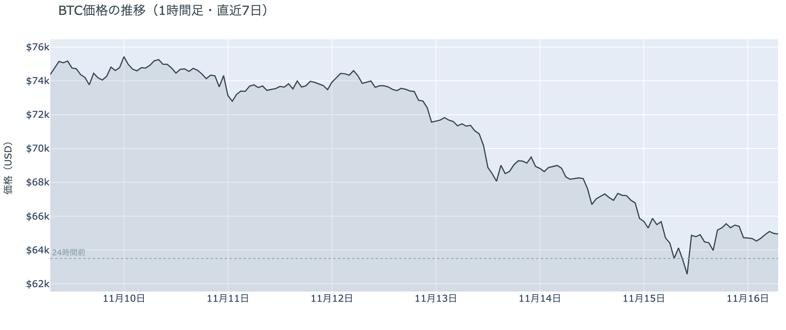

*図の見方: 1時間ごとの価格（日本時間）。点線は24時間前の水準です。*

* 24時間の値幅は6.7%で、前日の7.0%とほぼ同じ大きさ。
* 値動きの速い5分足（24時間の上位1割）に、拾えた清算の44%が入っていた。

日曜日は、朝の下げの続きで始まり、昼前と夕方の2回の戻りで24時間前の水準を上回りました。9時台から10時台の下げでは、価格が下がりながら建玉（＝先物の未決済残高。証拠金で張っている人の量）が増えていて、新しいショートが積まれた下げです。11時台の戻りは様子が逆で、価格が3%あまり上がりながら建玉が減り、ショートの清算が出ました。17時台から18時台の戻りも同じ形です。値動きの速い5分足に清算が集まっているので、清算が戻りを加速させています。

**図1-2 価格と50日・200日移動平均**

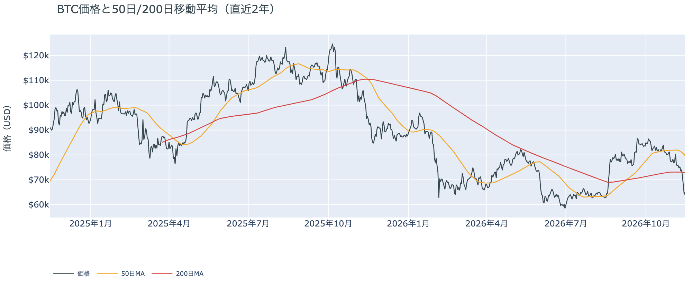

*図の見方: 2本の平均線の上下関係を見ます。50日線が200日線の上にあるのがゴールデンクロスです。*

* 50日線と200日線の差は約$6,830（9.4%）で、前日の9.8%からさらに縮んだ。
* 朝7時5分の価格は50日線を18.5%、200日線（$72,920）を10.8%下回る。

日曜日の戻りでも、短い目の弱さは変わっていません。ゴールデンクロス（＝50日線が200日線を上抜けること）の状態は69日目で、長い目で見た流れの向きはまだ変わっていませんが、価格は200日線の1割下にいて、2本の差は日を追って縮み続けています。

11月13日の米国株は、S&P500が−0.40%、ナスダック100が−1.21%で週を終え、米10年債利回りは5.15%の高さのままでした。日曜日は証券市場が閉まっていて、ビットコインの下げとも戻りとも同じ時間に動いた株や金利はありません。週末へ持ち越されたのは、前日と同じく12月の利上げを織り込んだ金利の高さです。

**図1-3 清算（直近24時間）**

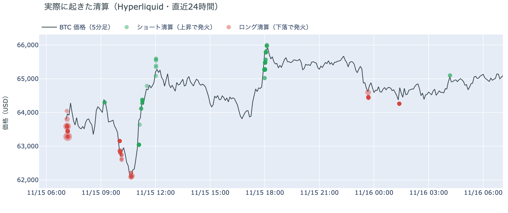

*図の見方: Hyperliquid で実際に清算された取引を、時刻（日本時間）と価格に重ねたもの。*

* 清算の3分の2はロングで、$63,000台に4割あまりが集まった。最大の1件は全体の4分の1。
* ショートの清算は、昼前と夕方の2回の戻りの時間に出た。

Hyperliquid（＝オンチェーンの先物取引所）で拾えた分で見ると、日曜日の清算は大口1つではなく多数のアドレスに散らばっています。ロングの清算は前日からの下げが続いた朝の早い時間に集まり、その後の戻りでは向きが変わってショートが焼けました。

## 2. なぜ動いたか：きっかけと、需給のどこが動いたか

**図2-1 ビットコインと株・金・原油の相対推移（起点＝100）**

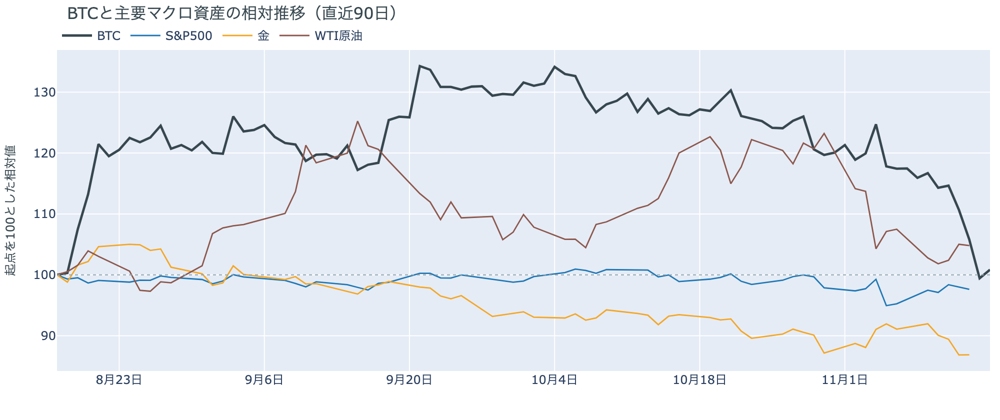

*図の見方: 同じ起点から何%動いたかで重ねたもの。線の向きが揃っているかを見ます。*

| この5営業日の動き（ビットコインは7日間） | 変化 |
|---|---:|
| ビットコイン | −13.0% |
| 金 | −4.6% |
| 米国株（S&P500） | +2.5% |
| 原油 | −2.5% |

* 建玉は93,615BTCで、前日の96,713BTCから3.2%減った。
* 1日をならした年率は+2.45%で、短期金利（13週Tビル 4.12%）を引いた上乗せは−1.67pt。

日曜日の戻りは、新しいきっかけが無いまま、先物のショートの買い戻しを通って価格になりました。

1. きっかけ：下げた時間にも戻した時間にも、外部環境の新しい出来事は見当たりません。米国株も米国債も週末で取引が無く、ビットコインと同じ時間に動いたものはありません。背景にあるのは、この1週間続いた利上げの織り込みです。FF金利先物では、12月のFOMC（＝米国の金利を決める会合）での0.25ptの利上げが確実視されたうえに、0.5ptの利上げも約5割弱まで織り込まれています（11月13日の先物の終値）。
2. 伝わり方：速い側の先物では、昼前の下げで積まれたショートが、そのあとの2回の戻りで買い戻され、清算がその戻りを押し広げました。価格が上がったのに建玉は24時間で3%減っているので、戻りは新しいロングの買いではなく、ショートが降りたことで起きています。遅い側では、アメリカの買い手は日曜日の戻りでも売りの側にいて（図①-1）、長期保有者も11月14日時点で前の週と同じ形で減らし続けています（図②-1）。日曜日の戻りを運んだのは先物で、アメリカの買い手と長期保有者までは届いていません。

この1週間で見ると、米国株が上げた5営業日にビットコインは13%下げていて、株と共通のきっかけによる下げではありません。同じ向きに下げたのは金で、どちらも米金利とドルが上がった週に売られています。日曜日の戻りは、この1週間の下げの向きを変えるほどの大きさではありません。

## 3. 市場参加者はいまどう見ているか

### ① アメリカの買い手は、戻りの日も売りの側にとどまっている

**図①-1 Coinbase Premium（アメリカとそれ以外の価格差・直近90日）**

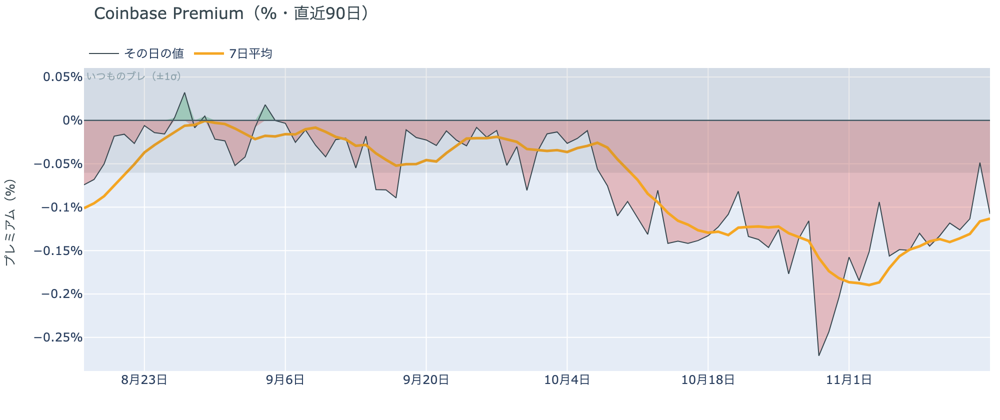

*図の見方: プラス＝アメリカで買いが強い。太線が1週間平均、細線がその日の値。薄い帯は「いつものブレの範囲」です。*

* 1週間平均は−0.11%で、前の週の1週間平均−0.15%より浅い。
* 11月15日の値は−0.11%で、いつものブレの1.8倍。前日の−0.05%から沈み直した。

日曜日の戻りは、アメリカの買い手が運んだものではありません。Coinbase Premium（＝アメリカとそれ以外の価格差）は1週間平均でマイナスのまま、日曜日の値もいつものブレを超えて沈み、アメリカの価格がほかより安い状態で戻りが進みました。売り急ぐ勢いは前の週より和らいでいますが、アメリカの買い手はまだこの水準を買い場とは見ていないということです。

**図①-2 ETFの日ごとの資金の出入り（直近90日）**

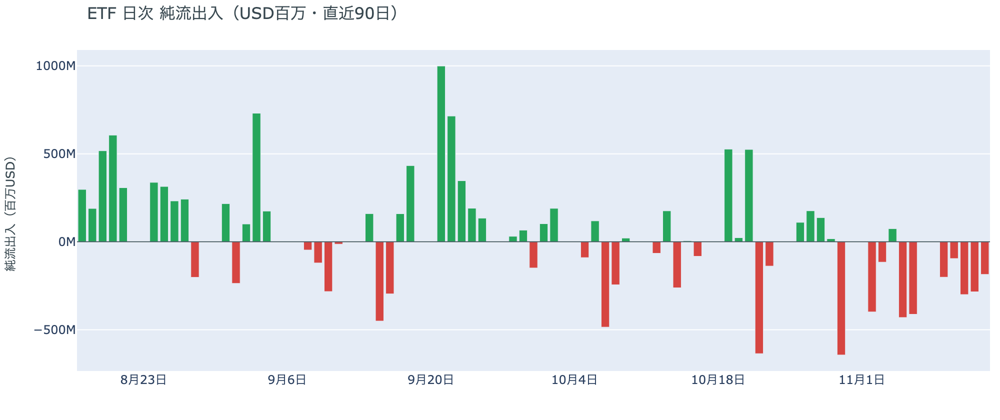

*図の見方: 入ったお金と出たお金の差。上に伸びれば入り超、下に伸びれば出超。*

| ETFの日ごとの出入り | 億ドル |
|---|---:|
| 11月9日 | −2.0 |
| 11月10日 | −1.0 |
| 11月11日 | −3.0 |
| 11月12日 | −2.8 |
| 11月13日 | −1.9 |
| 直近7営業日の合計 | −19.1 |

ETFの買い手は、資金を引き揚げる側にとどまっています。週末で新しい集計は無く、出超が7営業日続いた11月13日までの形のままです。値下がりを買いの機会と見る確信は、ETFの買い手にもまだ生まれていません。

**図①-3 Fear & Greed（市場心理の指数・直近90日）**

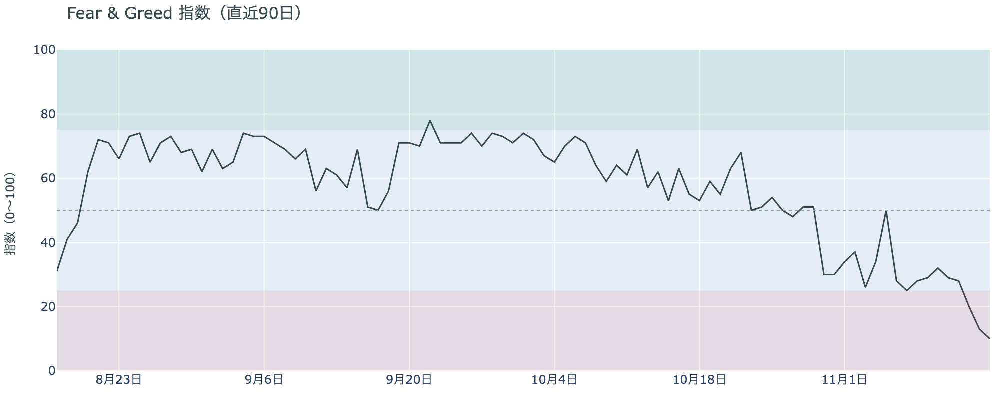

*図の見方: 0〜100で、50より上が「強欲」、下が「恐怖」。*

* 10の「極度の恐怖」。前日の13から3pt下げた。1週間前は28、1か月前は63。

参加者の多くは、下げを怖がる気持ちをさらに強めています。Fear & Greed（＝市場心理の指数）の11月15日の値は「極度の恐怖」の区分の中でもう一段下がり、1か月前の「強欲」の側から、この1か月でここまで冷えました。日曜日の戻りは、この冷え方を和らげる大きさではありません。

### ② 長期保有者は利益の出ない価格でも減らし続けるが、減り方は前の週より小さい

**図②-1 長期保有者の保有量の30日変化とSOPR（直近90日）**

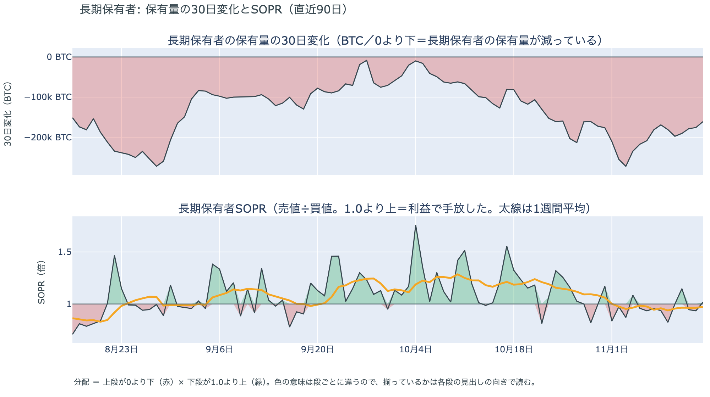

*図の見方: 上段は、長期保有者の保有量が30日でどれだけ増減したか。マイナス＝手放している。下段は長期保有者SOPRで、1より上なら利益で手放した。どちらも太線の1週間平均で読みます。*

| 11月14日時点 | 1週間平均 | 前の週の平均 |
|---|---:|---:|
| 長期保有者SOPR（1より上＝利益で手放した） | 0.97 | 0.95 |
| 長期保有者の保有量の30日変化（万BTC） | −17.9 | −22.6 |

* 30日変化は、1か月前（10月15日）の−11.6万BTCより大きい減り方のまま。

長期保有者は、利益が出ない価格でも手放すのをやめていません。保有量は30日で減り、動いたコインは平均して買値より安く動いているので、利益確定の売りとは呼べない形のまま減っています。ただ減り方は前の週より小さく、買値を下回る度合いも前の週より浅くなっていて、11月14日時点の長期保有者の持ち方は前日に書いた形のままです。

マイナーの収入は平年を下回ったままです（Puell Multiple（＝マイナー収入の平年比）が11月14日時点の1週間平均で0.80）。前の週の0.96から下がりましたが、土曜日の採掘の難易度の引き下げでマイナーの負担は軽くなる側に動いていて、売りを急ぐ持ち手として新しく現れた形ではありません。

### ③ 先物：戻りはショートの買い戻しで、ロングは積み直されていない

**図③-1 資金調達率と建玉（直近30日）**

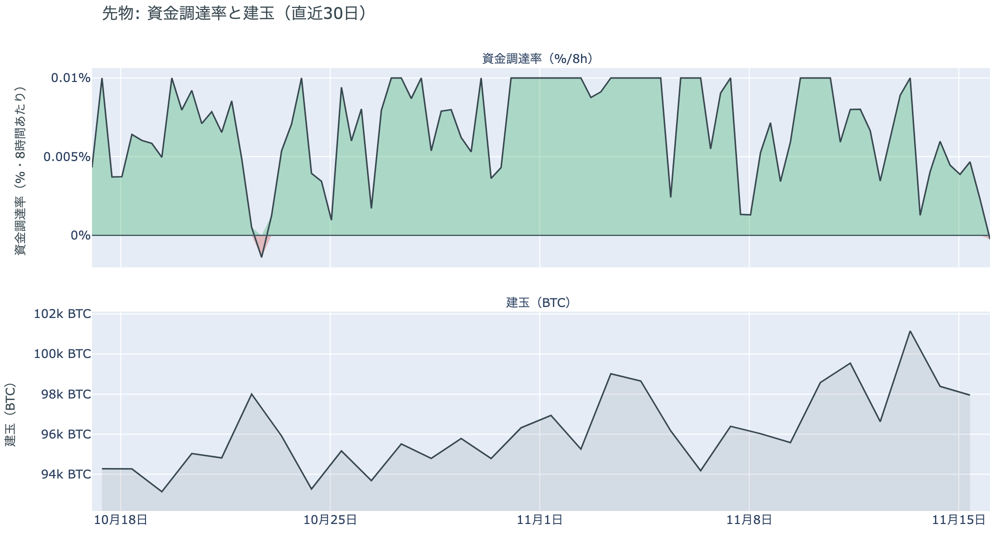

*図の見方: 上段は資金調達率（8時間ごと・日本時間）。プラスが続く＝ロングがショートより多い。下段は建玉。*

* 上乗せは直近34日の平均+2.92ptを大きく下回り、前日の+1.10ptからマイナスへ沈んだ。
* 直近34日で上乗せがプラスだった日は82%。

先物の参加者は、価格が戻っても上げへの確信を取り戻していません。前日は「上げへの確信はさらに細った」と説明しました。日曜日は価格が上がったのに建玉が減っていて、戻りはショートの買い戻しであり、新しいロングは積まれていないので、前日の説明は今日の数値と合っています。資金調達率（＝ロングが払う金利。プラス＝ロングがショートより多い）はまだプラスですが、ロングが払う分は短期金利（＝ドルを米国の短期国債で持つだけで受け取れる金利）を下回りました。余分に払ってでも上げに賭けたい人は、この1か月で最も少なくなっています。

### ④ オプション：数日内の大きな動きへの見込みは少し和らいだが、下げへの備えは外していない

オプションには2種類あります。コール（＝決めた価格で買う権利）とプット（＝決めた価格で売る権利）で、価格が上がればコールの価値が上がり、価格が下がればプットの価値が上がります。プットは「価格が下がったときの保険」として買われます。オプションを買う人は、その権利と引き換えに権利料（＝オプションを買う人が払う金額）を払います。

**図④-1 満期ごとのIV（年率%）**

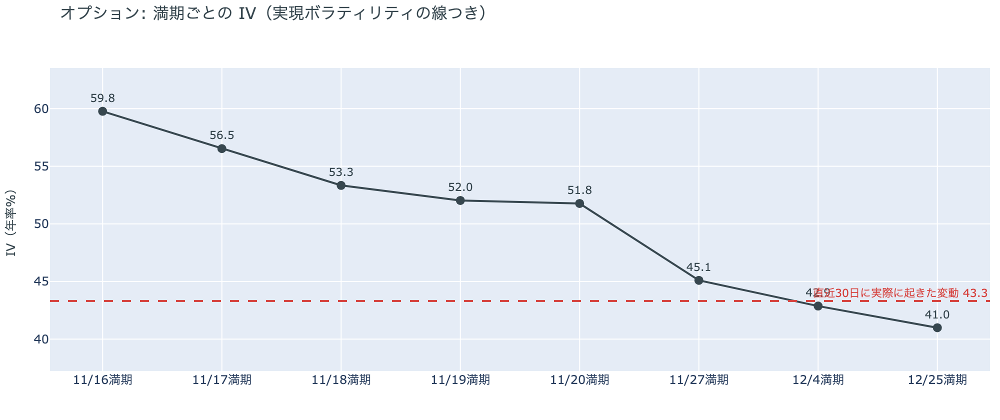

*図の見方: IVを満期ごとに並べたもの。点線は実現ボラティリティ。IVが点線より下なら、市場はこの先の値動きを過去の値動きより小さいと見ています。*

| 満期 | IV |
|---|---:|
| 11月16日 | 60 |
| 11月17日〜18日 | 53〜57 |
| 11月19日〜20日 | 52 |
| 11月27日〜12月4日 | 43〜45 |
| 12月25日 | 41 |

* IVは全体で47.3で、実現ボラティリティ43.3より4.0pt高い。過去1年では下から67%の位置。

参加者は、この数日のうちにまだ大きく動くと見ていますが、その見込みは前日より少し和らぎました。IV（＝値動きの幅の予想）は全体で実現ボラティリティ（＝過去の値動きの幅）を上回り、市場はこの先の値動きを過去の値動きより大きいと見ています。前日は目の前の満期のIVが60台へ跳ねたと書きましたが、日曜日の戻りのあと、11月17日・18日の満期は50台へ下がりました。それでも11月20日までの満期のオプションの権利料には、11月27日以降の満期に対する上乗せが乗ったままです。NVIDIAの決算と FOMC の議事要旨が出る週の前半に、まだ大きく動くと見られているからです。

**図④-2 満期ごとのプットとコールの差**

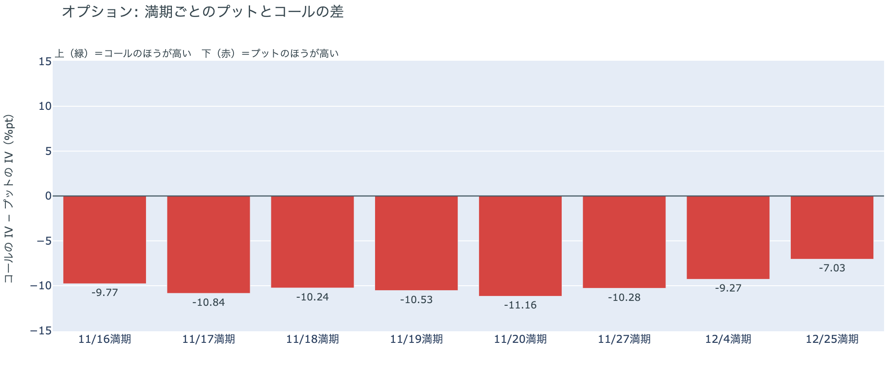

*図の見方: 満期ごとに、プットとコールのどちらが高く売れているか。ゼロより上ならコールのほうが高く、下ならプットのほうが高い。*

| 満期 | どちらが高いか |
|---|---|
| 11月16日 | プットが高い |
| 11月17日 | プットが高い |
| 11月18日 | プットが高い |
| 11月20日 | プットが高い（差はいちばん大きい） |
| 11月27日 | プットが高い |
| 12月4日 | プットが高い |
| 12月25日 | プットが高い（差はいちばん小さい） |

参加者は、大きく動くなら下だと見ています。どの満期もプットのほうが高く、11月末までの満期はほぼ同じ大きな差のままです。日曜日に価格が戻っても下げへの備えを外していないので、続落を気にする見方は前日から変わっていません。

**図④-3 12月25日満期の持ち高（権利の価格ごと）**

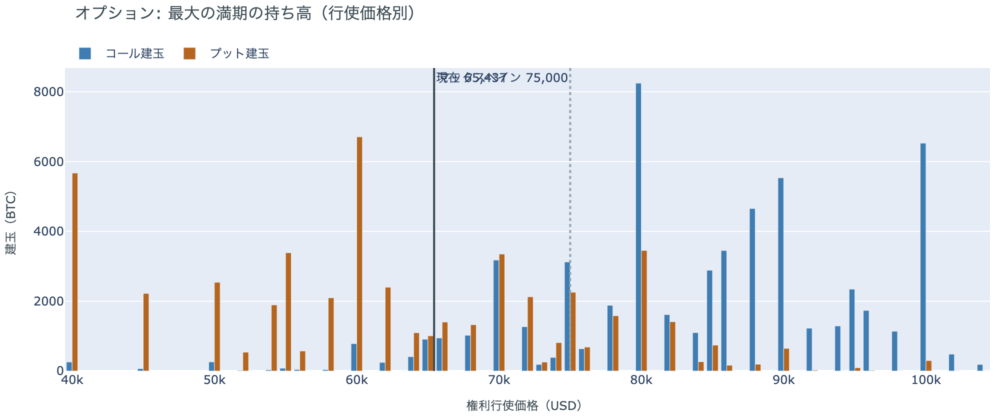

*図の見方: 青＝コール、橙＝プット。現値より上にコールが、下にプットが積まれるのが普通です。*

| 12月25日満期のオプション（基準の価格は約$65,400） | 量（万BTC） | 意味 |
|---|---:|---|
| いまより高い価格のコール | 約8.4 | 「価格が上がる」に賭けた分 |
| いまより安い価格のプット | 約3.7 | 「価格が下がる」への保険 |
| うち、いまより15%以上高い価格のコール | 約7.4 | 大きな上げへの賭け |
| うち、いまより15%以上安い価格のプット | 約2.3 | 大きな下げへの保険 |

* 12月25日満期の持ち高は約14.6万BTCと全満期の39%で、コールがプットの1.5倍。前日とほぼ同じ形。

年末の最大の満期では、「価格が上がる」に賭けた人たちが降りておらず、年末までの上げへの期待はまだ手放されていません。先物ではロングが積み直されていない一方で、年末に向けたコールの持ち高の形は変わっていません。大きな上げに賭けた分が報われるには、12月25日の夕方5時までに約$75,200を超える必要があります。全満期でオプションの持ち高が集まっているのは$60,000〜$70,000の帯で、価格はいまその帯の中ほどにいます。

### ⑤ 5年以上動いていなかったコインが、2日続けて多くの生成日にわたって動いた

* 11月14日に動いた5年以上前のコインは、大きい3つの生成日を除いて約1,570BTCと、平年（直近1年の中央値）の4.3倍。
* 動いた分は1,600を超える生成日に散らばり、大きい3つで全体の14%。

11月14日にも、5年以上動いていなかったコインが平年を大きく超えて動き、覚醒（＝5年以上動かなかったコインの移動）は11月10日・13日に続いて5日で3回目になりました。前日の11月13日と同じく、多くの生成日の古いコインが少しずつ動いた形で、まとまった1つの移動ではありません。この記録は売却とは限らず、保管先の変更や取引所のウォレットの整理でも同じ形になります。量は長期保有者の保有量の30日変化（図②-1）の1%ほどで、長期保有者全体の減り方を変える大きさではありません。

## 4. 価格に影響しうる直近のイベント

オプション市場が目の前の満期ほどIVを高く付けている区間は、11月18日の朝に出るNVIDIAの決算と、11月19日の朝に出るFOMCの議事要旨をまたぐ11月20日までの満期に当たります。下げへの備えは、その先の11月27日の満期まで同じ厚さで置かれています。

| 日付 | イベント | 何に効くか |
|---|---|---|
| 11/18（水）6:20ごろ 日本時間 | NVIDIAの決算（米国時間17日の引け後）。フアン氏の辞任後、初めての決算 | 米国株（ナスダック100） |
| 11/19（木）4:00 日本時間 | FOMCの議事要旨（10月27〜28日分） | 金利 |
| 11/25（水） | 米10月のPCE物価指数（米国の物価統計） | 金利 |
| 11/30（月）米国時間の引け | MSCIの指数から米Strategy（＝ビットコインを大量に持つ米企業）が外れる実施日 | Strategyの株と、指数に連動する資金 |
| 12/9（水） | FOMC。0.25ptの利上げは確実視され、0.5ptの利上げも約5割弱まで織り込まれている。結果は日本時間10日早朝 | 金利 |
| 12/25（金）17:00 | オプションの最も大きな満期（約14.6万BTC、全満期の39%） | 約$75,200以上のコールの期限 |

## まとめ

日曜日のビットコインは、新しいきっかけが無いなかで、昼前に積まれたショートが2回の戻りで買い戻され、清算で速まりながら$65,000台へ戻しました。アメリカの買い手はその戻りでも売りの側にとどまり、長期保有者も利益の出ない価格で減らし続けていますが、どちらも前の週から続く形のままで、アメリカの買い手と長期保有者の持ち方までは変わっていません。参加者は、ショートが降りた戻りを流れの変化とは見ておらず、NVIDIAの決算とFOMCの議事要旨が出る週の前半にまだ大きく動くと見て、動くなら下と備えたまま、上げに賭ける新しいロングを積まずにいます。

---

<small>（数値は11月16日7時5分（日本時間）までのデータに基づきます。価格・先物・オプションはその時点の値、市場心理は11月15日の確定値、オンチェーン（＝ブロックチェーン上の記録）は11月14日時点、ETF資金フローは11月13日分までです。証券市場の終値は11月13日時点で、週末のため更新がありません。オンチェーンの長期保有者の数値には、ETFや取引所が預かっている分も含まれます。清算は Hyperliquid で拾えた分だけで、市場全体のごく一部です。オプションはDeribit（BTCオプションの大半を占める取引所）の全銘柄です。）</small>

*本稿は情報提供を目的としたものであり、投資助言ではありません。将来の価格動向を保証・示唆するものではなく、投資判断は各自の責任において行ってください。*
