# 半導体株安の夜もショートの買い戻しで$65,000台 ― ロングは積まれず、目先のIVは和らぐ

**2026年11月17日**

ビットコインは月曜日、日中にじりじりと下げたあと、米国株の取引が始まった時間に買い戻され、24時間前とほぼ同じ$65,000台で火曜日の朝を迎えました。

* **価格**：24時間の値幅は2.8%と、前日の6.7%から半分以下に縮み、朝7時5分の時点で約$65,374。この1週間の下げのあとで、値動きが落ち着いた1日だった
* **きっかけ**：外部環境の新しい出来事は無かった。米国株は NVIDIA を中心に半導体株が売られたが、ビットコインはその時間に上げていて、株安が持ち込まれた夜ではない
* **先物**：日中の下げでは新しい売り持ち（ショート）が積まれ、米国株の取引開始の時間にそのショートが買い戻された。ショートの清算（＝証拠金不足で強制的に閉じられた取引）が戻りを加速させた。新しい買い持ち（ロング）は積まれておらず、上げへの確信は戻っていない
* **需給の土台**：米国の買い手は月曜日も売りの側にいて、売り方は前の週より強まった。長期保有者（＝155日以上保有者）も11月15日時点で減らし続けていて、どちらも前日から形は変わっていない
* **オプションの見方**：この先の値動きが過去の値動きより大きいという見込みは消えた。それでも NVIDIA の決算と FOMC の議事要旨をまたぐ満期には備えを残し、動くなら下と見ている点は変わっていない

## 1. 何が起きたか

**図1-1 価格の推移（1時間足・直近7日）**

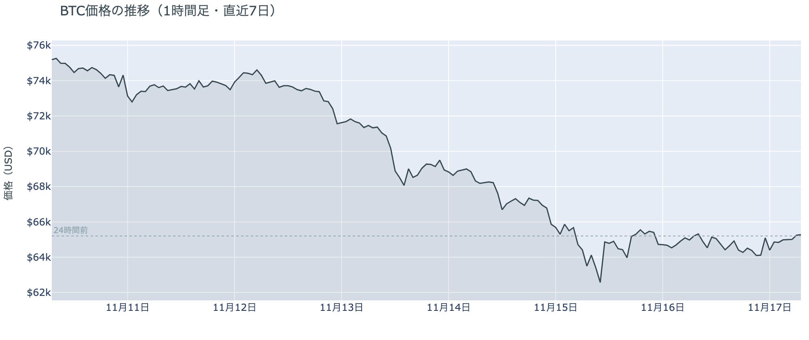

*図の見方: 1時間ごとの価格（日本時間）。点線は24時間前の水準です。*

* 24時間の値幅は2.8%で、前日の6.7%から半分以下に縮んだ。
* 拾えた清算の半分あまりは大口1つ。値動きの速い5分足には、拾えた清算の3割が入っていた。

月曜日は、日中に新しいショートが積まれ、夜にそれが買い戻された1日でした。朝9時から夜21時台までは、価格が$65,300あたりから$64,100あたりへじりじり下がりながら建玉（＝先物の未決済残高。証拠金で張っている人の量）が増えていて、下げに賭ける新しいショートが積まれた下げです。米国株の取引が始まった23時台は様子が逆で、価格が1.5%上がりながら建玉が1.4%減り、ショートの清算が24時間でいちばん多く出ました。いちばん速く上げた5分足にその清算が集まっているので、清算が戻りを加速させています。日付が変わった0時台にはロングの清算を伴って一度押し戻されましたが、その後は朝まで24時間前の水準の近くにとどまりました。

Hyperliquid（＝オンチェーンの先物取引所）で拾えた分で見ると、清算の半分あまりは1つの大口で、多数のアドレスが一斉に焼けた夜ではありません。

**図1-2 価格と50日・200日移動平均**

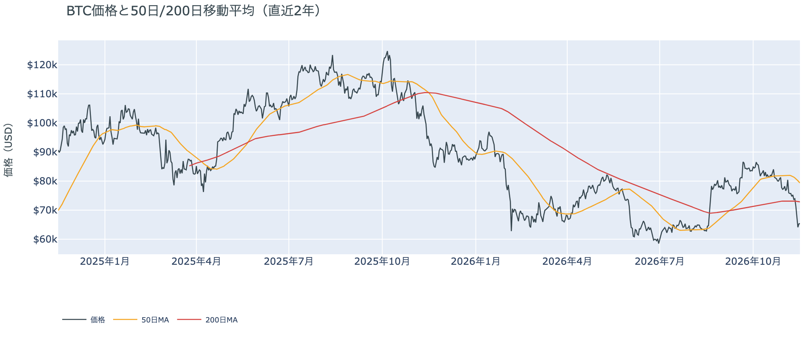

*図の見方: 2本の平均線の上下関係を見ます。50日線が200日線の上にあるのがゴールデンクロスです。*

* 50日線と200日線の差は約$6,510（8.9%）で、前日の9.4%からさらに縮んだ。
* 朝7時5分の価格は50日線を17.6%、200日線（$72,866）を10.3%下回る。

値動きが落ち着いても、短い目の弱さは変わっていません。ゴールデンクロス（＝50日線が200日線を上抜けること）の状態は70日目で、長い目で見た流れの向きはまだ変わっていませんが、価格は200日線の1割下にいて、2本の差は日を追って縮み続けています。

11月16日の米国株は、S&P500が−1.92%、ナスダック100が−2.65%と大きく下げました。NVIDIA の決算と Anthropic の上場を控え、AI と半導体の株が売られました。ただしビットコインはその夜に下げを深めておらず、米国株の下げがそのまま持ち込まれた夜ではありませんでした。

## 2. なぜ動いたか：きっかけと、需給のどこが動いたか

**図2-1 ビットコインと株・金・原油の相対推移（起点＝100）**

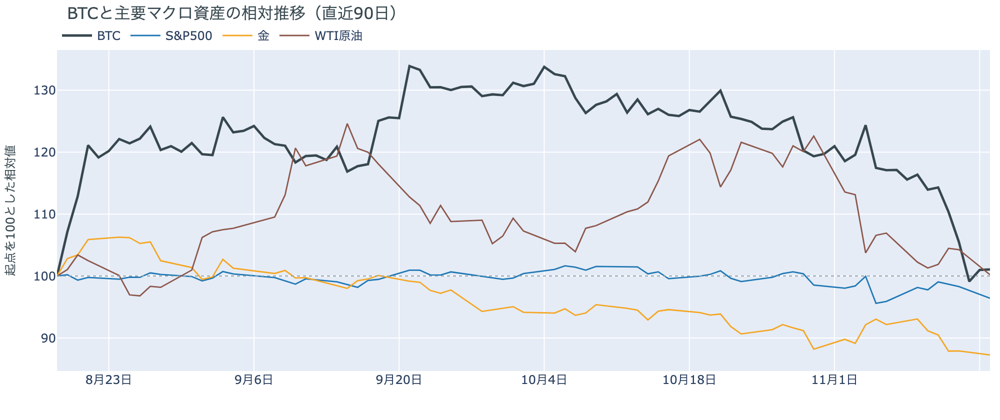

*図の見方: 同じ起点から何%動いたかで重ねたもの。線の向きが揃っているかを見ます。*

| この5営業日の動き（ビットコインは7日間） | 変化 |
|---|---:|
| ビットコイン | −13.1% |
| 金 | −6.2% |
| 米国株（S&P500） | −1.8% |
| 原油 | −2.0% |

* 建玉は92,949BTCで、前日の93,615BTCから0.7%減った。
* 1日をならした年率は+2.05%で、短期金利（13週Tビル 4.12%）を引いた上乗せは−2.07pt。

月曜日の値動きは、はっきりしたきっかけが無いまま、先物のショートが積まれては買い戻されることを通って、24時間前の水準へ戻りました。

1. きっかけ：ビットコインを動かした外部環境の新しい出来事は見当たりません。米国株は NVIDIA の決算と Anthropic の上場を控えて売られ、NVIDIA は−4.10% でした。しかし取引が始まった23時台、ナスダック100が1.75%下げた同じ時間に、ビットコインは1.5%上げています。逆向きに動いたので、株安はビットコインとの共通のきっかけではありません。背景にあるのは、前の週から続く利上げの織り込みです。FF金利先物では、12月の FOMC（＝米国の金利を決める会合）での0.25ptの利上げが確実視されたうえに、0.5ptの利上げも約4割まで織り込まれています（11月16日の先物の終値）。
2. 伝わり方：速い側の先物では、日中の下げで積まれたショートが、夜の戻りで買い戻され、清算がその戻りを押し広げました。24時間で見ると建玉は減っているので、戻りは新しいロングの買いではなく、ショートが降りたことで起きています。遅い側では、アメリカの買い手は月曜日も売りの側にいて（図①-1）、長期保有者も11月15日時点で前の週と同じ形で減らし続けています（図②-1）。月曜日の値動きを運んだのは先物で、アメリカの買い手と長期保有者までは届いていません。

前日は「日曜日の戻りはショートの買い戻しで、この1週間の下げの向きを変えるほどの大きさではない」と説明しました。月曜日も同じ形の戻りがもう一度起き、新しいロングが積まれないまま値動きだけが小さくなったので、前日の説明は今日の数値と合っています。

## 3. 市場参加者はいまどう見ているか

### ① アメリカの買い手は売りの側にとどまり、月曜日はその売りが強まった

**図①-1 Coinbase Premium（アメリカとそれ以外の価格差・直近90日）**

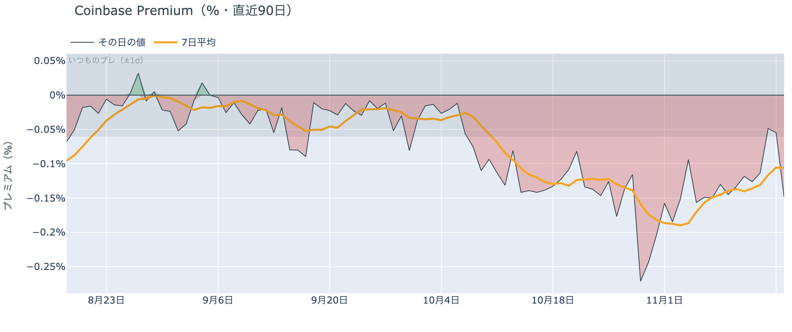

*図の見方: プラス＝アメリカで買いが強い。太線が1週間平均、細線がその日の値。薄い帯は「いつものブレの範囲」です。*

* 1週間平均は−0.11%で、前の週の1週間平均−0.14%より浅い。
* 11月16日の値は−0.15%で、いつものブレの2.5倍。前日の−0.11%から沈み直した。

アメリカの買い手は、この価格をまだ買い場とは見ていません。Coinbase Premium（＝アメリカとそれ以外の価格差）は1週間平均でマイナスのままで、月曜日の値はいつものブレを超えてもう一段沈みました。夜の戻りの時間もアメリカの価格がほかより安かったので、戻りを運んだのはアメリカの現物の買いではなく、先物のショートの買い戻しです。1週間平均で見た売り方は前の週より和らいでいますが、月曜日はその和らぎが止まりました。

**図①-2 ETFの日ごとの資金の出入り（直近90日）**

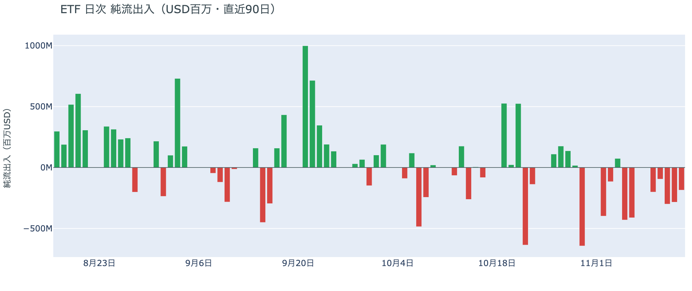

*図の見方: 入ったお金と出たお金の差。上に伸びれば入り超、下に伸びれば出超。*

| ETFの日ごとの出入り | 億ドル |
|---|---:|
| 11月9日 | −2.0 |
| 11月10日 | −1.0 |
| 11月11日 | −3.0 |
| 11月12日 | −2.8 |
| 11月13日 | −1.9 |
| 直近7営業日の合計 | −19.1 |

ETFの買い手は、資金を引き揚げる側にとどまっています。月曜日の分はまだ集計が出ておらず、出超が7営業日続いた11月13日までの形のままです。1日あたりの流出は大きくなっても小さくなってもいないので、値下がりを買いの機会と見る確信は、ETFの買い手にもまだ生まれていません。

**図①-3 Fear & Greed（市場心理の指数・直近90日）**

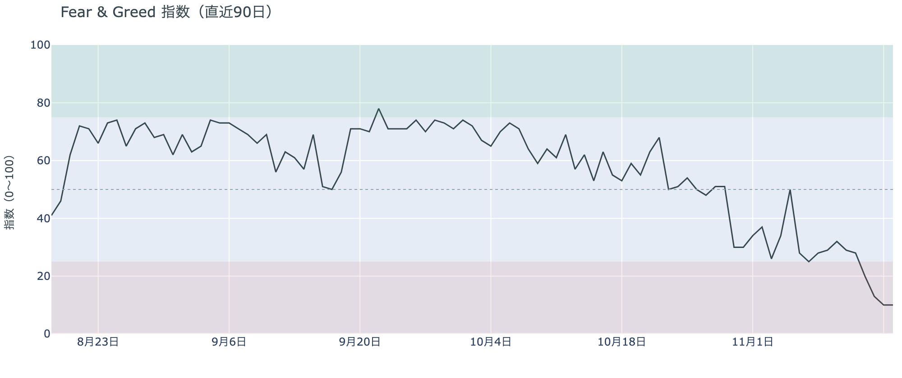

*図の見方: 0〜100で、50より上が「強欲」、下が「恐怖」。*

* 10の「極度の恐怖」で、前日と同じ。1週間前は29、1か月前は55。

参加者の多くは、下げを怖がる気持ちを和らげていません。Fear & Greed（＝市場心理の指数）の11月16日の値は前日と同じ「極度の恐怖」の深さにとどまり、値動きが落ち着いた月曜日にも戻りませんでした。

### ② 長期保有者は利益の出ない価格でも減らし続け、形は前の週から変わっていない

**図②-1 長期保有者の保有量の30日変化とSOPR（直近90日）**

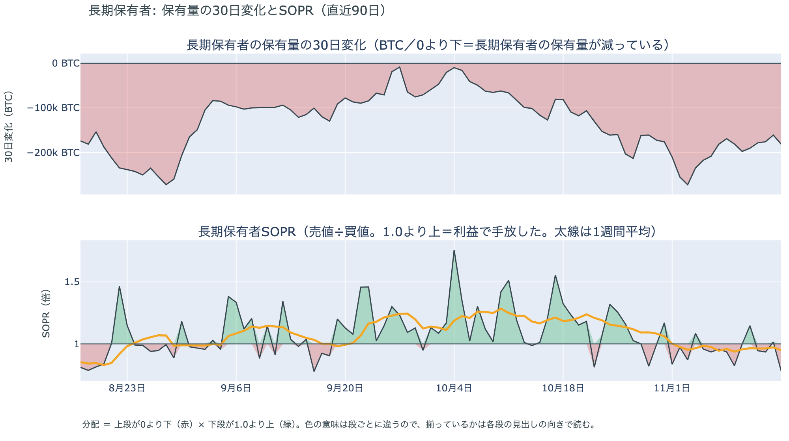

*図の見方: 上段は、長期保有者の保有量が30日でどれだけ増減したか。マイナス＝手放している。下段は長期保有者SOPRで、1より上なら利益で手放した。どちらも太線の1週間平均で読みます。*

| 11月15日時点 | 1週間平均 | 前の週の平均 |
|---|---:|---:|
| 長期保有者SOPR（1より上＝利益で手放した） | 0.95 | 0.96 |
| 長期保有者の保有量の30日変化（万BTC） | −18.1 | −22.0 |

* 30日変化は、1か月前（10月16日）の−12.7万BTCより大きい減り方のまま。

長期保有者は、利益が出ない価格でも手放すのをやめていません。保有量は30日で減り、動いたコインは平均して買値より安く動いているので、利益確定の売りとは呼べない形のまま減っています。減り方は前の週より小さいままで、11月15日時点の長期保有者の持ち方は、前日に書いた形から変わっていません。

マイナーの収入は平年を下回ったままです（Puell Multiple（＝マイナー収入の平年比）が11月15日時点の1週間平均で0.84）。前日の号で書いた5年以上動いていなかったコインの移動は、11月15日には平年を大きく超えておらず、今日は長期保有者のほかに新しく売りに回りそうな持ち手は見当たりません。

### ③ 先物：ショートは積まれては降りたが、ロングは積み直されていない

**図③-1 資金調達率と建玉（直近30日）**

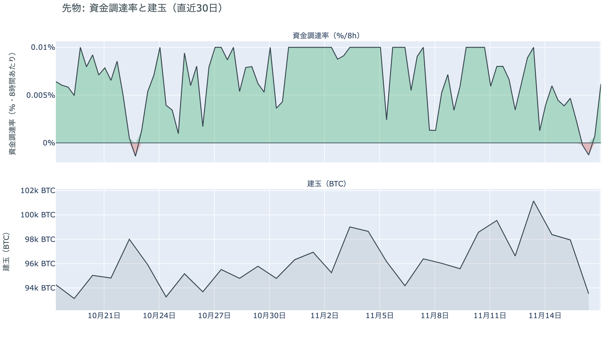

*図の見方: 上段は資金調達率（8時間ごと・日本時間）。プラスが続く＝ロングがショートより多い。下段は建玉。*

* 上乗せは前日の−1.67ptからさらに沈み、直近34日の平均+2.83ptを大きく下回る。
* 建玉の7日変化は−2.2%。

先物の参加者は、下げにも上げにも賭けを大きくしておらず、上げへの確信はこの1か月でいちばん弱いままです。月曜日に積まれたショートは夜には降りていて、下げを追いかける賭けも長くは持たれていません。一方で、価格が戻ってもロングは積み直されていないので、上げに賭ける人も戻っていません。資金調達率（＝ロングが払う金利。プラス＝ロングがショートより多い）はまだプラスですが、ロングが払う分は短期金利（＝ドルを米国の短期国債で持つだけで受け取れる金利）を前日より大きく下回りました。余分に払ってでも上げに賭けたい人は、さらに減っています。

### ④ オプション：大きく動くという見込みは消えたが、下げへの備えは外していない

オプションには2種類あります。コール（＝決めた価格で買う権利）とプット（＝決めた価格で売る権利）で、価格が上がればコールの価値が上がり、価格が下がればプットの価値が上がります。プットは「価格が下がったときの保険」として買われます。オプションを買う人は、その権利と引き換えに権利料（＝オプションを買う人が払う金額）を払います。

**図④-1 満期ごとのIV（年率%）**

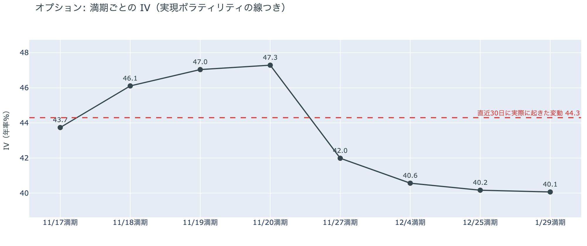

*図の見方: IVを満期ごとに並べたもの。点線は実現ボラティリティ。IVが点線より下なら、市場はこの先の値動きを過去の値動きより小さいと見ています。*

| 満期 | IV |
|---|---:|
| 11月17日 | 44 |
| 11月18日〜20日 | 46〜47 |
| 11月27日〜12月4日 | 41〜42 |
| 12月25日〜1月29日 | 40 |

* IVは全体で44.0で、実現ボラティリティ44.3とほぼ同じ。前日は4.0pt上回っていた。

参加者は、この先の値動きをこれまでと同じくらいの大きさと見るところまで、身構えを解きました。IV（＝値動きの幅の予想）は全体で実現ボラティリティ（＝過去の値動きの幅）とほぼ同じになり、前日まであった「過去より大きく動く」という見込みは消えています。それでも11月18日から20日の満期のオプションの権利料には、11月27日以降の満期に対する上乗せが残っています。NVIDIA の決算と FOMC の議事要旨が出る週の半ばには、まだほかの日より大きく動くと見られているからです。前日は50台だった11月17日・18日の満期が40台に下がり、その上乗せは小さくなりました。

**図④-2 満期ごとのプットとコールの差**

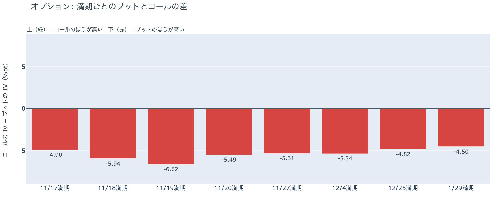

*図の見方: 満期ごとに、プットとコールのどちらが高く売れているか。ゼロより上ならコールのほうが高く、下ならプットのほうが高い。*

| 満期 | どちらが高いか |
|---|---|
| 11月17日 | プットが高い |
| 11月18日 | プットが高い |
| 11月19日 | プットが高い（差はいちばん大きい） |
| 11月20日 | プットが高い |
| 11月27日 | プットが高い |
| 12月4日 | プットが高い |
| 12月25日 | プットが高い |
| 1月29日 | プットが高い（差はいちばん小さい） |

参加者は、動くなら下だと見ています。どの満期もプットのほうが高く、差がいちばん大きいのは FOMC の議事要旨の直後に満期が来る11月19日です。月曜日に値動きが落ち着いても下げへの備えを外していないので、続落を気にする見方は前日から変わっていません。

**図④-3 12月25日満期の持ち高（権利の価格ごと）**

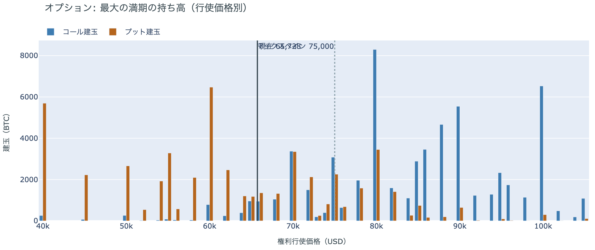

*図の見方: 青＝コール、橙＝プット。現値より上にコールが、下にプットが積まれるのが普通です。*

| 12月25日満期のオプション（基準の価格は約$65,700） | 量（万BTC） | 意味 |
|---|---:|---|
| いまより高い価格のコール | 約8.5 | 「価格が上がる」に賭けた分 |
| いまより安い価格のプット | 約3.8 | 「価格が下がる」への保険 |
| うち、いまより15%以上高い価格のコール | 約7.4 | 大きな上げへの賭け |
| うち、いまより15%以上安い価格のプット | 約2.4 | 大きな下げへの保険 |

* 12月25日満期の持ち高は約14.7万BTCと全満期の39%で、コールがプットの1.5倍。前日とほぼ同じ形。

年末の最大の満期では、「価格が上がる」に賭けた人たちが降りておらず、年末までの上げへの期待はまだ手放されていません。先物ではロングが積み直されていない一方で、年末に向けたコールの持ち高の形は変わっていません。大きな上げに賭けた分が報われるには、12月25日の夕方5時までに約$75,600を超える必要があります。全満期でオプションの持ち高が集まっているのは$64,000〜$70,000の帯で、価格はいまその帯の下のほうにいます。

## 4. 価格に影響しうる直近のイベント

オプション市場がほかの満期より IV を高く付けているのは、11月18日の朝に出る NVIDIA の決算と、11月19日の朝に出る FOMC の議事要旨をまたぐ11月18日から20日の満期です。下げへの備えはその区間でいちばん厚く、その先の満期にも同じ向きで置かれています。

| 日付 | イベント | 何に効くか |
|---|---|---|
| 11/17（火）米国時間 | SEC と CFTC（＝米国の証券と先物の監督当局）の委員候補の上院公聴会 | 暗号資産の規制 |
| 11/18（水）6:20ごろ 日本時間 | NVIDIA の決算（米国時間17日の引け後）。フアン氏の辞任後、初めての決算 | 米国株（ナスダック100） |
| 11/19（木）4:00 日本時間 | FOMC の議事要旨（10月27〜28日分） | 金利 |
| 11/19（木）米国時間 | Anthropic の米国での上場 | 米国株（AI 関連） |
| 11/25（水） | 米10月の PCE 物価指数（米国の物価統計） | 金利 |
| 11/30（月）米国時間の引け | MSCI の指数から米 Strategy（＝ビットコインを大量に持つ米企業）が外れる実施日 | Strategy の株と、指数に連動する資金 |
| 12/9（水） | FOMC。0.25ptの利上げは確実視され、0.5ptの利上げも約4割まで織り込まれている。結果は日本時間10日早朝 | 金利 |
| 12/25（金）17:00 | オプションの最も大きな満期（約14.7万BTC、全満期の39%） | 約$75,600以上のコールの期限 |

## まとめ

月曜日のビットコインは、新しいきっかけが無いなかで、日中に積まれたショートが米国株の取引開始の時間に買い戻され、清算で速まりながら$65,000台へ戻りました。米国株が半導体株を中心に下げた夜でしたが、ビットコインはその時間に逆に上げていて、株安が持ち込まれた形ではありません。アメリカの買い手は月曜日も売りの側にとどまり、長期保有者も利益の出ない価格で減らし続けていますが、どちらも前の週から続く形のままで、アメリカの買い手と長期保有者の持ち方までは変わっていません。参加者は、ショートが降りた戻りを流れの変化とは見ておらず、大きく動くという身構えは解いたものの、NVIDIA の決算と FOMC の議事要旨が出る週の半ばに動くなら下と備えたまま、上げに賭ける新しいロングを積まずにいます。

---

<small>（数値は11月17日7時5分（日本時間）までのデータに基づきます。価格・先物・オプションはその時点の値、市場心理は11月16日の確定値、オンチェーン（＝ブロックチェーン上の記録）は11月15日時点、ETF資金フローは11月13日分までです。証券市場の終値は11月16日時点です。オンチェーンの長期保有者の数値には、ETFや取引所が預かっている分も含まれます。清算は Hyperliquid で拾えた分だけで、市場全体のごく一部です。オプションはDeribit（BTCオプションの大半を占める取引所）の全銘柄です。）</small>

*本稿は情報提供を目的としたものであり、投資助言ではありません。将来の価格動向を保証・示唆するものではなく、投資判断は各自の責任において行ってください。*
