# NVIDIA決算前の株売りと同じ1時間に$63,000台へ ― ロングの清算が下げを速める

**2026年11月18日**

ビットコインは火曜日の夜、NVIDIA の決算を前に米国で AI・半導体株が売られたのと同じ1時間に下げ、$64,000台で水曜日の朝を迎えました。

* **価格**：24時間の値幅は3.3%と前日の2.8%からやや広がり、朝7時5分の時点で約$64,161。前日の落ち着きのあと、ふたたび下げの側へ戻った1日だった
* **きっかけ**：米国株の取引が始まってまもない時間に、NVIDIA の決算を控えた AI・半導体株の売りでナスダック100が下げ、ビットコインも同じ1時間に下げた。ビットコインに固有の新しい出来事は見当たらない
* **先物**：その下げで買い持ち（ロング）の清算（＝証拠金不足で強制的に閉じられた取引）が集中し、下げを加速させた。降りたロングの分を積み直す動きは無く、上げへの確信は弱いまま
* **需給の土台**：米国の買い手は売りの側にいるが、その売り方は前の週より和らいだ。長期保有者（＝155日以上保有者）は11月16日時点でも減らし続けていて、どちらも前日から形は変わっていない
* **オプションの見方**：NVIDIA の決算を越えた今日の満期からは上乗せが剥がれた。FOMC の議事要旨をまたぐ満期には備えを残し、どの満期もプットのほうが高いので、動くなら下と見る構えは変わっていない

## 1. 何が起きたか

**図1-1 価格の推移（1時間足・直近7日）**

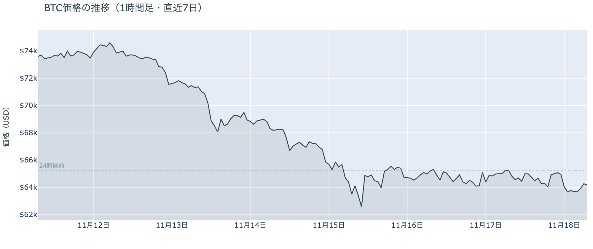

*図の見方: 1時間ごとの価格（日本時間）。点線は24時間前の水準です。*

* 値動きの速い5分足（24時間の上位1割）に、拾えた清算の95%が入っていた。
* 拾えた清算の96%はロングの側で、最大の1件が4割あまり、残りは70あまりのアドレスに分かれる。

火曜日は、夜0時台の1時間で下げ、そのまま朝まで戻りきらなかった1日でした。夕方には価格がじりじり下がりながら建玉（＝先物の未決済残高。証拠金で張っている人の量）が増えていて、新しい売り持ち（ショート）が積まれ、20時台にそのショートが買い戻されて一度$65,000台へ戻っています。様子が変わったのは0時台で、価格が1.4%下がる間に建玉は増えず、ロングの清算が24時間でいちばん多く出ました。いちばん速く下げた5分足にその清算が集まっているので、清算が下げを加速させています。朝6時台には、ショートの清算を伴って$64,000台へ戻しました。

**図1-2 価格と50日・200日移動平均**

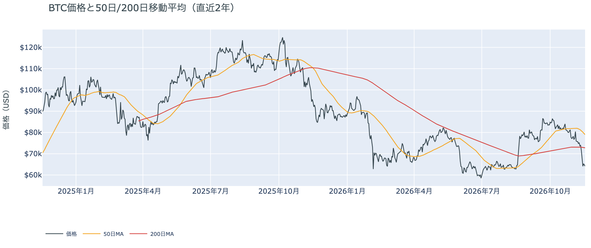

*図の見方: 2本の平均線の上下関係を見ます。50日線が200日線の上にあるのがゴールデンクロスです。*

* 50日線と200日線の差は約$6,184（8.5%）で、前日の8.9%からさらに縮んだ。
* 朝7時5分の価格は50日線を18.8%、200日線（$72,793）を11.9%下回る。

長い目で見た流れの向きはまだ変わっていませんが、短い目の弱さは前日より深まっています。ゴールデンクロス（＝50日線が200日線を上抜けること）の状態は71日目で、価格は200日線の1割あまり下にいて、2本の差は日を追って縮み続けています。

11月17日の米国株は、S&P500が−1.03%で終わり、VIX（＝米国株の値動きの幅の予想）は25台まで上がりました。米国株の不安が強い日は、その取引時間の値動きがビットコインにも持ち込まれやすく、火曜日はその形が出た1日です。

**図1-3 価格に清算を重ねた図（直近24時間）**

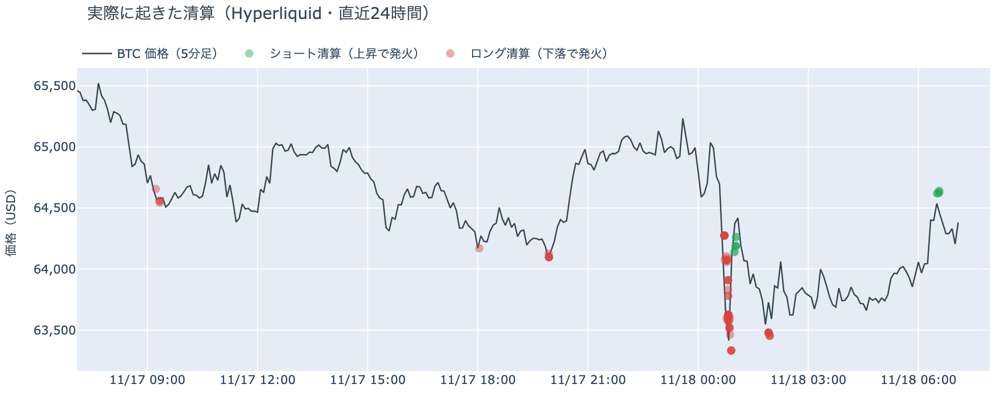

*図の見方: 価格の線に、Hyperliquid で拾えた清算を時刻ごとに重ねたもの（日本時間）。*

清算は夜0時台にまとまって出ていて、その時間の下げを押し広げています。Hyperliquid（＝オンチェーンの先物取引所）で拾えた分で見ると、1つの大口だけでなく多くのアドレスが同じ時間に焼けていて、下げに巻き込まれたロングは少なくありません。

## 2. なぜ動いたか：きっかけと、需給のどこが動いたか

**図2-1 ビットコインと株・金・原油の相対推移（起点＝100）**

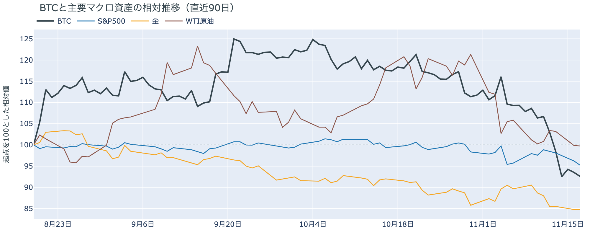

*図の見方: 同じ起点から何%動いたかで重ねたもの。線の向きが揃っているかを見ます。*

| この5営業日の動き（ビットコインは7日間） | 変化 |
|---|---:|
| ビットコイン | −12.9% |
| 金 | −4.4% |
| 米国株（S&P500） | −2.4% |
| 原油 | −0.5% |

* 建玉は92,566BTCで、前日の92,949BTCから0.4%減った。
* 1日をならした年率は+1.05%で、短期金利（13週Tビル 4.14%）を引いた上乗せは−3.09pt。

火曜日の下げは、米国の AI・半導体株の売りをきっかけに、先物のロングの清算を通って価格になりました。

1. きっかけ：NVIDIA の決算を引け後に控え、米国では AI・半導体株が売られました。Salesforce が9%あまり下げ、ナスダック100は取引が始まってまもない時間に1時間で1.4%下げています。ビットコインの24時間でいちばん大きな下げはこれと同じ1時間に起き、NVIDIA もその1時間に1.3%下げていました。同じ時間にビットコインに固有の出来事は見当たりません。決算は予想を上回り、NVIDIA の株価は時間外で上げました。ビットコインが朝6時台に戻したのは、その決算が出た時間です。背景には前の週から続く利上げの織り込みがあり、FF金利先物では12月の FOMC（＝米国の金利を決める会合）での0.25ptの利上げが確実視され、0.5ptの利上げも約4割まで織り込まれています（11月17日の先物の終値）。
2. 伝わり方：速い側の先物では、株安の1時間にロングが清算と手仕舞いで降り、その清算が下げを押し広げました。ロングが払う資金調達率（＝ロングが払う金利。プラス＝ロングがショートより多い）は短期金利をさらに下回っていて、降りたロングの代わりに上げに賭ける人は出ていません。遅い側では、アメリカの買い手は売りの側にいながら売り方は前の週より和らぎ（図①-1）、長期保有者も11月16日時点で前の週と同じ形で減らし続けています（図②-1）。火曜日の下げを運んだのは先物で、アメリカの買い手と長期保有者までは届いていません。

前日は「月曜日の戻りはショートの買い戻しで、流れの変化ではない」と説明しました。火曜日は新しいロングが積まれないまま、株安の1時間に再び下げているので、前日の説明は今日の数値と合っています。

## 3. 市場参加者はいまどう見ているか

### ① アメリカの買い手は売りの側にいるが、その売り方は和らいでいる

**図①-1 Coinbase Premium（アメリカとそれ以外の価格差・直近90日）**

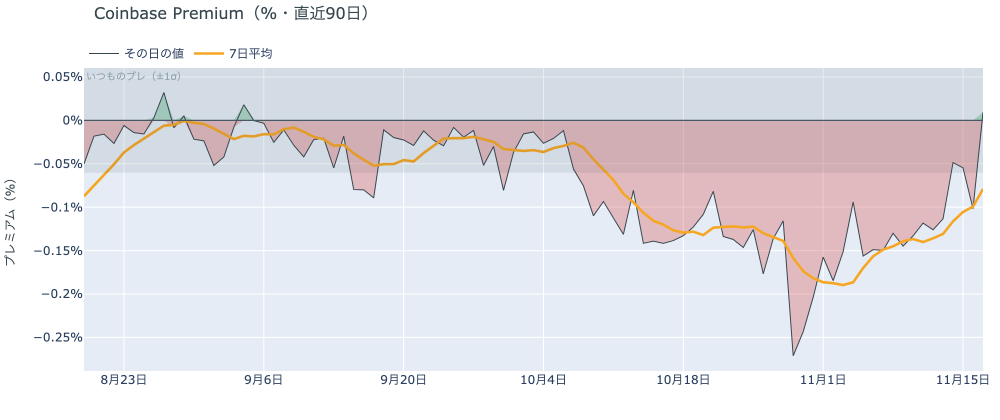

*図の見方: プラス＝アメリカで買いが強い。太線が1週間平均、細線がその日の値。薄い帯は「いつものブレの範囲」です。*

* 1週間平均は−0.08%で、前の週の1週間平均−0.14%より浅い。
* 11月17日の値は+0.01%で、いつものブレの範囲内。

アメリカの買い手は、この価格をまだ買い場とは見ていませんが、売り急ぐ構えは和らいでいます。Coinbase Premium（＝アメリカとそれ以外の価格差）は1週間平均でマイナスのままで、アメリカの価格がほかより安い状態は続いています。ただしそのマイナスは前の週の半分ほどまで浅くなっていて、価格が下がるほどアメリカから売りが出る形は、前の週より弱まりました。

**図①-2 ETFの日ごとの資金の出入り（直近90日）**

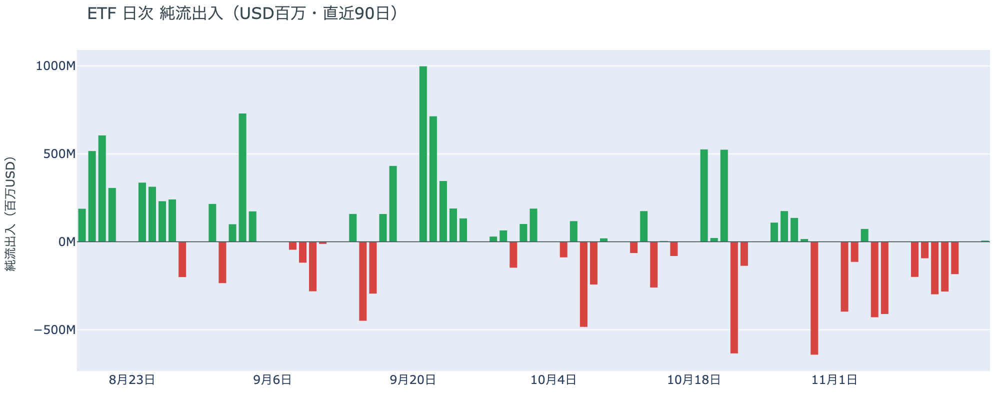

*図の見方: 入ったお金と出たお金の差。上に伸びれば入り超、下に伸びれば出超。*

| ETFの日ごとの出入り | 億ドル |
|---|---:|
| 11月10日 | −1.0 |
| 11月11日 | −3.0 |
| 11月12日 | −2.8 |
| 11月13日 | −1.9 |
| 11月16日 | +0.1 |
| 直近7営業日の合計 | −14.7 |

ETFの買い手は、資金を引き揚げる手を止めましたが、買い戻しには入っていません。11月16日は出超が7営業日続いたあとの入り超でしたが、ほぼゼロに近い大きさで、1週間の合計では大きく出超のままです。値下がりを買いの機会と見る確信は、ETFの買い手にもまだ生まれていません。

**図①-3 Fear & Greed（市場心理の指数・直近90日）**

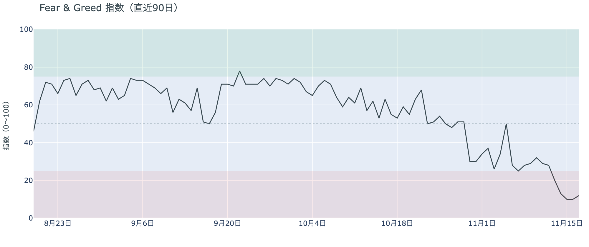

*図の見方: 0〜100で、50より上が「強欲」、下が「恐怖」。*

* 12の「極度の恐怖」で、前日から2pt戻した。1週間前は32、1か月前は53。

参加者の多くは、下げを怖がる気持ちを和らげていません。Fear & Greed（＝市場心理の指数）の11月17日の値はわずかに戻ったものの、「極度の恐怖」の深いところにとどまっています。

### ② 長期保有者は利益の出ない価格でも減らし続け、形は前の週から変わっていない

**図②-1 長期保有者の保有量の30日変化とSOPR（直近90日）**

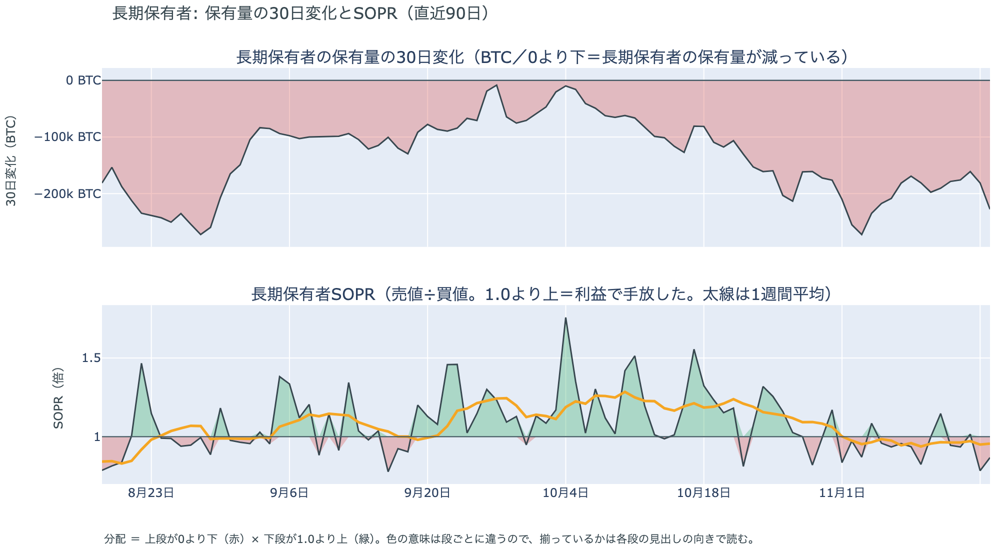

*図の見方: 上段は、長期保有者の保有量が30日でどれだけ増減したか。マイナス＝手放している。下段は長期保有者SOPRで、1より上なら利益で手放した。どちらも太線の1週間平均で読みます。*

| 11月16日時点 | 1週間平均 | 前の週の平均 |
|---|---:|---:|
| 長期保有者SOPR（1より上＝利益で手放した） | 0.96 | 0.94 |
| 長期保有者の保有量の30日変化（万BTC） | −18.7 | −20.9 |

* 1か月前（10月17日）の30日変化は−8.1万BTCで、いまはその2倍を超える減り方。

長期保有者は、利益が出ない価格でも手放すのをやめていません。保有量は30日で減り、動いたコインは平均して買値より安く動いているので、利益確定の売りとは呼べない形のまま減っています。減り方は前の週よりわずかに小さく、11月16日時点の長期保有者の持ち方は、前日に書いた形から変わっていません。

マイナーの収入は平年を下回ったままです（Puell Multiple（＝マイナー収入の平年比）が11月16日時点の1週間平均で0.88）。長く眠っていたコインが急に動いた記録も無く、長期保有者のほかに新しく売りに回りそうな持ち手は見当たりません。

### ③ 先物：降りたロングは積み直されず、上げに賭ける人は減り続けている

**図③-1 資金調達率と建玉（直近30日）**

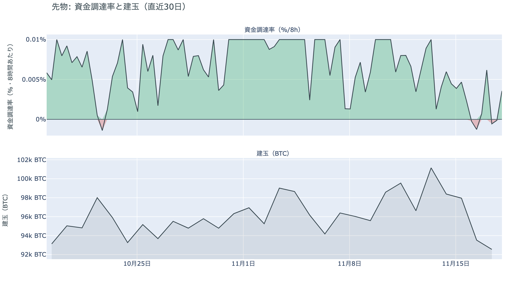

*図の見方: 上段は資金調達率（8時間ごと・日本時間）。プラスが続く＝ロングがショートより多い。下段は建玉。*

* 上乗せは前日の−2.07ptからさらに沈み、直近34日の平均+2.93ptを大きく下回る。
* 建玉の7日変化は−6.1%。

先物の参加者は、上げへの確信をこの1か月でいちばん弱めています。建玉はこの1週間で6%減っていて、下げのたびにロングが降り、その分が積み直されていません。ロングが払う資金調達率は、短期金利（＝ドルを米国の短期国債で持つだけで受け取れる金利）を前日よりさらに大きく下回りました。余分に払ってでも上げに賭けたい人は、もうほとんど残っていません。一方でショートも積まれては買い戻されていて、下げに大きく賭け続ける人も多くはありません。

### ④ オプション：NVIDIA の決算の上乗せは剥がれたが、下げへの備えは外していない

オプションには2種類あります。コール（＝決めた価格で買う権利）とプット（＝決めた価格で売る権利）で、価格が上がればコールの価値が上がり、価格が下がればプットの価値が上がります。プットは「価格が下がったときの保険」として買われます。オプションを買う人は、その権利と引き換えに権利料（＝オプションを買う人が払う金額）を払います。

**図④-1 満期ごとのIV（年率%）**

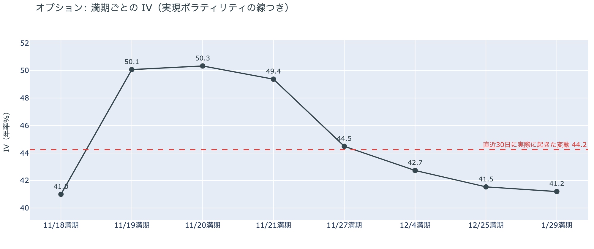

*図の見方: IVを満期ごとに並べたもの。点線は実現ボラティリティ。IVが点線より下なら、市場はこの先の値動きを過去の値動きより小さいと見ています。*

| 満期 | IV |
|---|---:|
| 11月18日 | 41 |
| 11月19日〜21日 | 49〜50 |
| 11月27日〜12月4日 | 43〜45 |
| 12月25日〜1月29日 | 41〜42 |

* IVは全体で43.1で、実現ボラティリティ44.2より1.1pt低い。

参加者は、この先の値動きをこれまでと同じくらいか、やや小さいと見ていて、大きく荒れることには身構えていません。IV（＝値動きの幅の予想）は全体で実現ボラティリティ（＝過去の値動きの幅）をわずかに下回っています。例外は11月19日から21日の満期で、そのオプションの権利料には、11月27日以降の満期に対する上乗せが乗っています。FOMC の議事要旨と Anthropic の上場が続く週の後半に、ほかの日より大きく動くと見られているからです。NVIDIA の決算を越えた今日11月18日の満期は41まで下がり、決算の上乗せは剥がれました。

**図④-2 満期ごとのプットとコールの差**

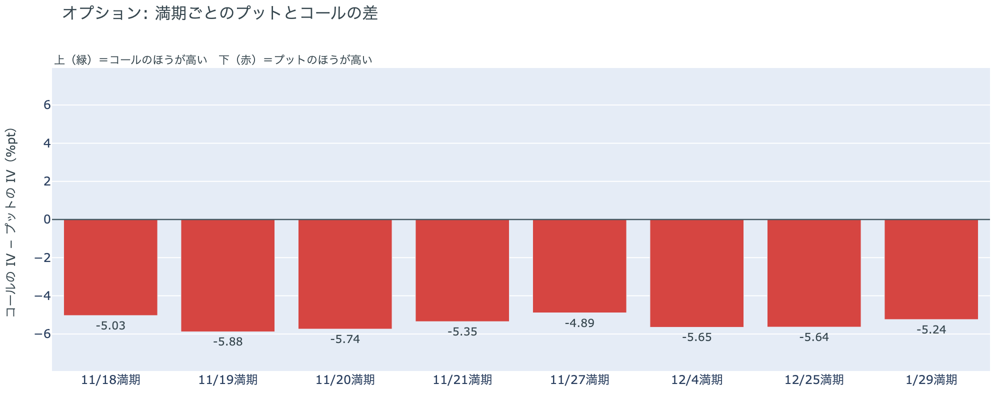

*図の見方: 満期ごとに、プットとコールのどちらが高く売れているか。ゼロより上ならコールのほうが高く、下ならプットのほうが高い。*

| 満期 | どちらが高いか |
|---|---|
| 11月18日 | プットが高い |
| 11月19日 | プットが高い（差はいちばん大きい） |
| 11月20日 | プットが高い |
| 11月21日 | プットが高い |
| 11月27日 | プットが高い（差はいちばん小さい） |
| 12月4日 | プットが高い |
| 12月25日 | プットが高い |
| 1月29日 | プットが高い |

参加者は、動くなら下だと見ています。どの満期もプットのほうが高く、差がいちばん大きいのは FOMC の議事要旨の直後に満期が来る11月19日です。NVIDIA の決算が予想を上回っても下げへの備えを外していないので、続落を気にする見方は前日から変わっていません。

**図④-3 12月25日満期の持ち高（権利の価格ごと）**

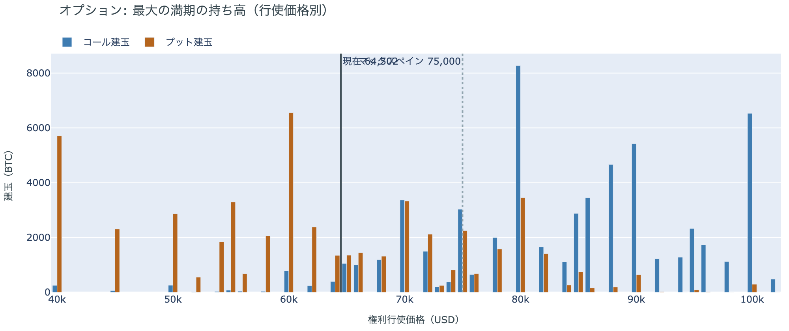

*図の見方: 青＝コール、橙＝プット。現値より上にコールが、下にプットが積まれるのが普通です。*

| 12月25日満期のオプション（基準の価格は約$64,500） | 量（万BTC） | 意味 |
|---|---:|---|
| いまより高い価格のコール | 約8.6 | 「価格が上がる」に賭けた分 |
| いまより安い価格のプット | 約3.7 | 「価格が下がる」への保険 |
| うち、いまより15%以上高い価格のコール | 約7.7 | 大きな上げへの賭け |
| うち、いまより15%以上安い価格のプット | 約2.1 | 大きな下げへの保険 |

* 12月25日満期の持ち高は約14.8万BTCと全満期の38%で、コールがプットの1.5倍。前日とほぼ同じ形。

年末の最大の満期では、「価格が上がる」に賭けた人たちが降りておらず、年末までの上げへの期待はまだ手放されていません。先物ではロングが降り続けている一方で、年末に向けたコールの持ち高は火曜日の下げでも減っていません。大きな上げに賭けた分が報われるには、12月25日の夕方5時までに約$74,200を超える必要があります。全満期でオプションの持ち高が集まっているのは$63,000〜$65,000の帯で、価格はいまその帯の中にいます。

### ⑤ 値下がりした状態で再び送金されるコインが、平年の3倍に増えた

**図⑤-1 コインが最後に送金された日の価格の分布（11月16日時点）**

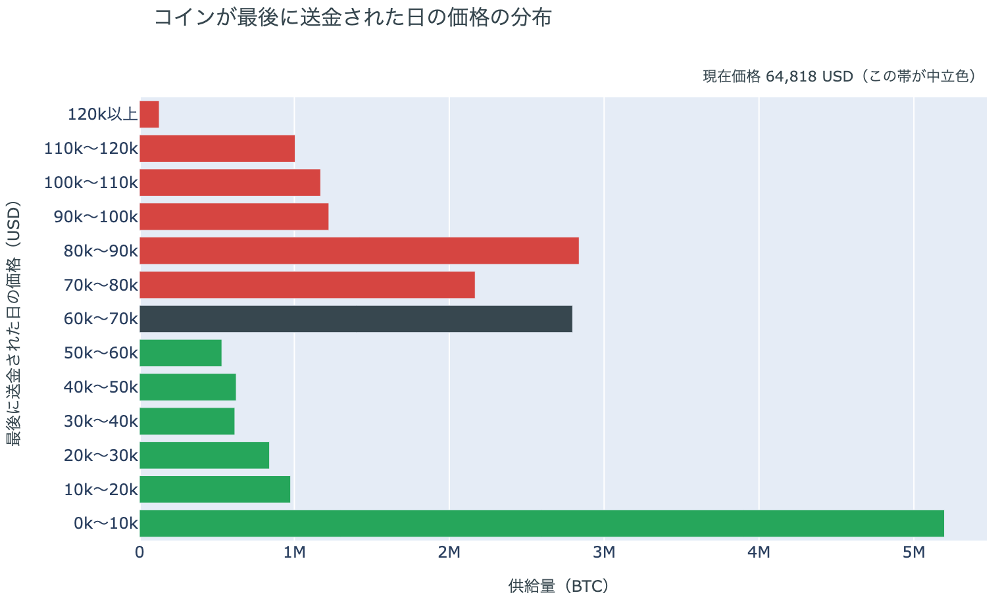

*図の見方: ビットコインはアドレスからアドレスへ送金されるたびに、受け取った側に新しい記録ができる。この図は、いまあるコインを、最後に送金された日の価格で束ねたもの。送金には売買のほか、取引所への入金・引き出しや自分のウォレット間の移し替えも含み、取引所の中での売買は含まない。*

| 過去の大きな下げの底 | 価格より上にいるコインの割合 | 値下がりした状態での再送金（1日あたり） |
|---|---:|---:|
| 2018年12月（2018年の冬の底） | 61% | 約4.1万BTC |
| 2020年3月（コロナショック） | 57% | 約8.4万BTC |
| 2022年6月（Luna・3ACの破綻） | 51% | 約7.2万BTC |
| 2022年11月（FTXの破綻） | 55% | 約7.1万BTC |
| 2026年11月16日 | 49% | 約2.9万BTC |

* 再送金の量は2017年以降の中央値（1日約9千BTC）の約3倍で、上位1割の水準を初めて超えた。

高い価格で受け取ったコインが、値下がりした状態で再び送金される量が、平年を大きく上回る水準に入りました。30日以上置かれていたコインが、最後に送金された日より安い価格で再び送金された量は、11月16日時点の1週間平均で1日約2万9千BTCと、1週間前の約2万1千BTCから増えています。いまの価格より高い価格で最後に送金されたコインは全体の約半分で、過去の大きな下げの底の5〜6割に近いところまで来ています。それでも再送金の量は、過去の大きな底の1日4万〜8万BTCの半分前後にとどまっていて、値下がりしたコインの多くは、まだまとめて送金されてはいません。価格は$60,000〜$70,000の帯（全供給の14%）の中にいます。

## 4. 価格に影響しうる直近のイベント

オプション市場がほかの満期より IV を高く付けているのは、11月19日の朝に出る FOMC の議事要旨と、同じ日の Anthropic の上場をまたぐ11月19日から21日の満期です。下げへの備えは11月19日の満期でいちばん厚く、その先の満期にも同じ向きで置かれています。

| 日付 | イベント | 何に効くか |
|---|---|---|
| 11/19（木）4:00 日本時間 | FOMC の議事要旨（10月27〜28日分） | 金利 |
| 11/19（木）米国時間 | Anthropic の米国での上場 | 米国株（AI 関連） |
| 11/25（水） | 米10月の PCE 物価指数（米国の物価統計） | 金利 |
| 11/30（月）米国時間の引け | MSCI の指数から米 Strategy（＝ビットコインを大量に持つ米企業）が外れる実施日 | Strategy の株と、指数に連動する資金 |
| 12/9（水） | FOMC。0.25ptの利上げは確実視され、0.5ptの利上げも約4割まで織り込まれている。結果は日本時間10日早朝 | 金利 |
| 12/25（金）17:00 | オプションの最も大きな満期（約14.8万BTC、全満期の38%） | 約$74,200以上のコールの期限 |

## まとめ

火曜日のビットコインは、NVIDIA の決算を前に米国で AI・半導体株が売られた1時間に、ロングの清算で速まりながら$64,000台まで下げました。下げを運んだのは先物で、アメリカの買い手は売り方を和らげ、長期保有者も前の週と同じ形で減らし続けているので、株安がきっかけでも、アメリカの買い手と長期保有者の持ち方までは変わっていません。値下がりした状態で再び送金されるコインは平年の3倍に増えましたが、過去の大きな下げの底の量には届いていません。参加者は、先物では上げに賭ける人がほとんど残らないほど確信を弱め、オプションでは NVIDIA の決算を越えても動くなら下と備えたまま、FOMC の議事要旨と12月の FOMC へ向かう値動きを待っています。

---

<small>（数値は11月18日7時5分（日本時間）までのデータに基づきます。価格・先物・オプションはその時点の値、市場心理は11月17日の確定値、オンチェーン（＝ブロックチェーン上の記録）は11月16日時点、ETF資金フローは11月16日分までです。証券市場の終値は11月17日時点です。オンチェーンの長期保有者の数値には、ETFや取引所が預かっている分も含まれます。清算は Hyperliquid で拾えた分だけで、市場全体のごく一部です。オプションはDeribit（BTCオプションの大半を占める取引所）の全銘柄です。）</small>

*本稿は情報提供を目的としたものであり、投資助言ではありません。将来の価格動向を保証・示唆するものではなく、投資判断は各自の責任において行ってください。*
