# 0.5pt利上げ論と議事要旨の夜に$62,000台へ ― 株が上げた時間にも下げ、建玉は増える

**2026年11月19日**

ビットコインは水曜日の夜、米国の利上げの見通しを強める材料が続くなかで下げ、$62,000台で木曜日の朝を迎えました。

* **価格**：24時間の値幅は4.8%と前日の3.3%から広がり、朝7時5分の時点で約$62,340。この1週間の安値の近くまで戻され、下げの側に傾いたまま2日続いた
* **きっかけ**：FRB の Waller 理事が12月の0.5ptの利上げを求め、日本時間4時に出た FOMC の議事要旨でも、ほぼ全員が追加の利上げを支持していた。ビットコインは米国株が上げた時間にも下げているので、前日のような株の売りが共通のきっかけではない
* **先物**：下げの途中で建玉が増え、売り持ち（ショート）が新しく積まれた。下げで拾いに入った買い持ち（ロング）の一部は清算（＝証拠金不足で強制的に閉じられた取引）され、下げを速めている。下げに賭ける人が増えた1日だった
* **需給の土台**：米国の買い手は水曜日に1日だけ売りを強めたが、1週間平均では前の週より浅いまま。長期保有者（＝155日以上保有者）は11月17日時点でも同じ形で減らし続けていて、どちらも前日から形は変わっていない
* **オプションの見方**：IV が実現ボラティリティを上回り、この先の値動きを大きめに見て備えを買い始めた。備えがいちばん厚いのは Anthropic の上場をまたぐ11月20日の満期で、どの満期もプットのほうが高く、動くなら下と見る構えは変わっていない

## 1. 何が起きたか

**図1-1 価格の推移（1時間足・直近7日）**

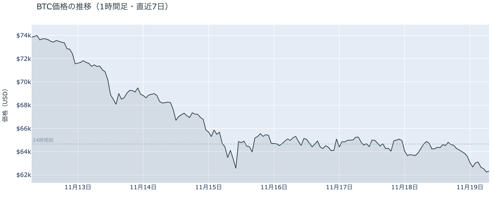

*図の見方: 1時間ごとの価格（日本時間）。点線は24時間前の水準です。*

* 値動きの速い5分足（24時間の上位1割）に入っていた清算は、拾えた分の39%。
* いちばん速く下げた23時35分の5分足（−0.57%）では、ナスダック100が+0.48%、NVIDIA が+1.73%。

水曜日は、一度に崩れたのではなく、夕方から朝まで段を踏んで下げ続けた1日でした。夜22時台から1時台にかけて、価格が下がる間に建玉（＝先物の未決済残高。証拠金で張っている人の量）が増えていて、下げに賭けるショートが新しく積まれています。いちばん速く下げた5分足には清算が入っていて、清算がその下げを加速させましたが、速い5分足に入った清算は拾えた分の4割ほどで、下げの大半は清算の外で進んでいます。その5分足では米国株が上げていて、ビットコインだけが逆向きに下げました。朝4時台には清算を伴わずに下げ、5時台には1件の大口のロングが清算されて$62,000台へ沈んでいます。

**図1-2 価格と50日・200日移動平均**

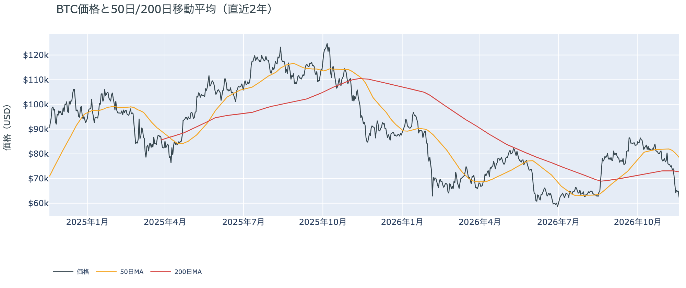

*図の見方: 2本の平均線の上下関係を見ます。50日線が200日線の上にあるのがゴールデンクロスです。*

* 50日線と200日線の差は約$5,850（8.05%）で、前日の8.5%からさらに縮んだ。
* 朝7時5分の価格は50日線を20.7%、200日線（$72,715）を14.3%下回る。

長い目で見た流れの向きはまだ変わっていませんが、価格はその流れから日ごとに離れています。ゴールデンクロス（＝50日線が200日線を上抜けること）の状態は72日目で、価格は50日線の2割下まで沈み、2本の差は縮み続けています。

11月18日の証券市場では、S&P500が−0.50%と小さく下げた一方、金は−2.75%、原油は−3.57%と大きく下げ、ドル指数は+0.33%上げました。株よりも、利上げの見通しで動きやすい金やドルのほうが大きく動いた日で、ビットコインの下げ幅は株より金に近い1日でした。

**図1-3 価格に清算を重ねた図（直近24時間）**

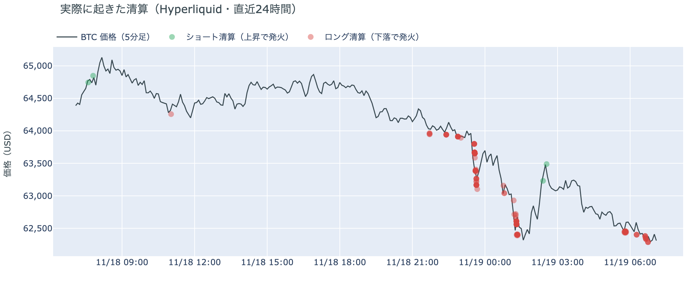

*図の見方: 価格の線に、Hyperliquid で拾えた清算を時刻ごとに重ねたもの（日本時間）。*

清算はほぼ全部がロングの側で、夜23時台と1時台、朝5時台にまとまって出ています。Hyperliquid（＝オンチェーンの先物取引所）で拾えた分で見ると、23時台と1時台は多くのアドレスに分かれて焼けていて、朝5時台は1件の大口が大半を占めます。下げの途中で買いに入ったロングが、そのたびに振り落とされた形です。

## 2. なぜ動いたか：きっかけと、需給のどこが動いたか

**図2-1 ビットコインと株・金・原油の相対推移（起点＝100）**

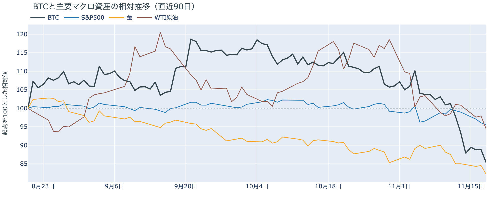

*図の見方: 同じ起点から何%動いたかで重ねたもの。線の向きが揃っているかを見ます。*

| この5営業日の動き（ビットコインは7日間） | 変化 |
|---|---:|
| ビットコイン | −15.7% |
| 金 | −6.1% |
| 米国株（S&P500） | −4.1% |
| 原油 | −4.2% |

* 建玉は96,806BTCで、前日の92,566BTCから4.6%増えた。
* 1日をならした年率は+5.51%で、短期金利（13週Tビル 4.15%）を引いた上乗せは+1.37pt。

水曜日の下げは、米国の利上げの見通しを強める材料が続いた夜に、先物で新しく積まれたショートと、ロングの清算を通って価格になりました。

1. きっかけ：米国の朝に、FRB の Waller 理事がテレビの取材で、12月の FOMC（＝米国の金利を決める会合）で0.5ptの利上げが必要だと述べました。日本時間4時に出た10月の FOMC の議事要旨でも、ほぼ全員が追加の利上げを適切と見ていて、ビットコインはその直後の4時台に清算を伴わずに下げています。FF金利先物では、12月の FOMC での0.25ptの利上げは確実視され、0.5ptの利上げの織り込みは前日の約3割から約4割に上がりました（11月18日の先物の終値）。米国株は NVIDIA の決算が予想を上回ったあとで底堅く、ビットコインがいちばん速く下げた5分にはナスダック100も NVIDIA も上げていたので、株の売りは共通のきっかけではありません。同じ夜には、ドイツの裁判所が Movie2k 事件の被告に4万BTCの引き渡しで裁判を打ち切る案を示したと報じられましたが、引き渡すかはまだ決まっていません。
2. 伝わり方：速い側の先物では、下げの途中でショートが積まれ、建玉は前の週の減り方から一転して増えました。資金調達率（＝ロングが払う金利。プラス＝ロングがショートより多い）は短期金利を上回るところまで戻っていて、下げを拾いに入るロングも同時に増えています。その拾いに入ったロングが清算され、下げを速めました。遅い側では、アメリカの買い手は水曜日にいつものブレを超えて売りに傾きましたが、1週間平均では前の週より浅いまま（図①-1）で、長期保有者も11月17日時点で前の週と同じ形で減らし続けています（図②-1）。水曜日の下げを運んだのは先物で、アメリカの買い手と長期保有者の持ち方までは届いていません。

## 3. 市場参加者はいまどう見ているか

### ① アメリカの買い手は水曜日に売りを強めたが、1週間の形はまだ前の週より浅い

**図①-1 Coinbase Premium（アメリカとそれ以外の価格差・直近90日）**

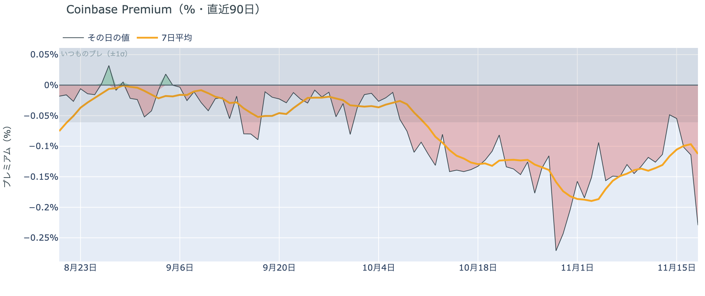

*図の見方: プラス＝アメリカで買いが強い。太線が1週間平均、細線がその日の値。薄い帯は「いつものブレの範囲」です。*

* 11月18日の値は−0.23%で、いつものブレの3.8倍。過去300日でいちばん低い1%に入る。
* 1週間平均は−0.11%で、前の週の1週間平均−0.14%より浅い。

アメリカの買い手は、下げた水曜日に、この価格を買い場と見るどころか売りを急ぎました。Coinbase Premium（＝アメリカとそれ以外の価格差）は1日の値でいつものブレを大きく超えて沈み、アメリカの価格がほかより一段安くなっています。ただしそれは1日の動きで、1週間平均で見れば売り方は前の週より和らいだままです。売りを強めたのが一時のことか、持ち方が変わったのかは、まだ1週間の形には出ていません。

**図①-2 ETFの日ごとの資金の出入り（直近90日）**

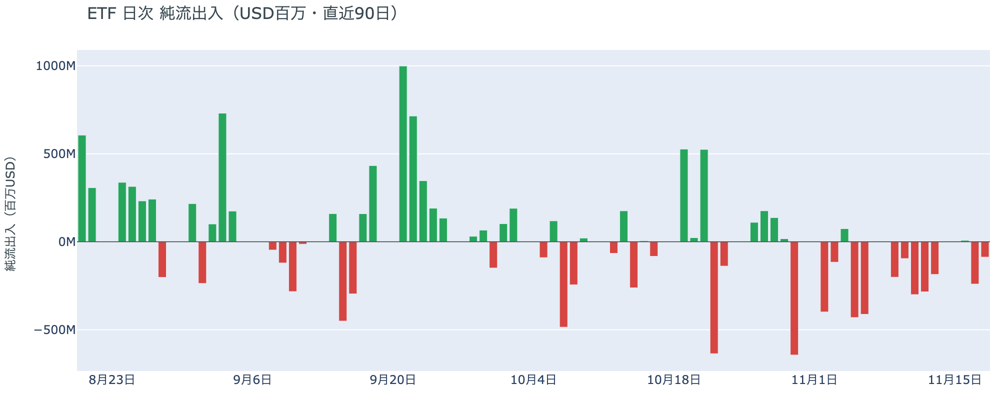

*図の見方: 入ったお金と出たお金の差。上に伸びれば入り超、下に伸びれば出超。*

| ETFの日ごとの出入り | 億ドル |
|---|---:|
| 11月12日 | −2.8 |
| 11月13日 | −1.9 |
| 11月16日 | +0.1 |
| 11月17日 | −2.4 |
| 11月18日 | −0.9 |
| 直近7営業日の合計 | −11.8 |

ETFの買い手は、資金を引き揚げる側に戻りました。11月16日にほぼゼロの入り超で手を止めたあと、2営業日続けて出超です。11月18日の出超は前日より小さいものの、値下がりを買いの機会と見る動きはETFの買い手にもまだ出ていません。

**図①-3 Fear & Greed（市場心理の指数・直近90日）**

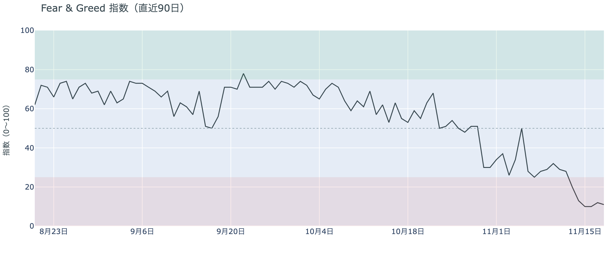

*図の見方: 0〜100で、50より上が「強欲」、下が「恐怖」。*

* 11の「極度の恐怖」で、前日から1pt下げた。1週間前は29、1か月前は59。

参加者の多くは、下げを怖がる気持ちをさらに強めています。Fear & Greed（＝市場心理の指数）の11月18日の値は「極度の恐怖」の深いところにとどまり、1か月前の「強欲」寄りから大きく冷えたままです。

### ② 長期保有者は利益の出ない価格でも減らし続け、形は前の週から変わっていない

**図②-1 長期保有者の保有量の30日変化とSOPR（直近90日）**

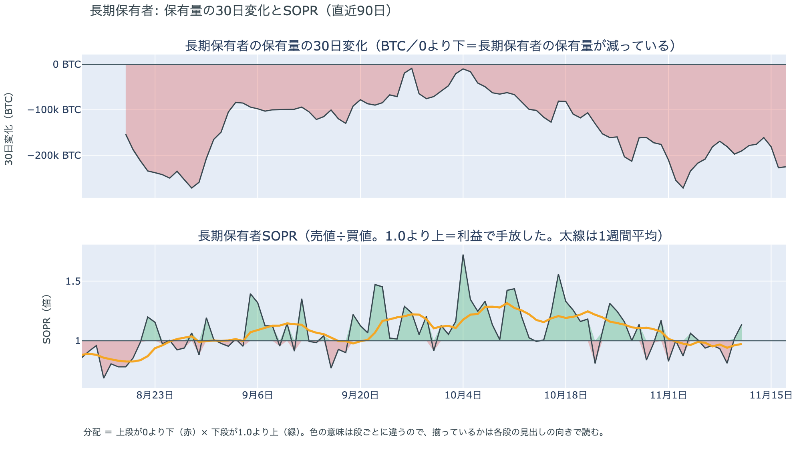

*図の見方: 上段は、長期保有者の保有量が30日でどれだけ増減したか。マイナス＝手放している。下段は長期保有者SOPRで、1より上なら利益で手放した。どちらも太線の1週間平均で読みます。*

| | 1週間平均 | 前の週の平均 |
|---|---:|---:|
| 長期保有者SOPR（1より上＝利益で手放した・11月11日時点） | 0.97 | 0.97 |
| 長期保有者の保有量の30日変化（万BTC・11月17日時点） | −19.1 | −19.9 |

* 1か月前（10月18日）の30日変化は−8.1万BTCで、いまはその2倍を超える減り方。

長期保有者は、利益が出ない価格でも手放すのをやめていません。保有量は30日で減り、動いたコインは平均して買値より安く動いているので、利益確定の売りとは呼べない形のまま減っています。減り方は前の週とほぼ同じで、11月17日時点の長期保有者の持ち方は、前日に書いた形から変わっていません。

マイナーの収入は平年を下回ったままです（Puell Multiple（＝マイナー収入の平年比）が11月11日時点の1週間平均で0.88）。長く眠っていたコインが急に動いた記録も無く、長期保有者のほかに新しく売りに回りそうな持ち手は見当たりません。

### ③ 先物：下げに賭けるショートが増え、下げを拾いに入るロングも戻った

**図③-1 資金調達率と建玉（直近30日）**

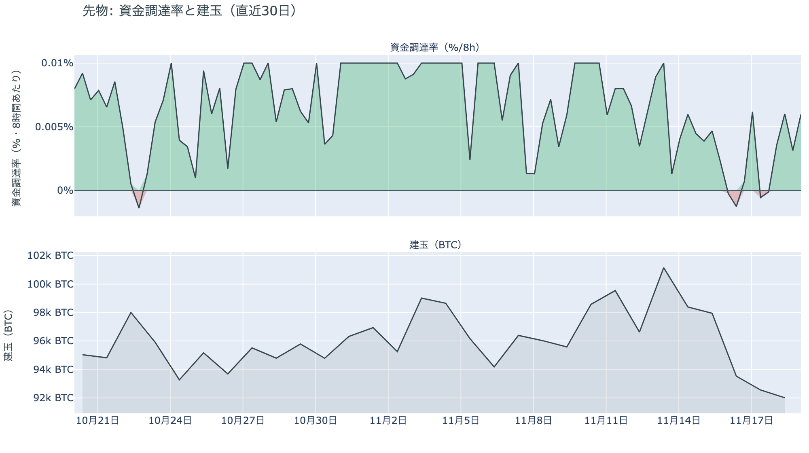

*図の見方: 上段は資金調達率（8時間ごと・日本時間）。プラスが続く＝ロングがショートより多い。下段は建玉。*

* 上乗せは前日の−3.09ptから+1.37ptへ戻ったが、直近34日の平均+2.99ptには届かない。
* 建玉の7日変化は−7.6%で、この1日で減った分の一部を取り戻した。

先物の参加者は、この下げで降りるのをやめ、上と下の両方へ賭けを積み直し始めています。水曜日は価格が下がるなかで建玉が増えていて、さらに下げると見るショートが新しく入りました。同時に、ロングが払う資金調達率は短期金利（＝ドルを米国の短期国債で持つだけで受け取れる金利）を再び上回っていて、この安値を拾いに入るロングも戻っています。前日は「余分に払ってでも上げに賭けたい人は、もうほとんど残っていない」と書きましたが、水曜日には下げの途中で買いに入る人が現れました。ただ、その一部は朝5時台までに清算されていて、拾いに入ったロングが報われる形にはまだなっていません。

### ④ オプション：Anthropic の上場をまたぐ満期に、下げへの備えをいちばん厚く置いている

オプションには2種類あります。コール（＝決めた価格で買う権利）とプット（＝決めた価格で売る権利）で、価格が上がればコールの価値が上がり、価格が下がればプットの価値が上がります。プットは「価格が下がったときの保険」として買われます。オプションを買う人は、その権利と引き換えに権利料（＝オプションを買う人が払う金額）を払います。

**図④-1 満期ごとのIV（年率%）**

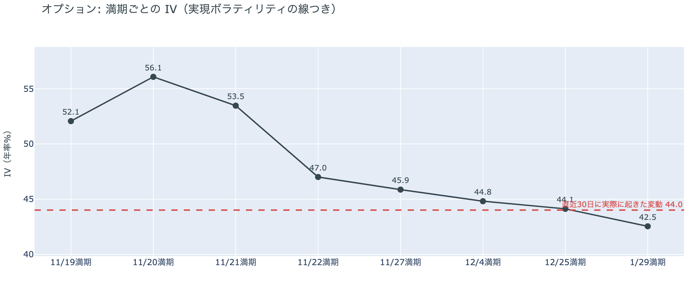

*図の見方: IVを満期ごとに並べたもの。点線は実現ボラティリティ。IVが点線より下なら、市場はこの先の値動きを過去の値動きより小さいと見ています。*

| 満期 | IV |
|---|---:|
| 11月19日 | 52 |
| 11月20日 | 56 |
| 11月21日 | 54 |
| 11月22日〜12月4日 | 45〜47 |
| 12月25日〜1月29日 | 43〜44 |

* IVは全体で44.5で、実現ボラティリティ44.0より0.5pt高い。前日は1.1pt低かった。

参加者は、この先の値動きをこれまでより少し大きいと見始め、備えを買っています。IV（＝値動きの幅の予想）は全体で実現ボラティリティ（＝過去の値動きの幅）を上回るところまで上がり、前日の「大きく荒れることには身構えていない」形から一歩動きました。とくに11月20日に満期が来るオプションの権利料には、11月22日以降の満期に対する上乗せがいちばん大きく乗っています。Anthropic の上場で、米国の AI 関連株が大きく動く日をまたぐからです。

**図④-2 満期ごとのプットとコールの差**

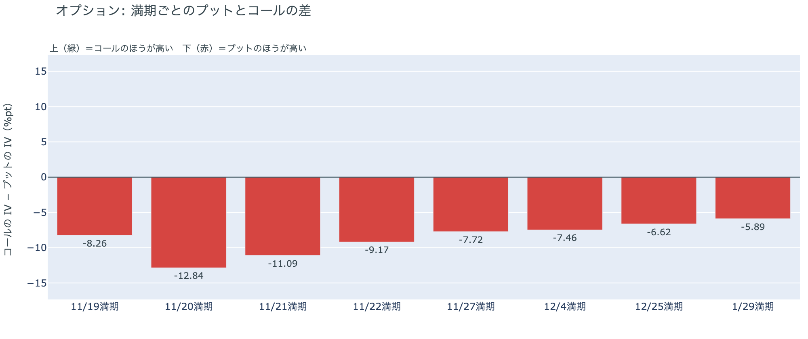

*図の見方: 満期ごとに、プットとコールのどちらが高く売れているか。ゼロより上ならコールのほうが高く、下ならプットのほうが高い。*

| 満期 | どちらが高いか |
|---|---|
| 11月19日 | プットが高い |
| 11月20日 | プットが高い（差はいちばん大きい） |
| 11月21日 | プットが高い |
| 11月22日 | プットが高い |
| 11月27日 | プットが高い |
| 12月4日 | プットが高い |
| 12月25日 | プットが高い |
| 1月29日 | プットが高い（差はいちばん小さい） |

参加者は、動くなら下だと見ています。どの満期もプットのほうが高く、差がいちばん大きいのは Anthropic の上場をまたぐ11月20日です。前日にいちばん厚かった11月19日の満期から、備えの中心が1日先の上場の日へ移りました。先へ行くほど差は小さくなるので、下げを強く警戒しているのはこの数日です。

**図④-3 12月25日満期の持ち高（権利の価格ごと）**

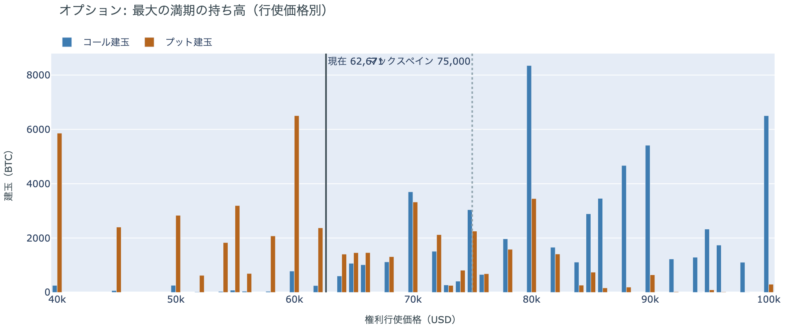

*図の見方: 青＝コール、橙＝プット。現値より上にコールが、下にプットが積まれるのが普通です。*

| 12月25日満期のオプション（基準の価格は約$62,700） | 量（万BTC） | 意味 |
|---|---:|---|
| いまより高い価格のコール | 約8.7 | 「価格が上がる」に賭けた分 |
| いまより安い価格のプット | 約3.6 | 「価格が下がる」への保険 |
| うち、いまより15%以上高い価格のコール | 約7.8 | 大きな上げへの賭け |
| うち、いまより15%以上安い価格のプット | 約1.9 | 大きな下げへの保険 |

* 12月25日満期の持ち高は約14.9万BTCと全満期の38%で、コールがプットの1.5倍。前日とほぼ同じ形。

年末の最大の満期では、「価格が上がる」に賭けた人たちが水曜日の下げでも降りておらず、年末までの上げへの期待は手放されていません。オプションの参加者が近い満期で下げに備えを置きながら、年末のコールはそのまま持ち続けているので、この数日の下げと年末に向けた見方を分けて持っています。大きな上げに賭けた分が報われるには、12月25日の夕方5時までに約$72,100を超える必要があります。全満期でオプションの持ち高が集まっているのは$60,000〜$65,000の帯で、価格はいまその帯の中にいます。

## 4. 価格に影響しうる直近のイベント

オプション市場がほかの満期より IV を高く付け、プットの備えもいちばん厚く置いているのは、Anthropic の米国での上場をまたぐ11月20日の満期です。その先の満期にも、同じ向きの備えが薄く置かれています。

| 日付 | イベント | 何に効くか |
|---|---|---|
| 11/19（木）米国時間 | Anthropic の米国での上場（取引開始） | 米国株（AI 関連）。11月20日満期の IV が高いのはこの日 |
| 11/25（水） | 米10月の PCE 物価指数（米国の物価統計） | 金利 |
| 11/30（月）米国時間の引け | MSCI の指数から米 Strategy（＝ビットコインを大量に持つ米企業）が外れる実施日 | Strategy の株と、指数に連動する資金 |
| 12/3（木） | ドイツ・ライプツィヒ地裁で Movie2k 事件の裁判が再開。被告が4万BTCを引き渡せば打ち切るという裁判所の案に、双方はまだ答えていない | 当局の手に渡りうる4万BTC |
| 12/9（水） | FOMC。0.25ptの利上げは確実視され、0.5ptの利上げも約4割まで織り込まれている。結果は日本時間10日早朝 | 金利 |
| 12/25（金）17:00 | オプションの最も大きな満期（約14.9万BTC、全満期の38%） | 約$72,100以上のコールの期限 |

## まとめ

水曜日のビットコインは、FRB の Waller 理事の0.5pt利上げ論と FOMC の議事要旨が続いた夜に、先物で積まれたショートと、拾いに入ったロングの清算を通って$62,000台まで下げました。アメリカの買い手は1日だけ売りを強めたものの1週間の形は前の週より浅く、長期保有者も同じ形で減らし続けているので、利上げの見通しがきっかけでも、アメリカの買い手と長期保有者の持ち方までは変わっていません。参加者は、先物では下げにも安値拾いにも賭けを積み直し、オプションでは Anthropic の上場をまたぐ数日に下げへの備えをいちばん厚く置きながら、年末に向けた上げの賭けは降りずに持ち続けています。

---

<small>（数値は11月19日9時16分（日本時間）までのデータに基づきます。価格は朝7時5分の時点の値、先物・オプションは取得時点の値、市場心理は11月18日の確定値、オンチェーン（＝ブロックチェーン上の記録）は長期保有者の保有量が11月17日時点、長期保有者SOPR と Puell Multiple が11月11日時点、ETF資金フローは11月18日分までです。証券市場の終値は11月18日時点です。オンチェーンの長期保有者の数値には、ETFや取引所が預かっている分も含まれます。清算は Hyperliquid で拾えた分だけで、市場全体のごく一部です。オプションはDeribit（BTCオプションの大半を占める取引所）の全銘柄です。）</small>

*本稿は情報提供を目的としたものであり、投資助言ではありません。将来の価格動向を保証・示唆するものではなく、投資判断は各自の責任において行ってください。*
