# Anthropic上場の夜、ハイテク株とともに$61,000台へ ― ショートが積まれ清算が下げを速める

**2026年11月20日**

ビットコインは木曜日、昼までに$64,000の手前まで戻したものの、夜に米国でハイテク株が崩れた時間に一緒に下げ、$61,000台で金曜日の朝を迎えました。

* **価格**：24時間の値幅は4.4%で、朝7時5分の時点で約$61,742。24時間前とほぼ同じ水準に見えても、明け方に付けた$61,350はこの1週間でいちばん安く、昼までの戻りを夜のうちに全部失った
* **きっかけ**：Anthropic が米国で上場した日に AI 関連の半導体株が売られ、ナスダック100は2.2%下げた。ビットコインは株が下げた時間に同じように下げていて、前日のような利上げの見通しではなく、株の売りがきっかけだった
* **先物**：下げの途中で建玉が増え、売り持ち（ショート）が新しく積まれた。安値を拾いに入った買い持ち（ロング）は清算（＝証拠金不足で強制的に閉じられた取引）され、下げを速めている。前日と同じ形で、下げに賭ける人がまた増えた
* **需給の土台**：米国の買い手は木曜日に過去300日でいちばん強く売りに傾き、1週間平均でも前の週より深くなった。長期保有者（＝155日以上保有者）も11月18日時点で損失の出る価格のまま減らし続けていて、売りは続き、米国の買い手の側で強まった
* **オプションの見方**：この先の値動きを過去より大きいと見て、備えを買ったまま。どの満期もプットのほうが高く、目の前の数日ほど下げへの備えを厚く置いているが、年末に向けた上げの賭けは降りていない

## 1. 何が起きたか

**図1-1 価格の推移（1時間足・直近7日）**

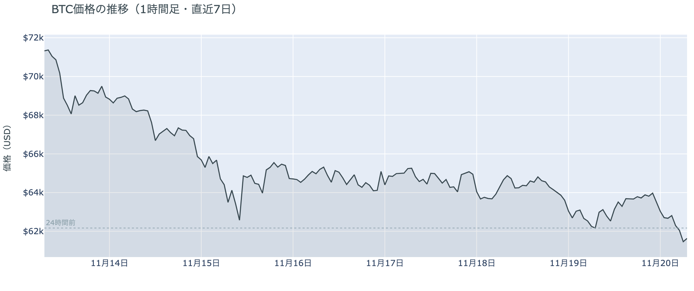

*図の見方: 1時間ごとの価格（日本時間）。点線は24時間前の水準です。*

* 値動きの速い5分足（24時間の上位1割）に、拾えた清算の54%が入っていた。
* 23時55分の5分足は−0.48%で、同じ5分にナスダック100が−0.51%、NVIDIA が−1.03%。

木曜日は、昼までの戻りを、夜の米国の取引時間にそっくり吐き出した1日でした。朝から昼にかけては、価格が上がるなかで建玉（＝先物の未決済残高。証拠金で張っている人の量）が減っていて、ショートの買い戻しが価格を$64,000の手前まで押し上げています。夜23時台に米国株の取引が始まると向きが変わり、下げの途中で建玉が増えて、下げに賭けるショートが新しく積まれました。清算はロングの側で、値動きの速い5分足に集まっているので、清算が下げを加速させています。米国株が下げた5分にはビットコインも同じくらい下げていて、夜の下げは株と同じ時間に進みました。

**図1-2 価格と50日・200日移動平均**

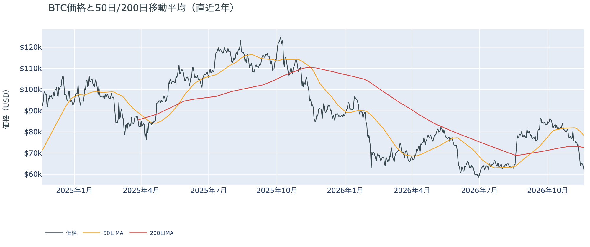

*図の見方: 2本の平均線の上下関係を見ます。50日線が200日線の上にあるのがゴールデンクロスです。*

* 50日線と200日線の差は約$5,508（7.58%）で、前日の8.05%から縮んだ。
* 朝7時5分の価格は50日線を21.0%、200日線（$72,634）を15.0%下回る。

長い目で見た流れの向きはまだ変わっていませんが、価格はその流れから離れたままです。ゴールデンクロス（＝50日線が200日線を上抜けること）の状態は73日目で、価格は50日線の2割下に沈み、2本の差は日ごとに縮んでいます。

11月19日の証券市場では、S&P500が−2.02%、金が−3.09%と、株と金がそろって大きく下げ、VIX（＝株式市場の恐怖指数）は28まで上がりました。逃げ場になりやすい金まで売られた日で、ビットコインもその日に買われる側には回っていません。米国の金曜日の取引を前に、証券市場の不安は収まらないまま持ち越されています。

**図1-3 価格に清算を重ねた図（直近24時間）**

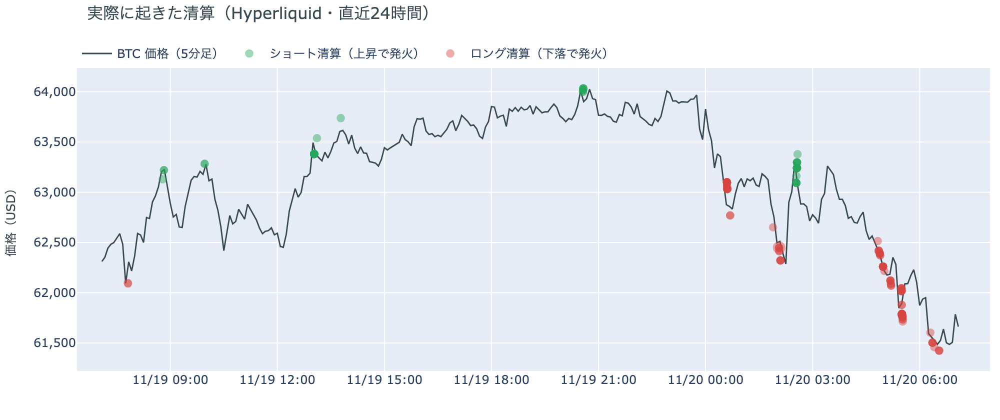

*図の見方: 価格の線に、Hyperliquid で拾えた清算を時刻ごとに重ねたもの（日本時間）。*

清算はほとんどがロングの側で、深夜2時台と朝5時台にまとまって出ています。Hyperliquid（＝オンチェーンの先物取引所）で拾えた分で見ると、120を超えるアドレスに分かれて焼けていて、大口1件が飛んだのではなく、下げの途中で拾いに入った多くのロングが、$62,000台を中心に振り落とされた形です。

## 2. なぜ動いたか：きっかけと、需給のどこが動いたか

**図2-1 ビットコインと株・金・原油の相対推移（起点＝100）**

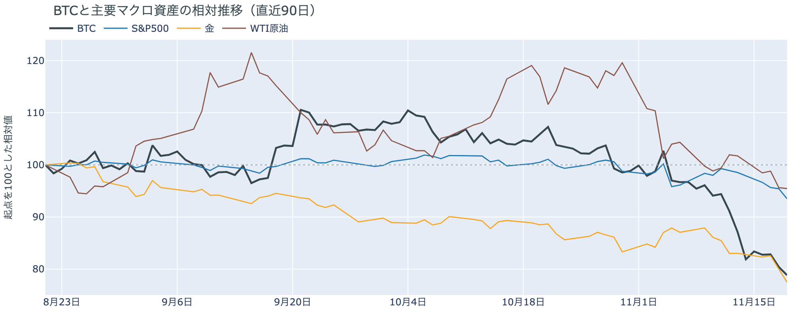

*図の見方: 同じ起点から何%動いたかで重ねたもの。線の向きが揃っているかを見ます。*

| この5営業日の動き（ビットコインは7日間） | 変化 |
|---|---:|
| ビットコイン | −13.5% |
| 金 | −6.7% |
| 米国株（S&P500） | −5.5% |
| 原油 | −6.4% |

* 建玉は97,257BTCで、前日の96,806BTCから0.5%増えた。
* 1日をならした年率は+6.56%で、短期金利（13週Tビル 4.15%）を引いた上乗せは+2.41pt。

木曜日の下げは、Anthropic の上場の日に米国の半導体株が売られたのをきっかけに、先物で新しく積まれたショートと、ロングの清算を通って価格になりました。

1. きっかけ：AI 開発企業の Anthropic が米国で上場し、初値は公開価格を34%上回ったものの、取引が進むと上げ幅を半分に縮めました。同じ日、AI 関連の半導体株が売られ、AMD は空売りを公表した調査会社の報告も重なって7%あまり、NVIDIA は3%あまり下げ、ナスダック100は前の日より2.2%安く終わっています。ビットコインは株が崩れた時間に同じ向きに下げていて、時刻が重なっています。一方で、FF金利先物では12月の FOMC（＝米国の金利を決める会合）で0.5ptの利上げをする織り込みが、前日の約4割から約3割に下がりました（11月19日の先物の終値）。米10年債利回りも夜の間わずかに下がっていたので、前日のような利上げの見通しはきっかけではありません。同じ夜には、米下院金融サービス委員会の French Hill 委員長が、CLARITY法案（＝暗号資産の市場構造法案）の年内の成立は難しいと述べたと報じられています。
2. 伝わり方：速い側の先物では、下げの途中でショートが積まれて建玉が増えました。資金調達率（＝ロングが払う金利。プラス＝ロングがショートより多い）は短期金利（＝ドルを米国の短期国債で持つだけで受け取れる金利）を上回ったままで、安値を拾いに入るロングも入っています。そのロングが清算され、下げを速めました。遅い側では、アメリカの買い手が木曜日に過去300日でいちばん強く売りに傾き、1週間平均でも前の週よりわずかに深くなりました（図①-1）。長期保有者も11月18日時点で減らし続けています（図②-1）。下げを運んだのは先物ですが、アメリカの買い手の売りにも届き始めています。

## 3. 市場参加者はいまどう見ているか

### ① アメリカの買い手は株安の夜に売りを強め、1週間の形も前の週より深くなった

**図①-1 Coinbase Premium（アメリカとそれ以外の価格差・直近90日）**

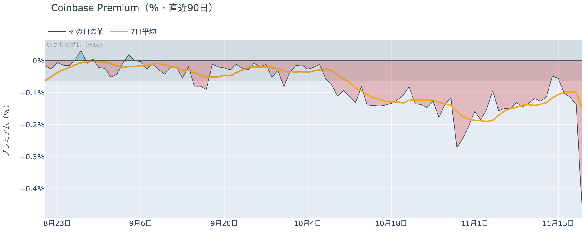

*図の見方: プラス＝アメリカで買いが強い。太線が1週間平均、細線がその日の値。薄い帯は「いつものブレの範囲」です。*

* 11月19日の値は−0.46%で、いつものブレの7.2倍。過去300日でいちばん低い。
* 1週間平均は−0.15%で、前の週の1週間平均−0.14%よりわずかに深い。

アメリカの買い手は、この安値を買い場とは見ておらず、売りを急いでいます。Coinbase Premium（＝アメリカとそれ以外の価格差）は木曜日に、いつものブレを大きく超えて過去300日でいちばん深く沈み、アメリカの価格がほかより一段安くなりました。前日は「1週間平均で見れば売り方は前の週より和らいでいる」と書きましたが、木曜日の売りで1週間平均も前の週より深くなったので、その説明はもう当てはまりません。アメリカの買い手の売りは、1日だけの動きから1週間の形に出始めています。

**図①-2 ETFの日ごとの資金の出入り（直近90日）**

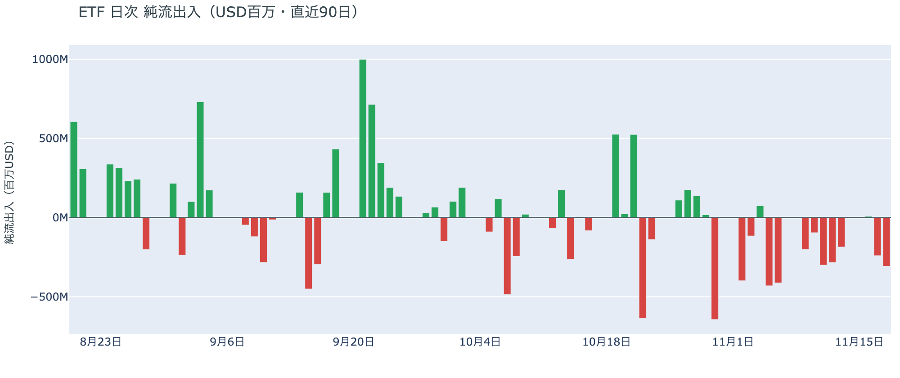

*図の見方: 入ったお金と出たお金の差。上に伸びれば入り超、下に伸びれば出超。*

| ETFの日ごとの出入り | 億ドル |
|---|---:|
| 11月12日 | −2.8 |
| 11月13日 | −1.9 |
| 11月16日 | +0.1 |
| 11月17日 | −2.4 |
| 11月18日 | −3.1 |
| 直近7営業日の合計 | −14.0 |

ETFの買い手も、資金を引き揚げる側にいます。11月16日にほぼゼロで手を止めたあと、2営業日続けて出超で、11月18日の出超は前日より大きくなりました。値下がりを買いの機会と見る動きは、ETFの買い手にも出ていません。

**図①-3 Fear & Greed（市場心理の指数・直近90日）**

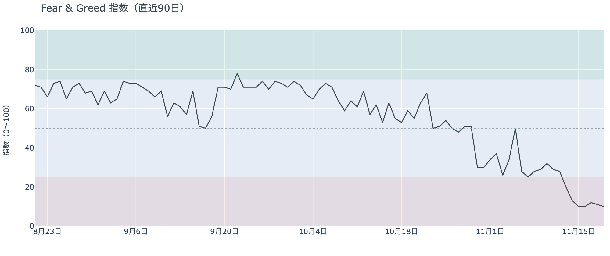

*図の見方: 0〜100で、50より上が「強欲」、下が「恐怖」。*

* 10の「極度の恐怖」で、前日から1pt下げた。1週間前は28、1か月前は55。

参加者の多くは、下げを怖がる気持ちを緩めていません。Fear & Greed（＝市場心理の指数）の11月19日の値は「極度の恐怖」の深いところで、2018年からの記録の中でも下から2%ほどの低さです。

### ② 長期保有者は損失の出る価格でも減らし続け、損失は前の週より深い

**図②-1 長期保有者の保有量の30日変化とSOPR（直近90日）**

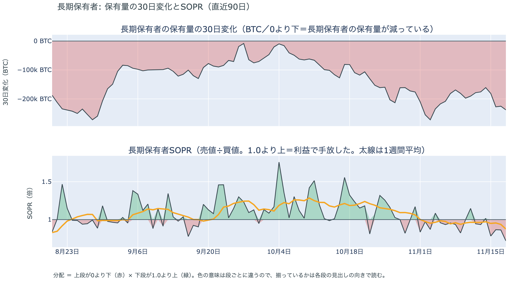

*図の見方: 上段は、長期保有者の保有量が30日でどれだけ増減したか。マイナス＝手放している。下段は長期保有者SOPRで、1より上なら利益で手放した。どちらも太線の1週間平均で読みます。*

| 11月18日時点 | 1週間平均 | 前の週の平均 |
|---|---:|---:|
| 長期保有者SOPR（1より上＝利益で手放した） | 0.88 | 0.97 |
| 長期保有者の保有量の30日変化（万BTC） | −19.8 | −19.2 |

* 1か月前（10月19日）の30日変化は−10.9万BTCで、いまはその2倍を超える減り方。

長期保有者は、損失の出る価格でも手放すのをやめていません。保有量は30日で減り続け、動いたコインは平均して買値より安く動いているので、利益確定の売りとは呼べない形のまま減っています。減り方は前の週とほぼ同じですが、動いたコインの損失は前の週より深くなりました。

マイナーの収入は平年を下回ったままです（Puell Multiple（＝マイナー収入の平年比）が11月18日時点の1週間平均で0.87）。長く眠っていたコインが急に動いた記録も無く、長期保有者のほかに新しく売りに回りそうな持ち手は見当たりません。

### ③ 先物：下げに賭けるショートと、安値を拾うロングが、どちらも増えている

**図③-1 資金調達率と建玉（直近30日）**

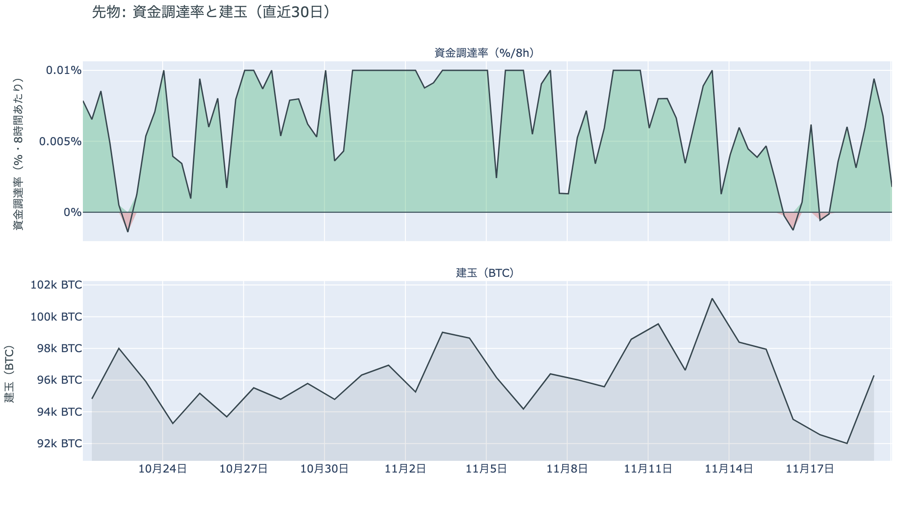

*図の見方: 上段は資金調達率（8時間ごと・日本時間）。プラスが続く＝ロングがショートより多い。下段は建玉。*

* 資金調達率はプラスが7回連続（約2日）。上乗せは前日の+1.37ptから+2.41ptへ広がった。
* 建玉の7日変化は−0.3%で、1週間前とほぼ同じ量に戻った。

先物の参加者の見方は、上と下に割れています。木曜日の夜は価格が下がるなかで建玉が増えていて、さらに下げると見るショートが新しく入りました。同時に、ロングが払う資金調達率は短期金利を上回る幅を広げていて、この価格を安いと見て拾うロングも増えています。前日は「先物で積まれたショートと、拾いに入ったロングの清算を通って下げた」と説明しました。木曜日の夜も同じ形が繰り返されたので、前日の説明は今日の数値と合っています。拾いに入ったロングは2晩続けて清算されていて、安値拾いが報われる形にはまだなっていません。

### ④ オプション：目の前の数日ほど下げに備え、年末の上げの賭けは降りていない

オプションには2種類あります。コール（＝決めた価格で買う権利）とプット（＝決めた価格で売る権利）で、価格が上がればコールの価値が上がり、価格が下がればプットの価値が上がります。プットは「価格が下がったときの保険」として買われます。オプションを買う人は、その権利と引き換えに権利料（＝オプションを買う人が払う金額）を払います。

**図④-1 満期ごとのIV（年率%）**

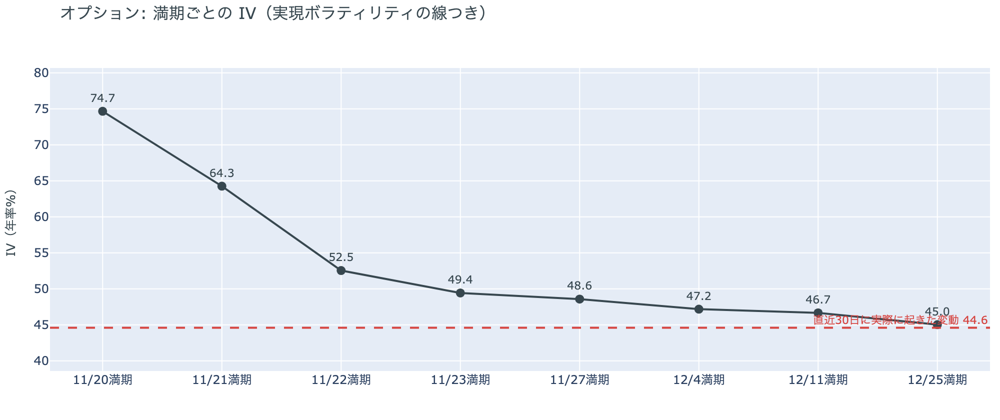

*図の見方: IVを満期ごとに並べたもの。点線は実現ボラティリティ。IVが点線より下なら、市場はこの先の値動きを過去の値動きより小さいと見ています。*

| 満期 | IV |
|---|---:|
| 11月20日 | 75 |
| 11月21日 | 64 |
| 11月22日 | 53 |
| 11月23日〜12月4日 | 47〜49 |
| 12月11日〜12月25日 | 45〜47 |

* IVは全体で45.7で、実現ボラティリティ44.6より1.1pt高い。過去1年の下から74%。

参加者は、この先の値動きをこれまでより大きいと見て、備えを買ったままです。IV（＝値動きの幅の予想）は全体で実現ボラティリティ（＝過去の値動きの幅）を上回り、前日の形を保っています。とくに今日の夕方に満期が来るオプションの権利料には、12月以降の満期に対する上乗せが大きく乗っていて、明日・明後日の満期にもそれが続きます。Anthropic の上場の夜を越えても、目の前の数日に大きく動くと見られているからです。

**図④-2 満期ごとのプットとコールの差**

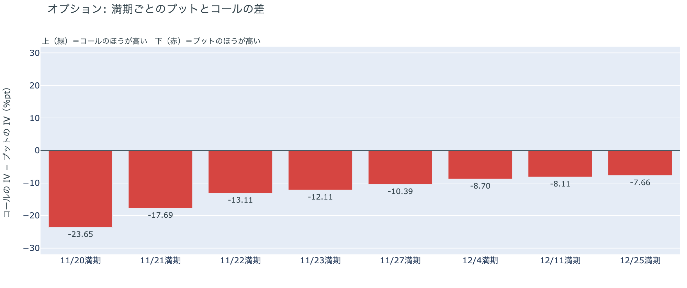

*図の見方: 満期ごとに、プットとコールのどちらが高く売れているか。ゼロより上ならコールのほうが高く、下ならプットのほうが高い。*

| 満期 | どちらが高いか |
|---|---|
| 11月20日 | プットが高い（差はいちばん大きい） |
| 11月21日 | プットが高い |
| 11月22日 | プットが高い |
| 11月23日 | プットが高い |
| 11月27日 | プットが高い |
| 12月4日 | プットが高い |
| 12月11日 | プットが高い |
| 12月25日 | プットが高い（差はいちばん小さい） |

参加者は、動くなら下だと見ています。どの満期もプットのほうが高く、手前の満期ほど差が大きいので、下げをいちばん強く警戒しているのは目の前の数日です。前日に備えの中心だった11月20日の満期は、上場の夜が過ぎても差がいちばん大きいままで、警戒は解かれていません。

**図④-3 12月25日満期の持ち高（権利の価格ごと）**

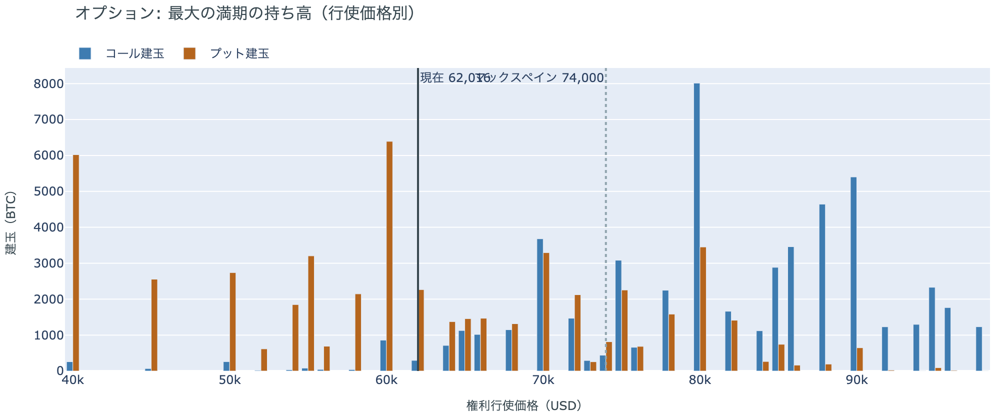

*図の見方: 青＝コール、橙＝プット。現値より上にコールが、下にプットが積まれるのが普通です。*

| 12月25日満期のオプション（基準の価格は約$62,000） | 量（万BTC） | 意味 |
|---|---:|---|
| いまより高い価格のコール | 約8.7 | 「価格が上がる」に賭けた分 |
| いまより安い価格のプット | 約3.7 | 「価格が下がる」への保険 |
| うち、いまより15%以上高い価格のコール | 約7.9 | 大きな上げへの賭け |
| うち、いまより15%以上安い価格のプット | 約2.1 | 大きな下げへの保険 |

* 12月25日満期の持ち高は約15.1万BTCと全満期の37%で、コールがプットの1.5倍。前日とほぼ同じ形。

年末の最大の満期では、「価格が上がる」に賭けた人たちが木曜日の下げでも降りておらず、年末までの上げへの期待は手放されていません。近い満期で下げに備えながら年末のコールを持ち続けているので、参加者は目の前の数日の下げと、年末に向けた見方を分けて持っています。大きな上げに賭けた分が報われるには、12月25日の夕方5時までに約$71,300を超える必要があります。全満期でオプションの持ち高が集まっているのは$60,000〜$65,000の帯で、いちばん多いのは$60,000です。価格はいまその帯の下のほうにいます。

## 4. 価格に影響しうる直近のイベント

オプション市場が IV をいちばん高く付け、プットの備えもいちばん厚く置いているのは、今日から週末にかけての満期です。上場の夜は過ぎましたが、目の前の数日への備えは解かれていません。その先の満期にも、同じ向きの備えが薄く置かれています。

| 日付 | イベント | 何に効くか |
|---|---|---|
| 11/20（金）17:00 | 11月20日のオプションの満期 | IV とプットの備えがいちばん厚い満期 |
| 11/25（水） | 米10月の PCE 物価指数（米国の物価統計）と、7〜9月期の GDP の改定値 | 金利 |
| 11/26（木） | 米国は感謝祭で株式市場が休場 | 米国株・ETF の取引が止まる |
| 11/30（月）米国時間の引け | MSCI の指数から米 Strategy（＝ビットコインを大量に持つ米企業）が外れる実施日 | Strategy の株と、指数に連動する資金 |
| 12/3（木） | ドイツ・ライプツィヒ地裁で Movie2k 事件の裁判が再開。被告が4万BTCを引き渡せば打ち切るという裁判所の案に、双方はまだ答えていない | 当局の手に渡りうる4万BTC |
| 12/9（水） | FOMC。0.25ptの利上げは確実視され、0.5ptの利上げの織り込みは約3割。結果は日本時間10日早朝 | 金利 |
| 12/25（金）17:00 | オプションの最も大きな満期（約15.1万BTC、全満期の37%） | 約$71,300以上のコールの期限 |

## まとめ

木曜日のビットコインは、Anthropic の上場の日に米国の半導体株が売られた時間に、先物で積まれたショートと、拾いに入ったロングの清算を通って$61,000台まで下げました。下げを運んだのは先物ですが、アメリカの買い手も売りを急いで1週間平均で前の週より深くなり、長期保有者も損失の出る価格で減らし続けているので、下げはアメリカの買い手の売りにも届き始めています。参加者は、先物では下げの賭けと安値拾いの両方を積み、オプションでは目の前の数日に下げへの備えをいちばん厚く置いていて、下げが終わったとは見ていませんが、年末に向けた上げの賭けは降りずに持ち続けています。

---

<small>（数値は11月20日7時5分（日本時間）までのデータに基づきます。価格・先物・オプションはその時点の値、市場心理は11月19日の確定値、オンチェーン（＝ブロックチェーン上の記録）は11月18日時点、ETF資金フローは11月18日分までです。証券市場の終値は11月19日時点です。オンチェーンの長期保有者の数値には、ETFや取引所が預かっている分も含まれます。清算は Hyperliquid で拾えた分だけで、市場全体のごく一部です。オプションはDeribit（BTCオプションの大半を占める取引所）の全銘柄です。）</small>

*本稿は情報提供を目的としたものであり、投資助言ではありません。将来の価格動向を保証・示唆するものではなく、投資判断は各自の責任において行ってください。*
