# ナスダック5%安の夜に$58,000台へ ― ロングの清算が下げを速め、ETFの流出も膨らむ

**2026年11月21日**

ビットコインは金曜日、昼の間は$61,000〜$62,000で落ち着いていたものの、夜に米国でハイテク株が一段と崩れた時間に$60,000を割り込み、$58,000台で土曜日の朝を迎えました。

* **価格**：24時間の値幅は7.8%と前日の4.4%から広がり、朝7時5分の時点で約$58,979。1週間で13.6%下げ、下げの速さは増している
* **きっかけ**：NVIDIA が1日で14%下げ、ナスダック100は5.6%安と、米国のハイテク株の売りが前日より深くなった。ビットコインのいちばん大きな下げは、米国株の取引が始まった直後の1時間に重なっている
* **先物**：下げの初めに売り持ち（ショート）が積まれ、買い持ち（ロング）の清算（＝証拠金不足で強制的に閉じられた取引）が下げを速めた。前日まで入っていた安値拾いのロングは退き、先物は下げに賭ける側に傾いた
* **需給の土台**：米国の買い手の売りは続き、ETFからの流出は11月19日に一段と大きくなった。長期保有者（＝155日以上保有者）も損失の出る価格で減らし続けていて、売りは続き、強まっている
* **オプションの見方**：この先の値動きを過去より大きいと見て、備えを買い続けている。どの満期もプットのほうが高く、週明けの数日にいちばん厚く備えているが、年末に向けた上げの賭けは降りていない

## 1. 何が起きたか

**図1-1 価格の推移（1時間足・直近7日）**

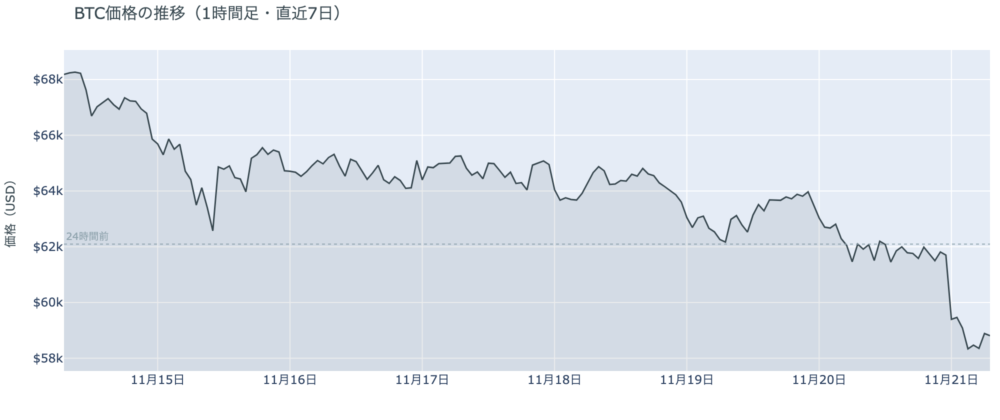

*図の見方: 1時間ごとの価格（日本時間）。点線は24時間前の水準です。*

* 値動きの速い5分足（24時間の上位1割）に、拾えた清算の62%が入っていた。
* 0時台の1時間は−3.7%で、同じ1時間にナスダック100が−2.1%、NVIDIA が−3.1%。

金曜日の下げは、米国の取引時間に入ってから一気に進みました。昼から夜22時台までは$61,500〜$62,200の間で動かず、23時台に米国株の取引が始まると、0時台の1時間で$59,000台まで落ちています。この1時間は価格が下がるなかで建玉（＝先物の未決済残高。証拠金で張っている人の量）が増えていて、下げに賭けるショートが新しく積まれました。続く3時台の下げでは建玉が減っていて、ロングの手仕舞いです。清算はロングの側で、値動きの速い5分足に集まっているので、清算が下げを加速させています。朝6時台の小さな戻りは、ショートの清算を伴った買い戻しでした。

**図1-2 価格と50日・200日移動平均**

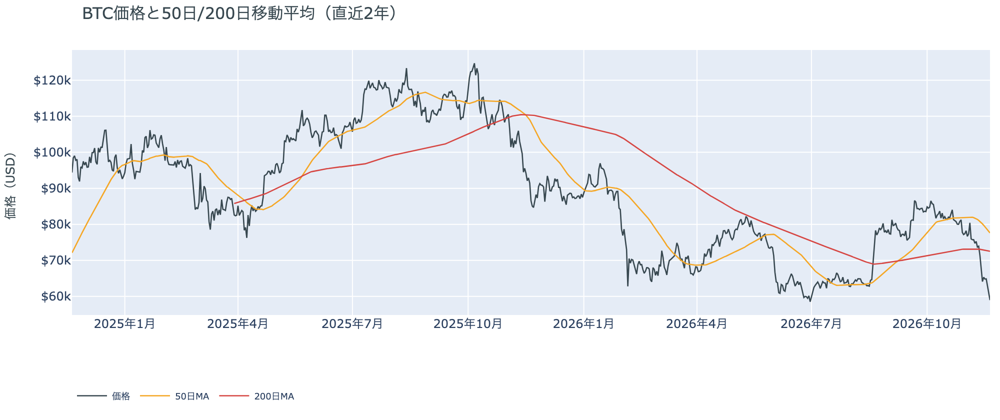

*図の見方: 2本の平均線の上下関係を見ます。50日線が200日線の上にあるのがゴールデンクロスです。*

* 50日線と200日線の差は約$5,097（7.03%）で、前日の7.58%から縮んだ。
* 朝7時5分の価格は50日線を24.0%、200日線（$72,531）を18.7%下回る。

長い目で見た流れの向きはまだ変わっていませんが、価格はそこから大きく離れ、2本の差も日ごとに縮んでいます。ゴールデンクロス（＝50日線が200日線を上抜けること）の状態は74日目で、価格は50日線の4分の1近く下にいます。

11月20日の証券市場では、S&P500が−3.70%と前日より大きく下げ、金も−4.02%と株と一緒に売られました。VIX（＝株式市場の恐怖指数）は36近くまで上がっています。株と金がそろって売られる不安を、証券市場は解かないまま週末を迎えたので、ビットコインは週末を、外部環境から持ち越された売りの材料を抱えたまま迎えています。

**図1-3 価格に清算を重ねた図（直近24時間）**

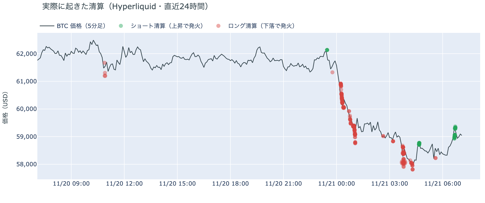

*図の見方: 価格の線に、Hyperliquid で拾えた清算を時刻ごとに重ねたもの（日本時間）。*

清算はほとんどがロングの側で、0時台と3時台の2つの山に集まっています。Hyperliquid（＝オンチェーンの先物取引所）で拾えた分では300を超えるアドレスに分かれていて、大口1件が飛んだのではなく、$58,000〜$59,000台で多くのロングが振り落とされた形です。

## 2. なぜ動いたか：きっかけと、需給のどこが動いたか

**図2-1 ビットコインと株・金・原油の相対推移（起点＝100）**

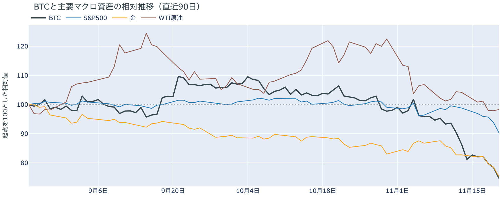

*図の見方: 同じ起点から何%動いたかで重ねたもの。線の向きが揃っているかを見ます。*

| この5営業日の動き（ビットコインは7日間） | 変化 |
|---|---:|
| ビットコイン | −13.6% |
| 金 | −9.0% |
| 米国株（S&P500） | −8.6% |
| 原油 | −5.7% |

* 建玉は96,098BTCで、前日の97,257BTCから1.2%減った。
* 1日をならした年率は+1.93%で、短期金利（13週Tビル 4.12%）を引いた上乗せは−2.19pt。

金曜日の下げは、NVIDIA を中心とした米国のハイテク株の売りをきっかけに、先物のショートとロングの清算を通って価格になり、アメリカの買い手の売りにも届いています。

1. きっかけ：NVIDIA は1日で14%下げ、ナスダック100も5.6%安く終わりました。NVIDIA については、米証券取引委員会（SEC）が会計の問題を調べているとロイターが報じています。ビットコインのいちばん大きな下げは、米国株の取引が始まった直後の0時台で、株が売られた時間と重なっています。ただ、そのあとは向きが分かれました。3時台はナスダック100がほぼ動かないなかでビットコインだけが下げ、4時台に NVIDIA が1時間で5%下げたときにはビットコインは下げていません。株の売りは下げの口火で、そこから先はビットコイン自身の持ち高が下げを運んでいます。金利の見通しはきっかけではありません。FF金利先物では、12月の FOMC（＝米国の金利を決める会合）で0.5ptの利上げをする織り込みが前日の約3割から約2割に下がり、米10年債利回りも夜の間に下がっていて、ビットコインとは逆向きです。原油も+0.4%と逆向きで、米国・中国・ロシアの3首脳が深圳で会談した週でしたが、今日の値動きに効いた形跡はありません。
2. 伝わり方：速い側の先物では、下げの初めにショートが積まれ、ロングの清算が下げを速めました。資金調達率（＝ロングが払う金利。プラス＝ロングがショートより多い）は1日をならすと短期金利（＝ドルを米国の短期国債で持つだけで受け取れる金利）を下回り、前日まで入っていた安値拾いのロングも退いています。遅い側にも届いています。ETFからは11月19日に1日で5.8億ドルが流出して出超が3営業日続き（図①-2）、長期保有者の減り方も前の週より大きくなりました（図②-1）。下げを運んだのは先物ですが、アメリカの買い手と長期保有者の売りも強まっています。

## 3. 市場参加者はいまどう見ているか

### ① アメリカの買い手は売りを続け、ETFからの流出は11月19日に一段と大きくなった

**図①-1 Coinbase Premium（アメリカとそれ以外の価格差・直近90日）**

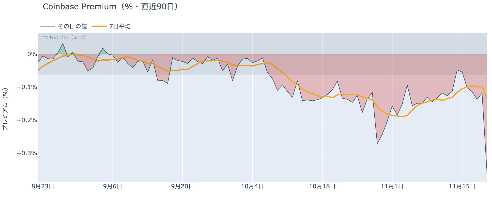

*図の見方: プラス＝アメリカで買いが強い。太線が1週間平均、細線がその日の値。薄い帯は「いつものブレの範囲」です。*

* 11月20日の値は−0.36%で、いつものブレの5.8倍。過去300日でいちばん低い。
* 1週間平均は−0.13%で、前の週の1週間平均とほぼ同じ。

アメリカの買い手は、この安値を買い場とは見ておらず、売りの側に立ち続けています。Coinbase Premium（＝アメリカとそれ以外の価格差）は金曜日に、前日の記録をさらに下回って過去300日でいちばん深く沈み、2日続けて、アメリカの価格がほかより一段安くなりました。前日は「下げはアメリカの買い手の売りにも届き始めた」と説明しました。金曜日も同じ形が出て、ETFの流出も膨らんだので、前日の説明は今日の数値と合っています。

**図①-2 ETFの日ごとの資金の出入り（直近90日）**

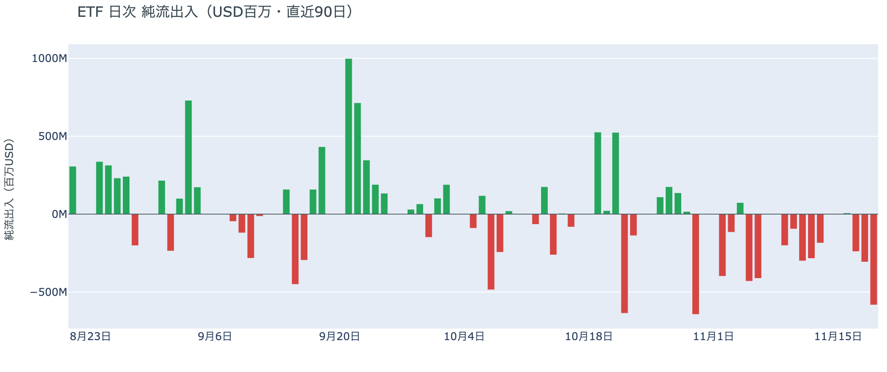

*図の見方: 入ったお金と出たお金の差。上に伸びれば入り超、下に伸びれば出超。*

| ETFの日ごとの出入り | 億ドル |
|---|---:|
| 11月13日 | −1.9 |
| 11月16日 | +0.1 |
| 11月17日 | −2.4 |
| 11月18日 | −3.1 |
| 11月19日 | −5.8 |
| 直近7営業日の合計 | −18.9 |

* 11月19日の流出のうち、5.4億ドルが iShares（IBIT）1本から出た。

ETFの買い手は、資金を引き揚げる動きを強めています。出超は3営業日続き、1日ごとに大きくなっていて、11月19日の流出は2024年の上場以来の日ごとの出入りでも下から2%に入る大きさです。値下がりを買いの機会と見る動きは、ETFの買い手にもまだ出ていません。

**図①-3 Fear & Greed（市場心理の指数・直近90日）**

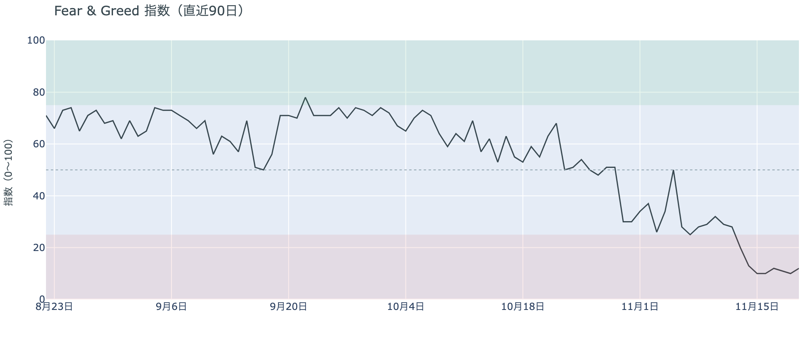

*図の見方: 0〜100で、50より上が「強欲」、下が「恐怖」。*

* 12の「極度の恐怖」で、前日から2pt戻した。1週間前は20、1か月前は63。

参加者の多くは、下げへの怖さを緩めていません。Fear & Greed（＝市場心理の指数）の11月20日の値は「極度の恐怖」の深いところにあり、2018年からの記録でも下から5%に入る低さです。$60,000を割った日にも数字はほとんど動いておらず、怖さは1週間ずっと底のあたりに張りついたままです。

### ② 長期保有者は損失の出る価格でも減らし続け、減り方は前の週より大きい

**図②-1 長期保有者の保有量の30日変化とSOPR（直近90日）**

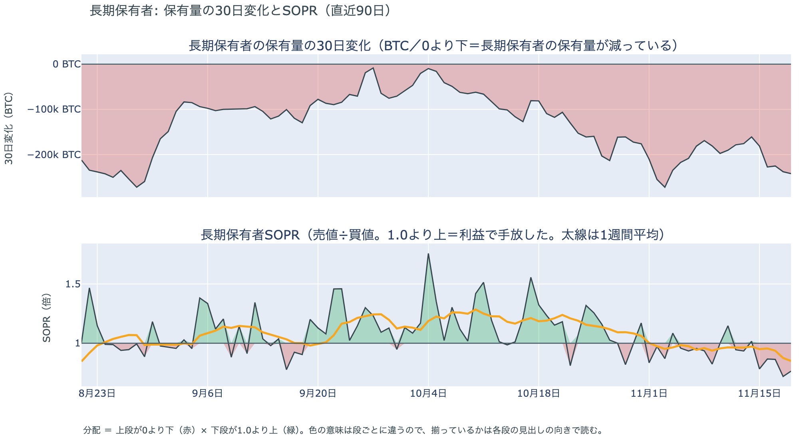

*図の見方: 上段は、長期保有者の保有量が30日でどれだけ増減したか。マイナス＝手放している。下段は長期保有者SOPRで、1より上なら利益で手放した。どちらも太線の1週間平均で読みます。*

| 11月19日時点 | 1週間平均 | 前の週の平均 |
|---|---:|---:|
| 長期保有者SOPR（1より上＝利益で手放した） | 0.85 | 0.96 |
| 長期保有者の保有量の30日変化（万BTC） | −20.7 | −18.7 |

* 1か月前（10月20日）の30日変化は−11.8万BTCで、いまはその2倍に近い減り方。

長期保有者は、損失の出る価格でも手放すのをやめておらず、下げが終わったとは見ていません。保有量は30日で減り、動いたコインは平均して買値より安く動いているので、利益確定の売りとは呼べない形のまま減っています。減り方は前の週より大きくなり、動いたコインの損失も前の週より深くなりました。

マイナーの収入は平年を下回ったままです（Puell Multiple（＝マイナー収入の平年比）が11月19日時点の1週間平均で0.89）。長く眠っていたコインが急に動いた記録はありません。

### ③ 先物：安値を拾うロングが退き、下げに賭ける側に傾いた

**図③-1 資金調達率と建玉（直近30日）**

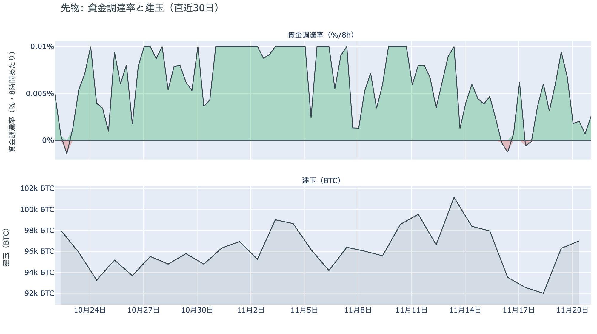

*図の見方: 上段は資金調達率（8時間ごと・日本時間）。プラスが続く＝ロングがショートより多い。下段は建玉。*

* 上乗せは前日の+2.41ptから−2.19ptへ下がった。直近34日の平均は+2.90pt。
* 建玉の7日変化は−4.1%。

先物の参加者は、下げに賭ける側に傾き、安値を拾う動きは引いています。前日は、さらに下げると見るショートと、この価格を安いと見て拾うロングの両方が増えていると説明しました。金曜日もショートは積まれましたが、ロングが払う資金調達率は短期金利を下回り、直近の8時間ではショートが払う側に回っています。余分に払ってでも上げに賭けたい人はいなくなり、2晩続けて清算された安値拾いのロングは、3晩目には入ってきませんでした。

### ④ オプション：週明けの数日にいちばん厚く備え、年末の上げの賭けは降りていない

オプションには2種類あります。コール（＝決めた価格で買う権利）とプット（＝決めた価格で売る権利）で、価格が上がればコールの価値が上がり、価格が下がればプットの価値が上がります。プットは「価格が下がったときの保険」として買われます。オプションを買う人は、その権利と引き換えに権利料（＝オプションを買う人が払う金額）を払います。

**図④-1 満期ごとのIV（年率%）**

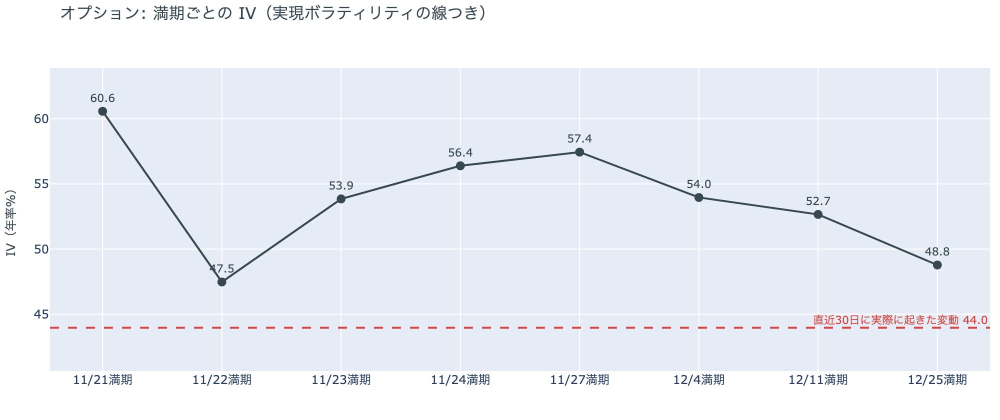

*図の見方: IVを満期ごとに並べたもの。点線は実現ボラティリティ。IVが点線より下なら、市場はこの先の値動きを過去の値動きより小さいと見ています。*

| 満期 | IV |
|---|---:|
| 11月21日 | 61 |
| 11月22日 | 48 |
| 11月23日〜11月27日 | 54〜57 |
| 12月4日〜12月11日 | 53〜54 |
| 12月25日 | 49 |

* IVは全体で45.9で、実現ボラティリティ44.0より1.9pt高い。過去1年の下から92%。

参加者は、この先の値動きをこれまでより大きいと見ていて、怖さは過去1年でも上のほうにあります。IV（＝値動きの幅の予想）は全体で実現ボラティリティ（＝過去の値動きの幅）を上回っていて、参加者は備えを買い続けています。とくに今日の夕方に満期が来るオプションの権利料には、ほかの満期に対する上乗せが大きく乗っています。11月23日から27日の満期にも、年末の満期に対する上乗せが乗っています。米国の PCE 物価指数と感謝祭の休場が重なる週に、大きく動くと見られているからです。

**図④-2 満期ごとのプットとコールの差**

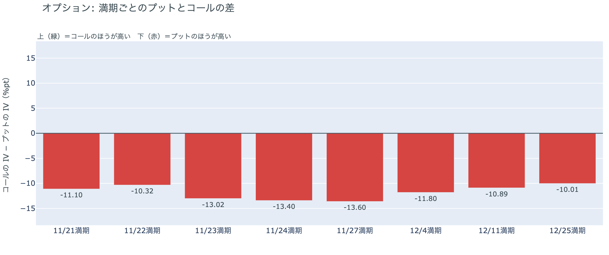

*図の見方: 満期ごとに、プットとコールのどちらが高く売れているか。ゼロより上ならコールのほうが高く、下ならプットのほうが高い。*

| 満期 | どちらが高いか |
|---|---|
| 11月21日 | プットが高い |
| 11月22日 | プットが高い |
| 11月23日 | プットが高い |
| 11月24日 | プットが高い（差は大きい） |
| 11月27日 | プットが高い（差はいちばん大きい） |
| 12月4日 | プットが高い |
| 12月11日 | プットが高い |
| 12月25日 | プットが高い（差はいちばん小さい） |

参加者は、動くなら下だと見ています。どの満期もプットのほうが高く、下げへの備えをいちばん厚く置いているのは、週明けの11月24日から27日の満期です。前日は目の前の満期ほど備えが厚い形でしたが、備えの中心は少し先の、米国の感謝祭をまたぐ週へ移りました。

**図④-3 12月25日満期の持ち高（権利の価格ごと）**

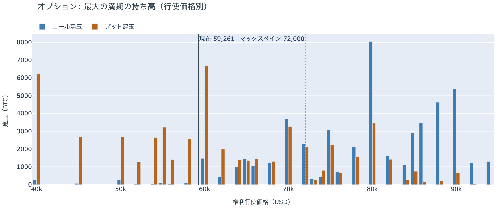

*図の見方: 青＝コール、橙＝プット。現値より上にコールが、下にプットが積まれるのが普通です。*

| 12月25日満期のオプション（基準の価格は約$59,300） | 量（万BTC） | 意味 |
|---|---:|---|
| いまより高い価格のコール | 約9.0 | 「価格が上がる」に賭けた分 |
| いまより安い価格のプット | 約3.2 | 「価格が下がる」への保険 |
| うち、いまより15%以上高い価格のコール | 約8.4 | 大きな上げへの賭け |
| うち、いまより15%以上安い価格のプット | 約2.1 | 大きな下げへの保険 |

* 12月25日満期の持ち高は約15.6万BTCと全満期の39%で、コールがプットの1.4倍。

年末の最大の満期では、「価格が上がる」に賭けた人たちが$60,000を割った夜にも降りておらず、年末までの上げへの期待は手放されていません。週明けの数日に下げへ備えながら年末のコールを持ち続けているので、参加者は目の前の下げと年末に向けた見方を分けて持っています。大きな上げに賭けた分が報われるには、12月25日の夕方5時までに約$68,200を超える必要があります。全満期でオプションの持ち高が集まっているのは$58,000〜$62,000の帯で、いちばん多いのは$60,000です。価格はいまその帯の中にいます。

### ⑤ コインの半分以上が、いまより高い価格で最後に送金されている

**図⑤-1 コインが最後に送金された日の価格の分布（11月19日時点）**

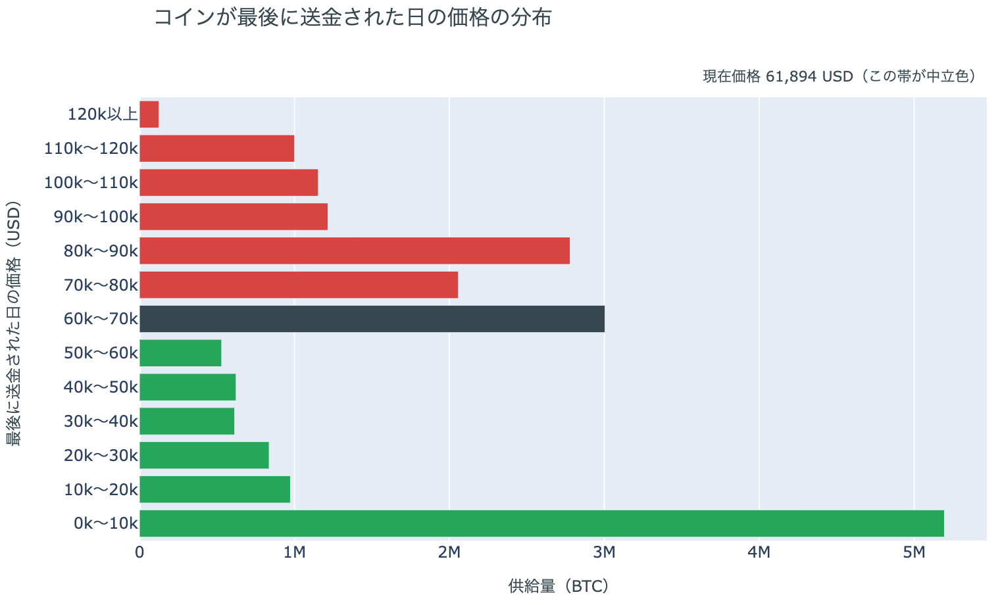

*図の見方: ビットコインはアドレスからアドレスへ送金されるたびに、受け取った側に新しい記録ができる。この図は、いまあるコインを、最後に送金された日の価格で束ねたもの。送金には売買のほか、取引所への入金・引き出しや自分のウォレット間の移し替えも含み、取引所の中での売買は含まない。*

| 過去の大きな下げの底 | 価格より上にいるコインの割合 | 30日以上置いたコインが値下がりした状態で再び送金された量（1週間平均） |
|---|---:|---:|
| 2018年12月（2018年の冬の底） | 60.6% | 約4.1万BTC/日 |
| 2020年3月（コロナショック） | 57.4% | 約8.4万BTC/日 |
| 2022年6月（Luna・3AC の破綻） | 51.1% | 約7.2万BTC/日 |
| 2022年11月（FTX の破綻） | 55.1% | 約7.1万BTC/日 |
| **2026年11月19日** | **54.7%** | **約3.2万BTC/日** |

* 30日以上置いたコインの値下がり再送金は、1週間前の約1.9万BTC/日から増えた。2017年以降の下から95%。

いまあるコインの半分以上が、いまより高い価格で最後に送金されていて、値下がりしたコインの多さは過去の大きな下げの底と同じくらいになりました。2017年以降の真ん中の値は24%で、その2倍を超えています。一方で、30日以上置いたコインが値下がりした状態で再び送金された量は、平年の3倍を超えて増えていますが、2018年の底の8割ほどで、2020年と2022年の底の半分にも届いていません。高い価格で受け取ったコインがまとめて送金し直される動きは、強まってはいるものの、過去の大きな底ほどの量にはなっていません。

価格は11月20日に、$60,000〜$70,000の帯から$50,000〜$60,000の帯へ下りました。下の帯は全供給の2.6%と薄く、すぐ上の$60,000〜$70,000には全供給の15%が積まれています。

## 4. 価格に影響しうる直近のイベント

オプション市場が IV をいちばん高く付けているのは今日の夕方の満期で、プットの備えをいちばん厚く置いているのは、米国の PCE 物価指数と感謝祭の休場が重なる11月24日から27日の満期です。

| 日付 | イベント | 何に効くか |
|---|---|---|
| 11/21（土）17:00 | 11月21日のオプションの満期 | IV がいちばん高い満期 |
| 11/25（水） | 米10月の PCE 物価指数（米国の物価統計）と、7〜9月期の GDP の改定値 | 金利 |
| 11/26（木） | 米国は感謝祭で株式市場が休場 | 米国株・ETF の取引が止まる |
| 11/30（月）米国時間の引け | MSCI の指数から米 Strategy（＝ビットコインを大量に持つ米企業）が外れる実施日 | Strategy の株と、指数に連動する資金 |
| 12/3（木） | ドイツ・ライプツィヒ地裁で Movie2k 事件の裁判が再開。被告が4万BTCを引き渡せば打ち切るという裁判所の案に、双方はまだ答えていない | 当局の手に渡りうる4万BTC |
| 12/9（水） | FOMC。0.25ptの利上げは確実視され、0.5ptの利上げの織り込みは約2割。結果は日本時間10日早朝 | 金利 |
| 12/25（金）17:00 | オプションの最も大きな満期（約15.6万BTC、全満期の39%） | 約$68,200以上のコールの期限 |

## まとめ

金曜日のビットコインは、NVIDIA を中心に米国のハイテク株が崩れた時間に下げ始め、先物で積まれたショートとロングの清算を通って$58,000台まで下げました。下げを運んだのは先物ですが、ETFからの流出が膨らみ、長期保有者も損失の出る価格で減り方を大きくしているので、金曜日は、アメリカの買い手と長期保有者の持ち方まで、売りの側へ一段傾いた日です。参加者は、先物では安値拾いから手を引き、オプションでは週明けの数日に下げへの備えをいちばん厚く置いていて、下げが終わったとは見ていませんが、年末に向けた上げの賭けは降りずに持ち続けています。

---

<small>（数値は11月21日7時5分（日本時間）までのデータに基づきます。価格・先物・オプションはその時点の値、市場心理は11月20日の確定値、オンチェーン（＝ブロックチェーン上の記録）は11月19日時点、ETF資金フローは11月19日分までです。証券市場の終値は11月20日時点で、週末のため更新がありません。オンチェーンの長期保有者の数値には、ETFや取引所が預かっている分も含まれます。清算は Hyperliquid で拾えた分だけで、市場全体のごく一部です。オプションはDeribit（BTCオプションの大半を占める取引所）の全銘柄です。）</small>

*本稿は情報提供を目的としたものであり、投資助言ではありません。将来の価格動向を保証・示唆するものではなく、投資判断は各自の責任において行ってください。*
