# 週末に$55,000台から$60,000台へ往復 ― 清算が下げも戻しも速め、先物の持ち高は軽く

**2026年11月22日**

ビットコインは土曜日、昼に$55,000台まで急に下げ、夜には$60,000台へ戻る大きな往復をしました。

* **価格**：24時間の値幅は10.5%と、前日の7.8%からさらに広がった。一時は2024年9月以来の安さまで下げたが、朝7時5分の時点では約$60,194で、24時間前とほぼ同じ位置に戻っている
* **きっかけ**：新しいきっかけは見当たらない。証券市場は週末で閉まっていて、金曜に米国のハイテク株が崩れた不安を抱えたまま、ビットコインだけが動いた
* **先物**：昼の下げは買い持ち（ロング）の清算（＝証拠金不足で強制的に閉じられた取引）が、夜の戻しは売り持ち（ショート）の買い戻しが速めた。往復のあとロングもショートも減って持ち高は軽くなったが、残った持ち高は下げに賭ける側に傾いたままで、下げが終わったとは見ていない
* **需給の土台**：土曜日の往復は米国の買い手と長期保有者まで届いていない。ただ、ETFからの流出は4営業日続き、長期保有者も損失の出る価格で減り方を大きくしていて、売りは前日から続いている
* **オプションの見方**：この先の値動きを過去より大きいと見て、週明けの週にいちばん厚く下げへ備えている。一方で、年末に向けた上げの賭けは降りていない

## 1. 何が起きたか

**図1-1 価格の推移（1時間足・直近7日）**

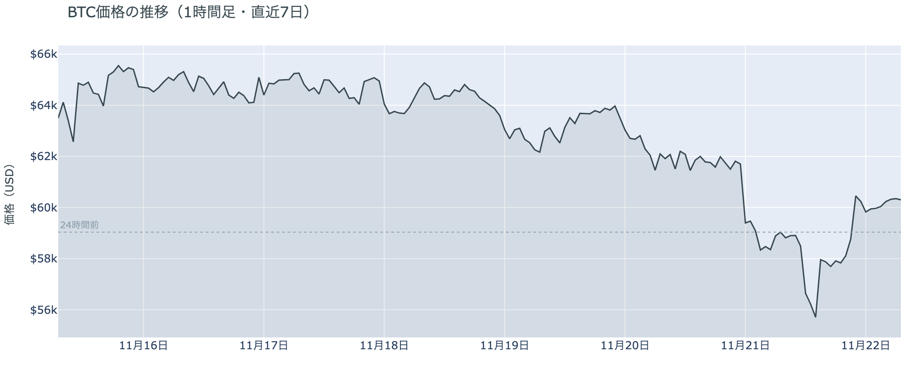

*図の見方: 1時間ごとの価格（日本時間）。点線は24時間前の水準です。*

* 24時間の値幅は10.5%（$55,106〜$60,883）で、前日の7.8%から広がった。
* 値動きの速い5分足（24時間の上位1割）に、拾えた清算の98%が入っていた。

土曜日の往復は、下げも戻しも先物の持ち高の整理で進みました。午前は$58,800〜$58,900で落ち着いていたものの、12時台の1時間で3%下げ、14時台には$55,000台に届いています。この下げの間は価格と一緒に建玉（＝先物の未決済残高。証拠金で張っている人の量）も減っていて、ロングの手仕舞いです。続く15時台の+4%と、21〜22時台に$60,000台へ戻した上げでは、価格が上がるなかで建玉が減っていて、ショートの買い戻しです。清算は下げではロング、戻しではショートの側で出て、どちらも値動きの速い5分足に集まっているので、清算が下げも戻しも加速させました。

**図1-2 価格と50日・200日移動平均**

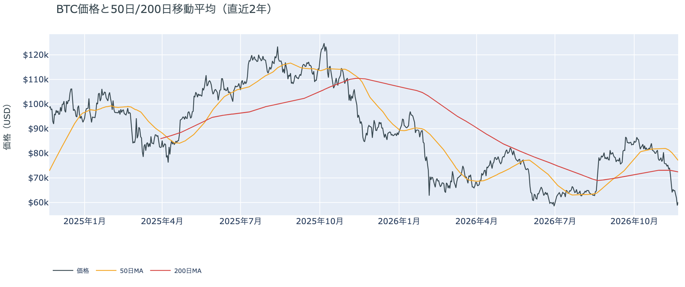

*図の見方: 2本の平均線の上下関係を見ます。50日線が200日線の上にあるのがゴールデンクロスです。*

* 50日線と200日線の差は約$4,712（6.51%）で、前日の7.03%から縮んだ。
* 朝7時5分の価格は50日線を22.0%下回る。

長い目で見た流れの向きはまだ変わっていませんが、2本の差は日ごとに縮んでいます。ゴールデンクロス（＝50日線が200日線を上抜けること）の状態は75日目で、価格は$55,000台からの戻しのあとも、50日線の2割以上下にいます。

証券市場は週末で閉まっています。11月20日はS&P500が−3.70%、金が−4.62%と、株と金がそろって売られて終わりました。外部環境から持ち越された不安は解けないまま週末に入っていて、土曜日のビットコインは、その不安の中で自分の持ち高だけで往復しました。

**図1-3 価格に清算を重ねた図（直近24時間）**

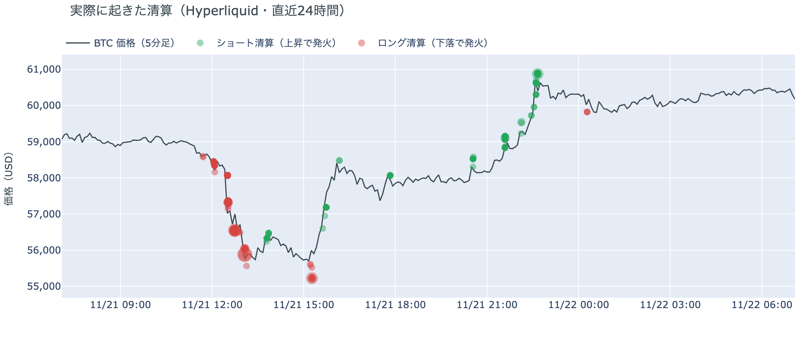

*図の見方: 価格の線に、Hyperliquid で拾えた清算を時刻ごとに重ねたもの（日本時間）。*

清算は、昼の下げのロングと夜の戻しのショートの2つの山に分かれています。Hyperliquid（＝オンチェーンの先物取引所）で拾えた分では、24時間の清算の半分を大口1件が占めていて、多くのロングが振り落とされたというより、大口が1つ飛んだ形です。

## 2. なぜ動いたか：きっかけと、需給のどこが動いたか

**図2-1 ビットコインと株・金・原油の相対推移（起点＝100）**

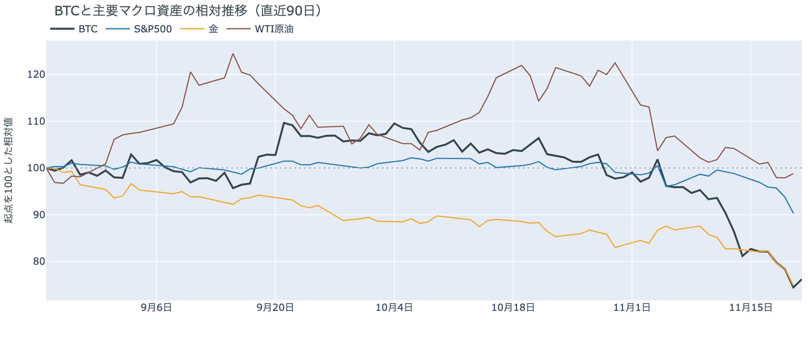

*図の見方: 同じ起点から何%動いたかで重ねたもの。線の向きが揃っているかを見ます。*

| この5営業日の動き（ビットコインは7日間） | 変化 |
|---|---:|
| ビットコイン | −6.1% |
| 金 | −9.5% |
| 米国株（S&P500） | −8.6% |
| 原油 | −5.2% |

* 建玉は91,854BTCで、前日の96,098BTCから4.4%減った。
* 1日をならした年率は−1.18%で、短期金利（13週Tビル 4.12%）を引いた上乗せは−5.30pt。

土曜日の往復は、新しいきっかけが無いまま、先物のロングの清算とショートの買い戻しを通って起きました。

1. きっかけ：土曜日の値動きにつながる新しい出来事は見当たりません。証券市場は閉まっていて、株・金利・原油から新しい材料は来ていません。前日の下げのきっかけだった米国のハイテク株の売り（11月20日に NVIDIA が−14%、ナスダック100が−5.6%）は、週明けまで答えが出ないまま残っています。昼の下げは、前日に割り込んだ$60,000の下で、ロングがまとめて手仕舞われた動きです。金利の見通しは下げの材料になっていません。FF金利先物では、12月の FOMC（＝米国の金利を決める会合）で0.5ptの利上げをする織り込みが11月20日に約1割と、1週間前の約5割から下がっています。
2. 伝わり方：速い側の先物が往復を運びました。昼はロングの清算と手仕舞いが下げを速め、夜はショートの買い戻しが戻しを速めて、建玉は1日で4%余り減りました。資金調達率（＝ロングが払う金利。プラス＝ロングがショートより多い）は1日をならしてもマイナスで、残った持ち高ではショートのほうが多いままです。土曜日の往復はアメリカの買い手と長期保有者までは届いていません。ETFは週末で取引が無く、アメリカの買い手の1週間平均（図①-1）も前の週から変わっていません。ただ、遅い側は前日までの売りを続けていて、ETFからの流出は4営業日続き（図①-2）、長期保有者の減り方も11月20日時点でさらに大きくなっています（図②-1）。

## 3. 市場参加者はいまどう見ているか

### ① アメリカの買い手は売りの側に立ったままで、安値を拾う側には回っていない

**図①-1 Coinbase Premium（アメリカとそれ以外の価格差・直近90日）**

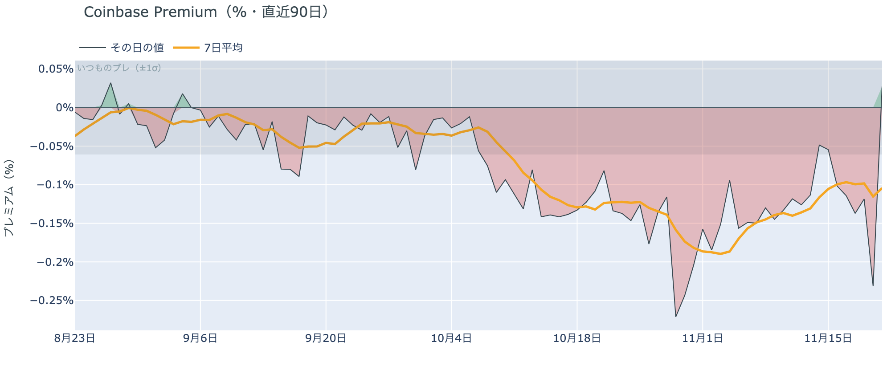

*図の見方: プラス＝アメリカで買いが強い。太線が1週間平均、細線がその日の値。薄い帯は「いつものブレの範囲」です。*

* 1週間平均は−0.10%で、前の週の−0.12%とほぼ同じ。
* その日の値は+0.03%で、いつものブレの範囲内。

アメリカの買い手は、$55,000台への下げを買い場とは見ておらず、売りの側に立ったままです。Coinbase Premium（＝アメリカとそれ以外の価格差）は1週間平均でマイナスのままで、アメリカの価格がほかより安い状態が続いています。土曜日の値はわずかにプラスでしたが、いつものブレの中なので、買い手が戻ってきた形にはなっていません。

**図①-2 ETFの日ごとの資金の出入り（直近90日）**

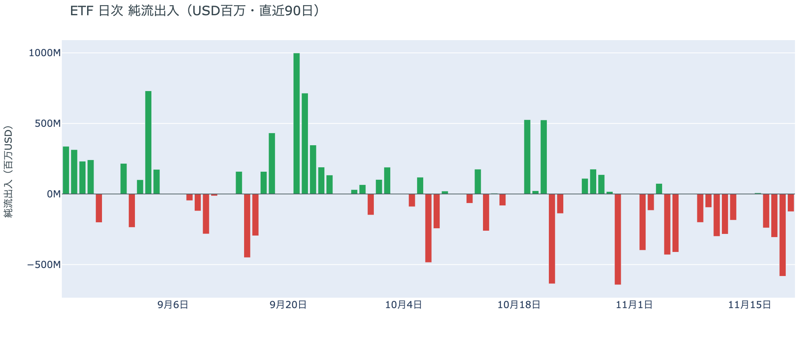

*図の見方: 入ったお金と出たお金の差。上に伸びれば入り超、下に伸びれば出超。*

| ETFの日ごとの出入り | 億ドル |
|---|---:|
| 11月16日 | +0.1 |
| 11月17日 | −2.4 |
| 11月18日 | −3.1 |
| 11月19日 | −5.8 |
| 11月20日 | −1.2 |
| 直近7営業日の合計 | −17.1 |

* 11月20日分は、最大の iShares（IBIT）の数字がまだ入っていない合計。

ETFの買い手は、資金を引き揚げる動きをやめていません。出超は4営業日続いています。11月20日の流出は前日より小さく見えますが、いちばん大きなファンドの数字がまだ入っていないので、流出が細ったとは言えません。値下がりを買いの機会と見る動きは、ETFの買い手にはまだ出ていません。

**図①-3 Fear & Greed（市場心理の指数・直近90日）**

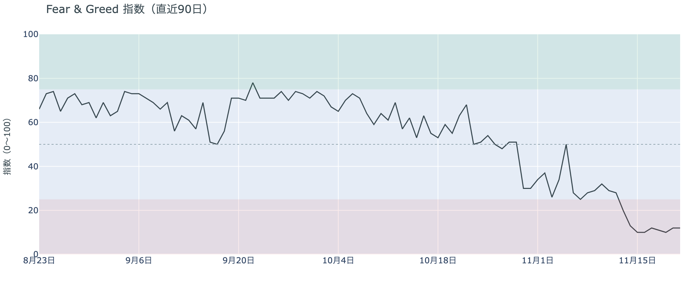

*図の見方: 0〜100で、50より上が「強欲」、下が「恐怖」。*

* 12の「極度の恐怖」で、前日と同じ。1週間前は13、1か月前は68。

参加者の多くは、下げへの怖さを緩めていません。Fear & Greed（＝市場心理の指数）の11月21日の値は、2018年からの記録でも下から5%に入る低さです。$55,000台まで下げても、$60,000台へ戻しても数字は動かず、怖さは1週間ずっと底のあたりに張りついたままです。

### ② 長期保有者は損失の出る価格でも減らし続け、減り方はさらに大きくなった

**図②-1 長期保有者の保有量の30日変化とSOPR（直近90日）**

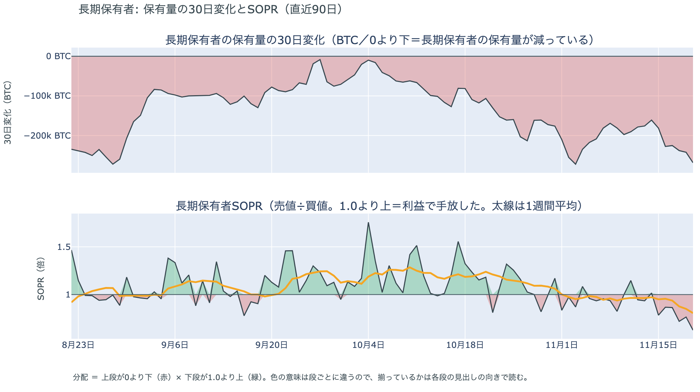

*図の見方: 上段は、長期保有者の保有量が30日でどれだけ増減したか。マイナス＝手放している。下段は長期保有者SOPRで、1より上なら利益で手放した。どちらも太線の1週間平均で読みます。*

| 11月20日時点 | 1週間平均 | 前の週の平均 |
|---|---:|---:|
| 長期保有者SOPR（1より上＝利益で手放した） | 0.81 | 0.96 |
| 長期保有者の保有量の30日変化（万BTC） | −22.1 | −18.2 |

* 1か月前（10月21日）の30日変化は−10.7万BTCで、いまはその2倍を超える減り方。

長期保有者（＝155日以上保有者）は、損失の出る価格でも手放すのをやめておらず、下げが終わったとは見ていません。保有量は30日で減り、動いたコインは平均して買値より安く動いているので、利益確定の売りとは呼べない形のまま減っています。減り方は前の週より大きくなり、動いたコインの損失も前の週より深くなりました。前日も同じ形を説明しましたが、1日新しい数字でも向きは変わらず、さらに一段進んでいます。

マイナーの収入は平年を下回ったままです（Puell Multiple（＝マイナー収入の平年比）が11月20日時点の1週間平均で0.90）。長く眠っていたコインが急に動いた記録はありません。

### ③ 先物：往復で持ち高は軽くなったが、残ったのは下げに賭ける側

**図③-1 資金調達率と建玉（直近30日）**

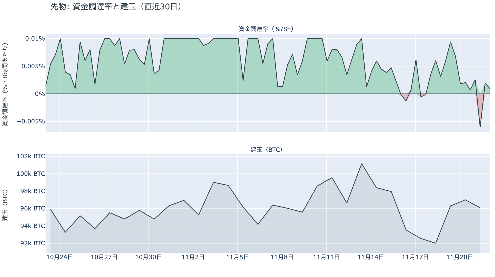

*図の見方: 上段は資金調達率（8時間ごと・日本時間）。プラスが続く＝ロングがショートより多い。下段は建玉。*

* 上乗せは−5.30ptで、直近34日でいちばん低い。34日の平均は+2.69pt。
* 建玉の7日変化は−2.3%。

先物の参加者は、下げが終わったとは見ていません。土曜日の往復で、ロングは清算され、ショートは買い戻されて、どちらの持ち高も減りました。それでも残った持ち高ではショートのほうが多く、1日をならすとショートがロングに金利を払う側に回っています。$60,000台へ戻したあとも、上げに賭け直すロングは入ってきていません。前日は「先物は安値拾いから手を引き、下げに賭ける側に傾いた」と説明しました。土曜日の戻しはショートの買い戻しで、ロングが戻った形ではないので、前日の説明は今日の数値と合っています。

### ④ オプション：週明けの週にいちばん厚く備え、年末の上げの賭けは降りていない

オプションには2種類あります。コール（＝決めた価格で買う権利）とプット（＝決めた価格で売る権利）で、価格が上がればコールの価値が上がり、価格が下がればプットの価値が上がります。プットは「価格が下がったときの保険」として買われます。オプションを買う人は、その権利と引き換えに権利料（＝オプションを買う人が払う金額）を払います。

**図④-1 満期ごとのIV（年率%）**

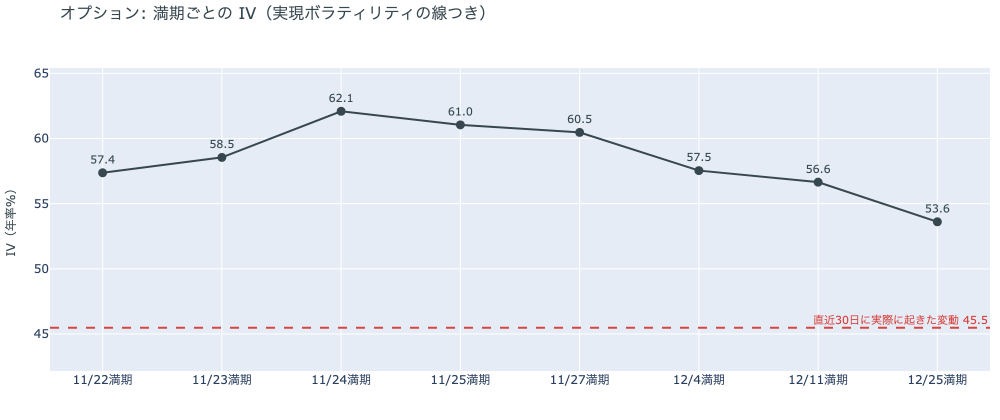

*図の見方: IVを満期ごとに並べたもの。点線は実現ボラティリティ。IVが点線より下なら、市場はこの先の値動きを過去の値動きより小さいと見ています。*

| 満期 | IV |
|---|---:|
| 11月22日 | 57 |
| 11月23日 | 59 |
| 11月24日〜11月27日 | 61〜62 |
| 12月4日〜12月11日 | 57〜58 |
| 12月25日 | 54 |

* IVは全体で52.5で、実現ボラティリティ45.5より7.1pt高い。過去1年の下から98%。

参加者は、この先の値動きをこれまでより大きいと見ていて、怖さは過去1年でいちばん上のあたりにあります。IV（＝値動きの幅の予想）は全体で実現ボラティリティ（＝過去の値動きの幅）を上回っていて、土曜日の往復のあとも、参加者は備えを買い続けています。中でも、11月24日から27日に満期が来るオプションの権利料には、年末の満期に対する上乗せが乗っています。米国の PCE 物価指数が出て、感謝祭で株式市場が休む週に、大きく動くと見られているからです。

**図④-2 満期ごとのプットとコールの差**

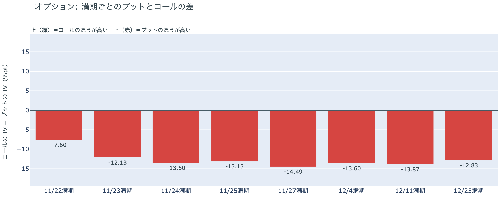

*図の見方: 満期ごとに、プットとコールのどちらが高く売れているか。ゼロより上ならコールのほうが高く、下ならプットのほうが高い。*

| 満期 | どちらが高いか |
|---|---|
| 11月22日 | プットが高い（差はいちばん小さい） |
| 11月23日 | プットが高い |
| 11月24日 | プットが高い |
| 11月25日 | プットが高い |
| 11月27日 | プットが高い（差はいちばん大きい） |
| 12月4日 | プットが高い |
| 12月11日 | プットが高い |
| 12月25日 | プットが高い |

参加者は、動くなら下だと見ています。どの満期もプットのほうが高く、下げへの備えをいちばん厚く置いているのは、感謝祭をまたぐ11月27日の満期です。$55,000台への下げと$60,000台への戻しを経ても、備えの置き場は前日から変わっていません。

**図④-3 12月25日満期の持ち高（権利の価格ごと）**

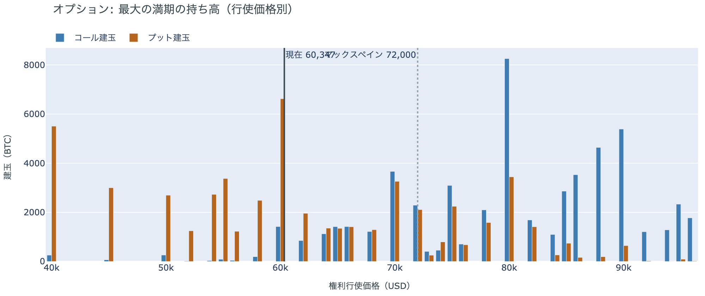

*図の見方: 青＝コール、橙＝プット。現値より上にコールが、下にプットが積まれるのが普通です。*

| 12月25日満期のオプション（基準の価格は約$60,300） | 量（万BTC） | 意味 |
|---|---:|---|
| コール（決めた価格で買う権利） | 約9.3 | 「価格が上がる」に賭けた分 |
| プット（決めた価格で売る権利） | 約6.3 | 「価格が下がる」への保険 |
| うち、いまより15%以上高い価格のコール | 約8.4 | 大きな上げへの賭け |
| うち、いまより15%以上安い価格のプット | 約2.0 | 大きな下げへの保険 |

* 12月25日満期の持ち高は約15.7万BTCと全満期の38%で、コールがプットの1.5倍。

年末の最大の満期では、「価格が上がる」に賭けた人たちが$55,000台まで下げた昼にも降りておらず、年末までの上げへの期待は手放されていません。週明けの週に下げへ備えながら年末のコールを持ち続けているので、参加者は目の前の下げと年末に向けた見方を分けて持っています。大きな上げに賭けた分が報われるには、12月25日の夕方5時までに約$69,400を超える必要があります。全満期でオプションの持ち高が集まっているのは$58,000〜$62,000の帯で、いちばん多いのは$60,000です。価格は$55,000台からその帯の中へ戻っています。

### ⑤ 高い価格で受け取ったコインの再送金は増え続けているが、過去の大きな底ほどの量ではない

**図⑤-1 コインが最後に送金された日の価格の分布（11月20日時点）**

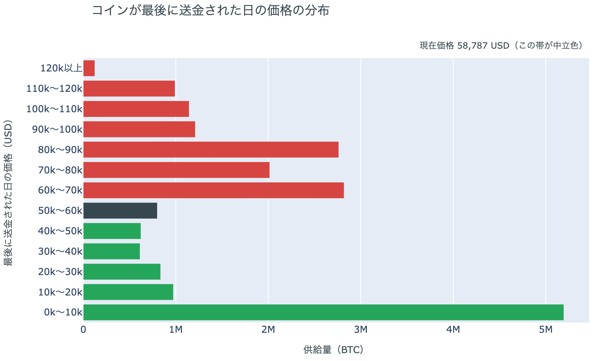

*図の見方: ビットコインはアドレスからアドレスへ送金されるたびに、受け取った側に新しい記録ができる。この図は、いまあるコインを、最後に送金された日の価格で束ねたもの。送金には売買のほか、取引所への入金・引き出しや自分のウォレット間の移し替えも含み、取引所の中での売買は含まない。*

| 過去の大きな下げの底 | 価格より上にいるコインの割合 | 30日以上置いたコインが値下がりした状態で再び送金された量（1週間平均） |
|---|---:|---:|
| 2018年12月（2018年の冬の底） | 60.6% | 約4.1万BTC/日 |
| 2020年3月（コロナショック） | 57.4% | 約8.4万BTC/日 |
| 2022年6月（Luna・3AC の破綻） | 51.1% | 約7.2万BTC/日 |
| 2022年11月（FTX の破綻） | 55.1% | 約7.1万BTC/日 |
| **2026年11月20日** | **57.0%** | **約3.4万BTC/日** |

* 値下がり再送金は1週間前の約2.2万BTC/日から増えた。2017年以降の下から95%。

高い価格で受け取ったコインが値下がりした状態で再び送金される量は、1週間でさらに増えましたが、過去の大きな底の量にはまだ届いていません。11月20日の量は2017年以降の真ん中の値の3.7倍ですが、2018年の底の8割ほどで、2020年と2022年の底の半分にも届いていません。一方で、いまより高い価格で最後に送金されたコインの割合は57%と、真ん中の値の24%の2倍を超え、過去の大きな下げの底と同じくらいの高さです。値下がりしたコインの多さは底のときと並んでいますが、それがまとめて送金し直される動きは、底のときほどの量にはなっていません。

11月20日時点の分布にいまの価格を重ねると、価格は$60,000〜$70,000の帯へ戻り、その下端からわずか0.3%上にいます。

## 4. 価格に影響しうる直近のイベント

オプション市場が IV をいちばん高く付け、プットの備えをいちばん厚く置いているのは11月24日から27日の満期で、米国の PCE 物価指数と感謝祭の休場が重なる週に当たります。

| 日付 | イベント | 何に効くか |
|---|---|---|
| 11/25（水） | 米10月の PCE 物価指数と、7〜9月期の GDP の改定値 | 金利 |
| 11/26（木） | 米国は感謝祭で株式市場が休場 | 米国株・ETF の取引が止まる |
| 11/30（月）米国時間の引け | MSCI の指数から米 Strategy（＝ビットコインを大量に持つ米企業）が外れる実施日 | Strategy の株と、指数に連動する資金 |
| 12/3（木） | ドイツ・ライプツィヒ地裁で Movie2k 事件の裁判が再開。被告が4万BTCを引き渡せば打ち切るという裁判所の案に、双方はまだ答えていない | 当局の手に渡りうる4万BTC |
| 12/9（水） | FOMC。0.25ptの利上げは織り込み済みで、0.5ptの利上げの織り込みは約1割。結果は日本時間10日早朝 | 金利 |
| 12/25（金）17:00 | オプションの最も大きな満期（約15.7万BTC、全満期の38%） | 約$69,400以上のコールの期限 |

## まとめ

土曜日のビットコインは、新しいきっかけが無いまま、先物のロングの清算で$55,000台まで下げ、ショートの買い戻しで$60,000台へ戻りました。往復を運んだのは先物だけで、アメリカの買い手と長期保有者の持ち方は土曜日には変わっていませんが、前日までの売りはどちらも続いています。参加者は、先物では戻したあとも下げに賭ける側に残り、オプションでは週明けの週に下げへの備えをいちばん厚く置いていて、下げが終わったとは見ていませんが、年末に向けた上げの賭けは降りずに持ち続けています。

---

<small>（数値は11月22日7時5分（日本時間）までのデータに基づきます。価格・先物・オプションはその時点の値、市場心理は11月21日の確定値、オンチェーン（＝ブロックチェーン上の記録）は11月20日時点、ETF資金フローは11月20日分まで（11月20日分は iShares（IBIT）の数字がまだ入っていない合計）です。証券市場の終値は11月20日時点で、週末のため更新がありません。オンチェーンの長期保有者の数値には、ETFや取引所が預かっている分も含まれます。清算は Hyperliquid で拾えた分だけで、市場全体のごく一部です。オプションはDeribit（BTCオプションの大半を占める取引所）の全銘柄です。）</small>

*本稿は情報提供を目的としたものであり、投資助言ではありません。将来の価格動向を保証・示唆するものではなく、投資判断は各自の責任において行ってください。*
