# 日曜に$61,000台まで戻す ― ショートの清算が上げを速め、資金調達率はプラスへ

**2026年11月23日**

ビットコインは日曜日、昼に$58,000台まで下げたあと、夕方の上げで$61,000台まで戻しました。

* **価格**：24時間の値幅は4.9%と、前日の10.5%から半分以下に縮んだ。朝7時5分の時点では約$60,772で、24時間前より1.3%高く、前日の大きな往復のあとで落ち着きを取り戻しつつある
* **きっかけ**：新しいきっかけは見当たらない。証券市場は週末で閉まっていて、金曜に米国のハイテク株が崩れた不安は、週明けの取引まで持ち越されたままになっている
* **先物**：昼に積まれた売り持ち（ショート）が、夕方の上げで清算（＝証拠金不足で強制的に閉じられた取引）されて上げを速め、同じ時間に新しい買い持ち（ロング）も入った。ロングがわずかに多い側へ戻り、下げに賭ける傾きは前日から解けた
* **需給の土台**：日曜日の戻しは米国の買い手と長期保有者まで届いていない。米国の買い手は戻しに加わらず、長期保有者も損失の出る価格で減り方をさらに大きくしていて、売りは前日から続いている
* **オプションの見方**：この先の値動きを過去より大きいと見る構えは変わらず、下げへの備えを今日の満期と12月の満期に厚く置いている。年末に向けた上げの賭けは降りていない

## 1. 何が起きたか

**図1-1 価格の推移（1時間足・直近7日）**

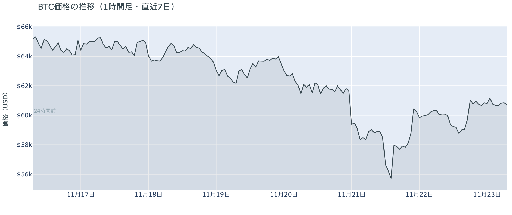

*図の見方: 1時間ごとの価格（日本時間）。点線は24時間前の水準です。*

* 24時間の値幅は4.9%で、前日の10.5%から半分以下に縮んだ。
* 値動きの速い5分足（24時間の上位1割）に、拾えた清算の96%が入っていた。

日曜日の戻しは、昼に積まれたショートが夕方に振り落とされる形で進みました。昼の14時台に価格が下げたとき、建玉（＝先物の未決済残高。証拠金で張っている人の量）は増えていて、新しくショートが積まれています。そのショートが、17〜18時台の上げで清算され、上げを速めました。この上げの間も建玉は増えていて、ショートが減る以上に新しいロングが入っています。21時台には、その新しいロングの一部が清算されて1度押し戻されましたが、価格は$60,000台を保ったまま朝を迎えています。

**図1-2 価格と50日・200日移動平均**

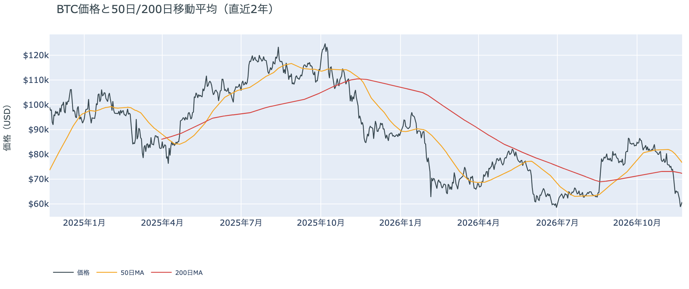

*図の見方: 2本の平均線の上下関係を見ます。50日線が200日線の上にあるのがゴールデンクロスです。*

* 50日線と200日線の差は約$4,334（5.99%）で、前日の6.51%から縮んだ。
* 朝7時5分の価格は50日線を20.7%下回る。

長い目で見た流れの向きはまだ変わっていませんが、2本の差は日ごとに縮み続けています。ゴールデンクロス（＝50日線が200日線を上抜けること）の状態は76日目で、日曜日に戻したあとも、価格は50日線の2割下にいます。

証券市場は週末で閉まっています。11月20日はナスダック100が−5.6%、S&P500が−3.7%、金が−4.6%と、株と金がそろって売られて終わりました。外部環境から持ち越された不安は、週明けに証券市場が開くまで答えが出ないまま残っていて、日曜日のビットコインはその不安の中で、自分の先物の持ち高だけで戻しました。

**図1-3 価格に清算を重ねた図（直近24時間）**

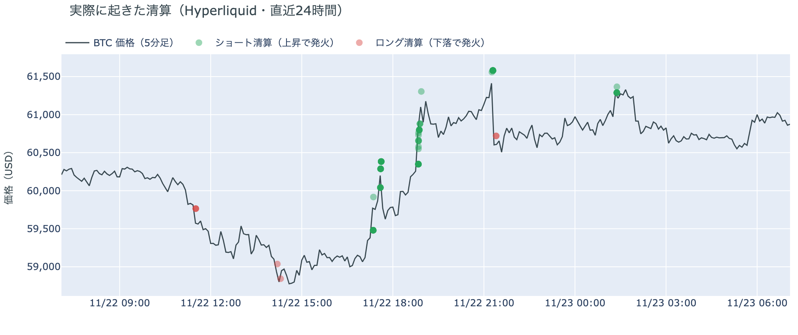

*図の見方: 価格の線に、Hyperliquid で拾えた清算を時刻ごとに重ねたもの（日本時間）。*

清算は、夕方の上げで焼けたショートと、夜に焼けたロングの2つの山に分かれています。Hyperliquid（＝オンチェーンの先物取引所）で拾えた分では、最大の1件でも全体の14%にとどまり、80のアドレスに散っています。前日のように大口1件が飛んだのではなく、多くの持ち高が少しずつ振り落とされた形です。

## 2. なぜ動いたか：きっかけと、需給のどこが動いたか

**図2-1 ビットコインと株・金・原油の相対推移（起点＝100）**

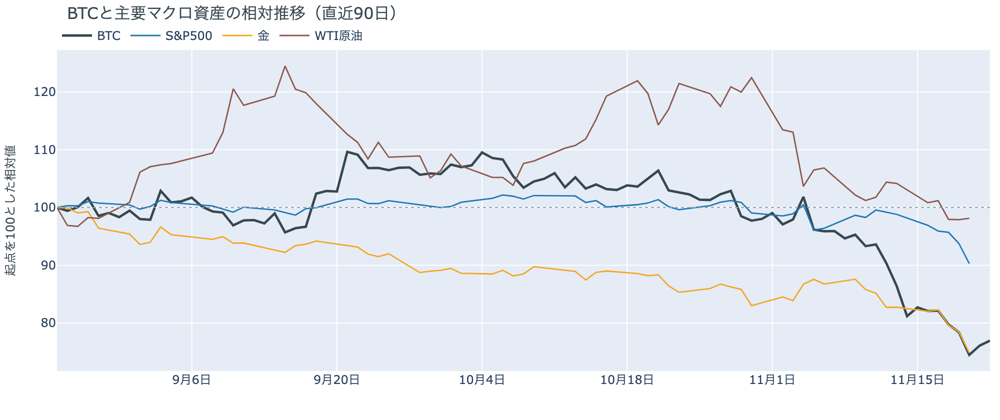

*図の見方: 同じ起点から何%動いたかで重ねたもの。線の向きが揃っているかを見ます。*

| この5営業日の動き（ビットコインは7日間） | 変化 |
|---|---:|
| ビットコイン | −7.0% |
| 金 | −9.5% |
| 米国株（S&P500） | −8.6% |
| 原油 | −5.8% |

* 建玉は93,101BTCで、前日の91,854BTCから1.4%増えた。
* 1日をならした年率は+0.65%で、短期金利（13週Tビル 4.12%）を引いた上乗せは−3.47pt。

日曜日の戻しは、新しいきっかけが無いまま、先物のショートの清算と新しいロングを通って起きました。

1. きっかけ：日曜日の値動きにつながる新しい出来事は見当たりません。証券市場は閉まっていて、株・金利・原油から新しい材料は来ていません。前の週の下げと並んでいた米国のハイテク株の売り（11月20日に、SEC が会計を調べていると報じられた NVIDIA が−14%）は、週明けまで持ち越されています。業界でも、取引所や政府のビットコインの大きな移動のような出来事は出ていません。
2. 伝わり方：速い側の先物が戻しを運びました。昼に積まれたショートが夕方の上げで清算されて上げを速め、同じ時間に新しいロングが入って、建玉は1日で増えています。資金調達率（＝ロングが払う金利。プラス＝ロングがショートより多い）は1日をならしてプラスに戻り、残った持ち高でもロングがわずかに多い側へ移りました。日曜日の戻しは、アメリカの買い手と長期保有者までは届いていません。アメリカの価格は戻しの間もほかより安いままで（図①-1）、長期保有者の減り方は11月21日時点でさらに大きくなっています（図②-1）。遅い側は、前日までの売りを続けています。

## 3. 市場参加者はいまどう見ているか

### ① アメリカの買い手は戻しに加わらず、売りの側に立ったまま

**図①-1 Coinbase Premium（アメリカとそれ以外の価格差・直近90日）**

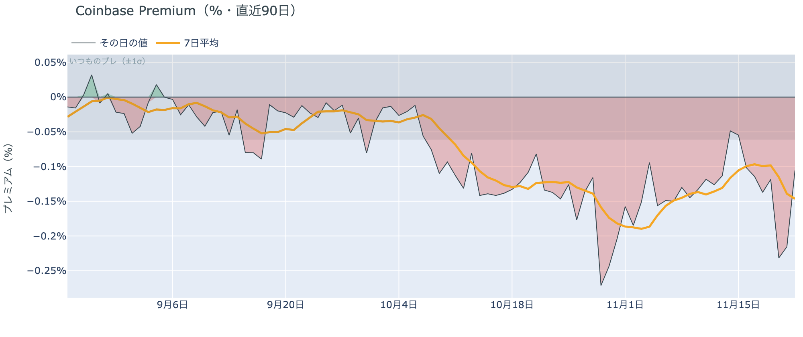

*図の見方: プラス＝アメリカで買いが強い。太線が1週間平均、細線がその日の値。薄い帯は「いつものブレの範囲」です。*

* 1週間平均は−0.15%で、前の週の−0.11%から沈んだ。
* その日の値は−0.11%で、いつものブレの1.7倍のマイナス。

アメリカの買い手は、$61,000台への戻しを買いに回る場面とは見ておらず、売りの側に立ったままです。Coinbase Premium（＝アメリカとそれ以外の価格差）は1週間平均で前の週より沈み、日曜日の値もいつものブレを超えるマイナスでした。アメリカの価格がほかより安いまま価格が戻したので、日曜日の戻しを引っ張ったのはアメリカの買い手ではありません。

**図①-2 ETFの日ごとの資金の出入り（直近90日）**

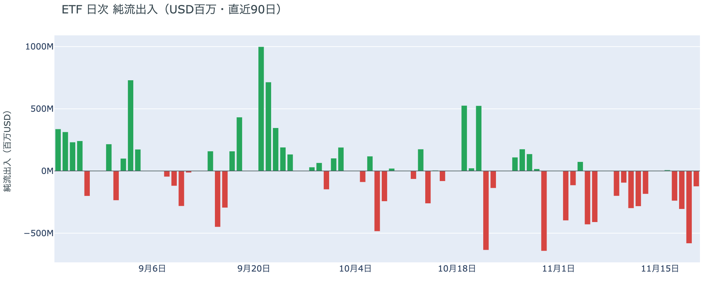

*図の見方: 入ったお金と出たお金の差。上に伸びれば入り超、下に伸びれば出超。*

| ETFの日ごとの出入り | 億ドル |
|---|---:|
| 11月16日 | +0.1 |
| 11月17日 | −2.4 |
| 11月18日 | −3.1 |
| 11月19日 | −5.8 |
| 11月20日 | −1.2 |
| 直近7営業日の合計 | −17.1 |

* 11月20日分は、最大の iShares（IBIT）の数字がまだ入っていない合計。

ETFの買い手は、11月20日までの時点で資金を引き揚げる動きをやめていません。出超は4営業日続き、1週間をならしても引き揚げの側です。週末はETFの取引が無いので、$55,000台への下げや日曜日の戻しを、ETFの買い手がどう受け止めたかはまだ数字に出ていません。

**図①-3 Fear & Greed（市場心理の指数・直近90日）**

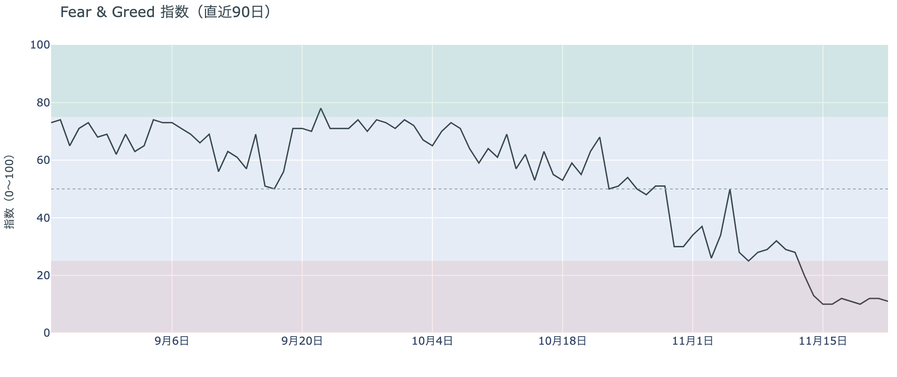

*図の見方: 0〜100で、50より上が「強欲」、下が「恐怖」。*

* 11の「極度の恐怖」。1週間前は10、1か月前は50。

参加者の多くは、戻しのあとも下げへの怖さを緩めていません。Fear & Greed（＝市場心理の指数）の11月22日の値は、2018年からの記録で下から4%に入る低さです。土曜日の往復でも日曜日の戻しでも数字は動かず、怖さは1週間ずっと底のあたりに張りついています。

### ② 長期保有者は損失の出る価格でも減らし続け、減り方はさらに大きくなった

**図②-1 長期保有者の保有量の30日変化とSOPR（直近90日）**

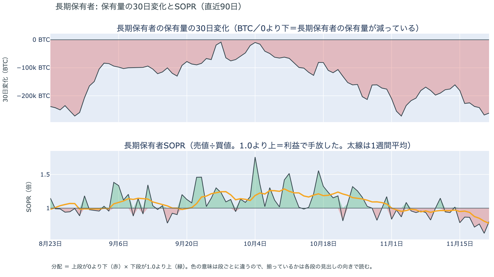

*図の見方: 上段は、長期保有者の保有量が30日でどれだけ増減したか。マイナス＝手放している。下段は長期保有者SOPRで、1より上なら利益で手放した。どちらも太線の1週間平均で読みます。*

| 11月21日時点 | 1週間平均 | 前の週の平均 |
|---|---:|---:|
| 長期保有者SOPR（1より上＝利益で手放した） | 0.78 | 0.97 |
| 長期保有者の保有量の30日変化（万BTC） | −23.5 | −17.9 |

* 11月21日の30日変化は−26.2万BTCで、1か月前（10月22日）の−13.0万BTCの2倍。

長期保有者（＝155日以上保有者）は、損失の出る価格でも手放すのをやめておらず、下げが終わったとは見ていません。保有量は30日で減り、動いたコインは平均して買値より安く動いているので、利益確定の売りとは呼べない形のまま減っています。減り方は前の週より大きくなり、動いたコインの損失も前の週より深くなりました。前日も同じ形を説明しましたが、1日新しい数字でも向きは変わらず、さらに一段進んでいます。

ほかに売りを急ぎそうな持ち手は見当たりません。マイナーの収入は平年をやや下回るところで止まっていて（Puell Multiple（＝マイナー収入の平年比）が11月21日時点の1週間平均で0.91）、前の週より持ち直しています。長く眠っていたコインが急に動いた記録もありません。

### ③ 先物：下げに賭ける傾きは解けたが、上げに強く賭け直してもいない

**図③-1 資金調達率と建玉（直近30日）**

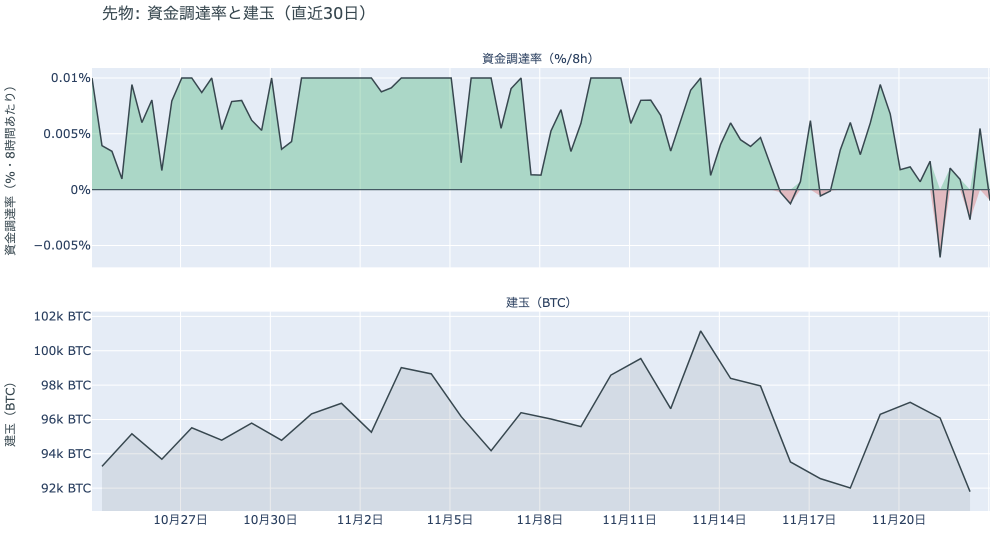

*図の見方: 上段は資金調達率（8時間ごと・日本時間）。プラスが続く＝ロングがショートより多い。下段は建玉。*

* 上乗せは前日の−5.30ptから−3.47ptへ戻した。直近34日の平均は+2.44pt。
* 建玉の7日変化は−6.3%。

先物の参加者は、下げに賭ける傾きを解きましたが、上げに強い確信を持って賭け直してはいません。前日は「戻したあとも下げに賭ける側に残っている」と説明しましたが、日曜日にショートが清算で減り、新しいロングが入ったので、その説明は今日の数値とは合わなくなりました。いまはロングがわずかに多い側です。それでも、ロングが払う金利は短期金利（＝ドルを米国の短期国債で持つだけで受け取れる金利）を大きく下回っていて、余分に払ってでも上げに賭けたい人はまだ戻っていません。建玉も1週間前より少なく、11月の下げで手仕舞われた持ち高を積み直すところまでは来ていません。

### ④ オプション：今日の満期と12月の満期に下げへ厚く備え、年末の上げの賭けは降りていない

オプションには2種類あります。コール（＝決めた価格で買う権利）とプット（＝決めた価格で売る権利）で、価格が上がればコールの価値が上がり、価格が下がればプットの価値が上がります。プットは「価格が下がったときの保険」として買われます。オプションを買う人は、その権利と引き換えに権利料（＝オプションを買う人が払う金額）を払います。

**図④-1 満期ごとのIV（年率%）**

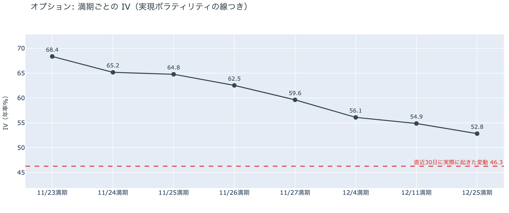

*図の見方: IVを満期ごとに並べたもの。点線は実現ボラティリティ。IVが点線より下なら、市場はこの先の値動きを過去の値動きより小さいと見ています。*

| 満期 | IV |
|---|---:|
| 11月23日 | 68 |
| 11月24日〜11月26日 | 63〜65 |
| 11月27日 | 60 |
| 12月4日〜12月11日 | 55〜56 |
| 12月25日 | 53 |

* IVは全体で58.0で、実現ボラティリティ46.3より11.8pt高い。過去1年の下から97%。

参加者は、この先の値動きをこれまでより大きいと見ていて、目の前ほど強く身構えています。IV（＝値動きの幅の予想）は全体で実現ボラティリティ（＝過去の値動きの幅）を上回り、日曜日に値動きが落ち着いても、備えを買う手は緩んでいません。中でも、今日の夕方5時に満期が来るオプションの権利料には、ほかの満期に対する上乗せが乗っています。2日続けて大きく動いた週末のあと、週明けの最初の1日にも大きく動くと見られているからです。

**図④-2 満期ごとのプットとコールの差**

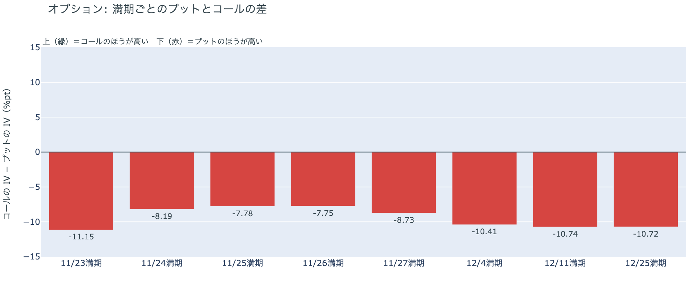

*図の見方: 満期ごとに、プットとコールのどちらが高く売れているか。ゼロより上ならコールのほうが高く、下ならプットのほうが高い。*

| 満期 | どちらが高いか |
|---|---|
| 11月23日 | プットが高い（差はいちばん大きい） |
| 11月24日 | プットが高い |
| 11月25日 | プットが高い |
| 11月26日 | プットが高い（差はいちばん小さい） |
| 11月27日 | プットが高い |
| 12月4日 | プットが高い |
| 12月11日 | プットが高い |
| 12月25日 | プットが高い |

参加者は、動くなら下だと見ていて、その備えを今日の満期と12月の満期に厚く置いています。どの満期もプットのほうが高く、差が小さいのは米国の PCE 物価指数と感謝祭が重なる週の半ばです。前日いちばん厚かった感謝祭をまたぐ11月27日の満期から、備えの重心は今日の満期と、FOMC（＝米国の金利を決める会合）をまたぐ12月の満期へ移りました。

**図④-3 12月25日満期の持ち高（権利の価格ごと）**

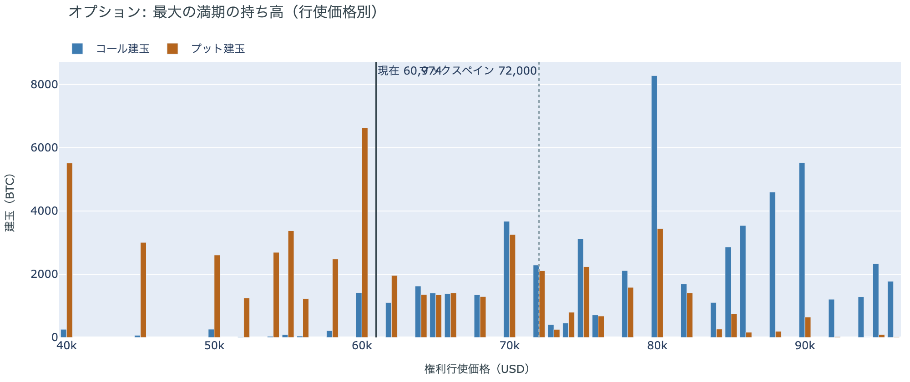

*図の見方: 青＝コール、橙＝プット。現値より上にコールが、下にプットが積まれるのが普通です。*

| 12月25日満期のオプション（基準の価格は約$61,000） | 量（万BTC） | 意味 |
|---|---:|---|
| コール（決めた価格で買う権利） | 約9.4 | 「価格が上がる」に賭けた分 |
| プット（決めた価格で売る権利） | 約6.4 | 「価格が下がる」への保険 |
| うち、いまより15%以上高い価格のコール | 約8.1 | 大きな上げへの賭け |
| うち、いまより15%以上安い価格のプット | 約2.0 | 大きな下げへの保険 |

* 12月25日満期の持ち高は約15.7万BTCと全満期の37%で、コールがプットの1.5倍。

年末の最大の満期では、「価格が上がる」に賭けた人たちが週末の往復を通しても降りておらず、年末までの上げへの期待は手放されていません。目の前の下げに厚く備えながら年末のコールを持ち続けているので、参加者は足元の下げと年末に向けた見方を分けて持っています。大きな上げに賭けた分が報われるには、12月25日の夕方5時までに約$70,100を超える必要があります。全満期でオプションの持ち高が集まっているのは$58,000〜$65,000の帯で、いちばん多いのは$60,000です。価格はその帯の中にいます。

## 4. 価格に影響しうる直近のイベント

オプション市場がプットの備えをいちばん厚く置いているのは、今日の夕方5時の満期と12月の満期です。今日の満期は週明けのアジアと欧州の時間に当たり、決まったイベントはありません。12月の満期は、12月9日の FOMC と12月25日の最も大きな満期をまたぎます。米国の PCE 物価指数と感謝祭が重なる週の半ばの満期は、備えが比べて薄くなっています。

| 日付 | イベント | 何に効くか |
|---|---|---|
| 11/25（水） | 米10月の PCE 物価指数と、7〜9月期の GDP の改定値 | 金利 |
| 11/26（木） | 米国は感謝祭で株式市場が休場 | 米国株・ETF の取引が止まる |
| 11/30（月）米国時間の引け | MSCI の指数から米 Strategy（＝ビットコインを大量に持つ米企業）が外れる実施日 | Strategy の株と、指数に連動する資金 |
| 12/3（木） | ドイツ・ライプツィヒ地裁で Movie2k 事件の裁判が再開。被告が4万BTCを引き渡せば打ち切るという裁判所の案に、双方はまだ答えていない | 当局の手に渡りうる4万BTC |
| 12/9（水） | FOMC。0.25ptの利上げは織り込み済みで、0.5ptの利上げの織り込みは約1割（11月20日時点）。結果は日本時間10日早朝 | 金利 |
| 12/25（金）17:00 | オプションの最も大きな満期（約15.7万BTC、全満期の37%） | 約$70,100以上のコールの期限 |

## まとめ

日曜日のビットコインは、新しいきっかけが無いまま、昼に積まれたショートが夕方の清算で振り落とされ、新しいロングも入って$61,000台まで戻しました。戻しを運んだのは先物だけで、アメリカの買い手は戻しに加わらず、長期保有者も損失の出る価格で減り方を大きくしていて、遅い側の売りは前日から続いています。参加者は、先物では下げに賭ける傾きを解きましたが、オプションでは目の前と12月に下げへの備えを厚く置いたままで、戻しを下げの終わりとは見ていません。ただ、年末に向けた上げの賭けは、週末の往復を通しても降りずに持ち続けています。

---

<small>（数値は11月23日7時5分（日本時間）までのデータに基づきます。価格・先物・オプションはその時点の値、市場心理は11月22日の確定値、オンチェーン（＝ブロックチェーン上の記録）は11月21日時点、ETF資金フローは11月20日分まで（11月20日分は iShares（IBIT）の数字がまだ入っていない合計）です。証券市場の終値は11月20日時点で、週末のため更新がありません。オンチェーンの長期保有者の数値には、ETFや取引所が預かっている分も含まれます。清算は Hyperliquid で拾えた分だけで、市場全体のごく一部です。オプションはDeribit（BTCオプションの大半を占める取引所）の全銘柄です。）</small>

*本稿は情報提供を目的としたものであり、投資助言ではありません。将来の価格動向を保証・示唆するものではなく、投資判断は各自の責任において行ってください。*
