# NVIDIAのCEO復帰で一時$64,000台へ ― 株は上げを保ち、ビットコインは上げを返す

**2026年11月24日**

ビットコインは月曜日、夜に$64,000台まで跳ねたあと、朝までにその上げをすべて返しました。

* **価格**：24時間の値幅は7.0%と、前日の4.9%から広がった。それでも朝7時5分の時点では約$61,201で、24時間前とほぼ同じ（+0.3%）。夜の上げは何も残らなかった
* **きっかけ**：米国の取引が始まる時間に、NVIDIA が Jensen Huang の CEO 復帰を決めたと伝わり、米国株と同じ時間に跳ねた。ただ、株が1日を通して上げを保ったのに対し、ビットコインは1時間後から下げに転じたので、戻りまでは共通のきっかけではない
* **先物**：跳ねた1時間は売り持ち（ショート）の清算（＝証拠金不足で強制的に閉じられた取引）が上げを速め、その後の下げは高値で入った買い持ち（ロング）の清算が速めた。下げの間に新しいショートも積まれていて、上げを追う確信は1日で消えた
* **需給の土台**：米国の買い手と長期保有者は、夜の上げにも加わっていない。ETF は11月20日まで5営業日で約22億ドルを引き揚げ、長期保有者も損失の出る価格で減り方を大きくしていて、売りは前日から続いている
* **オプションの見方**：この先の値動きを過去より大きいと見る構えは続いているが、身構えは前日より緩んだ。どの満期でもプットのほうが高く、動くなら下だという見方は変わっていない

## 1. 何が起きたか

**図1-1 価格の推移（1時間足・直近7日）**

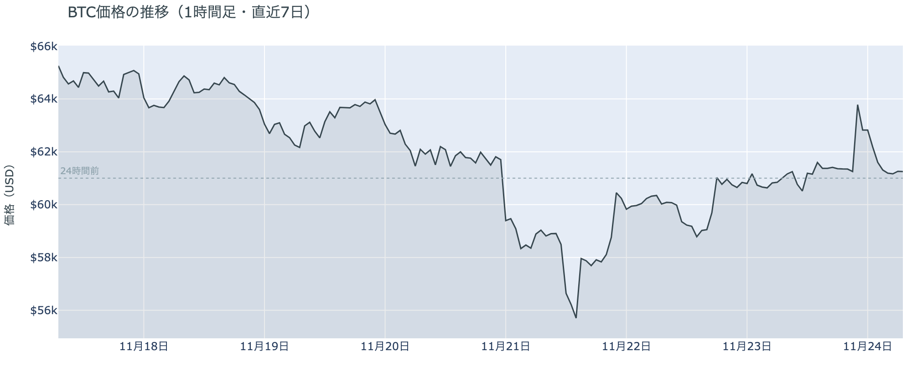

*図の見方: 1時間ごとの価格（日本時間）。点線は24時間前の水準です。*

* 24時間の値幅は7.0%で、前日の4.9%から広がった。
* 値動きの大きい5分足の上位は、5本とも23時前後の1時間に集まっている。

月曜日の値動きは、夜の1時間に跳ね、そこから朝までかけて返す形でした。22時台の跳ね上がりでは、建玉（＝先物の未決済残高。証拠金で張っている人の量）が減っていて、ショートが買い戻されています。そのショートの清算が上げを速めました。23時台に下げへ転じると、今度は高値で入ったロングの清算が下げを速め、同じ時間に建玉は増えて、新しいショートが積まれています。そこから朝4時台まで、ロングの清算を挟みながら価格はじりじり下げ、跳ねる前の$61,000台に戻りました。

**図1-2 価格と50日・200日移動平均**

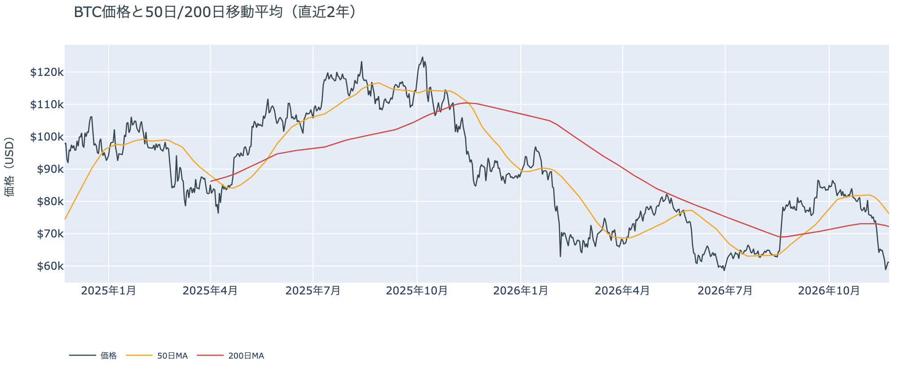

*図の見方: 2本の平均線の上下関係を見ます。50日線が200日線の上にあるのがゴールデンクロスです。*

* 50日線と200日線の差は約$3,928（5.44%）で、前日の5.99%から縮んだ。
* 朝7時5分の価格は50日線を19.6%下回る。

長い目で見た流れの向きはまだ変わっていませんが、2本の差は今日も縮みました。ゴールデンクロス（＝50日線が200日線を上抜けること）の状態は77日目で、夜に$64,000台まで跳ねても、価格は50日線の2割下から抜け出していません。

証券市場は11月23日、株が大きく戻して終わりました。S&P500は+4.7%、ナスダック100は+6.7%で、前の週の株の売りから一転しています。週末から持ち越されていた株の不安は月曜日にいったん解けましたが、ビットコインはその戻りを1日の上げとして持ち続けることはできませんでした。

**図1-3 価格に清算を重ねた図（直近24時間）**

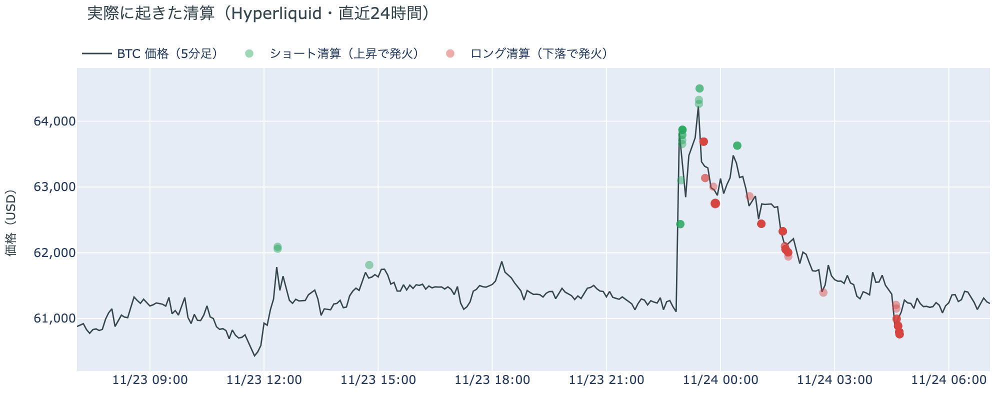

*図の見方: 価格の線に、Hyperliquid で拾えた清算を時刻ごとに重ねたもの（日本時間）。*

清算は、23時台に焼けたロングの山が中心で、24時間に拾えた分の9割がロングでした。Hyperliquid（＝オンチェーンの先物取引所）で拾えた分では、最大の1件が全体の半分を占めていて、多くの持ち高が振り落とされたというより、大口1件が飛んだ形です。

## 2. なぜ動いたか：きっかけと、需給のどこが動いたか

**図2-1 ビットコインと株・金・原油の相対推移（起点＝100）**

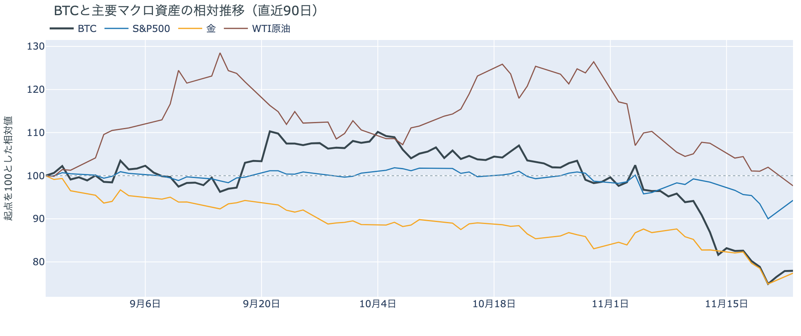

*図の見方: 同じ起点から何%動いたかで重ねたもの。線の向きが揃っているかを見ます。*

| この5営業日の動き（ビットコインは7日間） | 変化 |
|---|---:|
| ビットコイン | −5.6% |
| 金 | −5.7% |
| 米国株（S&P500） | −2.4% |
| 原油 | −6.2% |

* 建玉は93,465BTCで、前日の93,101BTCからわずかに増えた。
* 1日をならした年率は+3.58%で、短期金利（13週Tビル 4.15%）を引いた上乗せは−0.57pt。

月曜日の跳ね上がりは NVIDIA の CEO 復帰をきっかけに先物のショートの清算を通って起き、戻りは高値で入ったロングの清算と新しいショートを通って起きました。

1. きっかけ：NVIDIA の取締役会が、11日前に退いた Jensen Huang を CEO に戻すと決め、米国の取引が始まる時間に伝わりました。NVIDIA は+31%、ナスダック100は+6.7%で終わり、ビットコインはその同じ時間に跳ねています。ただし株は1日を通して上げを保ったのに対し、ビットコインは1時間後から下げに転じたので、戻りのほうは株と逆向きで、共通のきっかけではありません。業界では、Strategy の457BTCの買い増しが伝わった程度で、価格を動かす規模の出来事は見当たりません。原油は−4.2%と下げましたが、ビットコインの値動きとは時間が重ならず、効いた形跡はありません。
2. 伝わり方：速い側の先物が、上げも戻りも運びました。跳ねた1時間はショートの清算が上げを速め、戻りではロングの清算が下げを速めながら、新しいショートが積まれています。資金調達率（＝ロングが払う金利。プラス＝ロングがショートより多い）は1日をならしてプラスを保ち、短期金利との差は前日より縮みましたが、まだ下回っています。月曜日の動きは、アメリカの買い手と長期保有者までは届いていません。アメリカの価格は1週間をならしてもほかより安く（図①-1）、ETF は11月20日まで引き揚げを続け（図①-2）、長期保有者の減り方も11月22日時点でさらに大きくなっています（図②-1）。遅い側は、株の戻りが来ても売りを続けています。

前日は「戻しを運んだのは先物だけで、遅い側の売りは前日から続いている」と説明しました。月曜日は、株が大きく戻すという外部環境からの追い風が来ても、上げは先物の清算の中で始まって終わり、遅い側の数字は一つも上向いていないので、前日の説明は今日の数値と合っています。

## 3. 市場参加者はいまどう見ているか

### ① アメリカの買い手は株の戻りにも加わらず、売りの側に立ったまま

**図①-1 Coinbase Premium（アメリカとそれ以外の価格差・直近90日）**

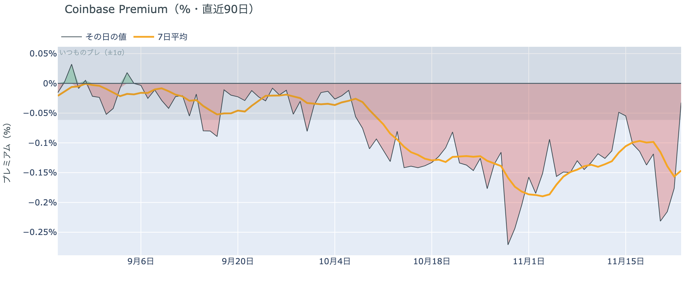

*図の見方: プラス＝アメリカで買いが強い。太線が1週間平均、細線がその日の値。薄い帯は「いつものブレの範囲」です。*

* 1週間平均は−0.15%で、前の週の−0.10%から沈んだ。
* その日の値は−0.03%で、いつものブレの範囲内。

アメリカの買い手は、株が戻った月曜日も、ビットコインを買い戻す場面とは見ていません。Coinbase Premium（＝アメリカとそれ以外の価格差）は1週間をならすと前の週より沈んでいて、アメリカの価格がほかより安い状態が続いています。月曜日の値はマイナスが小さくなりましたが、いつものブレの範囲の中なので、向きが変わったとは言えません。

**図①-2 ETFの日ごとの資金の出入り（直近90日）**

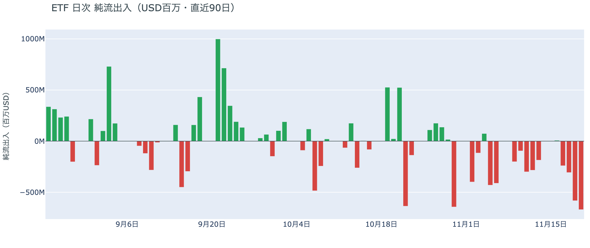

*図の見方: 入ったお金と出たお金の差。上に伸びれば入り超、下に伸びれば出超。*

| ETFの日ごとの出入り | 億ドル |
|---|---:|
| 11月16日 | +0.1 |
| 11月17日 | −2.4 |
| 11月18日 | −3.1 |
| 11月19日 | −5.8 |
| 11月20日 | −6.7 |
| 直近7営業日の合計 | −22.6 |

* 11月20日分のうち−5.4億ドルは、最大の iShares（IBIT）から。

ETF の買い手は、11月20日までの時点で引き揚げを速めています。前日の時点では入っていなかった iShares の数字がそろうと、11月20日は出超が4日続いたうちでいちばん大きい日になりました。出超は日を追うごとに大きくなっていて、下げの中で買いに回る ETF の買い手はまだ出ていません。株が戻った月曜日の出入りは、まだ数字に出ていません。

**図①-3 Fear & Greed（市場心理の指数・直近90日）**

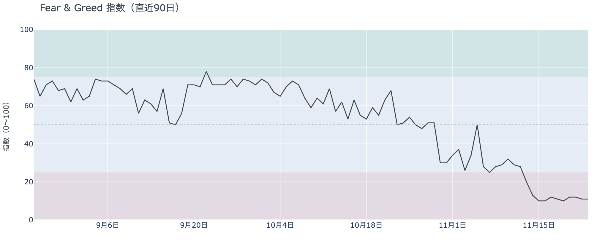

*図の見方: 0〜100で、50より上が「強欲」、下が「恐怖」。*

* 11の「極度の恐怖」。1週間前は10、1か月前は51。

参加者の多くは、株が戻っても下げへの怖さを緩めていません。Fear & Greed（＝市場心理の指数）の11月23日の値は、2018年からの記録で下から4%に入る低さのままで、10日近く底のあたりに張りついています。

### ② 長期保有者は損失の出る価格でも減らし続け、減り方はさらに大きくなった

**図②-1 長期保有者の保有量の30日変化とSOPR（直近90日）**

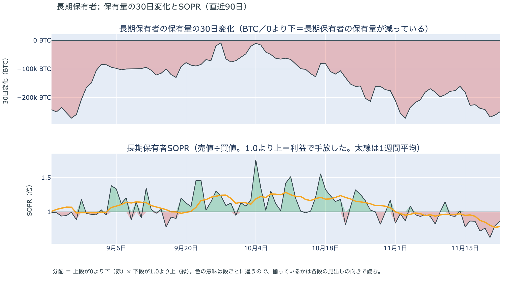

*図の見方: 上段は、長期保有者の保有量が30日でどれだけ増減したか。マイナス＝手放している。下段は長期保有者SOPRで、1より上なら利益で手放した。どちらも太線の1週間平均で読みます。*

| 11月22日時点 | 1週間平均 | 前の週の平均 |
|---|---:|---:|
| 長期保有者SOPR（1より上＝利益で手放した） | 0.79 | 0.95 |
| 長期保有者の保有量の30日変化（万BTC） | −24.5 | −18.1 |

* 11月22日の30日変化は−25.0万BTCで、1か月前（10月23日）の−15.3万BTCの1.6倍。

長期保有者（＝155日以上保有者）は、損失の出る価格でも手放すのをやめておらず、下げが終わったとは見ていません。保有量は30日で減り、動いたコインは平均して買値より安く動いているので、利益確定の売りとは呼べない形のまま減っています。減り方は前の週より大きく、動いたコインの損失も前の週より深くなりました。1日新しい数字でも、向きは前日から変わっていません。

ほかに売りを急ぎそうな持ち手は見当たりません。マイナーの収入は平年を1割ほど下回るところにあり（Puell Multiple（＝マイナー収入の平年比）が11月22日時点の1週間平均で0.90）、前の週よりわずかに持ち直しています。長く眠っていたコインが急に動いた記録も、今日はありません。

### ③ 先物：上げを追ったロングは振り落とされ、新しいショートが積まれた

**図③-1 資金調達率と建玉（直近30日）**

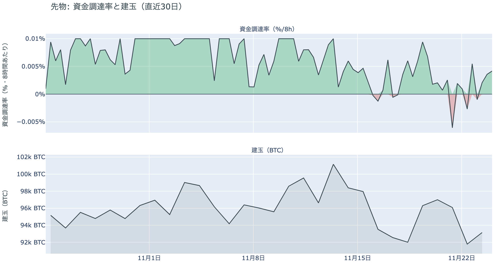

*図の見方: 上段は資金調達率（8時間ごと・日本時間）。プラスが続く＝ロングがショートより多い。下段は建玉。*

* 上乗せは前日の−3.47ptから−0.57ptへ戻した。直近34日の平均は+2.23pt。
* 建玉の7日変化は−0.4%。

先物の参加者は、株の戻りを見て一度は上げに乗りましたが、その上げを信じて持ち続けるほどの確信はありません。高値で入ったロングがその日のうちに清算され、下げの間に新しいショートが積まれたので、上げを追う人は夜のうちに減りました。それでも残った持ち高ではロングがわずかに多く、ロングが払う金利も短期金利（＝ドルを米国の短期国債で持つだけで受け取れる金利）との差を前日より縮めています。下げに賭ける側へ傾き直したわけではなく、上げにも下げにも強く賭けていない状態です。建玉は1週間前とほぼ同じで、11月の下げで手仕舞われた持ち高を積み直すところまでは来ていません。

### ④ オプション：身構えは前日より緩んだが、どの満期も下げへの備えが高いまま

オプションには2種類あります。コール（＝決めた価格で買う権利）とプット（＝決めた価格で売る権利）で、価格が上がればコールの価値が上がり、価格が下がればプットの価値が上がります。プットは「価格が下がったときの保険」として買われます。オプションを買う人は、その権利と引き換えに権利料（＝オプションを買う人が払う金額）を払います。

**図④-1 満期ごとのIV（年率%）**

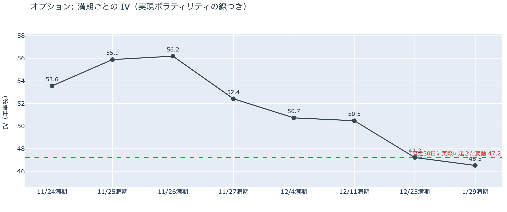

*図の見方: IVを満期ごとに並べたもの。点線は実現ボラティリティ。IVが点線より下なら、市場はこの先の値動きを過去の値動きより小さいと見ています。*

| 満期 | IV |
|---|---:|
| 11月24日 | 54 |
| 11月25日〜11月26日 | 56 |
| 11月27日 | 52 |
| 12月4日〜12月11日 | 51 |
| 12月25日 | 47 |

* IVは全体で55.4で、実現ボラティリティ47.2より8.2pt高い。過去1年の下から87%。

参加者は、この先の値動きをこれまでより大きいと見ていますが、前日ほどは身構えていません。IV（＝値動きの幅の予想）は全体で実現ボラティリティ（＝過去の値動きの幅）を上回ったままですが、過去1年の中での高さは前日の下から97%から下がりました。前日に今日の満期のオプションの権利料に乗っていた、ほかの満期に対する上乗せも剥がれています。いまいちばん高いのは、米国の PCE 物価指数をまたぐ11月25日と26日の満期ですが、ほかの満期との差は小さく、特定の日に大きく動くと見られているわけではありません。

**図④-2 満期ごとのプットとコールの差**

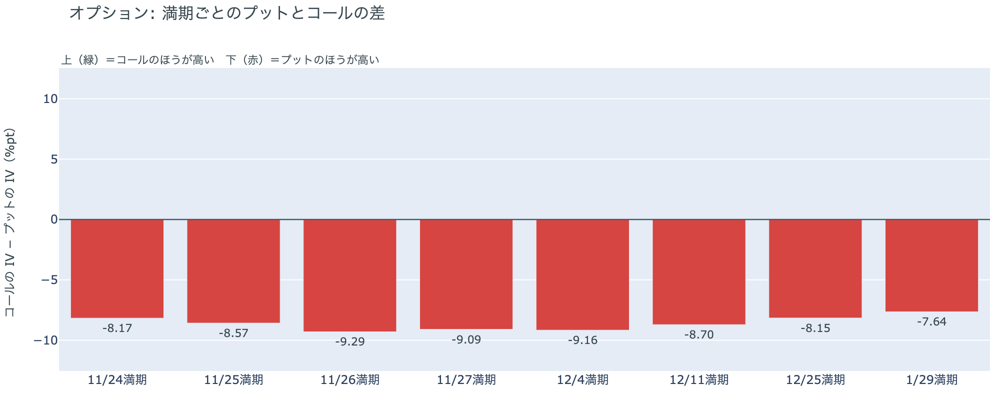

*図の見方: 満期ごとに、プットとコールのどちらが高く売れているか。ゼロより上ならコールのほうが高く、下ならプットのほうが高い。*

| 満期 | どちらが高いか |
|---|---|
| 11月24日 | プットが高い |
| 11月25日 | プットが高い |
| 11月26日 | プットが高い（差はいちばん大きい） |
| 11月27日 | プットが高い |
| 12月4日 | プットが高い |
| 12月11日 | プットが高い |
| 12月25日 | プットが高い |
| 1月29日 | プットが高い（差はいちばん小さい） |

参加者は、動くなら下だと見ていて、その見方を目の前から来年1月まで同じ厚さで持っています。どの満期もプットのほうが高く、差の大きさも満期ごとにほとんど変わりません。前日は今日の満期と12月の満期に備えが厚く寄っていましたが、月曜日の往復のあと、備えは特定の満期に寄らず、全体に均されました。株が大きく戻った日でも、下げへの備えを外す動きは出ていません。

**図④-3 12月25日満期の持ち高（権利の価格ごと）**

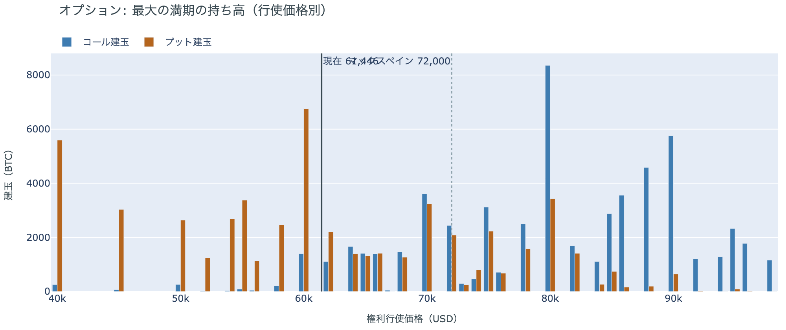

*図の見方: 青＝コール、橙＝プット。現値より上にコールが、下にプットが積まれるのが普通です。*

| 12月25日満期のオプション（基準の価格は約$61,400） | 量（万BTC） | 意味 |
|---|---:|---|
| コール（決めた価格で買う権利） | 約9.5 | 「価格が上がる」に賭けた分 |
| プット（決めた価格で売る権利） | 約6.4 | 「価格が下がる」への保険 |
| うち、いまより15%以上高い価格のコール | 約8.1 | 大きな上げへの賭け |
| うち、いまより15%以上安い価格のプット | 約2.2 | 大きな下げへの保険 |

* 12月25日満期の持ち高は約15.9万BTCと全満期の37%で、コールがプットの1.5倍。

年末の最大の満期では、「価格が上がる」に賭けた人たちが月曜日の往復を通しても降りておらず、年末までの上げへの期待は手放されていません。目の前ではどの満期もプットを高く値付けしながら、年末のコールは持ち続けているので、参加者は足元の下げへの備えと年末に向けた賭けを分けて持っています。大きな上げに賭けた分が報われるには、12月25日の夕方5時までに約$70,700を超える必要があります。全満期でオプションの持ち高が集まっているのは$58,000〜$65,000の帯で、いちばん多いのは$60,000です。夜に$64,000台まで跳ねた価格は、この帯の上の端から押し戻され、いまは帯の中にいます。

## 4. 価格に影響しうる直近のイベント

オプション市場のプットの備えは、特定の満期に寄らず、今日から1月まで同じ厚さで置かれています。IV がわずかに高いのは、米国の PCE 物価指数と GDP の改定値が出る11月25日をまたぐ満期で、FOMC をまたぐ12月の満期に IV の上乗せは乗っていません。

| 日付 | イベント | 何に効くか |
|---|---|---|
| 11/25（水） | 米10月の PCE 物価指数と、7〜9月期の GDP の改定値 | 金利 |
| 11/26（木）〜27（金） | 米国は感謝祭で26日は株式市場が休場、27日は短縮取引 | 米国株・ETF の取引が止まる・薄くなる |
| 11/29（日） | OPEC+ の会合 | 原油 |
| 11/30（月）米国時間の引け | MSCI の指数から米 Strategy（＝ビットコインを大量に持つ米企業）が外れる実施日 | Strategy の株と、指数に連動する資金 |
| 12/3（木） | ドイツ・ライプツィヒ地裁で Movie2k 事件の裁判が再開。被告が4万BTCを引き渡せば打ち切るという裁判所の案に、双方はまだ答えていない | 当局の手に渡りうる4万BTC |
| 12/9（水） | FOMC。0.25ptの利上げは織り込み済みで、0.5ptの利上げの織り込みは約3割（11月23日時点）。結果は日本時間10日早朝 | 金利 |
| 12/25（金）17:00 | オプションの最も大きな満期（約15.9万BTC、全満期の37%） | 約$70,700以上のコールの期限 |

## まとめ

月曜日のビットコインは、NVIDIA の CEO 復帰で株が跳ねた時間に、ショートの清算を通って$64,000台まで上げ、高値で入ったロングの清算と新しいショートを通って$61,000台へ戻りました。株は上げを保ったので、戻りは株と共通のものではなく、先物の中で始まって終わった往復です。株が大きく戻した日でも、アメリカの買い手と長期保有者の持ち方までは変わっておらず、どちらも売りを続けています。参加者は、先物でもオプションでも身構えを前日より少し緩めましたが、どの満期でも下げへの備えを外しておらず、株の戻りを下げの終わりとは見ていません。ただ、年末に向けた上げの賭けは、この往復を通しても降りずに持ち続けています。

---

<small>（数値は11月24日7時5分（日本時間）までのデータに基づきます。価格・先物・オプションはその時点の値、市場心理は11月23日の確定値、オンチェーン（＝ブロックチェーン上の記録）は11月22日時点、ETF資金フローは11月20日分までです。証券市場の終値は11月23日時点です。オンチェーンの長期保有者の数値には、ETFや取引所が預かっている分も含まれます。清算は Hyperliquid で拾えた分だけで、市場全体のごく一部です。オプションはDeribit（BTCオプションの大半を占める取引所）の全銘柄です。）</small>

*本稿は情報提供を目的としたものであり、投資助言ではありません。将来の価格動向を保証・示唆するものではなく、投資判断は各自の責任において行ってください。*
