# アジア株高の昼に$59,000台へ ― 夜は関税報道で戻りきれず、米国の売りが深まる

**2026年11月25日**

ビットコインは火曜日、アジアの株が大きく上げた昼に$60,000を割り込み、夜も関税の報道とハイテク株安の中で戻りきれませんでした。

* **価格**：朝7時5分の時点で約$59,935と、24時間前より2.0%安い。24時間の値幅は約4%で前日の7.0%から縮んだが、月曜日の夜の跳ね上がりの前より低いところまで下げた
* **きっかけ**：昼の下げに、はっきりしたきっかけは見当たらない。アジアの株は大きく上げていたので、株と共通のものではない。夜は、米国が16の国・地域に新しい関税を準備しているという報道と、NVIDIA などハイテク株の下げに時間が重なった
* **先物**：下げを運んだのは先物で、昼も夜も売り持ち（ショート）が新しく積まれ、買い持ち（ロング）の清算（＝証拠金不足で強制的に閉じられた取引）が昼の下げを速めた。それでもロングは降りておらず、参加者の見方は上と下に割れている
* **需給の土台**：米国の買い手の売りは前日より深くなった。ETF は株が大きく戻した月曜日にも約5.7億ドルを引き揚げ、長期保有者の保有量も損失の出る価格で減り続けているので、この下げを買い場と見る側はまだ出ていない
* **オプションの見方**：$60,000を割っても身構えは前日より緩んだ。ただ、どの満期でもプットのほうが高く、下げへの備えは目の前より12月に厚い

## 1. 何が起きたか

**図1-1 価格の推移（1時間足・直近7日）**

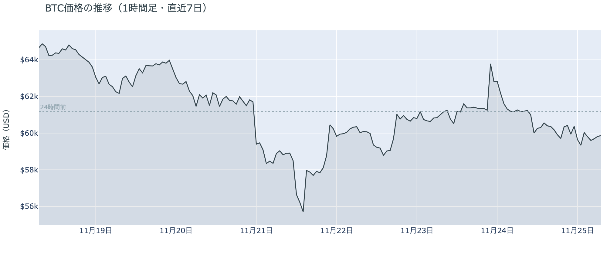

*図の見方: 1時間ごとの価格（日本時間）。点線は24時間前の水準です。*

* 24時間の値幅は$59,190〜$61,603の約4%で、前日の7.0%から縮んだ。

火曜日は、昼に大きく下げ、夜は$60,000を挟んで戻りきれない形でした。昼の10時台の後半から12時台の初めにかけて、価格は$61,000台から$59,000台へ下げています。この間、建玉（＝先物の未決済残高。証拠金で張っている人の量）は増えていて、ショートが新しく積まれました。下げは清算なしで始まり、途中からロングの清算が下げを速めています。夜は、22時台と0時台に下げた時間にも建玉が増え、ショートがさらに積まれました。未明の2時台からは持ち高が少しずつ手仕舞われ、価格は$60,000の手前に戻っています。

**図1-2 価格と50日・200日移動平均**

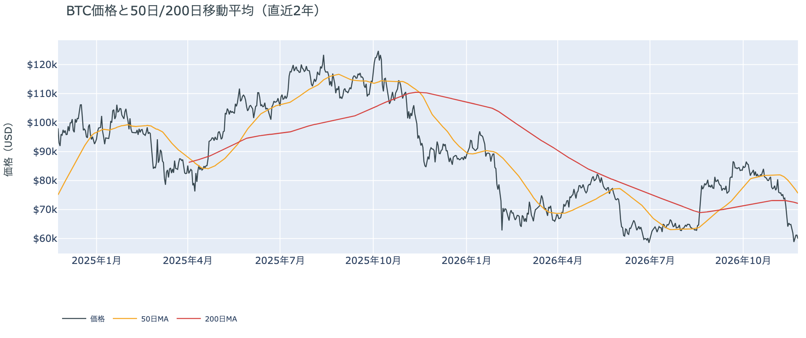

*図の見方: 2本の平均線の上下関係を見ます。50日線が200日線の上にあるのがゴールデンクロスです。*

* 50日線と200日線の差は約$3,513（4.87%）で、前日の5.44%から縮んだ。
* 朝7時5分の価格は50日線を20.8%下回る。

長い目で見た流れの向きはまだ変わっていませんが、この11月の下げで2本の差は縮み続けています。ゴールデンクロス（＝50日線が200日線を上抜けること）の状態は78日目で、価格は50日線を2割下回ったままです。

証券市場では、月曜日の株の戻りの一部が1日で剥がれました。11月24日の終値は、S&P500が−0.5%にとどまった一方、ハイテク株の多いナスダック100は−2.0%で、NVIDIA は5.9%下げています。月曜日にビットコインの跳ね上がりと時間が重なったハイテク株の追い風は、火曜日には残っていません。

**図1-3 価格に清算を重ねた図（直近24時間）**

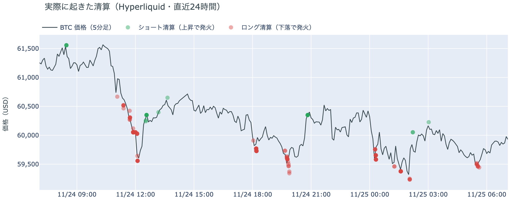

*図の見方: 価格の線に、Hyperliquid で拾えた清算を時刻ごとに重ねたもの（日本時間）。*

* 拾えた清算の9割超がロングで、ほぼ半分が昼の11時台と12時台に集まった。

昼の下げで振り落とされたのは、大口1件ではなく多数のロングです。Hyperliquid（＝オンチェーンの先物取引所）で拾えた清算は$59,000台と$60,000台に集まり、最大の1件でも全体の1割に届きません。前日は大口1件が中心だったので、今日のほうが広い参加者に及んだ下げでした。

## 2. なぜ動いたか：きっかけと、需給のどこが動いたか

**図2-1 ビットコインと株・金・原油の相対推移（起点＝100）**

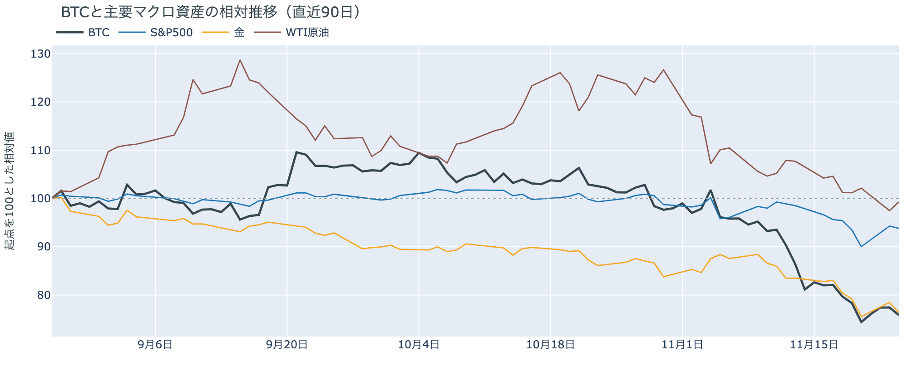

*図の見方: 同じ起点から何%動いたかで重ねたもの。線の向きが揃っているかを見ます。*

| この5営業日の動き（ビットコインは7日間） | 変化 |
|---|---:|
| ビットコイン | −7.6% |
| 金 | −8.0% |
| 米国株（S&P500） | −1.9% |
| 原油 | −5.1% |

* 建玉は96,339BTCで、前日の93,465BTCから3.1%増えた。
* 1日をならした年率は+4.04%で、短期金利（13週Tビル 4.17%）を引いた上乗せは−0.12pt。

火曜日の下げは、はっきりしたきっかけの無い昼に、新しいショートとロングの清算を通って起き、夜は関税の報道とハイテク株の下げをきっかけに、新しいショートを通って$60,000の下へ押し戻されました。

1. きっかけ：昼と夜で違います。昼の下げの時間、アジアの株は NVIDIA の CEO 復帰を受けて大きく上げていて、韓国の KOSPI は+6.3%で終わりました。ビットコインは逆向きに下げたので、株と共通のきっかけではなく、業界にもこの時間に重なる出来事は見当たりません。夜は、トランプ政権が中国・EU・日本など16の国・地域への新しい関税を今週中にも公表するという報道が22時台に伝わり、24時間でいちばん速い5分間の下げと時間が重なりました。続いて米国の取引が始まると、NVIDIA が月曜日の31%高の反動で下げ、ビットコインも0時台にナスダック100と同じ時間に下げています。規制では、米 CFTC（＝米国の先物規制当局）の事務局が11月23日、先物取引所などの準備金にビットコインを2割引きの評価で数えることを認めましたが、値動きに効いた形跡はありません。ホルムズ海峡でタンカーが機雷に触れたというイラン側の発表もありましたが、原油は昼の時点で3か月ぶりの安値圏にとどまっていて、ビットコインの下げに効いた形跡はありません。
2. 伝わり方：速い側では、先物が昼の下げも夜の下げも運びました。どちらの時間も価格が下がりながら建玉が増えていて、ロングの手仕舞いより、新しいショートの積み上がりが勝っています。資金調達率（＝ロングが払う金利。プラス＝ロングがショートより多い）はプラスのままなので、ロングも同時に残っています。遅い側では、アメリカの買い手の売りが深くなりました。アメリカの価格は1週間をならして前の週よりはっきり安く（図①-1）、ETF は11月23日まで5営業日続けて出超です（図①-2）。長期保有者の保有量も、11月23日時点で減り方が前の週より大きくなっています（図②-1）。今回の下げは先物だけの動きではなく、前から続くアメリカの買い手の売りの上に、先物のショートが重なったものです。

## 3. 市場参加者はいまどう見ているか

### ① アメリカの買い手は$60,000割れを買い場と見ず、売りを深めている

**図①-1 Coinbase Premium（アメリカとそれ以外の価格差・直近90日）**

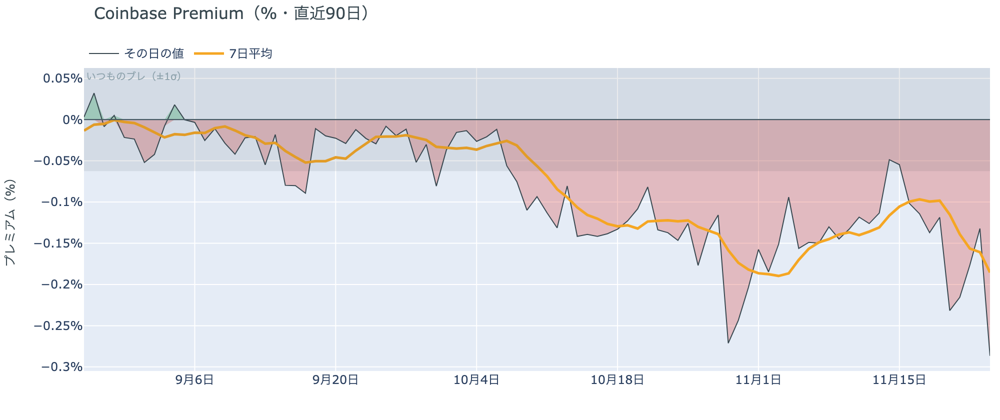

*図の見方: プラス＝アメリカで買いが強い。太線が1週間平均、細線がその日の値。薄い帯は「いつものブレの範囲」です。*

* 1週間平均は−0.19%で、前の週の−0.10%から沈んだ。
* その日の値は−0.29%で、いつものブレの4.6倍。過去300日でいちばん低い。

アメリカの買い手は、$60,000を割った価格を買い場と見ておらず、この1週間で売る側への傾きを強めました。Coinbase Premium（＝アメリカとそれ以外の価格差）は1週間平均で前の週のほぼ2倍のマイナスになっています。火曜日のその日の値もいつものブレを大きく超えているので、夜の戻りを抑えた売りはアメリカの側で強かったということです。

**図①-2 ETFの日ごとの資金の出入り（直近90日）**

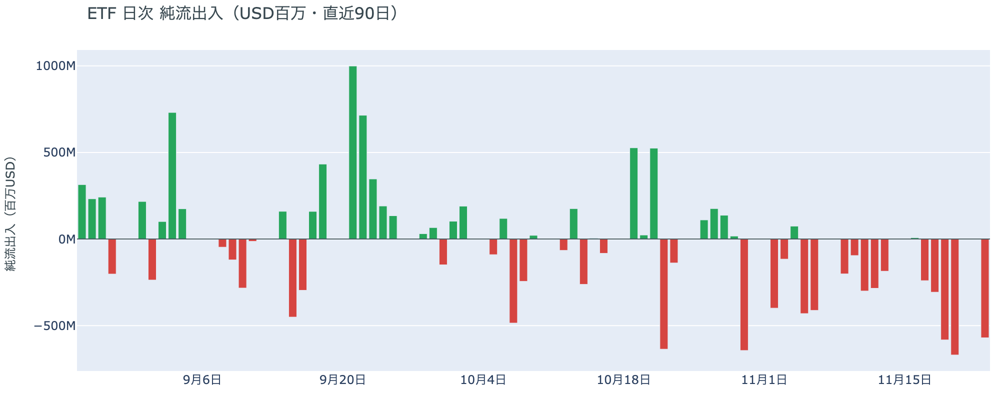

*図の見方: 入ったお金と出たお金の差。上に伸びれば入り超、下に伸びれば出超。*

| ETFの日ごとの出入り | 億ドル |
|---|---:|
| 11月17日 | −2.4 |
| 11月18日 | −3.1 |
| 11月19日 | −5.8 |
| 11月20日 | −6.7 |
| 11月23日 | −5.7 |
| 直近7営業日の合計 | −25.5 |

* 11月の合計は23日までで約−47億ドル。これまで最大だった今年6月の約−45億ドルを超えた。

ETF の買い手は、株が大きく戻した月曜日の上げを、買い直す場面ではなく引き揚げる場面と見ていました。前日は「アメリカの買い手は夜の上げに加わっていない」と説明しました。加わっていたなら、11月23日は出超が止まるか、はっきり縮むはずです。実際は5営業日続けての出超で、額も前の週の後半とほぼ変わらないので、前日の説明は今日の数値と合っています。

**図①-3 Fear & Greed（市場心理の指数・直近90日）**

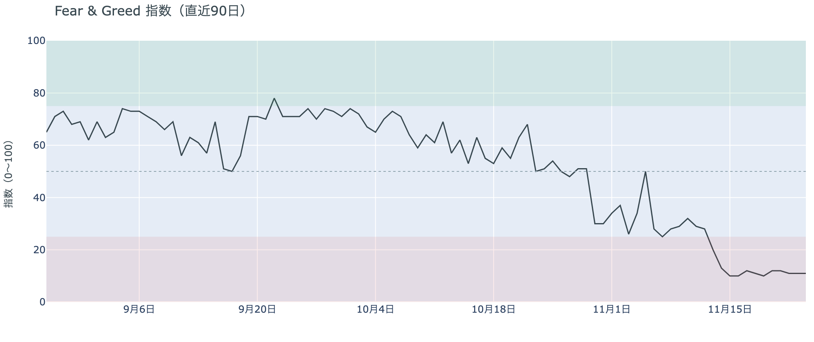

*図の見方: 0〜100で、50より上が「強欲」、下が「恐怖」。*

* 11の「極度の恐怖」で、前日と同じ。1週間前は12、1か月前は54。

参加者の多くは、下げへの怖さを強めも緩めもしていません。Fear & Greed（＝市場心理の指数）は11月14日から10台に張りついていて、月曜日の跳ね上がりでも動きませんでした。1日の上げ下げでは変わらないほど、弱気な見方が固まっています。

### ② 長期保有者の保有量は損失の出る価格で減り続け、減り方は前の週より大きい

**図②-1 長期保有者の保有量の30日変化とSOPR（直近90日）**

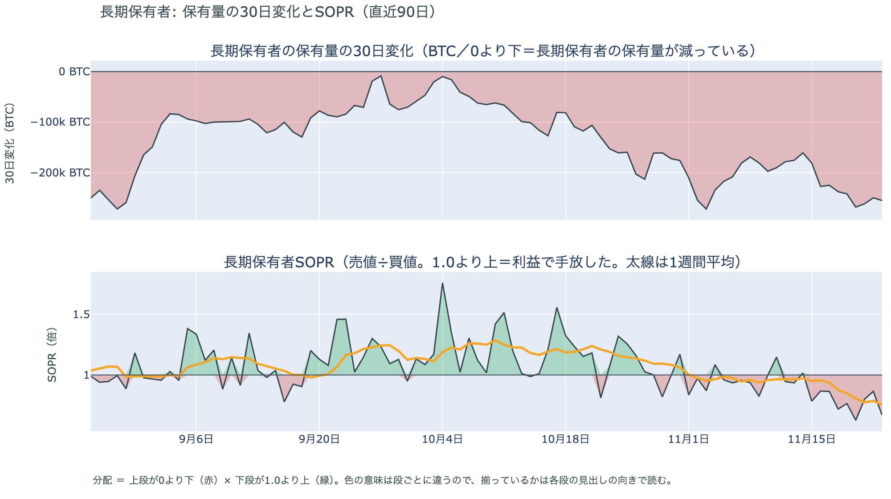

*図の見方: 上段は、長期保有者の保有量が30日でどれだけ増減したか。マイナス＝手放している。下段は長期保有者SOPRで、1より上なら利益で手放した。どちらも太線の1週間平均で読みます。*

| 11月23日時点 | 1週間平均 | 前の週の平均 |
|---|---:|---:|
| 長期保有者SOPR（1より上＝利益で手放した） | 0.76 | 0.96 |
| 長期保有者の保有量の30日変化（万BTC） | −24.9 | −18.7 |

長期保有者（＝155日以上保有者）は、損失の出る価格でもコインを動かし続けていて、下げが終わったとは見ていません。保有量の減り方は前の週より大きくなりました。動いたコインは平均して買値より安く動いていて、その損失も前の週より深いので、利益が出ているから手放すという形ではありません。

ほかに、急いで手放しそうな持ち手は見当たりません。マイナーの収入は平年を1割ほど下回るところで横ばいが続き（Puell Multiple（＝マイナー収入の平年比）が11月23日時点の1週間平均で0.89）、前の週から悪くなっていません。長く眠っていたコインがまとまって動いた記録もありません。

### ③ 先物：ショートが積まれてもロングは降りず、見方が割れたまま賭けが増えた

**図③-1 資金調達率と建玉（直近30日）**

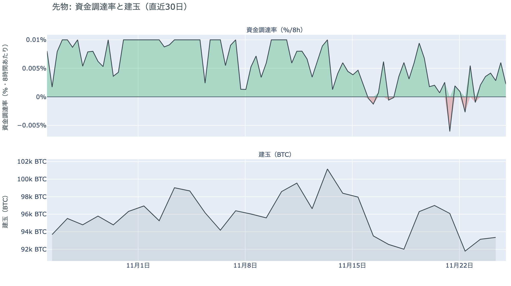

*図の見方: 上段は資金調達率（8時間ごと・日本時間）。プラスが続く＝ロングがショートより多い。下段は建玉。*

* 資金調達率はプラスが6回連続（約2日）。
* 上乗せは前日の−0.57ptから−0.12ptへ縮んだ。直近34日の平均は+2.23pt。

先物の参加者は、$60,000の下でさらに下げると見る側と、戻ると見る側に割れています。価格が下がりながら建玉が増えたので、下げに賭けるショートは新しく入りました。それでもロングが払う金利はプラスを保ち、短期金利（＝ドルを米国の短期国債で持つだけで受け取れる金利）との差も前日より縮んでいるので、ロングの側も降りていません。ただ、その金利はまだ短期金利に届かず、余分に払ってでも上げに賭けたい人は戻っていません。

### ④ オプション：身構えは緩んだが、下げへの備えは12月に厚く置かれている

オプションには2種類あります。コール（＝決めた価格で買う権利）とプット（＝決めた価格で売る権利）で、価格が上がればコールの価値が上がり、価格が下がればプットの価値が上がります。プットは「価格が下がったときの保険」として買われます。オプションを買う人は、その権利と引き換えに権利料（＝オプションを買う人が払う金額）を払います。

**図④-1 満期ごとのIV（年率%）**

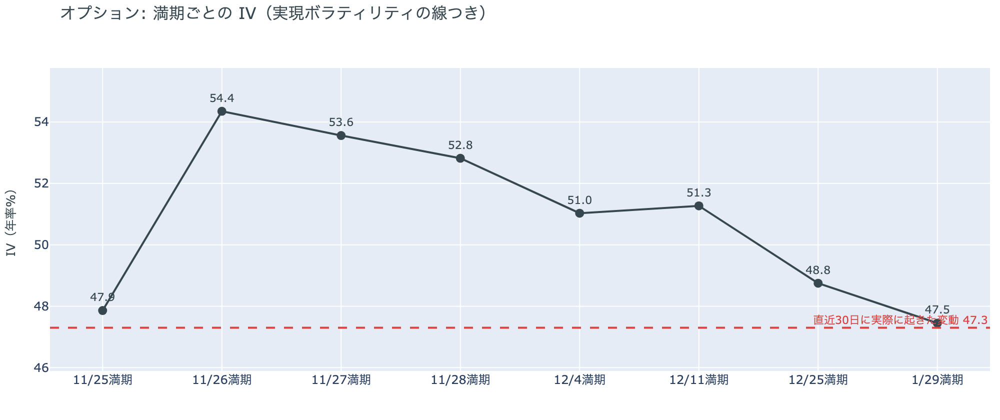

*図の見方: IVを満期ごとに並べたもの。点線は実現ボラティリティ。IVが点線より下なら、市場はこの先の値動きを過去の値動きより小さいと見ています。*

| 満期 | IV |
|---|---:|
| 11月25日 | 48 |
| 11月26日 | 54 |
| 11月27日〜11月28日 | 53〜54 |
| 12月4日〜12月11日 | 51 |
| 12月25日 | 49 |
| 1月29日 | 48 |

* IVは全体で52.3で、前日の55.4から下がった。実現ボラティリティ47.3より5.0pt高い。

参加者は、この先の値動きをこれまでより大きいと見ていますが、$60,000を割っても身構えを強めてはいません。IV（＝値動きの幅の予想）は全体で実現ボラティリティ（＝過去の値動きの幅）を上回ったままですが、差は前日より縮みました。いちばん高いのは、今夜22時30分の米国の PCE 物価指数をまたぐ11月26日の満期です。ただ、その先の満期との差は小さく、今夜だけ特別に大きく動くとは見られていません。

**図④-2 満期ごとのプットとコールの差**

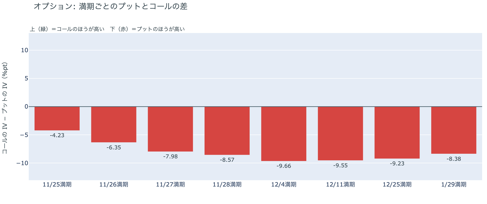

*図の見方: 満期ごとに、プットとコールのどちらが高く売れているか。ゼロより上ならコールのほうが高く、下ならプットのほうが高い。*

| 満期 | どちらが高いか |
|---|---|
| 11月25日 | プットが高い（差はいちばん小さい） |
| 11月26日 | プットが高い |
| 11月27日 | プットが高い |
| 11月28日 | プットが高い |
| 12月4日 | プットが高い（差はいちばん大きい） |
| 12月11日 | プットが高い |
| 12月25日 | プットが高い |
| 1月29日 | プットが高い |

参加者は、動くなら下だという見方を変えていませんが、下げを警戒しているのは目の前より12月です。前日は、どの満期にも下げへの備えが同じ厚さで置かれていました。火曜日は今日と明日の満期で差が小さく、12月4日から12月25日までの満期で大きくなっています。この区間には12月9日の FOMC（＝米国の金利を決める会合）と年末の最大の満期が入っていて、参加者は今週中に崩れることより、12月に入ってからの下げに備えています。

**図④-3 12月25日満期の持ち高（権利の価格ごと）**

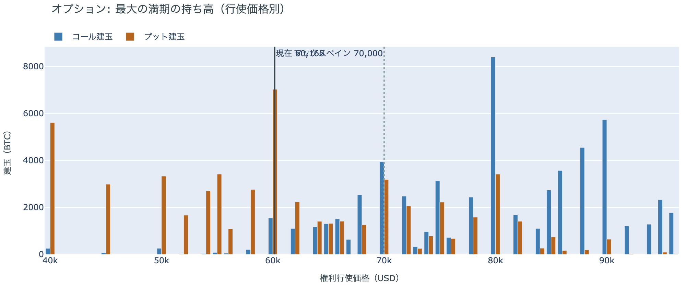

*図の見方: 青＝コール、橙＝プット。現値より上にコールが、下にプットが積まれるのが普通です。*

| 12月25日満期のオプション（基準の価格は約$60,200） | 量（万BTC） | 意味 |
|---|---:|---|
| コール（決めた価格で買う権利） | 約9.7 | 「価格が上がる」に賭けた分 |
| プット（決めた価格で売る権利） | 約6.6 | 「価格が下がる」への保険 |
| うち、いまより15%以上高い価格のコール | 約8.6 | 大きな上げへの賭け |
| うち、いまより15%以上安い価格のプット | 約2.1 | 大きな下げへの保険 |

* 12月25日満期の持ち高は約16.3万BTCと全満期の37%で、コールがプットの1.5倍。

年末の最大の満期では、「価格が上がる」に賭けた人たちが$60,000割れのあとも降りておらず、年末までの戻りを諦めてはいません。ただし、コールのほとんどは$70,000以上に置かれていて、報われるには12月25日の夕方5時までに$70,000を超える必要があります。全満期でオプションの持ち高が集まっているのは$58,000〜$62,000の帯で、いちばん多いのは$60,000です。いまの価格は、その帯の真ん中にいます。

### ⑤ 値下がりしたコインは全体の半分を超え、再送金の量は2018年の底に近づいた

**図⑤-1 コインが最後に送金された日の価格の分布（11月23日時点）**

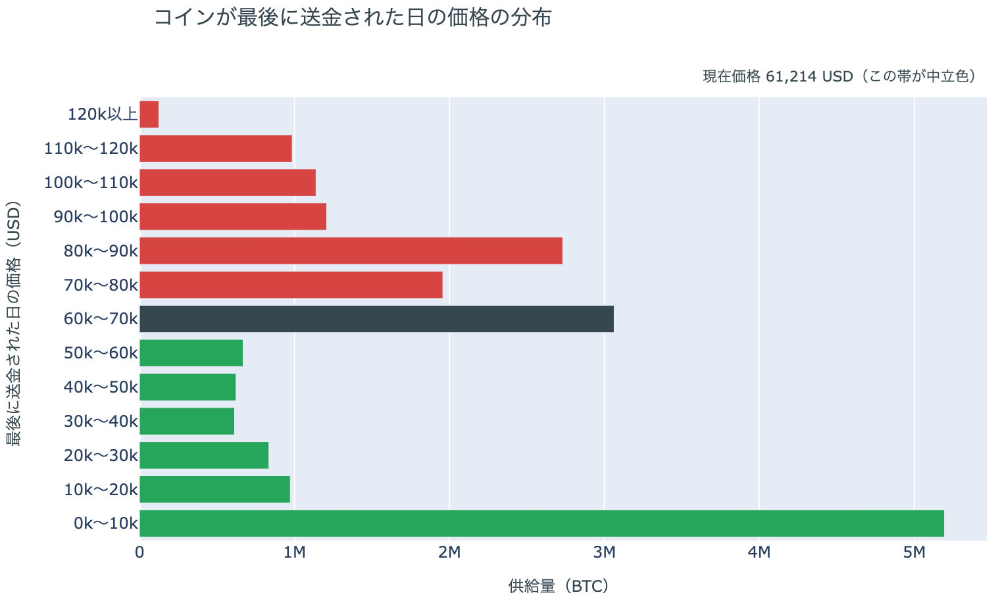

*図の見方: ビットコインはアドレスからアドレスへ送金されるたびに、受け取った側に新しい記録ができる。この図は、いまあるコインを、最後に送金された日の価格で束ねたもの。送金には売買のほか、取引所への入金・引き出しや自分のウォレット間の移し替えも含み、取引所の中での売買は含まない。*

| 過去の大きな下げの底 | 価格より上にいるコインの割合 | 30日以上置いたコインが値下がりした状態で再び送金された量（1週間平均） |
|---|---:|---:|
| 2018年12月（2018年の冬の底） | 60.6% | 約4.1万BTC/日 |
| 2020年3月（コロナショック） | 57.4% | 約8.4万BTC/日 |
| 2022年6月（Luna・3AC の破綻） | 51.1% | 約7.2万BTC/日 |
| 2022年11月（FTX の破綻） | 55.1% | 約7.1万BTC/日 |
| **2026年11月23日** | **53.7%** | **約3.6万BTC/日** |

* 値下がり再送金は1週間前の約2.9万BTC/日から増えた。2017年以降の下から96%。

いまあるコインの半分以上が、いまより高い価格で最後に送金されていて、値下がりしたコインの多さは過去の大きな下げの底と並んでいます。30日以上置いたコインが値下がりした状態で再び送金された量も、2017年以降の真ん中の値の3.9倍まで増え、2018年の底の9割近くになりました。ただ、2020年と2022年の底と比べると半分前後です。高い価格で受け取ったコインが送金し直される動きは強まっていますが、あの3回ほどまとまった量にはなっていません。

11月23日時点の分布にいまの価格を重ねると、価格は$60,000の境目のわずか0.1%下にいて、すぐ上の$60,000〜$70,000の帯には全供給の15%が積まれています。

## 4. 価格に影響しうる直近のイベント

オプション市場が下げへの備えをいちばん厚く置いているのは12月4日から12月25日までの満期です。12月4日の満期はドイツの Movie2k 事件の裁判を、12月11日の満期は米雇用統計・FOMC・米CPI をまたぎます。今夜の PCE 物価指数をまたぐ満期は IV がわずかに高いものの、備えは12月の満期より薄くなっています。

| 日付 | イベント | 何に効くか |
|---|---|---|
| 11/25（水）22:30 日本時間 | 米10月の PCE 物価指数と、7〜9月期の GDP の改定値 | 金利 |
| 今週中にも（報道） | 米通商代表部が、中国・EU・日本など16の国・地域への通商法301条の調査結果と新しい関税を公表 | 株・物価の見通し |
| 11/26（木）〜27（金） | 米国は感謝祭で26日は株式市場が休場、27日は短縮取引 | 米国株・ETF の取引が止まる・薄くなる |
| 11/29（日） | OPEC+ の会合。2027年の生産方針を決める | 原油 |
| 11/30（月）米国時間の引け | MSCI の指数から米 Strategy（＝ビットコインを大量に持つ米企業）が外れる実施日 | Strategy の株と、指数に連動する資金 |
| 12/3（木） | ドイツ・ライプツィヒ地裁で Movie2k 事件の裁判が再開。被告が4万BTCを引き渡せば打ち切るという裁判所の案を、被告側が検討している | 当局の手に渡りうる4万BTC |
| 12/4（金）22:30 日本時間 | 米11月の雇用統計 | 金利 |
| 12/9（水） | FOMC。0.25ptの利上げは織り込み済みで、0.5ptの利上げの織り込みは約3割（11月24日時点）。結果は日本時間10日早朝 | 金利 |
| 12/10（木）22:30 日本時間 | 米11月の CPI（＝米国の物価統計） | 金利 |
| 12/25（金）17:00 | オプションの最も大きな満期（約16.3万BTC、全満期の37%） | $70,000以上のコールの期限 |

## まとめ

火曜日のビットコインは、きっかけの見当たらない昼に新しいショートとロングの清算を通って$59,000台へ下げ、夜は関税の報道とハイテク株の下げをきっかけに、またショートが積まれて$60,000の下にとどまりました。アジアの株が大きく上げた時間にも下げたので、株の動きだけで決まった日ではなく、前から続くアメリカの買い手の売りが一段深くなった上で起きた下げです。長期保有者の保有量も減り続けていて、現物の側でこの価格を買い場と見る動きは出ていません。参加者は、先物では上と下に割れたまま賭けを増やし、オプションでは下げへの備えを12月に厚く置いているので、今週すぐに崩れるとは見ていないものの、下げが終わったとも見ていません。それでも、年末に向けた上げの賭けは$60,000を割っても降りずに残っています。

---

<small>（数値は11月25日7時5分（日本時間）までのデータに基づきます。価格・先物・オプションはその時点の値、市場心理は11月24日の確定値、オンチェーン（＝ブロックチェーン上の記録）は11月23日時点、ETF資金フローは11月23日分までです。証券市場の終値は11月24日時点です。オンチェーンの長期保有者の数値には、ETFや取引所が預かっている分も含まれます。清算は Hyperliquid で拾えた分だけで、市場全体のごく一部です。オプションはDeribit（BTCオプションの大半を占める取引所）の全銘柄です。）</small>

*本稿は情報提供を目的としたものであり、投資助言ではありません。将来の価格動向を保証・示唆するものではなく、投資判断は各自の責任において行ってください。*
