# 米国株の寄り付き急落で$57,000台へ ― 株とともに戻し、ショートの清算が$60,000回復を速める

**2026年11月26日**

ビットコインは水曜日の夜、米国株の寄り付きの急落と同じ時間に$57,200台まで下げ、未明に株と一緒に戻して、24時間ではほぼ横ばいでした。

* **価格**：朝7時5分の時点で約$60,069と、24時間前とほぼ同じ。ただ24時間の値幅は約5.6%と前日の約4%より広く、静かな日ではなく大きな往復の日だった
* **きっかけ**：夜の下げは、AI関連株の売りが再び強まった米国株の寄り付きの急落と時間が重なった。直前には米国の新しい関税案と PCE 物価指数も出ている。戻りも株の戻りと同じ時間で、ビットコインに固有のきっかけは見当たらない
* **先物**：下げの間に売り持ち（ショート）が積まれ、戻りでその大半が買い戻された。戻りを速めたのはショートの清算（＝証拠金不足で強制的に閉じられた取引）。買い持ち（ロング）は降りておらず、先物の見方は上げの側へ傾いた
* **需給の土台**：米国の買い手の売りは続き、ETF も6営業日続けて出超。長期保有者の保有量も損失の出る価格で減り続けているので、戻りを運んだのは先物で、現物の買い手は前日から変わっていない
* **オプションの見方**：感謝祭の連休のあいだは大きく動かないと見ている一方、下げへの備えは12月中旬までの満期に厚く置いたまま

## 1. 何が起きたか

**図1-1 価格の推移（1時間足・直近7日）**

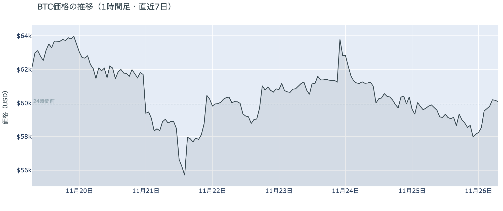

*図の見方: 1時間ごとの価格（日本時間）。点線は24時間前の水準です。*

* 24時間の値幅は約5.6%で、前日の約4%から広がった。

水曜日は、昼から夜にかけてゆっくり下げ、米国株の取引が始まった直後に大きく下げてから、未明に$60,000まで戻した日でした。朝から夜の22時台まで、価格は$59,900前後から$58,500台へ少しずつ下げ、その間に建玉（＝先物の未決済残高。証拠金で張っている人の量）は増えていたので、ショートが新しく積まれていました。23時30分に米国株の取引が始まると、価格は10分で$57,200台へ下げています。この下げには清算がほとんど出ていません。未明の1時台から4時台にかけては、価格が上がりながら建玉が減り、夜に積まれたショートが買い戻されました。

**図1-2 価格と50日・200日移動平均**

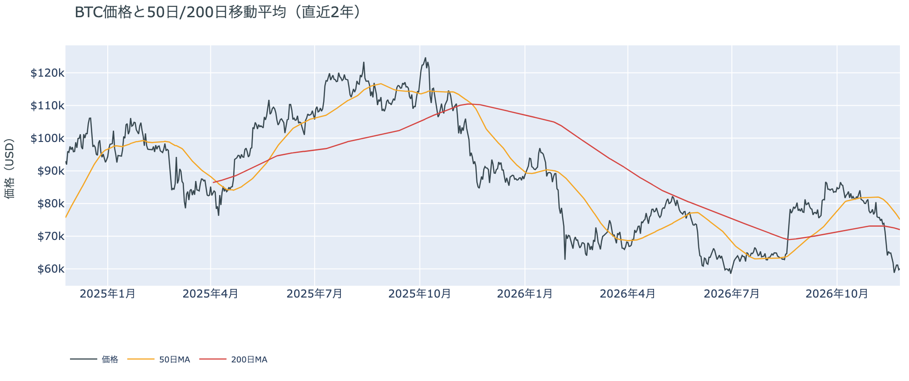

*図の見方: 2本の平均線の上下関係を見ます。50日線が200日線の上にあるのがゴールデンクロスです。*

* 50日線と200日線の差は約$3,104（4.31%）で、前日の4.87%から縮んだ。
* 朝7時5分の価格は50日線を20.0%下回る。

長い目で見た流れの向きはまだ変わっていませんが、2本の差は11月に入ってから縮み続けています。ゴールデンクロス（＝50日線が200日線を上抜けること）の状態は79日目で、夜の往復のあとも、価格は50日線を2割下回ったままです。

証券市場では、寄り付きの急落の大半が引けまでに戻りました。11月25日の終値は、ハイテク株の多いナスダック100が−0.65%、S&P500が−0.25%で、NVIDIA も日中の−9.0%から−4.0%まで戻しています。ビットコインにとっては、夜の下げと時間が重なった株の急落が、引けまでにほぼ消えた状態です。米国は26日が感謝祭で休場、27日は短縮取引です。

**図1-3 価格に清算を重ねた図（直近24時間）**

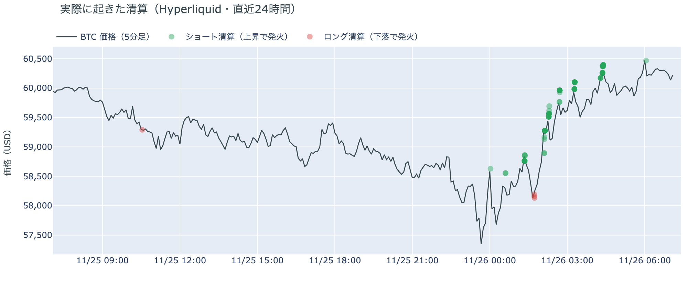

*図の見方: 価格の線に、Hyperliquid で拾えた清算を時刻ごとに重ねたもの（日本時間）。*

* 拾えた清算の9割超がショートで、9割近くが未明の1時台から4時台に集まった。

戻りの途中で振り落とされたのは、大口1件ではなく多数のショートです。Hyperliquid（＝オンチェーンの先物取引所）で拾えた清算は$58,000台から$60,000台に散らばり、最大の1件でも全体の16%でした。戻りは0時前に清算なしで始まり、2時台から清算が重なって速くなっています。値動きの速い5分足に清算の半分以上が入っていたので、清算が戻りを加速させました。

## 2. なぜ動いたか：きっかけと、需給のどこが動いたか

**図2-1 ビットコインと株・金・原油の相対推移（起点＝100）**

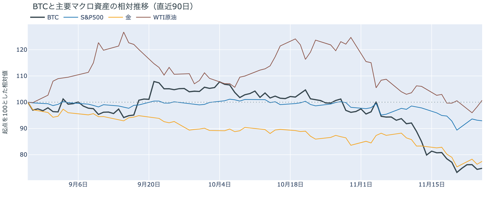

*図の見方: 同じ起点から何%動いたかで重ねたもの。線の向きが揃っているかを見ます。*

| この5営業日の動き（ビットコインは7日間） | 変化 |
|---|---:|
| ビットコイン | −4.6% |
| 金 | −3.4% |
| 米国株（S&P500） | −1.9% |
| 原油 | +1.1% |

* 建玉は97,114BTCで、24時間で0.8%増えた。夜0時台の高いところからは約2%減っている。
* 1日をならした年率は+7.51%で、短期金利（13週Tビル 4.15%）を引いた上乗せは+3.36pt。

水曜日の夜の下げは、米国株の寄り付きの急落をきっかけに、新しく積まれたショートを通って起き、未明の戻りは株の戻りと同じ時間に、そのショートの買い戻しと清算を通って起きました。

1. きっかけ：下げも戻りも、米国株と同じ時間に起きています。月曜日に CEO の復帰で31%上げた NVIDIA が売り直され、ナスダック100は寄り付き直後に前日の終値から約4%下げました。ビットコインの安値の$57,200台は、ナスダック100が最初の安値を付けた23時40分ごろと重なります。未明の2時台には、ナスダック100が+1.6%、ビットコインが+1.7%と、同じ時間に戻しました。株の戻りに、はっきりした新しいニュースは見当たりません。その前の22時台には、米国通商代表部が中国・EU・日本など14の国・地域への新しい関税案を公表し、22時30分には米国の物価統計の PCE 物価指数が出て、食品とエネルギーを除いた分が予想を上回りました。ビットコインは PCE 物価指数の直後の5分で0.7%下げています。ただ、米10年債利回りは上がらずに下がり、12月の FOMC（＝米国の金利を決める会合）の利上げの織り込みも前日から変わっていないので、金利の見通しを通った下げではありません。関税案は公聴会が1月25日からで、すぐには発動しません。原油はホルムズ海峡でタンカーが機雷に触れたというイラン側の発表があった日に+2.6%で終えましたが、ビットコインの下げにも戻りにも効いた形跡はありません。業界では、マイナーの CleanSpark が採掘した量より多くのビットコインを売ることを検討していると伝えられましたが、伝わったのは価格が戻っていた2時ごろなので、きっかけではありません。
2. 伝わり方：速い側では、先物が下げも戻りも運びました。夜0時台までは価格が下がりながら建玉が約3%増えていて、新しいショートが下げを押し広げています。未明は価格が上がりながら建玉が約2%減り、清算のほとんどがショートだったので、夜に積まれたショートの大半が買い戻しと清算で消えました。資金調達率（＝ロングが払う金利。プラス＝ロングがショートより多い）はプラスのまま上がったので、ロングは下げの間も降りていません。遅い側には、戻りは届いていません。アメリカの価格は1週間をならして前の週より安いままで（図①-1）、ETF は11月24日まで6営業日続けて出超です（図①-2）。長期保有者の保有量も11月24日時点で減り方が前の週より大きくなっています（図②-1）。往復を運んだのは先物で、アメリカの買い手と長期保有者の売りはその下で続いています。

## 3. 市場参加者はいまどう見ているか

### ① アメリカの買い手は戻りに加わらず、売る側に傾いたまま

**図①-1 Coinbase Premium（アメリカとそれ以外の価格差・直近90日）**

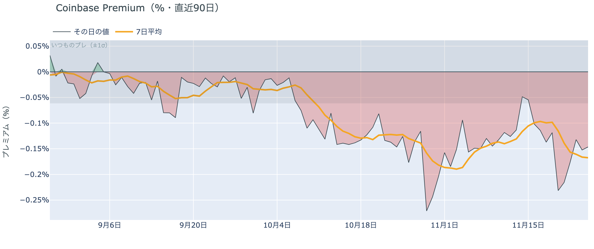

*図の見方: プラス＝アメリカで買いが強い。太線が1週間平均、細線がその日の値。薄い帯は「いつものブレの範囲」です。*

* 1週間平均は−0.17%で、前の週の−0.10%より深い。
* その日の値は−0.15%で、いつものブレの2.4倍。

アメリカの買い手は、$60,000への戻りを買いの場面と見ていません。Coinbase Premium（＝アメリカとそれ以外の価格差）は1週間平均で前の週よりはっきり深いマイナスにあり、戻りの時間を含む水曜日のその日の値もいつものブレを超えたマイナスでした。戻りの間もアメリカの側では売りが勝っていたので、戻りを買ったのはアメリカの現物の買い手ではないということです。

**図①-2 ETFの日ごとの資金の出入り（直近90日）**

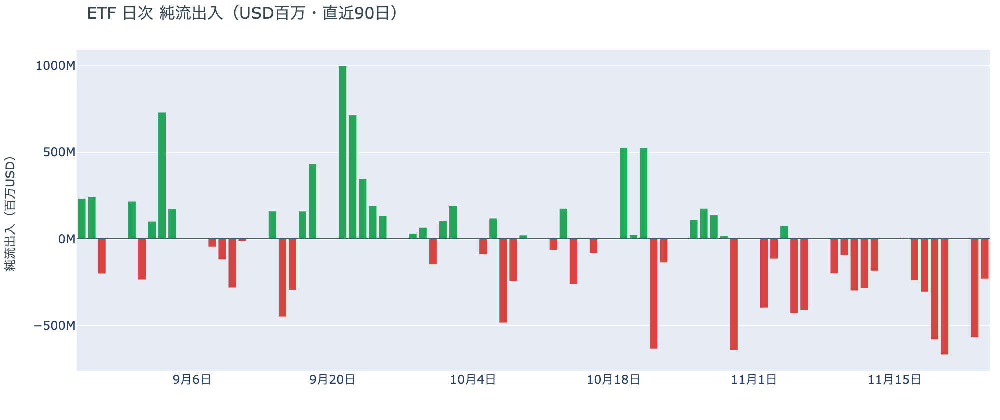

*図の見方: 入ったお金と出たお金の差。上に伸びれば入り超、下に伸びれば出超。*

| ETFの日ごとの出入り | 億ドル |
|---|---:|
| 11月18日 | −3.1 |
| 11月19日 | −5.8 |
| 11月20日 | −6.7 |
| 11月23日 | −5.7 |
| 11月24日 | −2.3 |
| 直近7営業日の合計 | −25.9 |

* 11月の合計は24日までで約−49億ドル。これまで最大だった今年6月の約−45億ドルを上回る。

ETF の買い手は引き揚げを続けていますが、急ぐ勢いは弱まりました。$60,000を割った11月24日も出超でしたが、額は前の3営業日の半分以下に縮んでいます。引き揚げる手は緩んでも、買い戻す側には回っていないので、アメリカの買い手の見方は弱気のままです。

**図①-3 Fear & Greed（市場心理の指数・直近90日）**

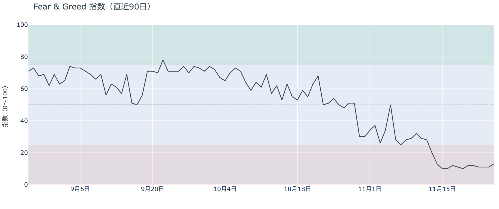

*図の見方: 0〜100で、50より上が「強欲」、下が「恐怖」。*

* 13の「極度の恐怖」で、前日の11から2pt戻した。1週間前は11、1か月前は50。

参加者の多くは、夜の往復でも弱気な見方を変えていません。Fear & Greed（＝市場心理の指数）は11月14日から10台に張りついたままで、$57,000台への下げでも、$60,000への戻りでも、ほとんど動いていません。

### ② 長期保有者は損失の出る価格でもコインを動かし続け、減り方は前の週より大きい

**図②-1 長期保有者の保有量の30日変化とSOPR（直近90日）**

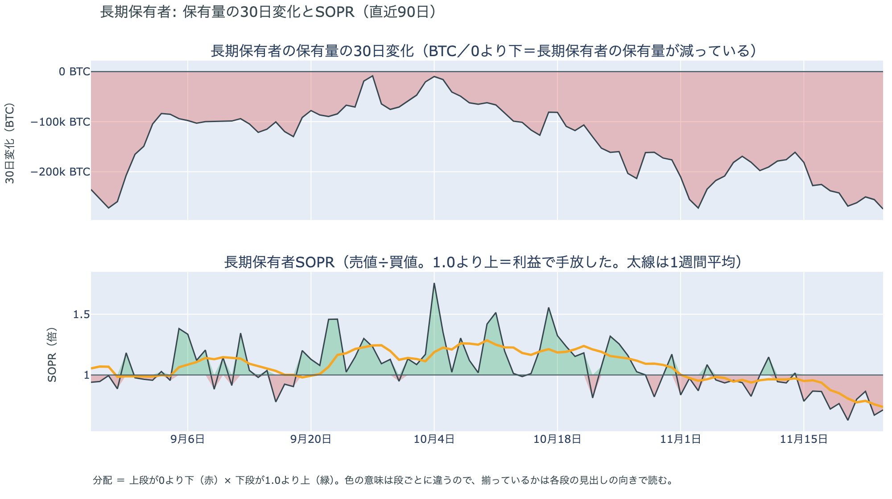

*図の見方: 上段は、長期保有者の保有量が30日でどれだけ増減したか。マイナス＝手放している。下段は長期保有者SOPRで、1より上なら利益で手放した。どちらも太線の1週間平均で読みます。*

| 11月24日時点 | 1週間平均 | 前の週の平均 |
|---|---:|---:|
| 長期保有者SOPR（1より上＝利益で手放した） | 0.74 | 0.94 |
| 長期保有者の保有量の30日変化（万BTC） | −25.6 | −19.1 |

長期保有者（＝155日以上保有者）は、損失の出る価格でもコインを動かし続けていて、下げが終わったとは見ていません。保有量の減り方は前の週より大きくなりました。動いたコインは平均して買値より安く動いていて、その損失も前の週より深いので、利益が出ているから手放すという形ではありません。

ほかに、急いで手放しそうな持ち手は見当たりません。マイナーの収入は平年を1割ほど下回るところで横ばいが続き（Puell Multiple（＝マイナー収入の平年比）が11月24日時点の1週間平均で0.88）、前の週から悪くなっていません。長く眠っていたコインがまとまって動いた記録もなく、コインが最後に送金された日の価格の分布にも、今日新しく取り上げる変化はありません。

### ③ 先物：積まれたショートは戻りで買い戻され、ロングは金利を上乗せして残った

**図③-1 資金調達率と建玉（直近30日）**

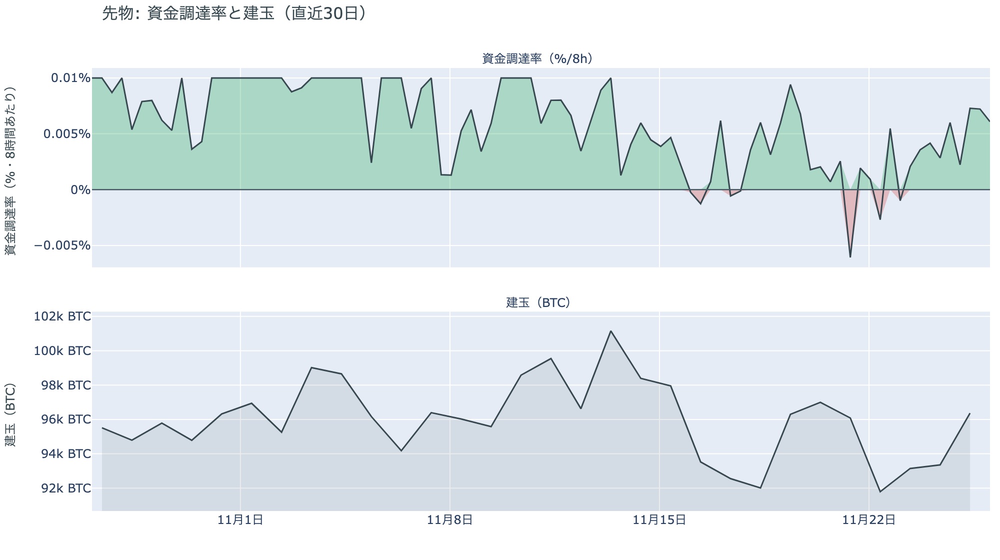

*図の見方: 上段は資金調達率（8時間ごと・日本時間）。プラスが続く＝ロングがショートより多い。下段は建玉。*

* 資金調達率はプラスが9回連続（約3日）。
* 短期金利に対する上乗せは前日の−0.12ptから+3.36ptへ。直近34日の平均+2.49ptを上回った。

先物の参加者は、$57,000台からの戻りを見て、上げの側へ傾き直しました。夜に下げへ賭けたショートは戻りで買い戻されて大半が消え、ロングは残ったからです。ロングが払う金利は、短期金利（＝ドルを米国の短期国債で持つだけで受け取れる金利）を上回るところまで上がりました。前日はいなかった、余分に払ってでも上げに賭けたい人が戻ってきたということです。前日は「見方が上と下に割れたまま賭けが増えた」と説明しました。下げの側の賭けが1晩で買い戻されたので、割れていた見方は上げの側へ寄っています。

### ④ オプション：連休は静かと見て、下げへの備えは12月の満期に厚い

オプションには2種類あります。コール（＝決めた価格で買う権利）とプット（＝決めた価格で売る権利）で、価格が上がればコールの価値が上がり、価格が下がればプットの価値が上がります。プットは「価格が下がったときの保険」として買われます。オプションを買う人は、その権利と引き換えに権利料（＝オプションを買う人が払う金額）を払います。

**図④-1 満期ごとのIV（年率%）**

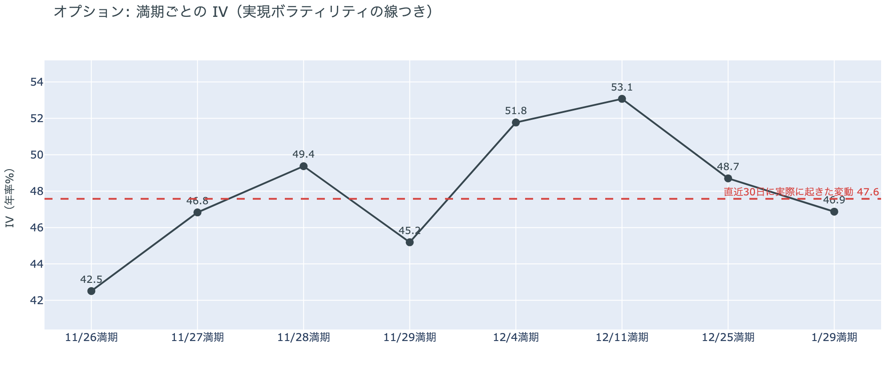

*図の見方: IVを満期ごとに並べたもの。点線は実現ボラティリティ。IVが点線より下なら、市場はこの先の値動きを過去の値動きより小さいと見ています。*

| 満期 | IV |
|---|---:|
| 11月26日 | 43 |
| 11月27日 | 47 |
| 11月28日 | 49 |
| 11月29日 | 45 |
| 12月4日 | 52 |
| 12月11日 | 53 |
| 12月25日 | 49 |
| 1月29日 | 47 |

* IVは全体で53.1で、前日の52.3から少し上がった。実現ボラティリティ47.6より5.5pt高い。

参加者は、この先の値動きをこれまでより大きいと見ていて、夜の往復のあとで身構えをわずかに強めました。IV（＝値動きの幅の予想）は全体で実現ボラティリティ（＝過去の値動きの幅）を上回り、差も前日より少し広がっています。例外は目の前で、米国が感謝祭で休場の11月26日の満期がいちばん低く、連休のあいだは大きく動かないと見られています。11月28日の満期がわずかに高いものの、いちばん高いのは12月11日の満期です。

**図④-2 満期ごとのプットとコールの差**

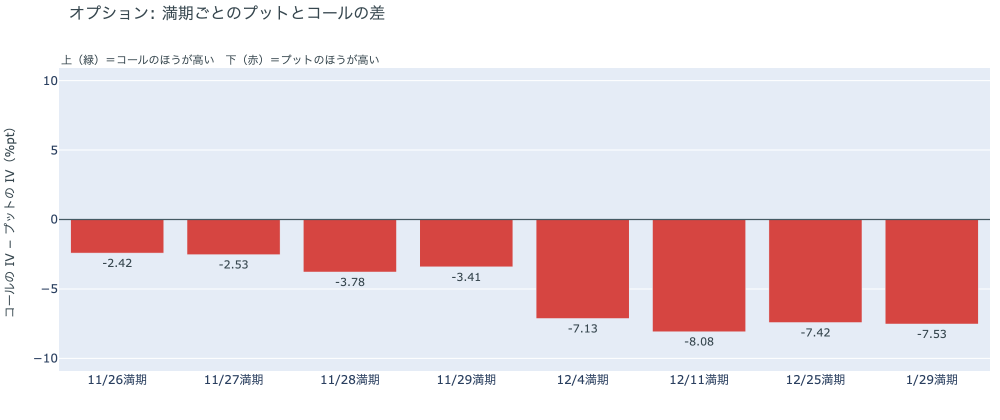

*図の見方: 満期ごとに、プットとコールのどちらが高く売れているか。ゼロより上ならコールのほうが高く、下ならプットのほうが高い。*

| 満期 | どちらが高いか |
|---|---|
| 11月26日 | プットが高い（差は小さい） |
| 11月27日 | プットが高い（差は小さい） |
| 11月28日 | プットが高い |
| 11月29日 | プットが高い |
| 12月4日 | プットが高い（差は大きい） |
| 12月11日 | プットが高い（差はいちばん大きい） |
| 12月25日 | プットが高い（差は大きい） |
| 1月29日 | プットが高い（差は大きい） |

参加者は、動くなら下だという見方を変えておらず、下げを警戒しているのは目の前より12月です。今週の満期ではプットとコールの差が小さく、12月4日から先の満期で大きくなっています。いちばん差が大きいのは、12月4日の米雇用統計、12月9日の FOMC、12月10日の米CPI（＝米国の物価統計）をまたぐ12月11日の満期です。前日は12月4日の満期の差がいちばん大きかったので、備えの重心は1週間先の米雇用統計・FOMC・米CPI へ移りました。

**図④-3 12月25日満期の持ち高（権利の価格ごと）**

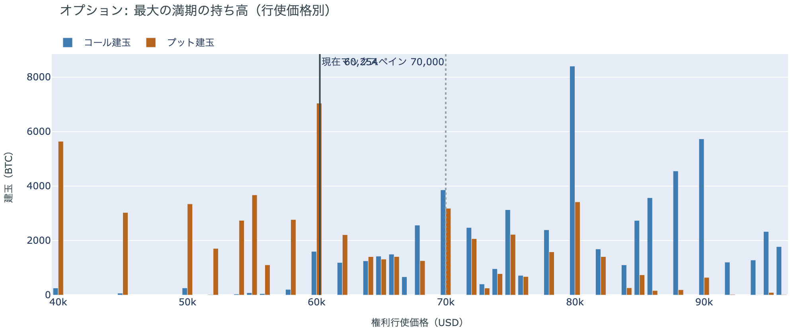

*図の見方: 青＝コール、橙＝プット。現値より上にコールが、下にプットが積まれるのが普通です。*

| 12月25日満期のオプション（基準の価格は約$60,300） | 量（万BTC） | 意味 |
|---|---:|---|
| コール（決めた価格で買う権利） | 約9.7 | 「価格が上がる」に賭けた分 |
| プット（決めた価格で売る権利） | 約6.6 | 「価格が下がる」への保険 |
| うち、いまより15%以上高い価格のコール | 約8.6 | 大きな上げへの賭け |
| うち、いまより15%以上安い価格のプット | 約2.1 | 大きな下げへの保険 |

* 12月25日満期の持ち高は約16.4万BTCと全満期の37%で、コールがプットの1.5倍。

年末の最大の満期では、「価格が上がる」に賭けた人たちが$57,000台への下げでも降りておらず、年末までの戻りを諦めてはいません。ただし、コールのほとんどは$70,000以上に置かれていて、報われるには12月25日の夕方5時までに$70,000を超える必要があります。全満期でオプションの持ち高が集まっているのは$58,000〜$62,000の帯で、いちばん多いのは$60,000です。夜の往復は、この帯の下の端から真ん中へ戻る動きでした。

## 4. 価格に影響しうる直近のイベント

オプション市場が下げへの備えをいちばん厚く置いているのは12月11日の満期で、12月4日の米雇用統計、12月9日の FOMC、12月10日の米CPI をまたぎます。その手前の12月4日の満期は、12月3日の Movie2k 事件の裁判の再開をまたぎます。感謝祭の休場と OPEC+ の会合が入る今週の満期では、IV もプットとコールの差も小さくなっています。

| 日付 | イベント | 何に効くか |
|---|---|---|
| 11/26（木）〜27（金） | 米国は感謝祭で26日は株式市場が休場、27日は短縮取引 | 米国株・ETF の取引が止まる・薄くなる |
| 11/29（日） | OPEC+ の会合（オンライン）。2027年の生産枠を決める | 原油 |
| 11/30（月）米国時間の引け | MSCI の指数から米 Strategy（＝ビットコインを大量に持つ米企業）が外れる実施日 | Strategy の株と、指数に連動する資金 |
| 12/3（木） | ドイツ・ライプツィヒ地裁で Movie2k 事件の裁判が再開。被告が4万BTCを引き渡せば打ち切るという裁判所の案を、被告側と検察が検討している | 当局の手に渡りうる4万BTC |
| 12/4（金）22:30 日本時間 | 米11月の雇用統計 | 金利 |
| 12/9（水） | FOMC。0.25ptの利上げは織り込み済みで、0.5ptの利上げの織り込みは約3割（11月25日時点）。結果は日本時間10日早朝 | 金利 |
| 12/10（木）22:30 日本時間 | 米11月の CPI | 金利 |
| 12/25（金）17:00 | オプションの最も大きな満期（約16.4万BTC、全満期の37%） | $70,000以上のコールの期限 |
| 1/25（月） | 米国通商代表部が、14の国・地域への新しい関税案の公聴会を始める | 株・物価の見通し |

## まとめ

水曜日のビットコインは、米国株の寄り付きの急落と同じ時間に、新しく積まれたショートを通って$57,200台まで下げ、未明は株の戻りと同じ時間に、そのショートの買い戻しと清算を通って$60,000まで戻しました。往復を運んだのは先物で、アメリカの買い手の売りと長期保有者の手放しは、その下で前日と同じように続いています。参加者は、下げに賭けたショートが1晩で振り落とされたのを見て目の前では上げの側へ傾きましたが、オプションでは下げへの備えを12月の米雇用統計・FOMC・米CPI に厚く置いたままで、下げが終わったとは見ていません。

---

<small>（数値は11月26日7時5分（日本時間）までのデータに基づきます。価格・先物・オプションはその時点の値、市場心理は11月25日の確定値、オンチェーン（＝ブロックチェーン上の記録）は11月24日時点、ETF資金フローは11月24日分までです。証券市場の終値は11月25日時点で、11月26日の米国は感謝祭で休場です。オンチェーンの長期保有者の数値には、ETFや取引所が預かっている分も含まれます。清算は Hyperliquid で拾えた分だけで、市場全体のごく一部です。オプションはDeribit（BTCオプションの大半を占める取引所）の全銘柄です。）</small>

*本稿は情報提供を目的としたものであり、投資助言ではありません。将来の価格動向を保証・示唆するものではなく、投資判断は各自の責任において行ってください。*
