# 感謝祭の休場で$60,000台に足踏み ― ロングが少し積まれ、ETFの流出は7営業日に

**2026年11月27日**

ビットコインは感謝祭の木曜日、米国株が休場のなかで$60,000台からほとんど離れず、24時間でわずかに上げました。

* **価格**：24時間の値幅は2.8%と、前日の約5.6%の半分。朝7時5分の時点で約$60,607と、大きな往復のあとの静かな1日だった
* **きっかけ**：米国株が休場で、新しいきっかけは来なかった。金と原油は上げたが、ビットコインの値動きに効いた形跡はない
* **先物**：朝に売り持ち（ショート）の清算（＝証拠金不足で強制的に閉じられた取引）が小さな上げを速め、夜は横ばいのまま買い持ち（ロング）が少し積まれた。上げに賭ける人は減っておらず、前日に上げの側へ傾いた見方を保っている
* **需給の土台**：米国の買い手の売りは続き、ETF は11月25日まで7営業日続けて出超。長期保有者の保有量も損失の出る価格で減り続けていて、前日から変わっていない
* **オプションの見方**：連休明けまでは大きく動かないと見る一方、下げへの備えは12月中旬の満期に厚く置いたまま

## 1. 何が起きたか

**図1-1 価格の推移（1時間足・直近7日）**

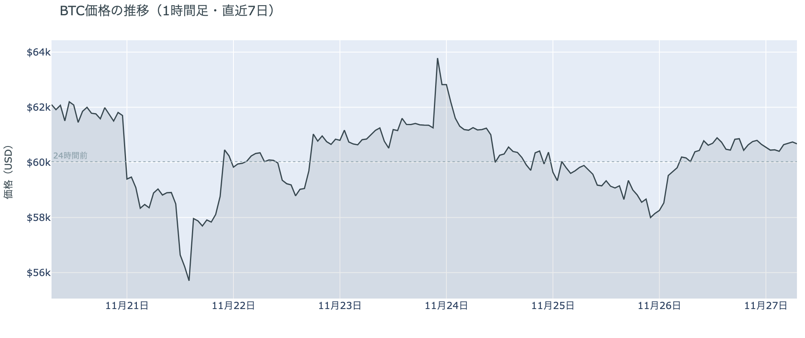

*図の見方: 1時間ごとの価格（日本時間）。点線は24時間前の水準です。*

* 24時間の値幅は2.8%で、前日の約5.6%から半分に縮んだ。

木曜日は、前の晩の往復のあと、価格が$60,400〜$60,900の間にとどまった1日でした。朝9時台に小さく上げたところで清算がまとまり、その大半はショートでした。被清算者は18件に散らばり、最大の1件でも全体の3割ほどなので、大口1件ではなく多数のショートが振り落とされています。値動きの速い5分足に、Hyperliquid（＝オンチェーンの先物取引所）で拾えた清算の8割超が入っていたので、清算がこの小さな上げを加速させました。夕方から未明にかけては価格がほぼ横ばいのまま建玉が増えていて、新しい持ち高が積まれています。

**図1-2 価格と50日・200日移動平均**

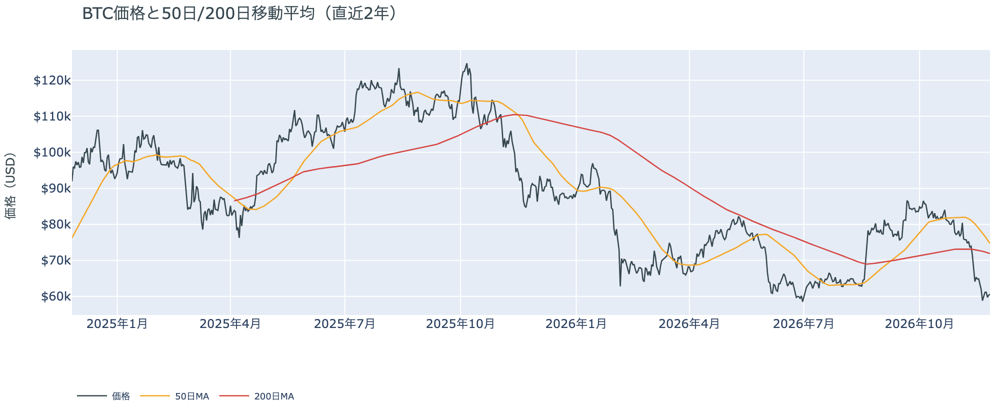

*図の見方: 2本の平均線の上下関係を見ます。50日線が200日線の上にあるのがゴールデンクロスです。*

* 50日線と200日線の差は約$2,763（3.84%）で、前日の4.31%から縮んだ。
* 朝7時5分の価格は50日線を18.8%下回る。

ゴールデンクロス（＝50日線が200日線を上抜けること）の状態は80日目ですが、50日線も200日線も下を向いています。2本の差は1日に約$390ずつ縮んでいて、価格が今の水準のままなら約9日後にデッドクロス（＝50日線が200日線を下抜けること）になる計算です。静かな1日のあとも、価格は50日線を2割近く下回ったままです。

証券市場では、米国が11月26日の感謝祭で休場で、株の取引がありませんでした。その間に金は+1.6%、原油は+1.5%で終えています。ビットコインにとっては、米国株という前の晩の値動きの相手がいない1日で、11月25日の S&P500 の−0.25% のあとに新しい材料は持ち越されていません。

## 2. なぜ動いたか：きっかけと、需給のどこが動いたか

**図2-1 ビットコインと株・金・原油の相対推移（起点＝100）**

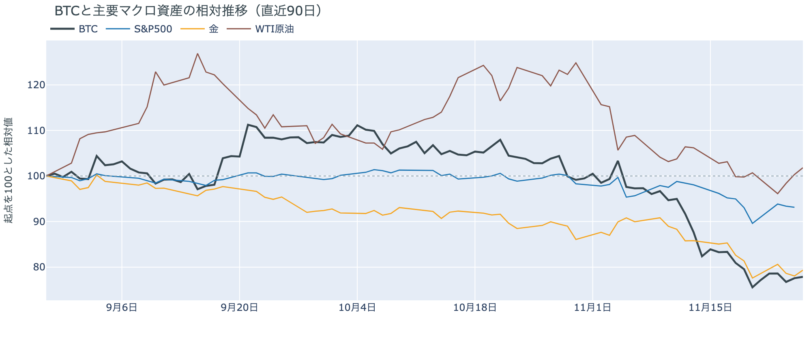

*図の見方: 同じ起点から何%動いたかで重ねたもの。線の向きが揃っているかを見ます。*

| この5営業日の動き（ビットコインは7日間） | 変化 |
|---|---:|
| ビットコイン | −2.1% |
| 金 | −2.5% |
| 米国株（S&P500） | −1.9% |
| 原油 | +2.0% |

* 建玉は98,161BTCで、24時間で約1%増えた。
* 1日をならした年率は+7.65%で、短期金利（13週Tビル 4.16%）を引いた上乗せは+3.50pt。

木曜日は、米国株が休場で新しいきっかけが来ず、先物で小さな持ち高の出入りがあっただけなので、価格はほとんど動きませんでした。

1. きっかけ：はっきりしたきっかけは見当たりません。前の2晩は、ビットコインの大きな動きが米国株の寄り付きや戻りと同じ時間に起きていましたが、この日は株の取引そのものがありませんでした。金と原油は上げましたが、ビットコインはその間も$60,000台の狭い幅にとどまっていて、今日の値動きに効いた形跡はありません。この1週間で見ても、ビットコインは金や株と同じくらい下げ、原油だけが上げています。
2. 伝わり方：速い側では、先物が小さな上げと横ばいを運びました。朝は価格が上がりながら建玉が減り、清算のほとんどがショートだったので、前の晩に残っていたショートの一部が買い戻しと清算で消えています。夕方から未明は、価格が横ばいのまま建玉が増え、資金調達率（＝ロングが払う金利。プラス＝ロングがショートより多い）の上乗せも少し上がったので、積まれたのはロングの側です。遅い側には、何も届いていません。アメリカの価格は1週間をならして前の週より安いままで（図①-1）、ETF は11月25日まで7営業日続けて出超です（図①-2）。長期保有者の保有量も11月25日時点で減り方が前の週より大きくなっています（図②-1）。静かな1日を運んだのは先物で、アメリカの買い手と長期保有者の売りはその下で続いています。

## 3. 市場参加者はいまどう見ているか

### ① アメリカの買い手は売る側に傾いたままで、戻りを買う動きは出ていない

**図①-1 Coinbase Premium（アメリカとそれ以外の価格差・直近90日）**

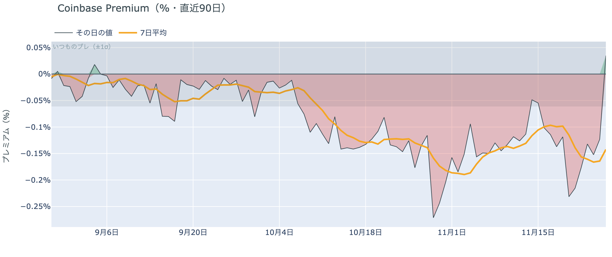

*図の見方: プラス＝アメリカで買いが強い。太線が1週間平均、細線がその日の値。薄い帯は「いつものブレの範囲」です。*

* 1週間平均は−0.14%で、前の週の−0.10%より深い。
* その日の値は+0.03%で、いつものブレの範囲内。

アメリカの買い手は、$60,000前後の価格をまだ買いの場面と見ていません。Coinbase Premium（＝アメリカとそれ以外の価格差）は1週間をならすと前の週より深いマイナスで、アメリカの側で売りが勝つ状態が続いています。感謝祭の木曜日にその日の値はプラスに出ましたが、いつものブレの内側で、米国の参加者が少ない休日の1日なので、売りが止まった形ではありません。

**図①-2 ETFの日ごとの資金の出入り（直近90日）**

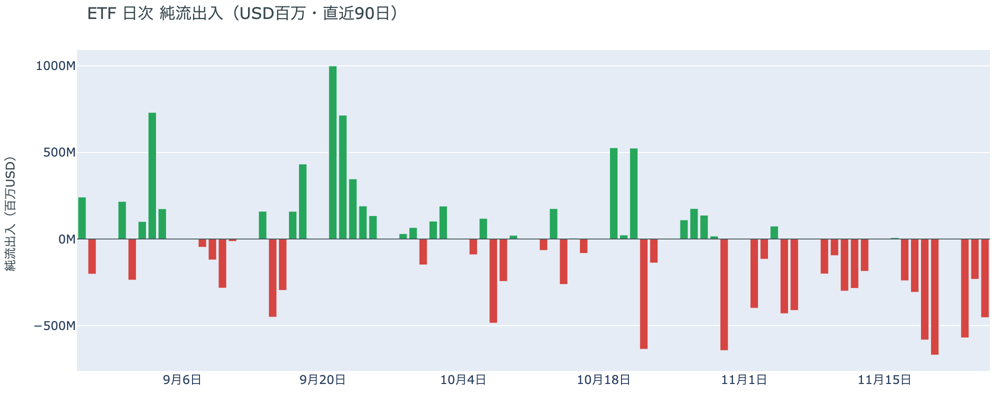

*図の見方: 入ったお金と出たお金の差。上に伸びれば入り超、下に伸びれば出超。*

| ETFの日ごとの出入り | 億ドル |
|---|---:|
| 11月19日 | −5.8 |
| 11月20日 | −6.7 |
| 11月23日 | −5.7 |
| 11月24日 | −2.3 |
| 11月25日 | −4.5 |
| 直近7営業日の合計 | −30.5 |

* 11月の合計は25日までで約−54億ドル。これまで最大だった今年6月の約−45億ドルを上回る。

ETF の買い手は引き揚げをやめておらず、見方は弱気のままです。前日に「急ぐ勢いは弱まった」と書いた11月24日の流出のあと、25日の流出は再び倍近くに増えました。引き揚げる手が緩んだのは1日だけだったということです。

**図①-3 Fear & Greed（市場心理の指数・直近90日）**

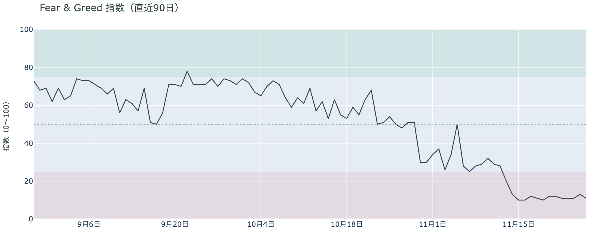

*図の見方: 0〜100で、50より上が「強欲」、下が「恐怖」。*

* 11の「極度の恐怖」で、前日の13から2pt下げた。1週間前は10、1か月前は48。

参加者の多くは、静かな1日のあとも弱気な見方を変えていません。Fear & Greed（＝市場心理の指数）は11月14日から10台に張りついたままで、$60,000台を保った木曜日にも戻っていません。

### ② 長期保有者は損失の出る価格でもコインを動かし続け、減り方は前の週より大きい

**図②-1 長期保有者の保有量の30日変化とSOPR（直近90日）**

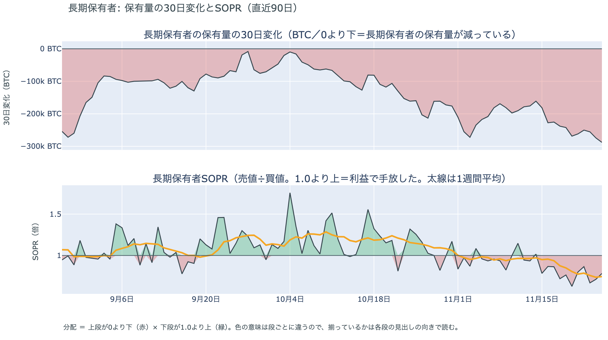

*図の見方: 上段は、長期保有者の保有量が30日でどれだけ増減したか。マイナス＝手放している。下段は長期保有者SOPRで、1より上なら利益で手放した。どちらも太線の1週間平均で読みます。*

| 11月25日時点 | 1週間平均 | 前の週の平均 |
|---|---:|---:|
| 長期保有者SOPR（1より上＝利益で手放した） | 0.75 | 0.88 |
| 長期保有者の保有量の30日変化（万BTC） | −26.3 | −19.8 |

長期保有者（＝155日以上保有者）は、損失の出る価格でもコインを動かし続けていて、下げが終わったとは見ていません。保有量の減り方は前の週より大きくなりました。動いたコインは平均して買値より安く動いていて、その損失も前の週より深いので、利益が出たから手放すという形ではありません。長期保有者の持ち方は、前日から変わっていません。

ほかに、急いで手放しそうな持ち手は見当たりません。マイナーの収入は平年を1割ほど下回るところで横ばいが続いていて（Puell Multiple（＝マイナー収入の平年比）が11月25日時点の1週間平均で0.87）、前の週から悪くなっていません。長く眠っていたコインがまとまって動いた記録もなく、コインが最後に送金された日の価格の分布にも、今日新しく取り上げる変化はありません。

### ③ 先物：ロングは降りずに少し積み増し、上げの側への傾きを保った

**図③-1 資金調達率と建玉（直近30日）**

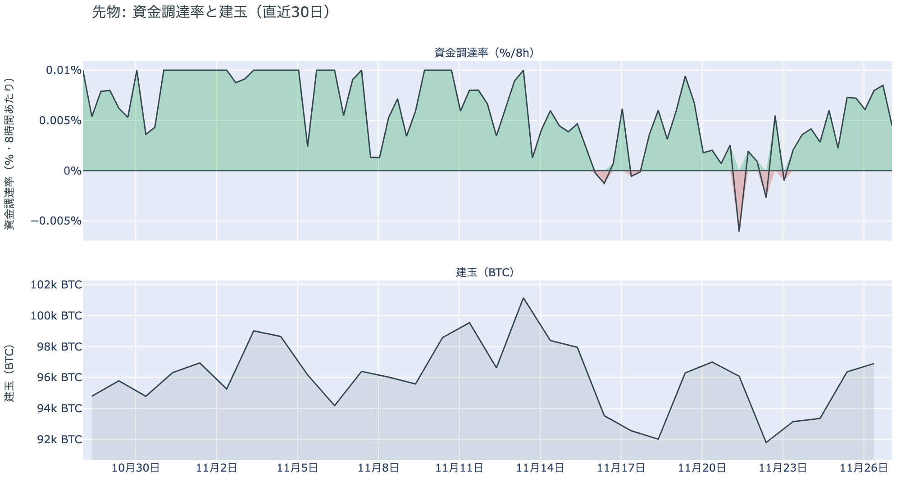

*図の見方: 上段は資金調達率（8時間ごと・日本時間）。プラスが続く＝ロングがショートより多い。下段は建玉。*

* 資金調達率はプラスが12回連続（約4日）。
* 短期金利に対する上乗せは前日の+3.36ptから+3.50ptへ。直近34日の平均+2.33ptを上回る。

先物の参加者は、前の晩に上げの側へ傾き直した見方を、静かな1日のあとも保っています。前の晩のショートの清算のあと、ロングは降りずに残り、夜には少し積み増されました。ロングが払う金利は、短期金利（＝ドルを米国の短期国債で持つだけで受け取れる金利）を上回るところにとどまっています。余分に払ってでも上げに賭けたい人が、1日で引いてはいないということです。前日は「割れていた見方は上げの側へ寄った」と説明しました。木曜日はショートがさらに買い戻され、ロングが積まれたので、前日の説明は今日の数値と合っています。

### ④ オプション：連休明けまでは静かと見て、下げへの備えは12月中旬の満期に厚い

オプションには2種類あります。コール（＝決めた価格で買う権利）とプット（＝決めた価格で売る権利）で、価格が上がればコールの価値が上がり、価格が下がればプットの価値が上がります。プットは「価格が下がったときの保険」として買われます。オプションを買う人は、その権利と引き換えに権利料（＝オプションを買う人が払う金額）を払います。

**図④-1 満期ごとのIV（年率%）**

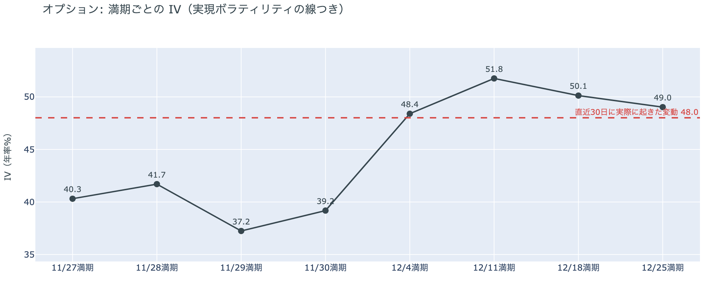

*図の見方: IVを満期ごとに並べたもの。点線は実現ボラティリティ。IVが点線より下なら、市場はこの先の値動きを過去の値動きより小さいと見ています。*

| 満期 | IV |
|---|---:|
| 11月27日 | 40 |
| 11月28日 | 42 |
| 11月29日 | 37 |
| 11月30日 | 39 |
| 12月4日 | 48 |
| 12月11日 | 52 |
| 12月18日 | 50 |
| 12月25日 | 49 |

* IVは全体で52.3で、実現ボラティリティ48.0より4.3pt高い。過去1年では高いほうから14%の位置。

参加者は、この先の値動きをこれまでより大きいと見ていて、身構えを解いていません。IV（＝値動きの幅の予想）は全体で実現ボラティリティ（＝過去の値動きの幅）を上回っています。例外は目の前で、今週末までの満期は40前後と低く、連休のあいだは大きく動かないと見られています。IV が一段上がるのは12月4日の満期からで、いちばん高いのは12月11日の満期です。

**図④-2 満期ごとのプットとコールの差**

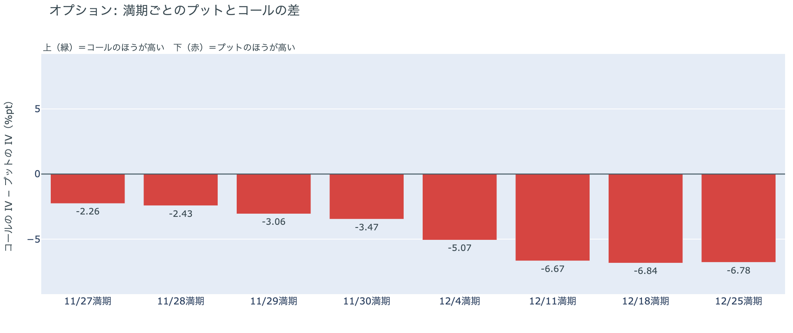

*図の見方: 満期ごとに、プットとコールのどちらが高く売れているか。ゼロより上ならコールのほうが高く、下ならプットのほうが高い。*

| 満期 | どちらが高いか |
|---|---|
| 11月27日 | プットが高い（差は小さい） |
| 11月28日 | プットが高い（差は小さい） |
| 11月29日 | プットが高い |
| 11月30日 | プットが高い |
| 12月4日 | プットが高い（差は大きい） |
| 12月11日 | プットが高い（差はいちばん大きい側） |
| 12月18日 | プットが高い（差はいちばん大きい側） |
| 12月25日 | プットが高い（差は大きい） |

参加者は、動くなら下だという見方を変えておらず、下げを警戒しているのは目の前より12月です。今週の満期ではプットとコールの差が小さく、12月4日から先で大きくなり、12月11日と12月18日の満期で最も大きくなっています。この2つの満期は、12月4日の米雇用統計、12月9日の FOMC（＝米国の金利を決める会合）、12月10日の米CPI（＝米国の物価統計）をまたぎます。前の晩のショートの清算で先物が上げの側へ傾いても、オプションの下げへの備えは剥がれていません。

**図④-3 12月25日満期の持ち高（権利の価格ごと）**

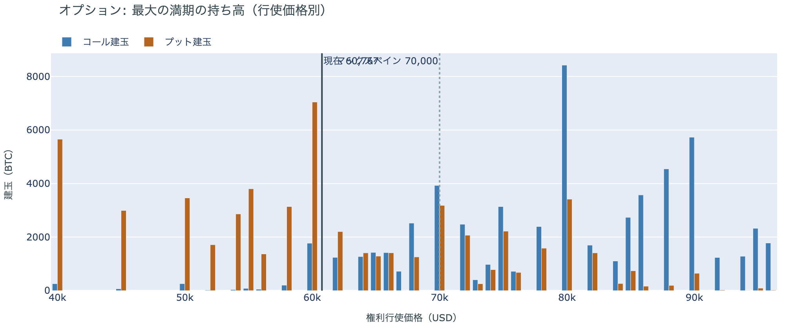

*図の見方: 青＝コール、橙＝プット。現値より上にコールが、下にプットが積まれるのが普通です。*

| 12月25日満期のオプション（基準の価格は約$60,800） | 量（万BTC） | 意味 |
|---|---:|---|
| コール（決めた価格で買う権利） | 約9.8 | 「価格が上がる」に賭けた分 |
| プット（決めた価格で売る権利） | 約6.7 | 「価格が下がる」への保険 |
| うち、いまより15%以上高い価格のコール | 約8.6 | 大きな上げへの賭け |
| うち、いまより15%以上安い価格のプット | 約2.1 | 大きな下げへの保険 |

* 12月25日満期の持ち高は約16.5万BTCと全満期の37%で、コールがプットの1.5倍。

年末の最大の満期では、「価格が上がる」に賭けた人たちが降りておらず、年末までの戻りを諦めてはいません。ただし、コールのほとんどは$70,000以上に置かれていて、報われるには12月25日の夕方5時までに$70,000を超える必要があります。全満期でオプションの持ち高が集まっているのは$58,000〜$62,000の帯で、いちばん多い$60,000には全体の4分の1近くがあります。木曜日の価格は、この帯の真ん中にとどまっていました。

## 4. 価格に影響しうる直近のイベント

オプション市場が下げへの備えをいちばん厚く置いているのは12月11日と12月18日の満期で、12月4日の米雇用統計、12月9日の FOMC、12月10日の米CPI をまたぎます。感謝祭の短縮取引と OPEC+ の会合が入る今週の満期では、IV もプットとコールの差も小さくなっています。

| 日付 | イベント | 何に効くか |
|---|---|---|
| 11/27（金） | 米国は感謝祭の翌日で、株式市場は短縮取引 | 米国株・ETF の取引が薄くなる |
| 11/29（日） | OPEC+ の会合（オンライン）。2027年の生産枠を決める | 原油 |
| 11/30（月）米国時間の引け | MSCI の指数から米 Strategy（＝ビットコインを大量に持つ米企業）が外れる実施日 | Strategy の株と、指数に連動する資金 |
| 12/3（木） | ドイツ・ライプツィヒ地裁で Movie2k 事件の裁判が再開。被告が4万BTCを引き渡せば打ち切るという裁判所の案を、被告側と検察が検討している | 当局の手に渡りうる4万BTC |
| 12/4（金）22:30 日本時間 | 米11月の雇用統計 | 金利 |
| 12/9（水） | FOMC。0.25ptの利上げは織り込み済みで、0.5ptの利上げの織り込みは約3割（11月26日時点）。結果は日本時間10日早朝 | 金利 |
| 12/10（木）22:30 日本時間 | 米11月の CPI | 金利 |
| 12/25（金）17:00 | オプションの最も大きな満期（約16.5万BTC、全満期の37%） | $70,000以上のコールの期限 |
| 1/25（月） | 米国通商代表部が、14の国・地域への新しい関税案の公聴会を始める | 株・物価の見通し |

## まとめ

感謝祭の木曜日のビットコインは、米国株が休場で新しいきっかけが来ないなか、朝のショートの清算と夜のロングの小さな積み増しという先物の出入りだけで、約$60,600の近くにとどまりました。アメリカの買い手の売りと長期保有者の手放しは、その下で前日と同じように続いています。参加者は、前の晩にショートが振り落とされたのを見て目の前では上げの側へ傾いたままですが、オプションでは下げへの備えを12月の米雇用統計・FOMC・米CPI に厚く置いたままで、下げが終わったとは見ていません。

---

<small>（数値は11月27日7時5分（日本時間）までのデータに基づきます。価格・先物・オプションはその時点の値、市場心理は11月26日の確定値、オンチェーン（＝ブロックチェーン上の記録）は11月25日時点、ETF資金フローは11月25日分までです。証券市場の終値は、株と米国債利回りが11月25日時点（11月26日の米国は感謝祭で休場）、金と原油が11月26日時点です。オンチェーンの長期保有者の数値には、ETFや取引所が預かっている分も含まれます。清算は Hyperliquid で拾えた分だけで、市場全体のごく一部です。オプションはDeribit（BTCオプションの大半を占める取引所）の全銘柄です。）</small>

*本稿は情報提供を目的としたものであり、投資助言ではありません。将来の価格動向を保証・示唆するものではなく、投資判断は各自の責任において行ってください。*
