# NVIDIAの報道と同じ1時間に3.7%下げ$60,000割れ ― 株高の中でショートが積まれた

**2026年11月28日**

ビットコインは金曜日、朝に$61,000台へ上げたあと、米国株の取引が始まった夜の1時間で3.7%下げ、$60,000を割り込みました。

* **価格**：24時間の値幅は約5.9%と、前日の2.8%の倍に広がった。朝7時5分の時点で約$59,688と、夜の下げのあとは$60,000のすぐ下で落ち着いた
* **きっかけ**：中国のデータセンターで NVIDIA の輸出規制対象の半導体が見つかったという報道があり、NVIDIA 株だけが売られた夜の取引開始直後に、ビットコインも下げた。指数の米国株は上げて終えたので、株安が来た夜ではない
* **先物**：夜の下げでは売り持ち（ショート）が新しく積まれ、買い持ち（ロング）の清算（＝証拠金不足で強制的に閉じられた取引）が下げを速めた。前日に上げの側へ傾いていた見方は、1日で薄れた
* **需給の土台**：米国の買い手は金曜日も売る側にいて、長期保有者の保有量も損失の出る価格で減り続けている。前日から続く売りで、夜の下げで持ち方が変わったわけではない
* **オプションの見方**：週末のあいだは大きく動かないと見る一方、下げへの備えは12月中旬の満期に厚く置いたまま

## 1. 何が起きたか

**図1-1 価格の推移（1時間足・直近7日）**

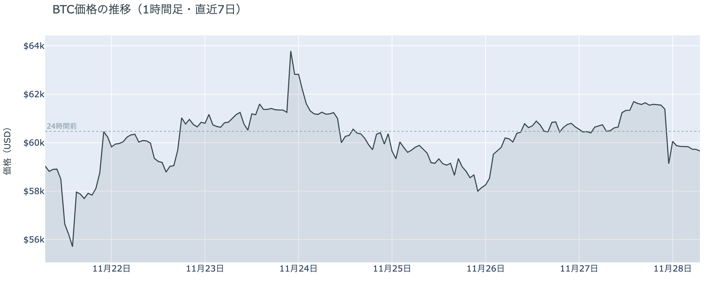

*図の見方: 1時間ごとの価格（日本時間）。点線は24時間前の水準です。*

* 24時間の値幅は約5.9%で、前日の2.8%から倍に広がった。
* 夜23時台の1時間で−3.7%。この24時間でいちばん大きく動いた1時間。

金曜日は、朝に上げた分を、夜の1時間でまとめて吐き出した1日でした。朝11時台の上げでは、Hyperliquid（＝オンチェーンの先物取引所）で拾えた清算がまとまり、ほとんどがショートで、その大半は大口1件が飛んだものです。昼にかけては価格が上がりながら建玉が増えていて、ロングが新しく積まれています。夜23時台の下げでは、価格が下がりながら建玉が増えたので、新しく積まれたのはショートの側です。同じ時間にロングの清算が続き、値動きの速い5分足に清算の4割近くが入っていたので、清算がこの下げを加速させました。0時台には1.6%戻し、そのあとは$59,800前後で動かなくなっています。

**図1-2 価格と50日・200日移動平均**

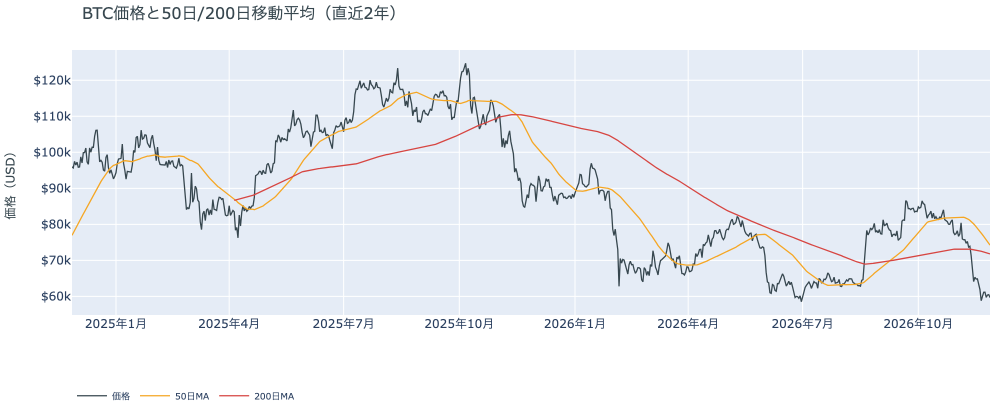

*図の見方: 2本の平均線の上下関係を見ます。50日線が200日線の上にあるのがゴールデンクロスです。*

* 50日線と200日線の差は約$2,431（3.39%）で、前日の3.84%から縮んだ。
* 朝7時5分の価格は50日線を19.6%下回る。

ゴールデンクロス（＝50日線が200日線を上抜けること）の状態は81日目ですが、50日線も200日線も下を向いています。2本の差は1日に約$380ずつ縮んでいて、価格が今の水準のままなら約7日後にデッドクロス（＝50日線が200日線を下抜けること）になる計算です。夜の下げで、価格は50日線から2割近く離れたところへ戻っています。

証券市場では、11月27日の米国株が感謝祭翌日の短縮取引で、S&P500 が+1.6%と上げて終えました。金も+3.8%と大きく上げ、原油は−0.7%です。ビットコインにとっては、株も金も上げた金曜日に1つだけ下げた形で、米国株から週末へ持ち越された売りの材料はありません。

## 2. なぜ動いたか：きっかけと、需給のどこが動いたか

**図2-1 ビットコインと株・金・原油の相対推移（起点＝100）**

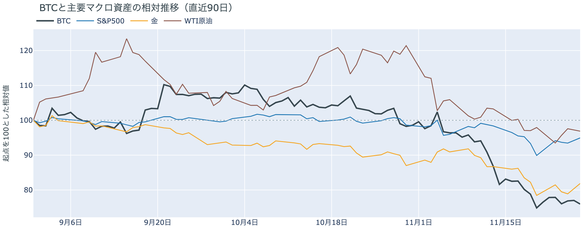

*図の見方: 同じ起点から何%動いたかで重ねたもの。線の向きが揃っているかを見ます。*

| この5営業日の動き（ビットコインは7日間） | 変化 |
|---|---:|
| ビットコイン | +1.5% |
| 金 | −0.5% |
| 米国株（S&P500） | +1.7% |
| 原油 | −0.2% |

* 建玉は98,349BTCで、7日で+1.2%。夜の下げの1時間にも+0.9%増えた。
* 1日をならした年率は+5.85%で、短期金利（13週Tビル 4.15%）を引いた上乗せは+1.70pt。

金曜日の夜は、NVIDIA 株だけが売られた米国株の取引開始直後をきっかけに、先物のショートの積み増しとロングの清算を通って下げました。

1. きっかけ：Bloomberg が11月27日、輸出規制で中国へは売れないはずの NVIDIA の最新の半導体が、中国のデータセンターで見つかったと報じました。米国株の取引が始まった23時台に NVIDIA 株は−2.0%と売られ、ビットコインの下げも同じ1時間に起きています。一方でナスダック100（＝米国の大型ハイテク株の指数）はその1時間も上げていて、1日では+2.6%で終えました。株全体が売られたのではなく、NVIDIA だけが売られた時間に、ビットコインも下げたということです。株と金が上げた日に下げたので、株や金と共通のきっかけで動いたのではありません。
2. 伝わり方：速い側では、先物が下げを運びました。夜の1時間に価格が下がりながら建玉が増えたので、下げに賭けるショートが新しく入り、朝から積まれていたロングの一部が清算で振り落とされています。資金調達率（＝ロングが払う金利。プラス＝ロングがショートより多い）の上乗せも前日の+3.50ptから半分に縮みました。遅い側では、アメリカの買い手が金曜日も売る側にいて、その日の Coinbase Premium はいつものブレを超えて沈みました（図①-1）。ただし1週間をならせば前の週からの続きで、ETF の流出も長期保有者の減り方も前日と同じ向きです（図①-2・図②-1）。夜の下げを運んだのは先物で、アメリカの買い手と長期保有者の持ち方までは変えていません。

## 3. 市場参加者はいまどう見ているか

### ① アメリカの買い手は売る側に傾いたままで、金曜日はその売りが一段と目立った

**図①-1 Coinbase Premium（アメリカとそれ以外の価格差・直近90日）**

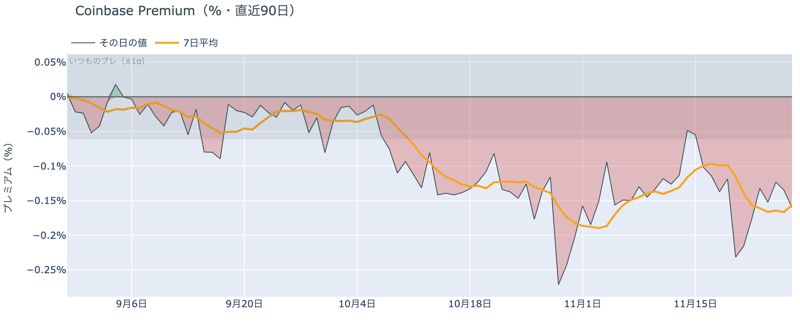

*図の見方: プラス＝アメリカで買いが強い。太線が1週間平均、細線がその日の値。薄い帯は「いつものブレの範囲」です。*

* 1週間平均は−0.16%で、前の週の−0.12%より深い。
* その日の値は−0.16%で、いつものブレの2.6倍。

アメリカの買い手は、$60,000前後の価格をまだ買いの場面と見ていません。Coinbase Premium（＝アメリカとそれ以外の価格差）は1週間をならしても前の週より深いマイナスで、アメリカの側で売りが勝つ状態が続いています。米国の取引が戻った金曜日には、その日の値もいつものブレを超えて沈みました。休場明けに米国の参加者が戻ると、アメリカの側の売りがかえって目立ったということで、売りが止まる形はまだ出ていません。

**図①-2 ETFの日ごとの資金の出入り（直近90日）**

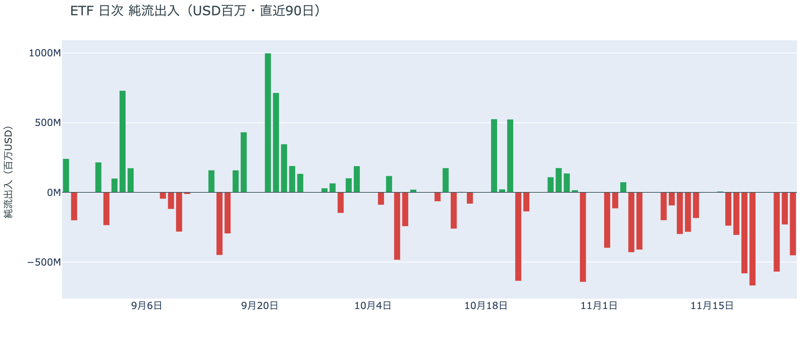

*図の見方: 入ったお金と出たお金の差。上に伸びれば入り超、下に伸びれば出超。*

| ETFの日ごとの出入り | 億ドル |
|---|---:|
| 11月19日 | −5.8 |
| 11月20日 | −6.7 |
| 11月23日 | −5.7 |
| 11月24日 | −2.3 |
| 11月25日 | −4.5 |
| 直近7営業日の合計 | −30.5 |

ETF の買い手は引き揚げを続けていて、見方は弱気のままです。11月25日まで7営業日続けて出超で、1週間で約30億ドルが出ていきました。感謝祭の休場をはさんで新しい数字はまだ出ておらず、引き揚げる手が止まった形跡はありません。

**図①-3 Fear & Greed（市場心理の指数・直近90日）**

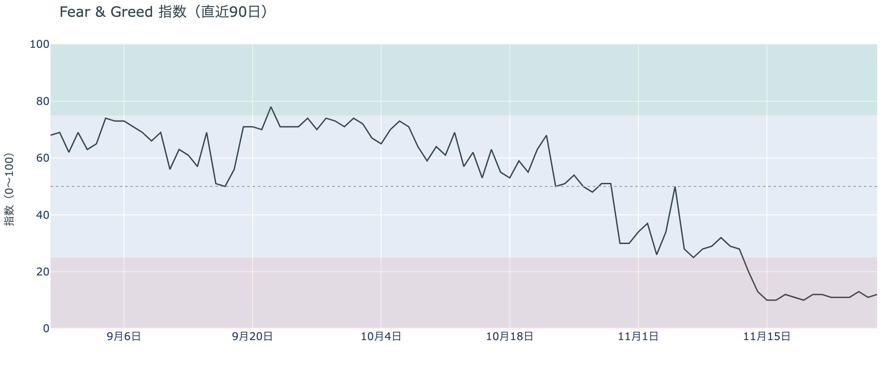

*図の見方: 0〜100で、50より上が「強欲」、下が「恐怖」。*

* 12の「極度の恐怖」で、前日の11から1pt戻した。1週間前も12、1か月前は51。

参加者の多くは、弱気な見方を変えていません。Fear & Greed（＝市場心理の指数）は11月14日から10台に張りついたままです。朝に$61,000台を回復した金曜日にも、気分は上向いていません。

### ② 長期保有者は損失の出る価格でもコインを動かし続け、減り方は前の週より大きい

**図②-1 長期保有者の保有量の30日変化とSOPR（直近90日）**

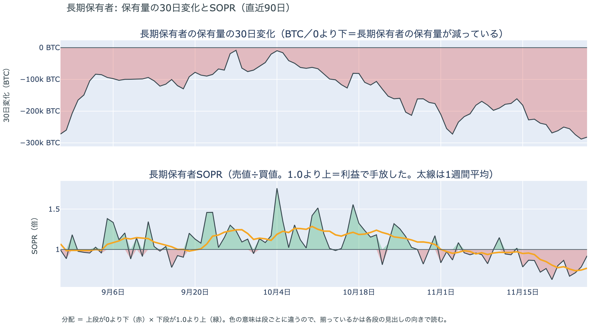

*図の見方: 上段は、長期保有者の保有量が30日でどれだけ増減したか。マイナス＝手放している。下段は長期保有者SOPRで、1より上なら利益で手放した。どちらも太線の1週間平均で読みます。*

| 11月26日時点 | 1週間平均 | 前の週の平均 |
|---|---:|---:|
| 長期保有者SOPR（1より上＝利益で手放した） | 0.77 | 0.85 |
| 長期保有者の保有量の30日変化（万BTC） | −26.9 | −20.7 |

長期保有者（＝155日以上保有者）は、損失の出る価格でもコインを動かし続けていて、下げが終わったとは見ていません。保有量の減り方は前の週より大きくなりました。動いたコインは平均して買値より安く動いていて、その損失も前の週より深いので、利益が出たから手放すという形ではありません。長期保有者の持ち方は、前日から変わっていません。

ほかに、急いで手放しそうな持ち手は見当たりません。マイナーの収入は平年を1割強下回るところにあり（Puell Multiple（＝マイナー収入の平年比）が11月26日時点の1週間平均で0.86）、前の週の0.89からわずかに下がっただけです。長く眠っていたコインがまとまって動いた記録もなく、コインが最後に送金された日の価格の分布にも、今日新しく取り上げる変化はありません。

### ③ 先物：夜の下げでショートが入り、上げの側への傾きは1日で薄れた

**図③-1 資金調達率と建玉（直近30日）**

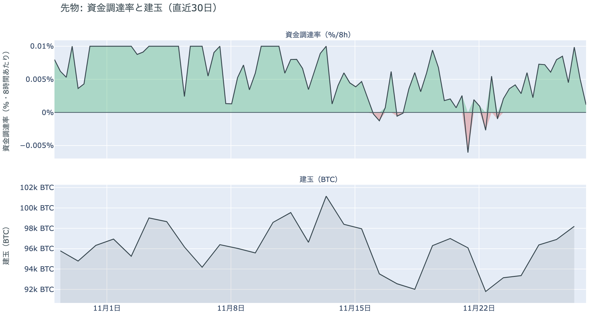

*図の見方: 上段は資金調達率（8時間ごと・日本時間）。プラスが続く＝ロングがショートより多い。下段は建玉。*

* 資金調達率はプラスが15回連続（約5日）。
* 短期金利に対する上乗せは+1.70ptで、直近34日の平均+2.47ptを下回る。

先物の参加者は、上げに賭ける確信を1日で弱めました。ロングはまだショートより多いものの、ロングが払う金利の、短期金利（＝ドルを米国の短期国債で持つだけで受け取れる金利）に対する上乗せは、前日の半分にまで縮んでいます。余分に払ってでも上げに賭けたい人が減り、代わりに夜の下げでショートが新しく入ったということです。前日は「前の晩にショートが振り落とされ、上げの側へ傾いた見方を保っている」と説明しました。金曜日の夜にロングが振り落とされ、ショートが積まれたので、その傾きは1日で巻き戻されています。

### ④ オプション：週末は静かと見て、下げへの備えは12月中旬の満期に厚い

オプションには2種類あります。コール（＝決めた価格で買う権利）とプット（＝決めた価格で売る権利）で、価格が上がればコールの価値が上がり、価格が下がればプットの価値が上がります。プットは「価格が下がったときの保険」として買われます。オプションを買う人は、その権利と引き換えに権利料（＝オプションを買う人が払う金額）を払います。

**図④-1 満期ごとのIV（年率%）**

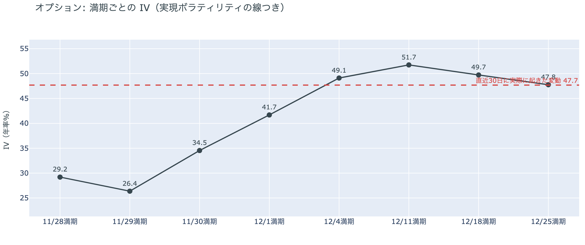

*図の見方: IVを満期ごとに並べたもの。点線は実現ボラティリティ。IVが点線より下なら、市場はこの先の値動きを過去の値動きより小さいと見ています。*

| 満期 | IV |
|---|---:|
| 11月28日 | 29 |
| 11月29日 | 26 |
| 11月30日 | 35 |
| 12月1日 | 42 |
| 12月4日 | 49 |
| 12月11日 | 52 |
| 12月18日 | 50 |
| 12月25日 | 48 |

* IVは全体で52.4で、実現ボラティリティ47.7より4.7pt高い。過去1年では高いほうから15%の位置。

参加者は、この先の値動きをこれまでより大きいと見ていて、身構えを解いていません。IV（＝値動きの幅の予想）は全体で実現ボラティリティ（＝過去の値動きの幅）を上回っています。例外は週末で、11月29日までの満期は30前後と低く、金曜日の夜に大きく下げたあとでも、週末のあいだは大きく動かないと見られています。IV が上がるのは12月の満期からで、いちばん高い12月11日の満期の権利料には、ほかの満期に対する上乗せが乗っています。12月の米雇用統計・FOMC・米CPI の直後に大きく動くと見られているからです。

**図④-2 満期ごとのプットとコールの差**

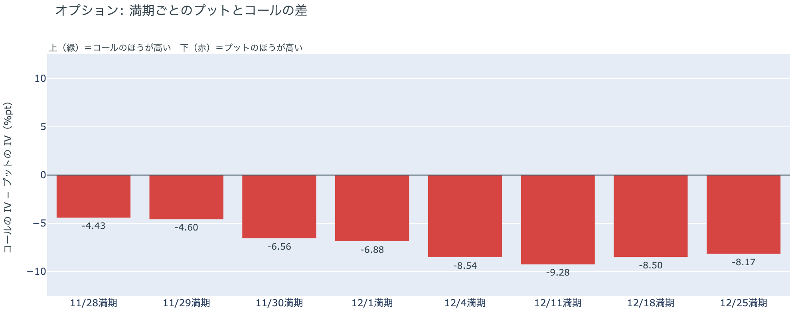

*図の見方: 満期ごとに、プットとコールのどちらが高く売れているか。ゼロより上ならコールのほうが高く、下ならプットのほうが高い。*

| 満期 | どちらが高いか |
|---|---|
| 11月28日 | プットが高い（差は小さい） |
| 11月29日 | プットが高い（差は小さい） |
| 11月30日 | プットが高い |
| 12月1日 | プットが高い |
| 12月4日 | プットが高い（差は大きい） |
| 12月11日 | プットが高い（差はいちばん大きい） |
| 12月18日 | プットが高い（差は大きい） |
| 12月25日 | プットが高い（差は大きい） |

参加者は、動くなら下だという見方を変えておらず、下げを警戒しているのは目の前より12月です。週末の満期ではプットとコールの差が小さく、12月4日から先で大きくなり、12月11日の満期で最も大きくなっています。この満期は、12月4日の米雇用統計、12月9日の FOMC（＝米国の金利を決める会合）、12月10日の米CPI（＝米国の物価統計）をまたぎます。金曜日の夜の下げのあとも、この形は前日から変わっていません。

**図④-3 12月25日満期の持ち高（権利の価格ごと）**

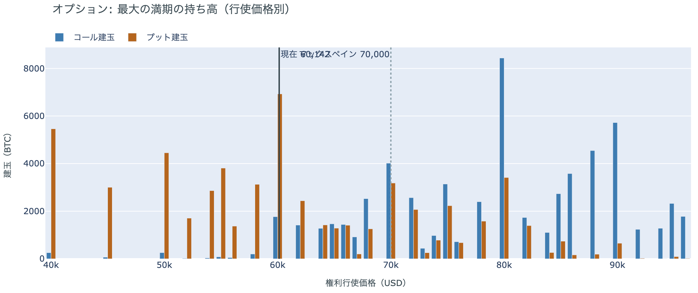

*図の見方: 青＝コール、橙＝プット。現値より上にコールが、下にプットが積まれるのが普通です。*

| 12月25日満期のオプション（基準の価格は約$60,100） | 量（万BTC） | 意味 |
|---|---:|---|
| コール（決めた価格で買う権利） | 約9.9 | 「価格が上がる」に賭けた分 |
| プット（決めた価格で売る権利） | 約6.8 | 「価格が下がる」への保険 |
| うち、いまより15%以上高い価格のコール | 約8.6 | 大きな上げへの賭け |
| うち、いまより15%以上安い価格のプット | 約2.2 | 大きな下げへの保険 |

* 11月27日の月末の満期が過ぎ、12月25日満期の約16.7万BTCが全満期の49%を占める。

年末の最大の満期では、「価格が上がる」に賭けた人たちが金曜日の夜の下げでも降りておらず、年末までの戻りを諦めてはいません。ただし、コールのほとんどは$70,000以上に置かれていて、報われるには12月25日の夕方5時までに$70,000を超える必要があります。全満期でオプションの持ち高が集まっているのは$58,000〜$62,000の帯で、夜に$60,000を割り込んだ価格は、いまもこの帯の中にいます。

## 4. 価格に影響しうる直近のイベント

オプション市場が下げへの備えをいちばん厚く置いているのは12月11日の満期で、12月4日の米雇用統計、12月9日の FOMC、12月10日の米CPI をまたぎます。OPEC+ の閣僚会合と MSCI の指数の入れ替えが入る週末から週明けの満期では、IV もプットとコールの差も小さいままです。

| 日付 | イベント | 何に効くか |
|---|---|---|
| 11/29（日） | OPEC+ の閣僚会合。2027年の生産枠を決める | 原油 |
| 11/30（月）米国時間の引け | MSCI の指数から米 Strategy（＝ビットコインを大量に持つ米企業）が外れる実施日 | Strategy の株と、指数に連動する資金 |
| 12/3（木） | ドイツ・ライプツィヒ地裁で Movie2k 事件の裁判が再開。被告が4万BTCを引き渡せば打ち切るという裁判所の案を、被告側と検察が検討している | 当局の手に渡りうる4万BTC |
| 12/4（金）22:30 日本時間 | 米11月の雇用統計 | 金利 |
| 12/9（水） | FOMC。0.25ptの利上げは織り込み済みで、0.5ptの利上げの織り込みは約2割（11月27日時点）。結果は日本時間10日早朝 | 金利 |
| 12/10（木）22:30 日本時間 | 米11月の CPI | 金利 |
| 12/25（金）17:00 | オプションの最も大きな満期（約16.7万BTC、全満期の49%） | $70,000以上のコールの期限 |
| 1/25（月） | 米国通商代表部が、14の国・地域への新しい関税案の公聴会を始める | 株・物価の見通し |

## まとめ

金曜日のビットコインは、NVIDIA の半導体をめぐる報道で NVIDIA 株だけが売られた米国株の取引開始直後に、先物のショートの積み増しとロングの清算を通って3.7%下げ、約$59,700で朝を迎えました。株と金が上げた日の下げで、アメリカの買い手の売りと長期保有者の手放しは、その下で前日と同じように続いています。参加者は、先物では前日の上げへの傾きを1日で手放し、オプションでは週末は静かと見ながら下げへの備えを12月の米雇用統計・FOMC・米CPI に厚く置いたままで、下げが終わったとは見ていません。

---

<small>（数値は11月28日7時5分（日本時間）までのデータに基づきます。価格・先物・オプションはその時点の値、市場心理は11月27日の確定値、オンチェーン（＝ブロックチェーン上の記録）は11月26日時点、ETF資金フローは11月25日分までです。証券市場の終値は11月27日時点で、米国株は感謝祭翌日の短縮取引でした。オンチェーンの長期保有者の数値には、ETFや取引所が預かっている分も含まれます。清算は Hyperliquid で拾えた分だけで、市場全体のごく一部です。オプションはDeribit（BTCオプションの大半を占める取引所）の全銘柄です。）</small>

*本稿は情報提供を目的としたものであり、投資助言ではありません。将来の価格動向を保証・示唆するものではなく、投資判断は各自の責任において行ってください。*
