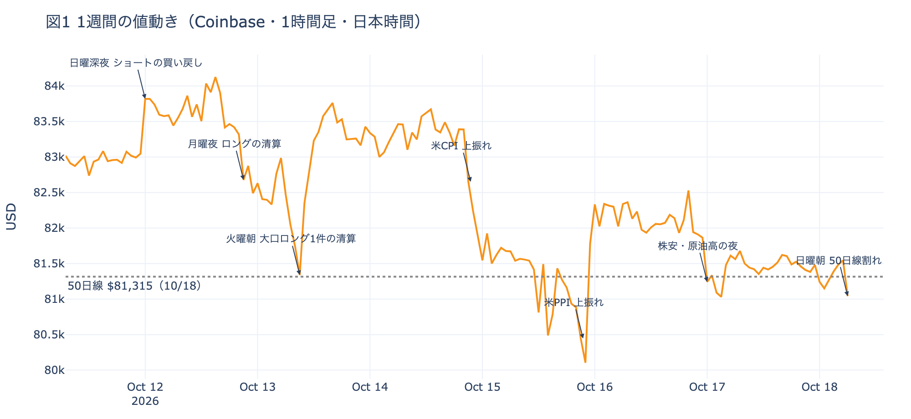
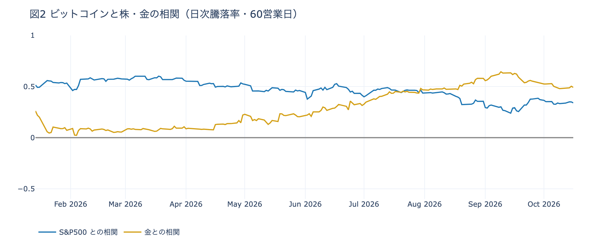

# 【10/12〜10/18】下げを止めたのは先物の上げへの賭けで、現物を持ちたい買い手は戻っていない

**2026年10月18日**

ビットコインはこの1週間で2.3%下げました。長期保有者の売りが前の週の2倍に広がったわりに、下げは小さく済んでいます。この号では、その売りを誰がどうやって受け止めたのかを、市場の仕組みから読み解きます。「1週間」は、10/12〜10/18 の日次の号が扱った、10月11日朝7時から18日朝7時まで（日本時間）です。

* **起きたこと**：長期保有者（＝155日以上保有者）が売り、米国の現物の買い手とETFは買いに戻らなかった。それでも下げは2.3%で止まった
* **この週は**：先物で上げに賭ける人が増え、その賭けが、現物と先物の値段の差で稼ぐ業者を通じて、現物の買いに変わった
* **この支えの性質**：先物の賭けは、怖い晩には真っ先に降りる。降りれば、支えていた買いはそのまま売りに変わる
* **見ておく数字**：資金調達率、建玉、Coinbase Premium の3つで、この仕組みが続いているかを確かめられる

## 1. 長期保有者が売り、現物の買い手は戻らず、それでも下げは2.3%で止まった

**図1 1週間の値動き（Coinbase・1時間足・日本時間）**

この週、現物を売る側は強くなりました。長期保有者の保有量の30日変化（1週間平均）は、約−3.8万BTCから約−9.4万BTCへ、前の週の2倍を超えています。買う側は弱いままです。米国の取引所の価格は、ほかの国より安い状態が43日続き、ETFも5営業日で差し引き流出でした。

現物の売り買いだけを見れば、価格はもっと下げていておかしくない週です。実際の下げは2.3%で、週の安値（米PPIの夜の$79,676）からも戻しています。売りを受け止めた誰かが、現物の外にいたことになります。

## 2. 先物の上げへの賭けが、裁定業者を通じて現物の買いに変わった

受け止めたのは、先物の参加者でした。仕組みは4段でつながっています。

**① 下げるたびに、先物で上げに賭ける人が増えた。** 先物は現物の受け渡しがない取引で、証拠金を置いて「上がる」「下がる」に張ります。この週は下げるたびにロング（＝上げへの賭け）が積み直され、建玉（＝まだ閉じていない賭けの総量）は1週間で1.9%増えました。

**② ロングが増えると、先物が現物より割高になる。** 先物の買いが多いぶん、先物の値段が現物より高くなります。その差を埋めるため、ロングを持つ人はショート（＝下げへの賭け）を持つ人に金利を払います。これが資金調達率です。この週の終わりには年率で約6.4%と、米国の短期金利（13週Tビル 4.07%）を2.3ポイント上回っていました。

**③ その金利を取りに、裁定業者が現物を買う。** 裁定業者は、現物を買うと同時に、同じ量の先物をショートで持ちます。現物と先物の損益が打ち消し合うので価格がどちらへ動いても損得はほぼ出ず、ロングが払う金利だけが手元に残ります。短期金利を上回るなら、やる価値のある取引です。

**④ 長期保有者が売ったコインは、この裁定業者が引き取ったと考えられる。** 先物のロングの反対側に立つショートの一部が、この業者です。彼らが現物を買うことで、先物の上げへの賭けが、現物市場の買いに変わります。

①〜③は、建玉と資金調達率の数字で確かめたことです。④は、先物と現物をつなぐふつうの仕組みから推した見立てで、誰が現物を買ったかを示すデータは見ていません。

## 3. この支えは、怖い晩に真っ先に抜け、抜けると売りに変わる

裁定業者が持っている現物は、値上がりを待って持っているコインではありません。先物のロングが金利を払ってくれるあいだだけ持っている、借り物の買いです。

先物のロングは、現物を買って持つ人より早く降ります。証拠金で張っているので、一定以上下がると強制的に閉じられます（清算）。株が崩れる晩のように怖い場面では、清算を待たずに自分から先に降ります。この週も、株安の金曜には米国の取引時間にロングの一部が手仕舞われ、積み直されたのは最後の1時間でした。

ロングが降りると、逆向きに同じ鎖が動きます。先物の割高が消え、金利が取れなくなった裁定業者は、現物を売って先物のショートを閉じます。支えていた買いが、そのまま売りに変わるわけです。米CPIの夜はその小さな版でした。資金調達率はいったんマイナスに沈み、ビットコインは株より大きく下げています。翌日にはプラスへ戻りました。

現物を買って持つ人は、多少下げても持ち続けられます。前の週までより土台が細いと書くのは、支えの中身がこちらから、すぐ降りる賭けへ移ったからです。

### 一歩引くと：株が崩れる日に、ビットコインが株より大きく下げる理由の一つ

**図2 ビットコインと株・金の相関（日次騰落率・60営業日）**

ふだんのビットコインは、株とも金とも弱めに連れて動くだけです（相関は期間によって株が上になったり金が上になったりします。数字は末尾の表）。ところが株が崩れる日は別で、直近1年でVIX（＝株式市場の恐怖指数）が1日で10%以上跳ねた26回の中央値は、ビットコインが−2.26%、S&P500が−1.28%でした。株の2倍近く下げています。

この章の仕組みは、その一つの説明になります。価格を先物の賭けが支えている時期ほど、株が崩れる晩に賭けが一斉に降り、裁定業者の売りが重なります。この週の米CPIの夜も、ビットコインは−1.85%、S&P500は−1.11%でした。ほかにも理由はありえるので、ここは見立てとして置いておきます。

## 4. 仕組みが続いているかは、3つの数字で確かめられる

| 数字 | いまの値 | 何がわかるか |
|---|---|---|
| 資金調達率と短期金利の差 | +2.29pt | プラスで大きいほど、裁定業者が現物を持つ理由がある。ゼロやマイナスに近づけば、借り物の買いが抜けていく |
| 建玉（1週間の変化） | +1.9% | 増えていれば、先物の賭けがまだ積まれている |
| Coinbase Premium（1週間平均） | −0.113%（43日続けてマイナス） | プラスに戻れば、現物を持ちたい米国の買い手が帰ってきたしるし |

週明けからは、この3つを揺らしうる予定が並んでいます。20日・21日のオプションの満期はプット（＝決めた価格で売る権利）がとりわけ高く、目の前の下げに備える人が多いことを示しています。10月末にはFOMCと、最も大きなオプションの満期が2日違いで重なります。

| 日付 | イベント | 何に効くか |
|---|---|---|
| 10/18（日）〜 | 米国がロシア産原油・ガスの主要輸入国への関税の適用を始める | 原油 |
| 10/20（火）・21（水）17:00 | オプションの満期。プットがとりわけ高い | 下げへの備えの期限 |
| 10/21（水）米国の引け後 | Meta・Teslaなど大手テックの決算（日本時間22日朝） | 米国株 |
| 10/23（金） | 米国の10月PMI速報 | 金利・株 |
| 10/27（火）〜28（水） | FOMC（＝米国の金利を決める会合）。利上げの織り込みは約1.5割（米CPIの日は約3割） | 金利。結果は日本時間29日未明 |
| 10/29（木） | 米国の7〜9月期GDPと9月のPCE物価 | 金利 |
| 10/29（木）〜30（金） | 日銀の会合 | 円 |
| 10/30（金）17:00 | オプションの最も大きな満期（全満期の38%）。FOMCの2日後 | $90,000以上のコールの期限 |

## 数字の置き場

### 7つの号が書いたこと

| 号 | 朝7時5分の価格 | 前の朝からの動き |
|---|---|---|
| 10/12（月） | 約$83,515 | 日曜深夜0時台に、ショートの買い戻しで上げた。きっかけは無い |
| 10/13（火） | 約$82,540 | 月曜夜21時台に、ロングの手仕舞いと清算で下げた。外部環境に原因は無い |
| 10/14（水） | 約$83,340 | 火曜朝に$81,000を割ったのは大口のロング1件の清算。昼までに戻した |
| 10/15（木） | 約$81,668 | 米CPIの上振れ。株も金も同じ夜に下げ、ショートが積まれた |
| 10/16（金） | 約$82,446 | 米PPIの夜に週の安値。$80,000を割った直後にロングが積み直された |
| 10/17（土） | 約$81,627 | 株安と原油高の夜にじり安。最後の1時間にロングが積み直された |
| 10/18（日） | 約$81,086 | 土曜は横ばい。日曜朝6時台の小さな下げで50日線（＝過去50日の終値の平均）をわずかに割った |

1週間の値幅は5.8%で、高値は12日の午後の$84,262、安値は15日22時台の$79,676です。

### 参加者ごとの数字

| 参加者 | この週の動き | 根拠 |
|---|---|---|
| 長期保有者 | 利益確定の売りが広がった | 保有量の30日変化（1週間平均）が約−3.8万BTC → 約−9.4万BTC |
| 米国の現物の買い手 | さらに引いた | Coinbase Premium（＝アメリカとそれ以外の価格差）の1週間平均が −0.056% → −0.113%。ETFは5営業日で流入2日・流出3日、差し引き −2.3億ドル |
| 先物の参加者 | 下げのたびにロングを積み直した | 建玉は1週間で +1.9%。資金調達率の年率 +6.36%、短期金利を引いた上乗せ +2.29pt |
| オプションの参加者 | 下げへの備えを目の前の満期へ寄せ、上げへの賭けは残した | 7つの号すべてで、全部の満期でプットのほうがコールより高かった。10月30日の満期でコールがプットの1.9倍（週の初めは2.1倍） |

- 長期保有者の数字には、ETFや取引所が預かっている分も含まれます。預かり分が移動しただけでも、保有量は減って見えます
- ETFの数字は米国の10/12〜10/16 の5営業日です

### 株・金との相関

| 相関を測った期間 | S&P500 | 金 |
|---|---:|---:|
| 30営業日（9/04〜） | +0.59 | +0.27 |
| 90営業日（6/10〜） | +0.39 | +0.51 |
| 180営業日（1/30〜） | +0.45 | +0.29 |
| 1年（2025/10/20〜） | +0.47 | +0.24 |

---

<small>（数値は10月18日7時5分（日本時間）までのデータに基づきます。価格は Coinbase の1時間足で、1週間は10月11日7時から18日7時までです。相関と騰落率は、ビットコインの日足（UTC 0時締め＝米東部20時）と、株・金・VIX が米国で取引された日の終値を、同じ米国の日付どうしで合わせて計算しました。長期保有者の保有量は10月16日時点、ETF資金フローは10月16日分までです。FOMCの織り込みは10月16日のFF金利先物の終値から計算したものです。オプションは Deribit の全銘柄です。）</small>

*本稿は情報提供を目的としたものであり、投資助言ではありません。将来の価格動向を保証・示唆するものではなく、投資判断は各自の責任において行ってください。*
