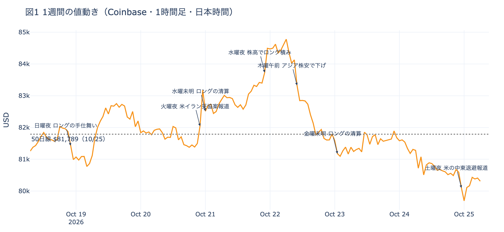
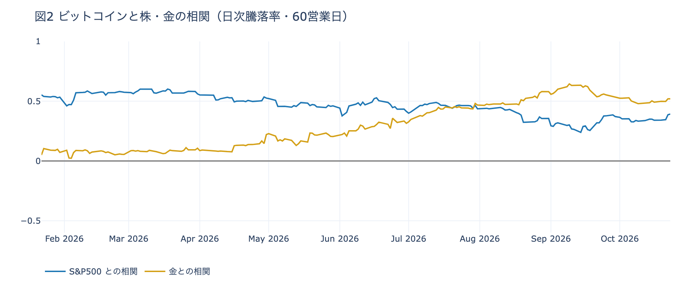

# 【10/19〜10/25】水曜に積まれた先物の買いは1日で消え、戻ったETFの買いも1日で売りに回った

**2026年10月25日**

ビットコインはこの1週間で0.9%下げました。小さな下げに見えますが、中身は往復です。水曜の夜に先物の買いが週の高値まで押し上げ、木曜の1日で全部返しました。先週の号で「抜けやすい支え」と書いた先物の買いは、その形のとおりに抜け、戻ってきたかに見えたETFの買い手も、下げた最初の日に売る側へ回りました。この号の「1週間」は、日本時間の10月18日朝7時から25日朝7時までです。毎朝出している日次の号のうち、10/19〜10/25 の7本が扱った期間にあたります。

* **起きたこと**：水曜の夜に先物の買い持ち（ロング）が積まれて週の高値を付け、木曜に1日で返した。ETFも月曜と水曜に買い、木曜に6月末以来の大きさで売った。1週間では0.9%の下げ
* **この週は**：支えが2度入って2度抜けた週。買い手は上げた日に乗り、下げた最初の日に降りた。土台は前の週より細くなったと見ている
* **この買いの性質**：先物のロングもETFの買い手も、この週は1日で向きを変える短い賭けだった。長期保有者（＝155日以上保有者）の売りは広がり、米国の取引所の買い手は土曜に3か月でいちばん深く引いた
* **確かめる数字**：資金調達率と短期金利の差、建玉、ETFの日ごとの出入り、Coinbase Premium の4つで、この形が続いているかを確かめられる

## 1. 上げも下げも1日で終わり、週の終わりは50日線の下にいた

**図1 1週間の値動き（Coinbase・1時間足・日本時間）**

この週の値動きは3つの山と谷でできています。火曜の夜に米国とイランの妥協案の報道で$83,000台へ上げてすぐ戻し、水曜の夜に米国株が3日続けて上げた時間に$84,856の高値を付け、木曜の午前にアジアの株式市場でAI関連株が売られるなかで上げた分を全部返しました。金曜は原油が$100を超え米国株が下げた夜も$81,300前後で動かず、土曜の深夜に米国が中東から人員を退避させているという報道と同じ時間に$79,107まで下げて、朝までに6割を戻しました。

週の終わりの価格は、50日線（＝過去50日の終値の平均）を1.8%下回っています。先週の号の時点では線に張りついていましたが、木曜から3日続けて線の下にいて、距離は日ごとに広がりました。50日線が200日線の上にある形は47日目で、長い目で見た向きは変わっていません。

売る側は前の週より強くなりました。長期保有者が持つ量の減り方は、1週間の平均で前の週より広がっています。買う側は、ETF（＝証券口座で買えるビットコインの投資信託）が月曜と水曜に大きく買って一度は戻ったように見えましたが、木曜に6月25日以来の大きさで売りました。米国の取引所の価格が海外より安い状態は50日続き、この価格差を表す Coinbase Premium（＝アメリカとそれ以外の価格差）の1週間平均は前の週と同じ深さのままです。数字は末尾の表にまとめました。

## 2. 支えは2度入って2度抜けた

買いは2つの経路から入り、どちらも1日で抜けました。段を追って説明します。

**① 上げは、米国株が上げた夜に先物で積まれたロングが運んだ。** 先物は、ビットコインそのものは受け渡さず、担保（＝証拠金）を預けて値上がりか値下がりかだけに賭ける取引です。値上がりに賭けるのがロング、値下がりに賭けるのが売り持ち（ショート）です。水曜は、米国の株式市場が開いてテック株が上げた時間に、価格と一緒に建玉（＝先物の未決済残高。証拠金で張っている人の量）が1日で4.2%増えました。価格と建玉が一緒に増えるのは、ロングが新しく積まれたしるしです。ただしロングが払う金利は前日より下がったので、増えたのは余分に払ってでも買いたい人ではなく、上げに乗った人の数でした。

**② そのロングは、下げ始めた最初の日に自分から降りた。** 証拠金で張った持ち高は、一定以上下がると清算（＝証拠金不足で強制的に閉じられた取引）になります。それを待たずに自分から降りる人も多く、木曜は午前8時から13時台までの6時間で、建玉が水曜に積まれた量を上回って減りました。水曜のロングは丸ごと手仕舞われたことになります。清算は午前の最初の下げには無く、深夜の一段を加速させただけなので、降りたのは強制ではなく自発です。資金調達率（＝ロングが払う金利。プラス＝ロングがショートより多い）から短期金利（＝ドルを米国の短期国債で持つだけで受け取れる金利）を引いた差は、水曜の朝のプラスから木曜の朝にはマイナスへ沈みました。先週の号で「支えていた買いは、降りればそのまま売りに変わる」と書いた形が、木曜に出ました。

**③ ETFの買い手も、この週は同じ足の速さだった。** ETFは月曜と水曜にそれぞれ5億ドル超を買いましたが、月曜の分は1社に集中し、水曜の分も2社でした。木曜に価格が下げると、最大手と2番手を含む複数の会社から売りが出て、金曜も続きました。月曜から水曜に入れた買いの7割強を、木曜と金曜で手放した計算です。8〜9月のETFは、下げた日にも買い続けることで戻りを支えました。10月は23日までで差し引き流出です。この週のETFは、上げた日に買い下げた日に売る、先物のロングと同じ動き方でした。

**④ 下げを小さく止めたのは、下げたところで入る新しい賭けだった（見立て）。** 木曜の夜には下げた水準で建玉が増え、土曜の深夜の戻しでは$79,000台でロングが入りました。ただし木曜の夜の持ち高は金曜のうちに消え、1週間の建玉は−1.1%とほぼ変わっていません。週を通して残った新しい買いは、先物にはありません。長期保有者が手放したコインを誰が受け取ったかは、この週も見えません。価格はこの30日で約5%下げているので、売りは受け手が現れるのを待つのではなく、価格を下げながら消化されていると見ています。

①②③は建玉・ETF・金利の数字で確かめたことで、④は数字から導いた見立てです。

## 3. この支えは、株が崩れる晩でなくても、下げた最初の日に抜ける

先週の号は、先物のロングが支えになっているときの弱点を「株が崩れる晩に真っ先に降りる」と書きました。この週に抜けたのは、たしかに先物のロングでしたが、抜けた時間は米国株が崩れた晩ではありません。木曜にロングが降りたのはアジアの午前で、同じ日の夜に米国株が7月以来の下げ幅になった時間には、ビットコインは$81,600前後で動きませんでした。金曜に原油が$100を超え米国株が下げた夜も、月曜に株が反発した夜も、ビットコインは米国株とは別に動いています。支えの抜けやすさは確かめられましたが、引き金は「株が崩れる晩」に限らず、下げが始まった最初の日に降りる、と広く取るほうが実態に合います。

降りたあとに戻ってくる速さも、前の週と同じでした。火曜の夜は月曜に積まれたショートが1日で買い戻され、金曜は木曜の夜のショートが買い戻されました。土曜の深夜は下げの時間にショートが積まれ、戻しの時間にロングが入り、両側が賭けを置き直しています。ただし日曜の朝にはロングが払う金利が短期金利を下回り、余分に払ってでも上げに賭けたい人はいなくなりました。先物の買いが現物に届くのは、先物と現物の値段の差を埋める業者（裁定業者）が現物を買うからで、その誘因は資金調達率が短期金利を上回るときに生まれます。この週はその朝が7つのうち5つと前の週の3つより多かったのに、建玉は週で増えていないので、現物に届いた買いが増えたとは言えません。

オプションの参加者の見方も同じ方向です。オプション（＝決めた価格で売り買いする権利）には、上げで価値が上がるコール（＝決めた価格で買う権利）と、下げで価値が上がるプット（＝決めた価格で売る権利）があり、買う人は権利料（＝オプションを買う人が払う金額）を払います。この週、7つの朝のうち6つで、全部の満期（＝権利の期限）でプットの権利料がコールより高く、例外は火曜の上げのあとの朝だけでした。一方、10月30日の満期に積まれた$90,000以上のコールは、火曜に1割強が外されたあと動いていません。参加者は、近いうちに崩れるとまでは見ていませんが、上げに余分に払う人はおらず、下げへの備えを目先の満期に厚く置いたまま、FOMC（＝米国の金利を決める会合）の週に入りました。

### 一歩引くと：株が崩れる日には株より大きく下げ、金が下げた週には連れなかった

**図2 ビットコインと株・金の相関（日次騰落率・60営業日）**

相関（＝2つの値動きがどれだけ同じ向きにそろうか。1に近いほどそろう）は、測る期間で順位が入れ替わります。直近30営業日では株のほうが高く、90営業日では金のほうが高い（数字は末尾の表）。この1本で「株の仲間」とは決められません。

株が崩れる日は別です。直近1年に VIX（＝株式市場の恐怖指数）が1日で10%以上跳ねた日は27回あり、ビットコインが株より持ちこたえたのは8回だけでした。この週はその27回のうち1回が入っていて、型どおり株の2倍以上下げています。

| VIX が10%以上跳ねた日の値動き | ビットコイン | S&P500 | 金 |
|---|---:|---:|---:|
| 直近1年27回の中央値 | −2.47% | −1.23% | −0.67% |
| この週の木曜（米国の10月22日） | −3.23% | −1.21% | −2.16% |

金とは逆です。この5営業日で金は4.1%下げましたが、ビットコインの下げは0.5%で、S&P500と同じでした。金を押し下げた材料は、ビットコインには届いていません。経済指標では、金曜の米国のPMI速報の夜にビットコインは動きませんでした。

3つを合わせると、市場はこの週、ビットコインを「株が崩れる日には株より大きく下げる資産」として値付けし、金の代わりとしては扱いませんでした。ただし平時は米国株にも連れず、先物の持ち高の出入りで動いています。株の仲間として扱われるのは怖い日だけ、というのがこの週の形で、ここは3つの測り方を並べて導いた見立てです。

## 4. この形が続いているかは、4つの数字で確かめられる

| 数字 | いまの値 | 何がわかるか |
|---|---|---|
| 資金調達率と短期金利の差 | −0.99pt | プラスで大きいほど、余分に払ってでも上げに賭ける人がいて、裁定業者が現物を持つ理由もある。この週は7つの朝のうち5つでプラス、木曜と日曜の朝はマイナス |
| 建玉（1週間の変化） | −1.1% | 増えていれば、先物の賭けが新しく積まれている。この週は水曜に4%増え、木曜に消えた |
| ETFの日ごとの出入り | 5営業日で+3.0億ドル。直近2日は流出 | 下げた日にも流入が続けば、8〜9月の形に戻ったしるし。上げた日だけ入り、下げた日に出るなら、この週の形が続いている |
| Coinbase Premium（1週間平均） | −0.125%（50日続けてマイナス） | プラスに戻れば、現物を持ちたい米国の買い手が帰ってきたしるし |

週明けは FOMC の週です。オプションの参加者が下げへの備えをいちばん厚く置いているのは、FOMC をまたぐ28日・30日の満期ではなく、目先の25日・26日の満期と11月の満期です。10月30日はオプションの最も大きな満期で、全満期の35%がここに集まり、$90,000以上のコールの期限でもあります。市場が見込む FOMC での利上げの確率は約1割で、1週間前の1割台半ばから下がりました。

| 日付 | イベント | 何に効くか |
|---|---|---|
| 10/27（火）〜28（水） | FOMC。市場が見込む利上げの確率は約1割。結果は日本時間29日未明 | 金利。28日・30日の満期がまたぐ |
| 10/29（木）21:30 | 米国の7〜9月期GDPと9月のPCE物価 | 金利 |
| 10/29（木）〜30（金） | 日銀の会合。展望レポートも出る | 円 |
| 10/30（金）17:00 | オプションの最も大きな満期（全満期の35%）。FOMCの2日後 | $90,000以上のコールの期限 |
| 11/1（日） | OPEC+の会合。12月の生産目標を決める | 原油 |
| 11/3（火） | 米国の中間選挙。米国の大統領は、その後のイランへの再度の軍事行動に言及している | 株・原油 |
| 11/6（金）17:00 | オプションの満期。下げへの備えが FOMC をまたぐ満期より厚い | 下げへの備えの期限 |
| 日程未定 | 米国とイランの協議（パキスタン・カタールの仲介）。米国は中東の大使館・基地から人員を退避中 | 原油 |

## 数字の置き場

### 7つの号が書いたこと

| 号 | 朝7時5分の価格 | 前の朝からの動き |
|---|---|---|
| 10/19（月） | 約$81,506 | 日曜の夕方に積まれたロングが夜に手仕舞われ、$82,000台から$81,000近くへ往復。はっきりしたきっかけは無い |
| 10/20（火） | 約$82,000 | 月曜は日中にロングが積まれて$83,000近くへ上げ、株が反発した夜にショートが積まれて戻した |
| 10/21（水） | 約$82,975 | 火曜の夜、米国とイランの妥協案の報道で$83,200へ。ショートの買い戻しが運び、報道の後退でロングの清算が戻しを加速させた |
| 10/22（木） | 約$84,636 | 水曜の夜、米国株が3日続けて上げた時間にロングが積まれて$84,500台へ。建玉は1日で4%増 |
| 10/23（金） | 約$81,397 | 木曜の午前、アジアのAI関連株安と原油高のなかで水曜のロングが手仕舞われ、上げを1日で全部返した |
| 10/24（土） | 約$81,300 | 金曜は原油が$100を超え米国株が下げた夜も動かず。ロングもショートも減って週末へ |
| 10/25（日） | 約$80,350 | 土曜の深夜、米国の中東退避の報道と同じ時間に$79,107へ。ショートが積まれ、ロングの清算が加速させた。朝までに6割戻す |

1週間の値幅は7.3%で、高値は水曜深夜（22日1時台）の$84,856、安値は土曜深夜（25日0時台）の$79,107です。前の週の値幅は5.8%でした。

### 参加者ごとの数字

| 参加者 | この週の動き | 根拠 |
|---|---|---|
| 長期保有者 | 利益確定の売りが広がった | 保有量の30日変化（1週間平均）が約−9.4万BTC → 約−11.1万BTC（10月23日時点） |
| 米国の現物の買い手 | ETFは上げた日に買い、下げた日に売った。取引所では引いたまま | Coinbase Premium の1週間平均は −0.127% → −0.125%。土曜のその日の値 −0.161% はいつものブレの2.9倍。ETFは5営業日で流入3日・流出2日、差し引き +3.0億ドル（前の週 −2.3億ドル）。木曜の −6.4億ドルは6月25日以来の大きさ |
| 先物の参加者 | 上げた日に積み、下げた日に降りた。週では持ち高ほぼ変わらず | 建玉は1週間で −1.1%。水曜に +4.2%、木曜に −2.8%。資金調達率と短期金利の差は7つの朝のうち5つでプラス（木曜と日曜の朝がマイナス）、週の終わりは −0.99pt |
| オプションの参加者 | 下げへの備えは目先の満期に厚く、10月末のコールは1割強だけ外した | 7つの朝のうち6つで、全部の満期でプットの権利料がコールより高かった（火曜は手前の満期でコールが高い）。10月30日の満期では、いまの価格より上のコールの建玉が、下のプットの1.8倍（週の初めは1.9倍） |

- ETFの数字は米国の10/19〜10/23 の5営業日です

### 株・金との相関

| 相関を測った期間 | S&P500 | 金 |
|---|---:|---:|
| 30営業日（9/14〜） | +0.61 | +0.29 |
| 90営業日（6/17〜） | +0.37 | +0.54 |
| 180営業日（2/06〜） | +0.46 | +0.36 |
| 1年（2025/10/27〜） | +0.47 | +0.23 |

---

<small>（数値は10月25日7時5分（日本時間）までのデータに基づきます。価格は Coinbase の1時間足で、1週間は10月18日7時から25日7時までです。相関と騰落率は、ビットコインの日足（UTC 0時締め＝米東部20時）と、株・金・VIX が米国で取引された日の終値を、同じ米国の日付どうしで合わせて計算しました。長期保有者の保有量は10月23日時点、ETF資金フローは10月23日分までです。オンチェーンの長期保有者の数値には、ETFや取引所が預かっている分も含まれます。FOMCの見込みは10月23日のFF金利先物の終値から計算したものです。オプションは Deribit の全銘柄です。）</small>

*本稿は情報提供を目的としたものであり、投資助言ではありません。将来の価格動向を保証・示唆するものではなく、投資判断は各自の責任において行ってください。*
